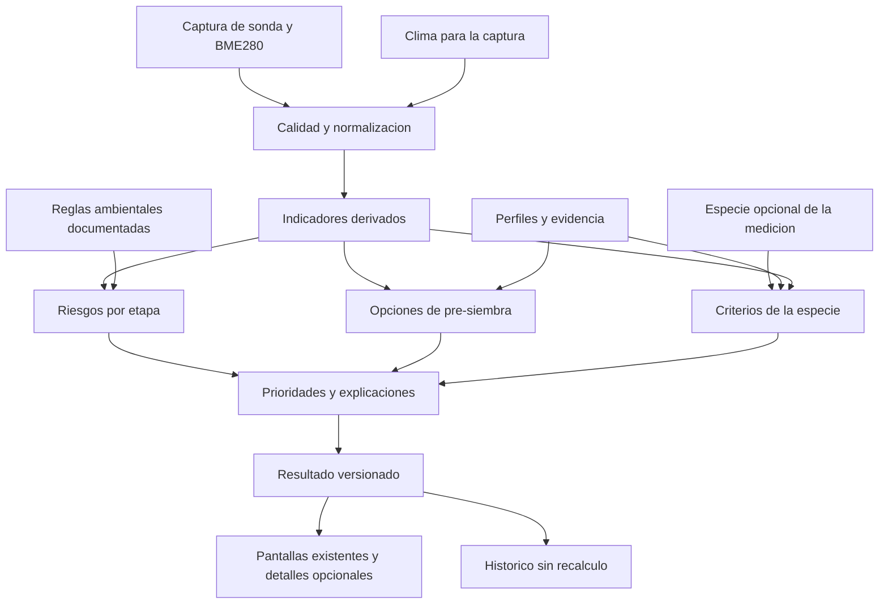

# Motor agronómico TerraSense: especificación de desarrollo

**Estado: motor base implementado por software (E1–E6 y ES1–ES8); pendientes únicamente la verificación en teléfono de los bloques desplegables e inglés y la validación instrumental y en terreno (E7).** Este documento define el motor desarrollado y sus reglas vigentes; no acredita calibración instrumental ni validación agronómica en campo. La sección 2 identifica el comportamiento del código disponible. El [task del motor agronómico](TASK_MOTOR_AGRONOMICO.md) detalla las subtareas, evidencias y pendientes de cada entrega.

El objetivo es obtener la mayor orientación agronómica defendible de la sonda, el BME280 y los servicios climáticos, **sin pedir al agricultor datos obligatorios nuevos**: la única pregunta añadida es la especie, opcional, en vegetativo, floración y cosecha. El motor debe explicar condiciones y posibilidades, reconocer lo que desconoce y ayudar a decidir qué revisar y cuándo. No diagnostica rendimiento, nutrición química, enfermedades ni madurez mediante variables que no miden esos fenómenos.

## Índice

- [1. Alcance y criterios de producto](#alcance)
- [2. Estado actual y fuentes de verdad](#estado)
- [3. Arquitectura propuesta](#arquitectura)
- [4. Las diez variables y su calidad](#variables)
- [5. Servicios climáticos y adquisición](#clima)
- [6. Indicadores derivados y combinaciones](#indicadores)
- [7. Catálogo de plantas y evidencia](#catalogo)
- [8. Reglas por etapa](#etapas)
- [9. Priorización, incertidumbre y redacción](#salidas)
- [10. Históricos y comparabilidad](#historicos)
- [11. Contratos, versiones y persistencia](#contratos)
- [12. Pantallas propuestas y justificación](#pantallas)
- [13. Validación y criterios de aceptación](#validacion)
- [14. Orden de implementación](#implementacion)
- [15. Decisiones y límites de activación](#decisiones)
- [16. Fuentes consultadas](#fuentes)

<a id="alcance"></a>
## 1. Alcance y criterios de producto

### 1.1. Entradas autorizadas

El usuario elige la etapa: pre-siembra, vegetativo, floración o cosecha. En vegetativo, floración y cosecha puede además indicar, de forma opcional, la especie que tiene plantada (sección [12.1](#pantallas)). **En pre-siembra deliberadamente no se pide ningún tipo de especie al agricultor: el objetivo de esa etapa es evaluar el suelo medido para sugerirle y recomendarle qué cultivos son compatibles.** El motor puede recibir automáticamente:

- Las diez variables del equipo y sus ausencias explícitas.
- Fecha y hora de captura, identificación del equipo y metadatos técnicos existentes.
- Coordenadas y precisión del GPS cuando el usuario ya autorizó incluir ubicación.
- Pronóstico, antecedentes meteorológicos modelados e información climática histórica para esas coordenadas, cuando haya conexión y disponibilidad.
- Catálogos y reglas distribuidos con la aplicación, con fuentes y versiones.
- Históricos propios autorizados, únicamente para operaciones que respeten su comparabilidad.

La especie se guarda **por medición**, no por campo: la app no agrupa mediciones por campo y no recuerda la especie de una medición anterior. Omitirla («Saltar») es una respuesta válida y deja la medición sin especie, con el mismo análisis general.

No agregar formularios para variedad, textura, profundidad, fecha de siembra, riego, superficie o tipo de instalación. No deducir la especie ni esos datos a partir de la etapa, de la última sugerencia consultada, de la identidad del equipo, de mediciones anteriores o de una coincidencia del catálogo. Consultar una ficha nunca equivale a seleccionar una especie.

La falta de coordenadas conserva el análisis local. No usar una ciudad por defecto, ubicación de la cuenta, IP ni coordenadas antiguas de otra captura para aparentar clima local. La georreferenciación sigue existiendo como dato; no se reintroduce un mapa.

### 1.2. Qué significa «más completo»

Una mejora aporta valor si introduce una conclusión verificable, un contexto útil o una decisión más clara. No basta con incorporar un número adicional al resultado. Cada indicador debe declarar entradas, fórmula, escala temporal, fuente, límites, reglas consumidoras y comportamiento sin datos.

Se buscan cinco resultados:

1. **Pre-siembra:** alternativas de establecimiento compatibles con los criterios que sí se pudieron revisar, con razones y limitaciones por alternativa.
2. **Vegetativo:** revisión de condiciones físicas que pueden dificultar el crecimiento. Con especie indicada, se agregan los criterios de su perfil que tengan evidencia; sin especie, no se atribuye una respuesta a una especie desconocida.
3. **Floración:** exposición ambiental y ventanas de atención, sin afirmar daño floral ni cuaja. Con especie indicada, se agregan sus sensibilidades florales documentadas.
4. **Cosecha:** comparación de condiciones meteorológicas para organizar labores; no decisión de madurez ni autorización de tránsito, aunque se indique la especie.
5. **Todas las etapas:** calidad del dato, explicación trazable, acciones coherentes y conservación del resultado original.

### 1.3. No objetivos

Quedan fuera: recetas de fertilización o enmiendas, litros o minutos de riego, identificación automática de cultivo/textura, predicción de rendimiento, diagnóstico de patógenos, calendario de maduración sin especie/fecha de inicio, certificación de aptitud de un huerto e instrucciones de aplicación de plaguicidas. Tampoco se incorpora un modelo generativo para inventar recomendaciones: las salidas son deterministas y auditables.

<a id="estado"></a>
## 2. Estado actual y fuentes de verdad

| Responsabilidad | Fuente local | Situación observada |
|---|---|---|
| Entrada BLE y validación de rangos | [probeService.ts](src/services/probeService.ts), [contrato BLE](../docs/CONTRATO_BLE.md) | Decodifica suelo, ambiente y batería; rechaza suelo inválido y distingue ausencias ambientales. |
| Calidad y procedencia de entradas | [inputQuality.ts](src/engine/inputQuality.ts), [tipos agronómicos](src/types/agronomy.ts) | Contrato versionado de las diez variables, fuentes, unidades, tiempos y limitaciones; se muestra en detalles y se conserva con capturas nuevas. La aplicación de todos sus límites a las reglas sigue pendiente. |
| Transporte y cancelación | [bleService.ts](src/services/bleService.ts) | Fuente del transporte, no del significado agronómico. |
| Perfiles y cálculo de déficit de presión de vapor | [agronomyEngine.ts](src/engine/agronomyEngine.ts), [prePlanting.ts](src/engine/prePlanting.ts), [localPhysics.ts](src/engine/localPhysics.ts) | Perfiles de pre-siembra con techo térmico, forma de establecimiento y distinción de perennes; cálculo local de DPV, punto de rocío y contraste térmico suelo–aire. |
| Etapas y criterios por especie | [stageEvaluator.ts](src/engine/stageEvaluator.ts), [speciesCatalog.ts](src/engine/speciesCatalog.ts), [speciesRules.ts](src/engine/speciesRules.ts) | `evaluateReadingForStage` aplica reglas generales (`GEN-TEMP-01`, `GEN-PH-01`, `GEN-VWC-01`) independientes del catálogo y suma los criterios de las 111 especies en vegetativo, floración y cosecha. |
| Consejos, fusión y coincidencias | [contextualAdvice.ts](src/engine/contextualAdvice.ts), [prePlanting.ts](src/engine/prePlanting.ts) | Ordena el plan por urgencia y cercanía, fusiona acciones duplicadas del mismo objetivo (§9.2) y en `pre_siembra` sugiere cultivos compatibles sin pedir especie al usuario. |
| Clima y caché sin red | [weatherService.ts](src/services/weatherService.ts), [weatherCacheStore.ts](src/services/weatherCacheStore.ts), [weatherOutlook.ts](src/engine/weatherOutlook.ts) | Consulta condiciones actuales, resúmenes diarios y temperatura horaria para duración de episodios; reutiliza caché cercana (≤1 km y ≤3 h) sin conexión. |
| Captura y guardado | [MeasureScreen.tsx](src/screens/MeasureScreen.tsx) | Fija contexto y captura; el clima llega de forma asíncrona y no bloquea guardar. |
| Presentación e históricos | [measurementPresentation.ts](src/engine/measurementPresentation.ts) | Conserva diagnóstico; las sugerencias nuevas se guardan en la presentación. |
| Resultado visible | [MeasurementResultFlow.tsx](src/components/MeasurementResultFlow.tsx) | Resumen, familias de variables, recomendaciones, plan global y pronóstico. |
| Estado del instrumento | [Firmware/TASK.md](../Firmware/TASK.md) | Referencia para integración y pruebas físicas. Una prueba de software no certifica mediciones reales. |

### 2.1. Brechas concretas que esta propuesta debe resolver

- La evaluación general consulta el conjunto de perfiles. Agregar una especie puede cambiar el estado de una variable: el diagnóstico general debe independizarse del tamaño del catálogo.
- La coincidencia térmica usa un mínimo sin máximo; una temperatura excesiva puede pasar el filtro. Tampoco distingue sistemáticamente semilla, trasplante y plantación.
- Los umbrales de conductividad del catálogo no contienen un contrato de método de medición ni equivalencia demostrada con la sonda.
- El pH necesita trazabilidad de método y calibración; el número que informa el equipo no acredita equivalencia con cada referencia de laboratorio.
- Las reglas específicas de floración son provisionales. Una reducción porcentual uniforme de tolerancias no constituye un modelo validado de respuesta floral.
- Humedad volumétrica sin textura, profundidad ni curva de retención no permite calcular agua disponible para raíces.
- Los primeros incrementos conservan información climática parcial útil sin inventar ceros ni exigir temperatura actual, validan unidades devueltas y registran estados y motivos por dato. E1.3 incorpora cobertura por capacidad y una política técnica de antigüedad en capturas nuevas; el task detalla su alcance y pendientes.
- El flujo nuevo separa estado semántico, cobertura y limitaciones de evidencia. Falta completar la independencia de las reglas ambientales y revisar sus fuentes. «No detecté alertas» no puede traducirse automáticamente a «todo está favorable».
- Las magnitudes ambientales y el pronóstico están desaprovechados para comparaciones temporales y combinaciones explicables.

Las cifras de las reglas actuales viven en el código enlazado. Este documento no las duplica como si fueran parámetros aprobados del motor futuro.

<a id="arquitectura"></a>
## 3. Arquitectura propuesta

Esta especificación contiene las capacidades y decisiones de diseño. El [task de implementación](TASK_MOTOR_AGRONOMICO.md), solicitado para revisar el avance paso a paso, concentra las casillas y evidencias sin duplicar parámetros ni mantener un registro de cambios.

| Capacidad | Responsabilidad | Dependencias |
|---|---|---|
| `input-quality` | Normalizar unidades, procedencia, intervalos temporales y calidad | Contrato del equipo y contratos del proveedor |
| `weather-context` | Obtener y normalizar clima; caché y degradación | `input-quality` |
| `evidence-catalog` | Lista de especies, perfiles, fuentes, parámetros y condiciones de aplicación | Ninguna entrada del agricultor |
| `species-rules` | Criterios del perfil de la especie indicada en vegetativo, floración o cosecha | `derived-indicators`, `evidence-catalog`, especie opcional de la medición |
| `derived-indicators` | Cálculos físicos y resúmenes temporales reproducibles | `input-quality`, `weather-context` |
| `stage-risks` | Reglas ambientales independientes del catálogo de especies | `derived-indicators`, registro de reglas documentadas |
| `crop-options` | Comparaciones por perfil sólo en pre-siembra | `derived-indicators`, `evidence-catalog` |
| `decision-composer` | Resolver prioridades y conflictos; generar razones | `stage-risks`, `crop-options`, `species-rules` |
| `result-snapshot` | Presentación, trazabilidad y guardado inmutable | `decision-composer` |



**Invariante:** añadir o retirar un perfil puede cambiar las opciones de pre-siembra y los criterios de esa especie, nunca los indicadores físicos ni una alerta ambiental general. Las alertas específicas de un perfil sólo se aplican a la medición si el usuario indicó esa especie; en cualquier otro caso permanecen dentro de su ficha. Indicar o saltar la especie no altera las reglas generales.

<a id="variables"></a>
## 4. Las diez variables y su calidad

### 4.1. Inventario operativo

| Variable | Procedencia y unidad interna | Uso propuesto | Lo que no permite concluir |
|---|---|---|---|
| Humedad de suelo `vwc` | Sonda, porcentaje volumétrico reportado | Describir el punto; revisión de extremos documentados; contexto de lectura de CE | Dosis de riego, textura, saturación universal, humedad de toda la zona radicular |
| Temperatura de suelo `temp` | Sonda, °C | Comparar condiciones de establecimiento; extremos térmicos del punto | Temperatura de toda la raíz, daño o días exactos de germinación |
| Conductividad `ec` | Sonda, µS/cm | Registro y evolución comparable; advertencias si el método está caracterizado | Fertilidad, sal específica, sodicidad o equivalencia automática con extractos de laboratorio |
| pH `ph` | Sonda, sin dimensión | Acidez del punto y coincidencias parciales, con límite de método | Dosis de cal/azufre, capacidad tampón o deficiencia de un nutriente |
| Nitrógeno `nitrogen` | Registro de la sonda | Calidad, trazabilidad y mensaje de no validación | Concentración química confirmada o recomendación de fertilización |
| Fósforo `phosphorus` | Registro de la sonda | Igual política que nitrógeno | Disponibilidad para la planta, bloqueo o dosis |
| Potasio `potassium` | Registro de la sonda | Igual política que nitrógeno | Balance nutricional o dosis |
| Temperatura de aire `airTemp` | BME280, °C o ausencia | Déficit de presión de vapor, punto de rocío aproximado y contexto térmico | Temperatura foliar, del fruto o del interior de una instalación distinta |
| Humedad de aire `airHumidity` | BME280, % o ausencia | Cálculos psicrométricos junto con temperatura simultánea | Mojamiento foliar, infección o humedad del suelo |
| Presión `airPressure` | BME280, hPa o ausencia | Consistencia física y cálculos atmosféricos auxiliares con uso demostrado | Predicción local de lluvia o tormenta desde una captura |

La batería, fecha, coordenadas y versiones son metadatos adicionales, no variables agronómicas extra. El campo heredado `lux` no es una medición disponible: el decodificador lo rellena con cero. No se usará ese cero para inferir oscuridad, radiación o fotoperíodo.

La trama operativa sigue siendo de **20 bytes**. Los 16 bytes son tolerancia de lectura de prototipos; no se propone otro modo ni un cambio del contrato. Si falta ambiente, el motor conserva suelo y suspende sólo los cálculos que necesitan BME280.

### 4.2. Política de calidad

Cada dato debe conservar `source`, unidad, instante o intervalo válido, estado de disponibilidad y motivo de limitación. Estados mínimos: disponible, ausente, inválido, antiguo y no caracterizado para esta interpretación. No reemplazar ausencias con promedios o referencias de cultivo.

La resolución de transmisión no es exactitud del instrumento. La especificación del BME280 describe el componente; su integración, exposición al sol, contacto con la mano y estabilización pueden afectar la lectura del equipo. No presentar el error nominal del fabricante como incertidumbre garantizada de la captura. [Fuente BME280](#s04).

La calidad se trata en tres niveles separados:

1. **Integridad:** paquete, centinelas, rangos físicos, finitud, unidades y reloj.
2. **Medición:** calibración conocida, condiciones de adquisición y representatividad. Una captura puede ser íntegra pero no representativa del campo.
3. **Interpretación:** existencia de evidencia y correspondencia entre método, etapa y variable.

No afirmar «sensor estabilizado» con una sola muestra. Si el transporte ya entrega varias muestras de una misma captura, se puede estudiar estabilidad; no exigir al usuario otra variable ni inventar una serie. Su implementación debe respetar cancelación, consumo y contrato BLE.

### 4.3. Conductividad, pH y nutrientes

**Conversión de unidades no es conversión de método.** Una CE de sonda, de solución del suelo, de extracto saturado o de una dilución de laboratorio son observaciones distintas. Las relaciones entre ellas requieren información o calibraciones específicas; no se puede recuperar todo a partir de CE y humedad reportadas. Tampoco se compensa por temperatura sin comprobar antes qué compensación realiza el equipo. [METER](#s05), [FAO sobre salinidad](#s06).

Propuesta para cada lectura: `ecMethod = unknown | bulk | pore_water | saturated_extract | other_documented`, definido por caracterización técnica, no por un selector del cliente. Inicialmente, usar `unknown` si no hay evidencia suficiente. Sin método compatible, un límite bibliográfico de salinidad no excluye categóricamente una especie ni activa instrucciones de lavado.

En pH registrar si la referencia procede de suelo/agua, suelo/sal u otra preparación. Sin equivalencia demostrada, rotular la coincidencia como parcial. Un suelo ácido no es universalmente perjudicial: existen perfiles acidófilos.

Los registros N, P y K siguen excluidos de compatibilidad, riesgo nutricional y dosis. La política no depende de probar que toda sonda usa exactamente el mismo algoritmo interno: basta con que estos registros no tengan validación química independiente para el equipo utilizado. Su correlación con CE no crea tres mediciones independientes adicionales.

<a id="clima"></a>
## 5. Servicios climáticos y adquisición

### 5.1. Principio de uso

«Aprovechar todos los datos» significa revisar su utilidad y consumir los que sostienen decisiones. No significa descargar todas las variables de todos los modelos en cada medición.

Open-Meteo ofrece datos actuales modelados, series horarias y agregados diarios. Dispone de temperatura, humedad, rocío, viento, radiación, precipitación, presión y evapotranspiración de referencia; algunas variables dependen del modelo. Sus series de suelo son modeladas y tienen capas definidas. [Documentación del proveedor](#s01).

El adaptador comprobará claves, unidades y disponibilidad con respuestas de prueba para Chile antes de activar cada grupo. No prometer cobertura uniforme por aparecer una variable en la documentación general.

### 5.2. Grupos de consulta propuestos

Identificadores de referencia del proveedor; cada grupo se normaliza a un contrato interno y se verifica antes de implementarlo. La finalidad de la última columna es una decisión de diseño de TerraSense.

| Grupo | Variables a consultar | Finalidad propuesta |
|---|---|---|
| Aire | `temperature_2m`, `relative_humidity_2m`, `dew_point_2m` | Exposición térmica y humedad ambiental previstas |
| Agua atmosférica | `precipitation`, `precipitation_probability`, `rain`, `showers` | Momento, cantidad y posibilidad de precipitación, tratados por separado |
| Viento | `wind_speed_10m`, `wind_gusts_10m`, `wind_direction_10m` | Contexto de demanda ambiental y organización de labores |
| Energía | `shortwave_radiation`, `et0_fao_evapotranspiration` | Energía y demanda atmosférica de referencia |
| Apoyo atmosférico | `vapour_pressure_deficit`, `surface_pressure`, `cloud_cover`, `is_day`, `weather_code` | Contraste de cálculos, contexto y explicaciones |
| Resumen diario | `temperature_2m_min`, `temperature_2m_max`, `precipitation_sum`, `precipitation_probability_max`, `wind_gusts_10m_max`, `et0_fao_evapotranspiration`, `sunrise`, `sunset` | Lectura resumida del horizonte |
| Contexto de suelo, opcional | `soil_temperature_6cm`, `soil_temperature_18cm`, `soil_moisture_3_to_9cm`, `soil_moisture_9_to_27cm` | Situar la región; nunca sustituir ni calibrar automáticamente la sonda |
| Nieve, opcional | `snowfall`, `snow_depth`, `freezing_level_height` | Identificar contexto meteorológico especial cuando esté disponible |

No sumar `precipitation + rain + showers`: se duplicaría parte del mismo fenómeno. No sumar ET₀ horaria y diaria para un mismo intervalo. No traducir probabilidad máxima diaria a probabilidad de que llueva en un horario concreto.

No consumir inicialmente presión en altura, irradiancia sobre paneles inclinados, temperatura aparente, fases lunares ni índices convectivos para decidir aptitud de cultivos. No existe en esta propuesta una regla agronómica justificada que necesite esos datos. Los indicadores de exposición humana, si se incorporan después, pertenecen a otro objetivo y no al diagnóstico del cultivo.

### 5.3. Resolución, horizonte y tiempo

**Configuración de producto propuesta, no umbral agronómico:** usar el resto del día de captura y cinco días siguientes. Analizar con mayor detalle las próximas 48 horas; ofrecer comparación diaria en el resto. No omitir una helada esta noche por comenzar la lista en «mañana».

Solicitar horas reales cuando estén disponibles. Una interpolación a intervalos menores no añade evidencia meteorológica nueva. Guardar UTC para operar e identificar intervalos; usar zona horaria para presentar fechas. Las sumas y promedios se asocian a su intervalo, no se tratan como observaciones instantáneas.

El adaptador debe probar los cambios de hora de Chile y los días de longitud distinta. Si un proveedor usa límites diarios con desplazamiento fijo, conservar esa convención explícita o agregar desde horas en UTC a los días locales; no mezclar silenciosamente ambos criterios. No asumir que todo día contiene 24 muestras.

`fetchedAt` es el momento de descarga. No llamarlo hora de emisión del modelo. Guardar `issuedAt` sólo cuando el producto realmente lo proporcione; el tiempo de procesamiento de la API tampoco es la emisión. La captura local y el clima tienen fechas distintas y deben conservarlas.

### 5.4. Históricos, climatología y conjuntos de pronósticos

El servicio histórico de Open-Meteo permite trabajar con reanálisis: son reconstrucciones modeladas, no mediciones de esta sonda. Se propone un módulo opcional, almacenado en caché, para contexto de estacionalidad, exposición histórica a frío/calor y evaluación climática parcial de perennes. No bloqueará la medición local. [API histórica](#s02).

Distinguir tres productos: clima histórico reconstruido, pronóstico que se emitió en el pasado y pronóstico actual. Sólo el segundo permite verificar qué se habría sabido al recomendar. No validar predicciones con información futura incorporada retrospectivamente.

No elegir una ventana histórica arbitraria y llamarla «clima normal». Registrar período, producto, resolución, cobertura, faltantes y representatividad. La falta de variedad impide afirmar que un frutal cumple sus requerimientos de frío, aunque se puedan calcular indicadores climáticos generales.

Los conjuntos de pronósticos son una extensión para mostrar dispersión entre escenarios. La fracción de miembros que supera un umbral no se presentará como probabilidad calibrada de daño agrícola. Sólo se activará si mejora decisiones y se valida el contrato del producto. [API de conjuntos](#s03).

### 5.5. Caché, consumo y errores

- Clave de caché: ubicación usada, producto/modelo, variables, período, unidades y versión del adaptador. La antigüedad de descarga no reemplaza la validez temporal de cada dato.
- Se puede compartir una respuesta meteorológica idéntica entre capturas autorizadas; nunca compartir mediciones privadas ni redondear ubicación sin justificar el efecto espacial.
- Una respuesta parcial no invalida automáticamente las otras variables. Un error en un grupo opcional no bloquea el grupo principal.
- Mantener límite de espera y cancelación del flujo existente. Permitir guardar la evaluación local mientras llega el clima.
- Definir en implementación una política versionada de frescura por producto. Una caché fuera de vigencia se identifica y no produce nuevas instrucciones de horario como si fuera actual.
- Consultar historia sólo cuando sea necesaria; no descargar décadas en cada lectura. Medir bytes, demora y aciertos de caché antes de ampliar solicitudes.
- Para distribución comercial, resolver acceso, atribución y condiciones del proveedor; no incrustar credenciales comerciales en la aplicación. La documentación consultada distingue acceso gratuito no comercial y comercial. [Condiciones de Open-Meteo](#s19).

### 5.6. Degradación exigida

| Situación | Resultado que debe mantenerse |
|---|---|
| Sin ubicación | Evaluación local y catálogo parcial; sin pronóstico atribuido al campo |
| Sin red | Resultado local; caché sólo con procedencia y vigencia visibles |
| Sin BME280 | Suelo y pronóstico disponibles; derivados locales del aire ausentes |
| Sin horas, con días | Comparación diaria; no inventar duración u hora del episodio |
| Falta viento o radiación | Suspender la combinación que los necesita, conservar las demás |
| Falta historia climática | No evaluar adecuación de largo plazo; mantener posibilidades de corto plazo |
| Pronóstico contradictorio con aire local | Conservar ambos y explicar diferencia de tiempo/escala; no corregir automáticamente uno con otro |
| Datos simulados | Uso de pruebas identificado; nunca persistirlos como medición real |

<a id="indicadores"></a>
## 6. Indicadores derivados y combinaciones

### 6.1. Cálculos físicos locales

Las siguientes fórmulas son propuestas de cálculo, no umbrales universales de cultivo. Se calculan con valores no redondeados; se redondea al presentar. `T` es temperatura del aire en °C y `HR` es humedad relativa en porcentaje.

**Presión de vapor y déficit atmosférico.** Para el dominio de aplicación de la ecuación sobre agua:

```text
es(T) = 0.6108 × exp(17.27 × T / (T + 237.3))   [kPa]
ea    = es(T) × HR / 100                       [kPa]
DPV   = es(T) - ea                            [kPa]
```

El déficit de presión de vapor (DPV; VPD en identificadores existentes) caracteriza el aire. La formulación de presión de saturación y humedad procede de FAO-56. No es el déficit hoja–aire porque no medimos temperatura foliar. No convertir un DPV elevado en marchitez diagnosticada ni en litros consumidos. [FAO-56, datos meteorológicos](#s07).

**Punto de rocío aproximado.** Puede obtenerse invirtiendo esa misma relación:

```text
x  = ln(ea / 0.6108)
Td = 237.3 × x / (17.27 - x)                   [°C]
separacionRocio = T - Td                       [°C]
```

Se trata de una derivación matemática de la ecuación anterior. Con HR cero, entradas ausentes/no finitas o fuera de dominio, no calcular `Td`; no introducir un mínimo artificial de humedad. Cerca de congelación distinguir referencia sobre agua/hielo: no usar esta aproximación como cálculo certificado de escarcha. La proximidad al rocío sugiere cercanía a saturación del aire, no prueba agua sobre hojas.

**Presión.** Convertir hPa a kPa si se necesita. La constante psicrométrica `gamma = 0.000665 × P` puede calcularse con presión en kPa, según FAO-56, pero no completa por sí sola una estimación de evapotranspiración. Se mantendrá como cálculo auxiliar sólo si existe una función consumidora justificada; no hace falta mostrarla al agricultor. [FAO-56](#s07).

**Contrastes térmicos.** `Tsuelo - Taire` es una diferencia observada, útil para explicar que suelo y aire están en condiciones distintas. No se traduce a temperatura radicular futura, estrés o inversión térmica desde una sola captura. No comparar con la API sin alinear tiempo y reconocer diferencias de altura y exposición.

### 6.2. Resúmenes climáticos calculables

| Indicador propuesto | Entradas | Operación | Restricción de interpretación |
|---|---|---|---|
| Mínima/máxima del intervalo | Temperaturas horarias | Extremos entre horas disponibles | Informar cobertura; un faltante puede ocultar el extremo real |
| Duración de exposición | Temperatura o DPV horarios y umbral documentado | Duración de intervalos que cumplen la condición | No inferir duración con una mínima/máxima diaria |
| Episodio continuo | Serie horaria completa | Agrupar intervalos contiguos | Un hueco corta el episodio; no unir sobre ausencia |
| Precipitación acumulada | Cantidades por intervalo | Suma sin solapamientos | Agua atmosférica prevista, no infiltración o agua útil |
| Persistencia de humedad ambiental | HR/rocío horarios | Duración de una condición documentada | No equivale a mojamiento foliar medido |
| Demanda de referencia acumulada | ET₀ del proveedor | Suma de intervalos compatibles | No es consumo del cultivo |
| Diferencia lluvia–ET₀ | Precipitación y ET₀ en igual período | `ΣP - ΣET₀` | Indicador meteorológico; no balance del agua del suelo |
| Exposición energética | Radiación horaria media | Integración temporal con unidades | No equivale a luz recibida por hojas bajo sombra/cubierta |
| Luz diurna astronómica | Salida/puesta del sol o cálculo documentado | Duración del día | No determina horas de luz efectiva ni floración sin perfil |
| Separación aire–rocío prevista | Temperatura y rocío de la API | Diferencia por hora | Aproximación ambiental; no diagnóstico de enfermedad |
| Dispersión de escenarios | Miembros de un mismo conjunto | Rango o cuantiles declarados | No garantía de cobertura estadística ni probabilidad de daño |

ET₀ representa una superficie de referencia, no cualquier cultivo. Estimar consumo específico requiere más supuestos; el motor no asignará un coeficiente de cultivo oculto. Tampoco supondrá que toda la lluvia entra al suelo o que una cantidad fija reemplaza un riego. [FAO-56, método de referencia](#s08).

Para radiación, integrar `W/m² × segundos / 10^6` para obtener MJ/m². No mezclar promedios horarios con valores instantáneos. El sistema no convertirá esa energía a lux de la sonda ni estimará fotosíntesis, biomasa o producción.

### 6.3. Combinaciones que pueden aportar decisiones

| ID | Combinación | Conclusión permitida | Acción o explicación posible | Condición para activarla |
|---|---|---|---|---|
| C01 | Aire cálido/seco + DPV + pronóstico | Demanda atmosférica elevada observada o prevista | Priorizar revisión del estado hídrico durante el episodio | Umbral y dominio documentados; no afirmar déficit en raíces |
| C02 | C01 + humedad del suelo | Presentar demanda y lectura de suelo juntas | «Hay demanda ambiental y esta humedad en el punto; revisa disponibilidad de agua» | Clasificar humedad sólo si existe referencia compatible |
| C03 | Temperatura de suelo + perfil de establecimiento | Coincidencia o limitación térmica actual | Explicar qué alternativa se beneficia o queda limitada | Perfil distingue semilla, trasplante u órgano vegetativo |
| C04 | C03 + mínimas de aire previstas | Un perfil compatible hoy puede enfrentar frío próximo | Dar prioridad a revisar ese episodio antes del establecimiento | Sensibilidad por perfil y tipo de exposición documentada |
| C05 | Temperatura + máximas y duración previstas | Exposición a calor próximo | Destacar período para observación o evitar recomendar establecimiento inmediato | Umbral respaldado; no asumir daño por especie desconocida |
| C06 | Humedad del suelo + lluvia prevista | Coincidencia de humedad observada y aporte atmosférico posible | Revisar drenaje/condiciones antes de labores | No inferir saturación ni escorrentía sin suelo caracterizado |
| C07 | CE + humedad + temperatura del suelo | La comparación de CE puede estar condicionada por la captura | Explicar por qué una variación no demuestra cambio de sales | Método conocido y comparabilidad; sin conversión empírica improvisada |
| C08 | pH + perfil + método | Coincidencia parcial o diferencia respecto de la referencia | Mostrar intervalo y alcance, sin receta de enmienda | Fuente con método o limitación de método explícita |
| C09 | HR/rocío + lluvia + duración | Período ambiental persistentemente húmedo | Sugerir observación de tejidos sensibles | No identificar patógeno ni cuantificar infección |
| C10 | Viento/ráfagas + lluvia + calor | Períodos meteorológicos relativamente menos adversos | Ayudar a ordenar labores de campo | No presentarlos como autorización de aplicación o tránsito |
| C11 | NPK + CE + metadatos de calidad | Lecturas nutricionales no confirmadas | Mantener la advertencia y evitar decisiones de fertilización | No convertir correlación en calibración química |
| C12 | Ambiente BME280 + contexto de API | Diferencia entre un punto local y un modelo regional | Mantener ambas fuentes y limitar extrapolación | No asumir invernadero ni recalibrar el modelo con una observación |

Las condiciones ambientales de enfermedad dependen del patógeno, huésped y, en muchos modelos, mojamiento foliar y duración. La disponibilidad de temperatura y HR no habilita automáticamente un modelo fitopatológico. Esta propuesta conserva C09 como contexto de observación. [UC IPM: modelos de enfermedad](#s09).

### 6.4. Indicadores que no se activarán como diagnóstico con estas entradas

- Agua disponible en raíces, capacidad de campo o punto de marchitez inferidos sólo desde una humedad puntual.
- Velocidad de infiltración/drenaje desde lluvia modelada y capturas portátiles separadas.
- Textura, compactación, materia orgánica, capacidad de intercambio catiónico o aireación del perfil.
- Salinidad del extracto saturado calculada desde CE sin una relación validada.
- Días a cosecha o grados-día de un cultivo establecido sin especie, variedad y fecha de inicio.
- Cumplimiento de frío invernal de un frutal sin contexto varietal y modelo pertinente.
- Probabilidad de infección o daño floral sin huésped y validación.
- Tendencia barométrica local sin serie comparable, o lluvia inferida sólo de presión.

En historia climática se pueden calcular acumulaciones térmicas de referencia como investigación, declarando base, período y modelo. No asociarlas al cultivo del usuario ni presentarlas como avance fenológico.

<a id="catalogo"></a>
## 7. Catálogo de plantas y evidencia

### 7.1. Perfil de establecimiento, no ficha enciclopédica

La unidad de evaluación será **especie o grupo bien definido + forma de establecimiento + contexto de evidencia**. Un mismo vegetal puede tener perfiles de semilla y trasplante distintos; en pre-siembra se presentan como alternativas de consulta, sin pedir que el agricultor elija una para evaluar el resto de la medición.

El catálogo separa dos cosas que crecen a ritmos distintos:

- **Lista de especies:** identidad (ID estable, nombre de Chile, nombre científico, grupo y sinónimos de búsqueda). Es la que ve el selector y puede ser amplia desde el inicio, porque no afirma ningún parámetro.
- **Perfil con criterios:** los umbrales por etapa y forma de establecimiento, cada uno con su fuente. Crece con la curación de la sección 7.5.

Una especie de la lista sin criterios habilitados para la etapa elegida se puede seleccionar, y el resultado lo dice expresamente: se muestra el análisis general y se indica que aún no hay criterios propios de esa especie para esa etapa. El selector no marca como «con perfil» una especie que no lo tiene. Desde ES8 ninguna especie del catálogo está en esa situación en vegetativo, floración o cosecha, porque la que no logra criterios en las tres etapas se retira ([§7.1](#analogia)); el aviso se conserva como resguardo.

<a id="analogia"></a>**Criterio por analogía.** Cuando ninguna fuente técnica documenta a la especie para un criterio, se admite el criterio documentado de una **especie similar**: la misma especie botánica o un cultivo del mismo género y, en su defecto, de la misma familia y con el mismo órgano cosechado y la misma sensibilidad. La analogía se declara siempre: el criterio indica de qué especie proviene (`scope: 'analog'`, `analogOf`), conserva la fuente y la cifra originales de esa especie, y explica la semejanza en sus limitaciones, que el detalle técnico muestra. Una analogía no se encadena: la especie de origen debe tener ese criterio con fuente propia. Nunca se usan promedios de grupo ni cifras sin fuente. Esta regla prioriza la cobertura de todo el catálogo en vegetativo, floración y cosecha (decisiones del 18 y 19 de octubre de 2026); la fuente propia, cuando aparece, reemplaza a la analogía. Una especie que no logra fuente propia ni especie similar para las tres etapas **se retira del catálogo**: no queda a medias. Sus nombres pasan a las exclusiones de la lista de especies, con ese motivo.

El catálogo contiene hechos documentados, no textos generados sin fuente. Información descriptiva puede mantenerse para comprensión, pero no se convierte en una regla ejecutable si faltan condiciones de aplicación. La identidad botánica y los sinónimos se revisan antes de consolidar IDs; nombres amplios como «hortalizas de hoja» no heredan automáticamente el perfil de lechuga.

### 7.2. Esquema de evidencia por perfil

| Campo | Contenido requerido |
|---|---|
| Identidad | ID estable, nombre en español de Chile, nombre científico documentado, grupo y sinónimos |
| Establecimiento | Semilla, trasplante, tubérculo, diente, corona, planta de vivero u otro documentado |
| Contexto | Campo abierto, protegido o no especificado en la fuente; región, variedad/grupo y etapa |
| Temperatura de suelo | Mínimo, banda favorable y máximo cuando estén documentados; no rellenar extremos faltantes |
| Temperatura de aire | Sensibilidad por etapa, duración y método de exposición, si existen |
| pH | Intervalo, método de referencia y ámbito de aplicación |
| Conductividad | Valor/unidad, tipo de muestra, temperatura de referencia y relación con sensor, si existe |
| Agua y aireación | Requerimientos cualitativos documentados; evitar porcentajes universales de humedad |
| Estacionalidad | Requisitos térmicos/fotoperiódicos documentados, sin copiar meses de otro hemisferio |
| Horizonte | Establecimiento inmediato o evaluación parcial de cultivo perenne |
| Evidencia por dato | Institución, URL, título, sección/página/tabla, edición, fecha de consulta, unidad original y transformación |
| Estado | Candidato, documentado parcialmente, habilitado para un criterio, validado localmente o retirado |
| Limitaciones | Qué criterios no se evaluaron y por qué |

La habilitación es por criterio: un perfil puede tener temperatura respaldada y salinidad no evaluable. No afirmar que el perfil completo está validado porque una fila térmica tiene fuente.

### 7.3. Catálogo candidato de ampliación

Este inventario define alcance de investigación, **no una lista ya implementada ni un conjunto de perfiles numéricos aprobados**. Las fuentes de entrada sirven para localizar y contrastar evidencia; una referencia de grupo no acredita todos los parámetros de cada especie.

| Grupo | Perfiles candidatos | Distinciones necesarias | Ruta documental inicial |
|---|---|---|---|
| Hojas | Lechuga, acelga, espinaca | Semilla/trasplante; límites superiores de germinación | Tabla térmica [S10](#s10), evidencia local por completar |
| Brassicas | Repollo, brócoli, coliflor, kale, nabo | No copiar un mismo umbral a toda la familia | [S10](#s10) para especies que enumera; [S17](#s17) para frío |
| Raíces | Zanahoria, rabanito, betarraga | Germinación no equivale a desarrollo de raíz comercial | [S10](#s10) |
| Bulbos y tallos | Cebolla, puerro, ajo, apio | Semilla, almácigo, bulbo y diente deben separarse | [S10](#s10); aclarar propagación antes de extraer reglas |
| Legumbres | Arveja, haba, poroto, lenteja, garbanzo | Identificar especie/grupo y forma de establecimiento | [S10](#s10) donde corresponda; [S11](#s11) como índice |
| Solanáceas | Tomate, pimentón/ají, berenjena | Semilla y trasplante; variedades y sensibilidad térmica | [S10](#s10), [S12](#s12) |
| Cucurbitáceas | Pepino, zapallo, zapallo italiano, melón, sandía | Especies/grupos distintos; semilla y trasplante | [S10](#s10) |
| Órganos vegetativos | Papa, camote | Tubérculo o esqueje no es semilla botánica | Perfiles actuales sólo como referencia de código; búsqueda específica antes de habilitar |
| Cereales | Maíz, trigo, avena, cebada | Uso y grupo invernal/primaveral; no inferir variedad | [S10](#s10) para maíz; [S11](#s11), [S16](#s16) como rutas |
| Aromáticas | Albahaca, cilantro, perejil, orégano, romero, tomillo | Semilla/trasplante/esqueje; perennes frente a anuales | [S13](#s13), [S10](#s10) para perejil; fuentes individuales para el resto |
| Berries | Frutilla, frambuesa, arándano, mora | Plantación y establecimiento; no puntuar como germinación | [S14](#s14), [S15](#s15), [S18](#s18) |
| Frutales | Palto, vid, manzano, peral, cerezo, duraznero, ciruelo | Perfil parcial de suelo y clima; variedad/portainjerto desconocidos | [S16](#s16), [S20](#s20) |
| Otros perennes | Nogal, avellano europeo, olivo, limonero, naranjo | Horizonte largo y necesidad de evidencia específica | [S16](#s16), [S20](#s20) como rutas, no aprobación de aptitud |
| Coberturas, extensión posterior | Avena de cobertura, vicia, trébol | Finalidad, manejo y compatibilidad no se infieren de sensores | [S11](#s11) para localizar perfiles; habilitar sólo con reglas propias |

La cobertura de criterios comprometida es total para **todo el catálogo** en vegetativo, floración y cosecha: cada especie tiene al menos un criterio evaluable por etapa, con fuente propia o, en su defecto, por [analogía declarada](#analogia). Nunca se alcanza con cifras sin fuente: la especie que no se puede cubrir se retira del catálogo. Pre-siembra queda fuera de esta meta, porque ahí el motor sugiere qué sembrar en vez de evaluar una especie elegida. El primer catálogo operativo debe priorizar perfiles con mejor evidencia y utilidad local; los candidatos incompletos permanecen fuera de las sugerencias activas.

**Cobertura comprometida de la lista de especies:** hortalizas y frutales deben quedar completos respecto de lo que se cultiva y comercializa en Chile, salvo las especies retiradas por no tener criterios ([§7.1](#analogia)), que quedan como exclusiones con motivo. La lista se construye desde estadísticas oficiales de superficie y comercialización (encuestas de hortalizas, catastros frutícolas y precios de mercados mayoristas), no desde una selección a criterio; la fuente y su fecha quedan registradas junto a la versión del catálogo. Aromáticas, especies ornamentales, forestales y otros árboles se incorporan con cobertura parcial y la lista no se presenta como exhaustiva en esos grupos. Esta cobertura es de **nombres**: la cobertura de criterios por etapa se informa aparte y nunca se infiere de que la especie esté en la lista.

### 7.4. Evidencia concreta localizada

**Temperatura de germinación:** la tabla de UC ANR permite diferenciar mínimos, intervalos favorables y máximos. Estos ejemplos están convertidos de °F a °C mediante `(F - 32) × 5/9`; muestran la estructura documental propuesta, no sustituyen validación local. [Fuente y tabla original](#s10).

| Semilla | Mínimo °C | Intervalo favorable °C | Máximo °C |
|---|---:|---:|---:|
| Tomate | 10,0 | 18,3–29,4 | 35,0 |
| Lechuga | 0,0 | 15,6–23,9 | 29,4 |
| Espinaca | 0,0 | 18,3–23,9 | 23,9 |
| Zanahoria | 4,4 | 18,3–29,4 | 35,0 |
| Pepino | 15,6 | 18,3–35,0 | 40,6 |
| Arveja | 4,4 | 18,3–23,9 | 29,4 |

No interpretar un mínimo como recomendación de sembrar a esa temperatura. No usar una tabla de semillas para dientes de ajo, tubérculos de papa o plantas de vivero. La entrada de tomate no justifica aplicar los mismos valores al trasplante.

**pH:** hay antecedentes de tomate en [S12](#s12), albahaca en [S13](#s13), frutilla en [S14](#s14) y arándano en [S18](#s18). Sirven para documentar perfiles con rangos y contextos propios; no se importan dosis de las mismas páginas. Los criterios de pH habilitados usan la tabla B-1 de hortalizas de [S22](#s22) y, cuando INIA documenta la especie, sus boletines: tomate [S23](#s23), frutilla [S24](#s24), cerezo [S25](#s25) y olivo [S26](#s26). El detalle por especie está en la [tarea ES6](TASK_MOTOR_AGRONOMICO.md#es6-criterios-por-especie-y-etapa--en-curso). En arándano, incluso las fuentes consultadas presentan diferencias de intervalo según contexto. La discrepancia debe registrarse, no resolverse tomando el promedio o el rango más amplio.

**Helada, calor y lluvia por especie:** la tolerancia a helada de hortalizas proviene de clasificaciones de extensión con umbrales en °F ([S27](#s27), [S28](#s28), [S29](#s29)), contrastadas con [S30](#s30), [S31](#s31), [S32](#s32) y [S33](#s33); se convierten con `(F - 32) × 5/9`. Cuando las fuentes difieren se usa lo que todas documentan (por ejemplo, 28 °F aunque una admita 24 °F) y la diferencia queda en las limitaciones; si una sostiene tolerancia y otra no (apio, papa), se trata como sensible. La clasificación por grupo de las hortalizas (no toleran, toleran heladas débiles, se dañan cerca de la madurez, toleran) es de INIA ([S36](#s36), [S37](#s37)). Tomate, cerezo, olivo y frutilla usan los capítulos de clima de sus boletines INIA ([S23](#s23)–[S26](#s26)); la helada sobre la aceituna, [S36](#s36); las flores de berries, [S34](#s34), y la cosecha de arándano, [S35](#s35). El calor en floración de pimiento, poroto y zapallos viene de [S38](#s38), y el de maíz, de [S39](#s39). **Salinidad y agua como referencia:** la tolerancia a sales de [S06](#s06) (tablas 4 y 5) y el factor ky de rendimiento de [S40](#s40) se informan por especie y etapa, pero no se comparan con la conductividad ni con la humedad de la sonda, porque el método y la textura no lo permiten. Una fuente que no da temperatura («sensible a helada») se compara con 0 °C como definición de helada, y una fuente que no da cantidad de lluvia se compara con la regla de día lluvioso de la app; ambos casos se declaran en el resultado.

**Amplitud y adaptación local:** ECOCROP sirve como índice de características ambientales y usos, pero FAO informa que su actualización se discontinuó. No tratarlo como un catálogo clínicamente validado o actualizado de recomendaciones locales. La documentación de INIA sobre aptitud térmica permite orientar la búsqueda de evidencia chilena, distinguiendo especies, variedades y zonas; una noticia sobre un libro no aporta por sí sola sus tablas. [ECOCROP](#s11), [INIA](#s16).

### 7.5. Proceso de incorporación

1. Identificar especie, propagación y pregunta que resolverá el perfil.
2. Localizar una fuente técnica primaria o de extensión institucional; priorizar antecedentes chilenos pertinentes y contrastar con otras fuentes cuando corresponda.
3. Registrar cada afirmación y su ubicación exacta. No convertir un resumen de buscador en un umbral definitivo.
4. Verificar unidad, variable, método, etapa, duración, variedad y región. Separar temperatura del aire, del suelo y del medio de germinación.
5. Conservar valores originales y conversión determinista. No inventar decimales de precisión biológica.
6. Resolver conflictos de contexto; si no se pueden resolver, mantener el criterio no evaluable o limitarlo al contexto documentado.
7. Crear casos de frontera, ausencia de datos y ejemplos contrapuestos.
8. Habilitar sólo los criterios respaldados, con versión y limitaciones. La evidencia bibliográfica y la validación del sensor en campo son estados diferentes.

No descargar ni reproducir libros completos en la aplicación. Conservar referencias y los hechos estructurados necesarios, respetando condiciones de uso. Los enlaces de catálogo son evidencia para los desarrolladores; el agricultor puede ver un resumen comprensible sin leer el documento técnico.

### 7.6. Ordenamiento de opciones

Evitar un promedio de temperatura, pH y clima que compense una limitación importante con una coincidencia irrelevante. Usar una clasificación explicable:

- **Coincide con los criterios evaluados:** sin limitaciones detectadas en criterios aplicables y con cobertura suficiente declarada. Nunca «apto garantizado».
- **Con limitaciones para revisar:** al menos un criterio respaldado limita el establecimiento o el pronóstico introduce un episodio adverso.
- **No evaluable con estos datos:** faltan criterios esenciales o el método no es comparable.

Dentro de cada grupo, ordenar primero por limitaciones relevantes, después por cobertura de evidencia comparable y finalmente por un desempate estable. La ponderación de importancia debe quedar documentada por criterio antes de implementarse; no seleccionar pesos para obtener un cultivo favorito. La lista completa sigue accesible.

Ningún cultivo gana porque sus parámetros faltantes se interpretaron como favorables. Los estados por criterio se conservan: coincidencia, limitación, desconocido o no aplicable. «No aplicable» exige una razón del perfil; no sirve para ocultar información ausente.

<a id="etapas"></a>
## 8. Reglas por etapa

### 8.1. Contrato de una regla

Toda regla declara: ID, versión, etapa, objetivo, entradas necesarias, unidades, condición, parámetros con evidencia, exclusiones, prioridad, salidas permitidas, acciones incompatibles y pruebas. Debe distinguir «no se cumple» de «no se pudo evaluar».

Una regla que combina lecturas no puede aumentar la evidencia por contar dos veces la misma información. CE y registros NPK no son votos independientes; temperatura, HR y DPV tampoco son tres confirmaciones independientes de un mismo riesgo atmosférico.

Estados de desarrollo de reglas: `draft`, `documented`, `enabled`, `locally_validated`, `retired`. Que una regla sea determinista o pase pruebas sólo demuestra comportamiento de software. No autoriza a marcarla `locally_validated`.

### 8.2. Pre-siembra

**Pregunta:** «¿Qué alternativas de establecimiento vale la pena explorar bajo las condiciones observadas y previstas?». La respuesta no elige por el agricultor ni promete cosecha.

| Regla propuesta | Entradas | Decisión | Ausencias y límites |
|---|---|---|---|
| PS01 — Condición térmica de establecimiento | Temperatura de suelo + perfil | Distinguir por debajo, dentro o por encima de referencias | Sin máximo documentado, el extremo superior queda desconocido |
| PS02 — Coincidencia de pH | pH + método + perfil | Coincidencia parcial o diferencia, con explicación | Sin correspondencia de método, no exclusión categórica |
| PS03 — Contexto de sales | CE + método + referencia compatible | Advertencia o criterio parcial de compatibilidad | Método desconocido: no aplicar directamente un límite de extracto |
| PS04 — Frío próximo | Perfil + aire previsto + duración | Señalar episodio que limita establecer esa alternativa al aire libre | Pronóstico exterior no acredita condiciones dentro de un invernadero |
| PS05 — Calor próximo | Perfil + exposición prevista | Señalar incompatibilidad térmica documentada | No usar un máximo diario como horas de exposición |
| PS06 — Contexto hídrico | Humedad puntual + lluvia + demanda atmosférica | Explicar qué revisar antes del establecimiento | No fijar dosis ni asegurar que la lluvia resolverá humedad |
| PS07 — Cobertura | Estado de todos los criterios aplicables | Clasificar opción y listar factores no evaluados | Una coincidencia térmica aislada no habilita «apto» |

Mostrar por perfil: forma de establecimiento, criterios coincidentes, limitación principal, episodio previsto pertinente y factores sin evaluar. Los frutales perennes sólo reciben evaluación parcial de suelo/clima; no compiten en un ranking de «qué sembrar esta semana» con hortalizas de ciclo corto.

Ejemplo de redacción, con valores que en ejecución provendrán de la captura: «La temperatura medida coincide con la referencia para esta forma de establecimiento. Hay frío previsto en el período indicado; esa exposición merece revisión antes de llevar plantas sensibles al campo».

### 8.3. Vegetativo

**Pregunta:** «¿Qué condiciones físicas conviene revisar para sostener el crecimiento?». No se afirma una deficiencia nutricional.

Las reglas VG01–VG05 se aplican siempre, con o sin especie. Si el usuario indicó una especie con criterios habilitados para esta etapa, se agregan como razones propias de esa especie (por ejemplo, su intervalo térmico de crecimiento o su sensibilidad salina documentada), identificadas con el perfil y su fuente. Las secciones 8.4 y 8.5 siguen la misma regla.

| Regla propuesta | Entradas | Resultado útil | No debe afirmar |
|---|---|---|---|
| VG01 — Demanda atmosférica | DPV local y previsto, exposición térmica | Priorizar observación durante el episodio | Que la planta ya está marchita |
| VG02 — Contexto agua–ambiente | Humedad del punto, demanda, lluvia | Presentar la combinación y acción de revisión | «Riega tantos litros» o «no necesita agua» |
| VG03 — Condiciones térmicas | Aire y suelo, pronóstico | Extremos observados/previstos con horizonte | Velocidad de crecimiento de una especie desconocida |
| VG04 — Acidez/conductividad | pH, CE, calidad | Revisar lecturas que cumplen reglas documentadas | Toxicidad específica, bloqueo de nutrientes o receta |
| VG05 — Humedad ambiental persistente | Horas previstas de ambiente húmedo | Recomendar observación de tejidos, sin diagnóstico | Presencia de hongos o necesidad de fungicida |

La recomendación debe referirse al período: «Revisa el estado hídrico durante las horas de mayor demanda previstas», acompañada de sus datos. Evitar consejos genéricos de «ajustar nutrición» si ninguna variable permite justificar ese ajuste.

### 8.4. Floración

**Pregunta:** «¿Qué exposición ambiental merece atención mientras el cultivo está en floración?». La etapa cambia la prioridad del mensaje, no inventa identidad o tolerancia de especie.

| Regla propuesta | Entradas | Resultado útil | Restricción |
|---|---|---|---|
| FL01 — Exposición a frío | Mínimas/horas previstas | Indicar período de frío y revisar flores sensibles | No diagnóstico de helada en el tejido ni daño porcentual |
| FL02 — Calor y demanda | Aire, HR, DPV y duración | Priorizar revisión en el episodio | No aborto floral, esterilidad de polen ni caída de flores asegurados |
| FL03 — Persistencia de humedad/lluvia | HR, rocío, lluvia horarios | Contexto para observar flores y tejidos | No infección ni polinización fallida inferidas |
| FL04 — Viento y ráfagas | Viento previsto | Exposición meteorológica que puede dificultar labores | No contar visitas de polinizadores ni afirmar ausencia de polinización |
| FL05 — Contexto del suelo | Humedad, CE, pH y calidad | Explicar condiciones observadas junto al episodio | No reducir uniformemente la tolerancia a sales de todas las especies |

Se propone retirar del nuevo flujo la regla genérica que multiplica todas las tolerancias salinas por un mismo porcentaje. Sólo admitir una regla floral específica en una ficha de perfil si existe evidencia correspondiente; esa regla se aplica a la medición únicamente cuando el usuario indicó esa especie.

La documentación de INIA muestra que respuesta al frío depende de especie, variedad y estado del órgano. Es fundamento para mantener ese límite, no para asignar una tolerancia única. [INIA: hortalizas y heladas](#s17).

### 8.5. Cosecha

**Pregunta:** «¿Qué períodos presentan menos obstáculos meteorológicos para organizar las labores?». La selección de esta etapa la hace el agricultor; el motor no verifica madurez.

| Regla propuesta | Entradas | Resultado útil | Restricción |
|---|---|---|---|
| CO01 — Exposición a lluvia | Lluvia, probabilidad, intervalos | Comparación de períodos y motivo | No garantiza cosecha seca ni calidad poscosecha |
| CO02 — Exposición a calor | Temperatura, radiación y duración | Períodos de menor exposición térmica | No temperatura de fruto ni vida útil |
| CO03 — Viento | Viento y ráfagas | Contexto para organizar labores | No límites de maquinaria sin especificación del equipo |
| CO04 — Humedad del suelo | Lectura puntual + antecedentes meteorológicos | Revisión del terreno antes de ingresar | No declarar transitabilidad, compactación o ausencia de barro |
| CO05 — Comparación incompleta | Cobertura por período | Explicar qué no se pudo comparar | No recomendar una ventana porque sus datos faltantes oculten riesgos |

Una ventana «menos adversa» es relativa a los criterios comparados, no una certificación de seguridad. Si una tiene menos lluvia y otra menos calor, mostrar la diferencia; no ocultarla con una puntuación opaca. Sin umbrales de tarea respaldados, presentar el pronóstico comparado sin ordenar una acción categórica.

### 8.6. Registro de parámetros antes de activar reglas

| Familia de parámetros | De dónde deben proceder | Política inicial |
|---|---|---|
| Mínimo/favorable/máximo de establecimiento | Fuente de especie y propagación | Habilitar por perfil y variable documentada |
| Temperatura de posible congelación del aire | Condición física declarada | Describir aire previsto, sin equipararlo a daño o temperatura del tejido |
| Calor, duración y sensibilidad | Evidencia de órgano/etapa o criterio ambiental explícito | No heredar un umbral universal del prototipo |
| DPV bajo/alto y duración | Evidencia del contexto de uso | Publicar el indicador continuo; habilitar categorías sólo en dominio documentado |
| Ambiente húmedo persistente | Evidencia de la condición ambiental | No adoptar umbrales de infección de un patógeno desconocido |
| Cantidad/probabilidad de lluvia | Parámetro de comparación meteorológica documentado | Nunca «esta lluvia reemplaza el riego» por una cantidad fija |
| Viento para una labor | Criterio específico de tarea | Sin ese criterio, informar magnitud y comparación |
| Extremos de humedad del suelo | Caracterización del método y dominio | No reutilizar suelo franco ni extremos de una colección cambiante de texturas |
| Frescura, cobertura y límites de petición | Política técnica versionada | Son decisiones de producto, no constantes agronómicas |

Los valores sin evidencia suficiente son trabajo de investigación del equipo, no preguntas nuevas para el usuario. No activar una regla incompleta para llenar la pantalla de recomendaciones.

<a id="salidas"></a>
## 9. Priorización, incertidumbre y redacción

### 9.1. Tres ejes independientes

1. **Condición:** hecho observado o previsto, su magnitud, intervalo y posible relevancia.
2. **Cobertura:** criterios evaluados, no evaluados y no aplicables.
3. **Evidencia:** validez de fuente, método y regla para esta interpretación.

No generar un porcentaje de «confianza agronómica» mezclando estos ejes. Si se muestra cobertura como fracción, debe indicar qué cuenta y no presentarse como probabilidad de éxito.

Estados globales propuestos: `attention`, `no_detected_risk`, `insufficient_data`. El segundo significa ausencia de alertas dentro de las reglas aplicables evaluadas, nunca aptitud universal. `insufficient_data` no se pinta como favorable.

El esquema actual usa `GREEN`, `AMBER` y `RED`. La futura adaptación debe ser explícita: `no_detected_risk` sólo puede usar verde con cobertura mínima cumplida y texto acotado; `attention` usa ámbar o rojo según regla respaldada; `insufficient_data` debe tener texto y tratamiento neutral propios. Si la columna obliga a conservar un valor legado, guardar además el estado semántico en `diagnosis` y no permitir que listas antiguas lo interpreten como éxito. Esta compatibilidad es un criterio de implementación, no un cambio de base realizado aquí.

### 9.2. Resolver acciones

Orden propuesto: integridad del dato → exposición próxima relevante → revisión física local → posibilidades de pre-siembra → seguimiento. La prioridad depende de severidad documentada, cercanía temporal, cobertura y etapa; no del orden del catálogo.

Cada acción tiene ID, objetivo, intervalo, razones y exclusiones. Fusionar acciones del mismo objetivo conservando razones. Una condición incierta de lluvia no debe cancelar una revisión hídrica respaldada. Una alerta de salinidad no genera riego de lavado, y un dato NPK no genera fertilización.

No ocultar una alerta relevante detrás de una ficha de cultivo. En el resumen proponer hasta tres prioridades de lectura; el detalle conserva todas las razones y limitaciones. Este límite es de presentación, no un recorte de evaluación.

### 9.3. Vocabulario del resultado

| Usar | Evitar |
|---|---|
| «La lectura coincide con…» | «Este campo es ideal para…» |
| «Podrías considerar esta alternativa…» | «Debes plantar…» |
| «Se prevé exposición a…» | «El cultivo sufrirá…» |
| «No evaluamos este criterio porque…» | Ocultar el criterio o hacerlo favorable |
| «Revisa las condiciones antes de…» | Dosis, tiempos de riego o tratamientos no sustentados |
| «No hay coincidencias en los criterios disponibles del catálogo» | «Aquí no crece nada» |

Conservar español de Chile e inglés cuando la aplicación esté en ese idioma. Los números se presentan en las unidades de preferencia, pero todas las reglas operan en unidades internas canónicas. Las traducciones no deben cambiar significado, umbrales ni prioridad.

<a id="historicos"></a>
## 10. Históricos y comparabilidad

El historial tiene dos usos diferentes: conservar lo que se observó/recomendó y, sólo cuando sea defendible, comparar capturas. El segundo no se habilita sólo por existir el primero.

La sonda es portátil. Mismo equipo, cercanía GPS y hora similar no prueban misma profundidad, manejo, textura o punto exacto. La colocación del sensor influye en la interpretación de humedad. [Universidad de Minnesota](#s21).

Política propuesta:

- Permitir consultar mediciones previas como registros independientes.
- Comparar una sesión sólo cuando el sistema pueda acreditar continuidad técnica y espacial suficiente; si no conoce profundidad/condición de inserción, mantener esa limitación explícita.
- No aprender capacidad de campo, drenaje o textura a partir de registros portátiles sin esa evidencia. Tampoco inferir riego por un salto de humedad.
- Una serie climática modelada sí puede resumirse sobre una misma ubicación/producto, pero sigue siendo clima modelado.
- Mantener separados cambio de versión de reglas y cambio de condiciones físicas.
- Abrir un histórico no solicita clima nuevo para modificar su recomendación original. Una comparación actual futura debe ser otra operación identificada, sin sobrescribir la captura.
- No generar tendencias con puntos de otra cuenta, equipo no autorizado o mediciones simuladas.

La restricción de no pedir más datos implica que ciertas inferencias temporales quedarán deshabilitadas. Es preferible una limitación explícita a una tendencia falsa por mover la sonda.

<a id="contratos"></a>
## 11. Contratos, versiones y persistencia

### 11.1. Interfaz conceptual

La capa de entrada ya implementa un contrato versionado en [agronomy.ts](src/types/agronomy.ts) y [inputQuality.ts](src/engine/inputQuality.ts). El siguiente ejemplo describe el contrato objetivo más amplio: los criterios, opciones y estado de antigüedad todavía deben integrarse. Las entradas son inmutables y el motor puro no hace peticiones de red.

```typescript
type Availability = 'available' | 'missing' | 'invalid' | 'stale';
type CriterionState = 'match' | 'limitation' | 'unknown' | 'not_applicable';

interface EvidenceDatum {
  value: number | null;
  unit: string;
  source: 'soil_probe' | 'bme280' | 'weather_model' | 'reanalysis';
  availability: Availability;
  validFrom: string;
  validTo: string;
  temporalKind: 'instant' | 'mean' | 'sum' | 'maximum' | 'minimum';
  methodId: string | null;
  limitationCodes: string[];
}

interface CriterionResult {
  ruleId: string;
  ruleVersion: string;
  state: CriterionState;
  inputRefs: string[];
  sourceRefs: string[];
  reasonCode: string;
  reasonValues: Record<string, number | string>;
  limitationCodes: string[];
}

interface CropOption {
  profileId: string;
  establishmentMethod: string;
  scope: 'short_term_establishment' | 'partial_perennial_assessment';
  classification: 'matches_evaluated_criteria' | 'has_limitations' | 'insufficient_data';
  criteria: CriterionResult[];
}
```

El contrato completo debe incluir: etapa; captura local; clima con ubicación solicitada y celda devuelta cuando exista; cobertura; indicadores con fórmulas versionadas; riesgos; opciones; acciones; textos/localización; versiones de motor, catálogo, proveedor/adaptador y política de evidencia.

`methodId = null` significa desconocido, no método por defecto. Los datos derivados declaran referencias a sus entradas y su fórmula; no se hacen pasar por otra observación del sensor.

### 11.2. Guardado y llegada asíncrona de clima

Conservar el patrón actual: una lectura local puede revisarse y guardarse antes del pronóstico. Si el pronóstico llega antes de guardar, generar una nueva evaluación en memoria desde la misma captura; si ya se guardó, no modificar silenciosamente el resultado persistido.

Cancelar solicitudes al salir o cambiar de cuenta. Respuestas tardías no deben completar otro resultado ni mezclar una localización con otra. Fijar reloj de evaluación en la entrada para que repetir un cálculo sea determinista.

Guardar una instantánea compacta de los datos usados, no únicamente una URL mutable ni sólo los textos. Conservar intervalos, valores, fuentes, razones, perfil, unidades y versiones para reproducir el resultado. El pronóstico completo en caché puede ser más amplio que el fragmento consumido por las reglas.

Medir tamaño del diagnóstico y de la cola sin red. Si la serie horaria excede un presupuesto práctico, diseñar almacenamiento separado antes de ampliar el payload; no eliminar las entradas necesarias para auditar una recomendación. No tocar `schema.sql`: cualquier evolución persistente se realiza mediante migraciones.

### 11.3. Compatibilidad

- Versionar el nuevo contrato; no reinterpretar presentaciones antiguas como resultados nuevos.
- La especie indicada se guarda en `crop_id` de la medición, junto con `crop_catalog_version`; sin especie se conserva `sin_especificar`. La textura sigue sin especificar. Una opción consultada en pre-siembra no modifica `crop_id`.
- Las mediciones anteriores con `crop_id` heredado de los perfiles del prototipo no se reinterpretan como especie indicada por el usuario.
- Preservar las claves históricas; los nuevos perfiles necesitan IDs estables y nombres traducibles.
- Listas, historial y resultado deben respetar cobertura insuficiente aunque conserven un semáforo legado.
- Mantener la capacidad de consultar la presentación guardada aun si se retira una regla o perfil.
- No depender de traducciones libres para reconocer alertas: usar IDs y códigos; los textos son presentación.

<a id="pantallas"></a>
## 12. Pantallas propuestas y justificación

La mejora principal es del motor. El único paso nuevo es el selector opcional de especie; no se interponen pasos obligatorios antes de medir o guardar. Las vistas siguientes consumirían el mismo resultado versionado.

### 12.1. Vegetativo, floración y cosecha: «¿Qué tienes plantado?»

**Decisión del producto.** Al elegir vegetativo, floración o cosecha, el flujo de medición muestra una pantalla entre la etapa y los pasos de preparación. En pre-siembra no aparece.

- Un desplegable con buscador: escribe y filtra por nombre común de Chile y sinónimos (choclo/maíz, palta/palto, zapallo italiano/zucchini), sin distinguir tildes ni mayúsculas. La lista se agrupa (hortalizas, frutales, aromáticas, otros) y abarca la cobertura comprometida en [7.3](#catalogo).
- Botón inferior **«Continuar»**, habilitado sólo cuando hay una especie seleccionada.
- Botón **«Saltar»** arriba a la derecha: continúa sin especie, con la medición en `sin_especificar`.
- Opción **«No se encuentra en la lista»**: lleva a una pantalla que explica que se están sumando más cultivos y continúa sin especie, igual que «Saltar». No existe una opción «Otra» ni se guarda texto libre.
- Volver desde la pantalla siguiente conserva la selección mientras dure la medición; una medición nueva parte vacía.
- Si la especie elegida no tiene criterios para la etapa, se avisa en el resultado, no en el selector como bloqueo.

**Por qué:** sin especie, vegetativo, floración y cosecha sólo pueden dar avisos ambientales generales. Con ella, el motor puede aplicar los criterios documentados de esa planta. Se mantiene opcional para no reabrir el problema original de pedir información que el usuario no tiene o no quiere dar.

**Criterio de aceptación:** se puede llegar a medir con un toque («Saltar»); la búsqueda encuentra especies por sinónimo; el resultado y el histórico muestran la especie indicada o «sin especie», y distinguen criterios propios de la especie de las alertas generales.

### 12.2. Pre-siembra: detalle opcional «Por qué aparece este cultivo»

**Recomendación: incorporarlo cuando se amplíen los perfiles.** Se abre tocando una posibilidad del resumen o de recomendaciones. No cambia el cultivo del campo.

Contenido: forma de establecimiento, coincidencias térmicas/de pH, contexto de CE, limitación principal, próximos episodios relevantes y criterios no evaluados. Las fuentes pueden estar en un desplegable secundario; no interrumpen la explicación para el agricultor.

**Por qué se necesita:** una lista extensa de nombres puede parecer una orden o esconder por qué dos especies reciben tratamientos distintos. El detalle permite explicar semilla frente a trasplante y compatibilidad parcial frente a aptitud completa. Meter todas esas razones en el resumen lo volvería difícil de recorrer en terreno.

**Alternativa descartada:** pedir en pre-siembra qué se quiere sembrar invertiría la pregunta de la etapa, que es qué conviene sembrar. Tampoco conviene un carrusel que oculte opciones o fuerce recorrerlas una por una.

**Criterio de aceptación:** el agricultor identifica por qué aparece una opción y su principal limitación; puede volver sin guardar una selección. Históricos muestran las razones originales. Sin perfiles evaluables, se explica la ausencia y se mantienen las mediciones.

### 12.3. Todas las etapas: «Próximas condiciones» dentro de pronóstico

**Recomendación: ampliar primero la pantalla de pronóstico existente.** Mostrar períodos, condiciones previstas y razones del motor; en cosecha, una comparación de períodos menos adversos. Un detalle horario opcional puede abrirse desde un día.

**Por qué:** el pronóstico aporta una dimensión temporal que las tarjetas de variables puntuales no pueden explicar. Permite entender «qué cambia esta noche» y distinguir el dato actual de una previsión. Es especialmente útil en floración y cosecha, donde interesan episodios y oportunidad de labores.

No se justifica inicialmente una pantalla separada obligatoria de «ventanas»: duplicaría fechas y navegación. Sólo extraerla como vista independiente si las pruebas muestran que el usuario no logra comparar períodos en la pantalla existente. Debe mostrar diferencias y cobertura, no un horario óptimo con precisión aparente.

**Criterio de aceptación:** distingue medido de previsto, incluye lo que queda del día, no destaca como conveniente un período con datos faltantes y no afirma seguridad de ingreso de maquinaria.

### 12.4. Vegetativo y floración: reutilizar recomendaciones y detalles

Las combinaciones suelo–aire–clima deben llegar como razones de las recomendaciones actuales. El detalle de ambiente puede mostrar DPV y rocío como derivados, claramente separados de las variables medidas.

No agregar una pantalla de «salud del cultivo»: aun con la especie indicada, sin observar la planta ese título sugeriría una capacidad que no tenemos. Tampoco una pantalla nutricional con dosis a partir de NPK.

### 12.5. Cobertura y calidad: bloque breve, no paso obligatorio

En el resumen, explicar sólo la limitación que cambia la interpretación: por ejemplo, ambiente ausente o pronóstico no disponible. Un detalle «Cómo se evaluó» puede reunir las demás. Evitar repetir avisos extensos en todas las tarjetas.

Conservar lectura sin red, idioma, accesibilidad, tamaño de letra, desplazamiento, guardado sin esperar el clima y navegación atrás (deslizar y Atrás del teléfono). El criterio de éxito no es tener más pantallas: es comprender mejor la decisión con el menor recorrido necesario.

<a id="validacion"></a>
## 13. Validación y criterios de aceptación

### 13.1. Tres comprobaciones que no deben confundirse

**Software:** entradas/salidas, cálculos, errores, cobertura temporal, determinismo y persistencia. Se puede verificar con casos sintéticos y respuestas de API conservadas.

**Medición:** contraste del instrumento con referencias apropiadas, método, repetibilidad y condiciones de adquisición. Depende de pruebas reales del equipo y no se sustituye por una respuesta BLE simulada.

**Interpretación agronómica:** revisión de aplicabilidad de perfiles, umbrales y acciones con evidencia y contraste local. Una prueba que devuelve «tomate» sólo confirma que el programa ejecutó sus reglas.

No inventar resultados de validación. Registrar versión, dominio y limitaciones de cada regla; habilitar de forma gradual únicamente lo que puede sostenerse.

### 13.2. Matriz de pruebas de software

| ID | Caso | Resultado exigido |
|---|---|---|
| T01 | Misma entrada, reloj y versiones | Resultado semántico idéntico |
| T02 | Agregar un cultivo al catálogo | No cambia un riesgo ambiental general |
| T03 | Cambiar el orden del catálogo | No cambia clasificación ni desempate estable |
| T04 | Falta una magnitud BME280 | Sólo se suspenden los derivados dependientes |
| T05 | Dato ausente, NaN o infinito | Nunca favorable ni convertido a cero |
| T06 | Cero real de lluvia o temperatura | Se conserva y se distingue de ausencia |
| T07 | Aire a 20 °C y HR de 50 % | DPV aproximado de 1,17 kPa y rocío de 9,3 °C, dentro de tolerancia numérica |
| T08 | HR de 100 % dentro de dominio | DPV cero y rocío igual a temperatura |
| T09 | HR cero | DPV evaluable si T es válida; rocío no calculable con el logaritmo |
| T10 | Falta presión, existen T y HR | DPV local sigue disponible |
| T11 | `lux` heredado en cero | No hay diagnóstico de luz |
| T12 | NPK cambia manteniendo las otras variables | No cambia compatibilidad ni se emite dosis |
| T13 | CE con método desconocido | No activa comparación categórica contra extracto saturado |
| T14 | pH sin método comparable | Explicación parcial y limitación visible |
| T15 | Límite mínimo/favorable/máximo de un perfil | Comportamiento definido a ambos lados y sobre cada frontera |
| T16 | Temperatura por encima del máximo documentado | No clasifica como favorable por superar el mínimo |
| T17 | Perfil de semilla comparado con trasplante | No reutiliza referencias fuera de su contexto |
| T18 | Perfil con parámetros faltantes | No obtiene ventaja por omitir restricciones |
| T19 | Ninguna coincidencia | Explica alcance del catálogo, sin afirmar imposibilidad universal |
| T20 | Etapa distinta de pre-siembra sin especie | No asigna especie ni propone automáticamente cambiar de cultivo |
| T21 | Episodio esta noche | Se incluye aunque ocurra antes del primer día futuro de la lista |
| T22 | Pronóstico sólo diario | No inventa horas de frío/calor ni ventana horaria |
| T23 | Una hora faltante entre episodios | No une continuidad ni rellena duración |
| T24 | Cambio de hora y fechas de Chile | Sin duplicar/perder intervalos ni desplazar el episodio de fecha |
| T25 | Precipitación y componentes | No hay doble conteo |
| T26 | ET₀ horaria/diaria disponibles | Sólo una representación por intervalo; no suma duplicada |
| T27 | Probabilidad diaria disponible, cantidad ausente | No inventa milímetros ni espera de riego |
| T28 | Pronóstico incompleto de un período | No gana la comparación por ocultar riesgos |
| T29 | Ubicación ausente o clima de otra captura | No atribuye pronóstico a este campo |
| T30 | Clima actual incompleto, futuro válido | Conserva el futuro utilizable |
| T31 | Caché fuera de vigencia | Indica limitación y suspende instrucciones temporales no justificadas |
| T32 | Suelo modelado difiere de sonda | No sobrescribe la medición ni infiere error automáticamente |
| T33 | Alta humedad ambiental | No diagnostica infección |
| T34 | Cosecha con humedad del suelo | No autoriza maquinaria ni afirma madurez |
| T35 | Consulta de ficha de cultivo | No modifica el cultivo de la medición |
| T36 | Guardar antes del clima | Guarda evaluación local coherente y registra alcance |
| T37 | Respuesta climática posterior al guardado | No reescribe silenciosamente el histórico |
| T38 | Salida/cambio de cuenta durante petición | Cancela o descarta respuesta, sin mezcla de datos |
| T39 | Reabrir histórico con catálogo nuevo | Conserva razones y datos originales |
| T40 | Presentación en ambos idiomas/unidades | Igual significado y evaluación, con conversiones sólo visuales |
| T41 | Dos capturas cercanas de sonda portátil | No inventa tendencia, textura ni capacidad de campo |
| T42 | Opción perenne | Explica evaluación parcial; no promete aptitud de huerto |
| T43 | Retirar regla o fuente | Históricos legibles y nuevos resultados sin la regla retirada |
| T44 | Varias señales derivadas del mismo fenómeno | No aumenta gravedad por duplicar evidencia |
| T45 | Misma captura con especie indicada y sin especie | Alertas generales idénticas; sólo se agregan los criterios de la especie |
| T46 | Especie de la lista sin criterios para la etapa | Resultado general con aviso explícito; ningún valor tomado de otra especie o grupo |
| T47 | Búsqueda por sinónimo, sin tildes o en mayúsculas | Encuentra la misma especie con ID estable |
| T48 | Medición nueva después de una con especie | Parte sin especie; no hereda la selección anterior |

La tabla térmica de la sección 7 sirve para pruebas de conversión y fronteras de ejemplos documentales. No se convertirá automáticamente en el catálogo de producción.

### 13.3. Pruebas con personas y dispositivo

En Android/iOS, verificar con lecturas de prueba identificadas: guardar sin esperar red; consultar detalle de cultivo sin seleccionarlo; recorrer resultados con letra grande; comprender «medido», «previsto» y «no evaluado»; volver desde un detalle sin perder captura; abrir un histórico sin conectividad.

Para pruebas del equipo: respetar el estado y procedimiento de [Firmware/TASK.md](../Firmware/TASK.md). Seleccionar protocolos que contrasten cada variable y su método. Los rangos del manual no demuestran exactitud; la repetibilidad no demuestra ausencia de sesgo. No declarar NPK validado por correlacionar sus registros entre sí.

Para revisar agronomía: incluir contraejemplos de cultivos acidófilos, semilla frente a trasplante, suelo frío con alternativa tolerante, alta temperatura sobre máximo, CE no comparable y episodios climáticos contradictorios. Las correcciones se hacen en fuentes/reglas versionadas, no ajustando el texto para disimular una clasificación incorrecta.

### 13.4. Comandos y alcance de verificación

Desde la raíz, para documentación:

```powershell
python docs/verificar_documentacion.py
```

El verificador comprueba una lista fija de documentos que incluye esta especificación y el task del motor agronómico, con sus enlaces locales y anclas.

Desde `App/`, durante la implementación:

```powershell
npm test
npm run type-check
npm start
```

Las pruebas existentes usan `tsx --test`; agregar nuevos archivos al comando de pruebas en [package.json](package.json) cuando corresponda. Las funciones físicas y de decisión deben probarse sin cargar React Native ni realizar llamadas reales en las pruebas unitarias. Los adaptadores se verifican con fixtures de proveedor y una prueba separada de disponibilidad, sin hacer que toda la suite dependa de internet.

<a id="implementacion"></a>
## 14. Orden de implementación

Este orden organiza las entregas. El [task del motor agronómico](TASK_MOTOR_AGRONOMICO.md) identifica lo implementado y verificado dentro de cada una; una entrega parcial no cierra todos sus criterios.

| Entrega | Alcance | Resultado verificable antes de continuar |
|---|---|---|
| E1 — Calidad y contratos | Disponibilidad, procedencia, unidades, tiempo, cobertura; detener ceros inventados | T04–T06, T10–T14, T29–T32; resultado parcial preservado |
| E2 — Física local | DPV, rocío, consistencia y metadatos de derivados | T07–T11, fórmulas comprobadas y límites explícitos |
| E3 — Clima horario | Resto del día, horas, resúmenes, caché, cancelación y errores parciales | T21–T32, T36–T38; costo de peticiones y payload medido |
| E4 — Motor por etapa | Reglas ambientales independientes, prioridades, cobertura y traducciones | T01–T03, T20, T33–T34, T40, T44 |
| E5 — Catálogo con evidencia | Lista de especies con la cobertura de 7.3, perfiles documentados, criterios por etapa, límites superiores y propagación | T15–T19, T42, T46–T47; cada criterio activo tiene fuente y contexto |
| E6 — Resultado y persistencia | Selector de especie, integración en pantallas existentes, detalle de alternativas y diagnóstico versionado | T35–T40, T43, T45, T48; consulta sin selección, «Saltar» y guardado sin red |
| E7 — Contraste con equipo y terreno | Validación de medición y revisión agronómica del alcance habilitado | Informe de evidencia en los registros técnicos existentes; sin afirmar validaciones no realizadas |
| E8 — Extensiones justificadas | Contexto climático histórico, perennes y escenarios de pronóstico | Valor demostrado frente a costo/latencia; limitaciones de variedad y escala conservadas |

La investigación de fuentes puede avanzar durante E1–E4, pero ningún parámetro llega al motor activo sin revisión de correspondencia. No es necesario esperar a completar todo el catálogo candidato para entregar física local y mejor clima.

### 14.1. Áreas de código previstas

| Área existente | Cambio previsto |
|---|---|
| `src/types/agronomy.ts` y `src/types/app.ts` | Contratos de evidencia, derivados y estados sin contexto inventado |
| `src/engine/` | Separar cálculo físico, evaluación de perfiles, riesgos y composición; funciones puras |
| `src/services/weatherService.ts` | Adaptador por grupos, horarios, unidades y respuestas parciales |
| `src/engine/measurementPresentation.ts` | Adaptación a textos, cobertura y versión guardada |
| `src/screens/MeasureScreen.tsx` | Selector opcional de especie entre etapa y pasos; captura inmutable y llegada climática conservando cancelación |
| `src/components/MeasurementResultFlow.tsx` y pronóstico | Presentar razones, derivados y consultas opcionales |
| `tests/` | Casos de la matriz y regresiones del flujo actual |
| `supabase/migrations/` | Sólo si el contrato persistido lo necesita; nunca editar el volcado como fuente |

No se requiere una dependencia nueva para calcular DPV o evaluar tablas. Antes de introducir bibliotecas, servicios adicionales o un cálculo climático complejo, justificar el beneficio y sus obligaciones de mantenimiento. No incorporar una API de inteligencia artificial para redactar conclusiones agronómicas.

<a id="decisiones"></a>
## 15. Decisiones y límites de activación

### 15.1. Decisiones establecidas por esta propuesta

- Sin nuevos datos obligatorios del agricultor. La etapa es obligatoria; la especie es opcional, sólo en vegetativo, floración y cosecha, y se guarda por medición.
- Catálogo separado de los riesgos ambientales generales; la lista de especies no implica perfil con criterios.
- Cobertura total del catálogo en vegetativo, floración y cosecha; sin fuente propia se admite el criterio de una especie similar, siempre declarado, y la especie que no tiene ni lo uno ni lo otro se retira del catálogo ([§7.1](#analogia)).
- Medición local, derivado local, pronóstico y reanálisis identificados por separado.
- No asignar una especie ni textura a partir de sugerencias o inferencias.
- Reglas explicables; límite importante no compensado por promedios de conveniencia.
- Sin dosis ni diagnósticos que requieran variables ausentes.
- Clima opcional; resultado local disponible sin red ni ubicación.
- Catálogos/fuentes versionados e históricos que preservan lo que se sabía al capturar.
- Cambios visuales concentrados en motivos y comparación temporal; el selector opcional de especie es el único formulario nuevo.

### 15.2. Trabajo técnico que debe cerrarse antes de habilitar capacidades

| Cuestión | Responsable funcional | Efecto mientras no esté resuelta |
|---|---|---|
| Método y compensación de CE del equipo utilizado | Caracterización del instrumento | Sin equivalencia automática con tablas de salinidad |
| Método/calibración de pH y humedad | Caracterización y evidencia agronómica | Coincidencias parciales; sin inferir reservas de agua |
| Exposición y estabilización del BME280 integrado | Pruebas del instrumento | Derivados identificados como instantáneos; no garantías de exactitud del ambiente del cultivo |
| Contexto y umbrales de reglas de calor, DPV y humedad persistente | Revisión de evidencia | Indicadores continuos disponibles; categorías/acciones incompletas deshabilitadas |
| Admisión de cada perfil y resolución de fuentes contradictorias | Curación del catálogo | Perfil o criterio incompleto fuera de las sugerencias concluyentes |
| Cobertura mínima, frescura y comparación temporal | Diseño y pruebas del motor | No emitir resultado favorable con cobertura desconocida |
| Disponibilidad, costo y acceso comercial al clima | Integración del proveedor | No dependencia obligatoria de un producto no contratado o sin cobertura |
| Capacidad de persistir series y razones | Ingeniería de la app y datos | Medir tamaño y cerrar contrato antes de desplegar |
| Mapeo de estado insuficiente en listas e históricos | Ingeniería de interfaz | No convertir ausencia de evaluación en verde por compatibilidad |

Estas cuestiones no requieren más formularios ni respuestas del agricultor. Son requisitos de desarrollo y verificación del equipo. La implementación debe priorizar capacidades habilitables y conservar explícitamente los criterios que aún no puede evaluar.

<a id="fuentes"></a>
## 16. Fuentes consultadas

Consulta documental: 10 de octubre de 2026. Los enlaces respaldan el aspecto indicado, no todas las reglas propuestas. Los parámetros futuros necesitan localización exacta de la afirmación dentro de su fuente; una fuente institucional no convierte automáticamente cualquier inferencia en una regla válida. Esta lista es bibliografía de la especificación, no un registro de cambios.

<a id="s01"></a>
**S01 — Open-Meteo, Forecast API.** [Documentación oficial](https://open-meteo.com/en/docs). Secciones de variables horarias/diarias y parámetros temporales. Sustenta disponibilidad y semántica de campos; la selección, agrupación y reglas de uso son diseño de TerraSense.

<a id="s02"></a>
**S02 — Open-Meteo, Historical Weather API.** [Documentación oficial](https://open-meteo.com/en/docs/historical-weather-api). Sustenta el uso de reanálisis y sus productos. No representa un sensor instalado en el campo.

<a id="s03"></a>
**S03 — Open-Meteo, Ensemble API.** [Documentación oficial](https://open-meteo.com/en/docs/ensemble-api). Referencia para una extensión de escenarios; no valida probabilidades de daño a cultivos.

<a id="s04"></a>
**S04 — Bosch Sensortec, BME280.** [Página técnica del fabricante](https://www.bosch-sensortec.com/en/products/environmental-sensors/humidity-sensors-bme280). Identifica las magnitudes del componente y su documentación. La caracterización del montaje TerraSense es independiente.

<a id="s05"></a>
**S05 — METER Group, Soil electrical conductivity: the complete guide to measurements.** [Guía del fabricante](https://metergroup.com/education-guides/soil-electrical-conductivity-the-complete-guide-to-measurements/). Distingue CE aparente, de solución y de extracto; explica requisitos de conversiones. No documenta el método interno de la sonda TerraSense.

<a id="s06"></a>
**S06 — FAO, Water quality for agriculture, salinidad.** [Capítulo técnico](https://www.fao.org/4/t0234e/t0234e03.htm). Referencia de tolerancia y contexto de medición. No autoriza trasladar límites entre agua de riego, extractos y una lectura directa.

<a id="s07"></a>
**S07 — FAO-56, Chapter 3: Meteorological data.** [Capítulo y ecuaciones](https://www.fao.org/4/x0490e/x0490e07.htm). Ecuaciones de presión de vapor, humedad y constante psicrométrica. La inversión para rocío indicada en el documento es una derivación algebraica de la relación de saturación.

<a id="s08"></a>
**S08 — FAO-56, Chapter 2: FAO Penman-Monteith equation.** [Método de referencia](https://www.fao.org/4/x0490e/x0490e06.htm). Define superficie de referencia y necesidades meteorológicas; no es una receta de riego de cultivo desconocido.

<a id="s09"></a>
**S09 — University of California IPM, Disease Model Database.** [Modelos y alcance](https://ipm.ucanr.edu/DISEASE/DATABASE/diseasemodeldatabase.html). [Ejemplo de dependencia de mojamiento y temperatura](https://ipm.ucanr.edu/DISEASE/DATABASE/dsvtable.html). Fundamenta por qué no se activa un diagnóstico fitopatológico sólo con HR y temperatura instantáneas.

<a id="s10"></a>
**S10 — UC ANR, Seed Germination Temperature and Timing.** [Tabla institucional](https://ucanr.edu/program/uc-master-gardener-program/seed-germination-temperature-and-timing). Remite al California Master Gardener Handbook, segunda edición, publicación 3382, tabla 5.2, página 114. Base de los ejemplos térmicos convertidos de esta especificación; no describe trasplante ni aptitud integral del campo.

<a id="s11"></a>
**S11 — FAO, ECOCROP.** [Descripción, alcance y estado del recurso](https://www.fao.org/geospatial/data-and-tools/data-portals/ecocrop/). Índice de características de plantas para localizar evidencia; su discontinuación de actualización limita el uso como referencia vigente única.

<a id="s12"></a>
**S12 — University of Minnesota Extension, Growing tomatoes in home gardens.** [Ficha de tomate](https://extension.umn.edu/garden-and-home/yard-and-garden/gardening-in-minnesota/growing-tomatoes). Apartados de pH, germinación y trasplante. No trasladar fechas de Minnesota a Chile ni importar dosis de fertilización.

<a id="s13"></a>
**S13 — University of Minnesota Extension, Growing basil.** [Ficha de albahaca](https://extension.umn.edu/garden-and-home/yard-and-garden/gardening-in-minnesota/yard-and-garden-problems/growing-basil). Apartados de suelo, pH y establecimiento; no habilita perfiles de todas las aromáticas.

<a id="s14"></a>
**S14 — University of Minnesota Extension, Strawberry nutrient management.** [Referencia de frutilla](https://extension.umn.edu/agriculture/specialty-crops/commercial-fruit-production/strawberry-farming/strawberry-nutrient-management). Se consulta el antecedente de pH y contexto. No se adoptan sus dosis a partir de NPK de la sonda.

<a id="s15"></a>
**S15 — University of Minnesota Extension, Growing raspberries in the home garden.** [Ficha de frambuesa](https://extension.umn.edu/garden-and-home/yard-and-garden/gardening-in-minnesota/growing-raspberries-in-the-home-garden). Diferencia formas productivas y condiciones de establecimiento; no convierte datos locales en recomendación varietal chilena.

<a id="s16"></a>
**S16 — INIA Quilamapu, presentación de Aptitud térmica de cultivos para la Región de Ñuble.** [Referencia institucional al libro](https://www.inia.cl/2024/11/04/libro-de-inia-identifica-zonas-optimas-para-establecer-cultivos-y-frutales-en-nuble-considerando-incremento-de-temperaturas/). Ruta hacia evidencia local. La noticia no se usa como fuente de valores numéricos del catálogo.

<a id="s17"></a>
**S17 — INIA, Hortalizas versus heladas.** [Artículo técnico institucional](https://www.inia.cl/2024/06/25/hortalizas-versus-heladas/). Diferencias de respuesta al frío según hortaliza y órganos; no un único límite universal.

<a id="s18"></a>
**S18 — Referencias institucionales de arándano.** [University of Maryland Extension, Growing Blueberries in the Mid-Atlantic](https://www.extension.umd.edu/resource/growing-blueberries-mid-atlantic-fs-2025-0766) y [University of Minnesota Extension, Growing blueberries in the home garden](https://extension.umn.edu/garden-and-home/yard-and-garden/gardening-in-minnesota/growing-blueberries-in-the-home-garden). Referencias para registrar diferencias de contexto; no se promedian rangos ni se prescriben enmiendas.

<a id="s19"></a>
**S19 — Open-Meteo, Terms.** [Condiciones oficiales](https://open-meteo.com/en/terms). Distinción de uso no comercial/comercial y atribución. Verificar condiciones vigentes al desplegar; no se documenta un precio fijo.

<a id="s20"></a>
**S20 — INIA, visualizador agroclimático para proyectos frutícolas.** [Descripción institucional](https://www.inia.cl/2026/07/06/programa-araucania-fruticola-de-inia-desarrolla-innovador-visualizador-agroclimatico-para-fortalecer-la-toma-de-decisiones-en-proyectos-fruticolas/). Fundamenta la importancia de historia climática, especie, variedad y estado fenológico en evaluaciones de frutales.

<a id="s21"></a>
**S21 — University of Minnesota Extension, Soil moisture sensors for irrigation scheduling.** [Guía técnica](https://extension.umn.edu/natural-resources/conservation/agricultural-soil-and-water/irrigation/soil-moisture-sensors-for-irrigation-scheduling). Ubicación, profundidad y propiedades del suelo en la interpretación de humedad. No se importan a la sonda portátil los supuestos de una instalación fija.

<a id="s22"></a>
**S22 — University of Maryland Extension, Mid-Atlantic Commercial Vegetable Production Recommendations 2026, sección B.** [Soil and Nutrient Management](https://extension.umd.edu/sites/extension.umd.edu/files/2026-02/Soil%20and%20Nutrient%20Management.pdf). Tabla B-1 «Target Soil pH Values for Vegetable Crops», p. 40: pH objetivo y pH bajo el cual encalar por hortaliza. No fija máximos ni reemplaza el requerimiento de cal de un laboratorio.

<a id="s23"></a>
**S23 — INIA, Manual de cultivo del tomate al aire libre (Boletín INIA–INDAP).** [Capítulo 1](https://biblioteca.inia.cl/server/api/core/bitstreams/21592963-55e3-43bb-9426-bd9ec288ae07/content), apartado 1.5.1 «Suelo», p. 16. pH óptimo de 6 a 6,5 y cultivos establecidos con pH 8 en Arica y Parinacota. Apartado 1.5.2 «Clima» y cuadro 1.3: la planta se hiela a −2 °C, bajo 10 °C se afecta la formación de flores y sobre 35 °C la fructificación.

<a id="s24"></a>
**S24 — INIA Quilamapu, Manual de frutilla (Boletín INIA N° 262, 2013).** [Documento](https://bibliotecadigital.ciren.cl/server/api/core/bitstreams/6989b90c-bc5f-494d-b790-fe196c0d430d/content). Capítulo 1, «Requerimientos de suelo» y cuadro 1: pH 5,8–7,0 y efectos bajo 5,8 y sobre 7,2. «Requerimientos agroclimáticos», pp. 7–8: aborto floral sobre 32 °C, raíces mejor con suelo sobre 12 °C y cosecha sin lluvias; «Pudrición gris», pp. 69–70: fruta madura susceptible con agua y más de 15 °C.

<a id="s25"></a>
**S25 — INIA La Platina, El cultivo del cerezo (Boletín INIA N° 133, 2005).** [Registro en la biblioteca INIA](https://biblioteca.inia.cl/items/4ed5eb65-a167-4db2-a6bc-1ebb7a26c489). Apartado «Suelo»: pH óptimo 6,0–6,5 y deficiencias de microelementos sobre 7,5. La tolerancia depende del portainjerto. Apartados «Temperatura» (cuadro 2, de Proebsting y Mills) y «Humedad relativa»: daño en flor desde −1,1 °C, temperaturas de congelamiento de yemas por estado, polen afectado sobre 30 °C, crecimiento limitado sobre 36 °C y partidura por lluvia en cosecha.

<a id="s26"></a>
**S26 — INIA Intihuasi, Manual del cultivo del olivo (Boletín INIA N° 101, 2003).** [Registro en la biblioteca INIA](https://biblioteca.inia.cl/items/f6a76e2b-197e-4643-8243-d29bc434cf1a). Capítulo 1 «Requerimientos de clima y suelo», p. 18: crecimiento con pH 5,5–8,5, preferible bajo 7,5. Cuadro 2 y floración, pp. 11–14: brotes tiernos dañados entre 0 y −5 °C, muerte de ramillas entre −5 y −10 °C, actividad detenida sobre 35 °C, caída de flores con niebla y estigma deshidratado con humedad bajo 50 %. La fila de frutos («menos de 5») es ambigua y no se usa.

<a id="s27"></a>
**S27 — Nebraska Extension, Frost – Cold Temperatures Bring an End to the Gardening Season (S. Browning, 2023).** [Artículo](https://lancaster.unl.edu/frost-cold-temperatures-bring-end-gardening-season/). Hortalizas «very hardy» (bajo 28 °F por períodos cortos), «frost tolerant» (28–32 °F sin daño) y «tender» (daño o muerte con 28–32 °F); cosecha antes de la helada de zapallo, tomate, pimiento, poroto y zapallo italiano.

<a id="s28"></a>
**S28 — South Dakota State University Extension, Fall Frost Tolerance of Common Vegetables (R. Burrows, 2023).** [Artículo](https://extension.sdstate.edu/fall-frost-tolerance-common-vegetables). Hortalizas sin tolerancia (proteger o cosechar antes de una helada leve), con tolerancia a helada leve (28–32 °F) y resistentes (24–28 °F; brócoli y coliflor hasta 26 °F).

<a id="s29"></a>
**S29 — South Dakota State University Extension, Leeks: Harvest and Storage (D. Kohn, 2025).** [Artículo](https://extension.sdstate.edu/leeks-harvest-and-storage). La cosecha de puerro puede esperar a las primeras heladas; bajo 20 °F se indica protegerlo.

<a id="s30"></a>
**S30 — Colorado State University Extension, Vegetable Planting Guide (CMG GardenNotes #720).** [Guía](https://extension.colostate.edu/resource/vegetable-planting-guide/). Clasifica el apio como intolerante a la helada; contrasta S27, que lo considera tolerante a heladas leves.

<a id="s31"></a>
**S31 — University of Wisconsin–Madison Extension, Growing onions, garlic, leeks, and other alliums in Wisconsin (A3785).** [Publicación](https://hort.extension.wisc.edu/files/2023/10/A3785-Growing-Onions-Garlic-Leeks-and-Other-Alliums-in-Wisconsin-KA-Delahaut-and-AC-Newenhouse.pdf). La cebolla de verdeo es cebolla inmadura; la cebolla de hoja (Allium fistulosum) es muy resistente al frío, sin temperatura documentada.

<a id="s32"></a>
**S32 — Iowa State University Extension and Outreach, Harvesting Asparagus (R. Jauron, 2018).** [Artículo](https://yardandgarden.extension.iastate.edu/article/2018/03/harvesting-asparagus). Los turiones tiernos son sensibles a la helada; no da una temperatura.

<a id="s33"></a>
**S33 — Marmolejo y Ruiz, Tolerancia de papas nativas (Solanum spp.) a heladas en el contexto de cambio climático, Scientia Agropecuaria 9(3), 2018.** [Artículo](https://www.scielo.org.pe/scielo.php?script=sci_arttext&pid=S2077-99172018000300010). Introducción: la mayoría de las variedades cultivadas de papa son sensibles bajo −2,5 °C, con daño foliar visible.

<a id="s34"></a>
**S34 — Penn State Extension, Frost and Freeze Damage on Berry Crops (K. Demchak, 2026).** [Artículo](https://extension.psu.edu/frost-and-freeze-damage-on-berry-crops). Temperaturas críticas de flor: frutilla abierta 30 °F; arándano abierta 27 °F y caída de pétalos 28 °F. Cerca del suelo el aire puede estar hasta 5 °F más frío que la mínima de referencia.

<a id="s35"></a>
**S35 — University of Georgia Cooperative Extension, Blueberry Harvesting and Postharvest Handling (Circular 1269, 2023).** [Publicación](https://fieldreport.caes.uga.edu/publications/C1269/blueberry-harvesting-and-postharvest-handling/). No cosechar arándano con plantas mojadas por rocío o lluvia: cosechar con lluvia puede partir la fruta.

<a id="s36"></a>
**S36 — INIA Intihuasi, Efectos de las heladas en la agricultura (Boletín INIA N° 165, 2007).** [Registro en la biblioteca INIA](https://biblioteca.inia.cl/items/475bd934-243f-4f91-8e24-ec7b98eed311). Apartado 3.2.4 «Olivos», p. 32: daño del fruto en crecimiento y maduración bajo 0 °C. Apartados 4.2 y 4.3, pp. 41–44: hortalizas que no toleran heladas, que toleran heladas débiles, que se dañan cerca de la madurez y que toleran heladas; aborto floral en arveja.

<a id="s37"></a>
**S37 — INDAP-PRODECOP e INIA Intihuasi, Manual de producción de hortalizas (1998).** [Registro en la biblioteca INIA](https://biblioteca.inia.cl/items/16f6bd25-6b1c-4973-8be7-dfa23d2ee52f). Requerimientos de clima: helada como temperatura bajo 0 °C en la caseta meteorológica y sensibilidad de hortalizas a las heladas; difiere de [S36](#s36) en zanahoria y agrega perejil y espárrago.

<a id="s38"></a>
**S38 — University of Maryland Extension, Vegetable Plant Pollination in a Changing Climate (2026).** [Artículo](https://extension.umd.edu/resource/pollination-vegetable-crops-changing-climate). Días sobre 95 °F y noches sobre 75 °F causan problemas de polinización en poroto, tomate, pimiento y zapallos; en poroto verde, noches sobre 68 °F.

<a id="s39"></a>
**S39 — Purdue University, Drought and Heat Stress Effects on Corn Pollination (R. L. Nielsen).** [Publicación](https://www.agry.purdue.edu/ext/corn/pubs/corn-07.htm). Sobre 95 °F se desecan las sedas expuestas; sobre 100 °F el calor puede matar el polen.

<a id="s40"></a>
**S40 — FAO, Organization, operation and maintenance of irrigation schemes (Irrigation and Drainage Paper 40, 1986), anexo II.** [Capítulo](https://www.fao.org/4/x5647E/x5647e0e.htm). Tabla 12, factores de respuesta del rendimiento (ky) por período, tomados de FAO Irrigation and Drainage Paper 33: un ky alto marca el período sensible a la falta de agua.

<a id="s41"></a>
**S41 — Washington State University Extension, How Does Heat Impact Blueberry Pollination, And Why Does It Matter? (M. Evalt, DeVetter Small Fruit Horticulture Program, WSU NWREC, 2024).** [Artículo](https://extension.wsu.edu/beat-the-heat/?p=527). Citando a Walters e Isaacs (2023): polen de arándano expuesto a 86–104 °F germina peor, y el crecimiento del tubo polínico se reduce sobre 95 °F.

<a id="s42"></a>
**S42 — University of Maryland Extension, Cracking of Vegetables (actualizado el 20 de febrero de 2023).** [Artículo](https://www.extension.umd.edu/node/2473). Rajadura longitudinal o concéntrica por lluvia persistente o rocío abundante («rain checking»); nombra melón, pepino, berenjena, tomate y pimiento. Recomienda cosechar antes de la madurez plena en períodos de lluvia frecuente.

<a id="s43"></a>
**S43 — University of Delaware Cooperative Extension, Fruit Cracking in Tomato (E. Ernest, agosto de 2026).** [Hoja técnica](https://www.udel.edu/content/dam/udelImages/canr/pdfs/extension/factsheets/Fruit-Cracking-in-Tomatoes_A.pdf). La lluvia durante la madurez del tomate aumenta la rajadura y las pérdidas de fruta comercial, sobre todo tras lluvia fuerte; también ocurre con riego irregular.

<a id="s44"></a>
**S44 — University of Delaware Cooperative Extension, Pythium in Vegetable Production (A. Koehler, Weekly Crop Update, 4 de junio de 2021).** [Artículo](https://sites.udel.edu/weeklycropupdate/?p=18401). En poroto verde, la pudrición algodonosa (Pythium) ocurre en plantas maduras cerca de la cosecha o después, y es más frecuente con lluvia y temperaturas frescas; recomienda evitar cosechar o embalar con clima húmedo.

<a id="s45"></a>
**S45 — University of Nebraska–Lincoln Extension, Wet Rots of Potato in Storage (G2203, A. D. Pavlista, Extension Potato Specialist, 2013).** [Publicación](https://extensionpubs.unl.edu/publication/g2203/na/pdf/view). Proteger la papa guardada de pudriciones húmedas cosechando con el suelo no mojado, evitando golpes al manipularla y guardándola fresca, seca y ventilada.

<a id="s46"></a>
**S46 — Mississippi State University Extension Service, State expects average sweet potato harvest (B. Coblentz, citando a L. Harvey, especialista en camote, 2021).** [Artículo](https://extension.msstate.edu/news/crop-report/2021/state-expects-average-sweet-potato-harvest). La lluvia al final de la temporada causa problemas de guarda como pudriciones, porque los suelos cálidos y mojados favorecen bacterias y hongos.

<a id="s47"></a>
**S47 — University of Arkansas Division of Agriculture, Cooperative Extension Service, Parsley (Home Gardening Series, FSA6091, C. R. Andersen).** [Hoja técnica](https://www.uaex.uada.edu/publications/PDF/FSA-6091.pdf). Si el perejil se fuerza a crecer por períodos largos sobre 90 °F (32,2 °C), el crecimiento se reduce mucho y puede morir.

<a id="s48"></a>
**S48 — Cornell Cooperative Extension (Cornell Vegetable Program), «Rolling Onions to "Stop the Rot"» (C. Hoepting, VegEdge, vol. 18, n.° 21, 31 de agosto de 2022).** [Boletín](https://rvpadmin.cce.cornell.edu/pdf/veg_edge/pdf252_pdf.pdf). Ensayo a campo 2021: menos pudrición bacteriana del bulbo (4,2 %) en cebollas volcadas antes de la lluvia que en las dejadas en pie (6,5 %); la lluvia que salpica puede introducir bacterias por el cuello.

<a id="s49"></a>
**S49 — University of Illinois Extension, Cabbage (Home Vegetable Gardening).** [Artículo](https://extension.illinois.edu/gardening-site/cabbage). Una lluvia fuerte repentina sobre una cabeza madura puede rajarla por la presión del agua absorbida de golpe.

<a id="s50"></a>
**S50 — University of Minnesota Extension, What's wrong with my plant? — Lettuce & endive, flowering plant.** [Diagnóstico](https://apps.extension.umn.edu/garden/diagnose/plant/vegetable/lettuce%26endive/floweringplant.html). Varios días sobre 75 °F (23,9 °C) hacen que la lechuga forme tallo floral y pueda amargar.

<a id="s51"></a>
**S51 — Oregon State University Extension Service, Plan now to harvest and store pumpkins and winter squash (K. Pokorny, 2023, revisado en 2025).** [Artículo](https://extension.oregonstate.edu/node/153311). Cosechar el zapallo de guarda antes de que el tiempo se vuelva demasiado frío o lluvioso; bajo 50 °F sostenido o con lluvia frecuente, es hora de traer la cosecha.

<a id="s52"></a>
**S52 — Colorado State University Western Colorado Research Center, Fruit Bud Stages & Critical Temperatures (H. J. Larsen y asociados).** [Fichas técnicas](https://labs.agsci.colostate.edu/minas/wp-content/uploads/sites/7/2025/09/budstagesapples.pdf). Umbrales críticos de helada (10 % y 90 % de mortalidad tras 30 minutos de exposición) por estadio de yema y flor en manzano, peral, damasco y ciruelo europeo (basados en datos de WSU Prosser).

<a id="s53"></a>
**S53 — Cornell Cooperative Extension, Orchard Soil pH Management (CCE Lake Ontario Fruit Program).** [Guía técnica](https://rvpadmin.cce.cornell.edu/uploads/doc_472.pdf). Recomienda mantener el pH del suelo del huerto de manzanos entre 6,0 y 6,5 en todo el perfil radicular para disponibilidad óptima de nutrientes.

<a id="s54"></a>
**S54 — Penn State Extension, Pear Soil pH and Nutrition.** [Artículo técnico](https://extension.psu.edu/orchard-soil-ph-and-nutrition). Objetivo documentado de pH 6,5 para huertos de perales comerciales.

<a id="s55"></a>
**S55 — North Carolina State Extension, Persimmon Culture & Viticulture.** [Ficha de caqui](https://content.ces.ncsu.edu/persimmons) y [Guía de vid](https://content.ces.ncsu.edu/muscadine-grapes-in-the-home-garden). Documenta pH óptimo de 6,0 a 6,5 para caqui y de 6,0 a 7,0 para cultivares de Vitis vinifera.

<a id="s56"></a>
**S56 — University of California Postharvest Technology Center, Persimmon: Recommendations for Maintaining Postharvest Quality (C. H. Crisosto).** [Ficha de poscosecha](https://postharvest.ucdavis.edu/produce-facts-sheets/persimmon). Indica que la lluvia durante la cosecha de caquis acelera el ablandamiento de la fruta e incrementa las pérdidas por pudrición.

<a id="s57"></a>
**S57 — California Rare Fruit Growers (CRFG), Fruit Facts.** [Índice de publicaciones](https://crfg.org/wiki/fruit/). Documenta requerimientos de pH, susceptibilidad térmica y comportamiento ante heladas para níspero, feijoa, granado, higuera, chirimoyo, maracuyá y tumbo.

<a id="s58"></a>
**S58 — Clemson University Cooperative Extension, Loquat (HGIC 1361).** [Ficha de extensión](https://hgic.clemson.edu/factsheet/loquat/). Documenta la temperatura crítica de −3 °C (27 °F) para daño en flores y frutos cuajados de níspero.

<a id="s59"></a>
**S59 — University of New Hampshire Extension, Growing Fruits: Plums, Cherries and Apricots in NH Home Orchards.** [Guía de extensión](https://extension.unh.edu/resource/growing-fruits-growing-plums-cherries-and-apricots-nh-home-orchards). Recomienda un rango de pH de 6,0 a 7,0 para frutales de hueso (carozos).

<a id="s60"></a>
**S60 — Michigan State University Extension / Purdue University MRCC, Picture Table of Fruit Freeze Thresholds (citando WSU EB0914 y MSU RR220).** [Tabla ilustrada](https://mrcc.purdue.edu/modules/vip/docs/PictureTableFFThresholds.pdf). Temperaturas críticas de 10 % y 90 % de daño en floración para duraznero y guindo (guinda ácida).

<a id="s61"></a>
**S61 — University of Georgia Cooperative Extension, Circulars on Peach and Pecan.** [Ficha de duraznero](https://extension.uga.edu/publications/detail.html?number=C1063) y [Blog de pecana](https://site.extension.uga.edu/pecan/2021/04/here-are-some-thoughts-on-the-recent-cold-snap-from-dr-wells/). Rango de pH de 6,0 a 6,5 para duraznero y sensibilidad a heladas primaverales en brotes de pecana.

<a id="s62"></a>
**S62 — University of Delaware Cooperative Extension, Fruit Cracking in Plums, Peaches, and Nectarines (G. Johnson).** [Artículo de extensión](https://sites.udel.edu/weeklycropupdate/?p=22968). Documenta absorción osmótica de agua y partidura de la piel en carozos cuando la fruta permanece mojada por lluvia cerca de la cosecha.

<a id="s63"></a>
**S63 — University of California Cooperative Extension, The Almond Doctor & County Fruit/Nut Reports (D. Doll, J. Connell, C. Kallsen).** [Almond Frost](https://www.thealmonddoctor.com/almond-frost-warning-protection-methods-2018/), [Almond Planting](https://www.thealmonddoctor.com/planning-and-planting-a-new-almond-orchard/), [Walnut Frost](https://ccfruitandnuts.ucanr.edu/files/296889.pdf) y [Pistachio Heat](https://cekern.ucanr.edu). Criterios térmicos y de suelo para almendro, nogal y pistacho.

<a id="s64"></a>
**S64 — Washington State University Viticulture & Enology, Grapevine Cold Hardiness (Ferguson et al., AJEV).** [Portal técnico](https://wine.wsu.edu/extension/cold-hardiness/). Documenta la temperatura crítica post-brotación de 29,8 °F (−1,2 °C) para variedades de vid vinífera.

<a id="s65"></a>
**S65 — University of California, Davis (Department of Viticulture and Enology), Effect of Heat on Grapevine Production and Fruit Quality (M. K. Bartlett).** [Artículo técnico](https://progressivecrop.com/2025/03/effect-of-heat-on-grapevine-production-and-fruit-quality/). Documenta que temperaturas sobre 35 °C (95 °F) durante la floración inhiben el desarrollo del tubo polínico y causan corrimiento floral en vid.

<a id="s66"></a>
**S66 — University of Wisconsin–Madison Division of Extension, Berry Splitting in Grapes (A. Atucha).** [Publicación de extensión](https://fruit.wisc.edu/2020/09/17/harvesting-decisions-after-heavy-rains-and-berry-splitting/). Documenta partidura de bayas y proliferación de Botrytis cinerea tras lluvias intensas próximas a la vendimia.

<a id="s67"></a>
**S67 — University of Florida IFAS Extension, EDIS Publications (Citrus, Lemon, Lime, Guava, Mango, Passion Fruit).** [Portal EDIS](https://edis.ifas.ufl.edu/). Publicaciones SS666 (pH en cítricos), HS402 (limonero), CH093 (lima ácida), MG045 (guayabo), MG216 (mango) y HS1467 (maracuyá).

<a id="s68"></a>
**S68 — Mississippi State University Extension Service, Fruit and Nut Review: Citrus (E. Stafne, Pub. 1779).** [Publicación](https://extension.msstate.edu/publications/fruit-and-nut-review-citrus). Daño por helada bajo −2,2 °C en árboles cítricos y fruta en árbol.

<a id="s69"></a>
**S69 — University of California Agriculture and Natural Resources, Growing Citrus in the Sierra Nevada Foothills (C. Fake, Pub. 31-018C).** [Publicación técnica](https://ccfruitandnuts.ucanr.edu/files/238122.pdf). Umbrales de helada y maduración para mandarinos y clementinas.

<a id="s70"></a>
**S70 — Oregon State University Extension Service, Growing Hazelnuts in the Pacific Northwest (J. Olsen, EM 9072).** [Manual técnico](https://extension.oregonstate.edu/catalog/em-9072-growing-hazelnuts-pacific-northwest-introduction). Tolerancia térmica de inflorescencias femeninas (−8,9 °C) y masculinas en avellano europeo.

<a id="s71"></a>
**S71 — Queensland Department of Primary Industries, Effects of Temperature on Premature Nut Drop in Macadamia (Stephenson y Gallagher).** [Investigación](https://era.dpi.qld.gov.au/id/eprint/11710/). Caída prematura de nueces en macadamia por temperaturas sobre 30 °C durante el cuajado.

<a id="s72"></a>
**S72 — Purdue University / ASHS Press, Macadamia Production in Southern California (L. T. McHargue).** [Procedimientos de simposio](https://www.hort.purdue.edu/newcrop/proceedings1996/v3-458.html). Documenta sensibilidad a heladas bajo −2,2 °C en follaje de macadamia.

<a id="s73"></a>
**S73 — University of Arizona Campus Arboretum, Simmondsia chinensis (Snyder Preserve Collection).** [Ficha botánica](https://arboretum.arizona.edu/snyder-preserve-simmondsia-chinensis). Tolerancia edáfica de jojoba en suelos con pH de 7,3 a 8,2.

<a id="s74"></a>
**S74 — University of Guam Cooperative Extension & Outreach, Fig Production Guide.** [Guía de extensión](https://www.uog.edu/extension/publications/). pH óptimo de 6,0 a 6,5 para higuera.

<a id="s75"></a>
**S75 — FAO, ECOCROP Data Sheets & Date Palm Cultivation (Zaid y de Wet).** [ECOCROP Lúcumo](https://ecocrop.apps.fao.org/ecocrop/srv/en/dataSheet?id=8912) y [Date Palm Paper](https://www.fao.org/4/y4360e/y4360e08.htm). Parámetros edafoclimáticos de lúcumo y palma datilera.

<a id="s76"></a>
**S76 — Central Soil Salinity Research Institute (ICAR), Performance of Edible Cactus in Saline Environments.** [Artículo científico](https://epubs.icar.org.in/index.php/IJAgS/article/download/39469/18063). Rango óptimo de pH de 6,5 a 7,5 para tuna (Opuntia ficus-indica).

<a id="s77"></a>
**S77 — Frontiers in Plant Science, Southern Species From the Biodiversity Hotspot of Central Chile: Vasconcellea pubescens (Letelier et al.).** [Artículo científico](https://pmc.ncbi.nlm.nih.gov/articles/PMC7348657/). Rango térmico de 10 a 28 °C y sensibilidad a heladas en papayo de montaña y babaco.

<a id="s78"></a>
**S78 — California Avocado Commission, Effects of Freezes on Avocado Trees.** [Guía cultural](https://californiaavocadogrowers.com/cultural-management-library/effects-freezes-avocado-trees/). Documenta daño en ramas y flores de palto Hass desde 29 °F (−1,7 °C).

<a id="s79"></a>
**S79 — University of Illinois Extension y Utah State University Extension, nectarino.** [HortAnswers: Nectarine](https://web.extension.illinois.edu/hortanswers/plantdetail.cfm?PlantID=628&PlantTypeID=11) y [Peach/Nectarine Growth Stages and Critical Temperatures](https://intermountainfruit.org/cold-effects/peach-nectarine-stages). pH preferido de 6,0 a 6,5 para nectarino y temperaturas críticas en plena floración de duraznero y nectarino: 10 % de daño a 27 °F (−2,8 °C) y 90 % a 24 °F (−4,4 °C).

<!-- ES7.A: fuentes S80–S119 (agente A, hortalizas). Agregar aquí, en orden. -->

<a id="s80"></a>
**S80 — Nebraska Extension y South Dakota State University Extension, acelga («chard»/«Swiss chard»).** [Frost – Cold Temperatures Bring an End to the Gardening Season](https://lancaster.unl.edu/frost-cold-temperatures-bring-end-gardening-season/) y [Fall Frost Tolerance of Common Vegetables](https://extension.sdstate.edu/fall-frost-tolerance-common-vegetables). «Chard» figura en la categoría de tolerancia a heladas leves (28 a 32 °F) de ambas fuentes, corroborando la clasificación de INIA.

<a id="s81"></a>
**S81 — INIA, Boletín N° 411 «Pimiento y Ají».** [Capítulo 3, Pimiento y Ajíes](https://biblioteca.inia.cl/items/85dd96ba-1f61-4bf2-9c06-42f32b0d0dbb) (texto consultado desde el [bitstream de la biblioteca digital](https://biblioteca.inia.cl/server/api/core/bitstreams/d3f598fb-0bfb-438d-a45a-3ca1449e271c/content)). Único párrafo que nombra al ají junto al pimiento como «cultivos muy susceptibles a las heladas»; no da una cifra exacta en °C.

<a id="s82"></a>
**S82 — Plants For A Future (PFAF), Capsicum pubescens (locoto/rocoto).** [Ficha de la especie](https://pfaf.org/user/Plant.aspx?LatinName=Capsicum+pubescens). Documenta tolerancia a heladas de hasta al menos −5 °C, más frío que el resto de los Capsicum cultivados; no se localizó un equivalente institucional chileno para esta especie andina.

<a id="s83"></a>
**S83 — INIA Intihuasi, Boletín N° 165, y South Dakota State University Extension, ajo.** [Efectos de las heladas en la agricultura](https://biblioteca.inia.cl/items/475bd934-243f-4f91-8e24-ec7b98eed311) y [Fall Frost Tolerance of Common Vegetables](https://extension.sdstate.edu/fall-frost-tolerance-common-vegetables). INIA clasifica al ajo entre las especies que toleran heladas; SDSU lo incluye («Garlic») en su categoría de helada leve (28 a 32 °F).

<a id="s84"></a>
**S84 — INIA Ururi, Informativo N° 56, «Cultivo de alcachofa».** [Texto del informativo](https://biblioteca.inia.cl/server/api/core/bitstreams/1ef0227a-e782-4c14-b12f-50ac6fbd1e03/content). Único manual agroclimático chileno específico de alcachofa: pH entre 6,4 y 6,8; estructuras aéreas destruidas entre −2 y −4 °C (daño permanente de estructuras subterráneas a −10 °C); temperaturas sobre 24 °C en la formación de la cabezuela inducen fibrosidad y apertura de brácteas.

<a id="s85"></a>
**S85 — Plants For A Future (PFAF), Cyclanthera pedata (caigua).** [Ficha de la especie](https://pfaf.org/user/Plant.aspx?LatinName=Cyclanthera+pedata). La describe como sensible a la helada («frost tender») sin dar una temperatura exacta de daño; se usa 0 °C como definición de helada.

<a id="s86"></a>
**S86 — INIA Intihuasi, Boletín N° 165, aborto floral del haba.** [Efectos de las heladas en la agricultura](https://biblioteca.inia.cl/items/475bd934-243f-4f91-8e24-ec7b98eed311). Señala el aborto floral por helada como un daño de especial importancia en habas y arvejas en floración, y clasifica al haba entre las especies que se dañan cerca de la madurez.

<a id="s87"></a>
**S87 — INIA Intihuasi, Boletín N° 165, pepino dulce.** [Efectos de las heladas en la agricultura](https://biblioteca.inia.cl/items/475bd934-243f-4f91-8e24-ec7b98eed311). Distingue al pepino dulce del tomate: mientras el tomate tolera hasta −2 °C por un corto tiempo, el pepino dulce, la sandía y el melón no son capaces de tolerar 0 °C.

<!-- ES7.B: fuentes S120–S179 (agente B, frutales). Agregar aquí, en orden. -->

<a id="s120"></a>
**S120 — University of Maine Cooperative Extension, Bulletin #4135 «Storage Conditions: Fruits and Vegetables».** [Boletín](https://extension.umaine.edu/publications/4135e/) (K. L. B. Gast, reimpreso de Kansas State University Cooperative Extension Service, 2001). Reproduce la tabla 1 de punto de congelación de frutas de Hardenburg, Watada y Wang (1986), USDA Agriculture Handbook N.° 66: manzana 29,3 °F, pera 29,2 °F, damasco 30,1 °F, guindo (cereza ácida) 29,0 °F y membrillo 28,4 °F. Se usa como helada sobre la fruta ya cosechada, de referencia para la fruta todavía en maduración.

<a id="s121"></a>
**S121 — USDA Agricultural Research Service, Agriculture Handbook 66, capítulo «Almond».** [Manual completo](https://www.ars.usda.gov/arsuserfiles/oc/np/commercialstorage/commercialstorage.pdf) (J. M. Labavitch, University of California, Davis). Documenta que las lluvias tardías de temporada amenazan con retrasar la cosecha de almendra, por lo que a veces se seca fuera del huerto en vez de en el suelo.

<a id="s122"></a>
**S122 — Oregon State University Extension Service, FS 146 «Harvesting, Handling, and Storing Nuts from the Home Orchard».** [Boletín](https://extension.oregonstate.edu/sites/extd8/files/documents/12281/harvesting-handling-storing-nuts.pdf) (J. Olsen y C. Raab, 2013). Indica juntar todas las avellanas caídas antes de que empiecen las lluvias de otoño, si es posible.

<a id="s123"></a>
**S123 — Oregon State University Extension Service, EM 9080 «Growing Hazelnuts in the Pacific Northwest: Orchard Nutrition».** [Boletín](https://extension.oregonstate.edu/catalog/em-9080-growing-hazelnuts-pacific-northwest-orchard-nutrition) (J. Olsen, 2013). Indica encalar el suelo de avellano europeo cuando el pH baja de 5,6.

<a id="s124"></a>
**S124 — University of Florida IFAS Extension, «Florida Plant Disease Management Guide: Guava» (PP-232/PG133).** [Publicación](https://ask.ifas.ufl.edu/publication/PG133) (R. Gazis, J. Crane y J. Wasielewski). Documenta que los síntomas de antracnosis aparecen durante la maduración del fruto de guayaba, causando pérdidas poscosecha, y que sus esporas se dispersan con el salpicado de la lluvia.

<a id="s125"></a>
**S125 — University of Hawaii, College of Tropical Agriculture and Human Resources (CTAHR), «Macadamia: Hawaii's Dessert Nut».** [Publicación](https://scholarspace.manoa.hawaii.edu/server/api/core/bitstreams/aece501e-c547-4d0e-a207-aa5f04363809/content) (R. A. Hamilton, P. J. Ito y C. L. Chia). Indica juntar las nueces de macadamia caídas antes de que se enmohezcan, germinen o se vuelvan rancias; en tiempo lluvioso cada 2 a 3 semanas, en tiempo seco una vez al mes.

<a id="s126"></a>
**S126 — University of Florida IFAS Extension, «Some Common Diseases of Mango in Florida» (PP23).** [Publicación](https://ufdcimages.uflib.ufl.edu/IR/00/00/28/58/00001/VH04800.pdf) (K. Pernezny y R. B. Marlatt). La antracnosis del mango es más grave en años con lluvia y rocío frecuentes entre la floración y la fruta de medio tamaño; el hongo queda latente hasta que la fruta madura, cuando aparecen las manchas de pudrición.

<a id="s127"></a>
**S127 — University of California Cooperative Extension (Kings County), «Walnut Nutrition: How to Develop a Balanced Program».** [Presentación](https://ucanr.edu/sites/default/files/2013-02/161801.pdf) (R. H. Beede). Documenta el efecto del pH del suelo en la disponibilidad de nutrientes del nogal: sobre 7,5 baja la de Zn, Cu, Mn y Fe; bajo 6,0 baja la de P, Ca y B.

<a id="s128"></a>
**S128 — University of California Cooperative Extension (Kings County), «Pistachio Micronutrient Management».** [Presentación](https://ucanr.edu/sites/default/files/2017-11/274450.pdf) (R. H. Beede). El mismo efecto del pH del suelo en la disponibilidad de nutrientes (S127), aplicado al pistacho.

<a id="s129"></a>
**S129 — FAO, «Prevention of aflatoxin in pistachios».** [Publicación](https://www.fao.org/4/w9474t/w9474t06.htm). Indica que cuando la cosecha de pistacho se realiza con clima seco la contaminación por micotoxinas no suele alcanzar niveles alarmantes, y que se vuelve un problema cuando la cosecha se hace con clima muy húmedo.

<a id="s130"></a>
**S130 — University of California Statewide IPM Program (UC IPM), «Walnut - Molds».** [Página](https://ipm.ucanr.edu/PMG/GARDEN/FRUIT/ENVIRON/walnutmold.html). El moho de la nuez se desarrolla rápido en condiciones cálidas y húmedas; recomienda proteger la cáscara y cosechar y secar la nuez rápidamente.

<a id="s131"></a>
**S131 — FAO, ECOCROP Data Sheet 8912, Pouteria lucuma (campo «Temperat. requir.»).** [Ficha](https://ecocrop.apps.fao.org/ecocrop/srv/en/dataSheet?id=8912). Documenta un requerimiento de temperatura óptimo de 21 a 27 °C y absoluto de 11 a 36 °C para el lúcumo, sin distinguir por etapa.

<a id="s132"></a>
**S132 — FAO, Date Palm Cultivation (A. Zaid y P. F. de Wet), sección «Rain effect».** [Documento](https://www.fao.org/4/y4360e/y4360e08.htm). La lluvia justo después de la polinización lava el polen de la palmera datilera; en las etapas rutab y tamar (dátil maduro) la lluvia y la humedad asociada causan daño severo, incluida pudrición y caída del fruto.

Las combinaciones cubiertas por [analogía](#analogia) (membrillo y pera asiática desde peral; pluot desde ciruelo; tangelo desde mandarino) reutilizan la evidencia y la cifra ya citadas en S41–S79 para esas especies de origen; el detalle está en la tabla de [ES7.B](TASK_MOTOR_AGRONOMICO.md#es7b-agente-b--frutales).

Castaño, jojoba y tuna se retiran del catálogo de frutales por falta de fuente propia o analogía válida para alguna etapa, tras la búsqueda documentada en [ES7.B](TASK_MOTOR_AGRONOMICO.md#es7b-agente-b--frutales).

<!-- ES8.C: fuentes S180–S239 (agente C, berries y aromáticas). Agregar aquí, en orden. -->

<a id="s180"></a>
**S180 — INIA e INDAP, Manual de manejo agronómico del frambueso (Boletín INIA N° 372).** [Texto del boletín](https://biblioteca.inia.cl/server/api/core/bitstreams/1237ffdb-2623-4b6f-ae8b-beccafc46e1d/content). Cuadro 7.2: pH adecuado 6,0–7,0 en suelos franco-arenosos a franco-limosos y 5,8–6,8 en franco-limosos a franco-arcillosos. Capítulo 3, p. 24: en floración tolera −1,3 °C con botón cerrado y −0,7 °C con flor abierta y fruto recién formado. Apartado 9.2: la pudrición gris es la principal enfermedad de la fruta y sus esporas se diseminan con las gotas de lluvia.

<a id="s181"></a>
**S181 — Penn State Extension, Frost and Freeze Damage on Berry Crops, frambuesa.** [Artículo](https://extension.psu.edu/frost-and-freeze-damage-on-berry-crops). Daño observado en flores abiertas de frambuesa con temperaturas apenas bajo 0 °C; la autora estima la temperatura crítica entre 30 y 32 °F. Corrobora la cifra de INIA ([S180](#s180)).

<a id="s182"></a>
**S182 — NC State Extension, Southeast Regional Caneberry Production Guide, capítulo 11 «Fertility Management».** [Capítulo](https://content.ces.ncsu.edu/southeast-regional-caneberry-production-guide/fertility-management). pH óptimo 6,0–6,5 para caneberries (mora y frambuesa); encalar si está bajo ese rango.

<a id="s183"></a>
**S183 — NC State Extension, Southeast Regional Caneberry Production Guide, capítulo 5 «Plant Growth».** [Capítulo](https://content.ces.ncsu.edu/southeast-regional-caneberry-production-guide/plant-growth). En cámara de crecimiento, las flores de mora mueren a 27 °F en todos sus estados (botón cerrado, botón hinchado y flor abierta).

<a id="s184"></a>
**S184 — University of Massachusetts Amherst, Cranberry Station, Frost Protection Guide (1998).** [Ficha](https://www.umass.edu/agriculture-food-environment/cranberry/fact-sheets/frost-protection-guide-1998). Tolerancia del arándano rojo por estado de la yema: desde el brote de más de media pulgada, temperaturas bajo 30 °F dañan hojas nuevas y flores; los frutos verdes recién formados también son sensibles.

<a id="s185"></a>
**S185 — University of Massachusetts Amherst, Cranberry Station, Frost Tolerances of Cranberry Fruit (2019).** [Ficha](https://www.umass.edu/agriculture-food-environment/cranberry/fact-sheets/frost-tolerances-of-cranberry-fruit-2019). Tolerancia de la fruta según el color: 28 °F blanca a levemente coloreada, 27 °F con color en la cara expuesta, 26 °F con color en toda la fruta y 25 °F roja.

<a id="s186"></a>
**S186 — Gobierno de Columbia Británica (Canadá), Ministerio de Agricultura, Currant and gooseberry production guide.** [Guía](https://www2.gov.bc.ca/gov/content/industry/agriculture-seafood/animals-and-crops/crop-production/berries/berry-production-guides/currant-gooseberry). pH óptimo 5,5–6,5 para grosellas y zarzaparrillas (*Ribes*); encalar bajo 5,5. La helada en cosecha usa además las filas «Gooseberries» (30,0 °F) y «Currants» (30,2 °F) de [S120](#s120), que también da frambuesa (30,0 °F) y mora (30,5 °F).

<a id="s187"></a>
**S187 — Universidad de Talca, Maqui: experiencias en domesticación desde la Región del Maule (seminario de productos forestales no madereros de INFOR, 2018).** [Presentación](https://www.infor.cl/images/pdf/Seminario_PFNM_2018/Maqui_Experiencias_en_domesticaci%C3%B3n_desde_la_Regi%C3%B3n_del_Maule.pdf). Entre los requerimientos para cultivar maqui: «sensibles a las heladas en época productiva». No da una temperatura.

<a id="s188"></a>
**S188 — Plants For A Future (PFAF), fichas de maqui, murtilla, calafate, michay y saúco.** [Aristotelia chilensis](https://pfaf.org/user/Plant.aspx?LatinName=Aristotelia+chilensis), [Ugni molinae](https://pfaf.org/user/Plant.aspx?LatinName=Ugni+molinae), [Berberis buxifolia](https://pfaf.org/user/Plant.aspx?LatinName=Berberis+buxifolia) (sinónimo de *B. microphylla*), [Berberis darwinii](https://pfaf.org/user/Plant.aspx?LatinName=Berberis+darwinii) y [Sambucus nigra](https://pfaf.org/user/Plant.aspx?LatinName=Sambucus+nigra). Maqui y murtilla, sensibles a la helada («frost tender»; la murtilla tolera cerca de −10 °C sólo en receso y su brote de primavera se daña con heladas tardías); calafate y michay, no sensibles y rústicos hasta cerca de −15 °C; saúco, no sensible. Base de datos de plantas útiles, aceptada para especies sin fuente institucional como en [S82](#s82).

<a id="s189"></a>
**S189 — FIA e INIA, Manual técnico de producción de la murtilla (resumen en OPIA, 2017).** [Artículo](https://opia.fia.cl/601/w3-article-81742.html). En 36 sitios muestreados por INIA la murtilla crece en forma natural en suelos de pH 5,6 a 6,0; las variedades INIA se recomiendan para zonas libres o de baja ocurrencia de heladas.

<a id="s190"></a>
**S190 — FIA, Resultados y lecciones en cultivo de rosa mosqueta (Serie Experiencias de Innovación N° 20, 2008).** [Documento](https://opia.fia.cl/601/articles-75533_archivo_01.pdf). Anexo 1: se desarrolla bien en suelos delgados y pobres de pH 6 a 6,5.

<a id="s191"></a>
**S191 — FIA, Rosa mosqueta: cuaderno para recolectoras y recolectores (2018).** [Cuaderno](https://www.fia.cl/wp-content/uploads/2018/04/Rosa-Mosqueta.pdf). Los frutos maduros se mantienen en la planta, pero tras las primeras heladas se ablandan y comienzan a caer.

<a id="s192"></a>
**S192 — University of Vermont Extension, Growing Elderberries: A Production Manual and Enterprise Viability Guide (2016).** [Manual](https://www.uvm.edu/d10-files/documents/2025-02/ElderberryGuideComplete.pdf). «Fertility Management», p. 17: ajustar el pH a 5,5–6,5 antes de plantar.

<a id="s193"></a>
**S193 — University of Missouri Center for Agroforestry, Growing and Marketing Elderberries in Missouri (AF1016, 2014).** [Guía](https://mastergardener.osu.edu/sites/mgv/files/imce/MISC/Resources/HLL-HHH/2014GrowingElderberryGuide%20(1).pdf). pH 5,5–6,5; el saúco tolera el frío después de la brotación, pero conviene elegir sitios altos para reducir el riesgo de helada de primavera.

<a id="s194"></a>
**S194 — South Dakota State University Extension, Fall Frost Tolerance of Common Vegetables, albahaca y ciboulette.** Misma publicación que [S28](#s28). Los cultivos de clima cálido pueden sufrir bajo 50 °F y las hojas de albahaca se ennegrecen con temperaturas en los 40 °F; la ciboulette («Chives») figura entre las que resisten heladas leves de 28 a 32 °F. La albahaca usa además la clasificación de INIA como especie que no tolera heladas ([S36](#s36)).

<a id="s195"></a>
**S195 — UC Statewide IPM Program, Cultural Tips for Growing Oregano.** [Ficha](https://ipm.ucanr.edu/home-and-landscape/cultural-tips-for-growing-oregano/). pH del suelo 6,0–6,5; una vez establecido, el orégano es rústico y tolera la helada; se planta cuando pasó el riesgo de heladas de primavera.

Las combinaciones de cilantro cubiertas por [analogía](#analogia) reutilizan las fuentes del perejil ([S22](#s22), [S28](#s28), [S37](#s37) y [S47](#s47)). El haskap se retira del catálogo de berries por falta de fuente propia o especie similar para la cosecha, tras la búsqueda documentada en [ES8.C](TASK_MOTOR_AGRONOMICO.md#es8c-agente-c--berries-y-aromáticas).

<!-- ES8.D: fuentes S240–S299 (agente D, cultivos, forrajeras y forestales). Agregar aquí, en orden. -->

<a id="s240"></a>
**S240 — Kansas State University, Spring Freeze Injury to Kansas Wheat (C-646, J. P. Shroyer, M. E. Mikesell y G. M. Paulsen, 1995).** [Publicación](https://bookstore.ksre.ksu.edu/pubs/spring-freeze-injury-to-kansas-wheat_C646.pdf). Tabla 1, para unas dos horas de exposición: macolla 12 °F, encañado 24 °F, bota 28 °F, espigadura y floración 30 °F (esterilidad, efecto severo), grano lechoso y pastoso 28 °F.

<a id="s241"></a>
**S241 — Gobierno de Manitoba (Canadá), Manitoba Agriculture, Spring Frost Damage Bulletin.** [Boletín](https://www.manitoba.ca/agriculture/crops/crop-management/spring-frost-damage-bulletin.html). Trigo, cebada y avena de primavera toleran hasta −6 °C mientras el punto de crecimiento sigue bajo el suelo, hasta 5 hojas o el encañado.

<a id="s242"></a>
**S242 — NDSU Extension, Small Grain Damage from Frost Dependent on Many Factors.** [Artículo](https://www.ndsu.edu/agriculture/ag-hub/ag-topics/crop-production/crops/barley/small-grain-damage-frost-dependent-many-factors). De fin de bota a floración la helada daña bajo 28 °F; la cebada es más sensible que el trigo en bota porque florece dentro de ella.

<a id="s243"></a>
**S243 — University of California, California Agriculture, Effects of cold on cereal crops (C. A. Suneson, agosto de 1964).** [Artículo](https://californiaagriculture.org/article/112987-effects-of-cold-on-cereal-crops.pdf). Daño por helada en espigadura de cebada, trigo, avena y centeno con mínimas de 29 a 35 °F; cerca de 32 °F, esterilidad de las flores masculinas. En arroz, citando a C. R. Adair (USDA), temperatura crítica del aire cercana a 40 °F en los 24 días previos a la espigadura y en la antesis, con alta esterilidad.

<a id="s244"></a>
**S244 — INIA, 100 años del cultivo del arroz en Chile, capítulo 4 «Clima de las zonas productoras de arroz en el mundo».** [Capítulo](https://ainfo.inia.uy/digital/bitstream/item/16110/1/cap.4-Donoso.pdf). Cuadro 1, adaptado de Yoshida (1981): temperaturas medias críticas por estado; baja de 9–16 °C en macolla, 22 °C en antesis y 12–18 °C en madurez; alta de 35 °C en antesis.

<a id="s245"></a>
**S245 — INIA, 100 años del cultivo del arroz en Chile, capítulo 15 «Crecimiento y desarrollo de la planta de arroz en Chile».** [Capítulo](https://biblioteca.inia.cl/server/api/core/bitstreams/c7faabeb-9482-4767-b989-aa6d59911d37/content). Bajo 20 °C en el establecimiento se retrasa el crecimiento; sobre 35 °C en floración hay esterilidad; el frío alarga la madurez, la hace irregular y reduce el peso del grano.

<a id="s246"></a>
**S246 — NDSU Extension, Canola Production (A686, revisado en 2021).** [Publicación](https://www.ndsu.edu/agriculture/sites/default/files/2021-11/a686%20Canola%20Production.pdf). Las plántulas de canola toleran la helada hasta 24 °F.

<a id="s247"></a>
**S247 — NDSU Extension, Effect of Frost on Flowering Canola.** [Artículo](https://www.ndsu.edu/agriculture/ag-hub/effect-frost-flowering-canola). La helada en floración aborta sólo las flores abiertas, retrasa la madurez y reduce poco el rendimiento.

<a id="s248"></a>
**S248 — Canola Council of Canada, Fall frost hits canola. What to do?** [Artículo](https://www.canolacouncil.org/canola-watch/fundamentals/fall-frost-hits-canola-what-to-do/). Helada fuerte bajo −2 °C (desgrane, semilla verde); más de −5 °C suele ser letal para la semilla húmeda; con menos de 20 % de humedad la semilla escapa al daño.

<a id="s249"></a>
**S249 — NDSU Extension, Evaluating Frost Damage in Soybean.** [Artículo](https://www.ndsu.edu/agriculture/ag-hub/ag-topics/crop-production/crops/soybeans/evaluating-frost-damage-soybean). Hojas superiores dañadas con 30–32 °F; bajo 30 °F por un período prolongado mueren tallos y hojas; sin pérdida de rendimiento después de R7.

<a id="s250"></a>
**S250 — Purdue University, Alternative Field Crops Manual, Sugarbeets (A. W. Cattanach, A. G. Dexter y E. S. Oplinger, 1991).** [Ficha](https://hort.purdue.edu/newcrop/afcm/sugarbeet.html). pH 6,0–8,0; no cultivar bajo 6,0 sin encalar. La helada usa por analogía el criterio de betarraga ([S27](#s27), [S28](#s28), [S36](#s36)).

<a id="s251"></a>
**S251 — Oregon State University Extension, Dryland Cropping Systems: Narrow-leaf Lupin (EM 8834-E, 2003).** [Publicación](https://extension.oregonstate.edu/sites/extd8/files/documents/em8834.pdf). pH 4,5–7,5, tolera hasta 8,0 con poca cal libre; calor de 80 °F o más en floración o llenado de vainas y frío bajo 50 °F aumentan el aborto floral.

<a id="s252"></a>
**S252 — Gobierno de Ontario (Canadá), Ministerio de Agricultura, Alimentación y Agronegocios, Chicory - Root (CropOp).** [Ficha](https://www.omafra.gov.on.ca/CropOp/en/indus_misc/pharm/chic.html). Achicoria industrial: pH 6 en suelos livianos y 7 en pesados; plántula sensible a la helada; raíces cosechadas antes de la primera helada, después de la cual baja la calidad de la inulina.

<a id="s253"></a>
**S253 — Penn State Extension, Spring Freeze Damage in Alfalfa.** [Artículo](https://extension.psu.edu/spring-freeze-damage-in-alfalfa). El punto de crecimiento de la alfalfa se congela con 24 °F o menos por cuatro horas o más; 28 a 32 °F no la dañan.

<a id="s254"></a>
**S254 — South Dakota State University Extension, Effects of Late Spring Frost on Alfalfa.** [Artículo](https://extension.sdstate.edu/effects-late-spring-frost-alfalfa). Daño menor con temperaturas apenas bajo cero por varias horas y severo bajo 25 °F por cuatro horas o más.

<a id="s255"></a>
**S255 — University of Wisconsin–Madison Extension, Rain Damage to Forage During Hay and Silage Making (M. Rankin y D. Undersander).** [Publicación](https://fyi.extension.wisc.edu/forage/files/2014/01/Raindam.pdf). La lluvia entre el corte y la cosecha del forraje causa pérdidas de rendimiento y calidad; 22 % de materia seca con una pulgada de lluvia tras un día de secado en alfalfa.

<a id="s256"></a>
**S256 — Oregon State University Extension, Red Clover (EM 8701, 1998).** [Ficha](https://ir.library.oregonstate.edu/downloads/1r66j149d). pH óptimo 6,6–7,6 y tolerado 4,5–8,2. La lluvia sobre el forraje cortado usa por analogía el criterio de alfalfa ([S255](#s255)).

<a id="s257"></a>
**S257 — Pacific Northwest Extension, Annual Ryegrass (PNW 501, 1999).** [Publicación](https://ir.library.oregonstate.edu/downloads/mg74qm32g). pH 5,0–7,8 tolerado y 5,5–7,5 óptimo; no se recomienda henificar ballica anual en zonas lluviosas o húmedas.

<a id="s258"></a>
**S258 — Penn State Extension, Ryegrass.** [Ficha](https://extension.psu.edu/ryegrass). La ballica tiene menos materia seca que otras gramíneas y necesita más tiempo de secado antes de enfardar.

<a id="s259"></a>
**S259 — Mississippi State University Extension, Forage Brassicas for Winter Grazing Systems.** [Publicación](https://extension.msstate.edu/publications/forage-brassicas-for-winter-grazing-systems). La col forrajera (*Brassica oleracea*) tolera el frío y sobrevive hasta 10 °F; las brásicas requieren pH 5,3–6,8.

<a id="s260"></a>
**S260 — University of Wisconsin–Madison Extension, Use of Brassica Crops in Grazing Systems.** [Artículo](https://cropsandsoils.extension.wisc.edu/articles/use-of-brassica-crops-in-grazing-systems). Las brásicas mantienen su calidad con temperaturas bajo cero si no han florecido; pH 5,3–6,8.

<a id="s261"></a>
**S261 — Universidad de Concepción, Resistance to freezing in three Eucalyptus globulus Labill subspecies (Electronic Journal of Biotechnology, vol. 9, n.° 3, 2006).** [Artículo](https://www.ejbiotechnology.info/index.php/ejbiotechnology/article/download/v9n3-24/308). LT50 de plántulas endurecidas de *E. globulus* entre −7,1 °C (procedencias menos resistentes) y menos de −9 °C.

<a id="s262"></a>
**S262 — INFOR, Desarrollo de una raza local de Eucalyptus globulus tolerante al frío en Chile (B. Gutiérrez y otros).** [Artículo](https://bibliotecadigital.infor.cl/server/api/core/bitstreams/c2654dd7-9a0c-44c5-a47f-85bb20a0dc59/content). Pérdidas de plantaciones de *E. globulus* por heladas incluso en el valle central; *E. nitens*, entre las especies más resistentes al frío.

<a id="s263"></a>
**S263 — Colegio de Postgraduados (México), Poblaciones de Pinus radiata D. Don difieren en la tolerancia a bajas temperaturas y en la tasa de crecimiento (Revista Chapingo, Serie Ciencias Forestales y del Ambiente, 2020).** [Artículo](https://www.scielo.org.mx/scielo.php?pid=S2007-40182020000300469&script=sci_arttext&tlng=es). Las heladas dañan las plantaciones de pino radiata en plántula; el follaje de plántulas de menos de dos años se deteriora entre −3 y −6 °C en verano y entre −12 y −14 °C en invierno.

Cebada, avena y triticale reutilizan por [analogía](#analogia) la tabla del trigo ([S240](#s240)) en llenado de grano (el triticale, en las tres etapas); la remolacha azucarera, la helada de la betarraga, y el trébol rosado, la lluvia sobre el forraje cortado de la alfalfa. El detalle está en [ES8.D](TASK_MOTOR_AGRONOMICO.md#es8d-agente-d--cultivos-forrajeras-y-forestales).
