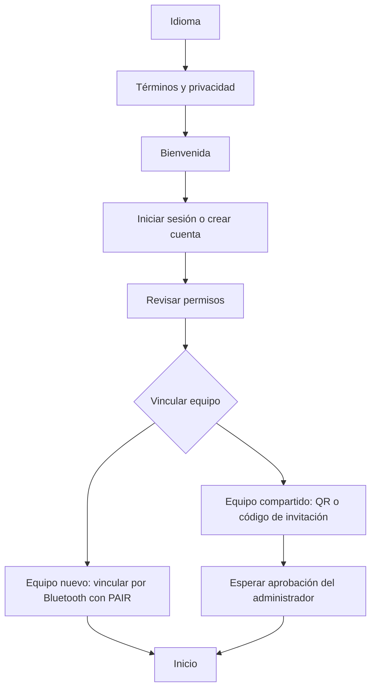

# TerraSense · App móvil

La app acompaña el trabajo de medición en el campo: conecta el teléfono con el equipo TerraSense, recibe las lecturas de suelo y ambiente, las interpreta según la etapa del cultivo y guarda el resultado para consultarlo después. Está desarrollada con React Native y Expo y permite usar la interfaz en español o inglés, con tema claro u oscuro.

La evaluación se realiza en el teléfono. Internet aporta el pronóstico, la gestión de cuentas y equipos, y el respaldo de las mediciones en Supabase.

## Flujo de pantallas

### Primer acceso



Al crear una cuenta se confirma el correo con un código. Quien ya inició sesión y completó la vinculación entra a Inicio sin repetir la bienvenida. Si una solicitud de acceso sigue pendiente, la app muestra la pantalla de espera.

Bluetooth permite comunicarse con la sonda. La cámara se usa para leer invitaciones QR, con la alternativa de ingresar el código a mano. La ubicación es opcional: permite guardar coordenadas y consultar el pronóstico del lugar. Las notificaciones avisan sobre solicitudes y cambios de acceso.

### Navegación principal

| Pantalla | Para qué sirve |
|---|---|
| **Inicio** | Elegir la sonda que se usará y comenzar una medición. |
| **Mis dispositivos** | Consultar los equipos vinculados y sus datos, vincular otro equipo o compartir una invitación. |
| **Mediciones** | Revisar el historial, filtrar por sonda, etapa o especie y abrir una lectura guardada. |
| **Configuración** | Administrar la cuenta, las preferencias, los permisos y la sincronización. |

La bandeja de avisos reúne las notificaciones de acceso a los equipos. Los miembros aprobados pueden medir y compartir invitaciones; el administrador además puede aprobar solicitudes, retirar accesos y delegar la administración.

### Una medición, paso a paso

<a id="captura-historial-y-pronóstico-contrato-implementado"></a>

1. **Elegir la etapa:** pre-siembra, vegetativo, floración o cosecha.
2. **Indicar la especie, si corresponde:** en vegetativo, floración y cosecha se puede buscar el cultivo o continuar sin especificarlo. La elección se guarda sólo para esa medición. En pre-siembra no se pide especie.
3. **Preparar la sonda:** seguir las indicaciones para encenderla, limpiarla e introducirla en el suelo.
4. **Revisar y medir:** confirmar la sonda y la etapa, elegir si se incluirán ubicación y pronóstico, y comenzar. La app conecta por Bluetooth, recibe la lectura y libera la conexión al terminar.
5. **Recorrer el resultado:** avanzar entre las pantallas siguientes, con botones o deslizando.
6. **Guardar:** conservar la lectura, la fecha, la etapa, la especie indicada y la evaluación. Se puede guardar sin esperar a que termine de cargar el pronóstico.

| Pantalla del resultado | Qué muestra |
|---|---|
| **Resumen** | Evaluación general, condiciones que requieren atención y límites de lo que se pudo evaluar. |
| **Suelo** | Humedad, temperatura, pH y conductividad eléctrica. |
| **Nutrientes** | Registros de nitrógeno, fósforo y potasio, identificados como **Sin validar**. |
| **Ambiente** | Temperatura, humedad relativa y presión atmosférica medidas por el BME280 del equipo. |
| **Clima** | Tiempo actual y pronóstico de los próximos cinco días, cuando están disponibles. |
| **Recomendaciones** | Acciones de revisión y seguimiento, ordenadas por prioridad, con su explicación. |

Cada variable permite abrir su detalle. La batería corresponde al último contacto con la sonda. Cuando falta un dato ambiental se muestra su ausencia: el pronóstico no sustituye las mediciones del equipo.

El historial abre el mismo recorrido de resultados y conserva la evaluación y el clima que se guardaron con la lectura. Las coordenadas, cuando existen, se presentan como texto.

## Cómo funciona el motor agronómico

El motor aplica **reglas y catálogos incluidos en la app**. Combina las lecturas con la etapa elegida y, si se indicó, la especie. El pronóstico complementa la orientación cuando está disponible y corresponde al lugar y al momento de la captura.

La evaluación sigue este orden:

1. **Revisar los datos.** Distingue lecturas disponibles, ausentes, inválidas o antiguas. Un dato que falta no se interpreta como una condición favorable.
2. **Aplicar las reglas generales de la etapa.** Compara temperatura y pH con referencias del catálogo y revisa extremos de humedad. Como no conoce la textura del suelo, sólo destaca extremos de humedad en los que coinciden los perfiles de referencia.
3. **Añadir criterios de la especie.** Si la especie elegida tiene reglas habilitadas para esa etapa, incorpora sus criterios de pH, temperatura o humedad ambiental. Con pronóstico puede sumar avisos de frío, helada, calor, lluvia o niebla según las reglas disponibles.
4. **Explicar el resultado.** Señala qué conviene revisar, por qué y cuándo. También identifica las limitaciones y lo que quedó sin evaluar.

### Qué cambia según la etapa

| Etapa | Cómo se orienta la lectura |
|---|---|
| **Pre-siembra** | Revisa condiciones del suelo y muestra posibles cultivos para explorar por coincidencias parciales de temperatura y pH. |
| **Vegetativo** | Destaca condiciones que conviene revisar durante el crecimiento y agrega los criterios disponibles para la especie. |
| **Floración** | Incorpora las sensibilidades documentadas para esa fase, incluidas las condiciones meteorológicas si hay pronóstico. |
| **Cosecha** | Aporta observaciones de humedad y clima para revisar las condiciones de las labores. |

Por ejemplo, en pre-siembra una temperatura inferior a los mínimos del catálogo genera un aviso para revisar las condiciones antes de sembrar. En floración, una especie con un criterio de helada habilitado puede añadir un aviso al recibir el pronóstico. Sin ese pronóstico, la app indica que no pudo evaluar ese riesgo.

### Cómo leer sus conclusiones

La evaluación actual distingue entre **condiciones que requieren atención** y **evidencia insuficiente para una evaluación completa**. Que no aparezca una alerta no garantiza que el suelo o el cultivo estén en buenas condiciones.

El pH ofrece una comparación orientativa. La conductividad se conserva como lectura, pero no clasifica salinidad sin un método compatible. Los registros de nitrógeno, fósforo y potasio no determinan dosis de fertilización. Sin conocer la textura, la humedad tampoco permite calcular una dosis de riego ni autorizar el ingreso de maquinaria. Las coincidencias de pre-siembra son opciones para evaluar, no una certificación de aptitud.

La [especificación del motor agronómico](MOTOR_AGRONOMICO.md) distingue la implementación actual de las capacidades previstas y explica las fuentes y criterios de validación.

## Uso sin internet

Antes de salir al campo hay que iniciar sesión y completar la vinculación con conexión. Con esa configuración guardada, la app permite recibir lecturas por Bluetooth, evaluarlas localmente y guardarlas en el teléfono.

Las mediciones pendientes se sincronizan al recuperar conexión, sin duplicar registros. La app muestra el estado de sincronización y conserva los pendientes separados por cuenta. El historial disponible sin red corresponde a los registros almacenados en el teléfono.

Si no hay pronóstico, la orientación usa la lectura local y señala esa limitación. Si no se obtiene ubicación, la medición se puede guardar sin coordenadas.

## Desarrollo local

Se necesita Node.js compatible con el proyecto y, para compilar Android, JDK 17 y Android Studio con su SDK configurado. Las pruebas reales de Bluetooth requieren un teléfono físico y una compilación nativa; Expo Go no incluye el módulo BLE.

Crea `App/.env` con la configuración pública de Supabase:

```env
EXPO_PUBLIC_SUPABASE_URL=https://<proyecto>.supabase.co
EXPO_PUBLIC_SUPABASE_ANON_KEY=<clave_publica>
```

La app también admite el `.env` de la raíz; `App/.env` tiene prioridad.

```bash
cd App
npm install
npm run android
```

Para sesiones posteriores, `npm start` levanta el servidor de desarrollo. `npm test` ejecuta las pruebas y `npm run type-check` revisa los tipos. Para generar el APK distribuible se usa `npm run android:release`, con la firma de publicación configurada según el [script de compilación](scripts/build-android-release.mjs).

## Estado y documentación técnica

<a id="124-actualizaciones-de-firmware-en-la-app"></a>

La app implementa el recorrido descrito, pero la validación completa con hardware sigue pendiente: el firmware aún no lee la sonda de suelo. La instalación de actualizaciones de firmware desde la app también está pendiente de integración.

- [Plan de validación](../docs/PLAN_VALIDACION.md): pruebas de integración y de funcionamiento en terreno.
- [Permisos y flujos de acceso](TASK_PERMISSIONS.md): especificación y comprobaciones de la interfaz.
- [Trabajo del motor agronómico](TASK_MOTOR_AGRONOMICO.md): implementación y validación de las reglas.
- [Contrato BLE](../docs/CONTRATO_BLE.md): comunicación entre el equipo y el teléfono.
- [Administración de equipos](../supabase/ADMINISTRACION.md): roles, invitaciones y control de acceso.
- [Plan del firmware](../Firmware/PLAN.md): integración con sensores y actualizaciones.
