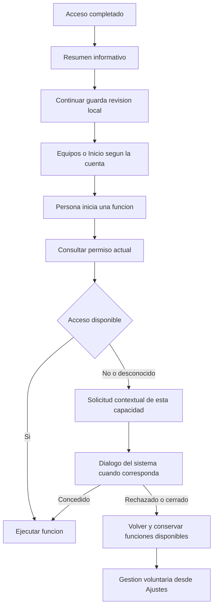
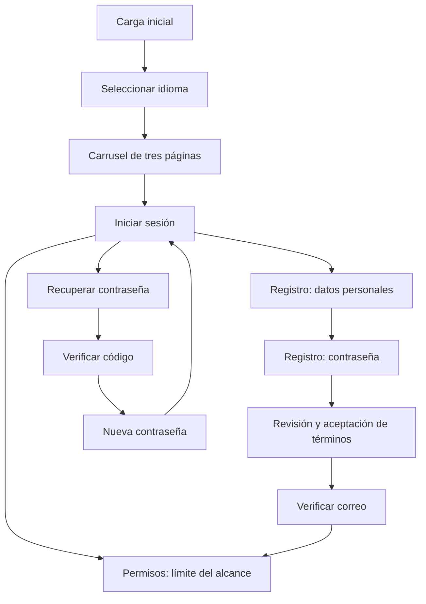

# Plan de implementación: permisos del teléfono

## Alcance vigente y estado

**Etapa actual: P1–P6 implementados el 28-09-2026; falta la matriz nativa (P7) y el módulo iOS de P1.**
Resumen del resultado en [App/README.md §4.1](README.md#permisos-del-teléfono).
Este bloque pasa a ser la referencia para la siguiente implementación. El seguimiento
de carga, idioma y acceso se conserva más abajo, con sus pendientes nativos.

Objetivo: rediseñar la explicación inicial de permisos y unificar sus solicitudes,
estados y recuperación en Android/iOS. Mantener la dirección visual de la entrada:
tipografía protagonista, naturaleza y tecnología sobrias, acciones visibles y adaptación
a pantallas pequeñas. Cada solicitud debe corresponder a una función concreta.

Incluye la pantalla inicial, los puntos que realmente abren diálogos en vinculación,
medición y Ajustes, y la configuración nativa que los respalda. Esas integraciones son
necesarias para que el comportamiento coincida con lo explicado. No incluye rediseñar
esas otras pantallas completas, cambiar membresías, firmware, registro ni textos legales.

- [x] Leer pantalla, servicio, estados, navegación y pruebas actuales.
- [x] Localizar solicitudes adicionales de Bluetooth, cámara, ubicación y notificaciones.
- [x] Consultar documentación oficial de Apple, Android, Google Play, React Native y Expo.
- [x] Revisar el código de los plugins instalados, además de `app.config.js`.
- [x] Documentar diferencias por plataforma, diseño, contratos y criterios de aceptación.
- [x] Implementar P1–P6 (salvo el módulo iOS de autorización Bluetooth, ver P1).
- [ ] Ejecutar la matriz nativa (P7).
- [ ] Revisar el binario final y las declaraciones de privacidad antes de publicar.

## 1. Qué dicen las guías y cómo aplicarlas

Fuentes consultadas el **28 de septiembre de 2026**. Distinguir requisitos de revisión,
recomendaciones de interfaz y decisiones propias del producto. Este plan no garantiza
la aprobación de una tienda.

### R1. Apple: pantalla explicativa inmediatamente anterior al diálogo

Apple indica una sola acción que abra el diálogo, con un título como «Continuar»;
desaconseja «Permitir» y acciones de cierre o cancelación en esa pantalla previa.
Esta indicación se refiere a esa interfaz concreta, no a una prohibición general de
posponer funciones opcionales ni al texto del botón nativo. El rechazo sigue disponible
en el diálogo del sistema. Preferir que el contexto de la función ya explique el motivo.
[Apple HIG: privacidad, sección de pantallas previas](https://developer.apple.com/design/human-interface-guidelines/privacy/).

### R2. Android: explicación cancelable y solicitud contextual

Android recomienda pedir acceso al iniciar la función que lo necesita, comprobarlo
antes de usarla y permitir cancelar la explicación previa. Ante rechazo, conservar las
funciones que no dependen de ese permiso. No abrir Ajustes inmediatamente para intentar
cambiar la decisión de la persona.
[Solicitudes en ejecución](https://developer.android.com/training/permissions/requesting).
Evitar acumular todos los diálogos al iniciar la app.
[Buenas prácticas](https://developer.android.com/training/permissions/usage-notes).

### R3. Permisos opcionales y límites funcionales

Apple exige respetar la decisión y evitar imponer acceso innecesario; la regla 4.5.4
impide exigir notificaciones para que la app funcione. La regla 5.1.1(iv) pide ofrecer
alternativas cuando sea posible. En TerraSense, Bluetooth es necesario para comunicarse
con la sonda; cámara y notificaciones no deben bloquear otras funciones.
[App Review Guidelines](https://developer.apple.com/app-store/review/guidelines/#privacy).

Google Play limita permisos a funciones existentes y finalidades informadas. La política
anuncia un cambio sobre ubicación precisa, efectivo el **27 de enero de 2027**: revisarlo
antes de una publicación posterior; no tratarlo como obligación ya vigente en esta auditoría.
[Permisos y APIs sensibles](https://support.google.com/googleplay/android-developer/answer/16558241?hl=en).

### R4. Consentimiento de datos y permiso del sistema son distintos

La aceptación de términos del registro no autoriza cámara, Bluetooth, ubicación ni
notificaciones. Tampoco un permiso del teléfono acredita por sí solo todos los usos
de datos. Revisar la explicación de coordenadas enviadas a Open-Meteo y su respaldo
en Supabase. Si un uso no fuera razonablemente esperable, evaluar la divulgación
destacada antes de ese acceso; no trasladarla sólo a los términos generales.
[Política de datos de Google Play](https://support.google.com/googleplay/android-developer/answer/10144311?hl=en-GB).

**Conclusión para los textos:** no hay una lista universal de palabras prohibidas
para toda la app. Importan la plataforma, la pantalla y la acción real.
Las variantes de interfaz de R1 y R2 deben implementarse por separado.

## 2. Hallazgos en la app actual

| Prioridad | Evidencia inspeccionada | Corrección prevista |
| --- | --- | --- |
| P0 | [PermissionsScreen](src/screens/PermissionsScreen.tsx) presenta cuatro botones «Permitir» junto a «Continuar». | Reemplazar la mezcla de explicación general y solicitudes por el diseño de la sección 3. |
| P0 | El logo, cuatro tarjetas extensas y el botón final están dentro de `AuthLayout`, que desplaza todo el contenido. | Cabecera compacta, filas breves y pie fijo; texto ampliado puede desplazarse. |
| P0 | [permissionsService](src/services/permissionsService.ts) usa `iosBluetoothRequested`, `androidBluetoothDenied` y `androidBluetoothBlocked` en memoria. | Consultar estado real y representar la información desconocida; reiniciar no debe inventar una primera solicitud. |
| P0 | [bleService](src/services/bleService.ts) también solicita permisos; [probeService](src/services/probeService.ts) lo invoca al verificar y leer. | Un único coordinador de solicitudes evita duplicaciones y resultados contradictorios. |
| P0 | [OnboardingScreen](src/screens/OnboardingScreen.tsx) y [DevicesScreen](src/screens/DevicesScreen.tsx) ofrecen Ajustes inmediatamente después de rechazar cámara. | Respetar la respuesta, mantener la alternativa manual y reservar Ajustes para una acción posterior del usuario. |
| P1 | El modelo actual no distingue autorización de radio apagada en Android, precisión de ubicación ni notificaciones provisionales. | Ampliar estados sin traducir todos a «Permitido». |
| P1 | [MeasureScreen](src/screens/MeasureScreen.tsx) intenta obtener ubicación al medir, con espera acotada y captura de error, pero no ofrece una solicitud contextual propia. | Integrar elección de coordenadas/pronóstico sin bloquear la lectura de suelo. |
| P1 | `app.config.js` contiene textos diferentes para una misma finalidad en `infoPlist` y plugins; no declara traducciones nativas es/en. | Unificar contenido y generar recursos nativos localizados. |
| P1 | El plugin BLE instalado añade `bluetooth-central` a `UIBackgroundModes` cuando recibe `modes: ['central']`; `isBackgroundEnabled: false` no neutraliza ese camino iOS. | Retirar el modo de segundo plano si sólo se usa BLE con la app activa; inspeccionar el resultado generado. |
| P1 | El plugin instalado de `expo-location` añade por defecto descripciones de ubicación Always y movimiento si no se desactivan explícitamente. | Desactivar esas claves innecesarias y verificar el `Info.plist` final. Declararlas no demuestra que se hayan solicitado. |
| P1 | La guía flotante está habilitada en permisos desde [App.tsx](App.tsx). | Evitar guías y superposiciones en una solicitud explicativa; mantener ayuda fuera de ese estado. |
| Preservar | La revisión de la etapa se guarda por cuenta; las autorizaciones las administra el sistema. La recuperación tiene prioridad de navegación. | Conservar ambos contratos y la continuidad sin red. |

La introspección efectiva se obtiene con `node scripts/check-native-permissions.cjs`, que
omite los archivos de Firebase ausentes del repositorio (sin ellos Expo se detenía). Confirmó
`bluetooth-central`, las claves Always/movimiento en inglés, textos de plugin que pisaban a
`infoPlist`, y además `SYSTEM_ALERT_WINDOW` y almacenamiento compartido declarados por dependencias.

## 3. Diseño y recorrido propuestos

### 3.1 Pantalla inicial informativa

**Decisión de diseño recomendada:** conservar una pantalla breve después del acceso,
con información sobre las cuatro capacidades. No iniciar solicitudes desde sus filas.
Los diálogos se abren cuando la persona utiliza la función correspondiente.

Así el recorrido queda: **acceso → explicación de capacidades → equipos/Inicio**.
No es una pantalla previa que retenga un diálogo pendiente de autorización.

- Título: **«Tu teléfono, listo para el campo»** / **“Your phone, ready for the field”**.
- Bajada: «Te explicamos qué acceso usa cada función. El teléfono te pedirá autorización cuando la uses».
- Cuatro filas con icono sencillo, nombre y una explicación de hasta dos líneas.
- Sin logo grande, porcentaje completado, casillas de aceptación ni indicación de que
  hacen falta cuatro autorizaciones para avanzar.
- Pie fijo: **«Continuar» / “Continue”**. Guarda sólo la revisión de esta explicación.
- No esperar a consultar permisos para habilitar ese pie. Si falla el almacenamiento,
  explicar el fallo y permitir continuar en la sesión, conservando el comportamiento actual.
- Composición de ancho máximo 520, márgenes adaptables y controles de al menos 48 unidades
  lógicas. Reducir adornos y espacios antes que tipografía.
- Objetivo sin scroll con texto normal en 360 × 640 y 375 × 667; con texto ampliado,
  permitir desplazamiento manteniendo accesible el pie.
- Evitar el rótulo fijo «Paso 3»: el acceso y registro tienen recorridos distintos.
- Mantener claro/oscuro, es/en, VoiceOver/TalkBack y reducción de movimiento.

| Fila | Texto propuesto en español | Texto propuesto en inglés |
| --- | --- | --- |
| Bluetooth | Conecta la sonda y recibe sus mediciones. | Connect the probe and receive its readings. |
| Ubicación | Añade coordenadas y consulta el pronóstico con Open-Meteo. | Add coordinates and get forecasts from Open-Meteo. |
| Cámara | Escanea invitaciones QR. También puedes escribir el código. | Scan QR invitations. You can also enter the code. |
| Notificaciones | Recibe los avisos que elijas sobre tus equipos. | Receive the device alerts you choose. |

En Android anterior a 12, si forma parte del rango soportado, añadir junto a Bluetooth
la dependencia de ubicación para buscar equipos. El detalle completo se presenta al
iniciar esa búsqueda, sin prometer que funcionará al rechazar ese permiso.

### 3.2 Solicitudes desde funciones reales

| Función iniciada por la persona | Acceso que se comprueba | Si no está concedido |
| --- | --- | --- |
| Buscar/vincular sonda o conectar para medir | Bluetooth; ubicación para escaneo sólo en Android que la requiera | Solicitud correspondiente; si se rechaza, conservar la navegación y explicar que esa conexión no puede realizarse. |
| Añadir coordenadas y pronóstico a una medición | Ubicación en primer plano | Solicitud voluntaria; la medición puede continuar sin esos datos, salvo la dependencia BLE antigua ya explicada. |
| Escanear una invitación | Cámara | Solicitud; si se rechaza, volver a la elección y conservar el ingreso manual del código. |
| Activar avisos en Ajustes | Notificaciones | Solicitud y, si procede, registro del token. No solicitar al montar una pantalla o iniciar sesión. |
| Revisar permisos en Ajustes de TerraSense | Consulta de estado | Mostrar el estado y ofrecer gestión explícita; consultar no abre diálogos. |

Preferir petición nativa directa cuando la acción y su explicación ya dan contexto.
Si hace falta una explicación adicional, aplicar la variante R1 en iOS y R2 en Android.
Desmontar esa vista antes de abrir el diálogo y restaurar el foco al terminar.
En iOS no convertirla en una hoja que se pueda cerrar por arrastre.

No pedir cámara, ubicación y notificaciones automáticamente tras conceder Bluetooth.
La guía de ayuda nunca ejecuta una solicitud ni resalta opciones del diálogo nativo.

### 3.3 Textos y estados de interacción

| Situación | Presentación propuesta | Evitar |
| --- | --- | --- |
| Permiso sin comprobar | «Por comprobar» / “Not checked” | Afirmar que nunca se solicitó. |
| Autorizado | «Autorizado» / “Allowed” | Confundirlo con radio encendida o entrega de push. |
| Rechazado | «Sin acceso» / “No access” | Mensajes de culpa, insistencia automática o celebraciones por aceptar. |
| Bloqueado para nuevas solicitudes | Explicar dónde se gestiona, al abrir gestión voluntaria | Abrir Ajustes automáticamente al rechazar. |
| Restringido por el dispositivo | «Restringido en este teléfono» / “Restricted on this phone” | Prometer que el usuario podrá cambiarlo en Ajustes. |
| Bluetooth apagado | «Bluetooth apagado» / “Bluetooth is off” | Volver a pedir autorización para encenderlo. |
| Ubicación aproximada | «Ubicación aproximada» / “Approximate location” | Tratarla como rechazo o garantizar precisión de GPS. |
| Notificaciones provisionales | «Avisos silenciosos» / “Quiet notifications” | Afirmar que mostrarán sonido y banners. |
| Fallo de consulta | «No pudimos comprobar el estado» / “Could not check status” | Presentarlo como rechazo permanente. |

Estos textos son propuestas de producto. La redacción y los botones del diálogo
nativo pertenecen al sistema operativo; la app no los dibuja ni los modifica.

## 4. Contrato técnico por plataforma

### 4.1 Android

- Android 12+: comprobar `BLUETOOTH_SCAN` y `BLUETOOTH_CONNECT` por separado.
  Conservar `neverForLocation` porque el escaneo identifica sondas y no calcula su ubicación.
  Esa bandera puede filtrar algunos anuncios BLE: probar la sonda física.
- Revisar `maxSdkVersion=30` para las declaraciones antiguas `BLUETOOTH` y
  `BLUETOOTH_ADMIN`. No aplicar ese límite a la ubicación de TerraSense: también
  se usa para coordenadas y clima en Android moderno.
  [Permisos Bluetooth](https://developer.android.com/develop/connectivity/bluetooth/bt-permissions).
- Para ubicación, valorar el alcance mínimo y admitir aproximada. Si se solicita precisión,
  pedir `ACCESS_FINE_LOCATION` y `ACCESS_COARSE_LOCATION` conjuntamente donde corresponde;
  el rechazo de precisa con aproximada concedida sigue siendo un resultado utilizable.
  [Ubicación en ejecución](https://developer.android.com/develop/sensors-and-location/location/permissions/runtime).
- Android 13+: tratar `POST_NOTIFICATIONS` en ejecución; cerrar el diálogo sin elegir
  no cambia su estado. En versiones anteriores no simular una solicitud que no existe.
  Preparar canales antes del registro push y revisar también su habilitación.
  [Notificaciones en Android](https://developer.android.com/develop/ui/compose/notifications/notification-permission).
- `PermissionsAndroid.check` sólo devuelve si está concedido. Un `false` no distingue
  primera solicitud, rechazo previo y bloqueo. Modelar esa incertidumbre; usar el resultado
  de `request`/`requestMultiple` y una explicación cancelable cuando proceda.
  [API de React Native](https://reactnative.dev/docs/0.86/permissionsandroid).
- Reconsultar después de volver de Ajustes, reanudar y antes de cada uso protegido;
  contemplar permisos temporales y revocación automática. Registrar la versión real
  de Android del Motorola G55 y los SDK mínimo/objetivo del artefacto de prueba.

### 4.2 iOS

- Separar autorización Bluetooth del estado de radio. Leer
  `CBManager.authorization` antes de crear un manager evita usar su inicialización
  como consulta de autorización. La biblioteca BLE instalada no expone esa lectura
  estática en su interfaz JS inspeccionada: prever un módulo Expo local pequeño,
  sin escaneo, que la exponga. Verificarlo antes de conectar el nuevo servicio.
  [CoreBluetooth: authorization](https://developer.apple.com/documentation/corebluetooth/cbmanager/authorization-swift.type.property).
- Distinguir restricciones del sistema de un rechazo editable. Bajo restricciones,
  no asegurar que Ajustes lo resolverá.
  [CoreBluetooth: restricted](https://developer.apple.com/documentation/corebluetooth/cbmanagerauthorization/restricted).
- Ubicación sólo `When In Use`, admitiendo precisión reducida.
  [CoreLocation: reducedAccuracy](https://developer.apple.com/documentation/corelocation/claccuracyauthorization/reducedaccuracy).
  Expo no distingue «una vez» de «al usar la app» en la autorización devuelta:
  no inventar ese detalle ni persistirlo como permanente.
  [Location de Expo](https://docs.expo.dev/versions/latest/sdk/location/).
- Notificaciones: conservar `authorized`, `denied`, `notDetermined` y, si aparece,
  `provisional` o `ephemeral`. Una autorización silenciosa no equivale a alertas completas.
  No añadir un pedido provisional automático en esta etapa.
  [UserNotifications](https://developer.apple.com/documentation/usernotifications/asking-permission-to-use-notifications),
  [Notifications de Expo](https://docs.expo.dev/versions/latest/sdk/notifications/).
- Localizar los mensajes de uso en recursos nativos es/en. El idioma seleccionado en
  Zustand no cambia por sí solo el idioma de los diálogos de iOS; verificar idioma del
  sistema, idioma de la app y fallback en una instalación.
  [Localización de Info.plist](https://developer.apple.com/documentation/bundleresources/managing-your-app-s-information-property-list).
- Conservar `NSBluetoothAlwaysUsageDescription`: su nombre no implica que TerraSense
  necesite ubicación Always ni actividad BLE en segundo plano.

### 4.3 Modelo común y almacenamiento

Ampliar [permissionState](src/utils/permissionState.ts) para separar:

| Dato | Contrato propuesto |
| --- | --- |
| Autorización | Concedida, no concedida, aún no determinada cuando la API lo acredita, restringida, no disponible o error. |
| Posibilidad de solicitar | Sí, no o desconocida; no deducirla de una marca local. |
| Disponibilidad del recurso | Radio apagada, servicios de ubicación desactivados, hardware ausente o estado desconocido. |
| Alcance | Precisión de ubicación y modalidad de notificaciones cuando la API los exponga. |
| Operación | Consulta, explicación, solicitud nativa, espera de retorno o finalización. |

El sistema es la fuente de verdad de los permisos y estos pertenecen a la instalación
de la app, no a una cuenta de TerraSense. Mantener `permissions-review-v1/<userId>`
sólo para recordar la explicación. No invalidar revisiones existentes por este rediseño.
Cambiar de cuenta no revoca ni vuelve a solicitar permisos del teléfono.

Supabase conserva preferencias de avisos y `profiles.push_token`, no el consentimiento
del sistema como si fuera una autorización reutilizable. En una medición sin ubicación,
mantener `latitude`, `longitude` y `gps_accuracy_m` nulos; no usar coordenadas de otra
lectura. No se prevé una migración de base de datos para esta etapa.

## 5. Implementación por fases

### P1. Configuración nativa y contratos — antes de cambiar la pantalla

**Archivos:** [app.config.js](app.config.js), [withStartupPermissions](plugins/withStartupPermissions.js),
`permissionState.ts`, `permissionsService.ts`; módulo nativo local y recursos de idioma a crear.

- [x] Inventariar permisos, `uses-feature`, claves iOS y SDK efectivos de una compilación.
- [x] Desactivar en expo-location `locationAlwaysPermission`,
  `locationAlwaysAndWhenInUsePermission` y `motionUsagePermission` con `false`;
  mantener ubicación When In Use y servicios de segundo plano desactivados.
- [x] Retirar `modes: ['central']` del plugin BLE y comprobar la ausencia efectiva
  de `bluetooth-central`; preservar otros modos sólo si una función vigente los necesita.
- [x] Unificar textos de uso; excluir micrófono, galería, contactos y ubicación de fondo.
- [x] Revisar declaraciones duplicadas en `uses-permission` y `uses-permission-sdk-23`.
  Ajustar límites de los permisos BLE antiguos sin retirar georreferenciación.
- [ ] Implementar lectura iOS de autorización Bluetooth sin crear `BleManager`. Provisorio:
  marca por instalación tras la primera solicitud; falla sólo si se restablece la privacidad sin desinstalar.
- [x] Definir tipos comunes y tests de mapeo antes de migrar consumidores.
- [x] Generar localización nativa de forma reproducible mediante configuración/plugin;
  no depender de editar a mano archivos que Expo regenerará.

**Aceptación:** lectura de estado sin diálogos ni escaneo; manifiesto y plist acordes
a las funciones actuales. Un archivo de configuración correcto no basta como prueba.

### P2. Coordinador único de permisos — depende de P1

**Archivos:** `permissionsService.ts`, `bleService.ts`, `probeService.ts`,
`notifications.ts` y nueva lógica/componente específico si hace falta.

- [x] Separar consultar, solicitar desde acción explícita y abrir gestión del sistema.
- [x] Usar un bloqueo común para que exista como máximo una solicitud nativa activa.
- [x] Revalidar antes de solicitar; una operación ya autorizada continúa sin repetir el diálogo.
- [ ] Conservar la función pendiente para reanudarla exactamente una vez tras conceder.
- [ ] Cancelar la continuación funcional si se desmonta la pantalla, cambia la cuenta
  o se abandona la operación; una respuesta tardía no navega ni escribe para la cuenta anterior.
- [ ] Evitar que `AppState` sobrescriba el resultado de una solicitud con una consulta anterior.
- [ ] Un timeout produce estado desconocido/error, nunca autorización. Si puede seguir
  abierto un diálogo del sistema, no liberar la cola para lanzar otro encima.
- [x] Centralizar solicitudes BLE y quitar duplicación entre verificar/conectar/leer.
- [x] Implementar las explicaciones R1/R2 sin convertir todo uso en una doble confirmación.

**Aceptación:** tocar varias veces, regresar de Ajustes o alternar pantallas no duplica
solicitudes ni ejecuta dos veces el escaneo, la captura o el registro push.

### P3. Pantalla inicial — depende del contrato de P1; puede avanzar junto a P2

**Archivos:** `PermissionsScreen.tsx`, [EntryUI](src/components/entry/EntryUI.tsx),
[App.tsx](App.tsx), [authFlow](src/utils/authFlow.ts).

- [x] Aplicar composición y textos de 3.1, retirando logo grande y las cuatro solicitudes.
- [ ] Usar contenido flexible y pie visible; no alterar por defecto `AuthUI` de otras pantallas.
- [x] Mantener la revisión por cuenta y continuar sin exigir ningún permiso concedido.
- [ ] Preservar prioridad de recuperación, sesión restaurada y siguiente ruta existente.
- [x] Tratar fallo de almacenamiento sin bloquear a la persona en esta etapa.
- [ ] Revisar guía flotante y banner offline para que no reduzcan innecesariamente el espacio;
  ninguna superposición debe interferir con solicitudes nativas.

**Aceptación:** primera entrada, cuenta existente y cambio de cuenta navegan correctamente;
pulsar Continuar no abre un diálogo de autorización.

### P4. Integración con funciones — depende de P2 y P3

**Archivos:** `OnboardingScreen.tsx`, `DevicesScreen.tsx`, `MeasureScreen.tsx`,
`SettingsDetails.tsx`, `probeService.ts` y `notifications.ts`.

- [x] Conectar búsqueda BLE al coordinador; explicar ubicación para escaneo antiguo
  antes de solicitarla y distinguir permiso de radio apagada.
- [x] Migrar ambos escáneres QR; conservar código manual cuando la cámara no se concede.
- [x] Retirar el salto inmediato a Ajustes después de un rechazo nuevo.
- [x] Ofrecer «Añadir ubicación y pronóstico» / “Add location and forecast” en la preparación
  de medición. Activarlo comprueba/solicita; dejarlo sin activar conserva medición sin ubicación.
- [x] Separar la preferencia de incluir coordenadas del permiso técnico usado por BLE antiguo:
  poder buscar la sonda no debe activar por sí solo envío de coordenadas a Open-Meteo.
- [ ] Cuando se incluya ubicación, leer la actual con espera acotada; usar la precisión real.
  Un error, falta de servicios o revocación deja datos ausentes y conserva la medición.
- [x] Hacer que activar avisos sea una acción explícita en Ajustes; montar pantallas,
  sincronizar preferencias o restaurar sesión sólo registra autorizaciones existentes.
- [ ] Diferenciar «permiso concedido» de «token registrado» y de «aviso entregado».
  Falta de red o fallo de Supabase no debe volver a pedir el permiso.
- [x] En Ajustes, reconsultar al regresar y mostrar restricciones/alcance; abrir la
  configuración del teléfono sólo tras la acción de gestión correspondiente.
- [ ] Comprobar el contexto de cuenta antes y después de las escrituras del token;
  preservar limpieza al cerrar sesión y preferencias de categorías.

**Aceptación:** cada función funciona con su permiso y ofrece una salida coherente
cuando no lo tiene. No hay cadena automática de cuatro solicitudes.

### P5. Textos finales y recursos es/en — junto con P3/P4

Propuestas de mensajes nativos, con una fuente de texto por finalidad:

| Recurso | Español | Inglés |
| --- | --- | --- |
| Bluetooth | TerraSense usa Bluetooth para encontrar tu sonda de suelo y recibir sus mediciones. | TerraSense uses Bluetooth to find your soil probe and receive its readings. |
| Cámara | TerraSense usa la cámara para leer el QR de invitación a un equipo. | TerraSense uses the camera to read a device invitation QR code. |
| Ubicación | TerraSense usa tu ubicación al medir para guardar coordenadas y consultar el pronóstico con Open-Meteo. | TerraSense uses your location when measuring to save coordinates and request forecasts from Open-Meteo. |

- [ ] Revisar los textos junto al comportamiento efectivo de P4.
- [ ] Comprobar traducciones del resumen, explicación contextual, errores y estados.
- [x] No usar «obligatorio para usar TerraSense» para capacidades opcionales.
- [ ] No prometer cifrado, anonimato, entrega de avisos o exactitud que esta pantalla no verifica.
- [ ] Aceptación legal, permisos del teléfono y preferencias de avisos permanecen separados.
- [ ] Revisar coherencia con la política de privacidad y fichas de tienda; preparar cambios
  concretos de esas declaraciones sólo si la implementación cambia el uso de datos.

### P6. Pruebas automatizadas — antes del cierre de P7

Extender [permissions.test.ts](tests/permissions.test.ts) y
[authFlow.test.ts](tests/authFlow.test.ts). Añadir pruebas del servicio con adaptadores
simulados y pruebas de interacción para aquello que una función pura no comprueba.

- [ ] Consultar/montar/resumir no llama a ninguna API de solicitud ni inicializa BLE iOS.
- [ ] Conceder, rechazar, bloquear, restringir, cancelar y fallar conservan estados distintos.
- [ ] BLE Android maneja concesión parcial de SCAN/CONNECT.
- [ ] Reinicio con permiso denegado no se rotula como primera solicitud conocida.
- [ ] Ubicación aproximada permite continuar; revocación elimina su uso siguiente.
- [ ] Doble pulsación, cambio de cuenta y respuesta tardía no repiten acciones.
- [ ] Timeout no se convierte en permiso y no permite superponer diálogos.
- [ ] Continuar guarda revisión; su fallo no inventa permisos ni altera otra cuenta.
- [ ] Cámara rechazada conserva alternativa manual; aceptar abre un solo escáner.
- [ ] No incluir ubicación mantiene coordenadas nulas y omite consulta meteorológica.
- [ ] Notificaciones denegadas no bloquean uso; provisionales mantienen su modalidad;
  sincronización sin permiso no solicita ni registra token.
- [ ] Errores al registrar token no se presentan como denegación del sistema.
- [ ] Plugins son idempotentes y no agregan capacidades descartadas ni borran GPS moderno.
- [ ] Ejecutar `npm test`, `npm run type-check` y exportación JS Android/iOS;
  documentar por separado resultados locales y de instalación nativa.

### P7. Matriz nativa y revisión final — depende de P1–P6

| Caso | Evidencia exigida | Estado |
| --- | --- | --- |
| Motorola G55 | Versión Android, recorrido inicial sin diálogos, uso de cada función y pie visible | Pendiente |
| Android 12+ y Android 13+ | BLE independiente de GPS; notificaciones según versión; rechazo/cierre del diálogo | Pendiente |
| Android anterior a 12, si el SDK mínimo lo soporta | Dependencia real de ubicación para escaneo y servicios desactivados | Pendiente |
| iPhone físico | Primera solicitud BLE/cámara/ubicación/avisos y lectura sin diálogo | Pendiente |
| Rechazo y bloqueo | Funciones alternativas, gestión voluntaria y regreso de Ajustes | Pendiente |
| Permiso temporal/revocación/reinicio | Nueva consulta de estado; sin autorización persistida ficticia | Pendiente |
| Radio apagada y hardware ausente | Mensaje correcto, sin reabrir autorización | Pendiente |
| Ubicación aproximada y sin señal | Precisión real o datos nulos; medición conservada | Pendiente |
| Cambio de cuenta con solicitud abierta | Resultado tardío sin navegación ni token de la cuenta anterior | Pendiente |
| Sin conexión | Explicación y permisos locales operables; token pendiente sin nueva solicitud | Pendiente |
| Tamaños compactos, es/en, claro/oscuro | Sin recortes con texto normal; pie accesible con accesibilidad ampliada | Pendiente |
| VoiceOver/TalkBack y movimiento reducido | Foco recuperado, estados leíbles y animaciones compatibles | Pendiente |
| Binario de distribución | Manifest/plist/localizaciones revisados; sin permisos extra por dependencias | Pendiente |

Las pruebas nativas requieren un cliente reconstruido: Expo Go y Metro no acreditan
Bluetooth ni el manifiesto de TerraSense. Android emulado tampoco sustituye la sonda
real; el simulador iOS no cubre toda la autorización BLE.

## 6. Orden de trabajo y criterio de cierre

**Orden:** P1 → P2; P3 puede avanzar tras fijar el contrato de estados.
Integrar P4 con P5; ejecutar P6 y después P7. Si se delega la implementación, asignar
un único editor de servicios/configuración nativa y otro de UI; el orquestador controla
los puntos compartidos, resultados y pendientes. Este plan no lanza agentes.

**Cierre:** resumen inicial sin solicitudes, permisos contextuales y variantes correctas
por plataforma, negativas respetadas, configuración mínima verificada y matriz nativa
resuelta en los dispositivos disponibles. Marcar explícitamente toda prueba que falte;
compilar o cambiar el texto del botón no acredita ese cierre.

**Estado de esta entrega:** auditoría y plan documentados. Las implementaciones P1–P7,
el módulo iOS, los cambios visuales y las pruebas nativas siguen pendientes. El código
de permisos no se modificó en esta etapa de planificación.

---

## Seguimiento anterior: carga, idioma, bienvenida y acceso

### Alcance de la etapa de entrada

Rediseñar el recorrido inicial de TerraSense hasta llegar a permisos:
**carga → idioma → carrusel → acceso**. Incluye registro en dos pasos,
verificación de correo, consentimiento y recuperación de contraseña.

La pantalla de permisos y las etapas posteriores quedaron fuera de aquella implementación.
Comprobar su punto de entrada sin cambiar su diseño, solicitudes ni comportamiento.
Las tareas de otros ámbitos conservadas al final no amplían este alcance, aunque sus
textos usen expresiones como «etapa vigente» o «siguiente etapa».

Estado del rediseño: **código integrado y verificaciones locales aprobadas; validación nativa pendiente**.
Participaron dos agentes en paralelo, ambos **`gpt-6-sol`** con razonamiento **`medium`**.
El orquestador completó e integró sus aportes tras agotarse el límite de uso de los agentes.
Las casillas de implementación certifican el código; las comprobaciones en teléfonos
y con correo real se registran por separado y siguen abiertas.

### Decisiones acordadas

- Tecnología y naturaleza, composición sobria y tipografía protagonista.
- Verde bosque, fondos claros cálidos, acentos de tierra y versión oscura coherente.
- Logo completo protagonista en la carga; retirarlo del carrusel y formularios.
- Tres páginas de bienvenida, conservando el formato de carrusel horizontal.
- Español e inglés antes de la bienvenida, con persistencia local y por cuenta.
- Registro en dos pasos: datos personales y contraseña.
- Rediseñar inicio de sesión, verificación, recuperación y nueva contraseña.
- Adaptación por espacio disponible en móviles Android e iOS, en vertical.
- Motorola G55 como dispositivo real de referencia; validar también tamaños pequeños.
- Botón principal visible y pantallas habituales completas sin desplazamiento vertical.
- Con teclado, texto de accesibilidad grande o contenido legal extenso, mantener
  accesibles el campo activo y la acción; permitir desplazamiento del contenido cuando
  físicamente no quepa. No reducir la legibilidad ni recortar contenido para hacerlo caber.

### Punto de partida verificado

- [x] Revisar navegación, carga, carrusel, acceso, preferencias y migraciones relacionadas.
- [x] Comprobar la base automatizada de App: 122 pruebas aprobadas y TypeScript sin errores.
- [x] Identificar dependencias compartidas: `AuthUI.tsx` también afecta permisos y vinculación.
- [x] Confirmar que `profiles.app_preferences` ya admite los idiomas `es` y `en`.
- [x] Detectar que el idioma del login sólo se cambia en memoria y puede reemplazarse
  al cargar la cuenta o perderse al reiniciar.
- [x] Detectar la diferencia entre el ancho predeterminado del splash nativo y el logo
  de la carga React; falta comprobar el resultado visual en una instalación real.
- [x] Detectar la diferencia entre las reglas de contraseña de la app y la configuración
  local de Supabase. Falta contrastarla con la configuración remota vigente.
- [x] Implementar el nuevo recorrido descrito en este bloque.
- [x] Contrastar en lectura el esquema remoto de perfiles, sus políticas y el trigger de alta.
- [ ] Validar el resultado visual en Android e iOS y las operaciones reales de Auth.

## Flujo y reglas de navegación

El diagrama representa una instalación nueva. Aplicar además estas reglas:

- Recordar idioma y bienvenida por instalación; cerrar sesión no reinicia esas elecciones.
- Restaurar una sesión válida hacia la etapa que corresponda a esa cuenta.
- Conservar la prioridad de recuperación sobre bienvenida, acceso y permisos.
- Mantener el progreso de instalaciones existentes: migrar el estado conocido sin
  obligar a repetir la bienvenida por la introducción de la pantalla de idioma.
- Poder cambiar idioma desde bienvenida y acceso mediante una acción discreta que
  abre el selector. Volver a la misma página o formulario conservando sus datos.
- Conservar el aislamiento por cuenta, el regreso con Atrás y el manejo de respuestas tardías.
- Distinguir sesión inválida de falta de conexión; la segunda no debe expulsar al usuario.

## Orquestación de dos agentes

El orquestador define contratos compartidos, asigna archivos, resuelve dependencias,
revisa la integración y mantiene el resumen global. Los agentes implementan y verifican
su parte, y actualizan exclusivamente su bloque de seguimiento en este TASK.

| Responsable | Modelo y razonamiento | Trabajo y archivos a cargo |
| --- | --- | --- |
| Agente A: inicio e idioma | `gpt-6-sol`, `medium` | `App.tsx`, `app.config.js`, `LoadingScreen.tsx`, `WelcomeCarouselScreen.tsx`, nueva pantalla de idioma, `authFlow.ts`, persistencia del idioma previo al acceso, `preferencesService.ts`, pruebas de entrada/preferencias y componentes nuevos compartidos de entrada. |
| Agente B: acceso y cuenta | `gpt-6-sol`, `medium` | `AuthScreen.tsx`, `EmailCodeScreen.tsx`, `ResetPasswordScreen.tsx`, `RegistrationConsentModal.tsx`, presentación de requisitos de contraseña, componentes exclusivos de acceso, pruebas de registro/verificación/recuperación y auditoría del contrato de Supabase Auth. |
| Orquestador | Agente principal | Contratos entre A y B, revisión conjunta, resolución de conflictos, comprobaciones finales y resumen global de implementado/pendiente. |

### Coordinación y dependencias

1. Leer `AGENTS.md` y revisar `git status` antes de editar; conservar cambios ajenos.
2. A y B acuerdan antes de integrar el contrato de selector de idioma y del contenedor
   adaptable: cabecera, contenido, acciones y comportamiento con teclado.
3. A publica la interfaz de los nuevos componentes compartidos. B puede avanzar en el
   estado del registro y formularios mientras A implementa carga, idioma y carrusel.
4. A es el único editor de navegación y preferencias compartidas. B solicita esos cambios
   mediante el contrato acordado; no redefine el estado global ni edita `App.tsx` en paralelo.
5. El diseño de acceso utiliza componentes nuevos o variantes explícitas. Mantener
   el comportamiento predeterminado de `AuthUI.tsx`, sus estilos y los componentes que
   consumen permisos y vinculación. Cualquier edición compartida tiene un único responsable.
6. El orquestador incorpora las pruebas nuevas al comando de App cuando sea necesario,
   revisa el conjunto y actualiza sólo la documentación existente que corresponda.
7. Antes de escribir este TASK, releer el bloque propio y aplicar un cambio localizado.
   No sobrescribir el documento completo con una copia anterior al trabajo del otro agente.
8. La auditoría remota empieza en modo lectura. Una configuración local no demuestra el
   estado remoto. Registrar por separado código listo, cambio desplegado y prueba real.

## Trabajo del agente A: inicio, idioma y bienvenida

### A1. Base adaptable del flujo

- [x] Crear una composición con cabecera, contenido flexible y acciones visibles.
- [x] Calcular espacio útil con ancho, altura, áreas seguras, escala de texto y teclado.
- [x] Reducir primero espacios decorativos e ilustraciones; usar cabecera compacta
  cuando falte altura, conservando lectura y áreas táctiles adecuadas.
- [x] Definir tipografía, colores, espaciados y transiciones sólo para este tramo.
- [x] Respetar tema claro/oscuro y reducción de movimiento del sistema.
- [x] Acordar y comunicar a B las interfaces del contenedor y del cambio de idioma.

### A2. Carga inicial

- [x] Mostrar fondo verde oscuro, logo grande proporcionado y rueda debajo.
- [x] Coordinar splash nativo y primer contenido React; ajustar encuadre por plataforma.
- [x] Cargar preferencias locales antes de presentar textos y evitar cambios de idioma visibles.
- [x] Separar la preparación local de consultas remotas que no necesitan bloquear la bienvenida.
- [x] Revisar esperas, errores y reintentos; descartar resultados de una sesión anterior.
- [x] La carga dura lo necesario para inicializar; no agregar una espera artificial de marca.
- [ ] Comprobar el splash en una compilación instalada, además de la pantalla React.

### A3. Idioma y persistencia

- [x] Crear selector con título bilingüe, Español/English y selección reconocible
  mediante texto, borde e icono; botón Continuar visible.
- [x] Aplicar la selección inmediatamente y guardarla localmente antes de avanzar.
- [x] Permitir elegir y completar la bienvenida sin conexión.
- [x] Implementar apertura inicial y retorno al selector desde bienvenida o acceso.
- [x] Resolver migración de instalaciones existentes y cierre de sesión.
- [x] Sin sesión, usar la elección del teléfono; con sesión restaurada, usar la caché
  de esa cuenta y reconciliarla con su perfil.
- [x] Una elección explícita hecha antes del acceso prevalece en esa entrada y se
  sincroniza con la cuenta autenticada; preservar las demás preferencias del perfil.
- [x] Asociar cambios pendientes a la cuenta correspondiente; impedir cruces al cambiar usuario.
- [x] Conservar elección local ante errores y comprobar reintento al recuperar conexión.
- [x] Evitar que la llegada a permisos muestre primero un idioma y luego otro por una carrera.

### A4. Carrusel

- [x] Página 1: conocer el suelo; estratos y raíces, título protagonista y explicación breve.
- [x] Página 2: conectar y medir; sonda y teléfono con composición propia.
- [x] Página 3: interpretar con contexto; historial y orientación agronómica.
- [x] Describir capacidades reales, sin inventar resultados, mapas ni lecturas de hardware.
- [x] Conservar deslizamiento horizontal, indicadores, Saltar, Continuar y Comenzar.
- [x] Permitir retroceder y mantener sincronizados página visible, indicador y botones.
- [x] Reemplazar alturas rígidas por ilustraciones adaptables; retirar el logo completo.
- [x] Animar sólo lo necesario en la página activa y conservar accesibilidad del carrusel.
- [x] Revisar en código traducciones, persistencia al terminar y conservación de página
  al abrir el selector de idioma. La interacción nativa se valida en la matriz inferior.

### Verificación y resultado del agente A

- [x] Pruebas del orden idioma/bienvenida/acceso y omisión con sesión restaurada; revisión
  de la migración en `App.tsx`. Reinicio real y migración instalada pendientes en la matriz.
- [x] Pruebas del servicio de preferencias con almacenamiento y servidor simulados:
  idioma persistente, red ausente, sincronización, cambio de cuenta y respuestas tardías.
- [x] Regresiones de prioridad de recuperación y entrada a permisos.
- [ ] Revisión de tamaños, temas e idiomas de las pantallas a cargo.
- [x] Integrar los archivos aportados por A y registrar comprobaciones y pendientes reales.

**Implementado:** [EntryUI](src/components/entry/EntryUI.tsx),
[carga con marca](src/components/LoadingScreen.tsx), [selector](src/screens/LanguageScreen.tsx),
[carrusel SVG](src/screens/WelcomeCarouselScreen.tsx) y [navegación inicial](App.tsx).
El pie mantiene la acción fuera del contenido desplazable; el carrusel mide el texto
y reduce su ilustración al espacio disponible. Idioma por instalación y cuenta,
reintentos, esperas remotas acotadas y protección ante cambios de sesión. El aviso de
guardado offline no ocupa espacio durante la entrada; la sincronización sigue activa.

**Verificado:** tipos, exportación JavaScript de Android/iOS,
[rutas](tests/entryLanguage.test.ts) y [persistencia](tests/entryPreferencesService.test.ts).
Las pruebas cubren conservación de ajustes editados sin red, actualización sin filas,
aborto por espera excesiva y elección nueva mientras llega una respuesta de otra cuenta.

**Restante:** splash instalado, regreso del selector, reinicio, accesibilidad y matriz visual nativa.

## Trabajo del agente B: acceso, registro y recuperación

### B1. Inicio de sesión

- [x] Rediseñar con título directo, correo, contraseña y acción Entrar visible.
- [x] Retirar logo completo e ilustración que reste espacio al formulario.
- [x] Conservar mostrar/ocultar contraseña, autorrelleno y gestores de contraseñas.
- [x] Ordenar el foco, permitir enviar desde teclado y ubicar errores junto a los campos.
- [x] Conservar correo tras error, bloquear envíos repetidos y tratar cuenta no confirmada.
- [x] Integrar Crear cuenta, Olvidé mi contraseña y acceso discreto al selector de idioma.
- [ ] Verificar teclado en ambas plataformas con la estructura adaptable acordada con A.

### B2. Registro en dos pasos y consentimiento

- [x] Paso 1: nombre y apellido, correo, indicador 1 de 2 y validación local; no crear cuenta aún.
- [x] Paso 2: contraseña, confirmación, requisitos compactos e indicador 2 de 2.
- [x] Volver al primer paso conserva los datos; abandonar o terminar limpia contraseñas.
- [x] Mantener contraseñas sólo en memoria y proteger contra pulsaciones duplicadas.
- [x] Conservar textos legales, lectura y dos aceptaciones explícitas en su panel propio.
- [x] Mostrar una acción inequívoca para crear la cuenta al finalizar la aceptación;
  eliminar la doble confirmación involuntaria del formulario tras cerrar el panel.
- [x] Un reintento de la misma operación conserva el consentimiento; revisar su vigencia
  al cambiar de flujo o modificar la identidad del registro.
- [x] Mantener metadatos de nombre y consentimiento y el tratamiento del correo ya registrado.
- [x] Coordinar con A la preferencia de idioma al crear y confirmar la cuenta.

### B3. Verificación por correo

- [x] Diseñar título breve, destinatario visible y seis casillas adaptables.
- [x] Conservar campo nativo, pegado, autorrelleno, enmascaramiento y verificación automática.
- [x] Conservar verificación manual y bloqueo de reintentos automáticos del mismo código rechazado.
- [x] Mostrar estados de solicitud, código inválido/vencido, límite y falta de conexión.
- [x] Reenvío con cuenta regresiva coherente al volver del segundo plano.
- [x] Volver o corregir el correo conserva el propósito: registro o recuperación.

### B4. Recuperación y nueva contraseña

- [x] Rediseñar correo → código → nueva contraseña con el mismo lenguaje visual.
- [x] Compartir la experiencia de código respetando su propósito y reglas actuales.
- [x] Nueva contraseña y confirmación con requisitos visibles y acciones accesibles.
- [x] Mostrar confirmación final e Ir a iniciar sesión; limpiar el estado al terminar.
- [x] Conservar el cierre de recuperación y la separación respecto de la sesión normal.
- [ ] Revisar recuperación por enlace con app cerrada/abierta y respuestas tardías.

### B5. Contrato de Supabase

- [x] Contrastar código, migraciones y esquema desplegado de perfiles mediante consulta
  de sólo lectura al proyecto vinculado.
- [ ] Leer la configuración remota vigente de Auth; la configuración local no la demuestra.
- [x] Comprobar en el servidor `profiles.app_preferences`, restricción de idiomas, RLS
  y políticas del perfil propio, además de `on_auth_user_created` y `handle_new_user`.
- [x] Corregir los metadatos del cliente: `full_name`, `first_name` y `last_name` explícitos
  conservan nombres compuestos que el fallback del trigger truncaba.
- [ ] Comparar reglas reales de contraseña con la app; preparar la corrección necesaria
  para que servidor y cliente apliquen la política acordada, sin afirmar despliegues no hechos.
- [x] Revisar configuración y plantillas locales: código de seis dígitos, vencimiento
  de 600 segundos, reenvío de 60 segundos y enlaces de recuperación.
- [ ] Confirmar esos valores en Auth remoto y comprobar entrega/validez del correo real.
- [x] Integrar el guardado de idioma preservando las demás preferencias.
- [ ] Probar operaciones autenticadas con cuentas de prueba; distinguir revisión de código,
  verificación remota de lectura y operaciones comprobadas de extremo a extremo.
- [x] Confirmar que este rediseño no requiere cambiar el esquema. No se aplicaron migraciones
  ni cambios remotos de Auth para esta implementación.

### Verificación y resultado del agente B

- [x] Pruebas de validación de ambos pasos, retorno, metadatos completos, consentimiento
  y bloqueo sincrónico de envíos. La creación real desde el panel sigue pendiente.
- [x] Pruebas de correo existente, propósito del código, verificación, errores y reenvío;
  revisión de la ruta de cuenta sin confirmar.
- [x] Pruebas del propósito de recuperación, enlaces y prioridad de ruta; revisión de
  guardado, limpieza de contraseña y cierre/cancelación de sesión.
- [ ] Completar el recorrido de nueva contraseña y cancelación contra Auth real.
- [ ] Revisión de teclado, temas, idiomas y tamaños de los formularios.
- [x] Integrar los archivos aportados por B y registrar comprobaciones y pendientes reales.

**Implementado:** [acceso y registro en dos pasos](src/screens/AuthScreen.tsx), campos con errores y foco, código y
nueva contraseña con acciones visibles. Aceptar términos envía una sola solicitud;
el consentimiento permite reintentos mientras no cambie la identidad. Las contraseñas
se limpian tras el registro o cambio confirmado. Los controles conservan autorrelleno.

**Verificado:** [pruebas de registro](tests/accessRegistration.test.ts), servicios, TypeScript, empaquetado y contrato remoto
de perfiles en lectura. El nombre compuesto conserva todos sus componentes.

**Restante:** teclado y autorrelleno reales, envío de correo, confirmación y recuperación
con cuentas de prueba. La app exige ocho caracteres con letra, número y especial;
`supabase/config.toml` declara seis y sin requisitos de composición. Falta leer la
política remota y acordar su alineación antes de cambiar una regla global para todos
los clientes. No se da por aplicada una configuración remota a partir del archivo local.

## Integración y aceptación del orquestador

- [x] Revisar ambos cambios y resolver dependencias sin ampliar el alcance a permisos.
- [x] Integrar pruebas nuevas en el comando de App y ejecutar `npm test` desde `App/`.
- [x] Ejecutar `npm run type-check` desde `App/`.
- [x] Conservar `PermissionsScreen`, `AuthUI`, servicios de permisos y tokens globales.
  La variante compacta de requisitos no cambia el comportamiento predeterminado.
- [ ] Comprobar todo el recorrido nuevo, sesión restaurada, cambio de cuenta y recuperación.
- [x] Actualizar documentación existente que corresponda al comportamiento implementado.
- [x] Ejecutar `python docs/verificar_documentacion.py` desde la raíz; cero errores.
- [x] Revisar directamente enlaces y diagrama de este TASK: el verificador estándar no lo incluye.
- [x] Revisar diferencias y registrar aquí sólo resultados realmente observados.

### Matriz visual y funcional

| Caso | Resultado exigido | Estado |
| --- | --- | --- |
| Motorola G55 | Recorrido completo, botones visibles y teclado operable | Pendiente |
| Android compacto, referencia lógica 360 × 640 | Pantallas habituales completas, sin desplazamiento vertical con texto normal y teclado cerrado | Pendiente |
| iPhone compacto, referencia lógica 375 × 667 | Mismo criterio, respetando barras y áreas seguras | Pendiente |
| Teléfonos grandes Android/iOS | Ancho de lectura limitado y distribución proporcionada | Pendiente |
| Teclado abierto | Campo activo y acción accesibles, sin superposición | Pendiente |
| Texto ampliado y lector de pantalla | Contenido completo, orden de foco y controles identificables | Pendiente |
| Español/inglés y claro/oscuro | Traducción íntegra, contraste y composición sin recortes | Pendiente |
| Movimiento reducido | Transiciones compatibles con la preferencia del sistema | Pendiente |
| Sin conexión y reconexión | Idioma conservado, errores accionables y reintentos coherentes | Servicio cubierto con dobles; recorrido nativo pendiente |
| Registro y recuperación | Correo/código reales con cuenta de prueba; transiciones correctas | Pendiente |
| Arranque instalado | Splash y carga coherentes en compilación nativa; no basta Metro o exportación JS | Pendiente |

Las pruebas automatizadas y capturas de diseño no certifican el resultado nativo.
Si falta teléfono, simulador iOS o acceso remoto, dejar esa fila pendiente e indicar
qué recurso falta. No marcarla completa por haber compilado o inspeccionado el código.

### Resumen global de seguimiento

- **Implementado:** carga → idioma → tres páginas → acceso, registro en dos pasos,
  consentimiento, verificación y recuperación. Integración de preferencias y protección
  contra respuestas tardías; permisos conserva su pantalla y sus solicitudes.
- **Verificado:** `npm test` con **139 pruebas aprobadas**, TypeScript sin errores y
  exportación JavaScript mediante Metro para Android e iOS. Consulta remota de perfiles
  en transacción de sólo lectura; no se ejecutaron altas ni cambios de configuración Auth.
- **Restante:** matriz nativa, política remota de contraseñas y operaciones con correo real.
  No hay teléfono ni emulador conectado a ADB. La exportación avisó que no pudo resolver
  `google-services.json` y `GoogleService-Info.plist` locales; la compilación nativa debe
  recibir esa configuración. Los cambios de splash/teclado requieren reconstruir el cliente.
  La exportación JavaScript no certifica un APK, iOS ni su comportamiento visual.
- **Criterio de cierre:** recorrido coherente, idioma persistente por instalación/cuenta,
  pantallas habituales completas y acciones accesibles, sin regresión en la entrada a permisos.

## Seguimiento conservado de otros ámbitos

Los bloques siguientes conservan implementaciones y pendientes de dashboard, medición,
permisos, ajustes y dispositivos. Consultarlos como contexto; la implementación activa
de este TASK está definida arriba. No marcar sus pendientes resueltos al cerrar el rediseño.

## Implementación vigente: dashboard y medición

El usuario autoriza implementar esta etapa. Sustituye la espera de aprobación de
Medición descrita más abajo; los pendientes de hardware de etapas anteriores siguen abiertos.

Flujo: Dashboard → preparación y selección explícita de fase → conexión y lectura →
resumen con plan y grid → detalle de parámetro → guardado local y respaldo.
El detalle tiene páginas Estado, Recomendación y Control con gesto horizontal y pestañas.
Anterior/Siguiente parámetro cambian la tarjeta sin regresar al grid y reinician en Estado.
El plan global conserva el punto de retorno. Atrás de Android sigue la misma navegación.

### Secuencia y progreso

- [x] Inspeccionar código, navegación, motor y persistencia; preservar cambios ajenos.
- [x] Especificar el flujo y criterios de aceptación antes de implementar.
- [x] Crear modelo compartido de presentación y recomendaciones por parámetro.
- [x] Crear grid adaptable, mini carrusel y detalle con navegación interna.
- [x] Integrar resultado, lectura guardada y dashboard con componentes compartidos.
- [x] Exigir fase explícita, fijar contexto al iniciar y proteger cancelación/guardado.
- [x] Preparar contrato remoto y función autenticada sin inventar un proveedor activo.
- [x] Ejecutar pruebas de App, tipos y verificador documental; registrar límites reales.

### Reglas de implementación

- Orden: humedad, temperatura de suelo, pH, CE, N, P, K, temperatura ambiente,
  humedad ambiente y presión. Dos columnas; una con espacio reducido/texto grande.
- Recomendaciones: estado correcto, atención, crítico e informativo/sin dato.
  Usar fase/cultivo/textura capturados; no inventar dosis, umbrales ni plazos.
  N/P/K no validan nutrición; ambiente ausente no se completa desde internet.
- El plan prioriza alertas aplicables a la fase y elimina duplicados.
- Guardar la presentación del diagnóstico junto con su versión para no reinterpretar
  una lectura histórica con preferencias nuevas. Lecturas antiguas muestran sólo lo registrado.
- Cancelar invalida respuestas tardías. Guardar usa bloqueo inmediato y UUID estable.
- API: entrada por identificador de medición guardada, autorización mediante RLS,
  respuesta versionada y validada, espera limitada y respaldo local. Proveedor pendiente.
- No desplegar servicios ni afirmar validación física; esta implementación es local.

### Verificación de aceptación

- [ ] Sin selección de fase no inicia; el contexto no cambia durante la captura.
- [ ] Grid, detalle y plan comparten lectura; anterior/siguiente respetan límites.
- [ ] Plan vuelve al mismo parámetro/página; Atrás protege resultados sin guardar.
- [x] Ausencia de ambiente e histórico antiguo conservan datos honestos (pruebas unitarias).
- [ ] Desplegar la función `measurement-recommendation` en Supabase
  (`supabase functions deploy measurement-recommendation`); hoy solo existe en el repositorio.
- [ ] Validar función remota desplegada: por ahora devuelve proveedor no configurado.
- [ ] Reintentos no aceptan respuestas anteriores ni duplican guardados.
- [x] Pruebas automatizadas y tipos aprobados; documentación sin errores.
- [ ] Validación visual en teléfono, lector de pantalla, texto ampliado y sonda real.

### Resultado local y puntos de conexión

`src/engine/measurementPresentation.ts` construye diez parámetros con diagnóstico
individual. `src/components/MeasurementExplorer.tsx` comparte grid, plan y navegación
entre dashboard, resultado y detalle guardado. El JSON `diagnosis.presentation` conserva
la versión mostrada al guardar, sin agregar columnas ni migraciones.

El gesto horizontal recorre Estado/Recomendación/Control. Los botones inferiores cambian
parámetro y reinician Estado. Abrir/cerrar el plan conserva parámetro y página interna.
La confirmación de salida protege resultados; conexión/lectura ignoran respuestas tardías
y tienen bloqueo inmediato. El guardado conserva UUID y bloqueo contra pulsaciones repetidas.

`src/services/recommendationsService.ts` ofrece conexión opcional con tiempo máximo y
validación de respuesta. No se llama automáticamente: falta elegir e integrar proveedor.
`../supabase/functions/measurement-recommendation/index.ts` autentica, consulta una lectura
guardada usando RLS y responde `PROVIDER_NOT_CONFIGURED`. No está desplegada; falta probarla
con usuarios reales y conectar el adaptador, sus secretos y la persistencia del análisis remoto.
No se envían datos a terceros ni se muestra análisis remoto ficticio.

Comprobaciones locales: 114 pruebas aprobadas, TypeScript sin errores y verificador
documental sin errores. Exportación JavaScript Android correcta (no equivale a APK).
Expo avisó que faltan los archivos de configuración nativa de Google; no impidió exportar.
No hay dispositivo conectado según ADB. Quedan pendientes pruebas de gestos, Atrás,
texto grande, temas, idiomas, permisos, sonda real y escenarios de interrupción en teléfono.

## Estado y alcance vigente

### Etapa vigente: auditar Permisos, Vinculación y Dashboard

Bienvenida y acceso ya fueron revisados con el usuario. El alcance actual termina en
Dashboard; Medición queda como la siguiente etapa, después de validar estas pantallas.

Implementado localmente:

- [x] Permisos: conservar solicitudes explícitas y continuación sin concederlos;
  refrescar el estado al terminar una solicitud y al regresar de Ajustes.
- [x] Bluetooth iOS: admitir respuestas inmediatas del listener sin acceder a una
  suscripción todavía no inicializada y liberarlo después de resolver.
- [x] Vinculación: conservar dos opciones, sonda nueva por Bluetooth y equipo compartido.
  La segunda permite escanear QR o ingresar/pegar su código temporal, sin exigir cámara
  para la entrada manual. Ambas llaman a la misma solicitud de acceso y esperan aprobación.
- [x] Mostrar y copiar la invitación temporal junto al QR en Mis dispositivos. Retirar
  de ese diálogo el identificador permanente, que no sirve como invitación. Permitir
  desplazar el diálogo para alcanzar sus controles en pantallas pequeñas.
- [x] Reemplazar el botón visible de desarrollo por diez pulsaciones en el logo de
  la pantalla de elección. Entra a Dashboard sin inventar un equipo; sólo funciona
  en desarrollo, se guarda por cuenta y se limpia al cerrar sesión.
- [x] Dashboard: aviso de desarrollo sin sonda, acción principal hacia vinculación,
  recarga al volver al primer plano y actualización del historial tras respaldar la cola.
  Una cuenta sin equipos no conserva un dispositivo seleccionado anteriormente.
- [x] Pairing: límites de espera en conexión y operaciones de configuración; propagar
  fallos del inicio de escaneo. Una lectura fallida o inválida de identidad ya no se
  interpreta como sonda nueva. Releer antes de provisionar evita sobrescribir un código
  que quedó guardado durante un intento anterior cuya confirmación se perdió.
- [x] Revisar servicios de invitación, espera de aprobación, rutas de entrada, consulta
  del historial, sincronización y migraciones que aplican autorización en el servidor.
- [x] Agregar regresiones de invitación manual, gesto de desarrollo, aislamiento por
  cuenta, listener iOS, fallos/tiempos límite e identidad BLE. Los dobles nativos prueban
  el servicio real, pero no certifican el comportamiento del hardware.
- [x] Pruebas de App: 109 aprobadas; TypeScript sin errores; exportación JavaScript
  Android correcta; verificador documental con 0 errores. La exportación no equivale
  a compilar ni probar un APK. `adb devices -l` no muestra dispositivos conectados.

Validación pendiente antes de dar por funcional el recorrido completo:

- [ ] Teléfono: conceder, rechazar y bloquear cada permiso; volver de Ajustes y continuar
  sin permisos. Cubrir Android 12+, Android anterior e iOS según la matriz inferior.
- [ ] Dos cuentas reales: QR y código manual vigentes, invitación vencida, código inválido,
  solicitud repetida, aprobación/rechazo del administrador y recuperación tras perder red.
- [ ] Sonda real: búsqueda, radio apagada, permiso bloqueado, desconexión, escritura,
  confirmación e intento repetido. Confirmar cómo informa el firmware una identidad vacía:
  el cliente sólo acepta una lectura vacía confirmada como equipo sin código.
  **No hay firmware ESP32 en este repositorio.**
- [ ] Diez pulsaciones: nueve no navegan, diez abren Dashboard; repetir después de reiniciar
  y cambiar de cuenta. En producción el gesto y la marca guardada no habilitan el acceso.
- [ ] Dashboard: estados sin sonda, sin lecturas, con última lectura y cola pendiente;
  recuperar red y comprobar respaldo, refresco, detalle, historial, dispositivos y ajustes.
- [ ] Validar disposición con teclado, texto ampliado, temas, idiomas y lector de pantalla.

### Siguiente etapa pendiente: Medición, revisión completa

Comenzar sólo después de validar Permisos, Vinculación y Dashboard con el usuario.

- [ ] Auditar cada grid/bloque de la pantalla, valores, unidades, datos ausentes, estados
  de carga/error y coherencia entre captura, diagnóstico, detalle y guardado.
- [ ] Validar la API de clima: coordenadas, fechas/zona horaria, respuesta real, ausencia
  de red, datos parciales y su representación sin inventar información.
- [ ] Auditar el motor agronómico, umbrales, etapa del cultivo, recomendaciones y su
  consistencia con las mediciones y el clima. Contrastar con las fuentes de verdad del código.
- [ ] Probar el recorrido completo con sonda, datos simulados identificados, reintentos,
  guardado local, sincronización y prevención de duplicados.

### Correo funcional y pulido del flujo inicial

Plan aprobado por el usuario tras probar la app en teléfono. El correo era lo que rompía
todo: sin código de confirmación no hay cuenta, y sin cuenta las políticas RLS bloquean la
app entera.

**Correo.** El remitente es `akurasoporte@gmail.com`, decisión del usuario, enviado por el
SMTP de Gmail de esa misma cuenta. Se descartaron Resend (exige dominio propio verificado;
sin él sólo entrega al correo del titular de la cuenta) y Brevo (no puede autenticar
`gmail.com` y reescribe el remitente). El límite de envíos pasó de 2 a 30 por hora, que es
lo que agotaba la cuota en cada prueba.

- [x] Dejar `supabase/config.toml` con la cuenta, el límite y la plantilla de contraseña
  cambiada enlazada a su archivo real.
- [x] Contraseña de aplicación generada y SMTP cargado en el panel remoto por el usuario.
      Comprobado contra remoto el 20-09-2026 en modo lectura: `smtp.gmail.com:587`,
      usuario y remitente `akurasoporte@gmail.com`, nombre `TerraSense`, sin hook de correo,
      confirmación obligatoria activa, código de 6 dígitos con 600 s de vencimiento y 60 s
      entre envíos. La contraseña no se leyó ni se imprimió en ningún momento.
- [x] Límite de correos subido de 2 a 30 por hora en remoto, con la API de administración
      y un PATCH de ese único campo. Verificado después que SMTP, `site_url`, URLs
      autorizadas y parámetros del código quedaron intactos.
- [x] Plantillas publicadas el 20-09-2026. Confirmación y recuperación con
      `configurar_codigos.py --apply`; la notificación de contraseña cambiada con un PATCH
      de su único campo, porque ese script no la gestiona. Las tres verificadas carácter a
      carácter contra el archivo local, con SMTP, URLs y límites intactos.
      Corrección aplicada antes de publicar: la cabecera usaba sólo `linear-gradient`, que
      Gmail descarta, y dejaba el texto blanco sobre fondo blanco. Ahora lleva
      `background-color:#1F5B3F` delante como respaldo.
- [ ] Probar en teléfono: registro, código incorrecto, código vencido, reenvío antes y
  después de los 60 s, recuperación y correo de contraseña cambiada.

**Interfaz del flujo inicial.** Implementado localmente; falta validación en dispositivo.

- [x] Bienvenida con el logo de la empresa en lugar del icono y el texto, y las tres
  láminas con el texto centrado.
- [x] Encabezados de acceso centrados y flecha retirada de todos los botones primarios.
- [x] Movimiento sin rebote en todo el flujo inicial, con los tokens de
  `App/src/constants/motion.ts`: los muelles sobrepasaban el valor final y volvían.
- [x] Términos: título centrado, entrada de la hoja regulada, sin el aviso de versión
  preliminar ni la instrucción de deslizar, y «Continuar» baja el texto hasta el final
  antes de exigir las dos casillas.
- [x] Texto legal completo: responsable Akura, `akurasoporte@gmail.com` para ejercer
  derechos y conservación de un mes tras cerrar la cuenta. Versión `2026-09-20-1`.
- [x] Confirmación de cuenta sin logo ni flecha, con seis casillas enmascaradas y
  verificación automática al sexto dígito.
- [ ] **Borrado real al mes.** El texto legal ya promete que el perfil y los datos
  personales se eliminan dentro del mes siguiente al cierre de la cuenta, y hoy el servidor
  no lo hace: `purge_expired_operational_data()` sólo limpia intentos de vinculación y
  auditorías. Es una migración pendiente, no una mejora opcional: mientras no exista, el
  texto promete algo que el sistema no cumple.
- [x] Marca del proyecto nativo corregida. `App/assets/` ya venía bien, pero
      `App/android/` conservaba el icono del proyecto Akura —un escudo turquesa con un
      visto bueno— del 19-09-2026: los PNG de `assets/` sólo llegan al teléfono cuando se
      regenera el nativo. `npx expo prebuild --platform android` lo rehace; esa carpeta
      está completa en `.gitignore` y no tiene archivos versionados, así que regenerarla
      no pisa trabajo de nadie.
- [x] Pantalla de arranque corregida. Desde SDK 52 la clave `splash:` suelta ya no aplica
      el color de fondo: quedaba `#FFFFFF` y el logotipo, casi blanco por diseño,
      desaparecía. Ahora se declara por el plugin `expo-splash-screen` con `#12281F`.
- [x] Pantalla de carga con la marca (`App/src/components/LoadingScreen.tsx`): fondo verde
      de arranque, logotipo y ruedita. Comparte color con la pantalla nativa, así que el
      arranque no muestra un destello claro al montar la app. Los estratos grises del
      logotipo pasan a verdes sobre fondo oscuro; la paleta vive en `BrandLogo` y su
      equivalente en el generador, que produce el PNG nativo.
- [x] Corregido el error «No pudimos revisar tu cuenta» en cuentas nuevas. La causa no
      estaba en la app: `listMyDevices` pedía `data_generation` y esa columna no existía en
      producción, porque faltaban por aplicar las dos migraciones de arriba. PostgREST
      respondía 42703, `getOnboardingState` lanzaba, y una cuenta recién creada no tiene
      estado en caché al que caer. El guardado de mediciones fallaba por lo mismo.
      Reproducido contra producción antes de tocar nada y verificado después.
- [x] Continuar de los términos responde a la primera. La hoja legal ya no espera a que
      termine la solicitud para cerrarse. Medido antes de cambiar: el endpoint de registro
      responde en 0,1–0,8 s, así que no era latencia del envío de correo sino que la única
      señal era una ruedita de medio segundo dentro del propio botón. La aceptación se
      conserva si la creación falla, para no obligar a releer los términos al reintentar.
- [x] `consentReducer` es idempotente al llegar al final: antes devolvía un objeto nuevo en
      cada evento de desplazamiento y re-renderizaba el texto legal completo mientras el
      dedo se movía.
- [x] Auditoría del esquema: se contrastó cada tabla, columna y RPC que consultan la app,
      la consola y las Edge Functions contra el esquema real en remoto. Aparece un segundo
      desfase de la misma clase que `data_generation`: **`profiles.push_token` no existía**.
      Ninguna migración lo declaraba. La app envuelve su escritura en un `catch` que
      devuelve `null`, así que el fallo se perdía en silencio y `send-push-alert` se
      quedaba sin destinatarios: el circuito de avisos push nunca llegó a cerrarse.
      Lo crea `20260920160000_token_de_notificaciones.sql`, ya aplicada y verificada.
- [x] Revisadas las tablas que ningún cliente consulta directamente
      (`admin_support_invite`, `device_access_invites`, `device_join_attempts`,
      `device_member_audit`, `device_status_log`, `support_register_attempts`).
      **Ninguna sobra**: las seis las usan RPCs o disparadores del servidor. Retirarlas
      rompería el QR de acceso, la unión por código, el alta de soporte, las auditorías,
      el restablecimiento de fábrica y el detalle de equipo. Una tabla que nadie consulta
      no provoca errores; los provoca lo contrario, una columna que el cliente pide y no
      existe, que es lo que esta auditoría busca.
- [x] Aviso de cuenta ya registrada. Supabase no devuelve error cuando el correo existe:
      para no confirmarle a un extraño qué direcciones están registradas, responde con un
      usuario sin identidades. La app lo reconoce y deja al agricultor en el inicio de
      sesión con el aviso, en vez de mandarlo a esperar un código que nunca llega. Se
      descartó una consulta directa a la base que respondiera sí o no: sería un padrón de
      clientes sondeable, y el proyecto tiene el CAPTCHA desactivado.
- [ ] Validar en teléfono el flujo completo con las transiciones nuevas, el icono del
      lanzador, la pantalla de arranque y la de carga. **Exige reinstalar la app**: el
      icono y el arranque se compilan en el APK, no se recargan con Metro.

### Etapa anterior: marca, pantallas principales y guías interactivas

Plan aprobado por el usuario. Marca oficial: **TerraSense**. Conservar cambios locales
de retirada de mapas y datos; bienvenida y autenticación quedan fuera de las guías.

- [x] Revisar continuidad, recursos vectoriales y cambios locales antes de editar.
- [x] Integrar logo vectorial en app, web y README; isotipo como favicon e íconos nativos.
- [x] Implementar guía reutilizable con foco en cada control, fondo atenuado,
  diálogo contextual, Atrás/Siguiente y X; desplazamiento y accesibilidad.
- [x] Mejorar Dashboard, Medición, Historial y Dispositivos conservando estados reales.
- [x] Cubrir permisos, vinculación, espera, Ajustes, submenús y detalles con guías.
- [x] Ejecutar pruebas, TypeScript, compilación web y verificación documental.
- [ ] Validar visualmente en dispositivo las guías, íconos y conexión BLE real.

Los pendientes de firmware, despliegue remoto y pruebas de borrado de la etapa anterior
siguen vigentes; esta etapa no los da por resueltos.

Resultado de la verificación ejecutada: App 90 pruebas aprobadas y TypeScript sin errores;
consola web 4 pruebas aprobadas y compilación Vite correcta; verificador documental con
13 documentos, 308 enlaces y 11 diagramas, 0 errores; modelo financiero 14 pruebas
aprobadas. Esto no sustituye la validación en dispositivo, que sigue pendiente.

### Retirada del mapa en consola web y base de datos

El mapa se retiró también fuera de la app, con el mismo criterio: desaparece la
representación, se conserva la georreferenciación. La consola pierde la ruta del mapa,
sus dos componentes y el ítem de navegación. La migración
`20260920140000_retirar_mapa_y_postgis.sql` elimina `soil_measurements.geom` y `radius_m`,
las tablas `predial_quadrants` y `field_perimeters`, y la extensión PostGIS; rehace
`prepare_device_for_owner` y `admin_factory_reset_device` sin el borrado de cuadrantes, y
esta última deja de devolver `quadrants_deleted`.

Comprobado contra remoto el 20-09-2026, en modo lectura: sólo quedan dos migraciones sin
aplicar, `20260920120000` y esta; `predial_quadrants` y `field_perimeters` tienen cero filas,
así que el borrado no destruye datos; y `data_generation` todavía no existe en `devices`.
Las dos migraciones no pueden separarse, porque ésta rehace `prepare_device_for_owner`, que
referencia objetos creados por la anterior.

- [x] Aplicada en remoto el 20-09-2026 con autorización explícita del usuario, junto con
      `20260920120000`. Comprobado antes: `predial_quadrants` y `field_perimeters` con cero
      filas, y la única medición georreferenciada tenía en `geom` el mismo punto que
      `latitude`/`longitude`, que se conservan. Lo único que se perdió es su `radius_m`,
      que la app ya no usa. Después: PostGIS y las dos tablas retiradas, `data_generation`
      presente en `devices` y `soil_measurements` como `NOT NULL DEFAULT 0`, los dos
      disparadores creados y los recuentos de filas intactos.
- [x] `Web/backend/database.types.ts` regenerado desde el proyecto remoto. La consola
      compila y sus pruebas pasan.
- [x] `supabase/schema.sql` regenerado con Docker en marcha. Ya no declara PostGIS, la
      geometría, el radio, los cuadrantes ni los perímetros, e incorpora `data_generation`,
      `push_token` y la tabla `device_data_resets`. Al volcar, cuidado: `supabase db dump`
      **trunca el archivo de salida antes** de comprobar que tiene Docker, así que si falla
      deja el destino en cero bytes. Volcar a un temporal y copiar sólo si el resultado es
      válido.

`latitude`, `longitude` y `gps_accuracy_m` se conservan y el detalle de cada lectura sigue
mostrando las coordenadas como texto: quitar el mapa no es quitar la georreferenciación.

Implementación de esta etapa:

- Los archivos `Logo/Logo/code.html` y `Logo/Asset/code.html` contienen SVG y son las
  fuentes de marca. `npm run assets:brand` en App genera los SVG de distribución,
  el módulo vectorial nativo, favicon y PNG de Expo. La tipografía queda trazada para
  no depender de las fuentes del teléfono; los PNG se exportan desde el vector.
- `ScreenGuide` presenta recorridos manuales desde `?`; no se abren al iniciar una
  pantalla. Incluyen Atrás/Siguiente/Finalizar y X, fondo atenuado y desplazamiento.
  Los controles aportan referencias y explicaciones; las filas del historial usan la
  primera medición como ejemplo. El recorrido no ejecuta acciones y pausa la lectura
  de QR. Los modales tienen su propio ámbito y Atrás cierra primero la guía.
- Dashboard conserva resumen sin mapa; Medición añade preparación de la sonda;
  Historial desplaza también cabecera y filtros; Dispositivos distingue vinculación
  de conexión BLE y muestra el alcance del último registro de batería/conexión.
- Pairing ya tenía cambios previos. Esta etapa añade guías a elección, búsqueda,
  nombre, registro, QR y espera; no redefine el contrato BLE ni el firmware.
- Verificación visual nativa pendiente: teléfonos pequeños, texto ampliado,
  TalkBack/VoiceOver, máscaras del launcher, permisos reales y sonda física.

Este archivo es el punto de continuidad del trabajo. Se conserva su nombre para mantener
el enlace existente desde el README. Las casillas marcadas describen trabajo realizado;
las pendientes son requisitos, no funciones disponibles.

- [x] Auditoría y mejoras previas de autenticación, recuperación y onboarding, con renovación
  visual del flujo inicial conservando la paleta e integración de los avances del usuario.
- [x] Implementación de la etapa de permisos descrita abajo y documentación del paso 3.
- [x] Revisión inicial de Ajustes y Dispositivos y definición del alcance con el usuario.
- [x] Consolidar en este documento las decisiones de la siguiente etapa.
- [x] Implementar los submenús de Ajustes, perfil y dispositivos (validación nativa pendiente).
- [x] Retirar todos los mapas de la app conservando el historial de mediciones.

Implementación autorizada por el usuario y realizada localmente; despliegue y validación nativa pendientes. La restricción anterior de trabajar sólo en inicio/auth corresponde a la etapa
ya realizada; el nuevo alcance incluye Ajustes, sus submenús y la eliminación de mapas.

## Objetivo y decisiones

Insertar `PermissionsScreen` como paso 3: bienvenida → autenticación → permisos →
vinculación de equipos. Mantener prioridad de recuperación y aislamiento entre cuentas.
Conservar la paleta y los componentes del flujo inicial. No cambiar otras pantallas.

La pantalla explica Bluetooth, ubicación en primer plano, cámara y notificaciones.
Cada solicitud requiere una acción del usuario. Continuar no equivale a conceder
permisos: se registra que se revisó la explicación en esta cuenta y dispositivo.
Los permisos reales se consultan al sistema y las funciones conservan sus comprobaciones.
No se solicita ubicación en segundo plano, micrófono, contactos ni archivos.

## Pasos y criterios de aceptación

- [x] 1. Revisar permisos y puntos de solicitud existentes.
  - Bluetooth Android 12+ separado de ubicación; Android anterior necesita ubicación
    para escanear. Cámara sólo para QR; notificaciones opcionales.
  - Verificación: inspección de servicios, configuración nativa y bibliotecas locales.
- [x] 2. Implementar servicio de permisos y persistencia de la etapa.
  - Consultas sin diálogos automáticos; solicitudes explícitas, rechazo y ajustes.
  - Marca versionada por cuenta/dispositivo, sin confundirla con autorización real.
  - Dependencia: paso 1. Verificar tipos y pruebas de estados/persistencia.
- [x] 3. Crear `PermissionsScreen` e integrar `resolveEntryRoute` y `App.tsx`.
  - Recuperación y login preceden a permisos; permisos preceden a onboarding/app.
  - Sin solicitudes push automáticas tras omitir o rechazar; refrescar al volver de ajustes.
  - Dependencia: paso 2. Verificar regresiones de rutas y cambio de cuenta.
- [x] 4. Documentar el paso 3 en `App/README.md`.
  - Explicar permisos necesarios/opcionales, rechazo, persistencia y diferencias de plataforma.
  - Dependencia: paso 3. Ejecutar verificador de documentación.
- [x] 5. Verificar y revisar el cambio completo.
  - [x] `npm test`: 83 pruebas aprobadas.
  - [x] `npm run type-check`: sin errores.
  - [x] `python docs/verificar_documentacion.py`: sin errores.
  - [x] Configuración nativa generada: escaneo con `neverForLocation`, ubicación disponible,
    sin micrófono; no se han generado ni reemplazado proyectos nativos.
  - [x] Exportación JavaScript Android con `expo export --platform android --no-bytecode`:
    correcta. Es una validación de empaquetado, no una compilación nativa de producción.
  - Dependencia: pasos 2–4. Confirmar que otras pantallas no se modificaron.

## Punto para retomar

Pasos 1–5 terminados. Pruebas, TypeScript, manifiesto, documentación y exportación JavaScript
ya verificados tras integrar los avances del usuario (animaciones, háptica y cliente de desarrollo).
Queda pendiente la validación de permisos en dispositivo de la sección siguiente.
Para la siguiente etapa, seguir el plan de Ajustes y retirada de mapas al final de este archivo.
Hay cambios previos de autenticación/UI en el árbol de trabajo: conservarlos.
No hay teléfono/emulador conectado; los diálogos reales de Android/iOS requieren
validación posterior en dispositivo. La ejecución de Hermes puede fallar con `spawn EPERM`.

## Validación pendiente en dispositivo

- [ ] Reconstruir e instalar el cliente nativo para aplicar los permisos de configuración.
- [ ] Android 12+: Bluetooth concedido con ubicación rechazada; Android anterior: permiso
  de ubicación necesario para escanear. Probar también ubicación aproximada.
- [ ] iOS: primera solicitud Bluetooth, radio apagada, rechazo y autorización en Ajustes.
- [ ] Rechazar cámara/notificaciones, continuar y comprobar que no hay otro diálogo automático.
- [ ] Regresar de Ajustes, reiniciar, cambiar de cuenta y abrir una recuperación.

## Decisiones acordadas para Ajustes

| Submenú o acción | Alcance acordado |
| --- | --- |
| Mi perfil | Nombre, correo y estado real de verificación, cambio de contraseña y seguridad de la cuenta. |
| Mis dispositivos | Equipos vinculados, selección, estado, rol y acceso a sus detalles. |
| Notificaciones | Interruptores por categoría existente: agronómicas, equipo, clima y sincronización. Diferenciar preferencias de autorización del sistema. |
| Actualizaciones | Exclusivamente firmware del ESP32. Descripción de novedades, requisitos, instrucciones, progreso real, resultado e interrupciones. No incluye actualizaciones de la app. |
| Idioma | Español e inglés, con persistencia coherente. |
| Apariencia | Claro, oscuro y seguir el sistema. Mantener la paleta actual y documentar cualquier cambio justificado. |
| Permisos del teléfono | Estado real de Bluetooth, ubicación, cámara y notificaciones; explicación transparente del uso de cada uno; solicitud o acceso a Ajustes del teléfono. |
| Datos y sincronización | Mediciones pendientes, estado y fecha del último envío, errores y reintento. Útil antes de cerrar sesión o entregar un equipo. |
| Administración del equipo | Miembros, solicitudes y transferencia de administración. Visible sólo para el administrador del equipo correspondiente. |
| Contacto | Abrir el cliente de correo con destinatario, asunto y mensaje predeterminados; alternativa para copiar el correo. El envío lo realiza el usuario. |
| Acerca de y privacidad | Versión, términos y aviso de privacidad. |
| Cerrar sesión | Acción separada al final de Ajustes, con tono rojizo y contraste accesible. |

Eliminar la configuración del campo de Ajustes. No eliminar por ello datos del campo
que sigan siendo necesarios en otras funciones.

### Contacto

Destinatario indicado: `akurasoporte@gmail.com`, confirmado por el usuario.

Asunto propuesto: «Soporte TerraSense».
Mensaje propuesto: «Hola, equipo de soporte. Necesito ayuda con TerraSense.
Descripción del problema: … Pasos que realicé: … Gracias.»
No adjuntar mediciones, credenciales ni datos personales automáticamente.

### Administración y preparación para otro propietario

> **Retirada** (`20260928130000_reset_solo_desde_backoffice.sql`): la app ya no prepara
> equipos. El único reset es el del backoffice y la sonda reseteada se revincula con la
> ventana PAIR. Lo que sigue queda como antecedente de la invalidación por generación, que
> se conserva.

- La administración es por equipo. Transferirla elimina los privilegios del administrador
  anterior sobre ese equipo; la autorización debe aplicarse también en el servidor.
- «Preparar equipo para otro propietario» será la última opción del submenú,
  visualmente diferenciada de las acciones habituales.
- Exigir al menos dos confirmaciones: primera con resumen explícito del equipo y de todos
  los datos/accesos afectados; segunda con confirmación inequívoca y reautenticación
  del administrador. Verificar autorización nuevamente al ejecutar.
- El usuario decidió no conservar el historial de mediciones del equipo al prepararlo
  para otro propietario. Explicar la eliminación antes de confirmar; no afectar otros equipos.
- Definir y verificar el borrado de mediciones remotas y locales, colas pendientes,
  vínculos, solicitudes y configuración del equipo. Impedir que una cola antigua vuelva
  a subir datos borrados. Contemplar otros teléfonos y copias sin conexión.
- Mantener intacto el firmware. Distinguir limpieza de datos del servidor/app de un
  restablecimiento físico de configuración: este último necesita soporte del ESP32.
- No mostrar éxito hasta comprobar las operaciones necesarias; definir recuperación
  ante fallos parciales y el mecanismo de alta del nuevo propietario.

### Permisos y firmware: límites que debe respetar la interfaz

Los controles deben reflejar permisos reales. No simular con un interruptor que la app
puede revocar permisos del sistema: cuando corresponda, abrir Ajustes y refrescar el
estado al regresar. Explicar Bluetooth para conexión, cámara para QR, notificaciones
para avisos y ubicación únicamente según los usos que sigan vigentes tras quitar mapas.

No hay código fuente del firmware ESP32 en este repositorio. Antes de implementar
la instalación, verificar el protocolo y la capacidad de actualización del equipo,
origen e integridad del firmware, compatibilidad, requisitos de batería/conexión y
recuperación ante interrupciones. Sin ese contrato, el centro debe indicar honestamente
que la instalación no está disponible; no usar barras simuladas ni dar OTA por existente.

## Plan pendiente, en orden de implementación

- [x] 1. Revisar el estado actual de los archivos y preservar cambios concurrentes.
  - Auditar navegación de Ajustes, perfil, dispositivos y permisos por equipo.
  - Revisar migraciones/RLS y servicios para transferencia, borrado y sincronización.
  - Inventariar todas las superficies de mapas y dependencias antes de retirarlas.
  - Resolver el destinatario de soporte y disponibilidad del contrato de firmware.
- [x] 2. Organizar Ajustes como índice de submenús.
  - Retirar configuración del campo; corregir retorno al origen y cierre inesperado al perder foco.
  - Guardar preferencias con control de errores y evitar escrituras concurrentes desordenadas.
  - Aplicar idioma y apariencia coherentemente; separar Cerrar sesión al final.
- [x] 3. Completar Mi perfil y Mis dispositivos.
  - Mostrar datos reales de cuenta/verificación y permitir editar nombre/cambiar contraseña.
  - Revisar estados vacíos, carga, error, selección obsoleta y bloqueo de acciones duplicadas.
  - Mantener invitaciones temporales coherentes con los permisos y roles reales.
- [x] 4. Implementar Notificaciones, Permisos y Datos y sincronización.
  - Persistir cada preferencia y respetarla en los puntos de emisión correspondientes.
  - No solicitar permisos inesperadamente al entrar o cambiar idioma.
  - Mostrar estado real de permisos, explicación y acceso al sistema.
  - Mostrar pendientes y último envío real; gestionar fallos y cierre de sesión sin pérdida silenciosa.
- [ ] 5. Completar Administración del equipo.
  - [x] Miembros y solicitudes con autorización del servidor.
  - [x] Transferencia y salida de administración al delegar; autorización por equipo en servidor.
  - [x] Preparación al final, doble confirmación, reautenticación y migración de borrado.
  - [x] Aplicar la migración en base de pruebas: aplicada el 20-09-2026 sobre PostgreSQL 17.6
    en contenedor, hasta `COMMIT` y sin errores. Todas sus dependencias existían.
  - [x] Rechazo de sincronización antigua verificado contra PostgreSQL: una medición con la
    generación anterior se rechaza con `TS001`, y con la generación nueva se acepta.
  - [ ] Probar fallos parciales y reintentos: pendiente, requiere simular caídas a mitad del
    borrado.
- [ ] 6. Crear el centro de actualizaciones del firmware ESP32.
  - [x] Consulta del catálogo real por equipo y notas de versión; instalación no disponible, explícita.
  - [ ] Descarga, transferencia, instalación, verificación y progreso real: necesitan contrato ESP32.
  - Implementar progreso real e instrucciones; instalación pendiente del contrato del firmware.
- [x] 7. Añadir Contacto y Acerca de y privacidad.
  - Correo con texto predeterminado y alternativa si no hay cliente disponible.
  - Versión real y documentos/enlaces válidos; no inventar términos ni avisos existentes.
- [x] 8. Eliminar mapas de toda la app conservando el historial.
  - Retirar pantallas, rutas, pestañas, botones, vistas de resultados y componentes cartográficos.
  - Retirar dependencias sólo cuando dejen de tener consumidores.
  - Conservar mediciones de todas las etapas y acceso a sus detalles sin mapa.
  - Mantener ubicación cuando sea necesaria para BLE o clima; quitar mapas no implica
    eliminar automáticamente GPS o datos de medición.
  - Reubicar cualquier sincronización que dependa actualmente de abrir el mapa.
- [ ] 9. Documentar y verificar el resultado.
  - [x] Actualizar README: submenús, autorización, borrado, firmware disponible y ausencia de mapas.
  - [x] Documentar decisiones visuales, límites del hardware y pendientes reales.
  - [x] Pruebas: 85 aprobadas, incluidas generación y aislamiento de cachés al borrar.
  - [x] TypeScript aprobado.
  - [x] Exportación JavaScript Android sin bytecode: 1.584 módulos, correcta; no equivale a compilación nativa.
  - [x] Verificador documental estándar: 13 documentos, 308 enlaces, 11 diagramas, 0 errores.
    Desbloqueado el 20-09-2026: los 25 bytes en cp1252 de `PCB/README.md` se reescribieron a UTF-8
    sin alterar el texto, en la sección del módulo transceptor RS-485 añadida por el trabajo de PCB.
  - Validar navegación, temas, idiomas, accesibilidad, permisos reales y aislamiento entre cuentas.
  - [x] Retirar rutas/pantallas/componentes y dependencia react-native-maps; conservar filtros y detalle.
  - [ ] Probar historial completo y controles en dispositivo.

## Verificación de la migración contra PostgreSQL (20-09-2026)

Aplicada sobre PostgreSQL 17.6 en contenedor, partiendo del volcado `supabase/schema.sql`,
que todavía no contiene `data_generation` y sirve como estado previo.

| Comprobación | Resultado |
| --- | --- |
| La migración aplica completa | Sin errores hasta `COMMIT` |
| Columnas `data_generation` | Presentes en `devices` y `soil_measurements`, `NOT NULL DEFAULT 0` |
| Disparadores | `trg_measurement_generation` y `trg_protect_device_generation` creados |
| `SECURITY DEFINER` | Correcto: lo tienen las funciones que deben, y `protect_device_generation` no |
| RLS de `device_data_resets` | Activa, política sólo de lectura, `anon` sin permisos |
| Medición con la generación vigente | Aceptada |
| Medición con la generación anterior | **Rechazada con `TS001`** |
| Medición con la generación nueva | Aceptada |
| Cliente intentando cambiar `data_generation` | Bloqueado: RLS de `devices` corta el `UPDATE` antes del disparador; el valor no cambia |

Pendiente de esta migración: fallos parciales y reintentos, que exigen simular caídas a
mitad del borrado, y su aplicación remota.

### `supabase start` no puede reconstruir la base desde cero

Hallazgo independiente, **anterior a este trabajo**. Las dos migraciones de línea base
`20260825000000_remote_baseline.sql` y `20260825020000_remote_baseline.sql` son marcadores
vacíos, sin DDL: el esquema real se creó directamente en el proyecto remoto y nunca quedó
en una migración. Los propios archivos lo advierten.

Por eso `supabase start` falla siempre en la tercera migración con
`relation "public.soil_measurements" does not exist`, y seguirá fallando: no es un defecto
de la migración nueva. Para probar migraciones en local hay que cargar antes
`supabase/schema.sql`, que es lo que se hizo aquí.

En Windows, además, el rango de puertos 54239-54338 puede estar reservado por el sistema y
chocar con los puertos por defecto de Supabase; se libera con `net stop winnat` y
`net start winnat` desde una consola de administrador.

## Próximo punto de continuidad

Los submenús y la retirada de mapas están implementados localmente. Se conservó la paleta.
El selector de campos se trasladó al historial para no perder acceso a mediciones de otros
campos al eliminar el mapa. Contacto usa el correo confirmado `akurasoporte@gmail.com`.

La revisión independiente identificó y se corrigió el riesgo de reclamar un equipo borrado
con su código permanente: la nueva migración bloquea esa reclamación y exige intervención
de soporte hasta disponer de una prueba de posesión física del firmware. Esa prueba es hoy la
ventana PAIR, así que `20260928130000` quitó el bloqueo y retiró la preparación desde la app.

Retomar con:
1. ~~Aplicar y probar la migración en base de pruebas~~: hecho el 20-09-2026. Sigue
   **sin aplicarse remotamente**. Resultado de la verificación local, con detalle abajo.
   Incluye columnas nuevas requeridas por la app, generación de datos, invalidación de
   copias, preparación por administrador, protección de reclamación y retirada de pushes
   de firmware. El borrado del panel de soporte también incrementa la generación.
2. Validar autorización, contraseña reciente, código, transferencia, concurrencia,
   borrado, reintentos, otros equipos y limpieza de teléfonos al reconectar.
3. Reconstruir cliente nativo y probar submenús, temas, idiomas, regreso de Ajustes,
   correo, historial y los casos de permisos pendientes de la etapa inicial.
4. Obtener el protocolo del firmware para implementar instalación con progreso real
   y, por separado, borrado físico de configuración sin modificar el firmware.
5. ~~Resolver la codificación de PCB/README.md~~: resuelto el 20-09-2026. Los bytes en cp1252
   se convirtieron a UTF-8 conservando el contenido; el verificador estándar vuelve a pasar.

No marcar instalación ESP32, borrado físico, migración desplegada ni pruebas en teléfono
como completados. Los textos legales ya identifican responsable, contacto y plazo de
conservación, pero el borrado automático al mes que anuncian sigue sin implementarse.
