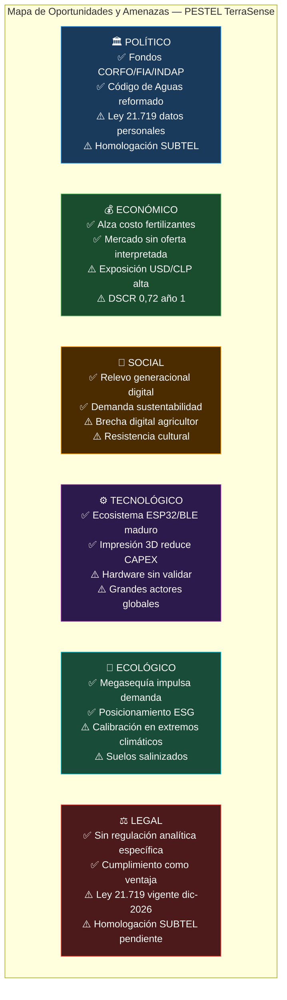

# TerraSense — Análisis PESTEL

> **Alcance:** Este análisis evalúa el entorno macro-externo del proyecto TerraSense en el contexto chileno. Se focaliza en las **oportunidades** y **amenazas** que el entorno presenta para la comercialización de un instrumento de medición de suelo con conectividad BLE, app móvil y plataforma en la nube.
>
> Complementa el análisis FODA interno ya documentado en este repositorio. Para las cifras económicas de referencia, ver [`docs/RESULTADOS_FINANCIEROS.md`](../docs/RESULTADOS_FINANCIEROS.md) y [`finanzas/supuestos.json`](../finanzas/supuestos.json).

---

## P — Político

### 🟢 Oportunidades

| # | Oportunidad | Fundamento |
|---|---|---|
| P-O1 | **Política nacional de agricultura de precisión** | El Ministerio de Agricultura y INIA Chile han impulsado programas de modernización del agro (Plan Estratégico Silvoagropecuario 2030). Esto crea demanda institucional y apertura cultural hacia herramientas de medición de terreno. |
| P-O2 | **Instrumentos de fomento productivo (CORFO, FIA, INDAP)** | Existen líneas de cofinanciamiento para MIPYMES agrotecnológicas y proyectos de innovación. Si TerraSense postula a CORFO o FIA, puede sustituir deuda cara y mejorar el VAN sin alterar el modelo base. El modelo no lo supone, pero la opción está abierta. |
| P-O3 | **Agenda digital del Estado** | Chile lidera en penetración de smartphones y digitalización en Latinoamérica. Las políticas de conectividad rural (Plan Nacional de Conectividad) amplían el alcance potencial del componente cloud de la plataforma. |
| P-O4 | **Incentivos a la eficiencia hídrica** | El Código de Aguas reformado (Ley 21.435, 2022) refuerza la gestión eficiente del recurso hídrico. TerraSense, al reducir el riesgo de riego innecesario, se alinea directamente con este marco regulatorio y puede usarse como argumento comercial ante cooperativas e INDAP. |

### 🔴 Amenazas

| # | Amenaza | Fundamento |
|---|---|---|
| P-A1 | **Inestabilidad regulatoria tecnológica** | La Ley 21.719 de Protección de Datos Personales entra en vigencia el 1 de diciembre de 2026. TerraSense almacena datos de georreferenciación, historial de lecturas y perfil de usuario en Supabase. El cumplimiento requiere revisión del esquema de consentimiento, retención y eliminación antes de esa fecha. |
| P-A2 | **Obligaciones SUBTEL pendientes** | La normativa de SUBTEL regula los equipos de radiofrecuencia (BLE opera en 2.4 GHz). El expediente de homologación del producto terminado aún no está iniciado. Comercializar sin homologación es una infracción que puede resultar en multas o retiro del mercado. |
| P-A3 | **Cambio de prioridades en políticas agrícolas** | Los ciclos electorales pueden reorientar el foco del apoyo público al agro. Una reducción en programas como INDAP o en los subsidios a la tecnificación reduciría el acceso de pequeños agricultores a recursos para comprar TerraSense. |

---

## E — Económico

### 🟢 Oportunidades

| # | Oportunidad | Fundamento |
|---|---|---|
| E-O1 | **Alza en el costo de insumos agrícolas** | El precio global de los fertilizantes nitrogenados y fosfatados aumentó sostenidamente desde 2021. A mayor costo de errar en la fertilización, mayor valor percibido de medir antes de aplicar. Esto desplaza la curva de demanda de TerraSense hacia la derecha. |
| E-O2 | **Mercado subatendido de sensores de suelo interpretados** | Ninguno de los competidores directos identificados (Hanna HI9814, Bluelab Pulse) ofrece prescripción agronómica contextualizada por etapa fenológica. El segmento que necesita interpretación, no solo datos crudos, no tiene un oferente claro en Chile. |
| E-O3 | **Precio competitivo respecto a sustitutos** | A $349.990 con IVA, TerraSense se ubica ~29 % bajo Hanna HI9814 ($491.827) y ~35 % bajo Bluelab Pulse ($538.990), con un diferenciador funcional que ninguno de ellos ofrece. El margen de contribución del 62,2 % permite absorber descuentos institucionales sin destruir rentabilidad. |
| E-O4 | **Modelo de pago único sin suscripción** | En un segmento con sensibilidad al gasto recurrente, la ausencia de suscripción mensual es una ventaja de posicionamiento y de adopción, especialmente en el pequeño agricultor con ingresos estacionales. |
| E-O5 | **Crecimiento del sector agrotech en LatAm** | El ecosistema de startups agrotech en Chile y la región crece. Esto facilita el acceso a rondas de inversión ángel o fondos sectoriales si el modelo se valida con ventas reales. |

### 🔴 Amenazas

| # | Amenaza | Fundamento |
|---|---|---|
| E-A1 | **Alta exposición al tipo de cambio USD/CLP** | La sonda 7-en-1 representa $48.000 de los $81.184 del BOM (59 %) y es importada. Un alza sostenida del dólar contrae la oferta y destruye margen. No hay SKU cotizados con moneda y vigencia que permitan cuantificar la exposición exacta hoy. |
| E-A2 | **DSCR de 0,72 el primer año** | El servicio de deuda del crédito bancario de $30.000.000 supera el EBITDA proyectado en 2027. La caja de arranque absorbe la diferencia, pero no hay holgura real. Si las ventas caen al escenario de estrés (130 u), el VAN es −$50.774.058. |
| E-A3 | **Precio sin validar en mercado** | Los $349.990 son una hipótesis económica; no hay ventas pagadas que los confirmen. Si el precio de mercado efectivo resulta ser inferior, el margen de contribución se comprime y el umbral de equilibrio sube. |
| E-A4 | **Sensibilidad al crédito bancario** | El modelo asume un crédito a 12 % efectivo anual y 10 años. No hay oferta bancaria vigente. Si el banco exige garantías inaceptables, tasa mayor o plazo menor, toda la estructura de financiamiento colapsa. |

---

## S — Social

### 🟢 Oportunidades

| # | Oportunidad | Fundamento |
|---|---|---|
| S-O1 | **Relevo generacional en el campo** | Los agricultores jóvenes y los hijos de agricultores con formación técnica son adoptadores tempranos de tecnología móvil. Este segmento es el canal de entrada más eficiente para TerraSense en el corto plazo. |
| S-O2 | **Creciente conciencia sobre sustentabilidad** | El consumidor final de alimentos y las cadenas de exportación presionan por producción sustentable. El agricultor que usa datos para reducir el uso de agua y fertilizantes puede certificar prácticas responsables, lo que abre mercados de mayor valor. |
| S-O3 | **Democratización del acceso tecnológico** | El precio del smartphone ha bajado significativamente en Chile. Junto al Plan Nacional de Conectividad, esto amplía la base de potenciales usuarios de la app móvil en zonas rurales que antes no tenían acceso. |
| S-O4 | **Valoración de la trazabilidad en la cadena exportadora** | Supermercados y compradores internacionales exigen trazabilidad de prácticas de cultivo. El historial de mediciones en la nube que ofrece TerraSense puede ser un insumo de trazabilidad valorado por este segmento. |

### 🔴 Amenazas

| # | Amenaza | Fundamento |
|---|---|---|
| S-A1 | **Brecha digital en el agricultor objetivo** | El segmento de mayor necesidad (pequeño agricultor, >50 años, zona rural) es también el de menor adopción tecnológica. La curva de adopción puede ser más lenta y costosa de lo que asume el modelo. |
| S-A2 | **Resistencia cultural al cambio de método** | La toma de decisiones por intuición y experiencia acumulada está profundamente arraigada. La propuesta de valor de TerraSense requiere que el agricultor cambie un hábito, lo que incrementa el costo de adquisición (CAC) y el tiempo de conversión. |
| S-A3 | **Concentración del mercado en zonas de alta conectividad** | El componente cloud y el pronóstico meteorológico requieren conectividad. En zonas de baja cobertura, la propuesta de valor se reduce al motor offline, que tiene menor diferenciación frente a competidores sin app. |

---

## T — Tecnológico

### 🟢 Oportunidades

| # | Oportunidad | Fundamento |
|---|---|---|
| T-O1 | **Ecosistema de componentes de bajo costo en expansión** | El mercado de módulos ESP32, sensores BLE y BME280 es maduro y competitivo. Esto permite iterar el hardware a bajo costo y acceder a proveedores alternativos, mitigando parcialmente el riesgo de la sonda 7-en-1. |
| T-O2 | **Madurez de Supabase y BLE como plataformas** | Ambas tecnologías tienen comunidades activas, documentación sólida y adopción creciente. Esto reduce el riesgo de obsolescencia tecnológica en el corto plazo y facilita el onboarding de nuevos desarrolladores. |
| T-O3 | **Crecimiento de la IA agrícola** | La proliferación de modelos de lenguaje e inferencia en el borde (edge AI) puede enriquecer el motor agronómico de TerraSense sin requerir conectividad permanente, profundizando el diferenciador sin conexión. |
| T-O4 | **Impresión 3D y ensamble externo como palanca de oferta** | La fabricación de la carcasa por impresión 3D y el ensamble de PCB externo eliminan la inversión en matricería, permitiendo lotes pequeños y rentables desde el año 1, lo que reduce el CAPEX inicial. |

### 🔴 Amenazas

| # | Amenaza | Fundamento |
|---|---|---|
| T-A1 | **Hardware sin validar en terreno** | La PCB V2 existe en KiCad pero no tiene firmware en el repositorio, no ha pasado ERC/DRC completo, ni tiene ensayos de autonomía, sellado IP ni repetibilidad de sensores. Comercializar desde el diseño actual sería prematuro y técnicamente riesgoso. |
| T-A2 | **Riesgo de obsolescencia de la sonda 7-en-1** | La sonda concentra el 59 % del BOM y no tiene SKU cotizado con vigencia. Si el proveedor descontinúa el modelo o sube el precio, la estructura de costo unitario se altera sin una alternativa probada disponible. |
| T-A3 | **Ingreso de grandes plataformas (John Deere, Trimble, Agrosmart)** | Si un actor global decide atacar el segmento de bajo costo con interpretación agronómica, puede superar la propuesta de TerraSense en escala, soporte y marca, sin que la empresa pueda responder en precio ni en red. |
| T-A4 | **Dependencia de la API de clima gratuita** | El componente meteorológico usa una API de terceros sin costo actual. Un cambio en el modelo de precios del proveedor o una interrupción del servicio afecta directamente la propuesta de valor cuando el usuario tiene conectividad. |

---

## E — Ecológico / Ambiental

### 🟢 Oportunidades

| # | Oportunidad | Fundamento |
|---|---|---|
| EC-O1 | **Crisis hídrica como catalizador de demanda** | Chile enfrenta una megasequía que ya supera 15 años en la zona central. En este escenario, la eficiencia hídrica no es opcional: es una necesidad de supervivencia del campo. TerraSense permite medir la humedad del suelo antes de regar, evitando pérdida de agua y cultivo. |
| EC-O2 | **Normativa ambiental en fertilizantes** | La regulación creciente sobre lixiviación de nitratos y contaminación de napas subterráneas crea presión sobre el agricultor para justificar cada aplicación de fertilizante. Un historial de mediciones de conductividad es un argumento de defensa ante una fiscalización. |
| EC-O3 | **Posicionamiento ESG para exportadores** | Las empresas agroexportadoras que adoptan tecnología de medición de suelo pueden acreditar métricas ESG (Environmental, Social and Governance) exigidas por compradores europeos y norteamericanos. TerraSense puede ser parte de ese stack de trazabilidad. |
| EC-O4 | **Reducción de huella de carbono por optimización de insumos** | Aplicar menos fertilizante (y más preciso) reduce la huella de carbono del proceso productivo. Esto abre la puerta a mercados de carbono y certificaciones de agricultura regenerativa. |

### 🔴 Amenazas

| # | Amenaza | Fundamento |
|---|---|---|
| EC-A1 | **Variabilidad climática extrema afecta calibración** | La conductividad eléctrica del suelo varía significativamente con la temperatura y la humedad. En condiciones de sequía extrema o helada, las lecturas pueden salir de los rangos de calibración del sensor, reduciendo la confianza en los resultados. |
| EC-A2 | **Salinización de suelos por riego con agua de baja calidad** | En zonas con agua de riego con alta conductividad eléctrica (CE), el sensor puede arrojar lecturas fuera del modelo empírico de N/P/K, lo que activa la salvaguarda de baja confianza. Esto limita la propuesta de valor en zonas áridas o con agua de canal de baja calidad. |

---

## L — Legal

### 🟢 Oportunidades

| # | Oportunidad | Fundamento |
|---|---|---|
| L-O1 | **Marco normativo aún en desarrollo para agrotech** | Chile no tiene una regulación específica para instrumentos de medición agronómica portátil que requiera certificación de exactitud analítica. Esto reduce las barreras de entrada regulatorias en comparación con, por ejemplo, la industria médica o química. |
| L-O2 | **Ley 21.719 como barrera para competidores informales** | La nueva ley de datos personales eleva el estándar de cumplimiento para cualquier app que almacene datos de usuario. TerraSense, al diseñar su arquitectura de privacidad desde cero (consentimiento, retención, eliminación), puede convertir el cumplimiento en una ventaja diferencial frente a competidores que no inviertan en esto. |

### 🔴 Amenazas

| # | Amenaza | Fundamento |
|---|---|---|
| L-A1 | **Ley 21.719 (Protección de Datos) — vigencia 01-12-2026** | Datos de georreferenciación, historial de mediciones y perfil de usuario están sujetos a esta ley. Si el producto se lanza antes de implementar consentimiento explícito, retención acotada y mecanismo de eliminación, existe riesgo de sanción. |
| L-A2 | **Homologación SUBTEL obligatoria** | Cualquier dispositivo que emita en frecuencias de radiofrecuencia (BLE en 2.4 GHz) debe estar homologado por SUBTEL antes de su comercialización en Chile. El expediente aún no está iniciado; sin homologación, vender el equipo es una infracción administrativa con multa y posible decomiso. |
| L-A3 | **Responsabilidad por recomendación agronómica** | Si un agricultor actúa sobre una recomendación de TerraSense y sufre pérdida de cultivo, puede reclamar responsabilidad. La app debe incluir disclaimers claros que establezcan que las recomendaciones son orientativas y no sustituyen la asesoría agronómica certificada. |
| L-A4 | **Régimen tributario y laboral de socios** | La condición tributaria y previsional de los socios fundadores como trabajadores de la empresa que controlan requiere revisión del contador. El modelo asume una estructura que debe ser validada legalmente antes de contratar. |

---

## Resumen Ejecutivo

### Prioridades de acción derivadas del PESTEL

| Prioridad | Factor | Acción concreta |
|---|---|---|
| 🔴 Crítica | L-A2 Homologación SUBTEL | Iniciar expediente de homologación BLE **antes** de fabricar unidades comerciales |
| 🔴 Crítica | L-A1 / P-A1 Ley 21.719 | Implementar consentimiento, retención y eliminación de datos antes del 01-12-2026 |
| 🔴 Crítica | T-A1 Hardware sin validar | Completar ERC/DRC, ruteo PCB, firmware y ensayos de terreno antes de comercializar |
| 🟠 Alta | E-A1 Exposición cambiaria | Cotizar BOM con SKU, moneda y vigencia para cuantificar exposición real |
| 🟠 Alta | E-A4 Crédito sin oferta bancaria | Obtener oferta bancaria real antes de comprometer el plan de lanzamiento |
| 🟡 Media | S-A1 Brecha digital | Incorporar onboarding simplificado y soporte presencial en el canal inicial |
| 🟡 Media | P-O2 CORFO/FIA | Evaluar postulación como opción para reducir el crédito bancario |
| 🟡 Media | EC-O1 Crisis hídrica | Usar la megasequía como argumento central en la pauta publicitaria Meta/Google |

---

*Elaborado en español de Chile conforme a la convención del repositorio. Documento de estado vigente; para la historia de cambios, ver el historial de git.*
