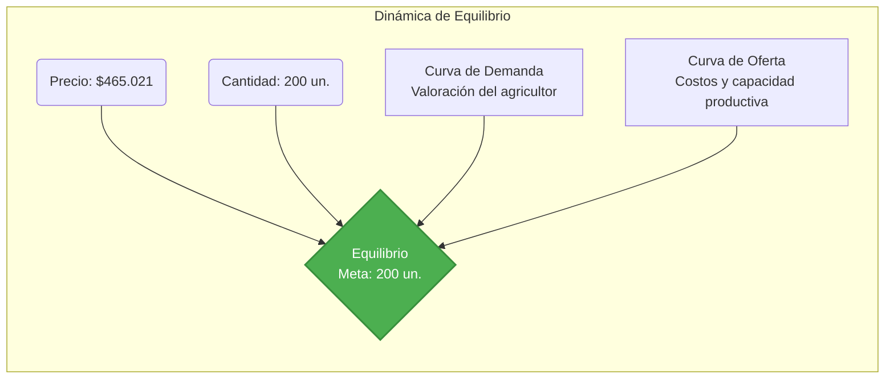
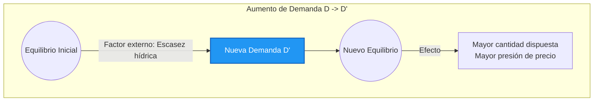
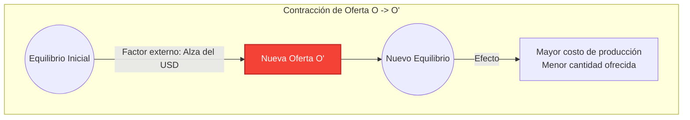

# TerraSense — Modelo Económico y Estrategia de Comercialización

Este documento define y justifica los parámetros económicos, de mercado y de marketing del proyecto TerraSense, estableciendo el marco comercial y financiero que rige su viabilidad.

> **Tesis central:** TerraSense no busca reemplazar la exactitud analítica de un laboratorio químico. Su modelo de negocio se basa en convertir mediciones rápidas de terreno en información comprensible y acciones agronómicas concretas, otorgando inmediatez en el campo.

## 1. Problema y Necesidad

- El agricultor frecuentemente decide sobre el riego y la fertilización con información insuficiente o tardía.
- El análisis de laboratorio es exacto, pero requiere extracción de muestra, tiempo de espera y un pago recurrente por análisis.
- Los medidores portátiles de la competencia entregan números crudos, sin contextualizar qué acción tomar agronómicamente.
- Por ende, el mercado necesita contexto inmediato, acciones comprensibles e historial centralizado.

*(El universo censal base para dimensionar el sector agrícola en Chile es de **175.556 explotaciones** según el VIII Censo Agropecuario y Forestal 2021).*

## 2. Producto y Propuesta de Valor

La arquitectura de la solución se compone de: **Hardware (Sonda) → Transmisión Bluetooth → Aplicación Móvil → Historial en la Nube**.

- Mediciones: 7 variables de suelo, complementadas con contexto meteorológico obtenido vía internet.
- Interfaz: Semáforo de criticidad (óptimo, precaución, crítico).
- Salida: Acciones agronómicas cualitativas adaptadas a la etapa fenológica del cultivo.
- Atributos comerciales: Motor de inferencia funcional sin conexión, georreferenciación, y un modelo de pago único (sin suscripción).

**Límites Técnicos y Comerciales Obligatorios:**
- El contexto meteorológico no lo mide el dispositivo local; **requiere conectividad a red** para la consulta a la API y carece de caché sin conexión.
- El motor de recomendaciones agronómicas **no calcula ni sugiere dosis en kg/ha** ni emite proyecciones de costos, dado que requeriría una precisión de laboratorio no disponible en terreno.
- Los valores de Nitrógeno (N), Fósforo (P) y Potasio (K) son inferidos a partir de la conductividad eléctrica. **No son un equivalente analítico confiable** para calcular fertilización, por ende, la aplicación los omite como cifras absolutas y prioriza una recomendación segura.

> **Propuesta de valor:** “Entregar al agricultor el significado directo de sus datos, indicándole las acciones preventivas y correctivas a tomar en tiempo real, sin depender de la conectividad rural ni de abonos recurrentes.”

## 3. Economía de Mercado y Asignación de Recursos

TerraSense opera y se justifica dentro de un **modelo de economía de mercado**. En este sistema, las decisiones fundamentales sobre **qué**, **cómo** y **para quién** producir no las toma una autoridad central, sino que se resuelven a través de la interacción libre entre oferta y demanda.

**Justificación del Modelo para TerraSense:**
- **Asignación eficiente de recursos privados:** Como empresa privada, decidimos cómo combinar nuestro capital, trabajo y tecnología (producción de hardware y desarrollo de software) para maximizar el valor entregado, respondiendo a una necesidad real y apremiante: la falta de información oportuna en el agro.
- **Formación libre de precios:** Nuestro precio propuesto de **$465.021 con IVA** no está fijado artificialmente. Considera nuestra estructura de costos (BOM de $80.076, importación, mano de obra) y busca equilibrarse con la disposición a pagar del cliente y los precios de los bienes sustitutos disponibles.
- **Soberanía del consumidor y bienes sustitutos:** El agricultor (consumidor final) dicta el éxito del proyecto. Ejerce su soberanía eligiendo libremente cómo resolver su necesidad, ponderando a TerraSense frente a medidores básicos (Bluelab, Hanna), laboratorios químicos o simplemente su intuición empírica.
- **Incentivos y diferenciación:** La competencia obliga a la innovación continua. TerraSense no compite por vender hardware crudo, sino por entregar valor a través de "decisiones" interpretadas agronómicamente, lo cual es nuestro incentivo de mercado para mejorar constantemente.

**Estructura de Mercado: Competencia monopolística**.
Existen múltiples oferentes (fabricantes de sensores, laboratorios, asesores) que satisfacen necesidades similares (información de suelo), pero los productos están **diferenciados**. Cada actor tiene cierto poder de mercado sobre su nicho. TerraSense posee este poder gracias a su motor agronómico sin conexión y soporte local, pero el precio de equilibrio a largo plazo sigue disciplinado por la disponibilidad de sustitutos cercanos. Las barreras de entrada son moderadas (requiere integración de hardware y desarrollo de software), existiendo libre entrada y salida.

## 4. Principio económico: Costo de oportunidad y Trade-offs

> **El costo de oportunidad de una decisión es el valor de la mejor alternativa a la que se renuncia.**

En una economía de mercado, los recursos son escasos (tiempo, dinero, esfuerzo) y elegir implica siempre un *trade-off*. Para la decisión de compra del agricultor:

| Alternativa | Beneficio Obtenido | Costo de Oportunidad (A lo que se renuncia) |
|---|---|---|
| Laboratorio Químico | Máxima exactitud analítica, mayor número de analitos y certificación oficial. | Inmediatez (demora 15-30 días), medición frecuente y bajo costo por nuevo muestreo. |
| TerraSense | Diagnóstico inmediato en el campo, alta frecuencia de medición y prescripción. | La exactitud analítica y la validez química certificada del laboratorio. |
| No medir (Intuición) | Ahorro del costo del equipo o del servicio ($0 inicial). | La seguridad en la decisión; riesgo de pérdida de cultivo por estrés hídrico o sobre-fertilización. |

**Trade-off estratégico de la empresa:** TerraSense renuncia deliberadamente a competir en exactitud analítica. A cambio, provee **contexto, alertas, historial y acciones sugeridas**. Optimiza el recurso más crítico del agricultor: la oportunidad de tomar a tiempo una decisión de riego o fertilización. TerraSense sirve para el monitoreo frecuente y rápido en el predio, estableciendo al laboratorio como un complemento para comprobaciones profundas.

## 5. Oferta y demanda: Equilibrio y Elasticidad

En nuestro modelo económico, las fuerzas de mercado interactúan de la siguiente forma:

- **Demanda:** Agricultores, cooperativas e instituciones que valoran las decisiones rápidas en el campo. Esta demanda es **relativamente elástica frente al precio** de los bienes sustitutos (si un medidor de la competencia baja su precio agresivamente, perdemos tracción). Sin embargo, **tiende a ser inelástica ante contingencias climáticas** (en extrema sequía, conocer la humedad del suelo pasa de ser un lujo a una necesidad operativa ineludible).
- **Oferta:** Equipos fabricados que TerraSense puede ensamblar, soportar y vender de forma rentable en Chile. La curva de oferta tiene pendiente positiva, condicionada por los costos marginales de ensamblaje, importación e innovación técnica.
- Precio de lista propuesto: **$465.021 con IVA** ($390.774 neto).
- Meta Año 1: **200 unidades**.
- Equilibrio operativo: **176 unidades**; incluyendo servicio de deuda: **204 unidades**.

**Gráfico Conceptual de Equilibrio:**

**Nota metodológica:** El precio y las 200 unidades son una **meta comercial y un plan financiero**, no un punto de equilibrio econométrico ya observado experimentalmente ni una demanda real ya validada.

## 6. Desplazamientos de la Curva de Demanda

Factores exógenos alteran la disposición a pagar del mercado, desplazando toda la curva de demanda (ceteris paribus):

| Variación | Causa o Factor | Movimiento de la Curva | Efecto Económico |
|---|---|---|---|
| D1: Escasez hídrica y salinidad | Mayor urgencia por revisar humedad y conductividad eléctrica (CE) | Demanda se desplaza a la **derecha** | Aumenta la demanda; el monitoreo inmediato y la preservación del cultivo ganan valor. |
| D2: Aumento en el costo de fertilizantes | Sube el riesgo y costo de aplicar abono ciegamente | Demanda se desplaza a la **derecha** | Incrementa la disposición a pagar por certidumbre; medir para no desperdiciar fertilizante. |

**Análisis Gráfico:**

El argumento económico conceptual es que decidir a ciegas conlleva un riesgo asimétrico. La certidumbre marginal (el valor de medir) crece directamente proporcional a la incertidumbre del entorno climático y de los precios de los insumos.

## 7. Desplazamientos de la Curva de Oferta

Del mismo modo, factores ligados a los costos de producción y tecnología desplazan la curva de oferta:

| Variación | Causa o Factor | Movimiento de la Curva | Efecto Económico |
|---|---|---|---|
| O1: Alza del tipo de cambio (USD) o de fletes | Aumento en el costo de importación de la sonda (representa el 59% del BOM) | Oferta se desplaza a la **izquierda** | Contracción de oferta; aumentan los costos marginales de producción, reduciendo el margen de contribución. |
| O2: Innovación tecnológica productiva | Impresión 3D optimizada y ensamble PCBA externo evitan altos costos fijos de matricería | Oferta se desplaza a la **derecha** | Expansión de oferta; baja la inversión de capital (CAPEX) inicial, permitiendo lotes pequeños rentables. |

**Visual y Análisis Gráfico:**

**Precisión sobre la exposición cambiaria:** El porcentaje de exposición del 88,6% fue descartado por falta de respaldo. Lo que sí es defendible: la sonda 7-en-1 concentra **$48.000 de los $80.076 del Costo de Materiales (BOM)** y la mayoría de los componentes son de importación directa. El impacto en la oferta por fluctuaciones de la divisa se proyecta ajustando el modelo financiero en `supuestos.json`.

## 8. Business Intelligence: Economía Unitaria y Financiamiento

El proyecto modela su economía en base a los siguientes parámetros (ver [RESULTADOS_FINANCIEROS.md](../docs/RESULTADOS_FINANCIEROS.md)):

- **Economía Unitaria:** El margen de contribución absorbe los costos de hardware (sensor BME280 y carcasa 3D) y el ensamblaje. La API de clima es gratuita, mientras que la impresión 3D se paga por cada equipo.
- **Inversión y Financiamiento:** Aporte propio de los socios de $9.000.000 más un crédito dimensionado de $30.000.000 a 10 años, diseñado para sostener una caja operativa estable los primeros 24 meses.
- **Evaluación y Escenarios:** Se proyectan los flujos a 5 años obteniendo un VAN al 20 %, TIR efectiva anual y payback del caso base. Existen escenarios de estrés (-35% ventas) y crecimiento (+50% ventas) que recalculan automáticamente la dotación de personal y el inventario.

## 9. Estrategia de Marketing y Análisis de Mercado

Para la estrategia de comercialización, aplicamos los conceptos fundamentales de marketing, enfocándonos en solucionar problemas reales en el campo más allá del simple hardware.

**Identificación Estratégica:**
- **La Necesidad Real (Need):** El agricultor no "necesita" tecnología por sí misma. Su necesidad subyacente es la **certidumbre y la seguridad** al tomar decisiones. Necesita optimizar el agua y los fertilizantes para evitar pérdidas de cultivo y asegurar el rendimiento económico de su campo. Es una necesidad operativa y de seguridad financiera.
- **El Deseo (Want):** El cliente desea satisfacer esa necesidad mediante una herramienta que sea intuitiva, rápida y portátil. A diferencia de las complejas redes de telemetría o los laboratorios con tiempos de espera, el agricultor *desea* un "asesor de bolsillo" que no dependa de conectividad constante (debido a la ruralidad) y que no le ate a suscripciones mensuales.
- **La Demanda (Demand):** Constituye la porción del mercado objetivo que no solo tiene este deseo, sino también la **disposición y el poder adquisitivo** para pagar el precio establecido de **$465.021**. Aquí apuntamos a pequeños y medianos agricultores, así como a asesores, donde la propuesta de valor supera el sacrificio económico.

**El Valor Real del Proyecto (Más allá de lo monetario):**
El valor de TerraSense no se calcula únicamente restando sus costos de su precio. Su **valor intangible y estructural** radica en:
- **Democratización Tecnológica:** Entregar agricultura de precisión a productores históricamente excluidos de las costosas soluciones de telemetría a gran escala.
- **Impacto Ambiental y Eficiencia:** Al fomentar decisiones basadas en datos e interpretar el momento fenológico, se evita la sobre-fertilización (protegiendo napas subterráneas) y se optimiza el recurso hídrico, promoviendo la sustentabilidad.
- **Tranquilidad (Peace of Mind):** Otorgar al agricultor la confianza absoluta de que sus decisiones agronómicas tienen respaldo técnico.

**Cliente inicial:** Pequeños y medianos agricultores chilenos; toman decisiones frecuentes de riego y fertilización; habitan zonas de conectividad irregular; muestran sensibilidad a incurrir recurrentemente en gastos de análisis de laboratorio o suscripciones.

**Adopción inicial:** Cultivos de mayor valor (frutales, hortalizas de exportación) y agricultores con smartphone, disposición digital y que prefieren una compra directa o cofinanciada.

## 10. Dimensionamiento del Mercado

| Nivel | Tamaño | Significado |
|---|---:|---|
| Mercado Total | 175.556 explotaciones | Universo censal teórico (VIII Censo Agropecuario y Forestal 2021, INE) |
| Mercado Accesible | ~120.000 | **Supuesto sin tabla de respaldo**: no aplica región, superficie, rubro ni disposición a pagar |
| Mercado Objetivo Año 1 | 200 | Meta comercial: 0,17 % del Mercado Accesible |
| Mercado Objetivo acumulado 5 años | 2.550 | 2,13 % del Mercado Accesible (200 + 350 + 500 + 650 + 850) |

**Gráfico:** embudo Mercado Total → Mercado Accesible → Mercado Objetivo.

**Lectura crítica:** El Mercado Total tiene fuente censal oficial ([INE](https://www.ine.gob.cl/censoagropecuario/resultados-finales/graficas-nacionales)). Sin embargo, el **Mercado Accesible y el Mercado Objetivo son supuestos internos**. Las 200 ventas del Año 1 surgen como un requerimiento para alcanzar el equilibrio con deuda (205 u), y deben validarse progresivamente en terreno.

## 11. Análisis de Competencia y Escalamiento Comercial

Precios exhibidos consultados el **04-09-2026**. **No comparar cantidad de variables sin método ni exactitud declarada**: es la crítica más fácil de recibir en la defensa.

| Alternativa | Precio exhibido | Alcance real |
|---|---:|---|
| [Hanna HI9814](https://hannachile.com/producto/medidor-portatil-e-impermeable-de-ph-ce-tds-temperatura-groline-hidroponia-hi9814/) | $491.827 | pH/CE/TDS/temperatura para **soluciones y sustratos**; no mide humedad de suelo |
| [Bluelab Pulse](https://delaferia.cl/products/pulse-meter-bluelab-temperatura-humedad-y-ec) | $538.990 | Humedad, CE y temperatura **con Bluetooth, app, historial y uso sin internet** |
| [FieldScout TDR 350](https://sandbox.specmeters.com/FieldScout-TDR350-Soil-Moisture-Meter) | No cotizado localmente | Humedad, CE y temperatura **con registro, GPS y Bluetooth** |
| Laboratorio | ~$35.000–$60.000/muestra | Referencia analítica; algunos servicios incluyen recomendación |
| **TerraSense** | **$465.021** | ~5 % bajo Hanna, ~14 % bajo Pulse. |

**Oportunidad estratégica:** TerraSense se ubica en el espacio entre el medidor de datos crudos y el laboratorio exacto pero menos inmediato. Nuestro principal **diferenciador** radica en la interpretación agronómica contextualizada por etapa fenológica y en la ausencia de pagos recurrentes o suscripciones.

**Diferenciador que sí podemos sostener:** la **interpretación agronómica contextualizada por etapa fenológica** y la ausencia de suscripción. El uso sin conexión y la georreferenciación **no son exclusivos** de TerraSense.

**Canales y escalamiento comercial:**
- **Año 1 (200 u):** Venta directa digital autogestionada por los socios a través de Shopify (emisión de factura, pasarela Webpay/Mercado Pago, logística con Bluexpress). La adquisición dependerá de un embudo Click-to-WhatsApp alimentado por pauta publicitaria en Meta/Google Ads dirigida a perfiles de recambio generacional y asesores.
- **Año 2 (350 u):** Escalamiento de pauta digital e inicio de consolidación del embudo de conversión validado empíricamente.
- **Año 3 (500 u) y Año 4 (650 u):** Aumento del presupuesto de adquisición e integración de agencia de marketing externa. Se proyecta un crecimiento escalonado de la dotación ajustada directamente a la capacidad de ensamble y soporte post-venta de los equipos activos.

## 12. Análisis Crítico: Decisiones y Riesgos

| Riesgo/decisión | Fundamento | Mitigación |
|---|---|---|
| No competir en exactitud | El valor está en frecuencia e interpretación | Posicionamiento complementario al laboratorio |
| N/P/K derivados de conductividad | La conductividad no identifica los tres nutrientes por separado | No mostrarlos como cifras interpretables, excluirlos del veredicto con baja confianza y mantener el laboratorio |
| Exposición cambiaria del BOM | La sonda es el 59 % del costo de materiales y casi todo es importado | Cotizar SKU con moneda y vigencia; lotes fraccionados y proveedores alternativos **por validar** |
| Precio $465.021 sin validar | No hay ventas pagadas que lo confirmen | Pilotos pagados antes de comprar volumen; sensibilidades a $349.990–$429.990 en el modelo |
| **Flujo de caja estrecho el año 1** | **El flujo de fondos es negativo el primer año** | Un solo crédito a 10 años, reserva dimensionada y cotización completa antes de firmar |
| Metas de venta no validadas | Son metas financieras, no preventas cerradas | Escenario de estrés a 130 u en el modelo; preventas y piloto antes de comprometer inventario |
| **Hardware pendiente de ejecución de pruebas** | La PCB V3 y carcasa están diseñadas con protocolos FAT y SAT, pero faltan las pruebas físicas | Ejecutar protocolos FAT y SAT documentados en terreno y laboratorio |
| **Cumplimiento normativo abierto** | SUBTEL, baterías, consumidor y Ley 21.719 (vigente 01-12-2026) | Revisar expediente del producto terminado antes de vender, no del módulo |

## 13. Conclusión del Modelo

1. TerraSense opera en una economía de mercado bajo competencia monopolística, con libertad de precio y sustitutos reales.
2. Su costo de oportunidad está declarado: renuncia a precisión de laboratorio para ganar inmediatez, frecuencia, portabilidad y prescripción.
3. La oferta es sensible al tipo de cambio: la sonda concentra el 60 % del costo de materiales y casi todo el BOM es importado. La demanda crece con la escasez hídrica y con el costo de decidir a ciegas.
4. La evaluación incluye **VAN, TIR efectiva anual y payback del proyecto**, con flujos mensuales a cinco años. Consultar la tabla de [resultados financieros](../docs/RESULTADOS_FINANCIEROS.md). La remuneración de los socios ya está incluida en nómina.
5. **El primer año es el riesgo.** El flujo de fondos de 2027 es negativo, y el escenario de estrés (−35 % de ventas) da un VAN negativo. Si ese escenario se materializa, corresponde **redimensionar el negocio**, no estirar el plazo de la deuda.
6. La oportunidad radica en **transformar datos agronómicos en decisiones ejecutables sin pretender reemplazar al laboratorio químico** — y en decirlo con los límites explícitos, que es lo que hace defendible el trabajo.

> “TerraSense no promete saber más que un laboratorio; promete ayudar al agricultor a decidir mejor entre un análisis y el siguiente”.

---

# Preguntas Frecuentes sobre el Modelo de Negocio

### 1. ¿Cómo se financia el desembolso inicial y por qué un banco prestaría a una empresa recién creada?
La inversión inicial es de **$29.856.916**, financiada al 100 % por un crédito bancario a 10 años, con cuota fija de $417.839 al 12 % efectivo anual. Como condición de entrada, el banco exige un **pie propio de los socios de $8.957.075** ($4.478.537 cada uno). El pie equivale al **30 % del crédito**; no se descuenta del principal y no se devuelve. El crédito financia la **caja de arranque** que sostiene la operación, garantizando que la caja nunca baje de $11.823.718.

**La respuesta honesta a la segunda parte: todavía no sabemos si un banco prestaría.** No tenemos oferta bancaria. La tasa del 12 % efectivo anual y el 2 % de gastos de apertura son presupuestos, no un CAE cotizado. FOGAPE es una garantía estatal sujeta a evaluación, no un subsidio ni una aprobación automática. Si el banco no ofrece el plazo o exige garantías inaceptables, **reducimos el lanzamiento y validamos preventas**; no lo sustituimos por un crédito personal.

### 2. ¿Por qué no dependen de un subsidio estatal como CORFO?
Porque el proyecto debe poder nacer y pagar sus deudas por sí mismo. Postular sigue siendo una opción abierta y beneficiosa: si se adjudica, sustituye deuda cara y mejora el resultado. El modelo no lo supone.

### 3. ¿Cómo se ve la caja del primer año?
La utilidad del ejercicio de 2027 es de **$-2.006.707** y el flujo de fondos es de **$-896.067**. Esto significa que la operación por sí sola no cubre sus compromisos y el déficit sale de la caja de arranque. La caja acumulada nunca baja de **$11.823.718**.

Esto es una advertencia, no un adorno: el primer año no tiene holgura. Por eso el crédito se dimensionó al mínimo que sostiene la reserva, y por eso pedimos cotización completa y probamos meses débiles antes de firmar. **La reserva financia transitorios, no pérdidas permanentes.**

### 4. ¿Cómo se dimensionó la reserva y qué cubre?
Tres meses de gastos fijos —incluido marketing— y tres cuotas del crédito, más un 10 % del desembolso inicial. **La reserva está dentro de la caja**: no es un gasto ni se suma dos veces a la inversión. El inventario inicial cubre solo los dos primeros meses de ventas, redondeado a lotes de 10 equipos; el lote de 10 es una **política de simulación, no un mínimo de compra del proveedor**. Con lead times reales habrá que recalcularlo.

### 5. ¿Por qué $465.021 y no un precio menor?
Porque el precio anterior se sostenía sobre una economía unitaria incompleta: no incluía comisiones de canal, contabilizaba una mano de obra directa que ya estaba en la nómina y usaba una carga patronal que no es defendible.

Con el margen objetivo neto exigido por el modelo sobre el Costo de Materiales (BOM) y gastos, el precio se eleva a **$465.021 con IVA** ($390.774 neto). Frente a las referencias consultadas el 04-09-2026 — **Hanna HI9814 a $491.827** y **Bluelab Pulse a $538.990** — quedamos aproximadamente 5 % y 13 % por debajo.

**Pero es una hipótesis, no un precio demostrado.** No hay ventas pagadas que lo validen. Los precios menores se conservan solo como sensibilidad en el modelo.

### 6. ¿De dónde salen las 200 unidades del año 1?
Las 200 unidades son la meta comercial del primer año, repartida por una estacionalidad mensual explícita. El equilibrio operativo es de 176 equipos y el equilibrio con servicio de deuda es de 205 equipos.

No las llamamos «conservadoras» por ser un número pequeño: **vender 200 unidades de un producto nuevo puede ser difícil**. La distribución mensual del modelo, concentrada en el segundo semestre, es estacionalidad hipotética. Por eso corremos un escenario de estrés a 130 unidades — que da VAN negativo.

### 7. ¿Qué pasa si el tipo de cambio sube fuertemente?
La sonda 7-en-1 representa **$48.000 de los $81.184 del BOM (59 %)** y la mayoría de los componentes son importados, de modo que la exposición cambiaria es alta. **No damos un porcentaje exacto de exposición al dólar porque aún no tenemos SKU cotizados con moneda y vigencia**; cuantificarlo es parte de la cotización pendiente.

El modelo permite evaluar el efecto cambiando el BOM en `supuestos.json` y regenerando. La mitigación planteada es compra fraccionada, proveedores alternativos y stock de seguridad, pero **ninguna está probada con un proveedor real**.

### 8. ¿Por qué comprar TerraSense si un laboratorio químico es más exacto?
Porque satisfacen necesidades distintas y complementarias. El laboratorio da exactitud analítica; TerraSense busca dar frecuencia e interpretación **sin cobro por lectura**.

Dos precisiones que hay que hacer explícitas: **no es «costo marginal cero»** — el uso implica tiempo de muestreo, limpieza, calibración, energía, mantenimiento y desgaste; y **no todo laboratorio demora 15–30 días ni entrega un informe sin recomendación**: [INIA documenta servicios que sí la incluyen](https://www.inia.cl/laboratorios/). Tampoco corresponde monetizar cada lectura como un laboratorio evitado mientras declaramos que no son sustitutos.

### 9. ¿El equipo realmente mide N, P y K?
**No.** La sonda mide conductividad eléctrica y temperatura; los tres registros asociados a N, P y K derivan de un modelo empírico. **Una lectura de conductividad no identifica concentraciones independientes de nitrógeno, fósforo y potasio**, ni siquiera por debajo del umbral de salinidad.

Por eso la app **no presenta esos valores como cifras interpretables en ningún caso**, marca la lectura como de baja confianza cuando la conductividad es alta y la excluye del veredicto. La salvaguarda por salinidad es parcial, **no una validación analítica**. Ninguna decisión de fertilización debe tomarse a partir de esos registros: para eso está el análisis de laboratorio.

### 10. ¿Cuánto ganan los fundadores y cuál es su retorno financiero?
Hay que separar dos cosas que el guion anterior mezclaba.

**Remuneración por trabajar:** base mensual bruta por socio en moneda del año inicial de $600.000, $700.000, $850.000, $1.000.000 y $1.200.000, más reajuste anual del 3 %. **No son sueldos líquidos**, y el modelo reserva un 35 % adicional sobre sueldos para gratificación y cargas patronales — un presupuesto, no una tasa legal única. La condición laboral y tributaria de socios con control de la empresa **debe revisarla el contador**.

**Retorno del capital: no lo publicamos.** No existe política de dividendos definida, y el flujo de fondos generado es caja de la empresa, **no un depósito al socio**. La cifra anterior de «+$79.588.754 limpios en el bolsillo» se retira: sumaba el sueldo bruto del socio al retorno de su inversión, lo que no tiene significado financiero. Los dividendos y prepagos se decidirán anualmente con información real y con la reserva cubierta.

### 11. ¿Por qué contabilidad externa y no un contador interno?
Porque el volumen de trabajo del primer año no justifica una contratación indefinida, y un contador general en Chile tiene un costo de empresa muy superior al de un servicio externo para una microempresa en Régimen Pro Pyme.

El modelo presupuesta **contador externo desde el mes 1** — antes incluso, para la apertura, el régimen tributario y el diseño de remuneraciones — a **$120.000/mes** más $20.000 por cada FTE contratado, reajustado. Hay [ofertas públicas de planes contables](https://www.contadoresdigitales.cl/planes-contables/), pero no todos incluyen inventario, nómina y renta anual: hay que pedir propuesta completa.

**Aclaración importante:** *no existe una regla que obligue a contratar un contador interno en un año determinado.* Lo que existe son obligaciones tributarias desde el inicio y una necesidad operativa de asesoría.

### 12. ¿Qué falta para que estas cifras sean defendibles?
1. BOM cotizado con SKU, precio neto y bruto, moneda, fecha, vigencia y costo puesto en taller.
2. Ensayos de terreno y laboratorio: incertidumbre por variable, repetibilidad, comportamiento con salinidad y humedad.
3. Embudo comercial observado y ventas piloto pagadas: precio efectivo, CAC, devoluciones y horas de soporte.
4. Oferta bancaria efectiva en CLP a tasa fija, con todos los cargos y garantías exigidas.
5. Revisión contable independiente del régimen, remuneraciones, PPM e IVA efectivo.
6. Obligaciones revisadas ante SUBTEL, baterías, protección al consumidor y datos personales (Ley 21.719, vigente desde el 1 de diciembre de 2026).

---

# Fuentes y Resumen de Cifras Vigentes

- [Informe maestro](../README.md)
- **[Modelo económico: supuestos y límites](../docs/MODELO_ECONOMICO.md)**
- **[Resultados financieros vigentes](../docs/RESULTADOS_FINANCIEROS.md)** — fuente de todas las cifras de este guion
- **[Plan de validación](../docs/PLAN_VALIDACION.md)** — qué falta para cerrar cada hallazgo
- **[Auditoría del 04-09-2026](../finanzas/historico/documentacion/docs/AUDITORIA_READMES_2026-09-04.md)** — origen de estas correcciones
- [Flujo de caja y financiamiento](../Flujo%20de%20caja%20y%20financiamiento%20-%20TerraSense.xlsx) — generado por `finanzas/modelo.py`
- [Estudio de viabilidad](../docs/INFORME%201%20.docx.md#analisis-economico)
- [Especificaciones y filosofía](../docs/INFORME%201%20.docx.md#propuesta)
- [Comparativa competitiva](../docs/INFORME%201%20.docx.md#viabilidad-tecnica)

## Cuadro Maestro de Cifras Vigentes

Consultar el [resumen económico del README](../README.md#finanzas-y-modelo-económico) y los [resultados financieros generados](../docs/RESULTADOS_FINANCIEROS.md): BOM por componente, margen, inversión, crédito, flujo anual, VAN, TIR y payback. Estas tablas se actualizan con `python finanzas/modelo.py`.
