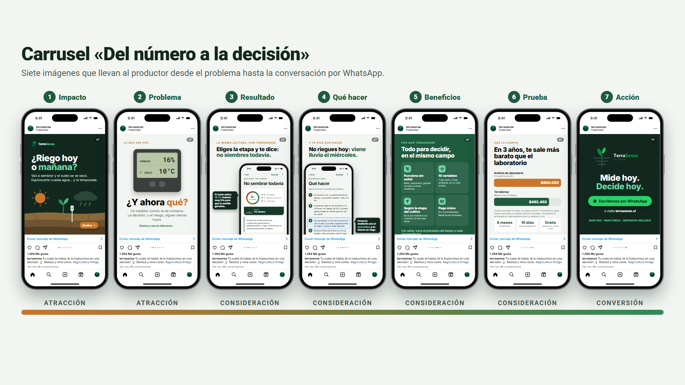
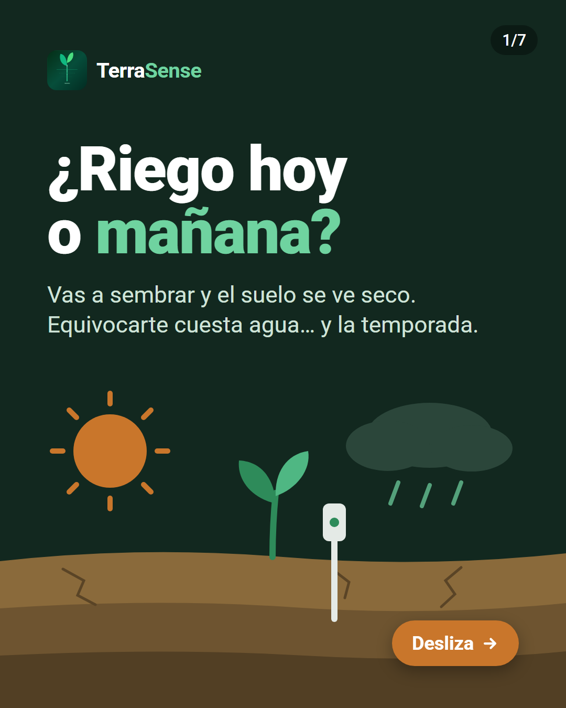
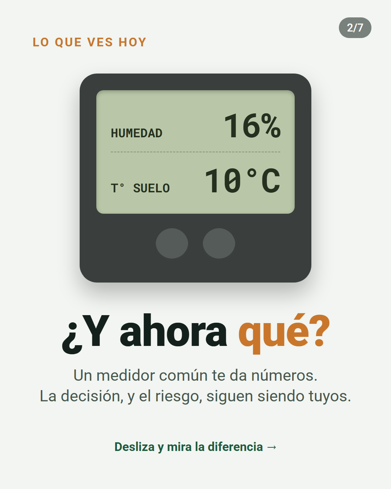
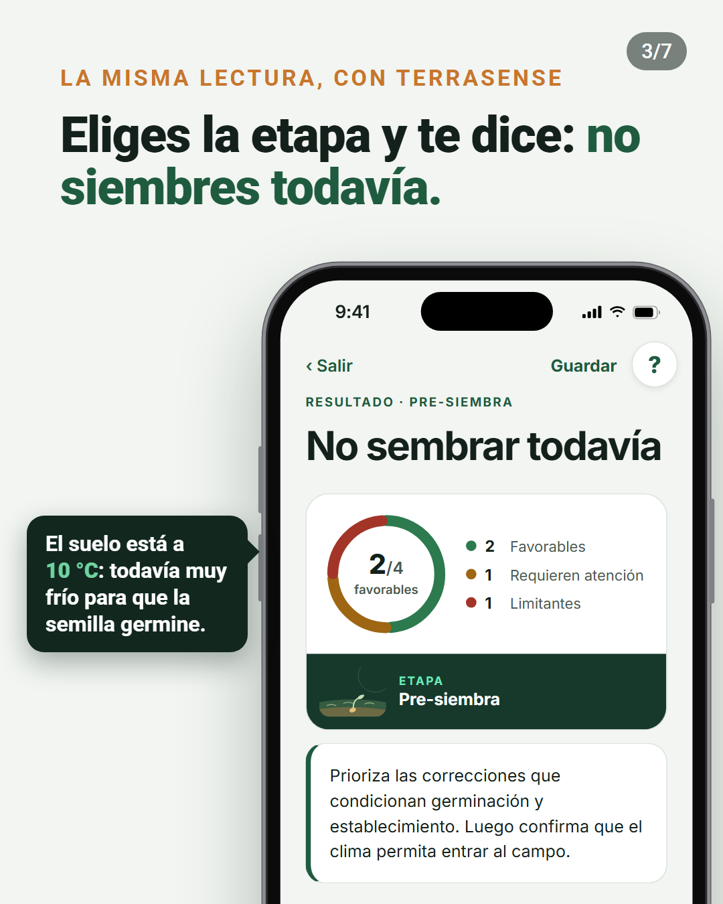
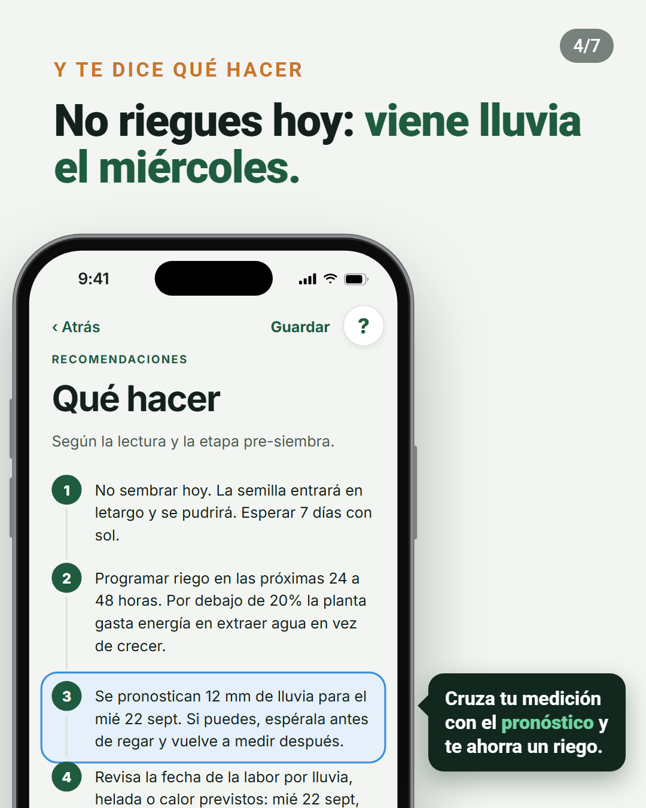
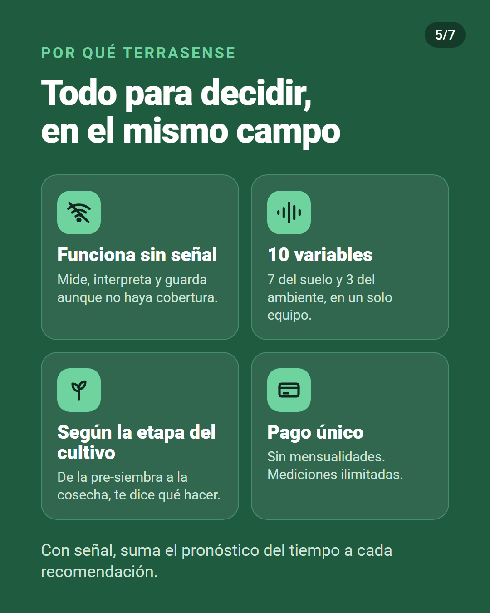
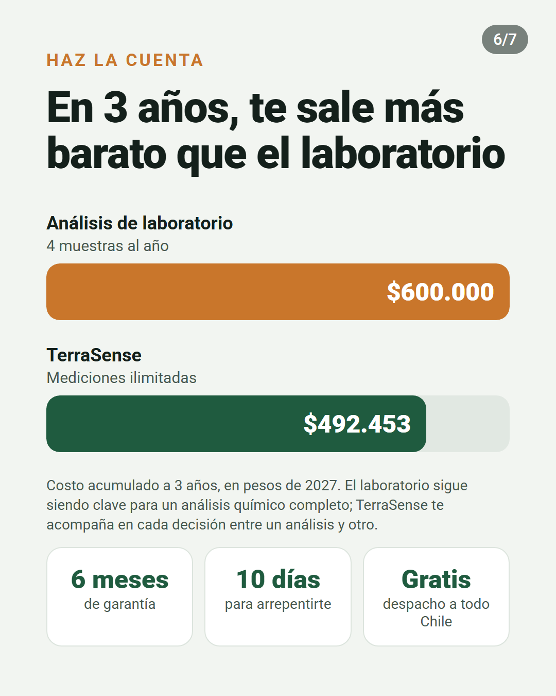
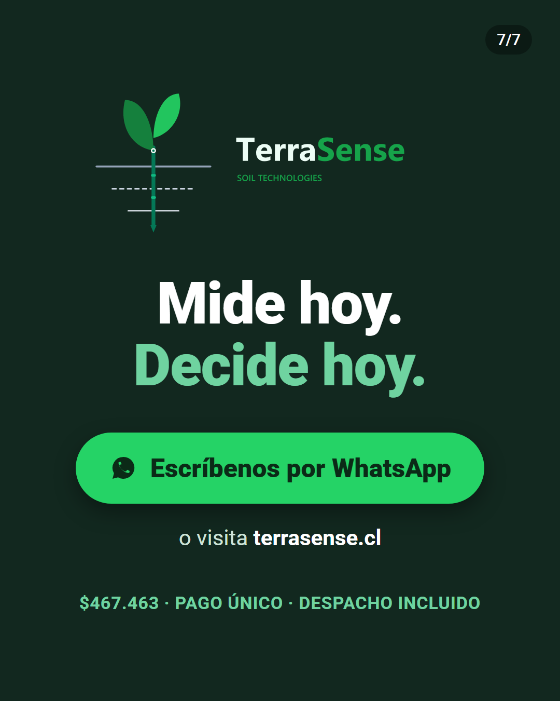

**INACAP**

Ingeniería en Electrónica y Sistemas Inteligentes

Asignatura: Comercialización de Tecnologías

 

 

# PLAN DE MARKETING TERRASENSE

### Evaluación N° 2: Comercialización y Tecnologías

Sonda de suelo portátil con interpretación agronómica en el teléfono

 

**Integrantes:** Álvaro Nicolás Villena Torrejón · Alan Paul Escobar Rojas

**Docente:** Kattia Maldonado Toledo

 

Santiago, Chile

Octubre de 2026

---

## Índice

- Introducción
1. Fundamentos del marketing aplicados a TerraSense
2. Análisis estratégico del entorno: PESTEL y FODA
3. Consumidor objetivo y factores que influyen en la compra
4. Recorrido del consumidor: «Sigue al consumidor»
5. Mercado, competencia, diferenciación y posicionamiento
6. Estrategia de marketing: las 7P
7. Publicidad y promoción
8. Marketing digital
9. Identidad visual y comunicación de marketing
10. Fuentes de información
- Conclusiones
- Referencias bibliográficas
- Anexos

**Índice de tablas**

- Tabla 1. Necesidad, deseo y demanda
- Tabla 2. Microentorno de TerraSense
- Tabla 3. Análisis PESTEL
- Tabla 4. Matriz FODA
- Tabla 5. Cruce FODA y decisiones del plan
- Tabla 6. Segmentación y mercado meta
- Tabla 7. Factores que influyen en la compra
- Tabla 8. Recorrido del consumidor y acciones por etapa
- Tabla 9. Tamaño del mercado
- Tabla 10. Comparación con la competencia
- Tabla 11. Costo acumulado para el agricultor
- Tabla 12. Objetivos de marketing del primer año
- Tabla 13. Niveles del producto
- Tabla 14. Estrategias de precio evaluadas
- Tabla 15. Síntesis de las 7P
- Tabla 16. Estrategia publicitaria
- Tabla 17. Estructura del carrusel y fundamento de cada imagen
- Tabla 18. Presupuesto de publicidad y promoción del primer año
- Tabla 19. Estrategia por canal digital
- Tabla 20. Indicadores digitales
- Tabla 21. Fuentes de información y su uso

**Índice de figuras**

- Figura 1. Mapa de posicionamiento
- Figura 2. Carrusel «Del número a la decisión»
- Figura 3. Logotipo de TerraSense
- Figura 4. Paleta de colores de la marca
- Figura 5. Pantallas de la aplicación TerraSense

---

## Introducción

En Chile, muchas decisiones de riego y fertilización se toman con información insuficiente o tardía. El análisis de suelo en laboratorio es exacto, pero exige tomar una muestra, enviarla y esperar el resultado. Los medidores portátiles responden en el momento, pero entregan números que el agricultor debe saber interpretar. En medio de una sequía prolongada y con insumos caros, decidir por intuición cuesta agua, fertilizante y cosecha.

TerraSense es una sonda de suelo portátil que mide siete variables del suelo y tres del ambiente, y envía la lectura por Bluetooth a una aplicación móvil. La aplicación interpreta la lectura según la etapa en que está el cultivo (pre-siembra, crecimiento vegetativo, floración o cosecha) y recomienda una acción concreta. Funciona sin señal en el campo; con señal, suma el pronóstico del tiempo y respalda el historial en la nube. Se vende con un pago único, sin suscripción.

El **objetivo** de este informe es diseñar el plan de marketing de TerraSense: a quién se dirige, por qué ese consumidor lo preferiría frente a las alternativas y cómo llegará a él. Cada capítulo corresponde a un criterio de la rúbrica de evaluación y, en el mismo orden, aplica los conceptos de la asignatura al proyecto para fundamentar una decisión. El precio, los costos y la meta de ventas provienen del modelo económico del proyecto; las cifras de demanda y conversión son hipótesis, y el plan indica cómo validarlas.

---

## 1. Fundamentos del marketing aplicados a TerraSense

### 1.1 El marketing como creación de valor

La American Marketing Association (2017) define el marketing como el conjunto de actividades y procesos para crear, comunicar, entregar e intercambiar ofertas que tienen valor para los clientes, los socios y la sociedad. Para Kotler y Armstrong (2017), es el proceso por el que las personas obtienen lo que necesitan y desean mediante la creación y el intercambio de valor. En ambas definiciones, la palabra clave es **valor**.

Para TerraSense, el valor no está en la sonda como objeto, sino en lo que el agricultor puede decidir con ella: regar a tiempo, no sembrar en un suelo frío o salino, no entrar con maquinaria a un suelo saturado. Como empresa de la era digital, además, la relación con el cliente no termina en la venta: continúa en la aplicación, el historial y el soporte por WhatsApp.

### 1.2 Necesidad, deseo y demanda

**Tabla 1. Necesidad, deseo y demanda**

| Concepto | Definición | Aplicación a TerraSense |
|---|---|---|
| Necesidad | Estado de carencia percibida | Certidumbre para decidir el riego y la fertilización sin arriesgar el cultivo ni malgastar agua e insumos |
| Deseo | Forma que toma la necesidad según la cultura y la persona | Una herramienta portátil y fácil de entender que diga qué hacer en el mismo campo, funcione sin señal y no cobre mensualidad |
| Demanda | Deseo respaldado por poder adquisitivo | Pequeños y medianos agricultores y asesores dispuestos a pagar $467.463 con IVA; la meta del primer año es de 200 equipos |

TerraSense no crea la necesidad de decidir bien, que ya existe: da forma a cómo se satisface.

### 1.3 Valor, satisfacción e intercambio

- **Valor:** beneficios percibidos menos costos económicos, de tiempo y de esfuerzo. TerraSense suma beneficios (respuesta inmediata, interpretación por etapa, mediciones ilimitadas) y reduce costos: su pago único queda por debajo del gasto acumulado en análisis de laboratorio durante el tercer año de uso habitual (sección 5.3).
- **Satisfacción:** depende de que el producto cumpla las expectativas. Por eso el plan no promete lo que el equipo no hace: no reemplaza al laboratorio ni calcula dosis de fertilizante, y el nitrógeno, el fósforo y el potasio se presentan como valores de referencia.
- **Intercambio:** el agricultor entrega dinero y recibe una herramienta y un servicio continuo (aplicación, historial y soporte). El intercambio se repite cuando recomienda el equipo a otros productores.

### 1.4 Mercado, oferta y miopía de marketing

El **mercado** de TerraSense son los compradores actuales y potenciales de información sobre el suelo: productores agrícolas y quienes los asesoran. La **oferta de mercado** combina la sonda, la aplicación, la interpretación agronómica, el historial y el soporte.

Levitt (1960) llamó **miopía de marketing** al error de enfocarse en el producto y no en la necesidad: los clientes no compran taladros, compran agujeros. TerraSense no vende una sonda de siete variables, **vende decisiones a tiempo en el campo**. Si se viera como fabricante de sensores, competiría por precio contra medidores importados; como proveedor de decisiones, compite por utilidad.

De ahí nace su **propuesta de valor**: *saber en el mismo campo, en segundos, qué hacer con el riego y la siembra según la etapa del cultivo, aun sin señal y con un solo pago.*

### 1.5 Orientación de la empresa y microentorno

TerraSense adopta una **orientación al marketing social**: satisfacer al cliente y, a la vez, cuidar el bienestar de la sociedad a largo plazo. Medir antes de regar o fertilizar reduce el uso innecesario de agua y fertilizante, en línea con la tendencia ESG (ambiental, social y de gobernanza). Las demás orientaciones se descartan: la orientación a la producción llevaría a competir solo por precio; la orientación al producto, a sumar sensores que nadie interpreta (la miopía de marketing); y la orientación a las ventas, a presionar una compra técnica que, mal hecha, termina en reseñas negativas.

**Tabla 2. Microentorno de TerraSense**

| Actor | En TerraSense | Implicancia para el plan |
|---|---|---|
| Empresa | Dos socios que desarrollan, producen y venden, apoyados por un contador | Canales que dos personas puedan atender en todo Chile |
| Proveedores | Fabricante de la sonda, de las placas y de los componentes electrónicos | Casi todo el costo es importado y depende del dólar |
| Intermediarios | Pasarela de pago, courier y plataformas de publicidad | Venta directa, sin distribuidores el primer año |
| Clientes | Agricultores y asesores. Es un **mercado industrial**: compran para producir, no para consumir | Valoran el retorno económico y la factura con IVA recuperable |
| Competidores | Medidores portátiles, laboratorios y asesoría agronómica | Diferenciarse por la interpretación, no por el hardware |
| Públicos | INDAP, cooperativas, juntas de vigilancia, medios agrícolas, SUBTEL y SERNAC | Prescriptores del productor y reguladores que exigen requisitos antes de vender |

---

## 2. Análisis estratégico del entorno: PESTEL y FODA

### 2.1 Análisis PESTEL

El análisis PESTEL (factores políticos, económicos, sociales, tecnológicos, ecológicos y legales) revisa las fuerzas del macroentorno que la empresa no controla. Cada factor termina en una decisión del plan.

**Tabla 3. Análisis PESTEL**

| Factor | Evidencia | Oportunidad o amenaza | Decisión del plan |
|---|---|---|---|
| Político | INDAP mantiene el Programa de Asesoría Técnica (SAT), que acompaña a pequeños productores en la adopción de tecnologías (Ministerio de Agricultura, s.f.) | Oportunidad: los asesores del programa son prescriptores naturales | Programa de asesores referentes (sección 7) |
| Económico | El precio de los fertilizantes subió con fuerza en 2021 y 2022 (ODEPA, s.f.); los componentes del equipo se pagan en dólares | Oportunidad: fertilizar sin medir es más caro. Amenaza: el alza del dólar encarece el equipo | Mensaje centrado en el ahorro de insumos; precio que se recalcula si cambia el costo |
| Social | El 95,1 % de los hogares rurales tiene internet y la brecha con lo urbano bajó a 1,6 puntos (Nogales, 2026) | Oportunidad: el agricultor ya usa smartphone y redes sociales. Matiz: internet en la casa no asegura señal en el campo | Venta y comunicación digitales; producto que funciona sin señal |
| Tecnológico | El Bluetooth de bajo consumo y las aplicaciones móviles abaratan la medición portátil | Oportunidad para un equipo accesible. Amenaza: copia por actores grandes | Diferenciarse por la interpretación agronómica, más difícil de copiar que el hardware |
| Ecológico | La zona entre Coquimbo y La Araucanía acumula un déficit de lluvias cercano al 30 % desde 2010 (CR2, 2015) | Oportunidad: medir la humedad del suelo pasa de lujo a necesidad | Mercado meta en la zona central; mensaje de cuidado del agua |
| Legal | Ley N° 21.398: garantía legal de seis meses y retracto de 10 días en compras a distancia (SERNAC, s.f.). Ley N° 21.719 de datos personales, vigente desde diciembre de 2026 (BCN, 2024). Conformidad de equipos de radio ante SUBTEL (SUBTEL, 2026). Ley N° 20.920 de responsabilidad del productor sobre las baterías | Amenaza si se ignoran; oportunidad de generar confianza si se comunican | Garantía y retracto informados antes del pago; política de privacidad; venta solo tras la conformidad de radio; recepción de baterías usadas |

### 2.2 Análisis FODA

**Tabla 4. Matriz FODA**

| | Positivo | Negativo |
|---|---|---|
| **Interno** | **Fortalezas**   F1. Recomendación agronómica según la etapa del cultivo, no solo datos.   F2. Funciona sin señal; con señal suma el pronóstico.   F3. Pago único, sin suscripción.   F4. Diez variables en un solo equipo.   F5. Precio menor que los medidores importados comparables. | **Debilidades**   D1. Marca nueva, sin clientes que den testimonio.   D2. Menor exactitud que un laboratorio; nitrógeno, fósforo y potasio solo como referencia.   D3. Estanqueidad IP67 y conformidad de radio por acreditar antes de vender.   D4. Equipo de dos personas para vender, producir y dar soporte. |
| **Externo** | **Oportunidades**   O1. Megasequía y presión por usar mejor el agua.   O2. Insumos caros: medir antes de fertilizar ahorra dinero.   O3. Conectividad rural casi universal en los hogares.   O4. Asesores técnicos de INDAP en terreno.   O5. Relevo generacional: productores jóvenes más abiertos a la tecnología. | **Amenazas**   A1. Competidores con marca y distribución establecidas (Hanna, Bluelab).   A2. Desconfianza hacia la tecnología y preferencia por la experiencia propia.   A3. Alza del dólar.   A4. Exigencias regulatorias antes de vender. |

### 2.3 Del análisis a las decisiones

**Tabla 5. Cruce FODA y decisiones del plan**

| Estrategia | Combinación | Decisión del plan |
|---|---|---|
| FO: usar fortalezas para aprovechar oportunidades | F1 + F2 + O1 | Posicionar a TerraSense como la herramienta para decidir el riego en plena sequía, aun sin señal: concepto «Del número a la decisión» (sección 7) |
| FO | F3 + O2 | Mostrar el ahorro frente al gasto recurrente en análisis con un comparador de costos en el sitio web (sección 5.3) |
| DO: superar debilidades con oportunidades | D1 + O4 | Ganar confianza a través de asesores que el agricultor ya respeta: programa de asesores referentes |
| DO | D4 + O3 | Venta y soporte por WhatsApp y sitio web, para que dos personas cubran todo Chile |
| FA: usar fortalezas contra amenazas | F1 + F5 + A1 | Competir por utilidad y precio, no por marca: comparación directa con Hanna y Bluelab |
| DA: reducir debilidades y amenazas | D2 + D3 + A2 + A4 | No prometer lo que no está demostrado: sin promesas de exactitud de laboratorio y venta solo con la conformidad de radio |

El entorno es favorable, pero el análisis muestra que la principal barrera no es el mercado, sino la **confianza**: una marca nueva vendiendo tecnología a un consumidor que desconfía de ella. Esa conclusión ordena el resto del plan.

---

## 3. Consumidor objetivo y factores que influyen en la compra

### 3.1 Consumidor objetivo

**Tabla 6. Segmentación y mercado meta**

| Variable | Criterio | Mercado meta |
|---|---|---|
| Geográfica | Déficit hídrico y agricultura intensiva | De Coquimbo a La Araucanía, con foco inicial en Valparaíso, Metropolitana, O'Higgins y Maule |
| Demográfica | Tamaño y tipo de explotación | Pequeños y medianos productores de hortalizas, frutales, viñas y cultivos anuales |
| Psicográfica | Actitud frente a la tecnología | Usan smartphone a diario y buscan reducir riesgos |
| Conductual | Frecuencia de decisión y beneficio buscado | Deciden riego y fertilización varias veces por temporada, hoy por intuición o con análisis esporádicos |

El mercado meta tiene dos segmentos, descritos como perfiles de cliente construidos a partir de la segmentación y validados con la guía de entrevistas del Anexo C:

- **El productor.** Hombre o mujer de 35 a 60 años, con 5 a 30 hectáreas de hortalizas o frutales en la zona central. Riega con agua escasa, compra fertilizante cada temporada y hace un análisis de suelo al año, cuando lo hace. Usa WhatsApp y Facebook a diario y ve videos en YouTube. Teme perder una siembra o una floración; su objeción es «estos aparatos son caros y no los entiendo».
- **El asesor técnico.** Agrónomo o técnico agrícola de 25 a 45 años que visita varios campos por semana y necesita respaldar sus recomendaciones con datos que el productor entienda. Su objeción es la exactitud: necesita saber qué puede afirmar con el equipo y qué no. Además de usuario, es el principal **influenciador** de la compra del productor.

Según la teoría de difusión de innovaciones (Rogers, 2003), los primeros compradores serán innovadores y adoptadores tempranos: productores jóvenes o con cultivos de mayor valor, para quienes un error cuesta más.

### 3.2 Factores que influyen en la compra

**Tabla 7. Factores que influyen en la compra**

| Factor | Cómo se manifiesta en el consumidor | Cómo influye en la compra | Respuesta del plan |
|---|---|---|---|
| **Cultural:** cultura | En el campo se valora la experiencia: «siempre lo hemos hecho así» | Frena la adopción si el producto parece reemplazar su conocimiento | Mensaje de complemento: el equipo confirma o corrige la intuición, no la reemplaza |
| **Cultural:** subcultura | Productores jóvenes, que crecieron con smartphone, conviven con productores tradicionales | Los jóvenes adoptan antes e influyen en su familia y sus vecinos | Primeras campañas dirigidas a productores jóvenes y a hijos que trabajan en el campo familiar |
| **Cultural:** clase social | Ingresos variables según la temporada | Sensibilidad al precio y rechazo a los pagos mensuales | Pago único y comparación con el gasto en análisis |
| **Social:** grupos de referencia | Vecinos, cooperativas, asesores y grupos de WhatsApp | La recomendación de un par pesa más que un anuncio | Programa de referidos, días de campo y testimonios reales |
| **Social:** roles y estatus | El productor que usa tecnología se percibe como moderno y profesional | Comprar refuerza su imagen de buen productor | Comunicación que muestra al productor como quien decide con datos |
| **Psicológico:** motivación (Maslow) | Necesidad de seguridad: proteger la cosecha y el ingreso | Compra para evitar pérdidas, no por novedad | Mensajes de riesgo evitado: no sembrar en suelo frío, no regar de más |
| **Psicológico:** percepción | La tecnología se asocia a complejidad y fallas | Un anuncio técnico se lee como «no es para mí» | Demostraciones de 30 segundos: medir y leer la recomendación |
| **Psicológico:** aprendizaje y actitudes | Malas experiencias previas con equipos difíciles o sin soporte | Generan un rechazo duradero | Guía en la aplicación, soporte humano y garantía comunicada |
| **Personal:** edad y ciclo de vida | El productor mayor prefiere el trato personal; el joven, la autogestión | Distintos caminos de compra según la edad | Compra asistida por WhatsApp o compra directa en el sitio |
| **Personal:** ocupación e ingresos | Ingresos concentrados en la cosecha | Compra cuando hay caja | Pauta reforzada antes de la temporada; pago en cuotas con tarjeta |
| **Personal:** estilo de vida | Jornadas largas, poco tiempo para aprender | Valora lo rápido y simple | Medición en menos de 20 segundos y recomendación en lenguaje claro |

**Cómo decide.** Según el modelo de Howard y Sheth (1969), TerraSense es una **compra extensa**: de alto valor, nueva para el comprador y técnica, por lo que el productor busca bastante información y necesita confianza antes de pagar. El modelo de Engel, Kollat y Blackwell (Blackwell et al., 2006) explica que los factores externos (la opinión del asesor y la cultura del campo) y los internos (la motivación de seguridad) actúan a la vez durante todo el proceso. Por eso el plan combina, en cada etapa del recorrido, presencia digital y recomendación personal.

---

## 4. Recorrido del consumidor: «Sigue al consumidor»

El recorrido sigue las cinco etapas del proceso de decisión de compra. Para cada una se define qué vive el consumidor, dónde se encuentra con la marca, qué hace TerraSense y cómo se mide.

**Tabla 8. Recorrido del consumidor y acciones por etapa**

| Etapa | Qué piensa y hace el consumidor | Punto de contacto | Acción concreta de TerraSense | Indicador |
|---|---|---|---|---|
| **1. Necesidad** | «Las plantas se ven estresadas», «gasté mucho en fertilizante y no sé si sirvió» | Redes sociales; conversación con el asesor o un vecino | Videos cortos sobre los síntomas del riego mal calibrado y el costo de fertilizar sin medir | Alcance y reproducciones |
| **2. Búsqueda** | Recuerda su último análisis (búsqueda interna); pregunta a su asesor y busca en Google y YouTube «cómo medir la humedad del suelo» (búsqueda externa) | Buscador, YouTube, grupos de WhatsApp, asesores | Anuncios en el buscador para esas consultas; tutoriales en YouTube; asesores referentes que conocen el equipo. Como la marca es nueva, debe aparecer en la búsqueda externa | Clics y visitas al sitio; consultas por referido |
| **3. Evaluación** | Compara laboratorio, medidores importados o seguir igual; duda de la exactitud. Solo tres a cinco opciones llegan a su conjunto evocado | Sitio web, WhatsApp, días de campo | Comparador de costo acumulado; ficha de qué mide y qué no; testimonios; demostración en un día de campo | Uso del comparador; conversaciones iniciadas |
| **4. Compra** | Le cuesta pagar por internet a una marca nueva; quiere hablar con alguien | WhatsApp, sitio web, pasarela de pago | Atención humana por WhatsApp con enlace de pago; garantía y retracto informados antes de pagar; despacho incluido a todo Chile | Conversión de conversación a venta |
| **5. Postcompra** | Abre la caja, se pregunta si fue buena decisión, mide por primera vez | Empaque, aplicación, WhatsApp | Guía de inicio impresa y en pantalla; mensaje a las 24 horas; seguimiento a los 15 días; invitación a reseñar y a referir | Clientes que miden la primera semana; recomendación neta |

La etapa 5 es la más crítica. En compras de alto valor aparece la **disonancia cognitiva** («¿hice bien?»), y retener a un cliente cuesta cerca de cinco veces menos que conseguir uno nuevo. Un cliente que no logra su primera medición se convierte en una reseña negativa; uno que la logra, en el testimonio que la marca no tiene (debilidad D1). Por eso la vinculación se hace con un solo botón y la aplicación guía la primera medición.

---

## 5. Mercado, competencia, diferenciación y posicionamiento

### 5.1 Tamaño del mercado

**Tabla 9. Tamaño del mercado**

| Nivel | Tamaño | Origen |
|---|---:|---|
| Mercado total (TAM, *Total Addressable Market*) | 175.556 explotaciones | VIII Censo Agropecuario y Forestal 2021 (INE, 2022) |
| Mercado servible (SAM, *Serviceable Addressable Market*) | ≈ 120.000 explotaciones | Estimación del equipo |
| Mercado objetivo del año 1 (SOM, *Serviceable Obtainable Market*) | 200 equipos | Meta del modelo económico: 0,17 % del mercado servible |
| Meta acumulada a cinco años | 2.550 equipos | 200 + 350 + 500 + 650 + 850 |

Solo el mercado total tiene fuente oficial. Como la meta del primer año equivale a menos de dos de cada mil explotaciones, la restricción no es el tamaño del mercado, sino la capacidad de llegar a él y ganar su confianza.

### 5.2 Competencia

**Tabla 10. Comparación con la competencia**

| Alternativa | Tipo | Precio | Qué entrega | Qué no entrega |
|---|---|---:|---|---|
| **TerraSense** | Directa | **$467.463** | Siete variables del suelo y tres del ambiente; recomendación según la etapa del cultivo; funciona sin señal | Exactitud de laboratorio; dosis de fertilizante |
| Bluelab Pulse | Directa | $538.990 | Humedad, conductividad y temperatura, con Bluetooth e historial | pH, nitrógeno, fósforo y potasio; recomendación |
| Hanna HI9814 | Directa parcial | $491.827 | pH, conductividad y temperatura en soluciones | Humedad del suelo; interpretación |
| FieldScout TDR 350 | Directa | Sin precio local | Humedad, conductividad y temperatura, con GPS | Recomendación; distribución en Chile |
| Laboratorio de suelos | Indirecta | ≈ $40.845 a $50.000 por muestra | Análisis exacto y completo | Inmediatez |
| Asesoría agronómica | Indirecta | ≈ $60.000 por visita | Diagnóstico experto | Presencia continua |
| Intuición del productor | Sustituto | Sin costo directo | Rapidez y experiencia | Respaldo con datos |

Precios con IVA publicados por los vendedores en Chile y consultados el 04-09-2026; laboratorio según la lista 2026 de la Universidad de Chile; asesoría según consultas del equipo. El mercado es de **competencia monopolística**: muchos oferentes con productos diferenciados. **Ningún competidor directo combina la medición del suelo y del ambiente con una recomendación por etapa del cultivo**: esa es la oportunidad de diferenciación.

### 5.3 Costo de uso frente a las alternativas

**Tabla 11. Costo acumulado para el agricultor**

| Alternativa | Uso | Año 1 | 3 años | 5 años | 10 años |
|---|---|---:|---:|---:|---:|
| TerraSense (incluye kits de batería y un segundo equipo en el año 6) | Ilimitado | $467.463 | $492.453 | $492.453 | $984.906 |
| Laboratorio, uso habitual | 4 muestras al año | $200.000 | $600.000 | $1.000.000 | $2.000.000 |
| Laboratorio, uso intensivo | 20 muestras al año | $1.000.000 | $3.000.000 | $5.000.000 | $10.000.000 |
| Asesoría agronómica | 2 visitas al año | $120.000 | $360.000 | $600.000 | $1.200.000 |

Pesos de 2027, sin descuento. Con uso habitual, el laboratorio supera a TerraSense durante el tercer año; con uso intensivo, el primero. El laboratorio sigue siendo necesario para los análisis químicos completos: TerraSense cubre el seguimiento frecuente entre un análisis y el siguiente.

### 5.4 Diferenciación

- **Diferencias sostenibles:** la recomendación según la etapa del cultivo; diez variables en un solo equipo; el pronóstico integrado a la recomendación cuando hay señal; el pago único frente a la telemetría con planes mensuales.
- **Atributos valiosos, pero no exclusivos:** el funcionamiento sin conexión, el historial y el Bluetooth, que Bluelab también ofrece. Se comunican como parte del producto, nunca como la diferencia, porque prometer como exclusivo algo que la competencia tiene destruye la credibilidad.

### 5.5 Posicionamiento

**Figura 1. Mapa de posicionamiento.** Valoración cualitativa según dos atributos que el consumidor valora: cuánto interpreta la lectura y cuán rápido llega la respuesta.

**Declaración de posicionamiento:** *Para los pequeños y medianos agricultores y sus asesores, que necesitan decidir el riego y la fertilización a tiempo, TerraSense es la sonda de suelo portátil que convierte la medición en una recomendación clara según la etapa del cultivo, en el mismo campo y aun sin señal. A diferencia de los medidores que solo entregan números y de los análisis que tardan semanas, TerraSense entrega la decisión en el momento, con un pago único.*

**Frase de posicionamiento:** «Del número a la decisión».

El posicionamiento es **claro**, porque ocupa un cuadrante que nadie más ocupa: alta interpretación con respuesta inmediata. Es **coherente**, porque se apoya en lo que el producto efectivamente hace. Y es **atractivo**, porque responde al temor principal del consumidor: equivocarse con el agua, el fertilizante o la siembra.

---

## 6. Estrategia de marketing: las 7P

McCarthy (1960) propuso las 4P (producto, precio, plaza y promoción) para productos físicos. Booms y Bitner (1981) las ampliaron a las 7P, sumando **personas**, **pruebas tangibles** y **procesos**, para los casos en que la experiencia después de la venta define la retención. TerraSense usa las **7P**: la sonda es un bien físico, pero su valor llega a través de una aplicación, un historial y un soporte continuo, y como marca nueva depende de que cada cliente logre su primera medición.

La mezcla se diseña para cumplir los siguientes objetivos:

**Tabla 12. Objetivos de marketing del primer año**

| Objetivo | Meta medible |
|---|---|
| Ventas | 200 equipos entre abril y diciembre de 2027 |
| Generación de demanda | 2.000 conversaciones calificadas por WhatsApp |
| Conversión | 10 % de las conversaciones terminan en venta |
| Prueba social | 30 clientes con testimonio publicado en los primeros seis meses |
| Satisfacción | Recomendación neta (NPS, *Net Promoter Score*) mayor que 50 a los 15 días de la compra |

### 6.1 Producto

**Tabla 13. Niveles del producto**

| Nivel (Kotler y Keller, 2016) | Qué incluye |
|---|---|
| Beneficio central | Decidir a tiempo el riego, la fertilización y el momento de entrar al campo |
| Producto real | Sonda de siete variables (humedad, temperatura, conductividad eléctrica, pH, nitrógeno, fósforo y potasio) y sensor del ambiente (temperatura, humedad del aire y presión); batería recargable por USB-C; carcasa para el campo; vinculación con un botón; aplicación para Android y iPhone; empaque con guía de inicio |
| Producto aumentado | Recomendaciones para cuatro etapas del cultivo (pre-siembra, crecimiento vegetativo, floración y cosecha); pronóstico de cinco días; historial en la nube; soporte por WhatsApp; garantía legal de seis meses |

**Decisiones:** una sola versión en el lanzamiento, para simplificar la producción y el soporte de un equipo de dos personas; mejoras continuas a través de actualizaciones de la aplicación; límites declarados en el propio producto (nitrógeno, fósforo y potasio como referencia).

**Justificación:** el consumidor busca simplicidad y confianza, no más funciones (sección 3). El producto está en la etapa de **introducción** de su ciclo de vida: la categoría es poco conocida, de modo que la comunicación debe primero explicar qué resuelve.

### 6.2 Precio

**Precio de lista: $467.463 con IVA** ($392.826 neto), pago único con despacho incluido. Se deriva del costo total del proyecto, exigiendo un 30 % de utilidad. Luego se contrasta con las estrategias de precio de la asignatura:

**Tabla 14. Estrategias de precio evaluadas**

| Estrategia | Evaluación para TerraSense | Decisión |
|---|---|---|
| Penetración (precio bajo para ganar participación) | Quedaría bajo el costo con la utilidad exigida, y en un instrumento de medición un precio muy bajo se lee como mala calidad | Descartada |
| Descremado (precio alto de lanzamiento) | Choca con un consumidor sensible al precio y con importados ya establecidos | Descartada |
| Psicológico (precio terminado en 990) | $459.990 quedaría bajo el costo con la utilidad exigida | Descartada |
| **Por valor** (refleja lo que el cliente percibe) | Más variables e interpretación que los importados, a menor precio, y más barato que el laboratorio desde el tercer año | **Adoptada** |

**Justificación:** el precio queda un 5,2 % bajo Hanna y un 13,5 % bajo Bluelab, con más beneficio (mercado); responde a la objeción «es caro» con el costo acumulado (consumidor); y no se rebaja con descuentos permanentes, porque el posicionamiento se basa en la utilidad y no en el precio más bajo. Se ofrece pago en cuotas con tarjeta y factura para quien tiene giro, que recupera el IVA.

### 6.3 Plaza

**Decisiones:** canal **directo y digital** el primer año, con tienda en línea propia, pasarela de pago y atención por WhatsApp; despacho incluido a todo Chile por courier ($6.000 por equipo, ya incluido en el costo); asesores referentes y días de campo como canal de influencia en terreno; desde el tercer año, evaluación de distribuidores de insumos agrícolas como punto de venta físico.

**Justificación:** el consumidor está disperso por el país y ya usa WhatsApp (Tabla 3, factor social); el canal directo conserva el margen y el contacto con cada cliente, y es el único que dos personas pueden atender a escala nacional.

### 6.4 Promoción

**Decisiones:** combina las tres herramientas de la asignatura: **publicidad** pagada en Meta, Google y YouTube; **relaciones públicas** con medios agrícolas, cooperativas y ferias; y **promociones** que no rebajan el precio de lista (programa de asesores referentes, Campo Pionero y referidos). Se detalla en las secciones 7 y 8.

**Justificación:** es una compra extensa y el consumidor desconfía de la tecnología. La línea común es **educar antes de vender**: primero entender el problema y ver el equipo funcionar.

### 6.5 Personas

**Decisiones:** los dos socios dan el **soporte en vivo** y la venta el primer año, con el lenguaje del campo; uno de ellos asume la **gestión de redes sociales** hasta que, en 2029, se incorpora una persona dedicada a marketing; los asesores referentes y los primeros clientes actúan como **voces externas** de la marca. Todos siguen el mismo protocolo: responder dentro de la jornada, explicar los límites del equipo y no prometer exactitud de laboratorio.

**Justificación:** para una marca nueva, la confianza se construye con trato humano y con personas a quienes el agricultor ya les cree, no con celebridades.

### 6.6 Pruebas tangibles

**Decisiones:** testimonios en video de los primeros clientes; publicación de la conformidad de radio ante SUBTEL y del ensayo de estanqueidad IP67 en cuanto se obtengan (el equipo se comunicará como resistente al agua solo con ese ensayo); sitio web con ficha técnica y comparador de costos; aplicación con identidad propia (Figura 5); empaque con guía de inicio y número de serie.

**Justificación:** la venta es a distancia y la marca es desconocida. Las pruebas tangibles reducen la incertidumbre de quien no puede tocar el equipo antes de comprarlo.

### 6.7 Procesos

1. **Consulta:** el cliente escribe por WhatsApp desde un anuncio o el sitio; fuera de horario recibe una respuesta automática con la ficha y el comparador.
2. **Asesoría previa:** se revisa su cultivo y se envía el enlace de pago.
3. **Pago y despacho:** confirmación de la garantía y el derecho a retracto; despacho con seguimiento.
4. **Puesta en marcha:** botón PAIR durante 3 segundos y guía en pantalla para la primera medición.
5. **Postventa:** seguimiento a las 24 horas y a los 15 días; garantía legal de seis meses; recepción de la batería al fin de su vida útil.

**Justificación:** cada paso elimina una fricción de las etapas de compra y postcompra del recorrido (Tabla 8). Cada equipo pasa una prueba de aceptación antes de embalarse, registrada por número de serie, lo que respalda la garantía.

### 6.8 Síntesis y coherencia de la mezcla

**Tabla 15. Síntesis de las 7P**

| P | Decisión | Por el consumidor | Por el mercado | Por el posicionamiento |
|---|---|---|---|---|
| Producto | Sonda de diez variables con recomendación por etapa | Busca saber qué hacer, no un número | Ningún competidor recomienda por etapa | Hace posible «del número a la decisión» |
| Precio | $467.463, por valor, sin rebajas | Rechaza las mensualidades | Bajo los importados comparables | Se compite por utilidad, no por precio |
| Plaza | Directa y digital, despacho incluido | Disperso y usuario de WhatsApp | Competidores venden por catálogo | Contacto directo que sostiene la confianza |
| Promoción | Educar antes de vender | Desconfía de la tecnología | Categoría poco conocida | Muestra la decisión, no la ficha técnica |
| Personas | Socios y asesores referentes | Confía en sus pares y en su asesor | Marca nueva sin reputación | La confianza es el principal activo |
| Pruebas tangibles | Testimonios, certificaciones y comparador | No puede tocar el equipo antes | Competidores con marca conocida | Respaldan lo que la marca promete |
| Procesos | Venta asistida y puesta en marcha con un botón | Poco tiempo y temor a lo complejo | Marca nueva que no puede fallar al inicio | La primera medición confirma la promesa |

Al revisar la mezcla, la variable más débil al lanzamiento son las **pruebas tangibles**: aún no hay clientes con testimonio y las certificaciones se obtienen antes de la venta. Por eso el plan prioriza el programa Campo Pionero y la publicación de las certificaciones.

---

## 7. Publicidad y promoción

**Tabla 16. Estrategia publicitaria**

| Elemento | Definición |
|---|---|
| Público | Productores de 30 a 60 años de hortalizas, frutales y viñas de la zona central, y asesores técnicos de 25 a 45 años |
| Objetivo | **De comunicación:** que el mercado meta asocie TerraSense con «saber qué hacer con el suelo en el mismo campo». **Comercial:** 200 equipos vendidos en 2027, con 2.000 conversaciones por WhatsApp y una conversión del 10 % |
| Mensaje | «Mide tu suelo y sabe qué hacer, ahí mismo. Sin esperar resultados, sin pagar mensualidades.» |
| Concepto creativo | **«Del número a la decisión».** La pantalla de un medidor común muestra «pH 5,5 / CE 2.500»; la de TerraSense dice «Suelo ácido para maíz en pre-siembra: confirma con un análisis antes de encalar». El contraste muestra la diferencia sin tener que explicarla |
| Medios | Facebook, Instagram, YouTube, buscador de Google, WhatsApp, días de campo y ferias agrícolas |
| Formatos | Videos verticales de 15 a 30 segundos; carruseles de antes y después; anuncios de texto en el buscador; tutoriales de 3 a 5 minutos; pendón y volante para ferias |
| Llamado a la acción | «Escríbenos por WhatsApp y te ayudamos a elegir» (principal); «Calcula cuánto te cuesta decidir a ciegas» (comparador en el sitio) |
| Tono | Cercano y directo, de tú, con el vocabulario del campo |

**Piezas principales:**

1. **Video «Diez segundos»:** un productor entierra la sonda, saca el teléfono y lee la recomendación. Texto final: «¿Riego hoy? Ahora lo sabes».
2. **Carrusel «Del número a la decisión»:** siete imágenes que llevan del problema a la conversación por WhatsApp. Es la pieza principal de la campaña y se desarrolla a continuación.
3. **Anuncio de búsqueda:** «Medidor de humedad de suelo con recomendación. Funciona sin señal. Despacho a todo Chile».

**Pieza principal: carrusel «Del número a la decisión»**

Es un anuncio de siete imágenes para Instagram y Facebook, en formato vertical 4:5 (1080 × 1350 píxeles), que el productor recorre deslizando hacia el lado. Su estructura sigue el modelo AIDA (atención, interés, deseo y acción), que describe cómo un anuncio lleva a una persona desde notarlo hasta actuar (Strong, 1925), y cada imagen corresponde a una etapa del recorrido del consumidor (sección 4) y a un nivel del embudo digital (sección 8). Las pantallas de la aplicación que aparecen en las imágenes 3 y 4 muestran el resultado que entrega el motor agronómico de TerraSense para una lectura real de pre-siembra: el usuario elige la etapa y la aplicación responde. No son una simulación de diseño.

**Figura 2. Carrusel «Del número a la decisión».** Las siete imágenes, en el orden en que el productor las ve, publicadas en un teléfono. Maqueta: los «me gusta» y comentarios de la publicación son ilustrativos. El Anexo D muestra cada imagen en tamaño completo.

**Tabla 17. Estructura del carrusel y fundamento de cada imagen**

| Imagen | Qué muestra | Función (AIDA) | Etapa del recorrido | Por qué funciona |
|---|---|---|---|---|
| 1. Impacto | «¿Riego hoy o mañana?» sobre un suelo seco, con la invitación «Desliza» | Atención | 1. Necesidad | La primera impresión se forma en una fracción de segundo y condiciona cómo se lee lo que viene después (Lindgaard et al., 2006; Asch, 1946). Una pregunta sin responder genera curiosidad, que empuja a deslizar (Loewenstein, 1994) |
| 2. Problema | Un medidor común que solo dice «Humedad 16 % · Suelo 10 °C» y la pregunta «¿Y ahora qué?» | Interés | 2. Búsqueda | Hace visible la brecha entre medir y decidir. Plantea el riesgo como pérdida («equivocarte cuesta agua y la temporada»), porque una pérdida pesa más que una ganancia del mismo tamaño (Kahneman y Tversky, 1979) |
| 3. Resultado | La pantalla de la aplicación: «No sembrar todavía», con 2 de 4 variables favorables | Interés y deseo | 3. Evaluación | Responde la pregunta abierta con la propuesta de valor: el número convertido en decisión, que es el concepto creativo de la campaña |
| 4. Qué hacer | Las recomendaciones de la aplicación, con la lluvia pronosticada para el día siguiente | Deseo | 3. Evaluación | Muestra un beneficio concreto y comprobable, ahorrarse un riego, en lugar de una promesa general |
| 5. Beneficios | Sin señal, diez variables, según la etapa del cultivo y pago único | Deseo | 3. Evaluación | Responde de antemano las objeciones del consumidor (sección 3): señal, complejidad y mensualidades |
| 6. Prueba | Costo a tres años frente al laboratorio; garantía, retracto y despacho | Deseo | 3 y 4. Evaluación y compra | Reduce el riesgo percibido de una compra extensa. Con los primeros clientes se agregarán testimonios, porque las personas se guían por lo que hacen otras como ellas (Cialdini, 2009) |
| 7. Acción | «Escríbenos por WhatsApp» y el precio con pago único | Acción | 4. Compra | Un solo llamado a la acción, el mismo de toda la campaña, para no dividir la atención |

**Por qué la primera imagen es la más importante.** En una red social, el usuario decide en un instante si se detiene o sigue de largo, y esa primera impresión pesa más que la información que llega después: es el efecto de primacía (Asch, 1946). Por eso la imagen 1 no muestra el producto, sino el problema del agricultor, con una pregunta que él mismo se hace, letra grande y alto contraste. La pregunta abre una brecha de curiosidad, es decir, una diferencia entre lo que la persona sabe y lo que quiere saber, que la motiva a buscar la respuesta (Loewenstein, 1994). Esa curiosidad activa el circuito de recompensa del cerebro, en el que participa la dopamina, y mejora el recuerdo de lo que se aprende a continuación (Gruber et al., 2014). Así, la respuesta de la imagen 3 se recuerda mejor porque el productor la estaba esperando.

**Coherencia con el plan.** Según el modelo de la caja negra visto en clase, el carrusel es el estímulo de marketing que entra en la mente del productor, y cada imagen apunta a un factor de la Tabla 7: la motivación de seguridad (imágenes 1 y 2), la percepción de que la tecnología es complicada (una pantalla simple en la imagen 3) y la sensibilidad al precio (imagen 6). Además, usa la identidad visual de la sección 9 y deja un solo mensaje por imagen.

**Acciones promocionales** (ninguna rebaja el precio de lista):

- **Programa de asesores referentes:** el asesor que refiere una venta recibe una comisión del 5 % ($23.301 por equipo), ya incluida en el costo. Convierte a los prescriptores en una red de venta sin costo fijo.
- **Campo Pionero:** los primeros 30 compradores reciben una puesta en marcha por videollamada y participan como casos de estudio. Los cupos son realmente limitados, lo que crea urgencia sin inventar plazos, y generan los testimonios que hoy faltan.
- **Referido entre clientes:** quien recomienda a otro productor recibe un kit de mantenimiento (soluciones de calibración y un cepillo para los electrodos).
- **Días de campo y relaciones públicas:** demostraciones con cooperativas y equipos de asesoría de INDAP, presencia en ferias regionales y un comunicado de lanzamiento a medios agrícolas, con el ángulo de medir antes de regar en plena sequía.

**Calendario:** expectativa en marzo de 2027 con los resultados del piloto de febrero; **lanzamiento el 19 de abril de 2027**; refuerzo de agosto a noviembre, antes de las siembras de primavera y de la temporada de riego, cuando la necesidad es más visible.

**Tabla 18. Presupuesto de publicidad y promoción del primer año**

| Partida | Monto 2027 | Participación |
|---|---:|---:|
| Anuncios en Meta (Facebook, Instagram y WhatsApp) | $2.700.000 | 45 % |
| Anuncios en Google y YouTube | $1.500.000 | 25 % |
| Días de campo, ferias y relaciones públicas | $900.000 | 15 % |
| Producción de videos y fotografías | $600.000 | 10 % |
| Herramientas digitales (mensajería, correo y diseño) | $300.000 | 5 % |
| **Total de publicidad** | **$6.000.000** | **100 %** |
| Comisión a referentes (5 % del precio, solo si hay venta referida) | hasta $4.660.274 | — |

El presupuesto equivale a $30.000 por equipo vendido, la cifra del modelo económico. El reparto entre partidas se ajusta según el costo por venta de cada canal.

---

## 8. Marketing digital

La estrategia digital es un **embudo de tres niveles** conectado con el recorrido del consumidor (sección 4):

- **Atracción:** que el productor reconozca su necesidad y conozca la marca (etapas 1 y 2).
- **Consideración:** que compare y confíe (etapa 3).
- **Conversión y fidelización:** que compre, use el equipo y lo recomiende (etapas 4 y 5).

**Tabla 19. Estrategia por canal digital**

| Canal | Objetivo | Contenido y formato | Frecuencia | Interacción | Llamado a la acción | Etapa |
|---|---|---|---|---|---|---|
| Instagram y Facebook | Alcance y educación | Videos cortos de errores frecuentes por etapa del cultivo; carruseles; historias con preguntas («¿Cuánta agua le falta a este campo?») | 4 publicaciones y 5 historias por semana | Respuesta a comentarios el mismo día; encuestas en historias | «Escríbenos por WhatsApp» | 1, 2 y 3 |
| Google (búsqueda) | Captar a quien ya busca | Anuncios de texto para «medidor humedad suelo» y «análisis de suelo precio» | Continua, reforzada de agosto a noviembre | — | «Ver cómo funciona» | 2 y 3 |
| YouTube | Demostrar y enseñar | Tutoriales de 3 a 5 minutos por etapa del cultivo; video de puesta en marcha | 2 videos al mes | Comentarios y preguntas frecuentes | «Míralo en tu campo» | 2, 3 y 5 |
| Sitio web | Evaluación y compra | Ficha técnica, comparador de costo acumulado, testimonios, botón de WhatsApp | Actualización mensual | Comparador interactivo | «Calcula tu ahorro» / «Comprar» | 3 y 4 |
| WhatsApp Business | Conversión y soporte | Catálogo, respuestas rápidas, enlace de pago, seguimiento | Atención diaria en horario hábil | Conversación uno a uno con una persona | «Te ayudamos a elegir» | 3, 4 y 5 |
| Correo y WhatsApp postcompra | Fidelización y referidos | Bienvenida, consejos de temporada, invitación a reseñar y referir | A las 24 horas, a los 15 días y una vez por temporada | Respuestas personalizadas | «Recomienda y recibe tu kit» | 5 |

Quienes visitan el sitio o ven más de la mitad de un video reciben, durante los 14 días siguientes, anuncios de consideración con testimonios y el comparador (*retargeting*). El Anexo B presenta el calendario de contenidos de los tres primeros meses.

**Tabla 20. Indicadores digitales**

| Indicador | Meta inicial |
|---|---|
| Costo por conversación iniciada en WhatsApp | Hasta $2.100 |
| Conversión de conversación a venta | 10 % |
| Costo de publicidad por venta | Hasta $30.000 |
| Tiempo de primera respuesta | Menos de 2 horas hábiles |
| Clientes que miden en su primera semana | 90 % |
| Recomendación neta (NPS) a los 15 días | Mayor que 50 |

Si el costo por venta de un canal supera los $30.000 durante dos meses seguidos, su presupuesto pasa al canal más eficiente.

---

## 9. Identidad visual y comunicación de marketing

La identidad de TerraSense une **la tierra** y **la tecnología**, y cada elemento refuerza el posicionamiento «del número a la decisión».

 &nbsp;&nbsp; 

**Figura 3. Logotipo de TerraSense.** A la izquierda, el ícono; a la derecha, el nombre.

- **Logotipo:** un brote cuya raíz es la sonda que entra en el suelo, con las líneas de los estratos. La planta (el cultivo) y la sonda (el dato) son una sola línea, igual que la propuesta une medición y decisión. El nombre separa por color «Terra», en verde noche, y «Sense», en verde vivo.
- **Colores:** verdes del cultivo con tonos tierra (Figura 4). El verde bosque marca las acciones y los botones; el ocre y la tierra, los acentos. Los estados del suelo usan verde, ámbar y rojo, siempre acompañados de texto o ícono, porque cerca del 8 % de los hombres distingue mal los colores.

**Figura 4. Paleta de colores de la marca.**

- **Tipografía:** sans serif limpia (Roboto en la aplicación) con títulos grandes en negrita, legible en un teléfono a pleno sol. El nombre de la marca se usa siempre como imagen.
- **Imágenes y composición:** fotografías reales en el campo (manos con tierra, la sonda enterrada, el teléfono al sol), nunca laboratorios ni modelos de banco de imágenes, porque el consumidor debe reconocerse en ellas. Cada pieza tiene un solo mensaje: un titular grande, una imagen y un llamado a la acción.
- **Estilo comunicacional:** cercano, empático y directo. Se tutea al productor, se usan verbos de acción («mide», «decide», «riega») y se dice **campo**, como lo dice el agricultor. El vocabulario técnico se usa solo cuando da autoridad, y siempre explicado. La marca no exagera: dice lo que el equipo hace y lo que no, porque la confianza es su principal activo.

**Figura 5. Pantallas de la aplicación TerraSense.** Inicio en tema claro y oscuro, elección del tipo de vinculación y preferencias con letra grande.

La identidad continúa dentro del producto: la aplicación usa la misma paleta, un tema claro de alto contraste para leer al sol y una opción de letra grande para usuarios mayores. Así, la comunicación y la experiencia de uso cuentan la misma historia, y la aplicación funciona como una prueba tangible de la marca.

---

## 10. Fuentes de información

**Tabla 21. Fuentes de información y su uso**

| Tipo | Fuentes | Para qué se usan | Confiabilidad |
|---|---|---|---|
| Académicas | Kotler y Armstrong (2017); Kotler y Keller (2016); Levitt (1960); McCarthy (1960); Booms y Bitner (1981); Rogers (2003); Howard y Sheth (1969); Blackwell et al. (2006) | Conceptos, comportamiento del consumidor, niveles del producto y 7P | Alta: textos de referencia de la disciplina |
| Psicología del consumidor y publicidad | Strong (1925); Asch (1946); Kahneman y Tversky (1979); Loewenstein (1994); Lindgaard et al. (2006); Cialdini (2009); Gruber et al. (2014) | Estructura del carrusel, primera impresión, curiosidad, aversión a la pérdida y prueba social | Alta: artículos y libros con revisión académica |
| Material de la asignatura | Maldonado (2026a, 2026b, 2026c) | Fundamentos, PESTEL, factores y etapas de compra, 4P y 7P | Alta para el marco del curso |
| Estadística oficial | INE (2022) | Tamaño del mercado total | Alta: fuente censal |
| Organismos públicos | CR2 (2015); ODEPA (s.f.); Ministerio de Agricultura (s.f.) | Factores ecológico, económico y político | Alta |
| Normativa | Leyes N° 21.398, 21.719 y 20.920; SUBTEL (2026); SERNAC (s.f.) | Factor legal, garantía, retracto y datos personales | Alta: texto legal y regulador |
| Prensa con datos de un estudio | Nogales (2026), con datos de Fundación País Digital | Conectividad rural | Media-alta |
| Precios publicados | Hanna Chile, La Feria, Spectrum y Universidad de Chile | Competencia y costo de uso | Media: vigentes a la fecha de consulta |
| Fuente interna | Modelo económico y diseño técnico de TerraSense | Precio, costos, presupuesto y meta de ventas | Alta en lo técnico; la demanda es una estimación |

**Lectura crítica:** los perfiles del consumidor y las metas de conversión se apoyan en fuentes secundarias y en el criterio del equipo, no en datos de clientes. Por eso el plan incluye una guía de entrevistas a diez productores y cinco asesores antes del lanzamiento (Anexo C), cuyos resultados ajustan los mensajes, los canales y la meta de ventas.

---

## Conclusiones

TerraSense responde a una necesidad real: en la zona central de Chile se decide el riego y la fertilización con agua escasa, insumos caros e información que llega tarde. El plan evita la miopía de mirar solo el aparato, porque lo que se vende es la **decisión a tiempo en el campo**.

El entorno es favorable (megasequía, fertilizantes caros, conectividad rural y asesores en terreno), pero el análisis identifica la confianza como la barrera principal. El consumidor compra para protegerse de pérdidas, confía más en sus pares y en su asesor que en un anuncio, y necesita entender y probar antes de pagar. Por eso todo el plan está construido sobre la confianza: un posicionamiento que no promete más de lo que el producto hace, asesores referentes, testimonios reales, atención humana y una postcompra cuidada.

La diferenciación sostenible es la recomendación según la etapa del cultivo, y el posicionamiento «del número a la decisión» ocupa un espacio que ningún competidor directo cubre. Las 7P son coherentes con él: un producto simple, un precio por valor bajo los importados, un canal digital con atención humana, una promoción que educa antes de vender y personas, pruebas y procesos que sostienen la experiencia después de la compra.

El principal riesgo es que la demanda y la conversión todavía son estimaciones. Las entrevistas, el piloto y los indicadores digitales permiten confirmarlas o corregirlas en los primeros meses, antes de comprometer más inventario.

---

## Referencias bibliográficas

- American Marketing Association. (2017). *Definitions of marketing*. https://www.ama.org/the-definition-of-marketing-what-is-marketing/
- Asch, S. E. (1946). Forming impressions of personality. *Journal of Abnormal and Social Psychology, 41*(3), 258–290.
- Biblioteca del Congreso Nacional de Chile. (2024). *Ley N° 21.719, regula la protección y el tratamiento de los datos personales*. https://www.bcn.cl/leychile/navegar?i=1209272
- Blackwell, R. D., Miniard, P. W., y Engel, J. F. (2006). *Consumer behavior* (10.ª ed.). Thomson South-Western.
- Booms, B. H., y Bitner, M. J. (1981). Marketing strategies and organization structures for service firms. En J. H. Donnelly y W. R. George (Eds.), *Marketing of services* (pp. 47–51). American Marketing Association.
- Cialdini, R. B. (2009). *Influence: Science and practice* (5.ª ed.). Pearson.
- Centro de Ciencia del Clima y la Resiliencia (CR2). (2015). *Informe a la Nación: La megasequía 2010-2015, una lección para el futuro*. https://www.cr2.cl/megasequia/
- Gruber, M. J., Gelman, B. D., y Ranganath, C. (2014). States of curiosity modulate hippocampus-dependent learning via the dopaminergic circuit. *Neuron, 84*(2), 486–496.
- Hanna Instruments Chile. (2026). *Medidor portátil e impermeable de pH, CE, TDS y temperatura GroLine HI9814* [Precio consultado el 04-09-2026]. https://hannachile.com/producto/medidor-portatil-e-impermeable-de-ph-ce-tds-temperatura-groline-hidroponia-hi9814/
- Howard, J. A., y Sheth, J. N. (1969). *The theory of buyer behavior*. John Wiley & Sons.
- Instituto Nacional de Estadísticas (INE). (2022). *VIII Censo Agropecuario y Forestal 2021: resultados finales*. https://www.ine.gob.cl/censoagropecuario
- Kahneman, D., y Tversky, A. (1979). Prospect theory: An analysis of decision under risk. *Econometrica, 47*(2), 263–291.
- Kotler, P., y Armstrong, G. (2017). *Fundamentos de marketing* (13.ª ed.). Pearson Educación.
- Kotler, P., y Keller, K. L. (2016). *Dirección de marketing* (15.ª ed.). Pearson Educación.
- La Feria. (2026). *Pulse Meter Bluelab: temperatura, humedad y EC* [Precio consultado el 04-09-2026]. https://delaferia.cl/products/pulse-meter-bluelab-temperatura-humedad-y-ec
- Laboratorio de Química de Suelos y Aguas, Universidad de Chile. (2026). *Lista de precios de análisis de suelos 2026*. https://www.labsueloaguas.uchile.cl/wp-content/uploads/2026/05/SUELOS.pdf
- Levitt, T. (1960). Marketing myopia. *Harvard Business Review, 38*(4), 45–56.
- Lindgaard, G., Fernandes, G., Dudek, C., y Brown, J. (2006). Attention web designers: You have 50 milliseconds to make a good first impression! *Behaviour & Information Technology, 25*(2), 115–126.
- Loewenstein, G. (1994). The psychology of curiosity: A review and reinterpretation. *Psychological Bulletin, 116*(1), 75–98.
- Maldonado, K. (2026a). *Introducción al marketing: conceptos fundamentales y entorno del marketing* [Diapositivas de clase, Unidad 2]. Comercialización de Tecnologías, INACAP.
- Maldonado, K. (2026b). *Comportamiento del consumidor en marketing* [Diapositivas de clase, Unidad 2]. Comercialización de Tecnologías, INACAP.
- Maldonado, K. (2026c). *Las 4P y 7P del marketing: del modelo tradicional al digital* [Diapositivas de clase, Unidad 2]. Comercialización de Tecnologías, INACAP.
- McCarthy, E. J. (1960). *Basic marketing: A managerial approach*. Richard D. Irwin.
- Ministerio de Agricultura. (s.f.). *Programa de Asesoría Técnica (SAT)*. https://minagri.gob.cl/servicios/programa-de-asesoria-tecnica-sat/
- Nogales, D. (2026, 25 de mayo). Chile alcanza cobertura de internet virtualmente universal y lleva brecha urbano-rural a su mínimo histórico. *La Tercera*. https://www.latercera.com/pulso/noticia/chile-alcanza-cobertura-de-internet-virtualmente-universal-y-lleva-brecha-urbano-rural-a-su-minimo-historico/
- Oficina de Estudios y Políticas Agrarias (ODEPA). (s.f.). *Evolución reciente de los precios de los fertilizantes*. https://www.odepa.gob.cl/publicaciones/articulos/evolucion-reciente-de-los-precios-de-los-fertilizantes
- Rogers, E. M. (2003). *Diffusion of innovations* (5.ª ed.). Free Press.
- Servicio Nacional del Consumidor (SERNAC). (s.f.). *Especial Ley Pro Consumidor*. https://www.sernac.cl/portal/604/w3-propertyname-786.html
- Spectrum Technologies. (s.f.). *FieldScout TDR 350 Soil Moisture Meter*. https://sandbox.specmeters.com/FieldScout-TDR350-Soil-Moisture-Meter
- Strong, E. K. (1925). *The psychology of selling and advertising*. McGraw-Hill.
- Subsecretaría de Telecomunicaciones (SUBTEL). (2026). *Equipos de alcance reducido*. https://www.subtel.gob.cl/equipos-de-alcance-reducido/

---

## Anexos

### Anexo A. Ficha comercial del producto

| Atributo | Especificación |
|---|---|
| Variables del suelo | Humedad, temperatura, conductividad eléctrica, pH, nitrógeno, fósforo y potasio (estos tres como referencia) |
| Variables del ambiente | Temperatura del aire, humedad relativa y presión |
| Interpretación | Según la etapa del cultivo que elige el usuario: pre-siembra, crecimiento vegetativo, floración o cosecha |
| Conexión | Bluetooth de bajo consumo; vinculación con el botón PAIR mantenido 3 segundos |
| Tiempo por medición | Menos de 20 segundos |
| Sin señal | Mide, interpreta y guarda; sincroniza al recuperar la conexión |
| Con señal | Suma el pronóstico de cinco días y respalda el historial en la nube |
| Energía | Batería de litio de 2.000 mAh recargable por USB-C |
| Carcasa | Diseñada para el campo, con objetivo de estanqueidad IP67 verificado en laboratorio acreditado antes de la venta |
| Aplicación | Android y iPhone; español e inglés; tema claro u oscuro; letra normal o grande |
| Precio | $467.463 con IVA ($392.826 neto), pago único, despacho incluido |
| Garantía | Legal de seis meses; derecho a retracto de 10 días en compras a distancia |

### Anexo B. Calendario de contenidos de los tres primeros meses

| Semana | Atracción (Instagram y Facebook) | Consideración (YouTube y sitio) | Conversión y fidelización (WhatsApp y correo) |
|---|---|---|---|
| 1 (lanzamiento, 19 de abril de 2027) | Video «Diez segundos»; historia «¿Cuánta agua le falta a este campo?» | Tutorial de puesta en marcha | Respuestas rápidas activas; enlace de pago |
| 2 | Carrusel «Del número a la decisión» | Tutorial: suelo frío en pre-siembra | Bienvenida a los primeros compradores |
| 3 | Testimonio del piloto | Comparador de costo acumulado publicado | Invitación al programa Campo Pionero |
| 4 | Infografía: el costo de fertilizar sin medir | Preguntas frecuentes: qué mide y qué no | Seguimiento a los 15 días |
| 5 a 8 | Un error frecuente por etapa del cultivo, una etapa por semana | Tutoriales por etapa: pre-siembra, crecimiento, floración y cosecha | Programa de referidos; recolección de reseñas |
| 9 a 12 | Casos de clientes Campo Pionero | Video con un asesor referente | Consejos para preparar el suelo en otoño e invierno |

### Anexo C. Guía de entrevista para validar al consumidor

Se aplica a 10 productores y 5 asesores de la zona central antes del lanzamiento, en 20 minutos.

1. ¿Cómo decide hoy cuándo regar y cuánto fertilizar?
2. ¿Cuántas veces al año analiza su suelo? ¿Cuánto paga y cuánto espera el resultado?
3. ¿Cuándo una decisión de riego o fertilización le costó una pérdida? ¿Qué pasó?
4. ¿Ha usado algún medidor de suelo? ¿Qué le gustó y qué no?
5. ¿Tiene señal de celular en todo su campo?
6. Si un equipo le dijera en el campo qué hacer según la etapa de su cultivo, ¿lo usaría? ¿Cuántas veces por temporada?
7. ¿Qué precio le parecería razonable por un equipo así, de pago único? ¿Y caro?
8. ¿A quién le pediría consejo antes de comprarlo?
9. ¿Dónde se informa sobre productos para el campo?
10. ¿Compraría por internet o preferiría hablar antes con una persona?

Los resultados ajustan los perfiles y los factores de compra (sección 3), los mensajes (sección 7) y los canales (sección 8).

### Anexo D. Imágenes del carrusel «Del número a la decisión»

   

  

Imágenes 1 a 7 en formato 4:5, tal como se publican. Las pantallas de las imágenes 3 y 4 reproducen la aplicación con la lectura de pre-siembra descrita en la sección 7.
