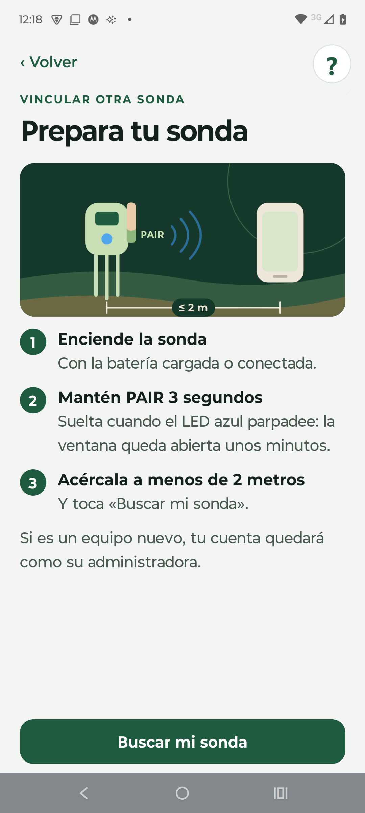
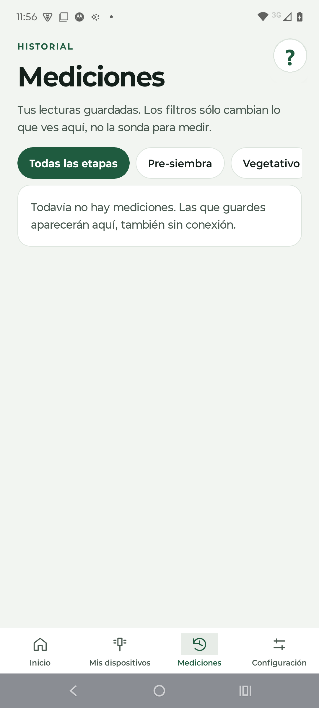

**INACAP**

Ingeniería en Electrónica y Sistemas Inteligentes

Asignatura: Comercialización de Tecnologías

 

 

# PLAN DE MARKETING TERRASENSE

### Evaluación N° 2: Comercialización y Tecnologías

Sonda de suelo portátil con interpretación agronómica en el teléfono

 

**Integrantes:** Álvaro Nicolás Villena Torrejón · Alan Paul Escobar Rojas

**Docente:** Kattia Maldonado Toledo

 

Santiago, Chile

Octubre de 2026

---

## Índice

1. Introducción
2. Fundamentos del marketing aplicados a TerraSense
   - 2.1 Qué entendemos por marketing
   - 2.2 Necesidad, deseo y demanda
   - 2.3 Valor, satisfacción e intercambio
   - 2.4 Mercado, oferta de mercado y miopía de marketing
   - 2.5 Orientación de la empresa y microentorno
   - 2.6 Misión, objetivos y estrategia de crecimiento
3. Análisis estratégico del entorno
   - 3.1 Análisis PESTEL
   - 3.2 Análisis FODA
   - 3.3 Cruce FODA: de los factores a las decisiones
4. Consumidor objetivo y factores que influyen en la compra
   - 4.1 Segmentación y mercado meta
   - 4.2 Perfiles del consumidor
   - 4.3 Roles en la decisión de compra
   - 4.4 Factores culturales, sociales, psicológicos y personales
   - 4.5 Modelos de comportamiento aplicados
5. Recorrido del consumidor: «Sigue al consumidor»
6. Mercado, competencia, diferenciación y posicionamiento
   - 6.1 Tamaño del mercado
   - 6.2 Competencia directa e indirecta
   - 6.3 Costo de uso frente a las alternativas
   - 6.4 Diferenciación
   - 6.5 Posicionamiento
7. Estrategia de marketing: las 7P
   - 7.1 Producto
   - 7.2 Precio
   - 7.3 Plaza
   - 7.4 Promoción
   - 7.5 Personas
   - 7.6 Pruebas tangibles (evidencia física)
   - 7.7 Procesos
8. Publicidad y promoción
9. Marketing digital
10. Identidad visual y comunicación de marketing
11. Fuentes de información
12. Conclusiones
13. Bibliografía
14. Anexos

**Índice de tablas**

- Tabla 1. Necesidad, deseo y demanda en TerraSense
- Tabla 2. Orientaciones de la empresa evaluadas para TerraSense
- Tabla 3. Objetivos de marketing del primer año
- Tabla 4. Estrategias de crecimiento de TerraSense (matriz de Ansoff)
- Tabla 5. Análisis PESTEL
- Tabla 6. Matriz FODA
- Tabla 7. Cruce FODA y decisiones estratégicas
- Tabla 8. Segmentación del mercado
- Tabla 9. Roles en la decisión de compra
- Tabla 10. Factores que influyen en la compra
- Tabla 11. Recorrido del consumidor y acciones por etapa
- Tabla 12. Tamaño del mercado (TAM, SAM y SOM)
- Tabla 13. Comparación con la competencia
- Tabla 14. Costo acumulado para el agricultor
- Tabla 15. Niveles del producto
- Tabla 16. Estrategias de precio evaluadas
- Tabla 17. Síntesis de las 7P
- Tabla 18. Estrategia publicitaria
- Tabla 19. Presupuesto de publicidad y promoción del primer año
- Tabla 20. Canales digitales
- Tabla 21. Indicadores digitales
- Tabla 22. Fuentes de información y su uso

**Índice de figuras**

- Figura 1. Mapa de posicionamiento
- Figura 2. Logotipo de TerraSense
- Figura 3. Paleta de colores de la marca
- Figura 4. Pantallas de la aplicación TerraSense

---

## 1. Introducción

En Chile, una parte importante de las decisiones de riego y fertilización se toma con información insuficiente o tardía. El análisis de suelo en laboratorio es exacto, pero exige tomar una muestra, enviarla y esperar el resultado. Los medidores portátiles disponibles responden en el momento, pero entregan números crudos que el agricultor debe saber interpretar. Entre ambos extremos, muchos productores deciden por intuición, en un contexto de sequía prolongada y de insumos caros, en el que equivocarse cuesta agua, fertilizante y cosecha.

TerraSense es la respuesta del equipo a ese problema. Es una sonda de suelo portátil que mide siete variables del suelo y tres del ambiente, y que envía la lectura por Bluetooth a una aplicación móvil. La aplicación interpreta cada valor según el cultivo y su etapa fenológica (pre-siembra, crecimiento vegetativo, floración o cosecha) y recomienda una acción concreta. Funciona sin conexión a internet en el campo; cuando hay señal, suma el pronóstico del tiempo de los días siguientes y respalda el historial en la nube. Se vende con un pago único, sin suscripción.

Este informe desarrolla el plan de marketing de TerraSense. Su **objetivo general** es definir cómo el producto llegará a su consumidor objetivo y por qué ese consumidor lo preferiría frente a las alternativas. Los **objetivos específicos** son:

1. Aplicar los conceptos fundamentales del marketing al proyecto y definir su misión, sus objetivos y su estrategia de crecimiento.
2. Analizar el entorno con las herramientas PESTEL y FODA, y traducirlo en decisiones.
3. Definir al consumidor objetivo y los factores que influyen en su compra.
4. Recorrer las cinco etapas de su proceso de decisión con acciones concretas para cada una.
5. Analizar el mercado y la competencia para establecer una diferenciación y un posicionamiento.
6. Diseñar la estrategia de las 7P, la publicidad, la promoción, el marketing digital y la identidad visual.

La **metodología** combina el material de la asignatura, fuentes oficiales chilenas (INE, ODEPA, CR2, SERNAC y la Biblioteca del Congreso Nacional), los precios publicados de la competencia y el modelo económico del propio proyecto, del que provienen el precio, los costos y el plan de ventas. Las cifras de demanda y las metas de conversión son hipótesis por validar, y se declaran como tales cada vez que aparecen.

---

## 2. Fundamentos del marketing aplicados a TerraSense

### 2.1 Qué entendemos por marketing

La American Marketing Association (2017) define el marketing como la actividad, el conjunto de instituciones y los procesos para crear, comunicar, entregar e intercambiar ofertas que tienen valor para los clientes, los socios y la sociedad. Kotler y Armstrong (2017) lo describen como el proceso por el que las personas obtienen lo que necesitan y desean mediante la creación y el intercambio de valor. Ambas definiciones coinciden en la palabra clave: **valor**.

Para TerraSense, el valor no está en la sonda como objeto, sino en lo que el agricultor puede decidir con ella: regar a tiempo, no sembrar en un suelo frío o salino, no entrar con maquinaria a un suelo saturado. Todo el plan se construye sobre esa idea.

El marketing pasó por cuatro eras: la de la producción («si lo fabricas, se venderá»), la de las ventas, la del marketing, que puso al cliente en el centro, y la era digital actual, basada en relaciones, datos y personalización. TerraSense nace en la **era digital**, y eso se nota en su oferta: el producto genera datos de cada medición, la relación con el cliente continúa después de la venta a través de la aplicación y de WhatsApp, y la comunicación se dirige a segmentos precisos por medio de canales digitales. El equipo no vende un aparato y se desentiende, sino que mantiene una relación con cada agricultor.

### 2.2 Necesidad, deseo y demanda

**Tabla 1. Necesidad, deseo y demanda en TerraSense**

| Concepto | Definición | Aplicación a TerraSense |
|---|---|---|
| Necesidad | Estado de carencia percibida | Certidumbre para decidir el riego y la fertilización sin arriesgar el cultivo ni malgastar agua e insumos |
| Deseo | Forma que toma la necesidad según la cultura y la persona | Una herramienta portátil, rápida y fácil de entender, que diga qué hacer en el mismo campo, funcione sin señal y no obligue a pagar una mensualidad |
| Demanda | Deseo respaldado por poder adquisitivo | Pequeños y medianos agricultores y asesores dispuestos a pagar $467.463 con IVA por el equipo; la meta del primer año es de 200 equipos |

La secuencia muestra el límite del marketing que enseña la asignatura: TerraSense no crea la necesidad de decidir bien, que ya existe, sino que da forma a cómo se satisface.

### 2.3 Valor, satisfacción e intercambio

- **Valor.** Es la diferencia entre los beneficios percibidos y los costos económicos, de tiempo y de esfuerzo. TerraSense suma beneficios (respuesta en el campo, interpretación por etapa, mediciones ilimitadas, historial) y reduce costos: un pago único que, en uso habitual, queda por debajo del gasto acumulado en análisis de laboratorio durante el tercer año (sección 6.3).
- **Satisfacción.** Depende de que la experiencia cumpla las expectativas. Por eso el plan no promete lo que el instrumento no hace: no reemplaza al laboratorio ni calcula dosis de fertilizante, y los valores de nitrógeno, fósforo y potasio se presentan como referencia. Prometer de más generaría decepción y reseñas negativas.
- **Intercambio.** El agricultor entrega dinero y, a cambio, obtiene una herramienta y un servicio (aplicación, historial, soporte). El intercambio se repite en el tiempo cuando el cliente recomienda el equipo a otros productores.

### 2.4 Mercado, oferta de mercado y miopía de marketing

El **mercado** de TerraSense son los compradores actuales y potenciales de información sobre el suelo: productores agrícolas y quienes los asesoran. La **oferta de mercado** no es solo el aparato. Es la combinación de la sonda, la aplicación, la interpretación agronómica, el historial y el soporte.

Levitt (1960) advirtió contra la **miopía de marketing**: enfocarse en el producto y no en la necesidad que satisface. La clase lo resume con un ejemplo: los clientes no compran taladros, compran agujeros. Aplicado al proyecto, TerraSense no vende una sonda de siete variables. **Vende decisiones a tiempo en el campo.** Si el equipo se viera a sí mismo como fabricante de sensores, competiría por precio contra medidores importados; viéndose como proveedor de decisiones, compite por utilidad.

De esta lectura se desprende la **propuesta de valor** de TerraSense: *saber en el mismo campo, en menos de un minuto, qué hacer con el riego y la fertilización según el cultivo y su etapa, aun sin señal y con un solo pago*. Cada componente responde a una carencia de las alternativas: la inmediatez, a la espera del laboratorio; la recomendación, a los números crudos de los medidores; el funcionamiento sin señal, a la conectividad irregular del campo; y el pago único, a las mensualidades de las soluciones de telemetría.

### 2.5 Orientación de la empresa y microentorno

Antes de elegir una orientación, el equipo evaluó las cinco que plantea la asignatura y lo que cada una significaría para el proyecto.

**Tabla 2. Orientaciones de la empresa evaluadas para TerraSense**

| Orientación | Premisa | Qué significaría para TerraSense | Decisión |
|---|---|---|---|
| A la producción | El cliente prefiere lo disponible y barato | Fabricar al menor costo y competir por precio con los medidores importados | Descartada: ignora que el agricultor no sabe interpretar los números |
| Al producto | El cliente prefiere la mejor calidad y más funciones | Sumar sensores y funciones sin preguntarse si el agricultor los usa | Descartada: es la puerta de entrada a la miopía de marketing (sección 2.4) |
| A las ventas | El cliente no compra si no se le presiona | Publicidad masiva y descuentos agresivos para vender rápido | Descartada: en una compra técnica genera clientes insatisfechos y reseñas negativas |
| Al marketing | Conocer y satisfacer al cliente mejor que la competencia | Diseñar el producto y la comunicación desde la decisión que el agricultor debe tomar | Adoptada como base |
| Al marketing social | Satisfacer al cliente y cuidar el bienestar de la sociedad a largo plazo | Además, reducir el uso innecesario de agua y fertilizante | **Adoptada como orientación del plan** |

TerraSense adopta una **orientación al marketing social**: satisfacer al cliente y, a la vez, cuidar el bienestar de la sociedad a largo plazo. Medir antes de regar o fertilizar reduce el uso innecesario de agua y fertilizante. Es un beneficio para el agricultor y para el entorno, en línea con la tendencia ESG (ambiental, social y de gobernanza) que muestra la asignatura. Esta orientación también obliga a ser honestos con los límites del producto.

El **microentorno** del proyecto lo componen:

- **La empresa:** dos socios que integran desarrollo, producción y venta, apoyados por un contador.
- **Los proveedores:** el fabricante de la sonda, los proveedores de componentes electrónicos y el fabricante de las placas.
- **Los intermediarios:** pasarela de pago, courier y plataformas de publicidad.
- **Los clientes:** agricultores y asesores.
- **Los competidores:** medidores portátiles, laboratorios y asesoría agronómica.
- **Los públicos relevantes:** el Instituto de Desarrollo Agropecuario (INDAP), cooperativas, juntas de vigilancia de regantes, la Subsecretaría de Telecomunicaciones (SUBTEL), el Servicio Nacional del Consumidor (SERNAC), los medios de comunicación agrícolas y las comunidades rurales donde se hacen las demostraciones.

Según la clasificación de mercados de clientes, TerraSense vende principalmente a un **mercado industrial**: el agricultor no compra la sonda para su consumo personal, sino para producir, y por eso valora el retorno económico del equipo y pide factura. El asesor técnico, que la usa para prestar un servicio, pertenece al mismo mercado. Los demás tipos tienen un papel acotado: el mercado **revendedor** aparece desde el tercer año con los distribuidores de insumos (sección 7.3); el **gubernamental** actúa como facilitador, no como comprador, a través de los programas de INDAP; y el **internacional** queda fuera del plan hasta validar el producto en Chile.

### 2.6 Misión, objetivos y estrategia de crecimiento

La asignatura muestra que el marketing se integra en la planificación estratégica de la empresa: la misión orienta los objetivos, y estos, las estrategias de cada área.

**Misión.** *Ayudar a los pequeños y medianos agricultores de Chile a decidir a tiempo el riego y la fertilización, convirtiendo la medición del suelo en una recomendación clara en el mismo campo.* Está orientada al mercado: describe la necesidad que se satisface y no el aparato que se fabrica.

**Tabla 3. Objetivos de marketing del primer año**

| Objetivo | Meta medible | Plazo |
|---|---|---|
| Ventas | 200 equipos vendidos | Abril a diciembre de 2027 |
| Generación de demanda | 2.000 conversaciones calificadas por WhatsApp | Abril a diciembre de 2027 |
| Conversión | 10 % de las conversaciones terminan en venta | Medido mes a mes desde el lanzamiento |
| Prueba social | 30 clientes del programa Campo Pionero con testimonio publicado | Primeros seis meses desde el lanzamiento |
| Satisfacción | Recomendación neta (NPS, *Net Promoter Score*) mayor que 50 a los 15 días de la compra | Medido en cada cliente |

Las metas de ventas y conversión son las mismas del modelo económico del proyecto y se validan con las entrevistas y el piloto (Anexo C).

Para crecer, la matriz de Ansoff (1957) combina productos y mercados actuales o nuevos en cuatro estrategias.

**Tabla 4. Estrategias de crecimiento de TerraSense (matriz de Ansoff)**

| Estrategia | Producto | Mercado | Aplicación en TerraSense | Momento |
|---|---|---|---|---|
| Penetración de mercado | Actual | Actual | Vender la sonda a productores y asesores de la zona central por el canal digital y los asesores referentes | Años 1 y 2 |
| Desarrollo de mercado | Actual | Nuevo | Llegar a otras regiones agrícolas y a los distribuidores de insumos como nuevo canal | Desde el año 3 |
| Desarrollo de producto | Nuevo | Actual | Sumar cultivos y funciones a la aplicación mediante actualizaciones para los clientes que ya tienen el equipo | Continuo, según lo que pidan los clientes |
| Diversificación | Nuevo | Nuevo | No se plantea: exigiría recursos que un equipo de dos personas no tiene | Descartada |

En la matriz BCG (del Boston Consulting Group; Henderson, 1970), que clasifica los productos según el crecimiento de su mercado y la participación que tienen en él, TerraSense es hoy un **interrogante**: compite en un mercado en crecimiento, el de la tecnología para el agro en un contexto de sequía, pero con una participación todavía mínima. Un interrogante necesita inversión en marketing para convertirse en **estrella**; por eso el plan concentra el esfuerzo del primer año en ganar confianza y testimonios, no en maximizar el margen de cada venta.

Por último, el plan sigue el ciclo del **sistema de marketing moderno**: crear valor, entregarlo al cliente, recibir su retroalimentación y mejorar la oferta. En TerraSense, la retroalimentación llega por WhatsApp, las encuestas de recomendación y el uso del equipo, y se traduce en mejoras de la aplicación que llegan también a quienes ya compraron.

---

## 3. Análisis estratégico del entorno

### 3.1 Análisis PESTEL

El análisis PESTEL (factores políticos, económicos, sociales, tecnológicos, ecológicos y legales) revisa las fuerzas del macroentorno que la empresa no controla. Cada factor se acompaña de la decisión que provoca en el plan.

**Tabla 5. Análisis PESTEL**

| Factor | Evidencia | Efecto para TerraSense | Decisión del plan |
|---|---|---|---|
| Político | INDAP mantiene el Programa de Asesoría Técnica (SAT), que acompaña a pequeños productores en la adopción de tecnologías y cofinancia inversiones (Ministerio de Agricultura, s.f.) | Oportunidad: los asesores del programa son prescriptores naturales y el cofinanciamiento podría facilitar la compra | Programa de asesores referentes (sección 8) y material para postular el equipo como inversión; el plan no supone ningún subsidio en sus cifras |
| Económico | El precio de los fertilizantes subió con fuerza en 2021 y 2022, y ODEPA monitorea desde entonces sus precios e importaciones (ODEPA, s.f.) | Oportunidad: aplicar insumos sin medir se volvió más caro. Amenaza: casi todo el costo del equipo es importado y depende del dólar | Mensaje centrado en el ahorro de insumos; precio derivado del costo, que se recalcula si cambia el dólar |
| Social | El 95,1 % de los hogares rurales tiene acceso a internet y la brecha con lo urbano bajó a 1,6 puntos (Nogales, 2026) | Oportunidad: la mayoría de los agricultores ya usa smartphone y redes sociales. Matiz: tener internet en la casa no garantiza señal en el campo | Canales digitales como vía principal (sección 9) y producto que funciona sin señal en el campo |
| Tecnológico | El Bluetooth de bajo consumo, los microcontroladores de bajo costo y las aplicaciones móviles hacen accesible la medición portátil | Oportunidad para un equipo de bajo costo; amenaza de que actores grandes bajen precios o copien la idea | Diferenciarse por la interpretación agronómica por etapa, que es más difícil de copiar que el hardware |
| Ecológico | La zona entre Coquimbo y La Araucanía acumula un déficit de lluvias cercano al 30 % desde 2010: la «megasequía» (CR2, 2015) | Oportunidad: el agua es el recurso más escaso; medir la humedad del suelo pasa de ser un lujo a una necesidad | Mercado meta en la zona central y mensaje de cuidado del agua |
| Legal | La Ley N° 21.398 amplió la garantía legal a seis meses y estableció el derecho a retracto de 10 días en compras a distancia (SERNAC, s.f.). La Ley N° 21.719 sobre datos personales rige desde el 1 de diciembre de 2026 (BCN, 2024). Todo equipo de radio de alcance reducido debe declarar su conformidad ante SUBTEL (SUBTEL, 2026). La Ley N° 20.920 (Ley REP) hace al productor responsable de las baterías al fin de su vida útil | Obligaciones que, bien comunicadas, generan confianza | Garantía y retracto informados antes del pago; política de privacidad clara; conformidad de radio antes de vender; recepción de baterías al fin de su vida útil |

### 3.2 Análisis FODA

**Tabla 6. Matriz FODA**

| | Positivo | Negativo |
|---|---|---|
| **Interno** | **Fortalezas**   F1. Interpretación agronómica por cultivo y etapa fenológica, no solo datos.   F2. Funciona sin conexión en el campo; con señal suma el pronóstico.   F3. Pago único, sin suscripción.   F4. Diez variables en un solo equipo: siete del suelo y tres del ambiente.   F5. Desarrollo propio de hardware y software: se puede mejorar rápido con la experiencia de los clientes.   F6. Precio menor que los medidores importados comparables. | **Debilidades**   D1. Marca nueva, sin historial ni clientes que den testimonio.   D2. Menor exactitud que un laboratorio; nitrógeno, fósforo y potasio solo como referencia.   D3. Estanqueidad IP67 y conformidad de radio por acreditar antes de vender.   D4. Equipo pequeño: dos socios para vender, producir y dar soporte.   D5. Caja ajustada el primer año. |
| **Externo** | **Oportunidades**   O1. Megasequía y presión por usar mejor el agua.   O2. Insumos caros: medir antes de fertilizar ahorra dinero.   O3. Conectividad rural casi universal en los hogares.   O4. Programas de asesoría técnica de INDAP con asesores en terreno.   O5. Relevo generacional: productores jóvenes más abiertos a la tecnología. | **Amenazas**   A1. Competidores con marca y distribución establecidas (Hanna, Bluelab).   A2. Desconfianza hacia la tecnología y preferencia por la experiencia propia.   A3. Alza del dólar, que encarece los componentes.   A4. Exigencias regulatorias antes de vender (radio, datos personales, baterías).   A5. Ingreso de actores grandes al segmento de bajo costo. |

### 3.3 Cruce FODA: de los factores a las decisiones

El cruce combina factores internos y externos para obtener estrategias. Cada estrategia se traduce en una acción del plan.

**Tabla 7. Cruce FODA y decisiones estratégicas**

| Tipo | Estrategia | Acción del plan |
|---|---|---|
| FO (usar fortalezas para aprovechar oportunidades) | F1 + F2 + O1: posicionar a TerraSense como la herramienta para decidir el riego en plena sequía, aun sin señal | Concepto creativo «Del número a la decisión» y demostraciones de riego en el campo (sección 8) |
| FO | F3 + O2: mostrar el ahorro frente al gasto recurrente en análisis | Comparador de costo acumulado en el sitio web (sección 6.3) |
| DO (superar debilidades con oportunidades) | D1 + O4: ganar confianza a través de prescriptores que el agricultor ya respeta | Programa de asesores referentes, financiado con la comisión comercial |
| DO | D4 + O3: atender por canales digitales para que dos personas cubran todo Chile | Venta y soporte por WhatsApp y el sitio web; guía integrada en la aplicación |
| FA (usar fortalezas contra amenazas) | F1 + F6 + A1: competir por utilidad y precio, no por marca | Comparación honesta con Hanna y Bluelab: más interpretación a menor precio |
| DA (reducir debilidades y amenazas) | D2 + D3 + A2 + A4: no prometer lo que aún no está demostrado | Mensajes sin promesas de exactitud de laboratorio; el IP67 se comunica como objetivo de diseño hasta tener el ensayo; venta solo tras la conformidad de radio |

---

## 4. Consumidor objetivo y factores que influyen en la compra

### 4.1 Segmentación y mercado meta

**Tabla 8. Segmentación del mercado**

| Variable | Criterio | Mercado meta |
|---|---|---|
| Geográfica | Zonas con déficit hídrico y agricultura intensiva | Zona central y centro-sur: de Coquimbo a La Araucanía, con foco inicial en Valparaíso, Metropolitana, O'Higgins y Maule |
| Demográfica | Tamaño y tipo de explotación | Pequeños y medianos productores de hortalizas, frutales, viñas y cultivos anuales |
| Psicográfica | Actitud frente a la tecnología | Productores que usan smartphone a diario y buscan reducir riesgos; asesores que quieren respaldar sus recomendaciones con datos |
| Conductual | Frecuencia de decisión y beneficio buscado | Quienes deciden riego y fertilización varias veces por temporada y hoy lo hacen por intuición o con análisis esporádicos |

El mercado meta tiene dos segmentos: el **productor**, que usa el equipo en su propio campo, y el **asesor técnico**, que lo lleva a varios campos y además influye en la compra de sus clientes. Según la teoría de difusión de innovaciones (Rogers, 2003), los primeros compradores serán innovadores y adoptadores tempranos: productores jóvenes o con cultivos de mayor valor, para quienes un error cuesta más.

### 4.2 Perfiles del consumidor

Los siguientes perfiles son **arquetipos construidos por el equipo** a partir del segmento definido; no corresponden a clientes reales y deben validarse con las entrevistas del Anexo C.

**Perfil 1: el productor.** Hombre o mujer de 35 a 60 años, con 5 a 30 hectáreas de hortalizas o frutales en la zona central. Riega con agua escasa y compra fertilizantes cada temporada. Usa WhatsApp y Facebook a diario y ve videos en YouTube. Hoy decide por experiencia y hace un análisis de suelo al año, cuando lo hace. Su temor es perder una siembra o una floración; su objeción, «estos aparatos son caros y no los entiendo».

**Perfil 2: el asesor técnico.** Agrónomo o técnico agrícola de 25 a 45 años, independiente o vinculado a programas de asesoría. Visita varios campos por semana y necesita respaldar sus recomendaciones con datos que el productor entienda. Busca herramientas portátiles y un historial por campo. Su objeción es la exactitud: necesita saber qué puede afirmar con el equipo y qué no.

### 4.3 Roles en la decisión de compra

**Tabla 9. Roles en la decisión de compra**

| Rol | Quién lo cumple | Implicancia |
|---|---|---|
| Iniciador | El productor, al ver estrés hídrico o subir sus costos de insumos | Comunicación que nombre esos síntomas |
| Influenciador | Asesor técnico, otros productores, familia (a menudo un hijo o hija más joven) | Programa de asesores referentes y testimonios de productores |
| Decisor | El productor o el dueño del campo | Argumento económico: costo acumulado y ahorro de insumos |
| Comprador | El productor, por internet o por WhatsApp | Compra simple, con factura para quien tiene giro y recupera el IVA |
| Usuario | El productor, un trabajador del campo o el asesor | Aplicación en español, con letra grande, tema claro para leer al sol y guía integrada |

### 4.4 Factores culturales, sociales, psicológicos y personales

**Tabla 10. Factores que influyen en la compra**

| Factor | Cómo se manifiesta en el consumidor | Influencia en la compra | Respuesta del plan |
|---|---|---|---|
| Cultural: cultura | En el campo se valora la experiencia acumulada; «siempre lo hemos hecho así» | Frena la adopción si el producto parece sustituir el conocimiento del productor | Mensaje de complemento: el equipo confirma o corrige la intuición, no la reemplaza |
| Cultural: subcultura | Productores jóvenes que crecieron con smartphone conviven con productores tradicionales | Los jóvenes adoptan antes y luego influyen en su familia y sus vecinos | Primeras campañas dirigidas a productores jóvenes e hijos que trabajan en el campo familiar |
| Cultural: clase social | Pequeños y medianos productores con ingresos variables según la temporada | Sensibilidad al precio y rechazo a los pagos recurrentes | Pago único, comparación con el gasto en análisis y factura con IVA recuperable para quien tiene giro |
| Social: grupos de referencia | Vecinos, cooperativas, juntas de vigilancia, asesores y grupos de WhatsApp | La recomendación de un par pesa más que un anuncio | Programa de referidos, días de campo y testimonios reales del piloto |
| Social: roles y estatus | El productor que adopta tecnología se percibe como moderno y profesional | Comprar puede reforzar la imagen de buen productor | Comunicación que muestra al productor como quien decide con datos |
| Psicológico: motivación (Maslow) | Necesidad de seguridad: proteger la cosecha y el ingreso | Compra motivada por evitar pérdidas más que por novedad | Mensajes de riesgo evitado: no sembrar en suelo frío, no regar de más, no entrar a un suelo saturado |
| Psicológico: percepción | Muchos asocian la tecnología con complejidad y fallas | Un anuncio técnico se percibe como «no es para mí» | Demostraciones de 30 segundos: medir y leer la recomendación |
| Psicológico: aprendizaje y actitudes | Experiencias previas con equipos difíciles de usar o sin soporte | Una mala experiencia previa crea rechazo duradero | Guía en la aplicación, soporte humano por WhatsApp y garantía legal comunicada |
| Personal: edad y ciclo de vida | El productor mayor prefiere el trato personal; el joven, la autogestión | Distintos canales de compra según la edad | Dos caminos de compra: atención por WhatsApp o compra directa en el sitio |
| Personal: ocupación e ingresos | Ingresos estacionales que se concentran en la cosecha | El momento de compra sigue al flujo de caja del campo | Pauta reforzada antes de la temporada de siembra y de riego; pago con tarjeta en cuotas a través de la pasarela |
| Personal: estilo de vida | Jornadas largas en el campo, con poco tiempo para aprender | Valora lo rápido y simple | Medición en menos de 20 segundos y una recomendación en lenguaje claro |

### 4.5 Modelos de comportamiento aplicados

- **Caja negra (Kotler).** Los estímulos externos (la sequía, el precio de los fertilizantes, la publicidad, la recomendación del asesor) entran a la «caja negra» del productor, donde se procesan según su motivación de seguridad y su percepción de la tecnología. La respuesta esperada es la compra. El plan controla los estímulos de marketing; los del entorno los aprovecha.
- **Modelo EKB (Engel, Kollat y Blackwell).** Las variables externas (la opinión del asesor, la cultura del campo) y las internas (la motivación por innovar, la actitud hacia la marca) actúan a la vez durante todo el proceso, no en secuencia (Blackwell et al., 2006). Por eso las acciones de la sección 5 combinan presencia digital y recomendación personal en cada etapa.
- **Howard-Sheth.** Distingue compras rutinarias, limitadas y extensas según el involucramiento (Howard y Sheth, 1969). TerraSense es una **compra extensa**: es de alto valor, nueva para el comprador y técnica. El productor busca bastante información, compara y necesita confianza. La primera experiencia de uso es decisiva: si es buena, refuerza el aprendizaje y genera lealtad y recomendación.

---

## 5. Recorrido del consumidor: «Sigue al consumidor»

El recorrido sigue las cinco etapas del proceso de decisión de compra que propone la asignatura. Court et al. (2009) muestran que ese recorrido no es un embudo lineal: el consumidor agrega y descarta marcas durante la evaluación y, después de comprar, su experiencia lo devuelve al ciclo como recomendador o como detractor. Para cada etapa se define qué vive el consumidor, dónde se encuentra con la marca, qué hace TerraSense y cómo se mide el resultado.

**Tabla 11. Recorrido del consumidor y acciones por etapa**

| Etapa | Qué piensa y hace el consumidor | Punto de contacto | Acción concreta de TerraSense | Indicador |
|---|---|---|---|---|
| 1. Necesidad | «Las plantas se ven estresadas», «gasté mucho en fertilizante y no sé si sirvió», «no sé si regar mañana» | Redes sociales, conversación con el asesor o un vecino | Contenido educativo sobre los síntomas de riego mal calibrado y el costo de fertilizar sin medir; videos cortos de errores frecuentes por etapa del cultivo | Alcance y reproducciones de los videos educativos |
| 2. Búsqueda | **Búsqueda interna:** recuerda su último análisis de laboratorio o un medidor que usó un vecino. **Búsqueda externa:** pregunta a su asesor o a otros productores; busca en Google y YouTube «cómo medir la humedad del suelo» | Buscador, YouTube, grupos de WhatsApp, asesores | Anuncios en el buscador para esas búsquedas; tutoriales en YouTube; asesores referentes que conocen el equipo. Como la marca es nueva y no está en la memoria del productor, la búsqueda externa es donde TerraSense tiene que aparecer | Clics y visitas al sitio; consultas que llegan por referido |
| 3. Evaluación de alternativas | Compara laboratorio, medidores importados, la asesoría o seguir como está; duda de la exactitud. Solo tres a cinco alternativas llegan a su **conjunto evocado** | Sitio web, WhatsApp, días de campo | Comparador en el sitio (TerraSense, laboratorio y medidores) con el costo acumulado; ficha honesta de qué mide y qué no; reseñas y testimonios; demostración en un día de campo. El objetivo es entrar al conjunto evocado junto al laboratorio y a los medidores conocidos | Tiempo en el comparador; conversaciones de WhatsApp iniciadas |
| 4. Compra | Siente fricción al pagar por internet a una marca nueva; quiere hablar con alguien | WhatsApp, sitio web, pasarela de pago | Atención humana por WhatsApp con enlace de pago; medios de pago conocidos; garantía de seis meses y derecho a retracto de 10 días informados antes de pagar; despacho incluido a todo Chile | Tasa de conversión de conversación a venta |
| 5. Postcompra | Abre la caja, se pregunta si fue buena decisión (disonancia cognitiva), mide por primera vez | Empaque, aplicación, WhatsApp, correo | Guía de inicio impresa y guía en pantalla; mensaje de bienvenida a las 24 horas; seguimiento a los 15 días con consejos por etapa e invitación a compartir su experiencia; programa de referidos para clientes satisfechos | Mediciones en la primera semana; reseñas; recomendación neta (NPS) |

La etapa 5 merece atención especial. La clase recuerda que retener a un cliente cuesta cerca de cinco veces menos que conseguir uno nuevo, y que en compras de alto valor aparece la disonancia cognitiva. En un producto técnico, un cliente que no logra su primera medición se convierte en una reseña negativa. Por eso la vinculación se hace con un solo botón (PAIR) y la aplicación incluye una guía en cada pantalla.

El recorrido también considera los rasgos del **consumidor digital de productos electrónicos** que muestra la asignatura. La gran mayoría investiga en internet antes de comprar, y los videos de demostración y las reseñas pesan en la decisión; por eso YouTube y los testimonios están presentes en las etapas 2 y 3. Las garantías, el soporte y la comunidad determinan la recompra y la recomendación; por eso la etapa 5 combina garantía comunicada, soporte por WhatsApp y programa de referidos. La asignatura muestra además que las marcas de electrónica crean urgencia con la escasez. TerraSense la aplica de forma honesta: los cupos del programa Campo Pionero son realmente limitados a los primeros 30 compradores (sección 8), sin inventar plazos ni rebajar el precio.

---

## 6. Mercado, competencia, diferenciación y posicionamiento

### 6.1 Tamaño del mercado

**Tabla 12. Tamaño del mercado (TAM, SAM y SOM)**

| Nivel | Tamaño | Origen |
|---|---:|---|
| Mercado total (TAM, *Total Addressable Market*) | 175.556 explotaciones | VIII Censo Agropecuario y Forestal 2021 (INE, 2022) |
| Mercado servible (SAM, *Serviceable Addressable Market*) | ≈ 120.000 explotaciones | Supuesto del equipo, sin filtro aún de región, superficie ni rubro |
| Mercado objetivo del año 1 (SOM, *Serviceable Obtainable Market*) | 200 equipos | Meta comercial del modelo: 0,17 % del mercado servible |
| Meta acumulada a cinco años | 2.550 equipos | 200 + 350 + 500 + 650 + 850 |

Solo el mercado total tiene fuente oficial. El mercado servible y la meta de ventas son supuestos y deben validarse con el piloto, las entrevistas y las primeras ventas. La meta del primer año representa menos de dos de cada mil explotaciones del mercado servible, de modo que la restricción no es el tamaño del mercado sino la capacidad de llegar a él y convencerlo.

### 6.2 Competencia directa e indirecta

**Tabla 13. Comparación con la competencia**

| Alternativa | Tipo | Precio de referencia | Qué entrega | Qué no entrega |
|---|---|---:|---|---|
| **TerraSense** | Directa | **$467.463** con IVA | Siete variables del suelo y tres del ambiente; interpretación por cultivo y etapa; pronóstico con señal; historial; funciona sin conexión | Exactitud de laboratorio; dosis de fertilizante |
| Bluelab Pulse | Directa | $538.990 | Humedad, conductividad y temperatura, con Bluetooth, aplicación e historial | pH, nitrógeno, fósforo y potasio; recomendación por etapa del cultivo |
| Hanna HI9814 | Directa parcial | $491.827 | pH, conductividad, sólidos disueltos y temperatura en soluciones y sustratos | Humedad del suelo; interpretación agronómica |
| FieldScout TDR 350 | Directa | Sin precio local | Humedad, conductividad y temperatura con registro, GPS y Bluetooth | Recomendación agronómica; distribución local |
| Laboratorio de suelos | Indirecta | ≈ $40.845 a $50.000 por muestra | Análisis exacto y completo, a veces con recomendación | Inmediatez: requiere muestreo, envío y espera |
| Asesoría agronómica | Indirecta | ≈ $60.000 por visita | Diagnóstico experto con contexto | Presencia continua; medición en el momento |
| Intuición del productor | Sustituto | Sin costo directo | Rapidez y experiencia acumulada | Respaldo con datos; prevención de errores |

Precios publicados de Bluelab y Hanna consultados el 04-09-2026; laboratorio según la lista 2026 de la Universidad de Chile (1,00 UF por muestra de fertilidad) y consultas de mercado del equipo; asesoría según consultas de mercado del equipo. TerraSense queda un 5,2 % bajo Hanna y un 13,5 % bajo Bluelab.

La estructura del mercado es de **competencia monopolística**: muchos oferentes con productos diferenciados, cada uno con algo de poder sobre su nicho, pero disciplinados por sustitutos cercanos. Ningún competidor directo combina la medición del suelo y del ambiente con una recomendación por etapa del cultivo. Esa es la oportunidad de diferenciación.

### 6.3 Costo de uso frente a las alternativas

**Tabla 14. Costo acumulado para el agricultor**

| Alternativa | Intensidad de uso | Año 1 | 3 años | 5 años | 10 años |
|---|---|---:|---:|---:|---:|
| TerraSense (equipo, kits de batería en los años 3 y 8, segundo equipo en el año 6) | Mediciones ilimitadas | $467.463 | $492.453 | $492.453 | $984.906 |
| Análisis de laboratorio | Uso habitual: 4 muestras al año | $200.000 | $600.000 | $1.000.000 | $2.000.000 |
| Análisis de laboratorio | Uso intensivo: 20 muestras al año | $1.000.000 | $3.000.000 | $5.000.000 | $10.000.000 |
| Asesoría agronómica | Uso habitual: 2 visitas al año | $120.000 | $360.000 | $600.000 | $1.200.000 |

Pesos de 2027, sin descuento. Con cuatro análisis al año, el costo acumulado del laboratorio supera al de TerraSense durante el tercer año; con uso intensivo, el primero. La comparación no significa que el laboratorio sobre: sigue siendo necesario para determinaciones químicas que el equipo no hace. Lo que TerraSense resuelve es el seguimiento frecuente entre un análisis y el siguiente. Este argumento alimenta el comparador del sitio web.

### 6.4 Diferenciación

La diferenciación se separa en lo que **sí es exclusivo** y lo que **no lo es**, porque prometer como diferencia algo que la competencia también tiene destruye la credibilidad:

- **Diferenciadores sostenibles:**
  - La interpretación agronómica por cultivo y etapa fenológica. Cada variable recibe su propia lectura, y el conjunto, un diagnóstico con acciones.
  - La combinación en un solo equipo de siete variables del suelo y tres del ambiente.
  - El pronóstico de los días siguientes incorporado a la recomendación cuando hay señal.
  - El pago único sin suscripción, frente a soluciones de telemetría con planes mensuales.
- **Atributos valiosos, pero no exclusivos:** el funcionamiento sin conexión, el historial y el Bluetooth, que Bluelab Pulse también ofrece. Se comunican como parte del producto, no como la diferencia.

### 6.5 Posicionamiento

**Figura 1. Mapa de posicionamiento.** Valoración cualitativa del equipo según dos atributos que el consumidor valora: cuánto interpreta la lectura y cuán rápido llega la respuesta.

**Declaración de posicionamiento.** *Para los pequeños y medianos agricultores y sus asesores, que necesitan decidir el riego y la fertilización a tiempo, TerraSense es la sonda de suelo portátil que convierte la medición en una recomendación clara según el cultivo y su etapa, en el mismo campo y aun sin señal. A diferencia de los medidores que solo entregan números y de los análisis que tardan semanas, TerraSense entrega la decisión en el momento, con un pago único.*

**Frase de posicionamiento:** «Del número a la decisión».

El posicionamiento es **claro**, porque ocupa un cuadrante que nadie más ocupa (alta interpretación y alta inmediatez). Es **coherente**, porque se apoya en lo que el producto hace. Y es **atractivo**, porque responde al temor principal del consumidor: equivocarse con el agua, el fertilizante o la siembra.

---

## 7. Estrategia de marketing: las 7P

Las 4P (producto, precio, plaza y promoción) fueron propuestas por McCarthy (1960) para gestionar la mezcla de marketing de productos físicos. Booms y Bitner (1981) las ampliaron a las 7P para incluir los servicios y la experiencia del cliente después de la venta, y sumaron **personas**, **pruebas tangibles** (o evidencia física) y **procesos**.

**¿Por qué 7P y no 4P?** La asignatura recomienda las 4P cuando se venden productos físicos por canales tradicionales y la transacción es el centro de la relación, y las 7P cuando hay un servicio o un negocio digital, cuando la empresa es emergente y está orientada al cliente, y cuando la experiencia posterior a la compra define la retención. TerraSense cumple ambas descripciones: la sonda es un bien físico, pero el valor llega a través de una aplicación, un historial en la nube y un soporte continuo, y el proyecto es una empresa emergente cuya reputación depende de que el cliente logre su primera medición. Por eso se usan las **7P**, que incluyen las 4P y suman las tres variables de servicio.

### 7.1 Producto

Siguiendo los niveles del producto de Kotler y Keller (2016), la oferta se ordena desde el beneficio que busca el cliente hasta los servicios que la rodean.

**Tabla 15. Niveles del producto**

| Nivel | Qué incluye |
|---|---|
| Beneficio central | Decidir a tiempo el riego, la fertilización y el momento de entrar al campo, con menos riesgo |
| Producto real | Sonda de suelo de siete variables (humedad, temperatura, conductividad eléctrica, pH, nitrógeno, fósforo y potasio) y sensor ambiental de temperatura, humedad del aire y presión. Batería recargable por USB-C, carcasa diseñada para el campo con objetivo de estanqueidad IP67 y vinculación con un botón. Aplicación para Android y iPhone, marca TerraSense y empaque con guía de inicio |
| Producto aumentado | Interpretación para ocho cultivos y cuatro texturas de suelo, pronóstico de cinco días con señal, historial respaldado en la nube, invitación de otros usuarios por código QR, aplicación en español e inglés con tema claro u oscuro y letra grande, soporte por WhatsApp y correo, garantía legal de seis meses |

**Decisiones clave del producto:**

- **Diseño y calidad:** carcasa para barro y lluvia, un solo botón y una aplicación con guía en cada pantalla. Cada equipo pasa una prueba de aceptación en fábrica antes de embalarse (sección 7.7).
- **Marca:** TerraSense, con una identidad que une tierra y tecnología (sección 10).
- **Empaque:** caja de cartón corrugado con guía de inicio impresa; es el primer contacto físico con la marca y debe permitir medir sin leer un manual.
- **Variantes:** una sola versión en el lanzamiento. Con un equipo de dos personas, una única variante simplifica la producción, el inventario y el soporte. El desarrollo de producto ocurre en la aplicación (Tabla 4).
- **Ciclo de vida:** el producto está en la etapa de **introducción**, en la que las ventas crecen lento, la marca es desconocida y la comunicación debe explicar qué es la categoría antes que convencer de una marca. Esto justifica una promoción educativa (sección 7.4) y la inversión en testimonios. En la etapa de crecimiento, la prioridad se trasladará a la distribución (sección 7.3).
- **Diferenciación:** la interpretación por cultivo y etapa, que ningún competidor directo ofrece (sección 6.4).

**Justificación.** El consumidor busca simplicidad y confianza (sección 4). Por eso el producto se diseñó con un botón de vinculación, lectura en menos de 20 segundos y recomendaciones en lenguaje claro, en lugar de más funciones. Los límites también se declaran en el producto: nitrógeno, fósforo y potasio aparecen como valores de referencia, nunca como base para dosificar fertilizante.

### 7.2 Precio

El precio no es solo un número: comunica un posicionamiento. Por eso se evaluaron las cuatro estrategias de precio que presenta la asignatura.

**Tabla 16. Estrategias de precio evaluadas**

| Estrategia | En qué consiste | Evaluación para TerraSense | Decisión |
|---|---|---|---|
| Penetración | Precio bajo para ganar participación rápido | Exigiría vender bajo el costo con la utilidad requerida; además, en un instrumento de medición un precio muy bajo se lee como baja calidad | Descartada |
| Descremado | Precio alto al lanzamiento para el segmento dispuesto a pagar más | Choca con un consumidor sensible al precio y con competidores importados ya establecidos; frenaría la generación de testimonios | Descartada |
| Psicológico | Precios terminados en 990 que se perciben más bajos | Bajar a $459.990 dejaría el precio bajo el costo con la utilidad exigida; subir a $469.990 no agrega valor percibido | Descartada |
| **Por valor** | El precio refleja lo que el cliente percibe que recibe | Coincide con el posicionamiento: más variables e interpretación que los importados, a menor precio, y amortizable frente al laboratorio | **Adoptada** |

- **Precio de lista: $467.463 con IVA** ($392.826 neto). No es un precio fijado por aspiración comercial: se deriva del costo total del proyecto en diez años, exigiendo un 30 % de utilidad sobre ese costo. El precio por valor se comprueba después: el precio derivado del costo debe quedar bajo el valor que percibe el cliente, y así ocurre.
- **Frente a la competencia:** queda un 5,2 % bajo Hanna HI9814 y un 13,5 % bajo Bluelab Pulse, con más variables e interpretación. Es un precio de **valor**: menor que los equivalentes importados y con más beneficio, pero no un precio de penetración que sacrifique el margen.
- **Frente al costo de uso:** el gasto acumulado en análisis de laboratorio de uso habitual lo supera durante el tercer año (Tabla 14). Este es el argumento central contra la objeción «es caro».
- **Sin descuentos permanentes ni precio psicológico a la baja:** un precio como $459.990 quedaría bajo el costo con la utilidad exigida. Las promociones de la sección 8 no rebajan el precio de lista; se financian con el presupuesto de publicidad y con la comisión comercial ya considerados en el costo.
- **Facilidades:** pago con tarjeta en cuotas a través de la pasarela; factura para los productores con giro, que recuperan el IVA y pagan en la práctica el precio neto.

### 7.3 Plaza

La plaza sigue la cadena que muestra la asignatura, desde la producción hasta el cliente final:

1. **Producción:** los socios ensamblan, prueban y embalan cada equipo con componentes de proveedores; desde 2028 se suma un ensamblador.
2. **Distribución:** courier con seguimiento hasta la dirección del cliente, sin mayoristas.
3. **Punto de venta:** tienda en línea propia y WhatsApp Business; desde el tercer año, además, distribuidores de insumos agrícolas.
4. **Cliente final:** el equipo llega al campo o a la oficina del asesor, en cualquier región del país.

- **Canal directo y digital** en el primer año: tienda en línea propia con pasarela de pago (Webpay o Mercado Pago) y atención por WhatsApp. Sin intermediarios, para conservar el margen y la relación directa con el cliente, que es la fuente de aprendizaje del producto.
- **Despacho incluido a todo Chile** por courier. Su costo, de $6.000 por equipo, ya está en el costo variable.
- **Canal de influencia en terreno:** asesores referentes y días de campo con cooperativas, que no venden directamente pero acercan la compra.
- **Escalamiento:** desde el tercer año, con la marca validada, se evalúa incorporar distribuidores de insumos agrícolas de la zona central como punto de venta físico.

**Justificación:** el segmento ya usa WhatsApp y redes sociales (Tabla 5, factor social), está disperso geográficamente y el equipo tiene dos personas. Un canal digital con atención humana es el único que cubre el país con esa dotación.

### 7.4 Promoción

Se desarrolla en las secciones 8 (publicidad, relaciones públicas y promociones) y 9 (marketing digital). Usa las tres herramientas que distingue la asignatura:

- **Publicidad:** anuncios pagados en Meta, Google y YouTube para llegar al mercado meta.
- **Relaciones públicas:** presencia en medios agrícolas, cooperativas y ferias para construir reputación ante el productor y sus asesores.
- **Promociones:** acciones que estimulan la compra sin rebajar el precio de lista, como el programa Campo Pionero y los referidos.

Su línea común es **educar antes de vender**: el consumidor tiene una compra de alto involucramiento y desconfía de la tecnología, de modo que primero debe entender el problema y ver el equipo funcionar.

### 7.5 Personas

Las personas construyen una confianza que ningún algoritmo reemplaza, y para una marca nueva en el campo son la principal fuente de credibilidad. Los tres roles que destaca la asignatura se cubren así:

- **Soporte en vivo:** los dos socios atienden la venta y el soporte el primer año. Hablan el lenguaje del campo (etapa, capacidad de campo, salinidad) sin jerga innecesaria.
- **Gestión de la comunidad (*community manager*):** el primer año la asume uno de los socios, que responde comentarios y mensajes en redes sociales. **Desde 2029** se incorpora una persona dedicada a marketing, que toma este rol.
- **Creadores e influenciadores:** los asesores referentes y los productores del programa Campo Pionero actúan como voces externas. No son celebridades, sino personas a quienes el agricultor ya les cree: su asesor y sus vecinos.

Todas las personas que atienden clientes siguen el mismo protocolo: responder por WhatsApp dentro de la jornada, explicar los límites del equipo y no prometer exactitud de laboratorio. Las personas no se tratan como un costo que se recorta, sino como una ventaja frente a competidores que venden por catálogo.

### 7.6 Pruebas tangibles (evidencia física)

Las pruebas tangibles hacen visible la calidad antes de la compra y reducen la incertidumbre de quien no puede tocar el equipo. Son críticas para TerraSense porque es una marca nueva y se vende a distancia.

- **Diseño web y aplicación:** sitio con fichas técnicas honestas y el comparador de costos; aplicación con identidad visual propia, tema claro de alto contraste para leer al sol y letra grande opcional (Figura 4).
- **Reseñas y testimonios:** testimonios en video de los productores del piloto y del programa Campo Pionero, publicados en el sitio y en redes sociales.
- **Certificaciones:** declaración de conformidad del equipo de radio ante SUBTEL antes de vender y ensayo de estanqueidad IP67 en un laboratorio acreditado. El equipo se comunicará como «resistente al agua» solo cuando ese ensayo lo confirme.
- **Casos de éxito:** registros reales de medición antes y después de una decisión de riego, con la autorización del productor.
- **Empaque y equipo:** caja de cartón corrugado con guía de inicio impresa y etiqueta con el número de serie; carcasa diseñada para barro y lluvia.

### 7.7 Procesos

Los procesos son invisibles para el cliente, pero determinan su satisfacción. TerraSense los diseña en tres frentes: la compra sin fricciones, la incorporación del usuario a la aplicación (*onboarding*) y la atención automatizada con respaldo humano.

1. **Consulta:** el cliente escribe por WhatsApp desde un anuncio o desde el sitio. Fuera del horario hábil, una respuesta automática de WhatsApp Business confirma la recepción, envía la ficha del equipo y el enlace al comparador, y avisa cuándo responderá una persona.
2. **Asesoría previa:** se revisa su cultivo y su caso de uso, y se envía el enlace de pago.
3. **Pago y despacho:** confirmación escrita de las condiciones, la garantía y el derecho a retracto; despacho con seguimiento.
4. **Puesta en marcha (*onboarding*):** se mantiene presionado el botón PAIR durante 3 segundos y la aplicación encuentra la sonda; la guía en pantalla acompaña la primera medición. Es el flujo que define si el usuario se queda o abandona.
5. **Postventa:** seguimiento a las 24 horas y a los 15 días; garantía legal de seis meses con cambio, reparación o devolución; recepción de la batería al final de su vida útil.

Cada equipo pasa una prueba de aceptación en fábrica antes de embalarse, registrada por número de serie. Ese registro respalda la garantía.

**Tabla 17. Síntesis de las 7P**

| P | Decisión | Justificación (consumidor, mercado y posicionamiento) |
|---|---|---|
| Producto | Sonda de diez variables con interpretación por etapa | Responde a la necesidad de decidir, no solo de medir |
| Precio | $467.463 con IVA, derivado del costo; sin rebajas | Bajo los importados y amortizable frente al laboratorio |
| Plaza | Directa y digital, con despacho incluido | Consumidor disperso y digitalizado; equipo pequeño |
| Promoción | Educar antes de vender; referidos y días de campo | Compra extensa y desconfianza hacia la tecnología |
| Personas | Socios con lenguaje del campo; asesores referentes | La confianza se construye con trato humano |
| Pruebas tangibles | Testimonios, certificaciones, sitio, aplicación y empaque coherentes | Hace tangible la calidad de una marca nueva que se vende a distancia |
| Procesos | Venta asistida, respuesta automática, vinculación con un botón, seguimiento | Reduce la fricción en la compra y en la postcompra |

**Auditoría de la mezcla: la P más débil.** La asignatura propone revisar las siete variables e identificar la que limita el crecimiento. En TerraSense es la de **pruebas tangibles**: al lanzamiento no hay clientes con testimonio, y la conformidad de radio y el ensayo de estanqueidad se completan antes de la venta. Por eso el plan prioriza el programa Campo Pionero, los testimonios del piloto y la publicación de las certificaciones en cuanto se obtengan. También evita los tres errores comunes que muestra la clase: no ignora los procesos (se diseñan desde la primera consulta hasta la postventa), no subestima las pruebas tangibles (se reconocen como la P más débil) y no trata a las personas como un costo (son el canal de confianza del plan).

---

## 8. Publicidad y promoción

**Tabla 18. Estrategia publicitaria**

| Elemento | Definición |
|---|---|
| Público | Productores de 30 a 60 años de hortalizas, frutales y viñas de la zona central, y asesores técnicos de 25 a 45 años |
| Objetivo de comunicación | Que el mercado meta asocie TerraSense con «saber qué hacer con el suelo en el mismo campo» |
| Objetivo comercial (meta por validar) | 200 equipos vendidos entre abril y diciembre de 2027, con unas 2.000 conversaciones calificadas por WhatsApp y una conversión del 10 % |
| Mensaje principal | «Mide tu suelo y sabe qué hacer, ahí mismo. Sin esperar resultados, sin pagar mensualidades.» |
| Concepto creativo | **«Del número a la decisión».** La pantalla de un medidor común muestra «pH 5,5 / CE 2.500»; la de TerraSense dice «Suelo ácido para maíz en pre-siembra: confirma con un análisis antes de encalar». El contraste muestra la diferencia sin decirla |
| Tono | Cercano y directo, de tú, con el vocabulario del campo |
| Medios y formatos | Videos verticales de 15 a 30 segundos (Reels y Shorts); carruseles de antes y después; anuncios de búsqueda; tutoriales en YouTube; demostraciones en días de campo; pendón y volante para ferias |
| Llamado a la acción | «Escríbenos por WhatsApp y te ayudamos a elegir» (principal); «Calcula cuánto te cuesta decidir a ciegas» (comparador en el sitio) |

**Piezas principales:**

1. **Video «Diez segundos»:** un productor entierra la sonda en su campo, saca el teléfono y lee la recomendación. El texto en pantalla dice: «¿Riego hoy? Ahora lo sabes».
2. **Carrusel «Lo que ves vs. lo que entiendes»:** primero los números crudos de un medidor; luego la misma lectura interpretada por TerraSense en cada etapa del cultivo.
3. **Anuncio de búsqueda:** «Medidor de humedad de suelo con recomendación. Funciona sin señal. Despacho a todo Chile».

**Acciones promocionales.** Ninguna rebaja el precio de lista:

- **Programa de asesores referentes.** El asesor que refiere una venta recibe la comisión comercial del 5 % sobre el precio de lista ($23.301 por equipo), ya incluida en el costo variable. Convierte a los prescriptores en una red de venta sin costo fijo.
- **Campo Pionero.** Los primeros 30 compradores reciben una sesión de puesta en marcha por videollamada y la invitación a participar como caso de estudio con sus resultados. Genera testimonios reales, que hoy faltan (debilidad D1).
- **Días de campo demostrativos** con cooperativas y grupos de productores en la zona central, desde la temporada de pre-siembra de primavera.
- **Referido entre clientes.** El cliente que recomienda a otro productor recibe un kit de mantenimiento (soluciones de calibración y un cepillo para los electrodos), con cargo a la partida de días de campo y ferias.

**Relaciones públicas.** Construyen reputación ante el productor y sus asesores sin comprar espacio publicitario:

- **Comunicado de lanzamiento** a medios agrícolas especializados (revistas, sitios y programas radiales del campo), con el ángulo de interés público: medir antes de regar en plena megasequía.
- **Presentaciones a cooperativas, juntas de vigilancia y equipos de asesoría técnica de INDAP**, que son públicos relevantes del microentorno (sección 2.5) y prescriptores del productor.
- **Charlas técnicas en liceos agrícolas y centros de formación técnica** de la zona central sobre el manejo del suelo y el agua, en las que el equipo se muestra como herramienta de aprendizaje.
- **Presencia en ferias agrícolas regionales**, con demostraciones en vivo; su costo está dentro de la partida de días de campo y ferias.

Estas acciones no tienen costo adicional al presupuesto: usan el tiempo de los socios y la partida de ferias ya considerada.

**Calendario.** La campaña sigue la carta Gantt del proyecto:

- **Expectativa (marzo de 2027):** testimonios del piloto, cuya prueba de aceptación en sitio se completa en febrero.
- **Lanzamiento:** el 19 de abril de 2027.
- **Refuerzo:** la pauta se intensifica de agosto a noviembre, antes de las siembras de primavera y la temporada de riego, cuando la necesidad es más visible.

**Tabla 19. Presupuesto de publicidad y promoción del primer año**

| Partida | Monto 2027 | Participación |
|---|---:|---:|
| Anuncios en Meta (Facebook, Instagram y WhatsApp) | $2.700.000 | 45 % |
| Anuncios en el buscador de Google y YouTube | $1.500.000 | 25 % |
| Días de campo y ferias | $900.000 | 15 % |
| Producción de videos y fotografías | $600.000 | 10 % |
| Herramientas digitales (mensajería, correo, diseño) | $300.000 | 5 % |
| **Total de publicidad** | **$6.000.000** | **100 %** |
| Comisión comercial a referentes (5 % del precio de lista, si todas las ventas fueran referidas) | hasta $4.660.274 | — |

El presupuesto de publicidad corresponde a $30.000 por equipo vendido, la cifra del modelo económico del proyecto. La comisión solo se paga cuando hay venta. El reparto entre partidas es una propuesta del equipo que se ajustará según el costo por venta de cada canal.

---

## 9. Marketing digital

La estrategia digital sigue un **embudo de tres niveles**, conectado con el recorrido del consumidor:

- **Atracción (parte alta del embudo):** que el productor reconozca su necesidad. Corresponde a las etapas 1 y 2 del recorrido.
- **Consideración (parte media):** que compare y confíe. Corresponde a la etapa 3.
- **Conversión y fidelización (parte baja):** que compre, use el equipo y lo recomiende. Corresponde a las etapas 4 y 5.

**Tabla 20. Canales digitales**

| Canal | Objetivo | Contenido y formato | Frecuencia | Interacción | Llamado a la acción | Etapa del recorrido |
|---|---|---|---|---|---|---|
| Instagram y Facebook | Alcance y educación | Videos cortos de errores por etapa del cultivo; carruseles de antes y después; historias con preguntas («¿Cuánta agua crees que le falta a este campo?») | 4 publicaciones y 5 historias por semana | Respuesta a comentarios el mismo día; encuestas en historias | «Escríbenos por WhatsApp» | 1, 2 y 3 |
| WhatsApp Business | Conversión y soporte | Catálogo, respuestas rápidas, envío de enlace de pago; mensajes de seguimiento | Atención diaria en horario hábil | Conversación uno a uno con una persona | «Te ayudamos a elegir» | 3, 4 y 5 |
| Google (búsqueda) | Captar intención de compra | Anuncios de texto para búsquedas como «medidor humedad suelo» y «análisis de suelo precio» | Campaña continua, reforzada de agosto a noviembre | — | «Ver cómo funciona» | 2 y 3 |
| YouTube | Demostración y aprendizaje | Tutoriales de 3 a 5 minutos por cultivo y etapa; video de puesta en marcha | 2 videos al mes | Comentarios y preguntas frecuentes | «Míralo en tu campo» | 2, 3 y 5 |
| Sitio web (tienda) | Evaluación y compra | Ficha técnica honesta, comparador de costo acumulado, preguntas frecuentes, testimonios, botón de WhatsApp | Actualización mensual | Comparador interactivo | «Calcula tu ahorro» / «Comprar» | 3 y 4 |
| Correo y WhatsApp postcompra | Fidelización y referidos | Bienvenida, consejos por temporada, invitación a reseñar y a referir | A las 24 horas, a los 15 días y una vez por temporada | Respuestas personalizadas | «Cuéntanos cómo te fue» / «Recomienda y recibe tu kit» | 5 |

**Retargeting.** Quienes visitaron el sitio o vieron más de la mitad de un video reciben anuncios de consideración (testimonios y comparador) durante los 14 días siguientes.

**Tabla 21. Indicadores digitales**

| Indicador | Meta inicial (por validar en los primeros tres meses) |
|---|---|
| Costo por conversación iniciada en WhatsApp | Hasta $2.100 (pauta de Meta y Google dividida por las 2.000 conversaciones previstas) |
| Conversión de conversación a venta | 10 % |
| Costo de publicidad por venta | Hasta $30.000 |
| Tiempo de primera respuesta en WhatsApp | Menos de 2 horas hábiles |
| Clientes que miden en su primera semana | 90 % |
| Recomendación neta (NPS) a los 15 días | Mayor que 50 |

Las metas son hipótesis de partida. Si el costo por venta de un canal supera los $30.000 durante dos meses seguidos, su presupuesto se traslada al canal más eficiente.

El Anexo B detalla el calendario editorial de los tres primeros meses desde el lanzamiento.

---

## 10. Identidad visual y comunicación de marketing

La identidad visual de TerraSense une dos mundos: **la tierra** y **la tecnología**. Cada elemento refuerza el posicionamiento «del número a la decisión».

 &nbsp;&nbsp; 

**Figura 2. Logotipo de TerraSense.** A la izquierda, el ícono: un brote cuya raíz es la sonda que entra en el suelo, con las líneas de los estratos. A la derecha, el nombre: «Terra» en verde noche y «Sense» en verde vivo.

- **Logotipo.** El ícono resume la propuesta: la planta (el cultivo) y la sonda (el dato) son una sola línea. El nombre separa por color las dos mitades: la tierra («Terra») y el sentido o la percepción («Sense»). Sobre fondos oscuros, «Terra» pasa a blanco.
- **Colores.** La paleta (Figura 3) combina verdes del cultivo con tonos tierra. El verde bosque es el color de las acciones y los botones; el ocre y la tierra aparecen en ilustraciones y acentos. Los estados del suelo usan verde, ámbar y rojo, pero **nunca solo el color**: cada estado lleva además texto o ícono, porque cerca del 8 % de los hombres tiene alguna dificultad para distinguir colores.

**Figura 3. Paleta de colores de la marca.**

- **Tipografía.** Una sans serif limpia (Roboto en la aplicación de Android) para textos e interfaces, con títulos grandes en negrita. El nombre de la marca se usa siempre como imagen, nunca reescrito con otra letra.
- **Imágenes y composición.** Fotografías reales en el campo: manos con tierra, la sonda enterrada, el teléfono al sol. Nada de laboratorios asépticos ni modelos de banco de imágenes. Las ilustraciones son planas, con los estratos del suelo en franjas de color, iguales a las de la aplicación. Cada pieza tiene un solo mensaje: un titular grande, una imagen y un llamado a la acción.
- **Accesibilidad como parte de la marca.** El tema claro de la aplicación tiene alto contraste para leer a pleno sol y la opción de letra grande atiende a usuarios mayores. Ambas funciones existen en la aplicación (Figura 4) y se muestran en la comunicación, porque responden a factores personales del consumidor (edad y estilo de vida).

**Figura 4. Pantallas de la aplicación TerraSense.** De izquierda a derecha: inicio en tema claro, inicio en tema oscuro, elección del tipo de vinculación y preferencias con tema claro y letra grande.

- **Estilo comunicacional.** Cercano, empático y directo. Se tutea al productor, se usan verbos de acción («mide», «decide», «riega») y se dice **campo**, el término que usa el propio agricultor. El vocabulario técnico (capacidad de campo, salinidad, etapa fenológica) se usa cuando aporta autoridad, siempre explicado. La marca no exagera: dice lo que el equipo hace y lo que no, porque la confianza es su principal activo frente a competidores más conocidos.

---

## 11. Fuentes de información

El plan se apoya en fuentes de distinta naturaleza. Cada una se usa para lo que puede respaldar.

**Tabla 22. Fuentes de información y su uso**

| Tipo | Fuente | Uso en el plan | Confiabilidad |
|---|---|---|---|
| Académica | Kotler y Armstrong (2017); Kotler y Keller (2016); Levitt (1960); McCarthy (1960); Booms y Bitner (1981); Ansoff (1957); Henderson (1970); Rogers (2003); Blackwell et al. (2006); Howard y Sheth (1969); Court et al. (2009) | Conceptos, estrategia de crecimiento, cartera de productos, modelos de comportamiento, 4P y 7P, difusión de innovaciones y recorrido del consumidor | Alta: textos de referencia de la disciplina |
| Material de la asignatura | Clases de la Unidad 2 (Maldonado, 2026a, 2026b, 2026c) | Fundamentos, orientaciones, PESTEL, factores y etapas de compra, estrategias de precio, 4P y 7P | Alta para el marco del curso |
| Estadística oficial | INE (2022), Censo Agropecuario y Forestal | Tamaño del mercado total | Alta: fuente censal |
| Estudios y organismos públicos | CR2 (2015); ODEPA (s.f.); Ministerio de Agricultura (s.f.) | Factores ecológico, económico y político del PESTEL | Alta |
| Prensa con datos de un estudio | Nogales (2026), con datos de Fundación País Digital | Conectividad rural (factor social) | Media-alta: cita un estudio identificable |
| Normativa | Leyes N° 21.398, 21.719 y 20.920; SUBTEL (2026) | Factor legal, garantía, retracto, datos y baterías | Alta: texto legal y organismo regulador |
| Precios publicados | Hanna Chile, De la Feria (Bluelab), Spectrum (FieldScout), Universidad de Chile | Comparación de precios y costo de uso | Media: precios vigentes a la fecha de consulta |
| Fuente interna | Modelo económico y diseño técnico del proyecto TerraSense | Precio, costos, presupuesto de publicidad, plan de ventas y características del producto | Alta en lo técnico; las metas de venta son supuestos |
| Primaria (programada) | Entrevistas a productores y asesores (guía en el Anexo C); piloto de febrero de 2027 | Validar perfiles, factores de compra, precio y mensajes | Alta una vez aplicada: proviene del propio consumidor; se levanta antes del lanzamiento |

**Lectura crítica.** El plan todavía no cuenta con investigación primaria con agricultores: los perfiles del consumidor y las metas de conversión son hipótesis fundamentadas, no datos observados. Por eso el Anexo C propone una guía de entrevistas a diez productores y cinco asesores antes del lanzamiento. Sus resultados deben ajustar los mensajes, los canales y, si corresponde, el plan de ventas.

---

## 12. Conclusiones

TerraSense responde a una necesidad real y cada vez más urgente. En la zona central de Chile se decide el riego y la fertilización con agua escasa e insumos caros, y con información que llega tarde o no llega. El plan de marketing evita la miopía de mirar solo el aparato: lo que se vende es la **decisión a tiempo en el campo**. Ese principio ordena todo lo demás. De él nacen una orientación al marketing social, una misión centrada en la necesidad del agricultor y una estrategia de crecimiento por etapas: penetrar primero la zona central, luego desarrollar nuevos mercados y canales, y mejorar el producto a través de la aplicación.

El análisis del entorno muestra un contexto favorable: la megasequía, el alza de los fertilizantes, una conectividad rural casi universal y programas públicos de asesoría técnica. También muestra exigencias que el plan asume antes de vender: garantía, retracto, datos personales, conformidad de radio y baterías. El cruce FODA convierte esos factores en decisiones concretas: competir por utilidad y no por marca, ganar confianza a través de los asesores y no prometer lo que aún no está ensayado.

El consumidor es un productor que compra para protegerse de pérdidas, que confía más en sus pares y en su asesor que en un anuncio, y que necesita entender y probar antes de pagar. Por eso el recorrido define acciones en las cinco etapas, con énfasis en la postcompra: la primera medición decide si el cliente recomienda o abandona.

La diferenciación sostenible es la interpretación agronómica por cultivo y etapa, combinada con diez variables y un pago único. El posicionamiento «del número a la decisión» ocupa un espacio que ningún competidor directo cubre: alta interpretación con respuesta inmediata. Las 7P son coherentes con ese posicionamiento. El precio de $467.463 se deriva del costo, sigue una estrategia de precio por valor, queda bajo los medidores importados y, en uso habitual, resulta más conveniente que el laboratorio desde el tercer año. La plaza es digital con atención humana. La promoción combina publicidad, relaciones públicas y promociones, educa antes de vender y se financia sin rebajar el precio. Las personas, las pruebas tangibles y los procesos sostienen la experiencia después de la compra; de ellas, las pruebas tangibles son la variable más débil al lanzamiento, y por eso el plan prioriza los testimonios y las certificaciones.

El principal riesgo es que la demanda y las metas de conversión aún no están validadas. La próxima etapa del plan es medirlas: entrevistas, piloto y primeras ventas permitirán confirmar o corregir el plan antes de comprometer el inventario. Así, el plan no es una promesa de ventas, sino una hipótesis ordenada y medible.

---

## 13. Bibliografía

- American Marketing Association. (2017). *Definitions of marketing*. https://www.ama.org/the-definition-of-marketing-what-is-marketing/
- Ansoff, H. I. (1957). Strategies for diversification. *Harvard Business Review, 35*(5), 113–124.
- Biblioteca del Congreso Nacional de Chile. (2024). *Ley N° 21.719, regula la protección y el tratamiento de los datos personales*. https://www.bcn.cl/leychile/navegar?i=1209272
- Blackwell, R. D., Miniard, P. W., y Engel, J. F. (2006). *Consumer behavior* (10.ª ed.). Thomson South-Western.
- Booms, B. H., y Bitner, M. J. (1981). Marketing strategies and organization structures for service firms. En J. H. Donnelly y W. R. George (Eds.), *Marketing of services* (pp. 47–51). American Marketing Association.
- Centro de Ciencia del Clima y la Resiliencia (CR2). (2015). *Informe a la Nación: La megasequía 2010-2015, una lección para el futuro*. https://www.cr2.cl/megasequia/
- Court, D., Elzinga, D., Mulder, S., y Vetvik, O. J. (2009). The consumer decision journey. *McKinsey Quarterly*, (3).
- Hanna Instruments Chile. (2026). *Medidor portátil e impermeable de pH, CE, TDS y temperatura GroLine HI9814* [Precio consultado el 04-09-2026]. https://hannachile.com/producto/medidor-portatil-e-impermeable-de-ph-ce-tds-temperatura-groline-hidroponia-hi9814/
- Henderson, B. D. (1970). *The product portfolio*. The Boston Consulting Group.
- Howard, J. A., y Sheth, J. N. (1969). *The theory of buyer behavior*. John Wiley & Sons.
- Instituto Nacional de Estadísticas (INE). (2022). *VIII Censo Agropecuario y Forestal 2021: resultados finales*. https://www.ine.gob.cl/censoagropecuario
- Kotler, P., y Armstrong, G. (2017). *Fundamentos de marketing* (13.ª ed.). Pearson Educación.
- Kotler, P., y Keller, K. L. (2016). *Dirección de marketing* (15.ª ed.). Pearson Educación.
- La Feria. (2026). *Pulse Meter Bluelab: temperatura, humedad y EC* [Precio consultado el 04-09-2026]. https://delaferia.cl/products/pulse-meter-bluelab-temperatura-humedad-y-ec
- Laboratorio de Química de Suelos y Aguas, Universidad de Chile. (2026). *Lista de precios de análisis de suelos 2026*. https://www.labsueloaguas.uchile.cl/wp-content/uploads/2026/05/SUELOS.pdf
- Levitt, T. (1960). Marketing myopia. *Harvard Business Review, 38*(4), 45–56.
- Maldonado, K. (2026a). *Introducción al marketing: conceptos fundamentales y entorno del marketing* [Diapositivas de clase, Unidad 2]. Comercialización de Tecnologías, INACAP.
- Maldonado, K. (2026b). *Comportamiento del consumidor en marketing* [Diapositivas de clase, Unidad 2]. Comercialización de Tecnologías, INACAP.
- Maldonado, K. (2026c). *Las 4P y 7P del marketing: del modelo tradicional al digital* [Diapositivas de clase, Unidad 2]. Comercialización de Tecnologías, INACAP.
- McCarthy, E. J. (1960). *Basic marketing: A managerial approach*. Richard D. Irwin.
- Ministerio de Agricultura. (s.f.). *Programa de Asesoría Técnica (SAT)*. https://minagri.gob.cl/servicios/programa-de-asesoria-tecnica-sat/
- Nogales, D. (2026, 25 de mayo). Chile alcanza cobertura de internet virtualmente universal y lleva brecha urbano-rural a su mínimo histórico. *La Tercera*. https://www.latercera.com/pulso/noticia/chile-alcanza-cobertura-de-internet-virtualmente-universal-y-lleva-brecha-urbano-rural-a-su-minimo-historico/
- Oficina de Estudios y Políticas Agrarias (ODEPA). (s.f.). *Evolución reciente de los precios de los fertilizantes*. https://www.odepa.gob.cl/publicaciones/articulos/evolucion-reciente-de-los-precios-de-los-fertilizantes
- Rogers, E. M. (2003). *Diffusion of innovations* (5.ª ed.). Free Press.
- Servicio Nacional del Consumidor (SERNAC). (s.f.). *Especial Ley Pro Consumidor*. https://www.sernac.cl/portal/604/w3-propertyname-786.html
- Spectrum Technologies. (s.f.). *FieldScout TDR 350 Soil Moisture Meter*. https://sandbox.specmeters.com/FieldScout-TDR350-Soil-Moisture-Meter
- Subsecretaría de Telecomunicaciones (SUBTEL). (2026). *Equipos de alcance reducido*. https://www.subtel.gob.cl/equipos-de-alcance-reducido/

---

## 14. Anexos

### Anexo A. Ficha comercial del producto

| Atributo | Especificación |
|---|---|
| Variables del suelo | Humedad volumétrica, temperatura, conductividad eléctrica, pH, nitrógeno, fósforo y potasio (estos tres como referencia) |
| Variables del ambiente | Temperatura del aire, humedad relativa y presión |
| Interpretación | Ocho cultivos (maíz, tomate, papa, trigo, lechuga, palto, vid y arándano), cuatro texturas de suelo y cuatro etapas fenológicas |
| Conexión | Bluetooth de bajo consumo; vinculación con el botón PAIR mantenido 3 segundos |
| Tiempo por medición | Menos de 20 segundos con la conexión, según el diseño |
| Sin señal | Mide, interpreta y guarda; sincroniza al recuperar la conexión |
| Con señal | Suma el pronóstico de cinco días y respalda el historial en la nube |
| Energía | Batería de litio de 2.000 mAh recargable por USB-C |
| Carcasa | Diseñada para el campo, con objetivo de estanqueidad IP67, con ensayo en laboratorio acreditado programado antes de la venta |
| Aplicación | Android y iPhone; español e inglés; tema claro u oscuro; letra normal o grande |
| Precio | $467.463 con IVA ($392.826 neto), pago único, despacho incluido |
| Garantía | Legal de seis meses; derecho a retracto de 10 días en compras a distancia |

### Anexo B. Calendario editorial de los tres primeros meses

| Semana | Atracción (Instagram y Facebook) | Consideración (YouTube y sitio) | Conversión y fidelización (WhatsApp y correo) |
|---|---|---|---|
| 1 (lanzamiento, 19 de abril de 2027) | Video «Diez segundos»; historia «¿Cuánta agua le falta a este campo?» | Tutorial de puesta en marcha | Respuestas rápidas activas; enlace de pago |
| 2 | Carrusel «Lo que ves vs. lo que entiendes» | Tutorial: suelo frío en pre-siembra | Bienvenida a los primeros compradores |
| 3 | Testimonio del piloto (video) | Comparador de costo acumulado publicado | Invitación al programa Campo Pionero |
| 4 | Infografía: el costo de fertilizar sin medir | Preguntas frecuentes: qué mide y qué no | Seguimiento a los 15 días de los primeros clientes |
| 5 a 8 | Un error frecuente por etapa del cultivo (una etapa por semana) | Tutoriales por cultivo: maíz, papa, tomate y vid | Programa de referidos; recolección de reseñas |
| 9 a 12 | Casos de clientes Campo Pionero | Video con un asesor referente | Consejos de temporada: preparación de suelos de otoño e invierno |

### Anexo C. Guía de entrevista para validar el consumidor

Aplicar a 10 productores y 5 asesores de la zona central antes del lanzamiento. Duración: 20 minutos.

1. ¿Cómo decide hoy cuándo regar y cuánto fertilizar?
2. ¿Cuántas veces al año analiza su suelo? ¿Cuánto paga y cuánto espera el resultado?
3. ¿Cuál fue la última vez que una decisión de riego o fertilización le costó una pérdida? ¿Qué pasó?
4. ¿Ha usado algún medidor de suelo? ¿Qué le gustó y qué no?
5. ¿Tiene señal de celular en todo su campo?
6. Si un equipo le dijera en el campo qué hacer según su cultivo y su etapa, ¿lo usaría? ¿Cuántas veces por temporada?
7. ¿Qué precio le parecería razonable por un equipo así, de pago único? ¿Y caro?
8. ¿A quién le pediría consejo antes de comprarlo?
9. ¿Dónde se informa de productos para el campo (asesor, ferias, redes sociales, YouTube, cooperativa)?
10. ¿Compraría por internet o preferiría hablar con una persona antes?

Cada respuesta se registra en una planilla. Los resultados ajustan los perfiles (sección 4.2), los factores de compra (Tabla 10), los mensajes (sección 8) y los canales (Tabla 20).

### Anexo D. Pantallas adicionales de la aplicación

 &nbsp; 

Preparación de la sonda antes de vincularla (izquierda) e historial de mediciones con filtros por etapa del cultivo (derecha).
