

**INACAP**

Ingeniería en Electrónica y Sistemas Inteligentes

Asignatura: Comercialización de Tecnologías

 

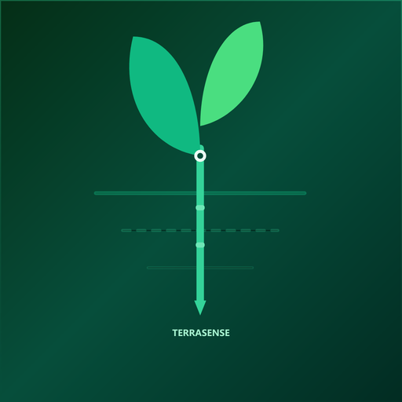

 

# PLAN DE MARKETING TERRASENSE

### Evaluación N° 2: Comercialización y Tecnologías

Sonda de suelo portátil con interpretación agronómica en el teléfono

 

**Integrantes:** Álvaro Nicolás Villena Torrejón · Alan Paul Escobar Rojas

**Docente:** Kattia Maldonado Toledo

 

Santiago, Chile

Octubre de 2026

---

## Índice

- Introducción
- 1. Fundamentos del marketing aplicados a TerraSense
   - 1.1 El marketing como creación de valor
   - 1.2 Necesidad, deseo y demanda
   - 1.3 Valor, satisfacción e intercambio
   - 1.4 Mercado, oferta y miopía de marketing
   - 1.5 Orientación de la empresa y microentorno
- 2. Análisis estratégico del entorno: PESTEL y FODA
   - 2.1 Análisis PESTEL
   - 2.2 Análisis FODA
   - 2.3 Del análisis a las decisiones
- 3. Consumidor objetivo y factores que influyen en la compra
   - 3.1 Segmentación y mercado meta
   - 3.2 Perfiles del consumidor
   - 3.3 Factores que influyen en la compra
   - 3.4 Cómo decide el consumidor
- 4. Recorrido del consumidor: «Sigue al consumidor»
- 5. Mercado, competencia, diferenciación y posicionamiento
   - 5.1 Tamaño del mercado
   - 5.2 Competencia
   - 5.3 Costo frente a las alternativas
   - 5.4 Diferenciación
   - 5.5 Posicionamiento
- 6. Estrategia de marketing: las 7P
   - 6.1 Elección del modelo: ¿4P o 7P?
   - 6.2 Producto
   - 6.3 Precio
   - 6.4 Plaza
   - 6.5 Promoción
   - 6.6 Personas
   - 6.7 Pruebas tangibles
   - 6.8 Procesos
   - 6.9 Síntesis y coherencia de la mezcla
- 7. Publicidad y promoción
   - 7.1 Estrategia publicitaria
   - 7.2 Pieza principal: carrusel «Del número a la decisión»
   - 7.3 Acciones promocionales y relaciones públicas
- 8. Marketing digital
- 9. Identidad visual y comunicación de marketing
   - 9.1 Logotipo
   - 9.2 Colores
   - 9.3 Tipografía, imágenes y composición
   - 9.4 Estilo comunicacional
- 10. Fuentes de información
- Conclusiones
- Referencias bibliográficas
- Anexos
   - Anexo A. Calendario de contenidos de los tres primeros meses

**Índice de tablas**

- Tabla 1.1. Necesidad, deseo y demanda aplicados a TerraSense
- Tabla 1.2. Microentorno de TerraSense
- Tabla 2.1. Análisis PESTEL: evidencia, efecto y decisión
- Tabla 2.2. Cruce FODA y decisiones del plan
- Tabla 3.1. Segmentación y mercado meta
- Tabla 3.2. Factores que influyen en la compra
- Tabla 4.1. Recorrido del consumidor y acciones por etapa
- Tabla 5.1. Tamaño del mercado
- Tabla 5.2. Comparación con la competencia
- Tabla 5.3. Costo acumulado para el agricultor
- Tabla 6.1. Criterios para elegir entre las 4P y las 7P
- Tabla 6.2. Niveles del producto
- Tabla 6.3. Estrategias de precio evaluadas
- Tabla 6.4. Síntesis de las 7P y su justificación
- Tabla 7.1. Estrategia publicitaria
- Tabla 7.2. Secuencia del carrusel
- Tabla 8.1. Estrategia por canal digital
- Tabla 9.1. Colores de la marca y su uso
- Tabla 10.1. Fuentes de información y su uso
- Tabla A.1. Calendario de contenidos desde el lanzamiento

**Índice de figuras**

- Figura 1.1. De la necesidad a la demanda en TerraSense
- Figura 2.1. Síntesis del análisis PESTEL de TerraSense
- Figura 2.2. Matriz FODA de TerraSense
- Figura 3.1. Perfiles del consumidor objetivo
- Figura 4.1. Mapa del recorrido del consumidor de TerraSense
- Figura 5.1. Tamaño del mercado de TerraSense
- Figura 5.2. Precio de TerraSense frente a la competencia directa
- Figura 5.3. Mapa de posicionamiento
- Figura 6.1. La mezcla de marketing de TerraSense
- Figura 7.1. Las siete imágenes del carrusel «Del número a la decisión»
- Figura 8.1. Embudo digital de TerraSense
- Figura 9.1. Logotipo de TerraSense
- Figura 9.2. Paleta de colores de la marca
- Figura 9.3. Pantallas de la aplicación TerraSense

---

## Introducción

En Chile, muchas decisiones de riego y siembra se toman con información insuficiente o tardía. El análisis de suelo en laboratorio es exacto, pero exige tomar una muestra, enviarla y esperar el resultado durante días o semanas. Los medidores portátiles responden en el momento, pero entregan números que el agricultor debe saber interpretar por su cuenta. En medio de una sequía prolongada y con insumos cada vez más caros, decidir por intuición tiene un costo concreto: agua desperdiciada, fertilizante mal aplicado y siembras que no prosperan.

TerraSense es una sonda de suelo portátil que mide siete variables del suelo (humedad, temperatura, conductividad eléctrica, pH, nitrógeno, fósforo y potasio) y tres del ambiente (temperatura, humedad del aire y presión), y envía la lectura por Bluetooth a una aplicación móvil. El agricultor elige la etapa en que está su cultivo (pre-siembra, crecimiento vegetativo, floración o cosecha) y la aplicación interpreta la lectura para esa etapa: entrega un veredicto, como «No sembrar todavía», y una lista de acciones concretas. Funciona sin señal en el campo; con señal, suma el pronóstico del tiempo a la recomendación y respalda el historial en la nube. Se vende con un pago único, sin suscripción.

El **objetivo** de este informe es diseñar el plan de marketing de TerraSense: definir a quién se dirige, por qué ese consumidor lo preferiría frente a las alternativas y cómo llegará a él. Cada capítulo parte del concepto visto en la asignatura, lo aplica al proyecto y termina en una decisión del plan. El precio, los costos y la meta de ventas provienen del modelo económico del proyecto; las cifras de demanda y de conversión son estimaciones, y el plan indica cómo validarlas antes de comprometer más recursos.

---

## 1. Fundamentos del marketing aplicados a TerraSense

### 1.1 El marketing como creación de valor

La American Marketing Association (2017) define el marketing como el conjunto de actividades y procesos para crear, comunicar, entregar e intercambiar ofertas que tienen valor para los clientes, los socios y la sociedad. Kotler y Armstrong (2017) lo describen como el proceso por el que las personas obtienen lo que necesitan y desean mediante la creación y el intercambio de valor. Las dos definiciones coinciden en una palabra: **valor**. El marketing no consiste en vender un objeto, sino en crear algo que el cliente considere valioso y hacérselo llegar.

Para TerraSense, el valor no está en la sonda como objeto, sino en lo que el agricultor puede decidir con ella: regar a tiempo, esperar a que el suelo se temple antes de sembrar, no entrar con maquinaria a un suelo saturado. Esta mirada ordena todo el plan. Además, TerraSense nace en la era digital del marketing, en la que la relación con el cliente no termina en la venta: continúa en la aplicación, en el historial de mediciones y en el soporte por WhatsApp.

### 1.2 Necesidad, deseo y demanda

La asignatura distingue tres conceptos que forman una secuencia. La **necesidad** es un estado de carencia percibida; el **deseo** es la forma que toma esa necesidad según la cultura y la persona; y la **demanda** es el deseo respaldado por poder adquisitivo. La Figura 1.1 y la Tabla 1.1 aplican esa secuencia al proyecto.

**Figura 1.1.** *De la necesidad a la demanda en TerraSense*

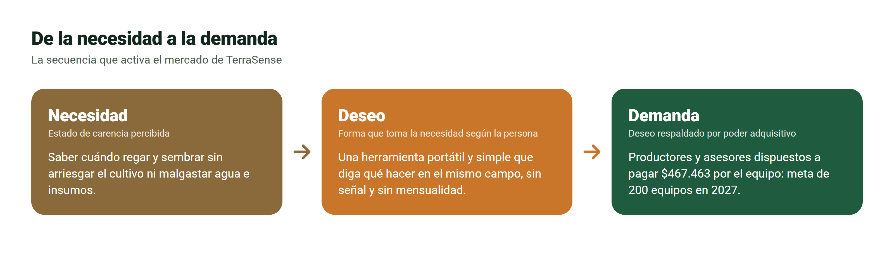

*Fuente:* elaboración propia a partir de Kotler y Armstrong (2017).

**Tabla 1.1.** *Necesidad, deseo y demanda aplicados a TerraSense*

| Concepto | Definición | Aplicación a TerraSense |
|---|---|---|
| Necesidad | Estado de carencia percibida | Certidumbre para decidir el riego y la siembra sin arriesgar el cultivo ni malgastar agua e insumos |
| Deseo | Forma que toma la necesidad según la cultura y la persona | Una herramienta portátil y fácil de entender que diga qué hacer en el mismo campo, funcione sin señal y no cobre mensualidad |
| Demanda | Deseo respaldado por poder adquisitivo | Pequeños y medianos agricultores y asesores dispuestos a pagar $467.463 con IVA; la meta del primer año es de 200 equipos |

*Fuente:* elaboración propia.

La secuencia deja en claro el límite del marketing: TerraSense no crea la necesidad de decidir bien, que ya existe en todo productor. Lo que hace es dar forma a cómo se satisface. Por eso la comunicación no intenta convencer al agricultor de que tiene un problema, sino mostrarle una manera más simple de resolver uno que ya conoce.

### 1.3 Valor, satisfacción e intercambio

- **Valor.** Es la diferencia entre los beneficios que percibe el cliente y los costos económicos, de tiempo y de esfuerzo que asume. TerraSense suma beneficios (respuesta inmediata, interpretación según la etapa, mediciones ilimitadas) y reduce costos: su pago único queda por debajo del gasto acumulado en análisis de laboratorio durante el tercer año de uso habitual (sección 5.3).
- **Satisfacción.** Depende de que el producto cumpla las expectativas que creó la comunicación. Por eso el plan no promete lo que el equipo no hace: no reemplaza al laboratorio, no calcula dosis de fertilizante, y el nitrógeno, el fósforo y el potasio se presentan como valores de referencia. Una expectativa inflada se convierte en decepción y en reseñas negativas.
- **Intercambio.** El agricultor entrega dinero y recibe una herramienta y un servicio continuo: aplicación, historial y soporte. El intercambio se repite cuando el cliente satisfecho recomienda el equipo a otros productores.

### 1.4 Mercado, oferta y miopía de marketing

El **mercado** de TerraSense está formado por los compradores actuales y potenciales de información sobre el suelo: los productores agrícolas y quienes los asesoran. La **oferta de mercado** no es solo el aparato, sino la combinación de la sonda, la aplicación, la interpretación agronómica, el historial y el soporte.

Levitt (1960) llamó **miopía de marketing** al error de enfocarse en el producto y no en la necesidad que satisface; la clase lo resume con el ejemplo del taladro: el cliente no quiere un taladro, quiere un agujero. Aplicado al proyecto, TerraSense no vende una sonda de siete variables, **vende decisiones a tiempo en el campo**. Si el equipo se viera a sí mismo como fabricante de sensores, competiría por precio contra medidores importados; viéndose como proveedor de decisiones, compite por utilidad.

De esta reflexión nace la **propuesta de valor** de TerraSense: *saber en el mismo campo, en segundos, qué hacer con el riego y la siembra según la etapa del cultivo, aun sin señal y con un solo pago.* Cada parte responde a una carencia de las alternativas: la inmediatez, a la espera del laboratorio; la recomendación, a los números crudos de los medidores; el funcionamiento sin señal, a la conectividad irregular del campo; y el pago único, a las mensualidades de las soluciones de monitoreo remoto.

### 1.5 Orientación de la empresa y microentorno

TerraSense adopta una **orientación al marketing social**: satisfacer al cliente y, a la vez, cuidar el bienestar de la sociedad a largo plazo. Medir antes de regar o fertilizar reduce el uso innecesario de agua y de fertilizante, un beneficio para el agricultor y para el entorno que está en línea con la tendencia ESG (ambiental, social y de gobernanza) vista en clase. Las demás orientaciones se descartan: la orientación a la producción llevaría a competir solo por precio; la orientación al producto, a sumar sensores que nadie interpreta, que es justamente la miopía de marketing; y la orientación a las ventas, a presionar una compra técnica que, mal hecha, termina en clientes insatisfechos.

El microentorno reúne a los actores cercanos que influyen en la capacidad de la empresa para servir a sus clientes. La Tabla 1.2 los describe junto con la consecuencia que tiene cada uno para el plan.

**Tabla 1.2.** *Microentorno de TerraSense*

| Actor | En TerraSense | Implicancia para el plan |
|---|---|---|
| Empresa | Dos socios que desarrollan, producen y venden, apoyados por un contador | Canales que dos personas puedan atender en todo Chile |
| Proveedores | Fabricantes de la sonda, de las placas y de los componentes electrónicos | Casi todo el costo es importado y depende del dólar |
| Intermediarios | Pasarela de pago, courier y plataformas de publicidad | Venta directa, sin distribuidores el primer año |
| Clientes | Agricultores y asesores. Es un **mercado industrial**: compran para producir, no para consumir | Valoran el retorno económico y la factura con IVA recuperable |
| Competidores | Medidores portátiles, laboratorios y asesoría agronómica | Diferenciarse por la interpretación, no por el hardware |
| Públicos | INDAP, cooperativas, juntas de vigilancia, medios agrícolas, SUBTEL y SERNAC | Prescriptores del productor y reguladores que exigen requisitos antes de vender |

*Fuente:* elaboración propia.

Dos lecturas de la tabla marcan el resto del informe. Primero, el cliente compra para producir, por lo que el argumento de venta debe ser económico y no emocional. Segundo, la empresa es muy pequeña, de modo que cada canal y cada acción deben poder sostenerse con dos personas.

---

## 2. Análisis estratégico del entorno: PESTEL y FODA

### 2.1 Análisis PESTEL

El análisis PESTEL revisa las fuerzas del macroentorno que la empresa no controla: factores políticos, económicos, sociales, tecnológicos, ecológicos y legales. La clase mostró con el caso de Uber que ignorar el entorno puede hundir a un producto innovador. Por eso cada factor se clasifica como oportunidad o amenaza y se traduce en una decisión concreta del plan. La Figura 2.1 resume el análisis y la Tabla 2.1 presenta la evidencia de cada factor.

**Figura 2.1.** *Síntesis del análisis PESTEL de TerraSense*

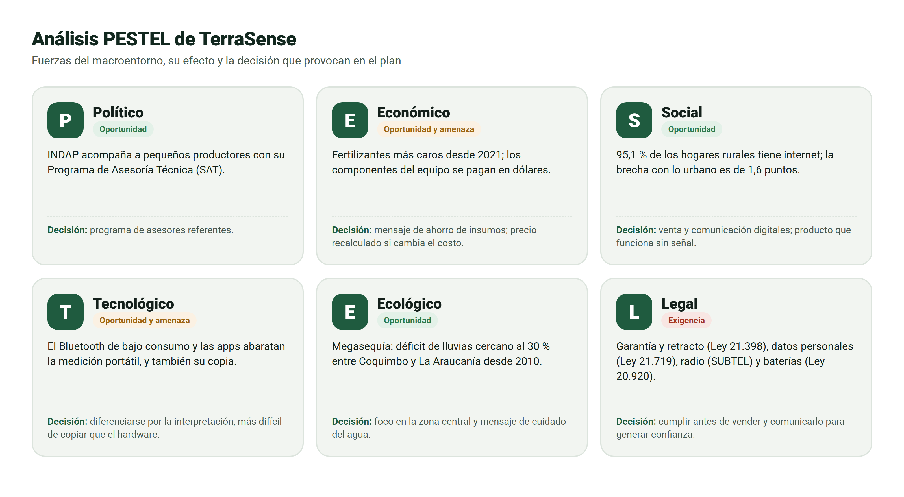

*Fuente:* elaboración propia con las fuentes de la Tabla 2.1.

**Tabla 2.1.** *Análisis PESTEL: evidencia, efecto y decisión*

| Factor | Evidencia | Oportunidad o amenaza | Decisión del plan |
|---|---|---|---|
| Político | INDAP mantiene el Programa de Asesoría Técnica (SAT), que acompaña a pequeños productores en la adopción de tecnologías (Ministerio de Agricultura, s.f.) | Oportunidad: los asesores del programa son prescriptores naturales | Programa de asesores referentes (sección 7.3) |
| Económico | El precio de los fertilizantes subió con fuerza en 2021 y 2022 (ODEPA, s.f.); los componentes del equipo se pagan en dólares | Oportunidad: fertilizar sin medir es más caro. Amenaza: el alza del dólar encarece el equipo | Mensaje centrado en el ahorro de insumos; precio que se recalcula si cambia el costo |
| Social | El 95,1 % de los hogares rurales tiene internet y la brecha con lo urbano bajó a 1,6 puntos (Nogales, 2026) | Oportunidad: el agricultor ya usa smartphone y redes sociales. Matiz: internet en la casa no asegura señal en el campo | Venta y comunicación digitales; producto que funciona sin señal |
| Tecnológico | El Bluetooth de bajo consumo y las aplicaciones móviles abaratan la medición portátil | Oportunidad para un equipo accesible. Amenaza: copia por actores grandes | Diferenciarse por la interpretación agronómica, más difícil de copiar que el hardware |
| Ecológico | La zona entre Coquimbo y La Araucanía acumula un déficit de lluvias cercano al 30 % desde 2010 (CR2, 2015) | Oportunidad: medir la humedad del suelo pasa de lujo a necesidad | Mercado meta en la zona central; mensaje de cuidado del agua |
| Legal | Ley N° 21.398: garantía legal de seis meses y retracto de 10 días en compras a distancia (SERNAC, s.f.). Ley N° 21.719 de datos personales, vigente desde diciembre de 2026 (BCN, 2024). Conformidad de equipos de radio ante SUBTEL (SUBTEL, 2026). Ley N° 20.920 de responsabilidad del productor sobre las baterías | Amenaza si se ignoran; oportunidad de generar confianza si se comunican | Garantía y retracto informados antes del pago; política de privacidad; venta solo tras la conformidad de radio; recepción de baterías usadas |

*Fuente:* elaboración propia con las fuentes citadas en cada fila.

El balance del macroentorno es favorable: cuatro de los seis factores abren oportunidades directas. La sequía y el precio de los insumos aumentan el costo de equivocarse, que es exactamente lo que TerraSense ayuda a evitar, y la conectividad rural permite vender y atender a distancia. Las amenazas se concentran en dos frentes que el plan asume desde el inicio: el tipo de cambio, que afecta el costo, y las exigencias legales, que se cumplen antes de vender y se comunican como una garantía para el comprador.

### 2.2 Análisis FODA

El análisis FODA cruza los factores internos de la empresa (fortalezas y debilidades) con los externos que identificó el PESTEL (oportunidades y amenazas). La Figura 2.2 presenta la matriz.

**Figura 2.2.** *Matriz FODA de TerraSense*

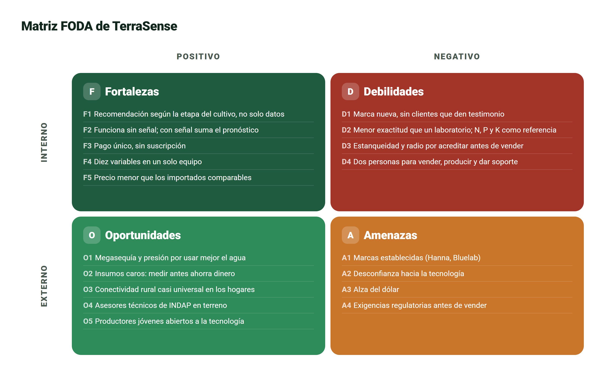

*Fuente:* elaboración propia.

Las fortalezas se concentran en el producto: la recomendación según la etapa, el funcionamiento sin señal y el pago único no tienen equivalente en la competencia directa. Las debilidades, en cambio, se concentran en la empresa: una marca sin historial, un equipo de dos personas y certificaciones que deben obtenerse antes de vender. Esta asimetría es la clave del análisis: el producto es bueno, pero todavía no tiene cómo demostrarlo.

### 2.3 Del análisis a las decisiones

Un FODA que solo enumera factores no sirve para decidir. Por eso la Tabla 2.2 combina los cuadrantes en cuatro tipos de estrategia y asigna a cada una una acción concreta del plan.

**Tabla 2.2.** *Cruce FODA y decisiones del plan*

| Estrategia | Combinación | Decisión del plan |
|---|---|---|
| FO: usar fortalezas para aprovechar oportunidades | F1 + F2 + O1 | Posicionar a TerraSense como la herramienta para decidir el riego en plena sequía, aun sin señal: concepto «Del número a la decisión» (sección 7) |
| FO | F3 + O2 | Mostrar el ahorro frente al gasto recurrente en análisis con un comparador de costos en el sitio web (sección 5.3) |
| DO: superar debilidades con oportunidades | D1 + O4 | Ganar confianza a través de asesores que el agricultor ya respeta: programa de asesores referentes |
| DO | D4 + O3 | Venta y soporte por WhatsApp y sitio web, para que dos personas cubran todo Chile |
| FA: usar fortalezas contra amenazas | F1 + F5 + A1 | Competir por utilidad y precio, no por marca: comparación directa con Hanna y Bluelab |
| DA: reducir debilidades y amenazas | D2 + D3 + A2 + A4 | No prometer lo que no está demostrado: sin promesas de exactitud de laboratorio y venta solo con la conformidad de radio |

*Fuente:* elaboración propia.

La conclusión del análisis estratégico es que la principal barrera no es el mercado, sino la **confianza**: una marca nueva vendiendo tecnología a un consumidor que desconfía de ella. Esa conclusión ordena el resto del plan, desde la elección de los canales hasta el diseño de cada pieza publicitaria.

---

## 3. Consumidor objetivo y factores que influyen en la compra

### 3.1 Segmentación y mercado meta

Segmentar consiste en dividir el mercado en grupos con necesidades y conductas parecidas para elegir a cuál dirigirse. La Tabla 3.1 aplica las cuatro variables clásicas de segmentación.

**Tabla 3.1.** *Segmentación y mercado meta*

| Variable | Criterio | Mercado meta |
|---|---|---|
| Geográfica | Déficit hídrico y agricultura intensiva | De Coquimbo a La Araucanía, con foco inicial en Valparaíso, Metropolitana, O'Higgins y Maule |
| Demográfica | Tamaño y tipo de explotación | Pequeños y medianos productores de hortalizas, frutales, viñas y cultivos anuales |
| Psicográfica | Actitud frente a la tecnología | Usan smartphone a diario y buscan reducir riesgos |
| Conductual | Frecuencia de decisión y beneficio buscado | Deciden riego y siembra varias veces por temporada, hoy por intuición o con análisis esporádicos |

*Fuente:* elaboración propia.

El resultado es un mercado meta con dos segmentos que cumplen papeles distintos en la compra: el **productor**, que usa el equipo y decide la compra, y el **asesor técnico**, que lo usa en varios campos y además influye en lo que compran sus clientes. La campaña de lanzamiento se dirige primero a los productores jóvenes o con cultivos de mayor valor: adoptan antes la tecnología (Tabla 3.2, subcultura) y para ellos un error cuesta más.

### 3.2 Perfiles del consumidor

La Figura 3.1 describe a los dos segmentos como perfiles de cliente. Son arquetipos construidos a partir de la segmentación, no personas reales, y se validarán con entrevistas a productores y asesores antes del lanzamiento.

**Figura 3.1.** *Perfiles del consumidor objetivo*

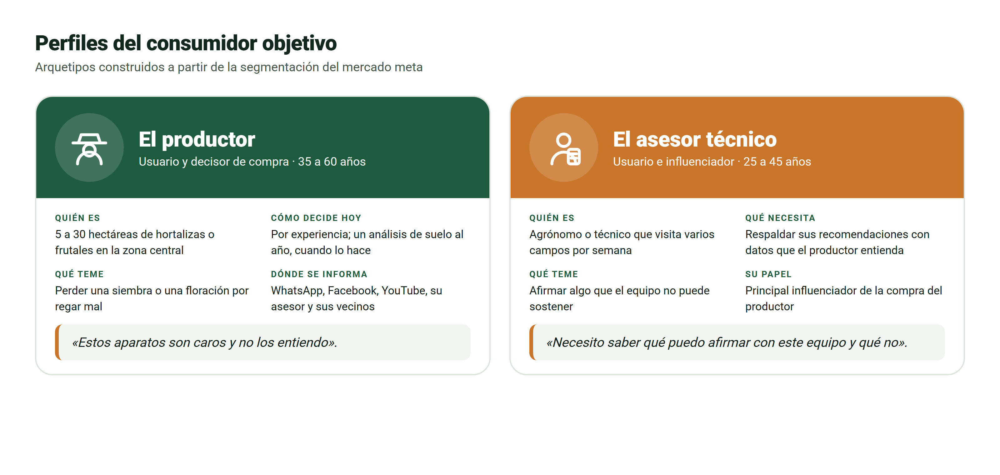

*Fuente:* elaboración propia.

Los perfiles muestran dos objeciones distintas que el plan debe responder. El productor teme que el equipo sea caro y difícil de usar: se le responde con el costo acumulado frente al laboratorio y con una aplicación que entrega una decisión, no una tabla de números. El asesor teme afirmar algo que el equipo no puede sostener: se le responde con una ficha honesta de qué mide y qué no, y con la advertencia de que los nutrientes son valores de referencia.

### 3.3 Factores que influyen en la compra

La asignatura agrupa en cuatro dimensiones las fuerzas que moldean la decisión de compra: culturales, sociales, psicológicas y personales. La Tabla 3.2 describe cómo se manifiesta cada factor en el consumidor de TerraSense, cómo influye en su compra y qué hace el plan al respecto.

**Tabla 3.2.** *Factores que influyen en la compra*

| Factor | Cómo se manifiesta en el consumidor | Cómo influye en la compra | Respuesta del plan |
|---|---|---|---|
| **Cultural:** cultura | En el campo se valora la experiencia: «siempre lo hemos hecho así» | Frena la adopción si el producto parece reemplazar su conocimiento | Mensaje de complemento: el equipo confirma o corrige la intuición, no la reemplaza |
| **Cultural:** subcultura | Productores jóvenes, que crecieron con smartphone, conviven con productores tradicionales | Los jóvenes adoptan antes e influyen en su familia y sus vecinos | Primeras campañas dirigidas a productores jóvenes y a hijos que trabajan en el campo familiar |
| **Cultural:** clase social | Ingresos variables según la temporada | Sensibilidad al precio y rechazo a los pagos mensuales | Pago único y comparación con el gasto en análisis |
| **Social:** grupos de referencia | Vecinos, cooperativas, asesores y grupos de WhatsApp | La recomendación de un par pesa más que un anuncio | Programa de referidos, días de campo y testimonios reales |
| **Social:** roles y estatus | El productor que usa tecnología se percibe como moderno y profesional | Comprar refuerza su imagen de buen productor | Comunicación que muestra al productor como quien decide con datos |
| **Psicológico:** motivación (Maslow) | Necesidad de seguridad: proteger la cosecha y el ingreso | Compra para evitar pérdidas, no por novedad | Mensajes de riesgo evitado: no sembrar en suelo frío, no regar de más |
| **Psicológico:** percepción | La tecnología se asocia a complejidad y fallas | Un anuncio técnico se lee como «no es para mí» | Demostraciones de 30 segundos: medir y leer la recomendación |
| **Psicológico:** aprendizaje y actitudes | Malas experiencias previas con equipos difíciles o sin soporte | Generan un rechazo duradero | Guía en la aplicación, soporte humano y garantía comunicada |
| **Personal:** edad y ciclo de vida | El productor mayor prefiere el trato personal; el joven, la autogestión | Distintos caminos de compra según la edad | Compra asistida por WhatsApp o compra directa en el sitio |
| **Personal:** ocupación e ingresos | Ingresos concentrados en la cosecha | Compra cuando hay caja | Pauta reforzada antes de la temporada; pago en cuotas con tarjeta |
| **Personal:** estilo de vida | Jornadas largas, poco tiempo para aprender | Valora lo rápido y simple | Medición en menos de 20 segundos y recomendación en lenguaje claro |

*Fuente:* elaboración propia a partir de Kotler y Armstrong (2017) y Maldonado (2026b).

De todos los factores, dos pesan más en esta compra. El psicológico de **motivación**: el productor no compra por curiosidad tecnológica, sino para protegerse de una pérdida, por lo que los mensajes hablan de riesgos evitados. Y el social de **grupos de referencia**: el productor cree más en su vecino y en su asesor que en cualquier anuncio, por lo que el plan invierte en testimonios, días de campo y asesores referentes.

### 3.4 Cómo decide el consumidor

Los tres modelos de comportamiento vistos en clase explican aspectos complementarios de esta compra. Según el **modelo de la caja negra** de Kotler, los estímulos externos (la sequía, el precio del fertilizante, la publicidad) entran en la mente del productor, que los procesa según su motivación y su percepción, y la respuesta es comprar o no comprar; el plan controla los estímulos de marketing y aprovecha los del entorno. Según el modelo de **Howard y Sheth (1969)**, TerraSense es una **compra extensa**: de alto valor, nueva para el comprador y técnica, de modo que el productor buscará bastante información y necesitará confianza antes de pagar. Y según el modelo de **Engel, Kollat y Blackwell** (Blackwell et al., 2006), los factores externos (la opinión del asesor, la cultura del campo) y los internos (la motivación de seguridad) actúan al mismo tiempo durante todo el proceso. Por eso el plan combina, en cada etapa del recorrido, presencia digital y recomendación personal.

---

## 4. Recorrido del consumidor: «Sigue al consumidor»

El proceso de decisión de compra tiene cinco etapas: necesidad, búsqueda, evaluación, compra y postcompra. «Seguir al consumidor» significa ponerse en su lugar en cada etapa: qué piensa, dónde busca, qué lo hace dudar y qué puede hacer la marca para acompañarlo. La Figura 4.1 representa ese recorrido como un mapa, con la curva de cómo se siente el productor en cada momento, y la Tabla 4.1 lo detalla con una acción concreta por etapa.

**Figura 4.1.** *Mapa del recorrido del consumidor de TerraSense*

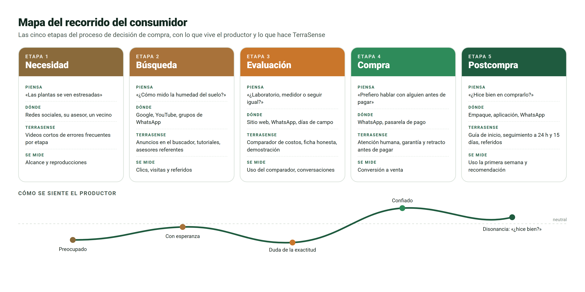

*Fuente:* elaboración propia a partir de Maldonado (2026b).

**Tabla 4.1.** *Recorrido del consumidor y acciones por etapa*

| Etapa | Qué piensa y hace el consumidor | Punto de contacto | Acción concreta de TerraSense |
|---|---|---|---|
| **1. Necesidad** | «Las plantas se ven estresadas», «gasté mucho en fertilizante y no sé si sirvió» | Redes sociales; conversación con el asesor o un vecino | Videos cortos sobre los síntomas del riego mal calibrado y el costo de fertilizar sin medir |
| **2. Búsqueda** | Recuerda su último análisis (búsqueda interna); pregunta a su asesor y busca en Google y YouTube «cómo medir la humedad del suelo» (búsqueda externa) | Buscador, YouTube, grupos de WhatsApp, asesores | Anuncios en el buscador para esas consultas; tutoriales en YouTube; asesores referentes que conocen el equipo |
| **3. Evaluación** | Compara laboratorio, medidores importados o seguir igual; duda de la exactitud. Solo tres a cinco opciones llegan a su conjunto evocado | Sitio web, WhatsApp, días de campo | Comparador de costo acumulado; ficha de qué mide y qué no; testimonios; demostración en un día de campo |
| **4. Compra** | Le cuesta pagar por internet a una marca nueva; quiere hablar con alguien | WhatsApp, sitio web, pasarela de pago | Atención humana por WhatsApp con enlace de pago; garantía y retracto informados antes de pagar; despacho incluido a todo Chile |
| **5. Postcompra** | Abre la caja, se pregunta si fue buena decisión, mide por primera vez | Empaque, aplicación, WhatsApp | Guía de inicio impresa y en pantalla; mensaje a las 24 horas; seguimiento a los 15 días; invitación a reseñar y a referir |

*Fuente:* elaboración propia.

La curva emocional de la Figura 4.1 muestra dos puntos críticos. El primero está en la **evaluación**: el productor ya se ilusionó con la solución, pero duda de su exactitud y compara con el laboratorio; ahí el plan responde con información honesta y con el comparador de costos. El segundo está en la **postcompra**: en compras de alto valor aparece la disonancia cognitiva («¿hice bien?»), y la clase recuerda que retener a un cliente cuesta cerca de cinco veces menos que conseguir uno nuevo. Un cliente que no logra su primera medición se convierte en una reseña negativa; uno que la logra, en el testimonio que la marca todavía no tiene (debilidad D1). Por eso la vinculación se hace con un solo botón y la aplicación guía paso a paso la primera medición.

---

## 5. Mercado, competencia, diferenciación y posicionamiento

### 5.1 Tamaño del mercado

El tamaño del mercado se estima en tres niveles: el mercado total (TAM, *Total Addressable Market*), el mercado servible (SAM, *Serviceable Addressable Market*), que es la parte que el producto puede atender, y el mercado objetivo (SOM, *Serviceable Obtainable Market*), que es la parte que la empresa espera captar.

**Figura 5.1.** *Tamaño del mercado de TerraSense*

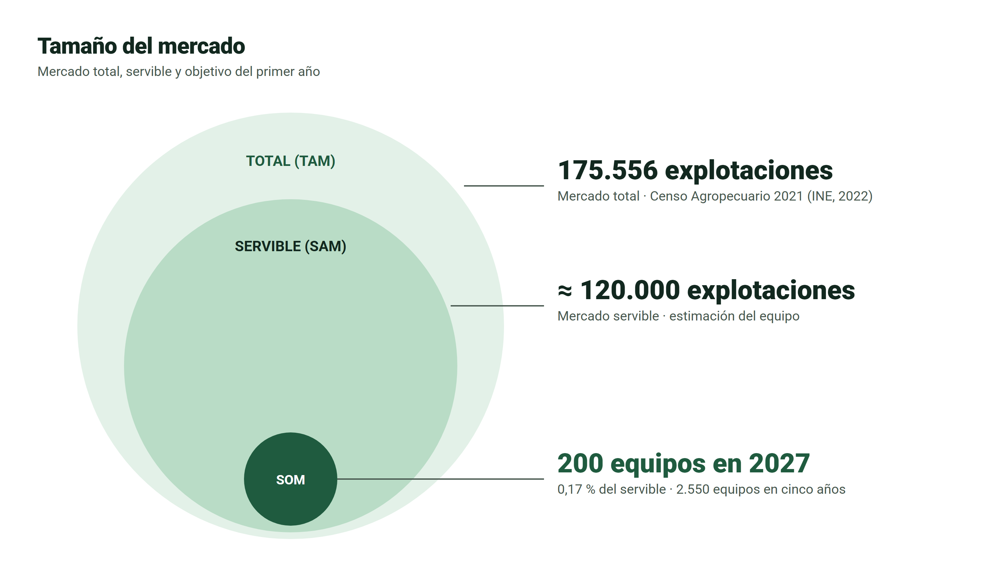

*Fuente:* elaboración propia con datos del INE (2022) y del modelo económico del proyecto.

**Tabla 5.1.** *Tamaño del mercado*

| Nivel | Tamaño | Origen |
|---|---:|---|
| Mercado total (TAM) | 175.556 explotaciones | VIII Censo Agropecuario y Forestal 2021 (INE, 2022) |
| Mercado servible (SAM) | ≈ 120.000 explotaciones | Estimación del equipo |
| Mercado objetivo del año 1 (SOM) | 200 equipos | Meta del modelo económico: 0,17 % del mercado servible |
| Meta acumulada a cinco años | 2.550 equipos | 200 + 350 + 500 + 650 + 850 |

*Fuente:* elaboración propia.

Solo el mercado total tiene fuente oficial; el servible es una estimación que deberá afinarse por región, superficie y rubro. Aun así, la proporción es elocuente: la meta del primer año equivale a menos de dos de cada mil explotaciones del mercado servible. La restricción del proyecto no es el tamaño del mercado, sino la capacidad de llegar a él y ganar su confianza.

### 5.2 Competencia

TerraSense compite con tres tipos de alternativas: competidores directos (otros medidores portátiles), indirectos (el laboratorio y la asesoría agronómica) y un sustituto que no cuesta dinero: la intuición del propio productor. La Tabla 5.2 los compara.

**Tabla 5.2.** *Comparación con la competencia*

| Alternativa | Tipo | Precio | Qué entrega | Qué no entrega |
|---|---|---:|---|---|
| **TerraSense** | Directa | **$467.463** | Siete variables del suelo y tres del ambiente; recomendación según la etapa del cultivo; funciona sin señal | Exactitud de laboratorio; dosis de fertilizante |
| Bluelab Pulse | Directa | $538.990 | Humedad, conductividad y temperatura, con Bluetooth e historial | pH, nitrógeno, fósforo y potasio; recomendación |
| Hanna HI9814 | Directa parcial | $491.827 | pH, conductividad y temperatura en soluciones | Humedad del suelo; interpretación |
| FieldScout TDR 350 | Directa | Sin precio local | Humedad, conductividad y temperatura, con GPS | Recomendación; distribución en Chile |
| Laboratorio de suelos | Indirecta | ≈ $40.845 a $50.000 por muestra | Análisis exacto y completo | Inmediatez |
| Asesoría agronómica | Indirecta | ≈ $60.000 por visita | Diagnóstico experto | Presencia continua |
| Intuición del productor | Sustituto | Sin costo directo | Rapidez y experiencia | Respaldo con datos |

*Fuente:* precios con IVA publicados por los vendedores en Chile y consultados el 04-09-2026; laboratorio según la lista 2026 de la Universidad de Chile; asesoría según consultas del equipo.

**Figura 5.2.** *Precio de TerraSense frente a la competencia directa*

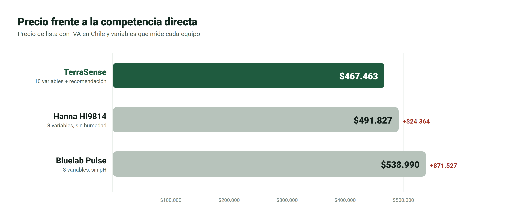

*Fuente:* elaboración propia con los precios de la Tabla 5.2.

La Figura 5.2 muestra que TerraSense cuesta $24.364 menos que Hanna (un 5,0 % menos) y $71.527 menos que Bluelab (un 13,3 % menos), mientras mide más variables que ambos y es el único que entrega una recomendación. En ese mercado, **ningún competidor directo combina la medición del suelo y del ambiente con una recomendación según la etapa del cultivo**. Esa es la oportunidad de diferenciación.

### 5.3 Costo frente a las alternativas

El precio de compra no es la única comparación que hace el productor: también pesa cuánto gasta en el tiempo con cada alternativa. La Tabla 5.3 calcula el costo acumulado.

**Tabla 5.3.** *Costo acumulado para el agricultor*

| Alternativa | Uso | Año 1 | 3 años | 5 años | 10 años |
|---|---|---:|---:|---:|---:|
| TerraSense (incluye kits de batería y un segundo equipo en el año 6) | Ilimitado | $467.463 | $492.453 | $492.453 | $984.906 |
| Laboratorio, uso habitual | 4 muestras al año | $200.000 | $600.000 | $1.000.000 | $2.000.000 |
| Laboratorio, uso intensivo | 20 muestras al año | $1.000.000 | $3.000.000 | $5.000.000 | $10.000.000 |
| Asesoría agronómica | 2 visitas al año | $120.000 | $360.000 | $600.000 | $1.200.000 |

*Fuente:* elaboración propia, en pesos de 2027 y sin descuento.

Con un uso habitual de cuatro análisis al año, el laboratorio supera el costo de TerraSense durante el tercer año; con uso intensivo, durante el primero. En diez años, el laboratorio cuesta el doble. Esto no significa que el laboratorio sobre: sigue siendo necesario para los análisis químicos completos. Lo que TerraSense cubre es el seguimiento frecuente entre un análisis y el siguiente. Este cálculo responde a la objeción «es caro» y alimenta el comparador del sitio web.

### 5.4 Diferenciación

Diferenciarse exige separar lo que realmente es exclusivo de lo que no lo es, porque prometer como diferencia algo que la competencia también tiene destruye la credibilidad.

- **Diferencias sostenibles:** la recomendación según la etapa del cultivo; diez variables en un solo equipo; el pronóstico del tiempo integrado a la recomendación cuando hay señal; y el pago único frente a los planes mensuales del monitoreo remoto.
- **Atributos valiosos, pero no exclusivos:** el funcionamiento sin conexión, el historial y el Bluetooth, que Bluelab también ofrece. Se comunican como parte del producto, nunca como la diferencia.

### 5.5 Posicionamiento

El posicionamiento es el lugar que la marca quiere ocupar en la mente del consumidor frente a sus alternativas. La Figura 5.3 ubica a cada alternativa según dos atributos que el productor valora: cuánto interpreta la lectura y cuán rápido llega la respuesta.

**Figura 5.3.** *Mapa de posicionamiento*

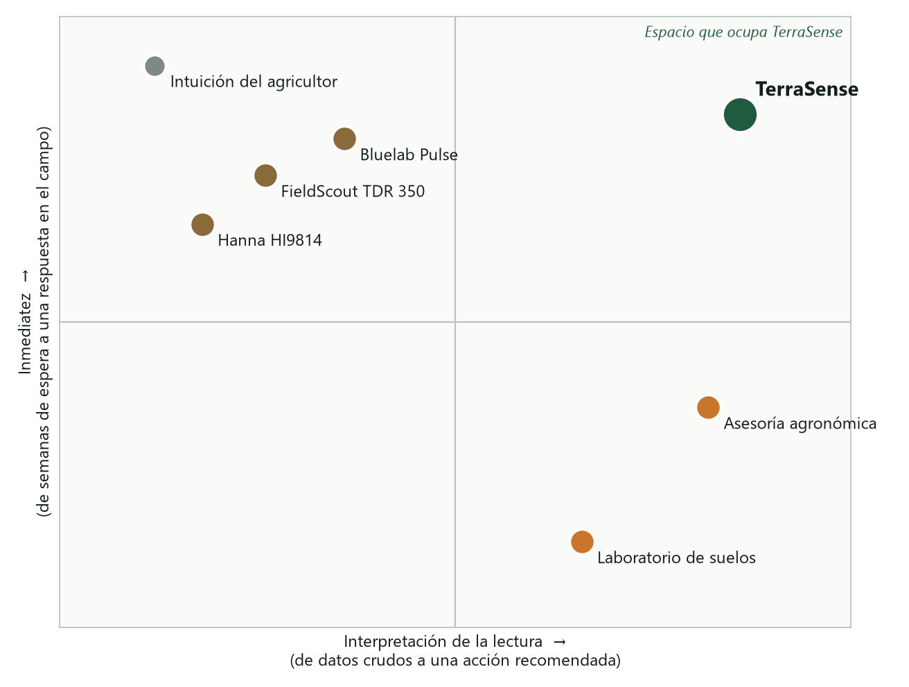

*Fuente:* elaboración propia; valoración cualitativa del equipo.

**Declaración de posicionamiento:** *Para los pequeños y medianos agricultores y sus asesores, que necesitan decidir el riego y la siembra a tiempo, TerraSense es la sonda de suelo portátil que convierte la medición en una recomendación clara según la etapa del cultivo, en el mismo campo y aun sin señal. A diferencia de los medidores que solo entregan números y de los análisis que tardan semanas, TerraSense entrega la decisión en el momento, con un pago único.*

**Frase de posicionamiento:** «Del número a la decisión».

El posicionamiento es **claro**, porque ocupa un cuadrante del mapa que ninguna alternativa ocupa: alta interpretación con respuesta inmediata. Es **coherente**, porque se apoya en lo que el producto efectivamente hace, como muestran las pantallas reales de la sección 7. Y es **atractivo**, porque responde al temor principal del consumidor: equivocarse con el agua, el fertilizante o la siembra.

---

## 6. Estrategia de marketing: las 7P

### 6.1 Elección del modelo: ¿4P o 7P?

McCarthy (1960) propuso las 4P (producto, precio, plaza y promoción) como marco para gestionar la mezcla de marketing de productos físicos. Booms y Bitner (1981) las ampliaron a las 7P, sumando **personas**, **pruebas tangibles** y **procesos**, tres variables que gestionan lo que ocurre después de la venta: la experiencia completa del cliente. Elegir uno u otro modelo no es un trámite, porque define qué variables administra la empresa y cuáles quedan sin dueño. Para decidir, TerraSense se contrastó con los criterios que la asignatura entrega para usar cada modelo (Maldonado, 2026c), como muestra la Tabla 6.1.

**Tabla 6.1.** *Criterios para elegir entre las 4P y las 7P*

| Modelo | Se usa cuando… | ¿Se cumple en TerraSense? | Evidencia |
|---|---|---|---|
| 4P | Se venden productos físicos con distribución tradicional | En parte | La sonda es un bien físico, pero se vende por un canal directo y digital, sin distribuidores (sección 6.4) |
| 4P | El mercado es de bienes de consumo masivo | No | Es un mercado industrial: el agricultor compra para producir, y es una compra extensa, de alto valor y técnica (secciones 1.5 y 3.4) |
| 4P | Los canales offline son los dominantes | No | La venta ocurre en el sitio web y por WhatsApp; los días de campo son un canal de influencia, no de venta |
| 4P | La transacción es el centro de la relación con el cliente | No | El valor llega después del pago: interpretación en la aplicación, historial en la nube, pronóstico, actualizaciones y soporte |
| 7P | Se ofrecen servicios o negocios digitales | Sí | La mitad del producto es software: la aplicación convierte la lectura en una recomendación según la etapa del cultivo |
| 7P | Es una empresa emergente u orientada al cliente | Sí | Empresa nueva de dos socios, con orientación al marketing social (sección 1.5) |
| 7P | La experiencia postcompra define la retención | Sí | Con pago único, retener significa que el cliente siga midiendo y recomiende el equipo. La recomendación de pares es el factor que más pesa en esta compra (sección 3.3), y la primera medición decide si nace un testimonio o una reseña negativa (capítulo 4) |
| 7P | El negocio incluye suscripciones o membresías | No, por decisión | La mensualidad se descartó porque el consumidor la rechaza (Tabla 3.2); el servicio continuo se entrega igual, incluido en el pago único |

*Fuente:* elaboración propia a partir de Maldonado (2026c).

**Decisión: el plan usa las 7P.** TerraSense cumple tres de los cuatro criterios de las 7P y solo uno, en parte, de los criterios de las 4P. La única condición de las 7P que no cumple, la suscripción, es una renuncia deliberada a cobrar mensualidades, no la ausencia de un servicio continuo.

El argumento de fondo viene del análisis estratégico. El FODA concluyó que la principal barrera no es el mercado, sino la **confianza**: una marca nueva que vende tecnología a un consumidor que desconfía de ella (sección 2.3). Con las 4P, justamente las tres palancas que responden a esa barrera quedarían fuera del plan:

- **Personas:** quién atiende, asesora y responde cuando el productor duda, antes y después de pagar.
- **Pruebas tangibles:** qué demuestra que el equipo funciona a alguien que no puede tocarlo antes de comprar, como los testimonios, las certificaciones y el comparador de costos.
- **Procesos:** cómo se asegura que el cliente logre su primera medición, el momento que define si se queda o abandona.

La asignatura advierte tres errores comunes al aplicar las 7P: ignorar los procesos, subestimar las pruebas tangibles cuando la confianza es difícil de construir y tratar a las personas como un costo. Los tres son riesgos concretos para TerraSense, por lo que el plan los gestiona como variables propias. Elegir las 7P tampoco abandona las 4P: el producto, el precio, la plaza y la promoción siguen ordenando la venta de la sonda como bien físico, y las tres nuevas variables gestionan el servicio que la rodea. La Figura 6.1 resume la mezcla resultante.

**Figura 6.1.** *La mezcla de marketing de TerraSense*

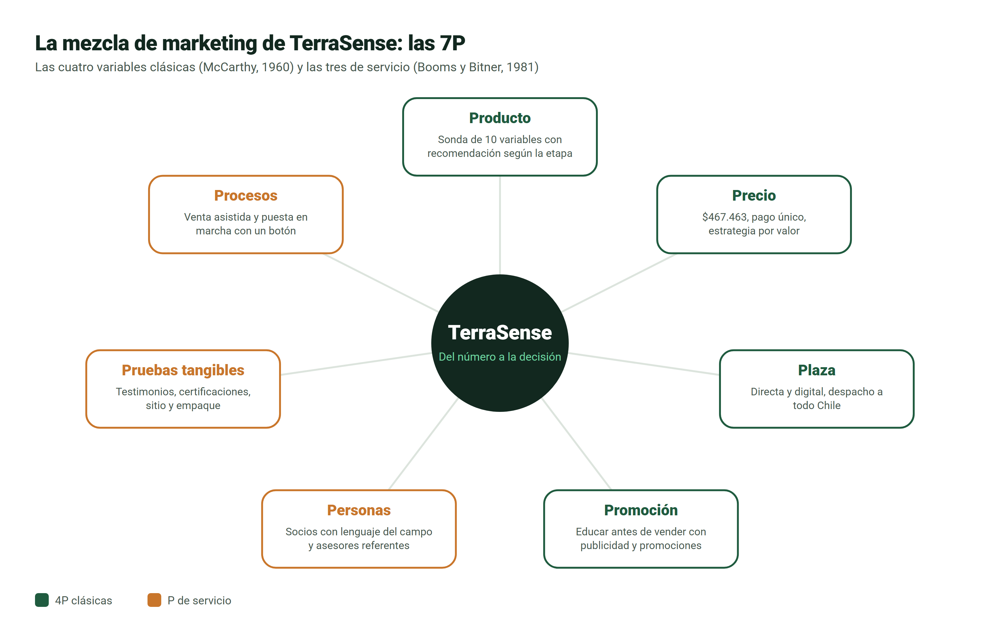

*Fuente:* elaboración propia a partir de McCarthy (1960), Booms y Bitner (1981) y Maldonado (2026c).

### 6.2 Producto

Kotler y Keller (2016) ordenan el producto en niveles: el beneficio central que busca el cliente, el producto real que lo entrega y el producto aumentado, formado por los servicios que lo rodean. La Tabla 6.2 aplica esos niveles.

**Tabla 6.2.** *Niveles del producto*

| Nivel | Qué incluye |
|---|---|
| Beneficio central | Decidir a tiempo el riego, la siembra y el momento de entrar al campo |
| Producto real | Sonda de siete variables (humedad, temperatura, conductividad eléctrica, pH, nitrógeno, fósforo y potasio) y sensor del ambiente (temperatura, humedad del aire y presión); batería recargable por USB-C; carcasa para el campo; vinculación con un botón; aplicación para Android y iPhone; empaque con guía de inicio |
| Producto aumentado | Recomendaciones para cuatro etapas del cultivo (pre-siembra, crecimiento vegetativo, floración y cosecha); pronóstico de cinco días; historial en la nube; soporte por WhatsApp; garantía legal de seis meses |

*Fuente:* elaboración propia a partir de Kotler y Keller (2016).

**Decisiones.** Una sola versión en el lanzamiento, para simplificar la producción y el soporte de un equipo de dos personas; mejoras continuas a través de actualizaciones de la aplicación; y límites declarados en el propio producto: el nitrógeno, el fósforo y el potasio aparecen como valores de referencia, nunca como base para dosificar fertilizante.

**Justificación.** El consumidor busca simplicidad y confianza, no más funciones (sección 3). Además, el producto está en la etapa de **introducción** de su ciclo de vida: la categoría es poco conocida, de modo que la comunicación debe primero explicar qué problema resuelve y después diferenciar la marca.

### 6.3 Precio

El precio de lista es de **$467.463 con IVA** ($392.826 neto), con pago único y despacho incluido. No es un precio elegido por aspiración comercial: se deriva del costo total del proyecto en diez años, exigiendo un 30 % de utilidad. Una vez calculado, se contrastó con las cuatro estrategias de precio vistas en clase (Tabla 6.3).

**Tabla 6.3.** *Estrategias de precio evaluadas*

| Estrategia | Evaluación para TerraSense | Decisión |
|---|---|---|
| Penetración (precio bajo para ganar participación) | Quedaría bajo el costo con la utilidad exigida, y en un instrumento de medición un precio muy bajo se lee como mala calidad | Descartada |
| Descremado (precio alto de lanzamiento) | Choca con un consumidor sensible al precio y con importados ya establecidos | Descartada |
| Psicológico (precio terminado en 990) | $459.990 quedaría bajo el costo con la utilidad exigida | Descartada |
| **Por valor** (refleja lo que el cliente percibe) | Más variables e interpretación que los importados, a menor precio, y más barato que el laboratorio desde el tercer año | **Adoptada** |

*Fuente:* elaboración propia a partir de Maldonado (2026c).

**Justificación.** Frente al mercado, el precio queda un 5,0 % bajo Hanna y un 13,3 % bajo Bluelab, con más beneficio (Figura 5.2). Frente al consumidor, responde a la objeción «es caro» con el costo acumulado (Tabla 5.3) y evita las mensualidades que rechaza. Y frente al posicionamiento, no se rebaja con descuentos permanentes, porque la marca compite por utilidad y no por ser la más barata. Se ofrece pago en cuotas con tarjeta y factura para quien tiene giro, que recupera el IVA.

### 6.4 Plaza

**Decisiones.** Canal **directo y digital** el primer año, con tienda en línea propia, pasarela de pago y atención por WhatsApp; despacho incluido a todo Chile por courier ($6.000 por equipo, ya considerado en el costo); asesores referentes y días de campo como canal de influencia en terreno; y, desde el tercer año, evaluación de distribuidores de insumos agrícolas como punto de venta físico.

**Justificación.** El consumidor está disperso por el país y ya usa WhatsApp (Tabla 2.1, factor social). El canal directo conserva el margen y el contacto con cada cliente, que es la principal fuente de aprendizaje de una empresa nueva, y es el único que dos personas pueden atender a escala nacional.

### 6.5 Promoción

**Decisiones.** Combina las tres herramientas de la asignatura: **publicidad** pagada en Meta, Google y YouTube; **relaciones públicas** con medios agrícolas, cooperativas y ferias; y **promociones** que no rebajan el precio de lista, como el programa de asesores referentes, Campo Pionero y los referidos. Se desarrolla en los capítulos 7 y 8.

**Justificación.** Es una compra extensa y el consumidor desconfía de la tecnología. La línea común es **educar antes de vender**: primero que el productor entienda el problema y vea el equipo funcionar, y recién después pedirle la compra.

### 6.6 Personas

**Decisiones.** Los dos socios dan el **soporte en vivo** y la venta el primer año, con el lenguaje del campo; uno de ellos asume la **gestión de redes sociales** hasta que, en 2029, se incorpore una persona dedicada a marketing; y los asesores referentes y los primeros clientes actúan como **voces externas** de la marca. Todos siguen el mismo protocolo: responder dentro de la jornada, explicar los límites del equipo y no prometer exactitud de laboratorio.

**Justificación.** Para una marca nueva, la confianza se construye con trato humano y con personas a quienes el agricultor ya les cree, no con celebridades.

### 6.7 Pruebas tangibles

**Decisiones.** Testimonios en video de los primeros clientes; publicación de la conformidad de radio ante SUBTEL y del ensayo de estanqueidad IP67 en cuanto se obtengan, ya que el equipo solo se comunicará como resistente al agua con ese ensayo; sitio web con ficha técnica y comparador de costos; aplicación con identidad propia (Figura 9.3); y empaque con guía de inicio y número de serie.

**Justificación.** La venta es a distancia y la marca es desconocida. Las pruebas tangibles reducen la incertidumbre de quien no puede tocar el equipo antes de comprarlo.

### 6.8 Procesos

1. **Consulta:** el cliente escribe por WhatsApp desde un anuncio o el sitio; fuera de horario recibe una respuesta automática con la ficha y el comparador.
2. **Asesoría previa:** se revisa su caso de uso y se envía el enlace de pago.
3. **Pago y despacho:** confirmación de la garantía y del derecho a retracto; despacho con seguimiento.
4. **Puesta en marcha:** botón PAIR durante 3 segundos y guía en pantalla para la primera medición.
5. **Postventa:** seguimiento a las 24 horas y a los 15 días; garantía legal de seis meses; recepción de la batería al fin de su vida útil.

**Justificación.** Cada paso elimina una fricción de las etapas de compra y postcompra del recorrido (Tabla 4.1). Cada equipo pasa una prueba de aceptación antes de embalarse, registrada por número de serie, lo que respalda la garantía.

### 6.9 Síntesis y coherencia de la mezcla

Cada decisión de la mezcla debe responder al consumidor, al mercado y al posicionamiento. La Tabla 6.4 hace esa comprobación para las siete variables.

**Tabla 6.4.** *Síntesis de las 7P y su justificación*

| P | Decisión | Por el consumidor | Por el mercado | Por el posicionamiento |
|---|---|---|---|---|
| Producto | Sonda de diez variables con recomendación según la etapa | Busca saber qué hacer, no un número | Ningún competidor recomienda según la etapa | Hace posible «del número a la decisión» |
| Precio | $467.463, por valor, sin rebajas | Rechaza las mensualidades | Bajo los importados comparables | Se compite por utilidad, no por precio |
| Plaza | Directa y digital, despacho incluido | Disperso y usuario de WhatsApp | Competidores venden por catálogo | Contacto directo que sostiene la confianza |
| Promoción | Educar antes de vender | Desconfía de la tecnología | Categoría poco conocida | Muestra la decisión, no la ficha técnica |
| Personas | Socios y asesores referentes | Confía en sus pares y en su asesor | Marca nueva sin reputación | La confianza es el principal activo |
| Pruebas tangibles | Testimonios, certificaciones y comparador | No puede tocar el equipo antes | Competidores con marca conocida | Respaldan lo que la marca promete |
| Procesos | Venta asistida y puesta en marcha con un botón | Poco tiempo y temor a lo complejo | Marca nueva que no puede fallar al inicio | La primera medición confirma la promesa |

*Fuente:* elaboración propia.

Al revisar la mezcla, la variable más débil al lanzamiento son las **pruebas tangibles**: todavía no hay clientes con testimonio y las certificaciones se obtienen antes de la venta. La clase propone identificar la P más débil y priorizarla; por eso el plan concentra sus primeras acciones en el programa Campo Pionero y en la publicación de las certificaciones.

---

## 7. Publicidad y promoción

### 7.1 Estrategia publicitaria

La Tabla 7.1 define los elementos de la estrategia publicitaria.

**Tabla 7.1.** *Estrategia publicitaria*

| Elemento | Definición |
|---|---|
| Público | Productores de 30 a 60 años de hortalizas, frutales y viñas de la zona central, y asesores técnicos de 25 a 45 años |
| Objetivo | **De comunicación:** que el mercado meta asocie TerraSense con «saber qué hacer con el suelo en el mismo campo». **Comercial:** 200 equipos vendidos en 2027, con 2.000 conversaciones por WhatsApp y una conversión del 10 % |
| Mensaje | «Mide tu suelo y sabe qué hacer, ahí mismo. Sin esperar resultados, sin pagar mensualidades.» |
| Concepto creativo | **«Del número a la decisión».** Un medidor común muestra «Humedad 16 % · Suelo 10 °C» y deja al productor con la pregunta «¿y ahora qué?»; con la misma lectura, TerraSense responde «No sembrar todavía» y explica qué hacer. El contraste muestra la diferencia sin tener que explicarla |
| Medios | Facebook, Instagram, YouTube, buscador de Google, WhatsApp, días de campo y ferias agrícolas |
| Formatos | Carrusel de siete imágenes (pieza principal); videos verticales de 15 a 30 segundos; anuncios de texto en el buscador; tutoriales de 3 a 5 minutos; pendón y volante para ferias |
| Llamado a la acción | «Escríbenos por WhatsApp y te ayudamos a elegir» (principal); «Calcula cuánto te cuesta decidir a ciegas» (comparador en el sitio) |
| Acciones promocionales | Programa de asesores referentes, Campo Pionero, referidos entre clientes y días de campo, sin rebajar el precio de lista (sección 7.3) |

*Fuente:* elaboración propia.

El concepto creativo traduce el posicionamiento en una imagen que se entiende sin leer un párrafo: el mismo par de números, sin interpretar y luego interpretado. Sobre ese concepto se construyen tres piezas: el **carrusel «Del número a la decisión»**, que es la pieza principal y se desarrolla en la sección 7.2; el **video «Diez segundos»**, en que un productor entierra la sonda, saca el teléfono y lee la recomendación, con el texto final «¿Riego hoy? Ahora lo sabes»; y el **anuncio de búsqueda** «Medidor de humedad de suelo con recomendación. Funciona sin señal. Despacho a todo Chile».

### 7.2 Pieza principal: carrusel «Del número a la decisión»

El carrusel es un anuncio de siete imágenes para Instagram y Facebook, en formato vertical 4:5 (1080 × 1350 píxeles), que el productor recorre deslizando hacia el lado. Se eligió este formato porque el usuario avanza a su ritmo y porque un solo anuncio alcanza para contar la historia completa, del problema a la decisión: cada imagen acompaña una etapa del recorrido del consumidor (capítulo 4). Las pantallas de las imágenes 3 y 4 no son una simulación: reproducen el resultado que entrega la aplicación para una lectura real de pre-siembra, con el suelo a 10 °C, un 16 % de humedad y 12 mm de lluvia pronosticados para el día siguiente. La Tabla 7.2 explica la secuencia y la Figura 7.1 muestra las siete imágenes.

**Tabla 7.2.** *Secuencia del carrusel*

| Imagen | Qué muestra | Etapa del recorrido | Para qué sirve |
|---|---|---|---|
| 1. «¿Riego hoy o mañana?» | Suelo seco y agrietado, un sol, una nube con lluvia y la sonda enterrada | 1. Necesidad | Detener al usuario con la pregunta que el productor se hace cada semana; muestra el problema, no el producto |
| 2. «¿Y ahora qué?» | Un medidor común, sin marca, que solo dice «Humedad 16 %» y «T° suelo 10 °C» | 2. Búsqueda | Hacer visible la brecha entre medir y decidir, la debilidad de la competencia directa (Tabla 5.2); plantea el riesgo como una pérdida, que conecta con la motivación de seguridad (Tabla 3.2) |
| 3. «No siembres todavía» | La misma lectura en la aplicación: veredicto «No sembrar todavía» y la explicación «El suelo está a 10 °C: todavía muy frío para que la semilla germine» | 3. Evaluación | Mostrar el concepto creativo: el número se convierte en decisión. La pantalla real responde al factor de percepción («la tecnología es complicada») |
| 4. «No riegues hoy: viene lluvia el miércoles» | La pantalla «Qué hacer», con la recomendación de esperar los 12 mm de lluvia antes de regar | 3. Evaluación | Mostrar un beneficio concreto, un riego ahorrado, gracias al pronóstico integrado a la recomendación (sección 5.4) |
| 5. «Todo para decidir, en el mismo campo» | Cuatro beneficios: funciona sin señal, diez variables, recomendación según la etapa y pago único | 3. Evaluación | Responder de antemano a las objeciones de los perfiles (Figura 3.1): falta de señal, complejidad, utilidad y mensualidades |
| 6. «En 3 años, te sale más barato que el laboratorio» | $600.000 en análisis de laboratorio frente a $492.453 de TerraSense; garantía, retracto y despacho incluido | 3 y 4. Evaluación y compra | Responder a la objeción «es caro» con el cálculo de la Tabla 5.3 y reducir el riesgo justo antes de pedir la compra |
| 7. «Mide hoy. Decide hoy.» | El logotipo, el botón «Escríbenos por WhatsApp» y el precio con pago único | 4. Compra | Cerrar con un solo llamado a la acción, el mismo de toda la campaña |

*Fuente:* elaboración propia.

**Figura 7.1.** *Las siete imágenes del carrusel «Del número a la decisión»*

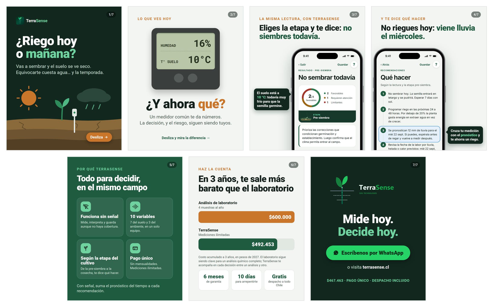

*Fuente:* elaboración propia; las imágenes 3 y 4 reproducen la aplicación TerraSense.

El carrusel aplica la identidad visual del capítulo 9: abre y cierra con el mismo fondo verde noche, deja un solo mensaje por imagen y usa el ocre para orientar la lectura. Cada imagen apunta a un factor de la Tabla 3.2: la motivación de seguridad (imágenes 1 y 2), la percepción de que la tecnología es complicada (imágenes 3 y 4) y la sensibilidad al precio (imagen 6).

### 7.3 Acciones promocionales y relaciones públicas

Las promociones estimulan la compra inmediata. En TerraSense, **ninguna rebaja el precio de lista**, para no contradecir el posicionamiento por valor:

- **Programa de asesores referentes.** El asesor que refiere una venta recibe una comisión del 5 % del precio de lista ($23.301 por equipo), ya incluida en el costo. Convierte a los prescriptores en una red de venta sin costo fijo.
- **Campo Pionero.** Los primeros 30 compradores reciben una puesta en marcha por videollamada y participan como casos de estudio. Los cupos son realmente limitados, lo que crea urgencia sin inventar plazos, y generan los testimonios que hoy faltan.
- **Referido entre clientes.** Quien recomienda a otro productor recibe un kit de mantenimiento con soluciones de calibración y un cepillo para los electrodos.
- **Días de campo y relaciones públicas.** Demostraciones con cooperativas y equipos de asesoría de INDAP, presencia en ferias regionales y un comunicado de lanzamiento a medios agrícolas, con el ángulo de interés público de medir antes de regar en plena sequía.

**Calendario.** La campaña tiene tres momentos: expectativa en marzo de 2027, con los resultados del piloto de febrero; **lanzamiento el 19 de abril de 2027**; y refuerzo de agosto a noviembre, antes de las siembras de primavera y de la temporada de riego, cuando la necesidad es más visible.

---

## 8. Marketing digital

La estrategia digital se organiza como un **embudo de tres niveles**, cada uno conectado con etapas del recorrido del consumidor. En la parte alta, la **atracción** busca que el productor reconozca su necesidad y conozca la marca (etapas 1 y 2). En la parte media, la **consideración** busca que compare y confíe (etapa 3). En la parte baja, la **conversión y fidelización** busca que compre, use el equipo y lo recomiende (etapas 4 y 5). La Figura 8.1 muestra el embudo con sus canales e indicadores.

**Figura 8.1.** *Embudo digital de TerraSense*

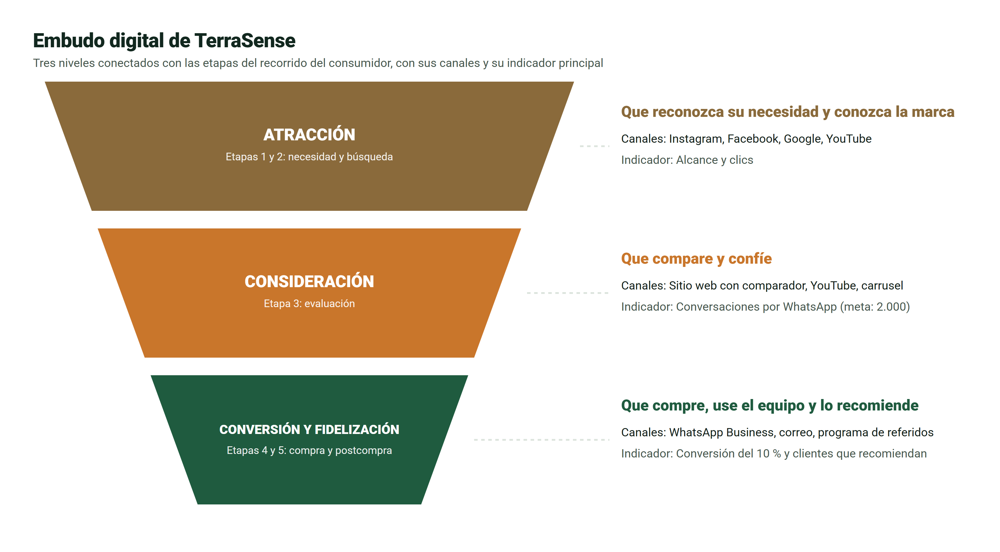

*Fuente:* elaboración propia.

La Tabla 8.1 desarrolla cada canal: objetivo, contenido, formato, frecuencia, interacción, llamado a la acción y etapa del recorrido.

**Tabla 8.1.** *Estrategia por canal digital*

| Canal | Objetivo | Contenido y formato | Frecuencia | Interacción | Llamado a la acción | Etapa |
|---|---|---|---|---|---|---|
| Instagram y Facebook | Alcance y educación | Carrusel «Del número a la decisión»; videos cortos de errores frecuentes por etapa del cultivo; historias con preguntas («¿Cuánta agua le falta a este campo?») | 4 publicaciones y 5 historias por semana | Respuesta a comentarios el mismo día; encuestas en historias | «Escríbenos por WhatsApp» | 1, 2 y 3 |
| Google (búsqueda) | Captar a quien ya busca | Anuncios de texto para «medidor humedad suelo» y «análisis de suelo precio» | Continua, reforzada de agosto a noviembre | — | «Ver cómo funciona» | 2 y 3 |
| YouTube | Demostrar y enseñar | Tutoriales de 3 a 5 minutos por etapa del cultivo; video de puesta en marcha | 2 videos al mes | Comentarios y preguntas frecuentes | «Míralo en tu campo» | 2, 3 y 5 |
| Sitio web | Evaluación y compra | Ficha técnica, comparador de costo acumulado, testimonios, botón de WhatsApp | Actualización mensual | Comparador interactivo | «Calcula tu ahorro» / «Comprar» | 3 y 4 |
| WhatsApp Business | Conversión y soporte | Catálogo, respuestas rápidas, enlace de pago, seguimiento | Atención diaria en horario hábil | Conversación uno a uno con una persona | «Te ayudamos a elegir» | 3, 4 y 5 |
| Correo y WhatsApp postcompra | Fidelización y referidos | Bienvenida, consejos de temporada, invitación a reseñar y referir | A las 24 horas, a los 15 días y una vez por temporada | Respuestas personalizadas | «Recomienda y recibe tu kit» | 5 |

*Fuente:* elaboración propia.

La elección de canales sigue al consumidor: el productor ya usa WhatsApp y Facebook a diario y aprende con videos de YouTube (Figura 3.1), y la clase muestra que la gran mayoría de los compradores de electrónica investiga en internet antes de comprar. WhatsApp ocupa un lugar central porque une la venta y el soporte en un mismo canal, atendido por una persona, que es lo que el consumidor pide en la etapa de compra. Quienes visitan el sitio o ven más de la mitad de un video reciben, durante los 14 días siguientes, anuncios de consideración con testimonios y el comparador (*retargeting*). El Anexo A presenta el calendario de contenidos de los tres primeros meses.

---

## 9. Identidad visual y comunicación de marketing

La identidad visual de TerraSense une dos mundos: **la tierra** y **la tecnología**. Cada elemento, desde el logotipo hasta el tono de los mensajes, refuerza el posicionamiento «del número a la decisión» y se aplica de la misma forma en la aplicación, en el sitio y en las piezas publicitarias, como el carrusel de la sección 7.2.

### 9.1 Logotipo

**Figura 9.1.** *Logotipo de TerraSense*

 &nbsp;&nbsp; 

*Fuente:* elaboración propia.

El ícono, a la izquierda, es un brote cuya raíz es la sonda que entra en el suelo, cruzada por las líneas de los estratos. La planta, que representa el cultivo, y la sonda, que representa el dato, forman una sola línea, igual que la propuesta une medición y decisión. El nombre, a la derecha, separa por color sus dos mitades: «Terra», la tierra, en verde noche, y «Sense», el sentido o la percepción, en verde vivo. Sobre fondos oscuros, «Terra» pasa a blanco, como en las imágenes 1 y 7 del carrusel.

### 9.2 Colores

**Figura 9.2.** *Paleta de colores de la marca*

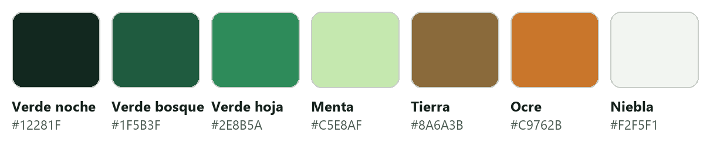

*Fuente:* elaboración propia.

**Tabla 9.1.** *Colores de la marca y su uso*

| Color | Código | Uso |
|---|---|---|
| Verde noche | #12281F | Fondos de impacto, como las imágenes 1 y 7 del carrusel |
| Verde bosque | #1F5B3F | Botones, acciones y titulares destacados |
| Verde vivo | #2E8B5A | «Sense» del logotipo y acentos |
| Ocre | #C9762B | Llamadas de atención, como «Desliza» y las etiquetas sobre los titulares |
| Tierra | #8A6A3B | Ilustraciones del suelo |
| Fondo claro | #F2F5F1 | Fondo de la aplicación y de las piezas informativas |
| Favorable, atención y limitante | #2C7A4E, #9E6612 y #A33528 | Estados del suelo, siempre acompañados de texto |

*Fuente:* elaboración propia a partir de la paleta de la aplicación.

La paleta combina los verdes del cultivo con los tonos de la tierra. Los estados del suelo usan verde, ámbar y rojo, como un semáforo, pero **nunca se comunican solo con el color**: cada estado lleva además texto o ícono, para que se lea sin ambigüedad.

### 9.3 Tipografía, imágenes y composición

- **Tipografía.** Una sans serif limpia: la tipografía del sistema en la aplicación y Roboto en las piezas gráficas, con titulares grandes en negrita que se leen en un teléfono a pleno sol. El nombre de la marca se usa siempre como imagen, nunca reescrito con otra letra.
- **Imágenes.** Fotografías reales en el campo (manos con tierra, la sonda enterrada, el teléfono al sol) e ilustraciones planas con los estratos del suelo en franjas de color, como en la imagen 1 del carrusel. Nunca laboratorios ni modelos de banco de imágenes, porque el productor debe reconocerse en ellas.
- **Composición.** Cada pieza tiene un solo mensaje: un titular grande, una imagen y un llamado a la acción. Las etiquetas en ocre sobre el titular («Lo que ves hoy», «Haz la cuenta») orientan la lectura.

**Figura 9.3.** *Pantallas de la aplicación TerraSense*

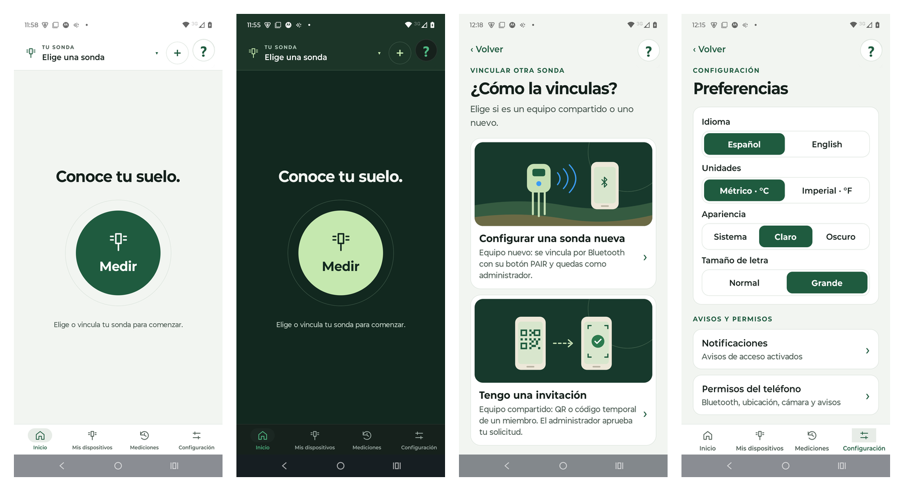

*Fuente:* capturas de la aplicación TerraSense.

La identidad continúa dentro del producto. La Figura 9.3 muestra el inicio en tema claro y oscuro, la elección del tipo de vinculación y las preferencias con letra grande. El tema claro tiene alto contraste para leer al sol y la letra grande atiende a usuarios mayores: ambas funciones responden a factores personales del consumidor (edad y estilo de vida) y se muestran en la comunicación como parte de la marca.

### 9.4 Estilo comunicacional

El estilo es cercano, empático y directo. Se tutea al productor, se usan verbos de acción («mide», «decide», «riega») y se dice **campo**, la palabra que usa el propio agricultor. El vocabulario técnico (capacidad de campo, salinidad, etapa del cultivo) se usa solo cuando da autoridad, y siempre explicado. Sobre todo, la marca no exagera: dice lo que el equipo hace y lo que no, porque la confianza es su principal activo frente a competidores más conocidos.

---

## 10. Fuentes de información

El plan se apoya en fuentes de distinta naturaleza, y cada una se usa solo para lo que puede respaldar. La Tabla 10.1 las clasifica.

**Tabla 10.1.** *Fuentes de información y su uso*

| Tipo | Fuentes | Para qué se usan | Confiabilidad |
|---|---|---|---|
| Académicas de marketing | Kotler y Armstrong (2017); Kotler y Keller (2016); Levitt (1960); McCarthy (1960); Booms y Bitner (1981); Howard y Sheth (1969); Blackwell et al. (2006) | Conceptos, comportamiento del consumidor, niveles del producto y 7P | Alta: textos de referencia de la disciplina |
| Material de la asignatura | Maldonado (2026a, 2026b, 2026c) | Fundamentos, PESTEL, factores y etapas de compra, elección entre 4P y 7P | Alta para el marco del curso |
| Estadística oficial | INE (2022) | Tamaño del mercado total | Alta: fuente censal |
| Organismos públicos | CR2 (2015); ODEPA (s.f.); Ministerio de Agricultura (s.f.) | Factores ecológico, económico y político | Alta |
| Normativa | Leyes N° 21.398, 21.719 y 20.920; SUBTEL (2026); SERNAC (s.f.) | Factor legal, garantía, retracto y datos personales | Alta: texto legal y regulador |
| Prensa con datos de un estudio | Nogales (2026), con datos de Fundación País Digital | Conectividad rural | Media-alta |
| Precios publicados | Hanna Chile, La Feria, Spectrum y Universidad de Chile | Competencia y costo de uso | Media: vigentes a la fecha de consulta |
| Fuente interna | Modelo económico y aplicación de TerraSense | Precio, costos, meta de ventas y pantallas del carrusel | Alta en lo técnico; la demanda es una estimación |

*Fuente:* elaboración propia.

**Lectura crítica.** Las fuentes oficiales y académicas respaldan el análisis del entorno, los conceptos y las decisiones de la mezcla. En cambio, los perfiles del consumidor y las metas de conversión se apoyan en fuentes secundarias y en el criterio del equipo, no en datos de clientes. Por eso el plan contempla entrevistas a diez productores y cinco asesores antes del lanzamiento, cuyos resultados ajustarán los mensajes, los canales y la meta de ventas.

---

## Conclusiones

TerraSense responde a una necesidad real: en la zona central de Chile se decide el riego y la siembra con agua escasa, insumos caros e información que llega tarde. El plan evita la miopía de mirar solo el aparato, porque lo que se vende es la **decisión a tiempo en el campo**, y de esa idea nacen la propuesta de valor, el posicionamiento y la campaña.

El análisis del entorno es favorable (megasequía, fertilizantes caros, conectividad rural y asesores en terreno), pero identifica la confianza como la barrera principal. El consumidor compra para protegerse de pérdidas, confía más en sus pares y en su asesor que en un anuncio, y necesita entender y probar antes de pagar. Por eso todo el plan está construido sobre la confianza: un posicionamiento que no promete más de lo que el producto hace, asesores referentes, testimonios reales, atención humana y una postcompra cuidada.

La diferenciación sostenible es la recomendación según la etapa del cultivo, y el posicionamiento «del número a la decisión» ocupa un espacio que ningún competidor directo cubre. Se eligieron las 7P y no las 4P porque el valor de TerraSense continúa después de la venta y la confianza se gana con personas, pruebas y procesos. La mezcla es coherente con el posicionamiento: un producto simple, un precio por valor bajo los importados, un canal digital con atención humana, una promoción que educa antes de vender y personas, pruebas y procesos que sostienen la experiencia después de la compra. El carrusel «Del número a la decisión» condensa esa estrategia en siete imágenes que llevan al productor del problema a la conversación por WhatsApp, con pantallas reales de la aplicación.

El principal riesgo es que la demanda y la conversión todavía son estimaciones. Las entrevistas, el piloto y los indicadores digitales permiten confirmarlas o corregirlas en los primeros meses, antes de comprometer más inventario.

---

## Referencias bibliográficas

- American Marketing Association. (2017). *Definitions of marketing*. https://www.ama.org/the-definition-of-marketing-what-is-marketing/
- Biblioteca del Congreso Nacional de Chile. (2024). *Ley N° 21.719, regula la protección y el tratamiento de los datos personales*. https://www.bcn.cl/leychile/navegar?i=1209272
- Blackwell, R. D., Miniard, P. W., y Engel, J. F. (2006). *Consumer behavior* (10.ª ed.). Thomson South-Western.
- Booms, B. H., y Bitner, M. J. (1981). Marketing strategies and organization structures for service firms. En J. H. Donnelly y W. R. George (Eds.), *Marketing of services* (pp. 47–51). American Marketing Association.
- Centro de Ciencia del Clima y la Resiliencia (CR2). (2015). *Informe a la Nación: La megasequía 2010-2015, una lección para el futuro*. https://www.cr2.cl/megasequia/
- Hanna Instruments Chile. (2026). *Medidor portátil e impermeable de pH, CE, TDS y temperatura GroLine HI9814* [Precio consultado el 04-09-2026]. https://hannachile.com/producto/medidor-portatil-e-impermeable-de-ph-ce-tds-temperatura-groline-hidroponia-hi9814/
- Howard, J. A., y Sheth, J. N. (1969). *The theory of buyer behavior*. John Wiley & Sons.
- Instituto Nacional de Estadísticas (INE). (2022). *VIII Censo Agropecuario y Forestal 2021: resultados finales*. https://www.ine.gob.cl/censoagropecuario
- Kotler, P., y Armstrong, G. (2017). *Fundamentos de marketing* (13.ª ed.). Pearson Educación.
- Kotler, P., y Keller, K. L. (2016). *Dirección de marketing* (15.ª ed.). Pearson Educación.
- La Feria. (2026). *Pulse Meter Bluelab: temperatura, humedad y EC* [Precio consultado el 04-09-2026]. https://delaferia.cl/products/pulse-meter-bluelab-temperatura-humedad-y-ec
- Laboratorio de Química de Suelos y Aguas, Universidad de Chile. (2026). *Lista de precios de análisis de suelos 2026*. https://www.labsueloaguas.uchile.cl/wp-content/uploads/2026/05/SUELOS.pdf
- Levitt, T. (1960). Marketing myopia. *Harvard Business Review, 38*(4), 45–56.
- Maldonado, K. (2026a). *Introducción al marketing: conceptos fundamentales y entorno del marketing* [Diapositivas de clase, Unidad 2]. Comercialización de Tecnologías, INACAP.
- Maldonado, K. (2026b). *Comportamiento del consumidor en marketing* [Diapositivas de clase, Unidad 2]. Comercialización de Tecnologías, INACAP.
- Maldonado, K. (2026c). *Las 4P y 7P del marketing: del modelo tradicional al digital* [Diapositivas de clase, Unidad 2]. Comercialización de Tecnologías, INACAP.
- McCarthy, E. J. (1960). *Basic marketing: A managerial approach*. Richard D. Irwin.
- Ministerio de Agricultura. (s.f.). *Programa de Asesoría Técnica (SAT)*. https://minagri.gob.cl/servicios/programa-de-asesoria-tecnica-sat/
- Nogales, D. (2026, 25 de mayo). Chile alcanza cobertura de internet virtualmente universal y lleva brecha urbano-rural a su mínimo histórico. *La Tercera*. https://www.latercera.com/pulso/noticia/chile-alcanza-cobertura-de-internet-virtualmente-universal-y-lleva-brecha-urbano-rural-a-su-minimo-historico/
- Oficina de Estudios y Políticas Agrarias (ODEPA). (s.f.). *Evolución reciente de los precios de los fertilizantes*. https://www.odepa.gob.cl/publicaciones/articulos/evolucion-reciente-de-los-precios-de-los-fertilizantes
- Servicio Nacional del Consumidor (SERNAC). (s.f.). *Especial Ley Pro Consumidor*. https://www.sernac.cl/portal/604/w3-propertyname-786.html
- Spectrum Technologies. (s.f.). *FieldScout TDR 350 Soil Moisture Meter*. https://sandbox.specmeters.com/FieldScout-TDR350-Soil-Moisture-Meter
- Subsecretaría de Telecomunicaciones (SUBTEL). (2026). *Equipos de alcance reducido*. https://www.subtel.gob.cl/equipos-de-alcance-reducido/

---

## Anexos

### Anexo A. Calendario de contenidos de los tres primeros meses

**Tabla A.1.** *Calendario de contenidos desde el lanzamiento*

| Semana | Atracción (Instagram y Facebook) | Consideración (YouTube y sitio) | Conversión y fidelización (WhatsApp y correo) |
|---|---|---|---|
| 1 (lanzamiento, 19 de abril de 2027) | Carrusel «Del número a la decisión»; historia «¿Cuánta agua le falta a este campo?» | Tutorial de puesta en marcha | Respuestas rápidas activas; enlace de pago |
| 2 | Video «Diez segundos» | Tutorial: suelo frío en pre-siembra | Bienvenida a los primeros compradores |
| 3 | Testimonio del piloto | Comparador de costo acumulado publicado | Invitación al programa Campo Pionero |
| 4 | Infografía: el costo de fertilizar sin medir | Preguntas frecuentes: qué mide y qué no | Seguimiento a los 15 días |
| 5 a 8 | Un error frecuente por etapa del cultivo, una etapa por semana | Tutoriales por etapa: pre-siembra, crecimiento, floración y cosecha | Programa de referidos; recolección de reseñas |
| 9 a 12 | Casos de clientes Campo Pionero | Video con un asesor referente | Consejos para preparar el suelo en otoño e invierno |

*Fuente:* elaboración propia.
