### TERRASENSE

Sonda portátil multivariable de diagnóstico agronómico

Informe de avance: ingeniería conceptual, básica y de detalle

### Álvaro Nicolás Villena Torrejón

Alan Paul Escobar Rojas

Académico guía: Carlos Alberto Castillo Torres

Santiago − Chile

AÑO 2026

### Índice general

- I. Introducción
- II. Descripción de la Problemática
  - Contexto del Sector Agrícola Nacional
  - El Problema Central
  - Impacto de las Decisiones Tradicionales
  - Relación con los Servicios Formales de Análisis y Asesoría
  - De la necesidad al requerimiento técnico
- III. Propuesta de Solución Tecnológica
  - Filosofía del Proyecto
  - Beneficiarios de la Solución
  - La Propuesta de Valor
  - Qué clase de instrumento es TerraSense
  - Estructura del Ecosistema
- IV. Objetivos del Proyecto
  - Objetivo General
  - Objetivos Específicos
  - Objetivos de la ingeniería básica y de detalle
- V. Ingeniería Conceptual
  - Análisis de Viabilidad Técnica
  - Evaluación: El teléfono reúne capacidades que duplicar en el instrumento sería un gasto
  - Matriz de Decisión: Puntuando sólo a las arquitecturas que superaron el filtro.
  - Sensor Ambiental: Compite el Bosch BME280, BMP280 y el Sensirion SHT40.
  - Arquitectura de Conectividad
  - Análisis de Viabilidad Económica
  - Las tres economías del análisis
  - Estructura de costos de fabricación
  - Inversión inicial
  - Financiamiento
  - Estructura de costos de operación
  - Determinación del precio de venta
  - Estado de resultados proyectado
  - Flujo de fondos y evaluación
  - Análisis de sensibilidad y punto de quiebre
  - Costo total de propiedad para el agricultor
  - Especificaciones Técnicas del Proyecto
  - Sistema de Procesamiento y Conectividad
  - Adquisición de Datos y Sensado
  - Estado Probatorio de las Especificaciones Declaradas
  - Gestión Energética
  - Carcasa del Dispositivo
  - Sellado de Componentes
  - Criterios de Eficiencia Energética y Digitalización
  - Arquitectura de la Gestión Eficiente de Energía
  - Los Estados de Consumo
  - Modelo de Autonomía en el Campo
  - Autonomía según el Patrón de Uso
  - Sensibilidad de la Autonomía
  - Sostenibilidad Ambiental y Análisis Competitivo
  - Síntesis de Eficiencia Energética
  - Condiciones Técnicas y Normativas Respecto al Diseño
  - Hardware
  - Radiofrecuencia y Telecomunicaciones
  - Buses Industriales
  - Estándares Edafológicos
  - Datos, Seguridad de la Información y Accesibilidad
  - Protección al Consumidor
  - Obligaciones Tributarias y Laborales
  - Clasificación de Cumplimiento Obligatorio vs. Voluntario
  - Protocolo de Validación de la Medición In Situ contra Laboratorio de Referencia
  - Plan de Calibración y Control de Deriva
  - Supuestos de Mercado
- VI. Ingeniería Básica
  - Composición de la placa del instrumento
  - Trazabilidad de lo conceptual a lo básico
  - Alcance y filosofía operativa
  - Capacidades y características
  - Interpretación agronómica por etapa y especie
  - Requerimientos técnicos y matrices de decisión por componente
  - Arquitectura eléctrica de la placa del instrumento
  - Eficiencia energética
  - Digitalización e Industria 4.0
  - Marco normativo aplicable al producto
- VII. Ingeniería de Detalle
  - Especificación de compra del producto
  - Congelación de la especificación y control de revisiones
  - Equipos del taller
  - Cotizaciones y proveedores
  - Verificación contra hojas de datos
  - Geometría de la placa del instrumento
  - Carcasa, conectores, cableado y montaje
  - Instalación y puesta en marcha en campo
  - Trazabilidad maestra
- VIII. Fabricación
  - Alternativas de ensamble de la placa
  - Proceso por estaciones
  - Capacidad del taller
  - Control de calidad y trazabilidad por número de serie
- IX. Ensayos y Pruebas
  - Matriz Requerimiento → Prueba
  - Ensayos de desarrollo de la placa y del firmware
  - Prueba de aceptación en fábrica (FAT)
  - Prueba de aceptación en sitio (SAT)
  - Ensayos normativos
  - Validación contra laboratorio, calibración y deriva
  - Pruebas del software y matriz de teléfonos
- X. Planificación del Proyecto
- XI. Propuestas de Mejora
  - Revisión de cumplimiento de la segunda entrega
- XII. Conclusiones
- XIII. Referencias Bibliográficas
- Anexos

### Índice de figuras

- Figura 1.0 “Diagrama de Decisiones y Consecuencias”
- Figura 1.1 “Diagrama de Flujo Arquitectura 8 Bits + Bluetooth Classic”
- Figura 1.2 “Diagrama de Flujo Arquitectura de Sistema Embebido y Pantalla”
- Figura 1.3 “Diagrama de Flujo Arquitectura con Datalogger Estacionario”
- Figura 1.4 “Diagrama de Flujo Arquitectura de Nodos con LoRaWAN”
- Figura 1.5 “Diagrama de Flujo Arquitectura de Sonda conectada al Teléfono”
- Figura 1.6 “Diagrama de Flujo Arquitectura de Sistema Embebido de Bajo Consumo”
- Figura 1.7 “Diagrama de Flujo Arquitectura de Conectividad”
- Figura 1.8 “Árbol de Alimentación y Nodos de Tensión”
- Figura 1.9 “Concepto funcional de la carcasa”
- Figura 2.0 “Estados de operación del equipo”
- Figura 2.1 “Secuencia de una jornada de medición”
- Figura 2.2 “Diagrama de bloques del hardware del instrumento”
- Figura 2.3 “Árbol de alimentación del instrumento”
- Figura 2.4 “Aplicación móvil: inicio, tema oscuro, vinculación y preferencias”
- Figura 2.5 “Consola de soporte: búsqueda de equipos y ficha del equipo”
- Figura 2.6 “Flujo de datos y digitalización del proceso”
- Figura 2.7 “Placa del instrumento: vista tridimensional”
- Figura 2.8 “Plano de la placa del instrumento”
- Figura 2.9 “Ruteo de la placa: cara superior e inferior”
- Figura 3.0 “Carcasa: planta, vista frontal y corte”
- Figura 3.1 “Secuencia de montaje del equipo”
- Figura 3.2 “Proceso de fabricación por estaciones”
- Figura 3.3 “Carta Gantt del proyecto”

### Índice de tablas

- Tabla 1.0 “Necesidades y requerimientos técnicos medibles”
- Tabla 1.1 “Caminos disponibles para conocer el suelo y lo que entrega cada uno”
- Tabla 1.2 “Distribución de Responsabilidades Funcionales del Sistema”
- Tabla 1.3 “Filtro de Viabilidad”
- Tabla 1.4 “Matriz de Decisiones”
- Tabla 1.5 “Comparativa de Microcontroladores”
- Tabla 1.6 “Comparativa de Sondas de Suelo”
- Tabla 1.7 “Comparativa de Sensores de Temperatura / Humedad / Presión Barométrica”
- Tabla 1.8 “Frontera Offline / Online del Sistema”
- Tabla 1.9 “Economías del análisis”
- Tabla 2.0 “Estructura de costos de fabricación (BOM) por equipo”
- Tabla 2.1 “Costeo de la carcasa impresa en taller propio”
- Tabla 2.2 “Costo variable por equipo”
- Tabla 2.3 “Equipamiento e inversión en activo fijo”
- Tabla 2.4 “Activo nominal (gastos de puesta en marcha)”
- Tabla 2.5 “Inversión inicial total”
- Tabla 2.6 “Condiciones del financiamiento”
- Tabla 2.7 “Fuentes y usos de los fondos al inicio”
- Tabla 2.8 “Matriz de decisión de las alternativas de financiamiento”
- Tabla 2.9 “Tabla de amortización del crédito”
- Tabla 3.0 “Dotación por año”
- Tabla 3.1 “Sueldo bruto mensual por cargo y costo laboral anual”
- Tabla 3.2 “Desglose estimado de servicios básicos mensuales”
- Tabla 3.3 “Costos operacionales, de administración y de comercialización”
- Tabla 3.4 “Determinación del precio de venta”
- Tabla 3.5 “Estado de resultados proyectado”
- Tabla 3.6 “Flujo de fondos para la evaluación del proyecto”
- Tabla 3.7 “Evaluación económica”
- Tabla 3.8 “Comparación del horizonte de evaluación: cinco y diez años”
- Tabla 3.9 “VAN ante distintas tasas de descuento”
- Tabla 4.0 “Análisis de sensibilidad y punto de quiebre”
- Tabla 4.1 “Costo total de propiedad para el agricultor”
- Tabla 4.2 “Especificaciones Técnicas ESP32”
- Tabla 4.3 “Especificaciones Técnicas Sonda”
- Tabla 4.4 “Contrato de Datos BLE (20 bytes)”
- Tabla 4.5 “Estado Probatorio de las Especificaciones de Hardware”
- Tabla 4.6 “Gestión Energética”
- Tabla 4.7 “Interfaz Hardware”
- Tabla 4.8 “Pilares de Digitalización del Proceso Agrícola”
- Tabla 4.9 “Estados Energéticos y Medidas de Diseño”
- Tabla 5.0 “Balance Energético por Nodo de Tensión”
- Tabla 5.1 “Energía por Ciclo de Medición”
- Tabla 5.2 “Autonomía según el Patrón de Uso”
- Tabla 5.3 “Sensibilidad de la Autonomía al Consumo y al Uso”
- Tabla 5.4 “Análisis Comparativo de Parámetros”
- Tabla 5.5 “Clasificación Normativa: Obligatoria, Voluntaria y de Mercado Futuro”
- Tabla 5.6 “Protocolo de Validación In Situ vs. Laboratorio de Referencia”
- Tabla 5.7 “Conversión de la humedad gravimétrica a volumétrica”
- Tabla 5.8 “Plan de Calibración y Control de Deriva”
- Tabla 5.9 “Supuestos de Mercado Declarados”
- Tabla 6.0 “Bloques funcionales de la placa del instrumento”
- Tabla 6.1 “Trazabilidad de la ingeniería conceptual a la ingeniería básica”
- Tabla 6.2 “Alcance incluido y excluido del proyecto”
- Tabla 6.3 “Filosofía operativa: condición, fase, acción del sistema y señal al usuario”
- Tabla 6.4 “Señales luminosas y sonoras del equipo”
- Tabla 6.5 “Ficha técnica del producto y del servicio”
- Tabla 6.6 “Matriz de decisión del ESP32 por nivel de integración”
- Tabla 6.7 “Requisitos técnicos de la sonda de suelo”
- Tabla 6.8 “Matriz de decisión del sensor ambiental”
- Tabla 6.9 “Matriz de decisión del cargador de la celda”
- Tabla 7.0 “Matriz de decisión del regulador de 3,3 V”
- Tabla 7.1 “Matriz de decisión del elevador de 5 V”
- Tabla 7.2 “Matriz de decisión del transceptor RS-485”
- Tabla 7.3 “Matriz de decisión del puente USB-serie”
- Tabla 7.4 “Matriz de decisión de la celda de energía”
- Tabla 7.5 “Matriz de decisión de la interfaz de usuario”
- Tabla 7.6 “Selección de interruptor, prensaestopa, respiradero y tapón por grado IP”
- Tabla 7.7 “Matriz de decisión del material de la carcasa”
- Tabla 7.8 “Matriz de decisión de la impresora 3D”
- Tabla 7.9 “Asignación de pines del módulo ESP32 en la placa del instrumento”
- Tabla 8.0 “Cálculos de dimensionamiento de la electrónica del instrumento”
- Tabla 8.1 “Potencia instalada del equipo por consumidor”
- Tabla 8.2 “Modos de consumo del equipo y tiempo por jornada”
- Tabla 8.3 “Gestión de cargas del equipo”
- Tabla 8.4 “Potencia instalada y consumo anual del taller”
- Tabla 8.5 “Fuentes de eficiencia y su ahorro”
- Tabla 8.6 “Pilares de Industria 4.0 y su implementación”
- Tabla 8.7 “Ciberseguridad: implementada y propuesta”
- Tabla 8.8 “Especificación de compra del producto por bloque”
- Tabla 8.9 “Revisiones de referencia del producto y su vínculo con el número de serie”
- Tabla 9.0 “Equipos del taller según el ciclo especificar, justificar, cotizar, dimensionar y probar”
- Tabla 9.1 “Resumen de la lista de materiales de la placa del instrumento por bloque”
- Tabla 9.2 “Verificación de los componentes de la placa del instrumento frente a las hojas de datos”
- Tabla 9.3 “Datos de fabricación de la placa del instrumento”
- Tabla 9.4 “Zonas críticas y distancias de la placa del instrumento”
- Tabla 9.5 “Dimensiones y tolerancias de la carcasa”
- Tabla 9.6 “Aberturas y elementos de fijación de la carcasa”
- Tabla 9.7 “Lista de conectores y pinout”
- Tabla 9.8 “Lista de cableado”
- Tabla 9.9 “Torques de apriete”
- Tabla 10.0 “Pasos de montaje y controles”
- Tabla 10.1 “Instalación y puesta en marcha en el campo”
- Tabla 10.2 “Trazabilidad maestra: requerimiento, especificar, justificar, cotizar, dimensionar y probar”
- Tabla 10.3 “Alternativas de ensamble de la placa del instrumento: A (taller) y C (fabricante)”
- Tabla 10.4 “Costo por placa del ensamble según el tamaño del lote”
- Tabla 10.5 “Estaciones de fabricación, controles y tiempos por unidad”
- Tabla 10.6 “Dimensionamiento de la capacidad del taller”
- Tabla 10.7 “Matriz requerimiento-prueba”
- Tabla 10.8 “Ensayos de desarrollo de la placa y del firmware”
- Tabla 10.9 “Pruebas de aceptación en fábrica (FAT)”
- Tabla 11.0 “Pruebas de aceptación en sitio (SAT)”
- Tabla 11.1 “Ensayos normativos”
- Tabla 11.2 “Ejecución de la campaña de validación”
- Tabla 11.3 “Pruebas automatizadas del software y del servicio”
- Tabla 11.4 “Matriz de teléfonos de prueba”
- Tabla 11.5 “Hitos del proyecto”
- Tabla 11.6 “Mejoras propias del equipo y su estado”
- Tabla 11.7 “Cobertura de los criterios de la segunda entrega”

## I. Introducción

La agricultura nacional enfrentó hasta hace muy poco tiempo un período decisivo marcado por la escasez hídrica persistente en la zona centro-sur y el encarecimiento de los insumos agroquímicos esenciales [1].

En este contexto, optimizar el uso del agua y los nutrientes es un requisito estricto de supervivencia económica para el pequeño y mediano productor. Sin embargo, existe una profunda brecha tecnológica que margina a este sector, los instrumentos de medición disponibles son económicamente difíciles de adquirir además de que entregan datos crudos (como valores aislados de conductividad o pH) que resultan incomprensibles sin una formación técnica especializada.

Para dar respuesta a esta problemática, el presente informe detalla el desarrollo y evaluación de TerraSense, un sistema integral de apoyo a la decisión sobre el terreno. Más que un simple sensor, la propuesta se basa en una arquitectura de bajo consumo que captura las variables físicas del suelo (mediante bus RS-485 con protocolo Modbus RTU) y del ambiente inmediato del punto de muestreo (mediante el sensor BME280 en bus I²C). Su innovación radica en delegar el procesamiento complejo al teléfono del agricultor vía Bluetooth Low Energy (BLE), transformando datos crudos en recomendaciones agronómicas accionables de forma inmediata, sin necesidad de conexión a internet durante la medición ni de suscripciones de pago. A lo largo de este documento se expone la ingeniería del sistema, desde la selección de la arquitectura hasta su fabricación y sus pruebas, junto con el marco regulatorio y la evaluación económica que respalda su viabilidad técnica y financiera.

En el teléfono, la aplicación ejecuta un motor agronómico determinista sin depender de internet para interpretar la lectura local. El usuario elige la etapa: pre-siembra, vegetativo, floración o cosecha. En las tres últimas puede indicar la especie de esa medición; en pre-siembra recibe alternativas de establecimiento según los datos disponibles. El resultado distingue alertas, información orientativa y aspectos no evaluables, y conserva las limitaciones del método. El pronóstico complementa el diagnóstico cuando existe una consulta válida o una copia reciente aplicable al lugar; su ausencia no se reemplaza por condiciones favorables inventadas.

El informe recorre el proyecto en el orden en que se construye. La ingeniería conceptual responde qué solución se implementa: evalúa las alternativas, define la arquitectura del instrumento, establece el marco normativo y evalúa la rentabilidad a diez años, con comparación a cinco (capítulo V). La ingeniería básica responde cómo funcionará técnicamente: la filosofía operativa, las capacidades del producto, la selección de cada componente, la energía y la digitalización (capítulo VI). La ingeniería de detalle responde cómo se comprará, construirá e instalará (capítulo VII); la fabricación, con qué proceso y capacidad se produce (capítulo VIII); y los ensayos, cómo se demuestra que cumple (capítulo IX). Cierran la planificación del proyecto (capítulo X) y las propuestas de mejora (capítulo XI). Las necesidades del agricultor se traducen en los requerimientos R01 a R27, que se siguen desde su especificación hasta su prueba.

La estructura de financiamiento se formaliza con fuentes y usos: el banco desembolsa el total de la inversión y el pie de los socios se abona como cuotas pagadas por anticipado, de modo que aporte propio y crédito quedan coherentes entre sí. Se comparan además las alternativas de financiamiento, incluidas la garantía estatal FOGAPE y los fondos concursables de Sercotec y CORFO, y se explica por qué quedan fuera del caso base. En el protocolo de validación, la ausencia de sesgo proporcional se declara con un criterio de equivalencia y no de significancia, y se formaliza la conversión entre humedad gravimétrica y volumétrica.

El documento distingue la especificación de diseño, la implementación y la evidencia de ensayo, y cada afirmación lleva su estado: **declarado por el fabricante**, **diseñado**, **implementado** o **verificado**. La placa del instrumento se fabrica para el prototipo funcional de diciembre de 2026, y con él se prevé ensayar la estanqueidad IP67, la autonomía y el alcance del enlace Bluetooth. Las cifras de detalle viven en los anexos, que acompañan el informe como archivos adjuntos: las cotizaciones (anexo A) y el flujo de caja (anexo B) como planillas de Excel, los planos de diseño de la placa y de la carcasa (anexos C y D), los formularios de las pruebas de aceptación en fábrica (FAT, *Factory Acceptance Test*) y en sitio (SAT, *Site Acceptance Test*), en el anexo E, y la carta Gantt (anexo F).

## II. Descripción de la Problemática

### Contexto del Sector Agrícola Nacional

La agricultura chilena es un pilar fundamental para la seguridad alimentaria y el desarrollo rural del país.

Según el último Censo Agropecuario y Forestal, el cual se realiza cada 10 años, existen más de 175.000 unidades productivas a nivel nacional [2, 3]. Dentro de este universo, la Agricultura Familiar Campesina (AFC) y los productores pequeños (con campos de 0,5 a 20 hectáreas) representan la base productiva del mercado interno [4]. Sin embargo, este sector se encuentra actualmente en un punto de vulnerabilidad histórica debido a la convergencia de dos factores extremos:

En primer lugar, el país atravesó una “mega sequía” ininterrumpida desde 2010, con un déficit de precipitaciones cercano al 30 % en la zona centro-sur [1]. Esta crisis hídrica no solo limita el riego, sino que altera las condiciones físico-químicas del terreno, promoviendo la salinización y degradación del suelo.

En segundo lugar, el escenario económico ha provocado una escalada sostenida en los costos operativos, especialmente impulsada por el alza internacional en los precios de los fertilizantes y agroquímicos [5].

En este escenario de estrechez hídrica y alto costo de insumos, la eficiencia productiva ya no es solo una oportunidad de mejora, sino un requisito estricto. La agricultura moderna exige optimizar cada gota de agua y cada gramo de nutriente aplicado. No obstante, para lograr esta eficiencia es imperativo contar con información precisa y en tiempo real sobre las condiciones del suelo, un requisito que choca frontalmente con la realidad tecnológica y económica del pequeño o mediano agricultor.

### El Problema Central

El problema radica en que el pequeño y mediano agricultor no tiene acceso a herramientas tecnológicas adaptadas a su realidad económica y técnica para tomar decisiones agronómicas. Si bien existen en el mercado instrumentos para medir parámetros vitales como la humedad, temperatura, pH y conductividad eléctrica (CE), estos presentan una doble barrera de entrada para la Agricultura Familiar Campesina:

La Barrera Económica: El problema no es únicamente que estos instrumentos tengan una etiqueta de precio alto en términos absolutos, sino que entregan poca capacidad de medición e interpretación por cada peso invertido, y que esa inversión debe repetirse porque la alternativa formal es un servicio, no un activo.

Un medidor portátil básico como el Hanna HI9814 cuesta US$294 [6] y mide únicamente 4 variables (pH, CE, TDS y temperatura) en soluciones hidropónicas, sin ninguna capa de interpretación agronómica; las sondas de precisión de grado investigación superan los US$1.495 [7]. La alternativa formal, el análisis de laboratorio acreditado, cuesta en Chile del orden de $50.000 por muestra; a ese costo, nueve muestras ya igualan el precio completo de un instrumento propio, sin que el agricultor pueda repetir la medición al día siguiente sin costo marginal, ni reciba una recomendación de manejo lista para aplicar en el momento. La barrera real, entonces, no es el precio de compra aislado, sino la relación entre lo que el instrumento mide, interpreta y permite repetir en el tiempo, frente a lo que cuesta sostener esa misma información por la vía del servicio. Esa es la relación que este proyecto reformula, y su comparación completa de costo total de propiedad para el agricultor se desarrolla también en este informe, junto con la estrategia de precios.

La Barrera de Interpretación: Incluso si el agricultor logra adquirir uno de estos equipos, las herramientas actuales entregan “datos planos” (por ejemplo, un valor aislado de 2.500 µS/cm o un pH de 5.5). La mayoría de los pequeños productores no cuenta con la formación técnica especializada para interpretar si ese número es letal para su cultivo específico, ni saben cómo traducir ese dato crudo en una acción correctiva concreta (como calcular cuántos litros de agua aplicar para lavar las sales).

Esta falta de herramientas accesibles e intuitivas obliga al agricultor a operar “a ciegas” durante todo el proceso productivo. El costo de esa ceguera no se reparte de manera pareja a lo largo de la temporada: se concentra en cuatro momentos en los que la decisión, una vez tomada, ya no se puede deshacer. Son las mismas cuatro etapas fenológicas sobre las que opera la solución propuesta.

- Pre-Siembra: Sin medir la conductividad eléctrica, el productor desconoce cuánta sal dejó acumulada la sequía en su terreno; sin medir la temperatura del suelo, no sabe si la tierra alcanzó el mínimo que exige la germinación. Siembra igual, guiado por el calendario heredado. La semilla se pierde en un suelo frío o demasiado salino, y esa pérdida sólo se vuelve visible varias semanas más tarde, cuando ya no queda ventana para resembrar.

- Vegetativo: Con la inversión ya comprometida, el riego se ajusta por costumbre y no por la humedad real del terreno. El exceso de agua desplaza el aire del suelo y asfixia las raíces, y de paso arrastra hacia abajo el fertilizante recién aplicado, que el cultivo ya no alcanza a absorber; la falta de agua, en el otro extremo, frena el desarrollo. En ambos casos el productor paga dos veces: el insumo perdido y el crecimiento que no ocurrió.

- Floración: Es la ventana más corta y la más cara de todas. Un estrés hídrico que pase inadvertido durante esos días provoca aborto floral masivo, y con él se pierde el rendimiento de la temporada completa aunque la planta siga verde y aparentemente sana. Es exactamente el tipo de daño que la inspección visual no alcanza a detectar a tiempo, porque cuando se hace evidente ya está consumado.

- Cosecha: Entrar al campo con maquinaria sobre un suelo con exceso de humedad compacta la tierra y destruye su estructura. El costo no se paga en la cosecha que se está levantando, sino en la siguiente: un suelo compactado infiltra peor, retiene menos agua y obliga a más labores de preparación. La decisión que hipoteca la temporada que viene se toma, sin saberlo, al cerrar la actual.

### Impacto de las Decisiones Tradicionales

Ante la falta de instrumental comprensible, el productor toma decisiones basadas en la tradición o en inspecciones sensoriales superficiales ( tocar la tierra con la mano, observar el polvo en superficie o guiarse por el calendario astronómico). Este método empírico induce fallos agronómicos severos en los cuatro momentos clave del cultivo:

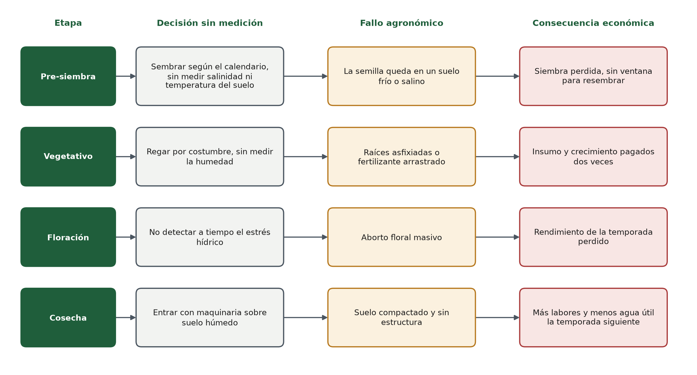

**Figura 1.0 “Diagrama de Decisiones y Consecuencias”**

Diagrama que encadena, para cada una de las cuatro etapas fenológicas, la decisión tomada sin medición, el fallo agronómico que produce y la consecuencia económica en que termina.

### Relación con los Servicios Formales de Análisis y Asesoría

Actualmente, las alternativas formales como los análisis de laboratorio son lentas (15 a 30 días) y costosas, entregando resultados cuando la fase crítica ya pasó. Por otro lado, pagar asesorías agronómicas continuas para que un profesional interprete los datos escapa del presupuesto operativo.

Corresponde precisar el alcance exacto de esta brecha, porque el proyecto no se plantea como un reemplazo del laboratorio. Un análisis acreditado determina propiedades químicas mediante extracción y método normalizado; un instrumento de terreno entrega una lectura directa, en un punto y en un instante.

Son procedimientos distintos que responden preguntas distintas, y confundirlos sería el error de fondo más grave que podría cometer este proyecto. TerraSense apunta al vacío que existe entre dos análisis de laboratorio: las decenas de decisiones de riego, siembra y manejo que el agricultor toma cada semana y que hoy resuelve por intuición, porque no existe ninguna herramienta que las acompañe con un dato propio de su campo. Los servicios de laboratorio y de asesoría conservan íntegramente su función en las decisiones que exigen determinaciones específicas, en particular las de fertilización.

En síntesis, el pequeño productor queda atrapado entre una crisis climática que le exige más precisión que nunca, un mercado de instrumentación que lo deja fuera por la relación entre lo que cobra y lo que entrega, y equipos que, cuando los alcanza, le devuelven un número que no sabe leer. Las dos barreras se refuerzan entre sí: la económica le impide comprar el instrumento, y la de interpretación vuelve inútil el instrumento que sí lograra comprar. El resultado es un productor que decide a ciegas y descubre sus errores al final de la temporada, cuando la pérdida de la cosecha y el endeudamiento del año ya son irreversibles.

### De la necesidad al requerimiento técnico

Las necesidades anteriores se traducen en requerimientos medibles, cada uno con un identificador, un valor numérico, su unidad y un criterio de aceptación verificable. Estos identificadores son las filas de la matriz que relaciona cada requerimiento con su prueba (capítulo IX) y de la trazabilidad maestra (capítulo VII).

| ID | Necesidad del agricultor | Requerimiento técnico | Valor | Unidad | Criterio de aceptación |
|---|---|---|---|---|---|
| R01 | Conocer el estado del suelo en el punto | Adquirir siete registros de suelo (N, P y K exclusivamente informativos): humedad volumétrica, temperatura, conductividad eléctrica (CE), pH, nitrógeno, fósforo y potasio | 7 | variables por medición | Los 7 campos de suelo distintos del centinela «sin lectura» en al menos 95 % de las mediciones del piloto |
| R02 | Contextualizar la medición con el ambiente | Medir temperatura del aire, humedad relativa (HR) y presión | 3 (±1,0 °C; ±3 % HR; ±1,0 hPa) | variables | Sensor contrastado con una referencia dentro de la exactitud de su hoja de datos |
| R03 | Decidir de pie sobre el punto | Tiempo de medición | ≤ 10 (adquisición y envío); ≤ 20 (ciclo con conexión) | s | Cronometrado en 10 mediciones consecutivas: ambos tiempos cumplidos |
| R04 | Confiar en el dato | Concordancia con laboratorio acreditado | pH con error cuadrático medio (RMSE) ≤ 0,3; CE con RMSE ≤ 10 % de la lectura o 200 µS/cm; humedad con RMSE ≤ 4; R² ≥ 0,80; pendiente de Passing-Bablok con intervalo de confianza del 95 % dentro de 0,90–1,10 | unidades de cada variable (humedad en puntos porcentuales) | Campaña de 30 puntos pareados según el protocolo de validación |
| R05 | Trabajar sin cobertura móvil | Operación completa sin red | 100 | % de las funciones de medición | En modo avión, con Bluetooth y ubicación reactivados: medir, diagnosticar, georreferenciar y guardar; la cola se sincroniza después sin pérdidas |
| R06 | Medir sin cable al teléfono | Alcance del enlace Bluetooth de bajo consumo (BLE) con el equipo cerrado y apoyado en el suelo | ≥ 5 (mínimo); 10 (objetivo) | m | 20 de 20 lecturas a 5 m; se registra la distancia a 10 m |
| R07 | Llegar a la jornada siguiente sin recargar | Autonomía con una carga en uso habitual (dos jornadas semanales de 2 h con 10 mediciones) | ≥ 8 | semanas | Autonomía medida de al menos 8 semanas y 80 % de la calculada |
| R08 | Cargar con un cargador de teléfono | Carga por USB-C a 5 V | ≤ 6 | h (de 3,0 V a plena carga) | Corriente de carga ≤ 0,5 A y tensión final dentro del límite de la celda (4,20 V ± 0,05 V); tensión de flotación medida en el FAT de cada unidad |
| R09 | Soportar barro, lluvia e inmersión accidental | Estanqueidad de la carcasa | IP67 (protección contra polvo e inmersión) | grado de protección | Norma IEC 60529 de la Comisión Electrotécnica Internacional: 30 min a 1 m de profundidad sin ingreso de agua ni polvo |
| R10 | Trabajar al sol y al frío | Temperatura de operación | −5 a +50 (operación); 0 a 45 (carga) | °C | Funcional a −5, +5, +25 y +50 °C; carga sólo dentro de 0 a 45 °C |
| R11 | Sobrevivir a caídas sobre grava | Resistencia a caídas | 6 caídas desde 1,0 m | caídas | IEC 60068-2-31: sin grietas, cierre estanco y equipo funcional |
| R12 | Recibir avisos sin pantalla | Señales luminosas y sonoras con un significado cada una | 3 LED y 1 buzzer | señales | Cada evento de la tabla de filosofía operativa produce su señal |
| R13 | Evitar vinculaciones accidentales desde la aplicación | Inicio de vinculación mediante pulsador | 3 (pulsación) y 30 (ventana) | s | Pulsación menor que 3 s no abre; la ventana dura 30 ± 1 s |
| R14 | Datos íntegros hasta el teléfono | Trama BLE única | 20 | bytes | 20 bytes con formato 1; ausencias marcadas y nunca estimadas |
| R15 | Leer la sonda sin errores | Bus RS-485 (comunicación serial diferencial) con Modbus RTU (protocolo serial binario) | 4.800 (velocidad de fábrica de la sonda; 9.600 si se reconfigura) | baudios | 1.000 lecturas consecutivas sin error de CRC (verificación de redundancia cíclica) |
| R16 | Un equipo que no se daña en el campo | Protección eléctrica: inversión de batería, descarga electrostática (ESD), cortocircuito | ±8 (contacto) | kV | Protección coordinada con el diodo, sin daño y dentro de sus límites térmicos con batería invertida; sin daño tras 10 descargas en USB y en el bus |
| R17 | No quedarse sin energía sin aviso | Aviso de batería baja en dos capas independientes: el equipo avisa por tensión de celda medida y la aplicación avisa por carga estimada | Equipo: 3,40 con rearme en 3,50. Aplicación: 15 con rearme en 20 | V (equipo); % de carga estimada (aplicación) | El equipo entra en aviso con tensión válida menor que 3,40 V y se rearma sólo al superar 3,50 V; la aplicación avisa con carga estimada menor o igual a 15 % y se rearma sólo al superar 20 %. Cada capa emite un aviso sonoro o de pantalla por ciclo, incluso si el primer dato válido ya llega bajo el umbral; el LED rojo permanece intermitente mientras dure la batería baja. Los dos avisos son independientes por diseño y no se exige que coincidan en el tiempo, porque uno mide una tensión y el otro estima una carga a partir de la curva de la celda |
| R18 | Una celda segura | Seguridad de la celda de litio | IEC 62133-2 | certificado | Certificado vigente y protección integrada verificada |
| R19 | Usar el espectro legalmente | Radiofrecuencia del enlace BLE | Bajo el límite de SUBTEL (Subsecretaría de Telecomunicaciones) | potencia | Medición en laboratorio y declaración de conformidad publicada antes de vender |
| R20 | Un precio justo y una empresa sostenible | Precio derivado del costo con utilidad de 30 %; VAN (valor actual neto) positivo al 20 % | 30 y 20 | % | VAN > 0 y caja nunca negativa en los 10 años |
| R21 | No pagar cuotas | Cero suscripciones | 0 | pesos por mes al agricultor | Ninguna función de medición condicionada a un pago recurrente |
| R22 | Poder producirlo | Capacidad de producción del taller | 200 (2027) a 1.085 (2036) | equipos por año | Horas de impresión, ensamble y FAT dentro de la capacidad instalada |
| R23 | Respaldar cada equipo | Trazabilidad por número de serie | 100 | % de las unidades con registro | Cada unidad con su ID de 15 dígitos y su registro FAT |
| R24 | Poder reponer el equipo en el tiempo | Disponibilidad de componentes, con número de parte de producción congelado | 100 | % de los circuitos integrados con proveedor y alternativa identificada | Cada circuito integrado con un número de parte único de producción y un proveedor vigente, más una alternativa de abastecimiento identificada. La alternativa se declara validada sólo cuando una unidad fabricada con ella aprueba los ensayos de desarrollo de su bloque |
| R25 | Que sus datos sean sólo suyos | Aislamiento por equipo y rol | 0 | lecturas de equipos ajenos | Batería de pruebas de acceso cruzado sin una sola lectura ajena |
| R26 | Usarlo con distinta alfabetización digital | Accesibilidad de la aplicación | 4,5:1 (contraste) y 48 × 48 (área táctil) | relación; dp | Auditoría de las pantallas |
| R27 | Cambiar la celda al fin de su vida | Celda extraíble con herramientas comunes | ≤ 5 | min | Desmontaje cronometrado con destornillador |

**Tabla 1.0 “Necesidades y requerimientos técnicos medibles”**

Los requerimientos R01 a R04 y R14 a R15 definen la medición; R05 a R08 y R17 la energía y la comunicación; R09 a R11 y R16 la robustez; R12 y R13 la interfaz; R18 y R19 la seguridad y la ley; R20 a R24 el negocio y la producción; y R25 a R27 el servicio. Ningún requisito posterior del informe se introduce sin un identificador de esta tabla.

## III. Propuesta de Solución Tecnológica

### Filosofía del Proyecto

Antes de cualquier decisión técnica o de diseño más focalizado, el proyecto responde a una pregunta fundamental: ¿Para qué existe esta herramienta? La respuesta no es "para cuidar plantas", sino para proteger el patrimonio de una familia que se juega el año entero en cada siembra.

Esta distinción no es un matiz retórico; cambia el criterio con el que se evalúa cada decisión de desarrollo.

El fin último no es el campo productivo, sino el ser humano cuyo sustento familiar depende de él. Un cultivo que se pierde por acidez o salinidad es, en el fondo, un problema agronómico menor comparado con lo que realmente está en juego, una familia que queda endeudada durante un año entero por tomar una decisión sin la información adecuada. Ese es el problema social y económico que TerraSense ataca. Por ello, toda decisión de diseño se resuelve preguntando cuál alternativa reduce más el riesgo económico del productor, no cuál es la más sofisticada desde el punto de vista técnico. De esta premisa central se desprenden cuatro principios que gobiernan el diseño del sistema:

- No Entregamos Datos, Entregamos Respuestas: Un dato aislado, un valor de pH o una lectura de conductividad no es información útil para quien no sabe interpretarlo. Un dato sin contexto es, en la práctica, “un vacío” con unidades. TerraSense no entrega la medición en bruto, sino la cadena completa: desde la captura de la variable física hasta una orientación cualitativa de manejo (qué revisar y por qué, sin prescribir dosis ni volúmenes).

- El Teléfono es el Cerebro del Sistema: La idea central que ordena todo el diseño es sencilla y radical en sus consecuencias: el teléfono que el agricultor ya posee es el instrumento de registro más potente que existe. Tiene pantalla legible, ubicación satelital, capacidad de cálculo y memoria.

Fabricar un instrumento nuevo que vuelva a incluir todas esas capacidades sería cobrarle dos veces al agricultor por algo que ya tiene. Por eso, el aparato físico se reduce a lo mínimo indispensable:

hacer lo único que el teléfono no puede hacer por sí solo (tomar contacto físico con la tierra y el ambiente). Todo el resto ocurre en el teléfono. Además de que el 100 % del procesamiento agronómico ocurre en el procesador del teléfono sin depender de cobertura de red móvil (3G/4G/5G). La nube actúa exclusivamente como respaldo posterior.

- Diseño para el Campo Real, no para el Laboratorio: El instrumento no vivirá sobre un escritorio; se caerá sobre tierra y piedras, se mojará y viajará quizás en la caja de una camioneta.

Cada elección de materiales responde a esa realidad de uso, priorizando la austeridad y la resistencia sobre la estética .

- Cero Suscripciones Recurrentes: El agricultor paga una vez por su instrumento y sus mediciones le pertenecen; puede consultarlas y usarlas libremente. A diferencia de la instrumentación importada que depende de plataformas por suscripción, aquí no existe una cuota mensual que condicione el funcionamiento del equipo. La tecnología no debe convertirse en una carga financiera mensual para quien ya enfrenta suficiente incertidumbre. Este principio tiene una consecuencia económica directa y asumida; los costos de soporte, servicios digitales, mantenimiento y reposición permanecen en el presupuesto de la empresa y están explícitamente cuantificados en la evaluación económica de este informe.

### Beneficiarios de la Solución

El beneficiario directo y principal es el pequeño y mediano productor comercial (Agricultura Familiar Campesina), quien hoy queda fuera de toda la oferta de instrumentación profesional. Sin embargo, el diseño contempla un impacto expansivo hacia otros actores:

La Familia y el Equipo de Trabajo: El sistema está diseñado para que cualquier persona en el campo pueda tomar una medición sin necesitar formación técnica previa.

Asesores Técnicos y Extensionistas: Quienes hoy deben estimar las condiciones del suelo a través de la observación, podrán pasar de “estimar” a “medir”, dejando un registro histórico de cada medición.

Cabe precisar, para efectos del dimensionamiento comercial, que la cantidad de campos visitados por un asesor no equivale a la cantidad de equipos comprados.

Instituciones Públicas: Podrían apoyarse en esta información agregada para focalizar sus programas de fomento, paliando la actual falta de datos de suelo georreferenciados a escala de campo individual.

El Medio Ambiente: Una fertilización y riego ajustados a la necesidad real del cultivo en lugar de aplicaciones preventivas por exceso de precaución reduce el desperdicio hídrico y la contaminación de napas por lixiviación.

### La Propuesta de Valor

TerraSense toma la información física del suelo y del aire, la cruza con el conocimiento agronómico del cultivo y con las condiciones climáticas del lugar exacto de la medición, entregando en segundos y sin necesidad de conexión a internet una recomendación concreta y accionable. Es, en esencia, la diferencia entre entregarle a alguien un termómetro y entregarle una orientación de manejo ya interpretada. El modelo comercial que sostiene esa promesa es la venta del instrumento con la aplicación incluida y sin cobro por lectura, el usuario dispone de una herramienta de seguimiento permanente, mientras los servicios de laboratorio y asesoría conservan su función en aquellas decisiones que requieren determinaciones específicas.

### Qué clase de instrumento es TerraSense

Conviene nombrar con precisión la categoría del producto, porque de ella se desprende con qué se compara y con qué no. TerraSense **no es un sensor de suelo** ni un nodo de monitoreo: es una **sonda portátil multivariable de diagnóstico agronómico**. Cada palabra de esa definición carga una decisión de diseño:

- **Sonda portátil**, porque el instrumento viaja con la persona y mide donde ésta decide, en contraste con un nodo que se entierra en un punto y mide ese punto durante toda su vida útil.
- **Multivariable**, porque una sola inserción entrega hasta diez registros asociados al mismo punto y ciclo de captura: siete del suelo y tres del ambiente.
- **De diagnóstico agronómico**, porque la salida del sistema no es el número sino su interpretación según la etapa y, cuando se indica, la especie del cultivo: el instrumento termina en una orientación de manejo, no en una lectura.

La comparación honesta no es contra otro aparato de la misma forma, sino contra las cuatro maneras en que hoy un pequeño productor puede saber algo de su suelo. La tabla las recorre por lo que importa a quien decide: con qué cobertura del campo, a qué costo de la medición siguiente y con qué resultado en la mano.

| Camino disponible hoy | Cómo se obtiene el dato | Cobertura del campo | Costo de la medición siguiente | Qué recibe el agricultor | De qué depende |
|---|---|---|---|---|---|
| Laboratorio de suelos acreditado | Muestra extraída y enviada; resultado en días o semanas | Sólo los puntos que se pagan, habitualmente uno o dos por temporada | El precio de otra muestra | Concentraciones reales con exactitud trazable y método declarado | Logística de envío y plazo del laboratorio |
| Asesoría agronómica externa | Observación y criterio profesional durante una visita | Lo que alcanza a recorrer la visita | El precio de otra visita | Recomendación experta con contexto del cultivo | Disponibilidad y agenda del asesor |
| Nodo fijo de monitoreo continuo | Sensores enterrados de forma permanente con telemetría | Un punto fijo por nodo: cubrir otro punto exige otro nodo | Cero en el punto instalado; el precio de un nodo nuevo para cualquier otro punto | Series de tiempo y alertas del punto instalado | Cobertura de red permanente y, por lo general, una plataforma de pago mensual |
| Medidor portátil de 1 a 4 variables | Contacto directo, lectura inmediata en pantalla propia | Cualquier punto que se decida medir | Cero | El valor numérico de las variables que mide | Nada; tampoco deja registro histórico ni interpreta el valor |
| TerraSense | Contacto directo, hasta diez registros del mismo ciclo enviados al teléfono | Cualquier punto que se decida medir, con su ubicación registrada | Cero | Lecturas, alertas, límites de interpretación y orientación por etapa y especie, guardados en el historial | Cuenta y equipo previamente habilitados; sin red para lectura y guardado local; red para registro, respaldo y renovación del pronóstico |

**Tabla 1.1 “Caminos disponibles para conocer el suelo y lo que entrega cada uno”**

De ese cuadro se desprenden las seis ventajas que el proyecto defiende, y conviene enunciarlas como lo que son: consecuencias de decisiones de arquitectura, no atributos declarados.

1. **Mide donde el agricultor decide, no donde quedó enterrado un sensor.** El campo no es homogéneo: la acidez, la salinidad y la humedad cambian entre el alto y el bajo, entre la sombra y el sol, entre un sector recién fertilizado y otro que no. Un nodo fijo describe con mucho detalle un solo punto; la sonda portátil describe el campo. Es la única de las ventajas que no se puede igualar bajando un precio o agregando un sensor: es la arquitectura.
2. **Hasta diez registros del mismo ciclo de captura en una sola inserción.** Siete variables de suelo y tres ambientales, con la precisión de que siete de esos diez son magnitudes medidas de forma independiente y tres (nitrógeno, fósforo y potasio) se derivan de la conductividad y se conservan como registros informativos. Incluso contando sólo las medidas, la cantidad de variables disponibles excede a la de los medidores portátiles de tres o cuatro variables con que se compara.
3. **Entrega un plan de acción, no un número.** El motor agronómico corre completo en el teléfono y traduce la medición en qué revisar, por qué y en qué orden, según la etapa y, cuando se indica, la especie del cultivo. Un valor de conductividad de 2.100 µS/cm no dice nada a quien no lo interpreta; la diferencia entre el dato y la decisión es todo el producto.
4. **La medición siguiente no cuesta nada.** Al no cobrar por lectura ni por suscripción, el costo marginal de medir otra vez es cero. Eso cambia la conducta: se mide antes y después de fertilizar, en varios sectores, a lo largo de la temporada, algo imposible cuando cada medición es una muestra pagada.
5. **Funciona sin cobertura.** Medir, diagnosticar, georreferenciar y guardar ocurren sin red; la nube sólo respalda después. Para un campo sin señal, un producto que dependa de conexión para interpretar simplemente no sirve.
6. **Deja memoria del campo.** Cada medición queda con su ubicación, su fecha y su evaluación, de modo que la segunda temporada se compara con la primera. Un medidor de mano olvida; el laboratorio guarda sus informes y no el contexto del punto.

Dicho esto, la comparación no sería creíble sin nombrar lo que las otras alternativas conservan a su favor, y el proyecto lo asume: el laboratorio acreditado entrega concentraciones reales de nutrientes con exactitud trazable, que esta sonda no determina y no pretende reemplazar; la asesoría aporta criterio profesional y mirada integral del cultivo, que ningún motor de reglas iguala; el nodo fijo entrega continuidad temporal en su punto, que una medición puntual no da; y los medidores con pilas intercambiables permiten reanudar el trabajo de inmediato con un repuesto, mientras la celda integrada obliga a planificar la carga. TerraSense no desplaza a ninguno de los cuatro: ocupa el espacio que ninguno cubre, que es la medición frecuente, barata, en cualquier punto del campo e interpretada en el momento.

### Estructura del Ecosistema

Para optimizar costos de manufactura y maximizar la durabilidad en terreno, las responsabilidades se distribuyen de forma estricta entre el hardware, la aplicación móvil y la infraestructura backend:

| Capa del Sistema | Componente Físico | Responsabilidad Asignada | Lo Que Deliberadamente No Realiza |
|---|---|---|---|
| 1. Instrumento de Captura | ESP32-WROOM-32D + Sonda 7-en-1 + BME280 | Excitar sensores, leer buses RS-485 e I²C, verificar checksums y transmitir trama BLE. | No procesa algoritmos agronómicos, no almacena historial ni requiere pantalla gráfica propia. |
| 2. Inteligencia Local | App móvil (React Native) con almacenamiento local persistente del teléfono y cola de sincronización diferida | Ejecutar motor agronómico determinista, presentar las lecturas con su cobertura, alertas e información orientativa, y almacenar el histórico local. | No genera voltajes de excitación industrial ni depende de servidores externos para evaluar. |
| 3. Respaldo y soporte | Supabase (PostgreSQL) + Consola Web | Respaldar mediciones al detectar red, control de cuentas, soporte posventa y consulta del histórico de cada equipo. | No bloquea la operación en campo en ausencia de conectividad. |

**Tabla 1.2 “Distribución de Responsabilidades Funcionales del Sistema”**

Sobre la segunda fila conviene una precisión, porque de ella dependen las afirmaciones de operación sin red que el informe sostiene más adelante. La aplicación no utiliza un motor de base de datos embebido; conserva las mediciones en el almacenamiento persistente del propio teléfono y mantiene una cola de envío diferido, mientras el motor agronómico y las definiciones de cultivos residen en el código de la aplicación y no en un servidor. El efecto para el usuario de medir, diagnosticar y consultar sin cobertura es el mismo que ofrecería una base de datos local.

## IV. Objetivos del Proyecto

### Objetivo General

Diseñar, construir y validar una sonda portátil multivariable de diagnóstico agronómico que resuelva, de punta a punta, la toma de decisiones del pequeño agricultor: capturando en terreno las variables físicas y químicas relevantes del suelo y su ambiente, interpretándolas de inmediato mediante un sistema de razonamiento agronómico ejecutado en el teléfono del usuario, y entregando una recomendación de manejo clara y aplicable en cuestión de segundos, sin costos recurrentes por suscripción.

En síntesis: lograr que una medición física se convierta, en el mismo lugar, en una orientación agronómica contextualizada, cuyo alcance y limitaciones sean visibles.

### Objetivos Específicos

Para materializar este objetivo general, el proyecto se estructura en los siguientes frentes de trabajo:

- Definir la arquitectura de hardware y comunicación: Comparar explícitamente distintas combinaciones de componentes y protocolos de transmisión hacia el teléfono, justificando técnica y económicamente la elección final en lugar de asumir la primera opción disponible.

- Diseñar el sistema de adquisición de datos: Lograr una integración confiable entre la sonda edáfica (que penetra la tierra) y los sensores ambientales, asegurando que el equipo capture un panorama físico-químico completo y no sólo datos aislados.

- Optimizar la autonomía energética: Desarrollar un sistema de alimentación capaz de sostener un uso frecuente en terreno durante varios meses sin requerir recargas constantes ni mantenimiento especializado, garantizando su disponibilidad durante toda la temporada agrícola.

- Desarrollar el motor de razonamiento agronómico: Construir el algoritmo (el “corazón” del sistema) que convierta las variables físicas capturadas en orientaciones cualitativas ajustadas a la etapa fenológica específica del cultivo y su etapa (siembra, desarrollo, floración o cosecha).

- Programar la interfaz móvil (App) para entornos rurales: Desarrollar una aplicación intuitiva y accesible para usuarios de distintos niveles de alfabetización digital, que opere de forma offline al momento de medir y sincronizar los datos cuando recupere la cobertura de red.

- Diseñar el encapsulado industrial (Carcasa): Crear una estructura física robusta, pensada explícitamente para el rigor del trabajo agrícola, que proteja los componentes electrónicos del barro, polvo, sol directo, humedad e inmersiones accidentales.

- Validar la precisión instrumental: Contrastar empíricamente las mediciones del equipo contra muestras analizadas por un laboratorio de referencia acreditado, respaldando con evidencia científica que los datos capturados reflejan fielmente la realidad del suelo, y declarar con igual claridad qué variables quedan fuera de esa validación y por qué.

- Asegurar el cumplimiento normativo: Identificar y cumplir el marco regulatorio aplicable, abarcando la seguridad eléctrica del hardware, el uso permitido del espectro radioeléctrico, y la protección de datos personales y derechos del consumidor, expresando cada norma como un requisito de diseño con método de verificación y criterio de aceptación.

- Evaluar la viabilidad económica y financiera: Estructurar el modelo de negocio, analizando rigurosamente la estructura de costos, proyecciones de flujo de caja y fuentes de financiamiento, para asegurar que la solución tecnológica sea sostenible como empresa en el tiempo.

### Objetivos de la ingeniería básica y de detalle

La etapa que este informe agrega lleva esos frentes desde la decisión conceptual hasta lo que hace falta para comprar, fabricar, instalar y probar el equipo:

- Especificar las capacidades del producto y del servicio: traducir cada necesidad en un requerimiento con valor, unidad y criterio de aceptación, y reunirlos en una ficha técnica con el origen y el estado de cada cifra.
- Diseñar la placa del instrumento con sus circuitos integrados soldados directamente, rutearla y justificar cada componente con una matriz de decisión.
- Dimensionar la electrónica, la energía y la digitalización: calcular cada circuito con su margen, la potencia instalada y el consumo anual del equipo y del taller, y ubicar la digitalización en el marco de Industria 4.0.
- Especificar la compra y la geometría: cotizar el producto, el taller y los servicios con proveedores identificados, y fijar las reglas de fabricación, conectores, cableado, torques y montaje.
- Definir la fabricación: el método de ensamble de la placa, las estaciones, la capacidad del taller y la trazabilidad por número de serie.
- Definir los ensayos: una prueba para cada requerimiento, con la aceptación en fábrica y en sitio y los ensayos normativos.
- Planificar el proyecto hasta su entrega e incorporar las mejoras surgidas en las tres ingenierías.

## V. Ingeniería Conceptual

La ingeniería conceptual constituye el puente crítico entre la problemática diagnosticada y la materialización de la solución. En esta etapa, los principios filosóficos del proyecto, movilidad, independencia de red, bajo costo y el uso del teléfono como núcleo de procesamiento se traducen en requerimientos técnicos concretos. El objetivo de esta fase no es simplemente elegir componentes al azar, sino definir y justificar la arquitectura de hardware y software óptima que garantice la viabilidad del equipo en el mundo real, equilibrando rendimiento, robustez y usabilidad para el pequeño agricultor.

A partir de estas premisas, se desarrolla el siguiente análisis de viabilidad técnica, como también viabilidad económica en donde se evalúan las distintas alternativas para materializar el sistema.

### Análisis de Viabilidad Técnica

Antes de comparar cualquier alternativa, el proyecto fija dos capas de exigencia, porque confundirlas es el error metodológico más común en un estudio de ingeniería conceptual.

- Requisitos Obligatorios (filtro de viabilidad): Son condiciones de cumplimiento innegociable: una arquitectura que no las satisface queda eliminada antes de puntuar, sin importar su desempeño en el resto de los criterios.

| ID | Requisito | Qué exige |
|---|---|---|
| RO-1 | Alimentar y comunicarse con la sonda | Operar por bus diferencial RS-485 con sonda industrial. |
| RO-2 | Interpretar, no solo mostrar | Entregar un veredicto interpretado, no una lectura plana. |
| RO-3 | Operar sin cobertura celular | Completar la medición en el momento, sin depender de señal de datos. |
| RO-4 | Muestrear múltiples puntos | Permitir recorrer y medir distintos puntos de un mismo campo en una jornada. |
| RO-5 | Ser físicamente realizable | Construirse con componentes de catálogo real, no con tecnología hipotética. |

**Tabla 1.3 “Filtro de Viabilidad”**

Criterios Ponderados: Solo entre las arquitecturas que sobreviven el filtro se aplica una matriz de puntuación (escala 1 a 10) sobre ocho criterios: cobertura espacial (15 %), calidad de interfaz (13 %), capacidad de interpretación (15 %), autonomía energética (14 %), costo total a cinco años para el agricultor (16 %), robustez mecánica y ambiental (10 %), facilidad de actualizar el conocimiento agronómico (9 %) e independencia de infraestructura externa (8 %).

Esta separación en dos capas evita "aprobar" una arquitectura inviable con un buen puntaje ponderado, un caso real que aparece más adelante y que el propio proyecto descarta por honestidad tecnológica.

Alternativas Evaluadas: Se compararon seis arquitecturas; ninguna es hipotética, las seis existen hoy como productos comerciales o como proyectos publicados en la literatura técnica.

- Instrumento autónomo (8 bits + pantalla + Bluetooth Classic): La arquitectura por defecto de la electrónica educativa y de buena parte de los medidores genéricos de importación, un microcontrolador simple, una pantalla LCD u OLED pequeña, y un módulo Bluetooth Classic para vinculación.

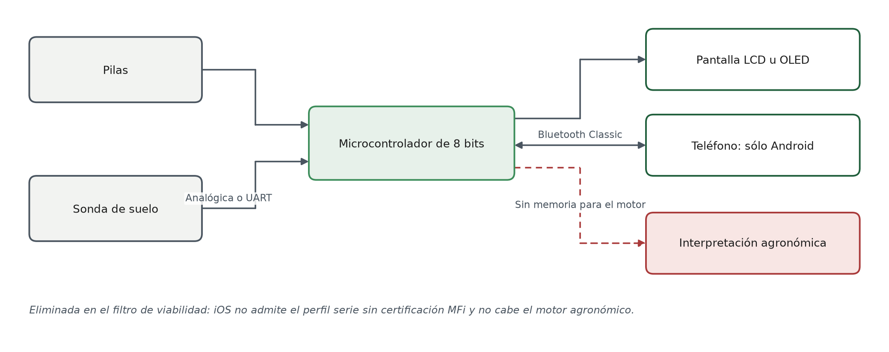

**Figura 1.1 “Diagrama de Flujo Arquitectura 8 Bits + Bluetooth Classic”**

Evaluación: Los módulos Bluetooth Classic más usados implementan un perfil de comunicación que iOS no permite usar sin certificación MFi de Apple. Adoptarla significa renunciar a la mitad del mercado de teléfonos. Además, la memoria disponible no alcanza para el motor de interpretación y no hay forma de actualizar el firmware de forma remota. Incumple el filtro de viabilidad y queda eliminada.

- Instrumento autónomo con inferencia embebida y pantalla: La versión seria de la alternativa anterior. Todo el sistema incluido el motor de interpretación agronómica viviría dentro del microcontrolador, sin depender de un teléfono.

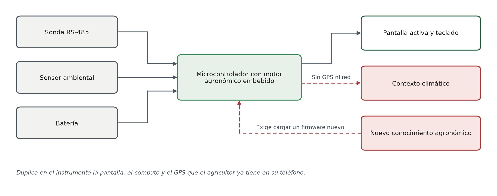

**Figura 1.2 “Diagrama de Flujo Arquitectura de Sistema Embebido y Pantalla”**

Evaluación: Incorporar una pantalla activa y el motor de interpretación agronómica reduce la autonomía en más de tres cuartas partes; la ventana de la pantalla es un riesgo de estanqueidad frente a la humedad;

sin GPS ni conectividad, se pierde la capa del motor que cruza la medición con el clima previsto; y corregir el conocimiento agronómico exigiría publicar un nuevo firmware y forzar al usuario a instalarlo. Sí supera el filtro de viabilidad y llega a la etapa de puntuación.

- Datalogger estacionario con telemetría de red móvil: La arquitectura típica de las parcelas de investigación: equipo fijo, alimentado por panel solar, con una sonda enterrada en un único punto y un módem de red móvil que sube datos a una web por suscripción.

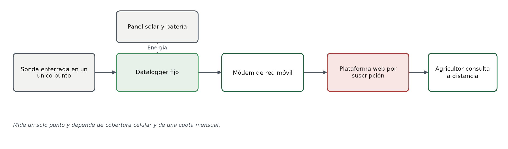

**Figura 1.3 “Diagrama de Flujo Arquitectura con Datalogger Estacionario”**

Evaluación: Resuelve bien un problema distinto. La variabilidad de un campo es espacial; mapear veinte puntos exigiría veinte equipos. Requiere cobertura celular exacta en el punto de instalación e impone una suscripción recurrente (incompatible con el proyecto). Incumple RO-3 y RO-4 y queda eliminada.

- Red de nodos LoRaWAN con estación controladora en el campo: Reemplaza el módem de red móvil por una radio de largo alcance y bajísimo consumo hacia una estación concentradora en el campo.

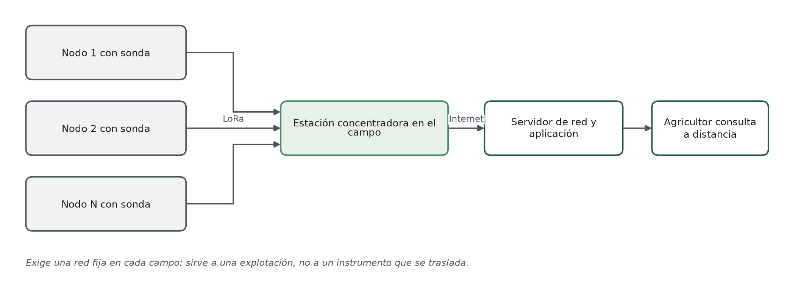

**Figura 1.4 “Diagrama de Flujo Arquitectura de Nodos con LoRaWAN”**

Evaluación: Es la alternativa técnicamente más elegante entre las descartadas, pero medir 20 puntos exigiría 20 nodos a un costo prohibitivo, y exige instalar infraestructura propia (la estación). Además, no resuelve el caso de uso real: el agricultor está de pie sobre el punto cuando necesita la decisión, no a distancia. Cumple los requisitos y pasa a puntuar con esa reserva.

- Sonda conectada directo al teléfono (electrónica intermedia): La alternativa más radical: eliminar la radio del medio y conectar la sonda al teléfono por cable.

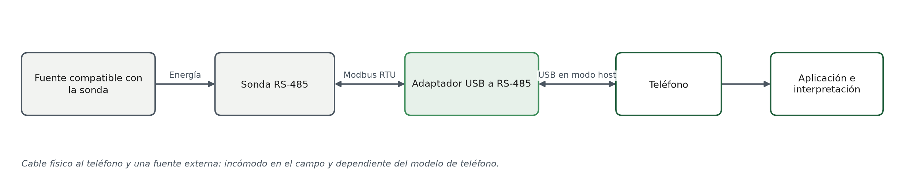

**Figura 1.5 “Diagrama de Flujo Arquitectura de Sonda conectada al Teléfono”**

Evaluación: Si se puntuara, obtendría el segundo mejor resultado al heredar gratis todas las capacidades del teléfono. Sin embargo, es físicamente irrealizable, la sonda opera en un rango de 5 a 24 V DC que técnicamente incluye los 5 V que entrega un puerto USB, el puerto de un teléfono convencional en modo host no puede sostener la corriente de excitación que exige la sonda industrial durante la medición, y ningún teléfono comercial genera de forma nativa la señalización diferencial RS-485 que el protocolo exige.

El límite no es de tensión sino de corriente entregable y de capa física. Incumple RO-1 y RO-5 y queda eliminada sin puntuar.

- Instrumento portátil inalámbrico de bajo consumo, con el teléfono como intérprete: La síntesis de las lecciones anteriores: un equipo portátil mínimo que resuelve únicamente lo que el teléfono no puede hacer (proveer la tensión, protocolo y medición física), y delega en el teléfono la interpretación, posición geográfica, pantalla y almacenamiento mediante un enlace inalámbrico BLE

(Bluetooth Low Energy).

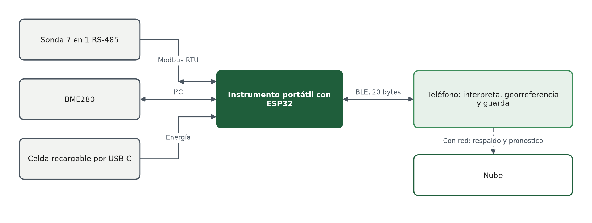

**Figura 1.6 “Diagrama de Flujo Arquitectura de Sistema Embebido de Bajo Consumo”**

### Evaluación: El teléfono reúne capacidades que duplicar en el instrumento sería un gasto

innecesario. Asume que el usuario dispone de un teléfono, supuesto respaldado por la alta penetración del smartphone en zonas rurales [15].

### Matriz de Decisión: Puntuando sólo a las arquitecturas que superaron el filtro.

| Criterio | Peso | Instrumento autónomo con inferencia embebida y pantalla | Red de nodos LoRaWAN con estación concentradora campo | Instrumento portátil inalámbrico de bajo consumo, con el teléfono como intérprete |
|---|---|---|---|---|
| Cobertura espacial | 15 % | 8 | 5 | 10 |
| Calidad de interfaz | 13 % | 4 | 7 | 10 |
| Capacidad de interpretación | 15 % | 6 | 8 | 10 |
| Autonomía energética | 14 % | 4 | 8 | 9 |
| Costo total a 5 años | 16 % | 6 | 2 | 8 |
| Robustez mecánica | 10 % | 6 | 9 | 9 |
| Actualización del conocimiento | 9 % | 5 | 8 | 10 |
| Independencia de infraestructura | 8 % | 9 | 5 | 7 |
| Puntaje ponderado final | 100 % | 5,91 | 6,32 | 9,20 |

**Tabla 1.4 “Matriz de Decisiones”**

Conclusión y Sensibilidad: La arquitectura de un instrumento portátil inalámbrico de bajo consumo, con el teléfono como intérprete gana con margen amplio por su ventaja insuperable en cobertura espacial ilimitada, capacidad de interpretación y facilidad de actualización del software. Tras un análisis de sensibilidad elevando los pesos de distintos criterios, esta arquitectura mantiene su ventaja.

Selección de Componentes Base: Decidida la arquitectura general, la segunda capa de decisiones define con qué componente concreto se construye cada bloque.

Se aplicó la misma disciplina, evaluación de candidatos reales, criterios declarados antes de comparar, y honestidad explícita cuando la alternativa descartada es superior en alguna dimensión. Sobre once subsistemas evaluados, en siete existe una alternativa técnicamente superior en alguna métrica, y el proyecto lo declara en lugar de presentar una selección irreal donde el componente elegido gane en todo.

Microcontrolador: Se evaluaron cuatro candidatos: ESP32, nRF52840, STM32WB55 y ATmega328P + HC-05. Este último queda descartado de entrada: su módulo Bluetooth Classic sufre el mismo bloqueo de iOS (certificación MFi) visto en la evaluación de arquitecturas.

Los tres restantes se puntúan sobre cinco criterios declarados antes de comparar, en la misma escala de 1 a 10 usada en la matriz de arquitecturas: consumo de radio en transmisión BLE (20 %), actualización del firmware por Bluetooth (20 %), concurrencia disponible para separar la pila de radio de la temporización Modbus (15 %), ecosistema y soporte de documentación (25 %) y disponibilidad y costo en el mercado local (20 %). Cada celda de la tabla es la nota del criterio y el puntaje ponderado, la suma de cada nota por su peso.

| Microcontrolador | Consumo de radio en Tx BLE (20 %) | Actualización del firmware por Bluetooth (20 %) | Concurrencia (15 %) | Ecosistema y documentación (25 %) | Disponibilidad y costo (20 %) | Puntaje ponderado | Veredicto |
|---|---|---|---|---|---|---|---|
| STM32WB55 | 10 (~5–6 mA [8]) | 8 | 8 (2 núcleos) | 5 | 4 | 6,85 | Descartado |
| nRF52840 | 10 (~5–6 mA [9]) | 10 | 5 (1 núcleo) | 7 | 5 | 7,50 | Descartado |
| ESP32 | 4 (~130–150 mA [19]) | 7 | 10 (2 núcleos) | 10 | 10 | 8,20 | Seleccionado |

**Tabla 1.5 “Comparativa de Microcontroladores”**

Justificación de la Selección: Aunque los chips nRF52840 y STM32WB55 superan al ESP32 por un factor enorme en eficiencia de radio, al modelar el presupuesto energético completo del equipo esa ventaja de radio sólo se traduce en una fracción mínima de autonomía total, porque la carga dominante es el consumo propio de la placa de control mientras el equipo está encendido, no la radio. A cambio de resignar ese porcentaje, el ESP32 gana en los criterios de mayor peso: el ecosistema de desarrollo y el soporte de la comunidad, la disponibilidad y el costo en el mercado local, y el doble núcleo para sostener la temporización de la sonda sin perder el Bluetooth. En actualización del firmware por Bluetooth queda detrás del nRF52840, cuyo mecanismo de actualización por BLE es maduro: el ESP32 aporta las particiones y la interfaz de actualización, pero el transporte por Bluetooth lo implementa el propio firmware. El producto no usa el Wi-Fi integrado del ESP32; el catálogo de versiones está implementado en la consola de soporte y la transferencia por Bluetooth se especifica como ampliación del firmware.

Sobre la cifra de consumo conviene fijar una sola referencia, porque este informe la utiliza en dos lugares distintos, el módulo presenta un rango dinámico total de 95 a 380 mA medido en su propio pin de 3,3 V, dentro del cual la transmisión BLE se sitúa en el orden de 130 a 150 mA. El balance energético de este informe adopta 150 mA para la fase de envío, es decir el extremo superior de esa banda, por prudencia.

Sonda de Suelo: Aporta 7 de las 10 variables del sistema, siendo la decisión más crítica. Se comparó la sonda 7-en-1 RS-485 contra instrumentos de grado de investigación (METER TEROS 12, Delta-T WET150, Stevens HydraProbe) [10].

Los criterios declarados y sus pesos son: número de variables entregadas (30 %), exactitud declarada (25 %), viabilidad económica medida como costo por variable (30 %) y robustez e idoneidad para uso portátil en terreno (15 %).

| Sonda | Variables entregada s | Exactitud Pura | Viabilidad Económica | Robustez | Puntaje Ponderado |
|---|---|---|---|---|---|
| Grado Investigación (TEROS 12, etc.) | 3 a 4 variables | 10 / 10 | Muy Baja (Costo x20) | 10 | 5,50 |
| Sonda 7-en-1 RS-485 | 7 variables | 7 / 10 | Alta | 7 | 8,50 |

**Tabla 1.6 “Comparativa de Sondas de Suelo”**

Justificación de la Selección: Se sacrifica exactitud absoluta a cambio de viabilidad. Obtener las siete variables con sensores de investigación multiplicaría el costo del producto por veinte, lo que contradice el objetivo mismo del proyecto. La limitación técnica más importante se declara explícitamente: la estimación de N, P y K no se mide por electrodo ion-selectivo, sino que se deriva de la conductividad eléctrica. En suelo salino se puede leer erróneamente un estado “fértil”. Para mitigarlo, la aplicación presenta N, P y K como registros informativos, acompañados de forma permanente por una advertencia de que no constituyen un diagnóstico nutricional y no permiten prescribir dosis de fertilizante; además, cuando la conductividad eléctrica supera los 1.000 µS/cm se activa un veto de confianza que refuerza esa advertencia en pantalla. En ningún caso se presenta una clase agronómica ni una dosis derivada de estos tres valores.

### Sensor Ambiental: Compite el Bosch BME280, BMP280 y el Sensirion SHT40.

| Sensor | Exactitud Temperatura | Mide Humedad Relativa | Mide Presión Barométrica | Veredicto |
|---|---|---|---|---|
| Sensirion SHT40 | ±0,2 °C [11] | Sí | No | Descartado por función |
| Bosch BMP280 | ±1,0 °C [12] | No | Sí | Descartado por función |
| Bosch BME280 | ±1,0 °C [13] | Sí (±3 % HR) | Sí (±1,0 hPa) | Seleccionado |

**Tabla 1.7 “Comparativa de Sensores de Temperatura / Humedad / Presión Barométrica”**

Justificación de la Selección: Se elige por una razón funcional, no de desempeño. El BME280 es el único de los tres candidatos que entrega simultáneamente las tres magnitudes que la aplicación reserva al ambiente local. El SHT40 es más exacto en temperatura pero no mide presión; el BMP280, frecuentemente confundido con el BME280 por su encapsulado casi idéntico, no aporta humedad relativa y por lo tanto no constituye un reemplazo funcional. La presión barométrica se utiliza además para corregir el cálculo de evapotranspiración por altitud [14]. Cabe precisar que la temperatura del BME280 se emplea también en la compensación interna del propio sensor, y su correspondencia con el aire exterior depende críticamente de su ubicación física dentro de la carcasa, requisito que se aborda en el diseño mecánico.

### Arquitectura de Conectividad

La estrategia de comunicación del sistema se divide en distintas etapas, cada una diseñada para optimizar los recursos energéticos y superar las barreras del entorno agrícola:

- Sonda de Suelo → ESP32 (Bus RS-485 Modbus RTU): Se eligió esta interfaz frente a alternativas más simples (como UART directo) porque transmite una señal diferencial robusta e inmune al ruido electromagnético en campo abierto. Además, al ser el estándar universal para instrumentación industrial, permite intercambiar sondas de distintos fabricantes en el futuro sin necesidad de rediseñar la placa base del equipo. Conviene separar las dos capas involucradas:

RS-485 define la capa eléctrica diferencial, mientras Modbus define la estructura de los mensajes;

en su implementación serial RTU se verifican longitud, dirección, función, CRC-16 y temporización entre tramas.

- Sensor Ambiental BME280 → ESP32 (Bus I2C): Para la captura de datos atmosféricos

(temperatura del aire, humedad relativa y presión barométrica), se utiliza una comunicación serie de dos hilos (I²C). Al estar el sensor integrado para lectura ambiental local, directamente en la placa o a muy corta distancia del microcontrolador, el protocolo I²C es el estándar ideal por su simplicidad técnica y bajo consumo, sin verse afectado por las limitaciones de distancia que sufriría en campo abierto.

- ESP32 → Teléfono (Bluetooth Low Energy): Se optó por un enlace BLE puntual debido a su bajo consumo energético. El equipo envía paquetes de datos muy pequeños (tramas de 20 bytes en el contrato vigente) y se conecta solo durante los segundos que dura la medición. Al utilizar BLE se evita la barrera de certificación MFi que afecta al perfil serial de Bluetooth Classic en iOS, habilitando compatibilidad con Android y Apple sin costos de hardware adicionales.

- Teléfono → Nube (HTTPS / Supabase): El sistema implementa una arquitectura estrictamente offline-first. La falta de cobertura en zonas rurales es la principal causa de fallo en agrotecnología, por lo que el motor de interpretación agronómica corre localmente en el teléfono sobre almacenamiento local persistente. La conexión a la nube ocurre de manera diferida y en segundo plano, interviniendo únicamente para sincronizar historiales y respaldar información cuando el teléfono detecta señal de internet.

Esta independencia tiene un límite preciso, y conviene declarar la frontera función por función en lugar de afirmar genéricamente que el sistema “funciona offline”. La siguiente tabla es la definición operativa de esa frontera.

| Función del sistema | Conectividad requerida | Comportamiento sin cobertura |
|---|---|---|
| Emparejamiento y lectura BLE del instrumento | Ninguna | Funciona íntegramente; el enlace es punto a punto entre equipo y teléfono |
| Validación de la trama y marcado de lecturas ausentes | Ninguna | Funciona íntegramente; una variable no recibida se almacena como ausente, nunca se estima |
| Motor agronómico: diagnóstico y recomendación de labor | Ninguna | Funciona íntegramente; las reglas y umbrales residen en la aplicación, no en un servidor |
| Georreferenciación de la medición | Ninguna | Funciona con el GPS satelital del teléfono, que no requiere datos móviles |
| Guardado en la base local y consulta del histórico ya almacenado | Ninguna | Funciona íntegramente sobre el almacenamiento del teléfono |
| Creación de cuenta, inicio de sesión inicial y recuperación de credenciales | Requiere internet | No disponible; la sesión ya iniciada permanece válida y permite seguir midiendo |
| Registro de un equipo nuevo en la cuenta | Requiere internet | No disponible; se completa al recuperar cobertura |
| Sincronización y respaldo del histórico hacia la nube | Requiere internet | Las mediciones persisten en cola antes del envío y conservan un identificador para reintentos; la ausencia de pérdidas o duplicados se acepta mediante pruebas de interrupción y recuperación |
| Pronóstico meteorológico a cinco días | Red para renovar; copia local bajo condiciones | Sin red puede reutilizar la consulta de la misma cuenta de hasta tres horas y hasta un kilómetro; sin una copia aplicable informa clima no evaluado |

**Tabla 1.8 “Frontera Offline / Online del Sistema”**

Con la cuenta y el equipo previamente habilitados, la lectura, el diagnóstico local y el guardado no dependen de la red. La georreferenciación requiere autorización y una posición válida del teléfono, pero no datos móviles; si no se obtiene, se conserva la ausencia en lugar de inventar coordenadas. Registrar cuentas o equipos, respaldar y renovar el pronóstico sí requieren conectividad. Una copia meteorológica reciente puede complementar la lectura sin red si cumple las condiciones de uso, sin reemplazar el ambiente medido por el equipo.

Se adjunta un diagrama de flujo para comprender de manera visual la ruta de la información, desde la captura en terreno hasta el almacenamiento diferido en la nube:

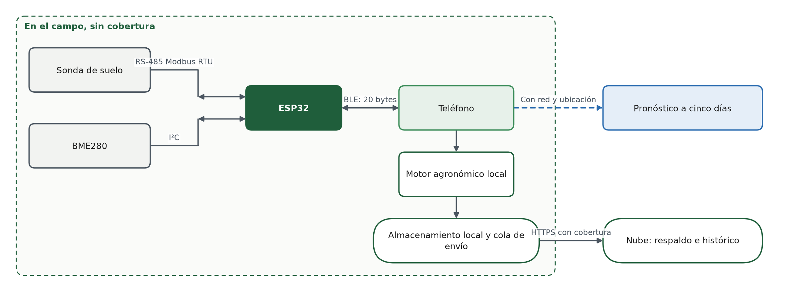

**Figura 1.7 “Diagrama de Flujo Arquitectura de Conectividad”**

### Análisis de Viabilidad Económica

El análisis que sigue determina si el proyecto es económicamente sostenible y, sobre todo, **a qué precio**. El precio de venta no es un dato de entrada sino un resultado: se construye primero la estructura completa de costos e inversión, y el precio se deriva de ella exigiendo un margen de utilidad definido. Fijar el precio antes de conocer el costo invierte la lógica del estudio, porque obliga a ajustar los costos a una cifra elegida de antemano.

La secuencia es la siguiente: se costea el equipo componente por componente, se dimensiona la inversión inicial y su financiamiento, se proyectan los costos de operación, administración y comercialización, y solo entonces se determina el precio que cubre todo eso con el margen exigido. Con ese precio se construyen el estado de resultados, el flujo de fondos y los indicadores de rentabilidad: el VAN (valor actual neto), la TIR (tasa interna de retorno) y el período de recuperación de la inversión o payback.

### Las tres economías del análisis

Antes de la primera cifra conviene fijar una separación que este informe mantiene en todo su desarrollo, porque mezclarlas vuelve incomparable cualquier evaluación. El análisis distingue tres economías con unidades, destinatarios y criterios de éxito propios.

| Economía | Qué mide | Con qué se evalúa |
|---|---|---|
| Economía del proyecto | La inversión de puesta en marcha frente a los flujos que genera la actividad | VAN, TIR y payback sobre el flujo de fondos |
| Economía del negocio | Cuánto cuesta fabricar cada equipo y operar la empresa, y qué margen deja cada venta | Lista de materiales (BOM, *Bill of Materials*), costo variable, estructura de costos y estado de resultados |
| Economía del cliente | Cuánto gasta el agricultor para resolver el mismo problema con TerraSense o sin él | Costo total de propiedad comparado a 1, 3, 5 y 10 años |

**Tabla 1.9 “Economías del análisis”**

La consecuencia práctica es una sola y se aplica sin excepción: **el ahorro del agricultor no es ingreso del proyecto.** Los pesos que un cliente deja de gastar en laboratorio o asesoría no aparecen en ninguna línea del flujo de caja de la empresa; se presentan únicamente como argumento de adopción, porque explican por qué alguien compraría el equipo, no cuánto factura quien lo vende.

### Estructura de costos de fabricación

El costo de materiales de cada unidad se detalla en la BOM (*Bill of Materials*, lista de materiales): el desglose de todo lo que entra físicamente en un equipo, componente por componente, con su cantidad y su costo neto. La lista corresponde al producto sobre la placa del instrumento, sin placas de desarrollo ni módulos: el módulo ESP32-WROOM-32D (con antena y certificación) y los circuitos integrados y pasivos de la placa, más la sonda, la batería, la carcasa, los materiales de montaje y el flete. Los componentes electrónicos se cotizaron en LCSC y los precios se convirtieron a pesos al tipo de cambio de referencia [16]; el detalle por línea, con modelo, código del proveedor, fecha y enlace, está en el anexo de cotizaciones. Cada línea declara si su precio fue consultado o es una estimación, de modo que se distinga lo verificado de lo presupuestado.

| Bloque del equipo | Líneas | Subtotal neto por equipo | Participación |
|---|---:|---:|---:|
| Sonda | 1 | $44.394 | 54,5 % |
| Celda | 1 | $6.900 | 8,5 % |
| Carcasa | 1 | $7.238 | 8,9 % |
| PCB y ensamble | 3 | $6.289 | 7,7 % |
| MCU y radio | 1 | $2.710 | 3,3 % |
| USB-C y carga | 20 | $1.543 | 1,9 % |
| Alimentación 3,3 V | 1 | $83 | 0,1 % |
| Elevador 5 V | 10 | $665 | 0,8 % |
| RS-485 | 4 | $220 | 0,3 % |
| Sensor ambiental | 2 | $4.623 | 5,7 % |
| Interfaz de usuario | 10 | $229 | 0,3 % |
| Protección y medición de batería | 5 | $731 | 0,9 % |
| Pasivos de desacoplo | 4 | $657 | 0,8 % |
| Montaje y embalaje | 9 | $5.142 | 6,3 % |
| **Total BOM neto por equipo** | **72** | **$81.425** | **100,0 %** |

**Tabla 2.0 “Estructura de costos de fabricación (BOM) por equipo”**

La sonda de suelo representa **$44.394, equivalente al 54,5 % del costo de materiales**, y es por lejos la decisión de abastecimiento más crítica del proyecto. El mercado de sondas 7-en-1 RS-485 muestra una dispersión enorme, entre $12.100 y $82.100, que refleja productos genuinamente distintos en número de variables, calidad de construcción y material del vástago. La variante cotizada, de siete variables, cuesta $44.394 puesta en Chile según una publicación con fecha; una sonda barata no sirve si no sostiene la exactitud que el protocolo de validación exige, y por eso se compra una muestra antes del lote.

En el otro extremo, la electrónica de la placa del instrumento (módulo ESP32, circuitos integrados, sensor ambiental, pasivos, indicadores y protecciones) suma $11.462 por equipo, un 14,1 % de la BOM, y dentro de ella el sensor BME280 y el módulo ESP32 concentran la mayor parte. La conclusión de diseño es directa: el costo del instrumento se decide en la sonda y en un puñado de circuitos integrados, y ninguna economía sobre los pasivos cambia el resultado, de modo que en ellos se privilegia la robustez sobre el ahorro.

Dos precisiones sobre el abastecimiento tienen consecuencias que conviene declarar:

- **Régimen tributario de las compras importadas.** Desde octubre de 2025, la Ley N° 21.713 [42] eliminó la exención que liberaba de IVA a las importaciones bajo US$41: hoy toda compra internacional paga IVA, y las plataformas inscritas ante el Servicio de Impuestos Internos lo recaudan en el momento de la compra para pedidos de hasta US$500, sin arancel aduanero adicional. Ese IVA solo constituye crédito fiscal si la compra se formaliza como importación con Declaración de Ingreso. Comprando al detalle, la exposición es de **$499 por equipo**, del orden de $99.712 anuales al volumen del primer año. El proyecto asume formalizar el abastecimiento antes de comprometer volumen, y esta cifra dimensiona lo que está en juego si no lo hace.
- **La placa de control es un módulo con antena soldado a la placa del instrumento, no una placa de desarrollo.** El presupuesto adquiere el ESP32 como módulo WROOM-32D, que trae la antena y la certificación de radio, y suma en la propia placa el regulador de 3,3 V de baja corriente en reposo, el puente USB-serie, el cargador y el elevador de la sonda. Los cargos de ensamble de la placa se contratan a un fabricante ($1.214 por placa al lote de 200) y se incluyen en la BOM.

La carcasa se imprime en taller propio: el proyecto adquiere dos impresoras Creality K1C, que figuran en el activo fijo, y el costo de cada carcasa se construye así:

| Concepto | Neto CLP | Base de cálculo |
|---|---:|---|
| Filamento PETG, 210 g a $25.000/kg (carcasa de 110 × 100 × 40 mm para la placa de 99,9 × 90 mm) | $5.250 | AliExpress $20.700-$35.800 por kg |
| Merma de impresión, 15 % (fallos, soportes y purga) | $788 | estimación de taller |
| Energía, 1,05 kWh por carcasa (K1C, 262 W promedio durante 4 h) a $200/kWh | $210 | tarifa BT1 de referencia, $180-$220/kWh |
| Mantención de impresora prorrateada (boquillas, correas, cama) | $990 | $100.000 anuales por impresora, sobre 100 carcasas por impresora |
| **Total por carcasa** | **$7.238** | — |

**Tabla 2.1 “Costeo de la carcasa impresa en taller propio”**

El filamento explica el 73 % del costo de cada carcasa; la merma, la energía y la mantención de las impresoras completan el resto. Imprimir en taller propio mantiene bajo control el plazo de entrega y permite corregir el diseño de la envolvente entre lotes sin depender de un proveedor externo, lo que importa mientras la estanqueidad IP67 no esté ensayada.

A los materiales se suman los costos que solo existen cuando hay una venta, y que por lo tanto pertenecen al costo variable y no a la estructura:

| Concepto | Neto CLP |
|---|---:|
| Materiales y servicios de la BOM | $81.425 |
| Merma de fabricación, 3 % de la BOM | $2.443 |
| Provisión de reposiciones y garantía, 5 % de la BOM | $4.071 |
| Envío al cliente | $6.000 |
| **Subtotal sin comisión** | **$93.939** |
| Comisión comercial, 5 % sobre el precio bruto | $23.373 |
| **Costo variable total por equipo** | **$117.312** |

**Tabla 2.2 “Costo variable por equipo”**

El costo variable total, $117.312 por equipo, equivale al 29,9 % del precio neto de venta. Cada unidad vendida deja por lo tanto un margen de contribución de $275.515, que es lo que queda disponible para cubrir la estructura fija de la empresa, los intereses y la utilidad. La comisión comercial es la única partida que depende del precio; todas las demás dependen de la BOM y del envío, y por eso una variación en el costo de la sonda se transmite casi íntegra al costo variable.

### Inversión inicial

La puesta en marcha exige tres tipos de desembolso de naturaleza distinta, que conviene no mezclar: los bienes que se compran una vez y se deprecian, los gastos de constitución y desarrollo que se amortizan, y el dinero que debe quedar disponible para sostener la operación mientras las ventas todavía no cubren los costos.

El equipamiento se dimensionó **según la dotación real del proyecto**, no sobre una plantilla genérica: tres puestos de trabajo el primer año, dos impresoras para producir las carcasas e instrumental de laboratorio (osciloscopio, fuente, multímetros, analizador lógico, estaciones de soldadura y de aire caliente, microscopio y fixture de ensayo) suficiente para el montaje y la verificación de cada unidad.

| Componente del activo fijo | Cant. | Valor unitario | Valor total | Vida útil | Depreciación anual |
|---|---:|---:|---:|---:|---:|
| Impresora 3D: Creality K1C | 2 | $450.008 | $900.016 | 5 años | $180.003 |
| Estación de soldadura: Hakko FX-888D | 2 | $145.965 | $291.930 | 5 años | $58.386 |
| Estación de aire caliente: Quick 861DW | 1 | $332.702 | $332.702 | 5 años | $66.540 |
| Placa calefactora: UYUE 946-1010 (100 × 100 mm, 400 W, 50–350 °C) | 1 | $45.114 | $45.114 | 5 años | $9.023 |
| Esténcil de ensamble: Esténcil de acero de 0,12 mm para la PCB (con marco) | 2 | $8.865 | $17.730 | 5 años | $3.546 |
| Microscopio estereoscópico: AmScope SE400-Z (10× a 20×, binocular) | 1 | $329.318 | $329.318 | 5 años | $65.864 |
| Osciloscopio: Rigol DS1054Z (4 canales, 50 MHz) | 1 | $519.573 | $519.573 | 5 años | $103.915 |
| Fuente de laboratorio: Korad KA3005P (0 a 30 V, 0 a 5 A) | 1 | $111.656 | $111.656 | 5 años | $22.331 |
| Multímetro: UNI-T UT61E+ (resolución de 0,01 µA en el rango de 220 µA) | 2 | $116.607 | $233.214 | 5 años | $46.643 |
| Analizador lógico: SparkFun TOL-18627 (USB, 8 canales, 24 MHz, compatible con sigrok) | 1 | $30.846 | $30.846 | 5 años | $6.169 |
| Fixture de ensayo FAT: Fixture de pogo pines P75-E2 con placa FR4 y base impresa | 1 | $38.528 | $38.528 | 5 años | $7.706 |
| Notebook: ASUS Vivobook 15 M1502NAQ (Ryzen 7, 16 GB, SSD de 512 GB) | 3 | $554.613 | $1.663.839 | 5 años | $332.768 |
| Monitor: Samsung S4 de 24 pulgadas, IPS, Full HD | 3 | $92.429 | $277.287 | 5 años | $55.457 |
| Muebles de oficina: Escritorio Tripoli de 120 × 60 cm y silla ergonómica Belisa (juego) | 3 | $184.857 | $554.571 | 5 años | $110.914 |
| Impresora de oficina: Brother DCP-L2540DW (multifuncional láser monocromática) | 1 | $210.076 | $210.076 | 5 años | $42.015 |
| Herramientas: Destornillador dinamométrico, extractores de humo, calibres, pistola de calor, puntas para insertos, alicates, destornilladores de precisión, pulseras antiestáticas, esteras e impresora de etiquetas | 1 | $374.588 | $374.588 | 5 años | $74.918 |
| **Total activo fijo** | — | — | **$5.930.988** | — | **$1.186.198** |

**Tabla 2.3 “Equipamiento e inversión en activo fijo”**

El activo fijo suma $5.930.988 y se deprecia en línea recta a cinco años, a razón de $1.186.198 anuales que se cargan al estado de resultados. Al agotarse esa vida útil los equipos se renuevan: en 2032 el proyecto vuelve a comprarlos por $6.875.641, valor reajustado por inflación, y esa compra figura como reinversión en el flujo de fondos. Así la depreciación de los años siguientes corresponde a equipos efectivamente pagados.

| Partida | Neto CLP |
|---|---:|
| Constitución de sociedad, trámites legales y marca | $700.000 |
| Prototipado electrónico (tres rondas de PCB portadora) | $1.100.000 |
| Prototipado mecánico (carcasa, juntas, estanqueidad) | $450.000 |
| Firmware del ESP32 | $900.000 |
| Aplicación móvil y consola web | $800.000 |
| Metrología y campaña de validación (30 muestras pareadas) | $1.300.000 |
| Ensayo IP67 en laboratorio acreditado | $475.000 |
| Verificación SUBTEL (Res. N° 737/2025) | $1.300.000 |
| **Total activo nominal** | **$7.025.000** |
| Amortización anual (5 años) | $1.405.000 |

**Tabla 2.4 “Activo nominal (gastos de puesta en marcha)”**

Del activo nominal, $6.325.000 (el 90 %) corresponde al desarrollo técnico que el propio informe programa: prototipos de placa y carcasa, programa del microcontrolador, aplicación, campaña de validación, ensayo IP67 y verificación ante SUBTEL. Solo $700.000 son trámites de constitución de la sociedad. Estos gastos no se deprecian porque no son bienes físicos; se amortizan en cinco años.

El capital de trabajo no se fijó por una regla de tantos meses, sino **iterando hasta que la caja nunca baje de un piso de seguridad** durante los diez años, con un mínimo de política de 3 meses de estructura. El cálculo es circular y conviene declararlo: más capital de trabajo exige más crédito, que genera más intereses, que profundizan la pérdida de los primeros años, que a su vez exigen más capital de trabajo. El modelo resuelve ese bucle por aproximaciones sucesivas.

| Destino | CLP | Participación |
|---|---:|---:|
| Equipamiento y activo fijo | $5.930.988 | 20,9 % |
| Activo nominal (puesta en marcha) | $7.025.000 | 24,4 % |
| Capital de trabajo (3,0 meses de estructura) | $12.719.785 | 44,2 % |
| Inventario inicial (2 meses de ventas) | $3.131.286 | 10,9 % |
| **Inversión inicial total** | **$28.807.059** | **100,0 %** |

**Tabla 2.5 “Inversión inicial total”**

La partida más grande de la inversión no es un bien físico sino el capital de trabajo: $12.719.785, el 44,2 % del total. Es el dinero que financia la pérdida de los dos primeros ejercicios y los dos meses de inventario con que parte la producción. El equipamiento y el activo nominal, que son lo que habitualmente se asocia a «montar la empresa», representan juntos menos de la mitad.

### Financiamiento

La inversión inicial se financia con un crédito bancario de largo plazo que el banco desembolsa por el total, $28.807.059. Para otorgar un crédito de ese tamaño a una empresa sin historial de ventas, el banco exige que los socios comprometan capital propio: un pie de $9.000.000, $4.500.000 por socio, que se abona al banco el mismo día del desembolso como **cuotas pagadas por anticipado**. Ese abono cubre las primeras 22,3 cuotas mensuales del calendario, es decir, todo 2027 y la mayor parte de 2028, los dos ejercicios de arranque en que la empresa todavía no cubre su estructura. Desde ahí la cuota sale de la caja de la operación.

El pie, entonces, no se suma a la inversión ni se pierde de vista: es dinero de los socios que paga deuda. Las fuentes del inicio son el crédito y el pie; los usos son la inversión inicial y las cuotas anticipadas. Ambos lados suman lo mismo, de modo que ningún peso se cuenta dos veces, y el pie aparece explícitamente en la tabla de amortización, en el flujo de fondos y en el desembolso inicial con que se calculan el VAN y la TIR.

| Condición | Valor |
|---|---|
| Inversión inicial total del proyecto | $28.807.059 |
| Monto del préstamo (capital), desembolsado íntegro por el banco | $28.807.059 |
| Pie de los socios, con capital propio | $9.000.000 |
| Aporte por socio (2 socios, partes iguales) | $4.500.000 |
| Destino del pie | Abono al banco el día del desembolso como cuotas pagadas por anticipado |
| Cuotas que cubre el pie | 22,3 cuotas mensuales: todo 2027 y hasta octubre de 2028 |
| Sistema de amortización | Francés: cuota constante, interés decreciente, capital creciente |
| Tasa de interés | 12 % efectiva anual (0,9489 % mensual) |
| Plazo | 10 años, 120 cuotas mensuales iguales |
| Cuota mensual | $403.147 |
| Total intereses del crédito | $19.570.539 |
| Total pagado al banco (con el pie incluido) | $48.377.598 |

**Tabla 2.6 “Condiciones del financiamiento”**

| Fuentes | Monto | Usos | Monto |
|---|---:|---|---:|
| Crédito bancario | $28.807.059 | Inversión inicial | $28.807.059 |
| Pie de los socios | $9.000.000 | Cuotas pagadas por anticipado | $9.000.000 |
| **Total fuentes** | **$37.807.059** | **Total usos** | **$37.807.059** |

**Tabla 2.7 “Fuentes y usos de los fondos al inicio”**

#### Alternativas de financiamiento evaluadas

Antes de fijar esta estructura se compararon las alternativas a las que puede optar una empresa nueva de base tecnológica en Chile. Dos son instrumentos públicos de fomento: la garantía FOGAPE (Fondo de Garantía para Pequeños Empresarios), que no entrega dinero sino que avala hasta el 80 % de un crédito bancario de una micro o pequeña empresa [51], y los fondos concursables de capital semilla: Capital Semilla Emprende de Sercotec, con un subsidio de $3.500.000 [52], y Semilla Inicia de CORFO, con un subsidio no reembolsable de hasta $15.000.000 que cofinancia hasta el 75 % del proyecto [53].

| Criterio | Peso | Crédito bancario con pie propio | Crédito con garantía FOGAPE | Capital Semilla Emprende (Sercotec) | Semilla Inicia (CORFO) |
|---|---:|---:|---:|---:|---:|
| Certeza de obtener los fondos | 35 % | 4 | 2 | 1 | 1 |
| Suficiencia del monto frente a la inversión | 25 % | 5 | 5 | 1 | 3 |
| Disponibilidad al inicio de la operación | 20 % | 5 | 3 | 2 | 2 |
| Costo financiero | 10 % | 2 | 3 | 5 | 5 |
| Libertad de uso y control de la empresa | 10 % | 5 | 4 | 3 | 2 |
| **Puntaje ponderado** | — | **4,35** | **3,25** | **1,80** | **2,20** |

**Tabla 2.8 “Matriz de decisión de las alternativas de financiamiento”**

El criterio con más peso es la **certeza de obtener los fondos**, porque la empresa compromete arriendo, sueldos y compras de componentes desde el primer mes y no puede condicionar esos compromisos a un resultado que no controla. Ahí está la diferencia decisiva. Los fondos concursables se asignan por concurso, con cupos y convocatorias anuales: no basta con que el proyecto sea bueno para adjudicarlos, y su fecha de resolución no coincide necesariamente con la de inicio de la operación. Capital Semilla Emprende cubre además apenas el 12 % de la inversión y exige postular como persona natural sin inicio de actividades, y Semilla Inicia, aun en su monto máximo, deja sin financiar cerca de la mitad. La garantía FOGAPE, por su parte, la asigna el banco desde su propio cupo y la evalúa con la historia comercial del deudor, que una empresa nueva todavía no tiene.

La decisión, por lo tanto, **no responde a que el proyecto no califique** para estos instrumentos, sino a que la puesta en marcha no debe depender de un beneficio cuya obtención no está asegurada. Por eso el pie se cubre con capital propio de los fundadores y el proyecto se ejecuta con un financiamiento que puede asegurarse de antemano. Los instrumentos públicos quedan como **escenario favorable, fuera del caso base**: si durante 2027 se adjudicara un fondo concursable, se destinaría a prepagar el crédito, y si el banco ofreciera la garantía FOGAPE, podrían rebajarse el pie o la tasa. A modo de referencia, un Semilla Inicia por su monto máximo, aplicado a reducir el crédito, ahorraría $10.190.491 de intereses en los diez años. Ninguna de esas cifras entra en la evaluación, porque un modelo que cuenta con ellas falla precisamente en el escenario en que no llegan.

Sobre el sistema de amortización: se adopta el **francés**, de cuota constante con interés decreciente y capital creciente, porque es el que la banca chilena aplica al crédito empresarial de largo plazo. La cuota fija facilita además la planificación de caja de una empresa que en sus primeros ejercicios opera con holgura estrecha. La cuota anual, $4.837.760, equivale al 6,2 % de las ventas netas del primer año y al 0,9 % de las del último, de modo que su peso sobre la operación se diluye a medida que el negocio crece.

| Periodo | Saldo inicial | Cuota de capital | Intereses | Cuota total | Pagada con el pie | Pagada por la empresa | Saldo final |
|---|---:|---:|---:|---:|---:|---:|---:|
| 2027 | $28.807.059 | $1.641.546 | $3.196.214 | $4.837.760 | $4.837.760 | $0 | $27.165.513 |
| 2028 | $27.165.513 | $1.838.532 | $2.999.228 | $4.837.760 | $4.162.240 | $675.520 | $25.326.981 |
| 2029 | $25.326.981 | $2.059.156 | $2.778.604 | $4.837.760 | $0 | $4.837.760 | $23.267.826 |
| 2030 | $23.267.826 | $2.306.254 | $2.531.506 | $4.837.760 | $0 | $4.837.760 | $20.961.571 |
| 2031 | $20.961.571 | $2.583.005 | $2.254.755 | $4.837.760 | $0 | $4.837.760 | $18.378.567 |
| 2032 | $18.378.567 | $2.892.965 | $1.944.795 | $4.837.760 | $0 | $4.837.760 | $15.485.601 |
| 2033 | $15.485.601 | $3.240.121 | $1.597.639 | $4.837.760 | $0 | $4.837.760 | $12.245.480 |
| 2034 | $12.245.480 | $3.628.936 | $1.208.824 | $4.837.760 | $0 | $4.837.760 | $8.616.545 |
| 2035 | $8.616.545 | $4.064.408 | $773.352 | $4.837.760 | $0 | $4.837.760 | $4.552.137 |
| 2036 | $4.552.137 | $4.552.137 | $285.623 | $4.837.760 | $0 | $4.837.760 | $0 |
| **Total** | — | **$28.807.059** | **$19.570.539** | **$48.377.598** | **$9.000.000** | **$39.377.598** | — |

**Tabla 2.9 “Tabla de amortización del crédito”**

El crédito se cancela íntegramente dentro del horizonte de evaluación: al cierre de 2036 la deuda es cero. Los $19.570.539 de intereses son el precio del financiamiento y están descontados en el estado de resultados de cada ejercicio, aunque las cuotas de 2027 y de parte de 2028 las haya pagado el pie: el interés es un gasto del año en que se devenga, no del año en que se desembolsa el dinero.

### Estructura de costos de operación

La dotación crece de forma escalonada y deliberada: el primer año operan solo los dos socios y un contador, sin oficina y con la gestión comercial resuelta por los propios socios con publicidad digital. La oficina en Providencia entra el segundo año, el cargo de marketing el tercero, y los ensambladores se incorporan a medida que el volumen los exige.

| Año | Socios | Contador | Marketing | Ensambladores | Total personas | Oficina |
|---|---:|---:|---:|---:|---:|---|
| 2027 | 2 | 1 | 0 | 0 | 3 | no |
| 2028 | 2 | 1 | 0 | 1 | 4 | sí |
| 2029 | 2 | 1 | 1 | 1 | 5 | sí |
| 2030 | 2 | 1 | 1 | 2 | 6 | sí |
| 2031 | 2 | 1 | 1 | 2 | 6 | sí |
| 2032 | 2 | 1 | 1 | 3 | 7 | sí |
| 2033 | 2 | 1 | 1 | 3 | 7 | sí |
| 2034 | 2 | 1 | 1 | 3 | 7 | sí |
| 2035 | 2 | 1 | 1 | 4 | 8 | sí |
| 2036 | 2 | 1 | 1 | 4 | 8 | sí |

**Tabla 3.0 “Dotación por año”**

La dotación se expresa en personas y no en horas: el primer ensamblador entra en 2028, cuando el volumen supera lo que los socios pueden montar y verificar por sí mismos, y el cuarto en 2035, cuando las ventas se acercan a 1.033 equipos anuales.

Cada cargo tiene su propio sueldo. Los socios siguen una escala progresiva que parte cerca del ingreso mínimo mientras la empresa no es rentable y sube por escalones hasta $1.200.000 en 2031, desde donde solo se reajusta por inflación. Los empleados no siguen esa escala: se pagan a valor de mercado desde el primer mes, porque a un trabajador contratado no se le puede diferir la remuneración como un socio difiere la suya. El contador y el cargo de marketing parten en $1.000.000 brutos mensuales cada uno y el ensamblador en $700.000, todos en pesos de 2027 y reajustados por una inflación del 3 % anual:

| Año | Socio (c/u) | Contador | Marketing | Ensamblador (c/u) | Masa salarial bruta mensual | Cargas del empleador y provisiones | Costo laboral anual |
|---|---:|---:|---:|---:|---:|---:|---:|
| 2027 | $600.000 | $1.000.000 | — | — | $2.200.000 | 23,8 % | $32.689.140 |
| 2028 | $700.000 | $1.030.000 | — | $721.000 | $3.151.000 | 24,6 % | $47.103.354 |
| 2029 | $850.000 | $1.060.900 | $1.060.900 | $742.630 | $4.564.430 | 25,3 % | $68.631.682 |
| 2030 | $1.000.000 | $1.092.727 | $1.092.727 | $764.909 | $5.715.272 | 26,0 % | $86.416.053 |
| 2031 | $1.200.000 | $1.125.509 | $1.125.509 | $787.856 | $6.226.730 | 26,7 % | $94.672.448 |
| 2032 | $1.236.000 | $1.159.274 | $1.159.274 | $811.492 | $7.225.024 | 27,4 % | $110.457.607 |
| 2033 | $1.273.080 | $1.194.052 | $1.194.052 | $835.837 | $7.441.774 | 28,1 % | $114.396.445 |
| 2034 | $1.311.272 | $1.229.874 | $1.229.874 | $860.912 | $7.665.028 | 28,5 % | $118.203.924 |
| 2035 | $1.350.611 | $1.266.770 | $1.266.770 | $886.739 | $8.781.718 | 28,5 % | $135.424.622 |
| 2036 | $1.391.129 | $1.304.773 | $1.304.773 | $913.341 | $9.045.169 | 28,5 % | $139.487.361 |

**Tabla 3.1 “Sueldo bruto mensual por cargo y costo laboral anual”**

La masa salarial bruta pasa de $2.200.000 mensuales en 2027 a $9.045.169 en 2036, porque se combinan tres efectos: más personas, la escala de los socios y la inflación. El costo laboral anual es mayor que doce veces la masa bruta porque le suma las cargas del empleador y las provisiones. Sobre ese costo, el modelo no pondera los tramos legales por sus meses de vigencia: siete meses del tramo de enero y cinco del tramo que comienza en agosto. La Ley N° 21.735 [43] establece 3,5 % desde agosto de 2026, 4,25 % desde agosto de 2027 y aumentos hasta 8,5 % desde agosto de 2033; estos tramos ya incluyen el Seguro de Invalidez y Sobrevivencia. A eso se agregan el seguro de cesantía (2,4 % en contrato indefinido) y la cotización de la mutualidad, más las provisiones presupuestarias de vacaciones e indemnización, que no son tasas legales de cotización. La carga sobre el sueldo bruto pasa así de **23,8 % en 2027 a 28,5 % en 2036**. Aparte de la remuneración, cada persona recibe $150.000 mensuales de colación y movilización, que se registran en su propia línea de costos.

Conviene verificar además que la escala salarial se mantenga sobre el piso legal durante todo el horizonte. El ingreso mínimo mensual quedó en $553.553 [44] desde mayo de 2026 y se reajusta por índice de precios; el cargo peor remunerado del proyecto, el de ensamblador, parte en $700.000 y termina el horizonte en $913.341, holgadamente por encima de la proyección del mínimo.

| Concepto | Con oficina (desde 2028) | Sin oficina (2027) |
|---|---:|---:|
| Electricidad | $60.000 | $20.000 |
| Gastos comunes del edificio | $160.000 | $20.000 |
| Internet de fibra | $45.000 | $45.000 |
| Agua y gas | $65.000 | $25.000 |
| **Total mensual** | **$330.000** | **$110.000** |

**Tabla 3.2 “Desglose estimado de servicios básicos mensuales”**

El primer año la empresa opera desde un taller domiciliario, y los servicios básicos corresponden a la proporción de ese hogar que ocupa la actividad. Desde el segundo año la oficina en Providencia agrega un arriendo de $1.500.000 mensuales, fijado en el extremo superior de los avisos de oficinas comparables en la comuna, y servicios completos por $330.000. Ambos se reajustan por inflación.

| Concepto | 2027 | 2028 | 2029 | 2030 | 2031 | 2032 | 2033 | 2034 | 2035 | 2036 |
|---|---|---|---|---|---|---|---|---|---|---|
| Materiales y costo variable | $23.462.349 | $42.290.883 | $62.228.014 | $83.323.311 | $112.230.090 | $121.308.845 | $131.251.546 | $141.970.189 | $153.511.038 | $166.075.760 |
| Nómina y cargas | $32.689.140 | $47.103.354 | $68.631.682 | $86.416.053 | $94.672.448 | $110.457.607 | $114.396.445 | $118.203.924 | $135.424.622 | $139.487.361 |
| Colación y movilización | $5.400.000 | $7.416.000 | $9.548.100 | $11.801.452 | $12.155.495 | $14.606.853 | $15.045.059 | $15.496.411 | $18.241.489 | $18.788.734 |
| Arriendo de oficina | $0 | $18.540.000 | $19.096.200 | $19.669.086 | $20.259.159 | $20.866.933 | $21.492.941 | $22.137.730 | $22.801.861 | $23.485.917 |
| Servicios básicos | $1.320.000 | $4.078.800 | $4.201.164 | $4.327.199 | $4.457.015 | $4.590.725 | $4.728.447 | $4.870.301 | $5.016.410 | $5.166.902 |
| Patente comercial | $70.000 | $72.100 | $74.263 | $76.491 | $78.786 | $81.149 | $83.584 | $86.091 | $88.674 | $91.334 |
| Softwares y planes cloud | $3.600.000 | $3.708.000 | $3.819.240 | $3.933.817 | $4.051.832 | $4.173.387 | $4.298.588 | $4.427.546 | $4.560.372 | $4.697.183 |
| Materiales de oficina | $600.000 | $618.000 | $636.540 | $655.636 | $675.305 | $695.564 | $716.431 | $737.924 | $760.062 | $782.864 |
| Mantención de equipos | $1.200.000 | $1.236.000 | $1.273.080 | $1.311.272 | $1.350.611 | $1.391.129 | $1.432.863 | $1.475.849 | $1.520.124 | $1.565.728 |
| Publicidad digital | $6.000.000 | $10.815.000 | $15.913.500 | $21.308.176 | $28.700.475 | $31.022.174 | $33.564.810 | $36.305.877 | $39.257.205 | $42.470.367 |
| **Costo y gasto total** | $74.341.489 | $135.878.137 | $185.421.784 | $232.822.493 | $278.631.214 | $309.194.367 | $327.010.714 | $345.711.840 | $381.181.857 | $402.612.151 |

**Tabla 3.3 “Costos operacionales, de administración y de comercialización”**

La tabla muestra dónde está el costo de la empresa. En 2027 el personal, sumando nómina, cargas, colación y movilización, se lleva el 51 % del costo total y los materiales solo el 31 %: es una empresa que todavía paga más estructura de la que su volumen justifica. En 2036 la proporción se ha acercado (39 % el personal y 41 % los materiales), porque la estructura crece por escalones mientras las ventas crecen todos los años. La publicidad digital se presupuesta en $30.000 por equipo vendido, de modo que acompaña al volumen en lugar de ser un monto fijo.

### Determinación del precio de venta

Con la estructura completa de costos ya construida, el precio deja de ser una decisión arbitraria y pasa a ser un cálculo. El criterio es que **cada venta deje una utilidad de al menos el 30 % sobre el costo total**, entendido como la suma de los costos operacionales, los gastos de administración y los gastos de comercialización de todo el horizonte.

| Concepto | Valor |
|---|---:|
| Costo y gasto total de los 10 años | $2.672.806.047 |
| Margen de utilidad exigido sobre el costo total | 30 % |
| Ventas netas necesarias en los 10 años (costo total + 30 %) | $3.474.647.861 |
| Equipos vendidos en los 10 años | 7.481 |
| Equipos ponderados por el reajuste anual del precio (3 %) | 8.845,25 |
| **Precio neto de venta 2027 (ventas ÷ equipos ponderados)** | **$392.826** |
| IVA 19 % | $74.637 |
| **Precio de lista con IVA** | **$467.463** |

**Tabla 3.4 “Determinación del precio de venta”**

El precio de lista resultante es de **$467.463 con IVA**, expresado en pesos de 2027 y reajustado cada año por inflación, igual que los costos; por eso se obtiene dividiendo las ventas necesarias por los equipos ponderados según ese reajuste, y no multiplicando un costo medio por el margen. Conviene explicitar cómo se comporta ese margen en el tiempo: al ser un precio único aplicado sobre una estructura que se diluye con el volumen, los primeros ejercicios quedan por debajo del 30 % objetivo y los últimos por encima, de modo que el margen se cumple sobre el horizonte completo y no ejercicio por ejercicio. Esa es exactamente la razón por la que los años 2027 y 2028 arrojan pérdida: son los años en que se construye la empresa.

Este resultado define el posicionamiento competitivo. A $467.463, TerraSense queda por encima del precio de un medidor básico de importación como el Hanna HI9814 (US$294) o el Bluelab Pulse (US$339). **El argumento no es de etiqueta sino de capacidad y de costo de uso**: TerraSense entrega 7 variables de suelo más 3 ambientales con interpretación agronómica y mediciones ilimitadas sin costo marginal, frente a 3 o 4 variables sin interpretación de los equipos comparados, y cuesta menos que dos años y medio de análisis de laboratorio al ritmo habitual de cuatro muestras por año.

### Estado de resultados proyectado

| Concepto | 2027 | 2028 | 2029 | 2030 | 2031 | 2032 | 2033 | 2034 | 2035 | 2036 |
|---|---|---|---|---|---|---|---|---|---|---|
| (+) Ventas netas | $78.565.258 | $141.613.878 | $208.374.707 | $279.013.732 | $375.810.035 | $406.210.856 | $439.504.663 | $475.396.762 | $514.042.074 | $556.115.895 |
| (-) Costos operacionales | $23.462.349 | $42.290.883 | $62.228.014 | $83.323.311 | $112.230.090 | $121.308.845 | $131.251.546 | $141.970.189 | $153.511.038 | $166.075.760 |
| (-) Gastos de estructura | $50.879.140 | $93.587.254 | $123.193.769 | $149.499.182 | $166.401.124 | $187.885.523 | $195.759.168 | $203.741.652 | $227.670.820 | $236.536.391 |
| (-) Depreciación | $1.186.198 | $1.186.198 | $1.186.198 | $1.186.198 | $1.186.198 | $1.375.128 | $1.375.128 | $1.375.128 | $1.375.128 | $1.375.128 |
| (-) Amortización del activo nominal | $1.405.000 | $1.405.000 | $1.405.000 | $1.405.000 | $1.405.000 | $0 | $0 | $0 | $0 | $0 |
| (-) Costo financiero (intereses) | $3.196.214 | $2.999.228 | $2.778.604 | $2.531.506 | $2.254.755 | $1.944.795 | $1.597.639 | $1.208.824 | $773.352 | $285.623 |
| **(=) Utilidad antes de impuesto** | $-1.563.641 | $145.316 | $17.583.121 | $41.068.536 | $92.332.868 | $93.696.566 | $109.521.182 | $127.100.969 | $130.711.736 | $151.842.994 |
| (-) Impuesto a la renta | $0 | $0 | $4.041.199 | $10.267.134 | $23.083.217 | $23.424.142 | $27.380.296 | $31.775.242 | $32.677.934 | $37.960.748 |
| **(=) Utilidad del ejercicio** | $-1.563.641 | $145.316 | $13.541.922 | $30.801.402 | $69.249.651 | $70.272.425 | $82.140.887 | $95.325.727 | $98.033.802 | $113.882.245 |

**Tabla 3.5 “Estado de resultados proyectado”**

El primer ejercicio cierra con una pérdida de $1.563.641 y el segundo con $145.316. No es un defecto del modelo sino su hallazgo más útil: con 200 equipos vendidos, la estructura mínima que exige operar formalmente —dos socios, un contador, cotizaciones, servicios digitales y publicidad— no se cubre todavía. A partir de 2029 el resultado es positivo y creciente.

El impuesto a la renta se calcula bajo el régimen Pro Pyme [18], con las tasas de 12,5 % en 2027, 15 % en 2028 y 25 % desde 2029, y con arrastre de pérdidas: los $1.418.326 perdidos en los dos primeros ejercicios se descuentan de la base imponible de 2029, que por eso tributa sobre una utilidad menor que la contable. La depreciación y la amortización reducen el impuesto sin ser salidas de dinero, y por esa razón se suman de vuelta en el flujo de fondos.

### Flujo de fondos y evaluación

| Concepto | 2027 | 2028 | 2029 | 2030 | 2031 | 2032 | 2033 | 2034 | 2035 | 2036 |
|---|---|---|---|---|---|---|---|---|---|---|
| Utilidad del ejercicio | $-1.563.641 | $145.316 | $13.541.922 | $30.801.402 | $69.249.651 | $70.272.425 | $82.140.887 | $95.325.727 | $98.033.802 | $113.882.245 |
| (+) Depreciación y amortización | $2.591.198 | $2.591.198 | $2.591.198 | $2.591.198 | $2.591.198 | $1.375.128 | $1.375.128 | $1.375.128 | $1.375.128 | $1.375.128 |
| (-) Cuota de capital del préstamo | $1.641.546 | $1.838.532 | $2.059.156 | $2.306.254 | $2.583.005 | $2.892.965 | $3.240.121 | $3.628.936 | $4.064.408 | $4.552.137 |
| (-) Reinversión en activo fijo | $0 | $0 | $0 | $0 | $0 | $6.875.641 | $0 | $0 | $0 | $0 |
| (+) Cuota ya pagada con el pie | $4.837.760 | $4.162.240 | $0 | $0 | $0 | $0 | $0 | $0 | $0 | $0 |
| **(=) Flujo de fondos** | $4.223.770 | $5.060.222 | $14.073.965 | $31.086.345 | $69.257.844 | $61.878.947 | $80.275.894 | $93.071.919 | $95.344.523 | $110.705.236 |
| Caja acumulada | $16.943.555 | $22.003.777 | $36.077.741 | $67.164.086 | $136.421.930 | $198.300.877 | $278.576.770 | $371.648.690 | $466.993.213 | $577.698.449 |

**Tabla 3.6 “Flujo de fondos para la evaluación del proyecto”**

El flujo de fondos parte de la utilidad, le devuelve la depreciación y la amortización que no son salidas de caja, y le descuenta lo que sí sale de la empresa sin pasar por resultados: el capital del préstamo y, en 2032, la renovación del activo fijo. Le devuelve además la parte de la cuota que el pie ya pagó por anticipado en 2027 y 2028, porque ese dinero salió al inicio y no vuelve a salir de la caja. La caja nunca baja de $16.943.555, que ocurre en 2027.

| Indicador | Valor | Criterio | Veredicto |
|---|---:|---|---|
| Desembolso inicial evaluado (inversión $28.807.059 + pie $9.000.000) | $37.807.059 | — | — |
| VAN al 20 % | $121.326.245 | VAN > 0 | Cumple |
| TIR efectiva anual | 53,50 % | TIR > 20 % | Cumple |
| Payback simple | 3,47 años | ≤ 5 años | Cumple |
| Payback descontado al 20 % | 4,28 años | ≤ 5 años | Cumple |
| Caja mínima del horizonte | $16.943.555 | > 0 | Cumple |
| Deuda al cierre del horizonte | $0 | Crédito saldado | Cumple |

**Tabla 3.7 “Evaluación económica”**

Todos los indicadores cumplen su criterio. El VAN de $121.326.245 indica excedente económico después de remunerar el capital al 20 % anual; la TIR de 53,50 % supera esa exigencia en 33,50 puntos porcentuales; y el desembolso inicial, que suma la inversión y el pie, se recupera en 3,46 años nominales o 4,27 descontados, dentro del plazo de cinco años que el proyecto se fijó como criterio.

La evaluación principal es a diez años porque es el plazo del crédito y porque el equipo tiene una vida comercial que excede el lustro. La comparación con un horizonte de cinco años muestra qué parte del resultado depende de esa elección:

| Indicador | A 5 años (2027–2031) | A 10 años (2027–2036) |
|---|---:|---:|
| VAN al 20 % | $20.196.108 | $121.326.245 |
| TIR efectiva anual | 33,71 % | 53,50 % |
| Caja acumulada al cierre | $136.421.930 | $577.698.449 |
| Deuda bancaria pendiente al cierre | $18.378.567 | $0 |

**Tabla 3.8 “Comparación del horizonte de evaluación: cinco y diez años”**

A cinco años el proyecto ya crea valor, con un VAN de $20.196.108, pero conserva una deuda bancaria de $18.378.567 que a diez años está saldada. El grueso del VAN se genera en la segunda mitad del horizonte, cuando la estructura ya está pagada y cada venta adicional aporta casi todo su margen de contribución: evaluar a cinco años subestimaría el negocio, pero no cambiaría la decisión.

| Tasa efectiva anual | VAN | Interpretación |
|---:|---:|---|
| 5 % | $358.446.796 | Positivo |
| 8 % | $286.691.898 | Positivo |
| 10 % | $247.683.837 | Positivo |
| 15 % | $172.976.546 | Positivo |
| 20 % | $121.326.245 | Positivo |
| 30 % | $58.423.605 | Positivo |
| 40 % | $24.472.150 | Positivo |
| 50 % | $4.850.981 | Positivo |
| TIR: 53,50 % | $0 | VAN aproximadamente cero |

**Tabla 3.9 “VAN ante distintas tasas de descuento”**

El VAN decrece monótonamente al subir la tasa de descuento y cruza cero exactamente en la TIR, tal como exige la definición de ambos indicadores, y se mantiene positivo hasta exigencias de rentabilidad muy superiores al 20 % de referencia.

### Análisis de sensibilidad y punto de quiebre

Para verificar la robustez del resultado se recalculó el proyecto modificando una condición a la vez y **manteniendo congelado el financiamiento**, porque un banco no redimensiona el crédito cada vez que cambia una proyección.

| Caso | Precio de lista | Utilidad del año 1 | VAN a 10 años | TIR | Caja mínima |
|---|---:|---:|---:|---:|---:|
| Caso base | $467.463 | $-1.563.641 | $121.326.245 | 53,5 % | $16.943.555 |
| Ventas -10 % | $467.463 | $-6.439.190 | $68.110.355 | 39,7 % | $8.347.858 |
| Ventas -25 % | $467.463 | $-13.752.513 | $-13.658.373 | 15,6 % | $-28.550.609 |
| Ventas -35 % | $467.463 | $-18.628.061 | $-71.970.001 | -5,9 % | $-72.578.300 |
| Ventas +20 % | $467.463 | $7.164.024 | $228.300.299 | 78,6 % | $25.740.705 |
| BOM +15 % | $467.463 | $-4.250.584 | $91.890.381 | 45,8 % | $14.305.397 |
| BOM +30 % | $467.463 | $-6.937.526 | $62.143.703 | 37,8 % | $6.921.542 |
| Precio rebajado a $439.990 (−5,9 %) | $439.990 | $-5.906.268 | $73.851.568 | 41,2 % | $9.833.566 |
| Precio rebajado a $419.990 (−10,2 %) | $419.990 | $-9.067.612 | $38.799.274 | 31,5 % | $-813.346 |
| Precio rebajado a $399.990 (−14,4 %) | $399.990 | $-12.228.957 | $3.382.816 | 21,1 % | $-18.057.690 |
| Precio rebajado a $369.990 (−20,9 %) | $369.990 | $-16.970.974 | $-51.773.645 | 2,3 % | $-57.287.753 |

**Tabla 4.0 “Análisis de sensibilidad y punto de quiebre”**

Tres lecturas se desprenden de la tabla:

- **El punto de quiebre del volumen está entre una caída del 10 % y una del 25 % en las ventas.** Con −10 % el VAN sigue positivo en $68.110.355 y la caja mínima se mantiene en $8.347.858; con −25 % el VAN cae a $-13.658.373 y la caja a $-28.550.609, de modo que una caída de esa magnitud destruye a la vez valor y liquidez. Las cuotas que el pie dejó pagadas en los dos primeros años son las que sostienen la caja en el escenario de −10 %.
- **El costo de materiales admite desviación.** Un alza del 15 % en la BOM deja el VAN en $91.890.381 y la caja mínima en $14.305.397; a +30 % el VAN sigue siendo de $62.143.703 y la caja mínima baja a $6.921.542. El margen resiste, pero confirma que la cotización de la sonda no admite descuido.
- **El precio no admite rebaja.** Con el financiamiento dimensionado, la caja se vuelve negativa con cualquier precio de lista inferior a $420.933, apenas un 10,0 % bajo el precio calculado, y el proyecto deja de crear valor bajo $398.095. Ese resultado confirma que el precio debe derivarse del costo y no fijarse por aspiración comercial: un precio elegido para parecer competitivo, sin mirar la estructura, deja a la empresa sin caja en su tercer año.

### Costo total de propiedad para el agricultor

La pregunta que un agricultor se hace antes de comprar no es cuánto cuesta el instrumento, sino cuánto le cuesta hoy resolver el mismo problema y cuánto le costaría resolverlo con TerraSense en el tiempo. El costo total de propiedad (TCO, *Total Cost of Ownership*) responde exactamente eso. La comparación se desarrolla sobre dos intensidades de uso declaradas, porque presentar una sola sería construir el argumento sobre un supuesto cómodo.

| Alternativa | Intensidad | Año 1 | Acumulado a 3 años | Acumulado a 5 años | Acumulado a 10 años |
|---|---|---:|---:|---:|---:|
| TerraSense (equipo, kit de batería en los años 3 y 8, segundo equipo en el año 6) | Mediciones ilimitadas | $467.463 | $492.453 | $492.453 | $984.907 |
| Análisis de laboratorio (S1) | Uso habitual: 4 muestras/año | $200.000 | $600.000 | $1.000.000 | $2.000.000 |
| Análisis de laboratorio (S1) | Uso intensivo: 20 muestras/año | $1.000.000 | $3.000.000 | $5.000.000 | $10.000.000 |
| Asesoría agronómica externa (S2) | Uso habitual: 2 visitas/año | $120.000 | $360.000 | $600.000 | $1.200.000 |
| Asesoría agronómica externa (S2) | Uso intensivo: 12 visitas/año | $720.000 | $2.160.000 | $3.600.000 | $7.200.000 |

**Tabla 4.1 “Costo total de propiedad para el agricultor”**

Los valores S1 y S2 son supuestos de mercado declarados, no referencias bibliográficas, y figuran como tales en la tabla de supuestos de mercado al final del capítulo.

Bajo la intensidad habitual, que es el caso base, el instrumento **no se paga el primer año**: $467.463 de compra frente a $200.000 de laboratorio. Frente al laboratorio el cruce ocurre en el año 3 y la ventaja se mantiene hasta el final: a diez años la diferencia es de $2.000.000 contra $984.907, 2,0 veces. Frente a la asesoría habitual el resultado es más estrecho y no es monótono: TerraSense pasa adelante en el año 5, la compra del segundo equipo en el año 6 lo deja atrás durante 3 años, y recupera la ventaja en el año 9, para cerrar la década con una diferencia de 1,2 veces. Bajo uso intensivo las distancias se abren a 10,2 y 7,3 veces respectivamente.

El argumento estructural, en todo caso, no depende del precio: **el costo marginal de cada medición adicional es cero**. Un agricultor que tome cien mediciones al año acumula mil en diez años, de modo que cada una le cuesta $985 frente a los $50.000 de una muestra de laboratorio. El laboratorio y la asesoría conservan íntegramente su función en las determinaciones químicas que el instrumento no reemplaza; lo que el instrumento resuelve es el seguimiento rutinario entre temporadas, que hoy no tiene herramienta.

### Especificaciones Técnicas del Proyecto

Arquitectura General y Estrategia de Hardware: El diseño de hardware se articula en torno a una topología de bajo consumo, orientada a maximizar la autonomía del equipo en jornadas de terreno. La arquitectura separa lógicamente el sistema en un dominio de control digital (energizado mientras el interruptor está cerrado) y un dominio de potencia analógico/periférico que se aísla mediante power gating cuando no está en ciclo de medición.

La fuente de energía primaria es una celda LiPo protegida de 2.000 mAh a 3,7 V nominales, equivalente a una energía de referencia de aproximadamente 7,4 Wh. Antes de llegar a cualquier otro circuito, la celda pasa por un fusible rearmable (PTC) de 1 A y un diodo de protección contra inversión de polaridad: si la batería se conecta al revés, el diodo conduce y el PTC se abre, de modo que ninguno de los dos protege por sí solo. Un puente soldable en serie permite además intercalar un amperímetro para medir en banco el consumo real del equipo. Desde ese punto derivan cuatro ramas:

- Rama de Carga: el cargador lineal TP4056 carga la celda desde el puerto USB-C con 444 mA, la corriente que fija su resistencia de programación, y un termistor adosado a la celda limita la carga a la ventana de 0 a 45 °C; la celda trae además su propio circuito de protección contra sobrecarga, sobredescarga y cortocircuito. Una ruta de carga, formada por un P-MOSFET y un diodo Schottky, alimenta el sistema desde el USB mientras carga y desde la celda en terreno. El interruptor mecánico corta la entrada del sistema y no la celda: así el equipo puede cargarse estando apagado.

- Rama de Control: el regulador lineal de baja caída (LDO) RT9080 entrega 3,3 V al módulo ESP32-WROOM-32D, al sensor ambiental y al transceptor RS-485, tomando la energía directamente de la celda. Su corriente propia es de unos 2 µA, del orden de la de los reguladores de reposo bajo como el HT7533 [22], de modo que el reposo del microcontrolador se traduce en ahorro real; el puente USB-serie CH340C sólo se alimenta cuando hay un cable conectado.

- Rama de Medición Conmutada: el elevador MT3608 lleva la tensión a 5 V sólo durante la lectura, habilitado por el microcontrolador, y un par de transistores MOSFET, uno de canal P en serie con su salida y uno de canal N de mando, entrega esos 5 V a la sonda de suelo RS-485. El corte por MOSFET es necesario porque el elevador apagado no desconecta su salida.

- Rama de Interfaz: tres LED indicadores gobernados por el microcontrolador y un divisor resistivo de 100 kΩ + 100 kΩ, conectado a la celda después de sus protecciones, que entrega la mitad de la tensión de batería, entre 1,5 y 2,1 V, a una entrada analógica del ESP32.

El divisor drena de forma permanente 18,5 µA (I = V/R = 3,7 V / 200 kΩ), incluso con el equipo apagado. El valor se adopta por dos razones. La primera es de medición: el conversor analógico del ESP32 muestrea cargando un condensador interno, y una fuente de alta impedancia, como un divisor de 1 MΩ + 1 MΩ, entrega lecturas más ruidosas y lentas de estabilizar; con 100 kΩ la lectura es estable sin componentes adicionales. La segunda es de proporción: aunque con el equipo apagado el divisor es el mayor consumo que queda conectado a la celda, la energía de una carga la decide el tiempo encendido, y reducirlo diez veces sólo alargaría la autonomía en uso habitual un 3,2 %. Las resistencias se montan en encapsulado 1206, la misma huella que admite valores de 1 MΩ: si el uso real mostrara que el equipo pasa más tiempo apagado que lo supuesto, el cambio se resuelve reemplazando dos resistencias, sin rediseñar la placa.

La carga, la regulación y la elevación se resuelven con circuitos integrados soldados directamente en la placa, y no con módulos comerciales: así cada función queda bajo control del diseño (corriente de carga, ventana de temperatura, habilitación del elevador y corriente propia del regulador) y la lista de materiales se abastece en volumen desde el catálogo del fabricante de la placa. Un integrado combinado de carga y elevación, como el IP5306 [21], reduciría el número de piezas, pero mantiene una corriente de reposo propia y deja menos control sobre la corriente de carga y sobre la habilitación de la salida de 5 V.

### Sistema de Procesamiento y Conectividad

El núcleo del procesamiento recae en el módulo ESP32-WROOM-32 [19]. La elección de este SoC específico sobre alternativas mononúcleo responde a una exigencia de estabilidad concurrente: el procesador Xtensa LX6 de 32 bits y doble núcleo permite dedicar un núcleo de forma exclusiva a mantener la pila de radio (Wi-Fi/Bluetooth) y el sistema operativo en tiempo real (FreeRTOS), mientras el segundo núcleo gestiona la temporización estricta del protocolo Modbus RTU hacia la sonda. Compartir estas tareas en un solo núcleo introduciría el riesgo inaceptable de perder la conexión inalámbrica o corromper tramas de datos durante la lectura.

| Especificación | Detalle Técnico |
|---|---|
| Microcontrolador | Módulo ESP32-WROOM-32D |
| Procesamiento | Xtensa LX6, 32 bits, doble núcleo, hasta 240 MHz |
| Memoria | 520 KB SRAM interna / 4 MB Flash SPI; distribución de particiones de actualización por definir y ensayar |
| Conectividad | Wi-Fi 802.11 b/g/n + Bluetooth 4.2 (BR/EDR y BLE) |
| Consumo Dinámico | 95–380 mA (dependiente del estado del transceptor de radio); transmisión BLE en el orden de 130–150 mA |
| Certificación RF | Módulo pre-certificado FCC ID 2AC7Z-ESPWROOM32 |

**Tabla 4.2 “Especificaciones Técnicas ESP32”**

El rango de 95 a 380 mA describe el consumo del módulo medido en su propio pin de alimentación de 3,3 V, no el consumo del sistema completo: el extremo inferior corresponde a CPU activa con radio en reposo (el estado que domina durante la fase de adquisición Modbus) y el extremo superior a un pico instantáneo de transmisión Wi-Fi a máxima potencia, que este proyecto no utiliza porque toda la comunicación con el teléfono ocurre por BLE. Durante el advertising BLE de bajo duty cycle, el consumo promedio del módulo es menor que ese piso de 95 mA porque la radio se activa en pulsos breves y espaciados; el valor de 40 mA usado en la Fase 1 del ciclo de medición corresponde a ese promedio y no contradice el rango declarado, que describe el consumo en los instantes en que el núcleo de radio está activo.

### Adquisición de Datos y Sensado

- Sonda de Suelo 7-en-1 (RS-485 Modbus RTU), modelo ComWinTop CWT-Soil-NPKPHCTH-S: El nodo extrae 7 de las 10 variables del sistema mediante una sonda multiparamétrica de grado industrial, construida en acero inoxidable

316L para prevenir la corrosión por picadura inducida por cloruros en el suelo.

| Parámetro | Rango de Operación | Exactitud Declarada |
|---|---|---|
| Humedad Volumétrica | 0 – 100 % | ±2 % (0–50 %); ±3 % (50–100 %) |
| Temperatura de Suelo | −40 °C a +80 °C | ±5 °C a 25 °C, según la publicación del fabricante [20] |
| Conductividad Eléctrica | 0 – 20.000 µS/cm, intervalo adoptado por el sistema | ±3 % (hasta 10.000 µS/cm); ±5 % (10.000–20.000 µS/cm) |
| pH | 3,0 – 9,0 | ±0,3 |
| Macronutrientes (N, P, K) | 1 – 1.999 mg/kg c/u | ±2 % de la escala completa (según fabricante) |

**Tabla 4.3 “Especificaciones Técnicas Sonda”**

La Tabla 4.3 distingue los datos declarados para la ComWinTop CWT-Soil-NPKPHCTH-S [20] del intervalo adoptado por el sistema. La publicación del fabricante indica un rango de conductividad de hasta 200.000 µS/cm, pero sólo detalla la exactitud hasta 20.000 µS/cm; el producto utiliza este último intervalo. Para temperatura se conserva la declaración de ±5 °C, sin trasladar la exactitud de otra variante de la serie. La adquisición y el control de rangos están implementados; la exactitud del equipo ensamblado se determina mediante los ensayos de referencia.

El manual del fabricante fija la alimentación de la sonda entre 4,5 y 30 V DC [20]; dentro de ese rango, el proyecto opera la sonda en su extremo inferior (5 V, entregados por el elevador de tensión descrito más adelante) porque es la tensión que entrega el elevador de la placa sin componentes adicionales y queda dentro del rango del fabricante. Esta decisión se declara explícitamente como una condición de diseño a validar en banco con la muestra adquirida, dado que otras sondas 7-en-1 sólo alcanzan su exactitud declarada operando a 12 V o más; si la validación en laboratorio mostrara desviación en la lectura al operar a 5 V, la contingencia de diseño es agregar un elevador de 12 V dedicado a la sonda, detrás del mismo corte por MOSFET, lo que no altera la arquitectura general pero sí el consumo de la Rama de Medición Conmutada.

Conviene además declarar el supuesto con que se estima el consumo de la sonda, porque no se lee directamente de ninguna ficha. El manual del fabricante sólo declara el máximo, 0,5 W a 24 V [20], y la ficha de una sonda equivalente entrega 0,15 W a 12 V [50], de modo que la potencia no es constante con la tensión de alimentación. El balance energético de este informe adopta, a falta de dato a 5 V, un supuesto de potencia constante de 150 mW en el extremo inferior del rango, equivalente a 30 mA a 5 V. Ese supuesto se declara aquí como tal y figura entre las mediciones de banco que el plan de trabajo ejecuta antes de comprometer el volumen de compra. Su peso en el resultado es acotado, porque la fase de adquisición dura tres segundos, pero el método exige nombrarlo.

La comunicación Modbus RTU está implementada a 4.800 baudios, 8N1 y dirección 1, según el manual [20], con validación de la verificación de redundancia cíclica y reintentos. El firmware vigente contiene el mapa de registros de la sonda. La parametrización persistente y el ajuste remoto se especifican como ampliaciones para gestionar variantes de proveedores y coeficientes de calibración.

- Sensor Ambiental (Bosch BME280): Para las variables climáticas superficiales se integra un sensor BME280 en el bus I²C. Este componente aporta mediciones de temperatura (±1,0 °C), humedad relativa (±3 % HR) y presión barométrica (±1,0 hPa) [13]. Dado que su consumo en reposo es de apenas 0,1 µA, una cifra inferior a la corriente de fuga intrínseca de los transistores convencionales, se prescinde de un circuito de corte dedicado. El sensor operará en forced mode, autogestionando su transición a reposo tras cada muestreo; los 3,6 µA son el consumo medio a 1

Hz declarado en la hoja de datos, no la corriente instantánea durante la conversión 66 Trama de Datos BLE: El instrumento actúa como puente entre dos entornos distintos: hacia la sonda ejecuta una consulta Modbus RTU y verifica la respuesta; hacia el teléfono publica los datos ya decodificados en una característica GATT. La aplicación no necesita generar señales RS-485 ni procesar el cableado industrial, sino consumir un contrato de datos de aplicación. El contrato es único y de longitud fija:

20 bytes, con valores multibyte en formato big-endian. El equipo transmite siempre las diez variables (siete de suelo, tres de ambiente) más el estado de batería en una sola notificación; no existen tramas parciales ni modos reducidos.

| Bytes | Contenido | Tipo y escala | Interpretación en la App |
|---|---|---|---|
| 0–1 | Humedad volumétrica de suelo | uint16, ÷10 | Porcentaje con un decimal |
| 2–3 | Temperatura de suelo | int16 con signo, ÷10 | Grados Celsius, admite valores bajo cero |
| 4–5 | Conductividad eléctrica | uint16 | µS/cm directo |
| 6–7 | pH | uint16, ÷10 | Unidades de pH con un decimal |
| 8–9 | Nitrógeno (N) | uint16 | mg/kg, presentado como registro informativo |
| 10–11 | Fósforo (P) | uint16 | mg/kg, presentado como registro informativo |
| 12–13 | Potasio (K) | uint16 | mg/kg, presentado como registro informativo |
| 14 | Batería | uint8 | Porcentaje 0–100, no milivoltios |
| 15 | Identificador de formato | uint8 | Constante 0x01, que identifica este contrato de 20 bytes |
| 16–19 | Ambiente BME280 | 32 bits empaquetados | Temperatura del aire (12 bits, °C × 10 + 400), presión (12 bits, hPa − 300) y humedad relativa (8 bits, % × 2) |

**Tabla 4.4 “Contrato de Datos BLE (20 bytes)”**

Un cambio de orden de bytes o de escala puede producir cifras plausibles pero incorrectas, mucho más difíciles de detectar que una desconexión visible: una humedad de 35,0 % leída como 8.960 se advierte de inmediato, pero un pH mal escalado que arroje 6,5 en lugar de 5,6 puede pasar inadvertido y provocar una recomendación equivocada.

Las tres magnitudes del BME280 viajan dentro de la misma trama y no en una característica GATT separada: los bytes 16 a 19 empaquetan temperatura del aire, presión y humedad relativa en 12, 12 y 8 bits respectivamente. La razón de ese empaquetado es exacta y no estética: 20 bytes es la carga útil máxima que cabe en una notificación BLE con el MTU por defecto de 23 bytes (20 de datos más 3 de cabecera del protocolo). Al caber entera en un solo paquete, la medición de suelo y la de ambiente pertenecen por construcción a la misma captura, sin necesidad de emparejar dos paquetes, sin riesgo de mezclar lecturas de instantes distintos y sin negociar un MTU mayor que algunos teléfonos Android no conceden.

El byte 15 no es un selector de funciones opcionales sino un identificador de formato: vale 0x01 y su única función es permitir que una revisión futura del firmware cambie la disposición de los campos sin romper la aplicación instalada, que verificará ese byte antes de decodificar y rechazará una trama cuyo formato no reconozca. Es exactamente el fallo silencioso descrito más arriba lo que ese identificador previene.

Cuando el BME280 no responde, el firmware escribe un centinela de todos unos (0xFFF en cada campo de 12 bits, 0xFF en el de 8) y la aplicación almacena un valor nulo: la trama conserva su largo de 20 bytes, la ausencia queda marcada como tal y nunca se sustituye un dato faltante por un valor plausible.

### Estado Probatorio de las Especificaciones Declaradas

Las tablas anteriores mezclan, inevitablemente, cifras de distinta solidez: algunas provienen de la hoja de datos del componente exacto que se va a montar, otras de declaraciones del vendedor, y otras son estimaciones de diseño que se miden en banco. Presentarlas todas con el mismo peso sería engañoso, de modo que se clasifican explícitamente:

| Especificación declarada | Origen de la cifra | Nivel de evidencia | Cómo se confirma |
|---|---|---|---|
| ESP32-WROOM-32D: procesamiento, memoria, radio | Hoja de datos del módulo [19] | Confirmada por hoja de datos del componente seleccionado | Nada |
| LDO RT9080: unos 2 µA de corriente propia | Hoja de datos del regulador [64] | Confirmada por hoja de datos del componente seleccionado | Medir la corriente de la placa con el microcontrolador en reposo |
| ESP32: FCC ID 2AC7Z-ESPWROOM32 | Certificado modular del fabricante | Confirmada | Verificar que la integración respeta las condiciones del certificado modular |
| BME280: ±1,0 °C, ±3 % HR, ±1,0 hPa, 0,1 µA en reposo | Hoja de datos Bosch del componente exacto [13] | Confirmada por hoja de datos del componente seleccionado | Nada; verificar la respuesta térmica una vez montado tras el respiradero |
| SP3485: 2 mA con driver habilitado | Hoja de datos del transceptor exacto [24] | Confirmada por hoja de datos del componente seleccionado | Nada |
| Interruptor de encendido después de la ruta de carga | Decisión de diseño del esquemático | Definida; medición en banco programada | Medir la corriente de la celda con el interruptor abierto, usando el puente soldable de medición |
| Sonda 7-en-1: rangos y exactitudes de las 7 variables | Manual del fabricante del modelo adquirido, ComWinTop CWT-Soil-NPKPHCTH-S [20] | Declaraciones del fabricante e intervalo de conductividad adoptado por el proyecto, según Tabla 4.3 | Contrastar en suelo real con la campaña de validación de 30 muestras |
| Sonda: alimentación 4,5–30 V DC y consumo 30 mA a 5 V | Manual del fabricante (4,5–30 V; 0,5 W como máximo a 24 V) [20], ficha de una sonda equivalente (0,15 W a 12 V) [50] y supuesto propio de potencia constante | Alimentación confirmada por el manual; consumo, supuesto de diseño | Medir consumo y exactitud operando a 5 V; si la exactitud se degradara, la contingencia es elevar a 12 V |
| Sonda: acero inoxidable 316L | Descripción del vendedor | Declaración del vendedor | Certificado de material o ensayo; afecta la vida útil en suelos salinos |
| Corriente inversa del cargador con el equipo apagado: 2 µA | Supuesto de diseño sobre la hoja de datos del TP4056 [67] | Estimación de diseño; medición en banco programada | Medir la corriente de la celda con el interruptor abierto, usando el puente soldable de medición |
| Elevador: eficiencia η ≈ 0,85 | Valor típico de convertidores elevadores de esta clase y corriente | Estimación de diseño; medición en banco programada | Medir la eficiencia real a la corriente de excitación de la sonda |
| Divisor de batería: 18,5 µA | Cálculo directo (3,7 V / 200 kΩ) sobre el valor de resistencia adoptado | Calculada a partir de una decisión de diseño | Nada; verificar con las resistencias reales y su tolerancia |
| Autonomía: ≈ 18 semanas (125,6 días) por carga en uso habitual | Balance energético por nodo sobre las líneas anteriores | Calculada; hereda la incertidumbre de las estimaciones anteriores | Medir la energía de una jornada tipo y la corriente con el equipo apagado |

**Tabla 4.5 “Estado Probatorio de las Especificaciones de Hardware”**

La conclusión que se desprende de esta clasificación es concreta y define la prioridad de la etapa siguiente.

Las hojas de datos respaldan la selección nominal de la electrónica de control, pero no su desempeño integrado. La incertidumbre incluye la exactitud de la sonda, la alimentación, el consumo en cada estado y el montaje del sensor ambiental. Antes de comprometer compras de volumen se contrasta la muestra de sonda con patrones y se mide el conjunto ensamblado encendido, en adquisición, en carga y apagado.

### Gestión Energética

La alimentación adoptada es de 5 V para la sonda de suelo y de 3,3 V para el ESP32, el sensor ambiental y el transceptor RS-485. El equipo de desarrollo informa funcionamiento de la muestra de sonda a 5 V; esta observación respalda la operación a esa tensión, pero la exactitud, el tiempo de estabilización y el consumo se cuantifican por separado en D-13. El manual identificado para la sonda declara 4,5–30 V [20]: 5 V es la tensión de trabajo elegida, no el límite inferior de esa especificación. La batería nominal de 2.000 mAh y el interruptor permiten apagar el sistema entre jornadas; la autonomía depende de la corriente tomada de la batería y del tiempo en cada estado.

La integridad de captura se controla antes de guardar. Una sonda de suelo desconectada, sin respuesta o con una respuesta inválida produce campos ausentes y rechazo de la captura en la aplicación; una batería inválida también impide publicar el suelo. La ausencia del BME280 tiene un tratamiento distinto: se conserva el suelo disponible y el ambiente queda marcado como ausente, sin rellenarlo con el pronóstico. Estos controles detectan fallos de adquisición, pero una trama válida no demuestra por sí sola que la tensión sea estable ni que el valor medido sea exacto.

La autonomía del dispositivo depende de tres cortes: el que el microcontrolador aplica a la sonda en cada medición, el reposo del microcontrolador entre mediciones y el que el usuario aplica al equipo completo entre jornadas.

| Componente de Potencia | Función en la Arquitectura |
|---|---|
| PTC de 1 A y diodo de protección | Protección de la celda contra cortocircuito e inversión de polaridad: el diodo detecta la inversión y el PTC se abre. |
| Cargador TP4056 con termistor | Carga la celda por USB-C con 444 mA dentro de la ventana de 0 a 45 °C; la celda trae su propia protección contra sobrecarga, sobredescarga y cortocircuito. |
| Ruta de carga: P-MOSFET y diodo Schottky | Alimenta el sistema desde el USB mientras carga y desde la celda en terreno, de modo que el consumo del equipo no engaña al cargador. |
| Interruptor mecánico de encendido | Corta la entrada del sistema; la celda queda conectada al cargador para poder cargar con el equipo apagado. |
| Regulador lineal RT9080 (LDO) | Entrega 3,3 V al microcontrolador, al sensor ambiental y al transceptor RS-485 directamente desde la celda, con unos 2 µA de corriente propia. |
| Elevador MT3608 | Eleva a 5 V sólo durante la lectura de la sonda, habilitado por el pin IO5. |
| MOSFET de canal P y de canal N | Corte real de los 5 V de la sonda, gobernado por el mismo pin IO5. |
| Divisor resistivo 100 kΩ + 100 kΩ | Lectura del estado de batería por la entrada analógica del microcontrolador. |

**Tabla 4.6 “Gestión Energética”**

El corte de la sonda está resuelto para fallar hacia el lado seguro. El MOSFET de canal P, en serie con los 5 V de la sonda, mantiene su compuerta en alto mediante una resistencia de 10 kΩ, de modo que la rama queda apagada por defecto; el microcontrolador la habilita encendiendo el MOSFET de canal N, que lleva esa compuerta a tierra, y una resistencia de 4,7 kΩ a tierra en el pin IO5 mantiene apagados el elevador y el corte durante el reinicio. Si el programa se detiene o el microcontrolador se reinicia, la sonda queda desconectada, y en operación normal sólo se energiza durante los tres segundos de la adquisición. Sin ese corte, sus 176,5 mW referidos a la batería se sumarían de forma continua a los 66,7 mW que el equipo consume en espera, más que triplicándolos.

Para el equipo encendido con BLE disponible, el escenario energético de diseño adopta 18 mA con reposo ligero y 66,7 mW desde la celda. Son valores presupuestados, no medidos en el firmware actual, que no configura explícitamente ese ahorro. El regulador y las fugas del conjunto también deben medirse. Los 3,7 días calculados para un equipo olvidado encendido no constituyen autonomía garantizada; la instrucción de uso es apagar con el interruptor al terminar la jornada.

Con el interruptor abierto quedan conectados a la celda sólo dos consumos: el divisor de batería, 18,5 µA, y la corriente inversa del cargador, unos 2 µA según el supuesto de diseño que se confirma en banco. Suman ≈ 0,02 mA, tres órdenes de magnitud bajo el consumo del equipo encendido.

A modo de referencia del árbol de alimentación completo, incluyendo el punto de corte del MOSFET y los dos nodos de tensión regulada:

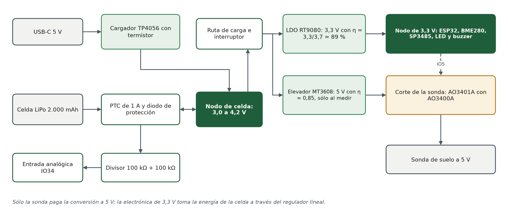

**Figura 1.8 “Árbol de Alimentación y Nodos de Tensión”**

El diagrama hace explícito lo que el balance energético por nodo cuantifica más adelante: la rama de 3,3 V toma su energía de la celda a través del regulador lineal, sin pasar por el elevador, y sólo la sonda paga la conversión a 5 V; por eso cada corriente se refiere a la batería antes de sumarla a otra.

Interfaz Física de Usuario: El panel físico del equipo se reduce deliberadamente a lo mínimo indispensable para la operación en terreno. La figura siguiente es un esquema funcional de la envolvente: muestra qué cumple cada elemento y dónde se ubica, sin representar la forma final, que se fija en la ingeniería de detalle:

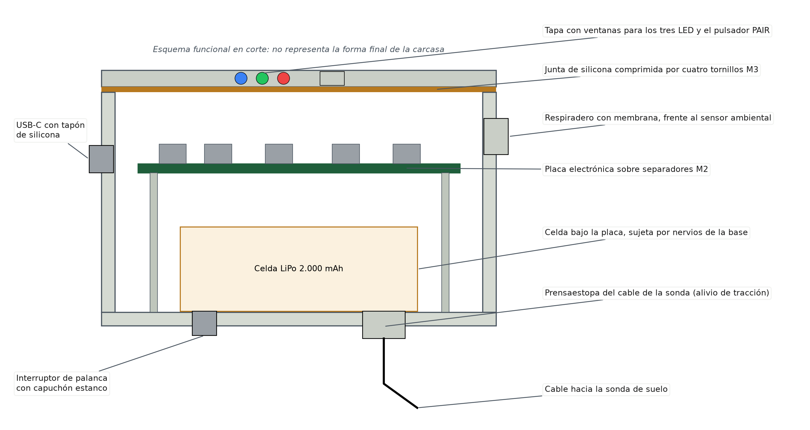

**Figura 1.9 “Concepto funcional de la carcasa”**

La interfaz consta de tres luces indicadoras, un zumbador, un botón de emparejamiento, un puerto USB-C de carga y un interruptor mecánico de encendido dimensionado para ser accionable incluso con guantes de trabajo pesados. Las luces y el zumbador comunican los estados relevantes del equipo sin necesidad de abrir la aplicación. En reposo permanecen apagados y en silencio, y cada color tiene un único significado: azul, vinculación; verde, operación correcta; rojo, necesita atención:

| Estado Operativo | Indicador Activo | Patrón de Señalización | Sonido | Significado Técnico |
|---|---|---|---|---|
| Encendido | 🟢 Verde | Fijo durante 1 s, una vez | Tres notas ascendentes | El equipo arrancó y está listo para vincularse o medir. |
| Ventana de vinculación | 🔵 Azul | Parpadeo de 2 Hz durante 30 s | Dos llamadas agudas | Se mantuvo el botón 3 s; mientras dure, la aplicación puede vincular el equipo. |
| Vinculación confirmada | 🟢 Verde | Tres destellos | Tres notas de confirmación | La aplicación registró el equipo y se lo confirmó dentro de la ventana. |
| Vinculación rechazada | 🔴 Rojo | Tres destellos | Dos notas descendentes | La ventana estaba cerrada o el identificador no corresponde al equipo. |
| Medición encolada para envío | 🟢 Verde | Tres destellos | Dos pitidos ascendentes | El equipo solicitó notificar una captura válida; no confirma recepción ni guardado en el teléfono. |
| Error de sonda | 🔴 Rojo | Tres destellos | Dos notas descendentes | Suelo ausente o descartado por respuesta inválida, rangos o batería inválida; la aplicación no guarda esa captura. |
| Batería baja | 🔴 Rojo | Un destello corto cada 10 s | Dos tonos graves, sólo al entrar en batería baja | Tensión de batería bajo el umbral de aviso; requiere recarga por USB-C. |

**Tabla 4.7 “Interfaz Hardware”**

### Carcasa del Dispositivo

Aislada de la interfaz de usuario, la envolvente física se enfoca exclusivamente en la estanqueidad, durabilidad e integración de los sensores en entornos agrícolas agresivos.

- Material y Estructura: La carcasa se fabrica en PETG mediante impresión 3D FDM. A diferencia del PLA o ABS, el PETG resiste la intemperie y la radiación UV. La rigidez frente a caídas sobre gravilla se logra mediante un relleno al 40–60 %, mientras que la estanqueidad depende de la configuración de perímetros sólidos (≥ 4 capas, altura de 0,16–0,20 mm).

### Sellado de Componentes

- Junta Principal: Utiliza un O-ring de silicona comprimido de forma controlada mediante insertos roscados M3 entre la tapa y el cuerpo.

- Salida de Sonda: El cable hacia la sonda de suelo emplea un prensaestopas industrial M12 en la base. Actúa como sellado y alivio de tracción; sin él, cualquier tirón transmitirá el esfuerzo mecánico directo a las soldaduras de la PCB.

### Criterios de Eficiencia Energética y Digitalización

Toda la ingeniería de energía del equipo se reduce a una sola regla, declarada de forma explícita y aplicada sin excepción a cada decisión de diseño, desde la elección del microcontrolador hasta el tipo de LED montado en el panel:

Toda energía que el instrumento consume fuera del instante de medición es energía desperdiciada, y esa energía desperdiciada se paga dos veces: en autonomía perdida para el usuario y en batería adicional que hay que comprar.

Esta regla es la que explica, con hilo conductor, las decisiones de hardware adoptadas: por qué el equipo no lleva pantalla, por qué existe un MOSFET dedicado solo a cortar la alimentación de la sonda, por qué se prefirieron LED por sobre otros métodos de alerta y por qué el equipo lleva un interruptor mecánico que corta la alimentación del sistema entre jornadas.

Digitalización del Proceso Agrícola: El segundo eje, tan determinante como la eficiencia energética, es la digitalización del proceso de toma de decisiones en terreno. TerraSense transforma un proceso hoy manual y no trazable, la estimación visual, la memoria del agricultor o, en el mejor de los casos, un cuaderno de papel en un flujo digital estructurado: cada medición queda georreferenciada, con marca de tiempo y sincronizada a una base histórica consultable. El agricultor pasa de "estimar" a "medir y registrar", cerrando la brecha de datos que hoy impide a instituciones públicas y privadas focalizar sus políticas de apoyo al sector. Esta digitalización se sostiene sobre cuatro pilares técnicos:

| Pilar de digitalización | Cómo se implementa en TerraSense |
|---|---|
| Offline-first con store & forward | El motor agronómico, el almacenamiento local persistente del teléfono y la captura BLE operan sin red; las mediciones se encolan localmente y se sincronizan de forma diferida en cuanto el teléfono detecta cobertura, sin bloquear ni degradar la operación en terreno. |
| Roles por equipo | Cada equipo tiene un administrador y usuarios aprobados por él; con seguridad a nivel de fila, cada cuenta accede sólo a los equipos de los que es miembro. Los usuarios operan únicamente desde la aplicación: la consola web es exclusiva del soporte técnico. |
| Gestión de versiones del firmware | El catálogo de versiones está implementado en la consola web de soporte. La actualización del equipo por Bluetooth y la parametrización remota de la sonda forman parte del diseño de ampliación. El firmware vigente se carga por USB; la aplicación móvil dispone de sus propios canales de distribución y actualización. |
| Accesibilidad digital (WCAG 2.1 AA) [23] | Contraste mínimo de 4,5:1 entre texto y fondo, área táctil mínima de 48×48 dp y prohibición del color como único portador de información, pensado para usuarios de distintos niveles de alfabetización digital y para la lectura bajo sol directo en terreno. |

**Tabla 4.8 “Pilares de Digitalización del Proceso Agrícola”**

Esta digitalización habilita capacidades imposibles bajo el modelo análogo, tales como comparar la evolución de un mismo punto del campo a lo largo de distintas temporadas y mantener un registro histórico respaldado. De este modo, el agricultor puede compartir información precisa con su asesor técnico sin depender de la memoria ni de anotaciones manuales.

### Arquitectura de la Gestión Eficiente de Energía

El rendimiento real lo dictan componentes básicos implementados estratégicamente. La sonda no permanece alimentada mientras el equipo está encendido: dos MOSFET gobernados por el microcontrolador cortan su alimentación salvo durante los segundos exactos en que se toma una lectura. Sin ese corte, la sonda sola consumiría más que todo el resto del equipo en espera. Los dos MOSFET cuestan en conjunto $129 y son, proporcionalmente, la mejor inversión electrónica del diseño.

Sin embargo, el componente que más autonomía aporta no es electrónico, sino mecánico: el interruptor que permite al usuario apagar el equipo por completo en lugar de dejarlo emitiendo advertising Bluetooth de forma permanente. La diferencia entre un equipo apagado y uno en publicidad continua es de varios órdenes de magnitud en consumo, y la determina una pieza de menos de $1.000 CLP.

### Los Estados de Consumo

El equipo no tiene un único nivel de consumo, sino que transita entre estados bien delimitados. Dado que el dispositivo pasa la mayor parte de su vida útil en reposo, el diseño se enfoca en gestionar estas transiciones y en acotar el tiempo que permanece conectado:

| Estado | Qué permanece activo | Medida de diseño |
|---|---|---|
| Almacenamiento | Circuitos no desconectados por el interruptor y autodescarga de la celda | Identificar rutas reales de consumo y verificar el método de apagado |
| Reposo | Control, regulación y periféricos retenidos | Medir la corriente del conjunto encendido en espera y apagado; confirmar que el puente USB-serie queda sin alimentación sin cable |
| Publicidad y conexión | Radio BLE y control | Ventanas acotadas de advertising y reintento controlado |
| Medición | Sonda, interfaces RS-485 y lectura ambiental | Habilitar solo durante estabilización y adquisición |
| Entrega y espera | Comunicación y procesamiento | Confirmar envío y regresar al estado de menor consumo |
| Carga | Circuito USB-C y celda | Verificar corriente, temperatura y efecto del calor sobre la lectura ambiental |

**Tabla 4.9 “Estados Energéticos y Medidas de Diseño”**

### Modelo de Autonomía en el Campo

Cada vez que el usuario pulsa “Medir”, se dispara una lectura y el balance distingue publicidad y conexión, adquisición, envío y aviso al usuario. Entre una medición y otra el equipo permanece encendido en espera, con el enlace BLE disponible, y al final de la jornada se apaga con el interruptor.

El error metodológico más común al estimar autonomía es sumar corrientes de distintos nodos de tensión como si fueran directamente equivalentes. El equipo no opera a una única tensión: la celda entrega 3,7 V nominales, la rama digital trabaja a 3,3 V detrás del regulador lineal y la sonda a 5 V detrás del elevador. Un miliamperio-hora no significa lo mismo en cada uno de esos nodos, de modo que el balance completo se plantea en unidades de energía (mWh) y no de carga (mAh): la energía sí es aditiva entre nodos de distinta tensión, la carga no.

La conversión hacia la batería sigue dos caminos. El regulador lineal entrega a la rama de 3,3 V la misma corriente que toma de la celda y disipa como calor la diferencia de tensión: la potencia desde la batería de cualquier componente de esa rama es 3,7 V × su corriente, y el 89 % de la energía que sale de la celda llega a la electrónica (3,3 V / 3,7 V). La sonda, que cuelga de los 5 V, paga la eficiencia del elevador, η ≈ 0,85 [66], es decir, un 15 % de pérdida, sólo durante los tres segundos de la lectura.

| Fase | Componente | Nodo / tensión | Corriente en el nodo | Potencia en el nodo | Potencia desde la batería (3,7 V) |
|---|---|---|---|---|---|
| Todas | Corriente propia del LDO RT9080 y divisor de batería | 3,7 V (celda) | 0,02 mA | 0,08 mW | 0,08 mW |
| Espera encendido | ESP32 con enlace BLE en espera | 3,3 V (LDO) | 18 mA | 59,4 mW | 66,6 mW |
| 1. Publicidad y conexión | ESP32 en advertising BLE | 3,3 V (LDO) | 40 mA | 132 mW | 148,0 mW |
| 2. Adquisición del conjunto | ESP32 (temporización Modbus) | 3,3 V (LDO) | 95 mA | 313,5 mW | 351,5 mW |
| 2. Adquisición del conjunto | Transceptor SP3485 (driver activo) [24] | 3,3 V (LDO) | 2 mA | 6,6 mW | 7,4 mW |
| 2. Adquisición del conjunto | BME280 (muestreo forced-mode) | 3,3 V (LDO) | 0,0036 mA | 0,012 mW | 0,013 mW |
| 2. Adquisición del conjunto | Sonda 7-en-1 (excitación y lectura) | 5 V (elevador, η≈0,85) | 30 mA | 150 mW | 150 mW / 0,85 ≈ 176,5 mW |
| 2. Adquisición del conjunto | Polarización del corte de la sonda (10 kΩ) | 5 V (elevador, η≈0,85) | 0,5 mA | 2,5 mW | 2,9 mW |
| 3. Envío del resultado | ESP32 transmitiendo BLE | 3,3 V (LDO) | 150 mA | 495 mW | 555,0 mW |
| 4. Aviso al usuario | Buzzer pasivo con transistor (dos pitidos, 160 ms; cota de diseño) | 3,3 V (LDO) | 52 mA | 171,6 mW | 192,4 mW |
| 4. Aviso al usuario | LED verde con 330 Ω (tres destellos, 360 ms) | 3,3 V (LDO) | 3,9 mA | 12,9 mW | 14,4 mW |

**Tabla 5.0 “Balance Energético por Nodo de Tensión”**

| Fase Operativa | Potencia desde la batería | Duración | Energía por ciclo |
|---|---|---|---|
| 1. Publicidad y conexión | 148,1 mW | 12 s | 0,494 mWh |
| 2. Adquisición del conjunto | 538,4 mW | 3 s | 0,449 mWh |
| 3. Envío del resultado | 555,1 mW | 1 s | 0,154 mWh |
| 4. Aviso al usuario (buzzer y LED verde) | 206,8 mW en pulsos | 0,16 s de buzzer y 0,36 s de LED, simultáneos al envío | 0,010 mWh |
| Total por ciclo | Variable | 16 s | 1,106 mWh |

**Tabla 5.1 “Energía por Ciclo de Medición”**

Tres precisiones sostienen estas tablas frente a un cálculo por suma directa de corrientes. La sonda toma 150 mW en su nodo de 5 V, pero exige 176,5 mW a la batería: el factor 1/η = 1,176 que impone el elevador es energía perdida en la conversión. La rama de 3,3 V pierde menos: los 40 mA de la Fase 1 valen 132 mW en su nodo y cuestan 148,0 mW de batería, porque el regulador lineal sólo disipa la diferencia entre 3,7 y 3,3 V. Y el consumo que queda conectado en todas las fases, el del regulador y el divisor, es de apenas 0,08 mW, de modo que la energía de la jornada la determina el tiempo que el módulo pasa en espera con el enlace activo. La corriente de transmisión del ESP32 en la Fase 3 se fija en 150 mA, el extremo superior de la banda de transmisión BLE declarada en la comparativa de microcontroladores; el consumo del transceptor SP3485 se toma del extremo superior de su hoja de datos [24]; el del buzzer, de la cota de diseño de 52 mA; y el de la sonda, del supuesto de potencia constante ya declarado.

### Autonomía según el Patrón de Uso

Como el equipo se apaga entre jornadas, la autonomía no se expresa en tiempo de reposo sino en jornadas de trabajo por carga. El ejercicio supone jornadas de 2 horas encendido con 10 mediciones cada una (141,5 mWh por jornada), una capacidad útil de 1.600 mAh equivalente a 5.920 mWh a 3,7 V, el consumo con el equipo apagado de la sección anterior (0,076 mW) y una autodescarga de la celda del 2 % mensual (4,93 mWh por día):

| Patrón de uso | Jornadas | Autonomía con una carga | Mediciones por carga |
|---|---|---|---|
| Equipo olvidado encendido, sin medir | Continuo | 88,8 horas (≈ 3,7 días) | — |
| Uso intensivo: una jornada diaria de 2 h con 10 mediciones | Diario | 40,0 días (≈ 5,7 semanas) | 400 |
| Uso habitual: dos jornadas semanales de 2 h con 10 mediciones | 2 por semana | 125,6 días (≈ 17,9 semanas) | 359 |
| Almacenado apagado, sin uso | Ninguno | 876,6 días (≈ 28,8 meses) | — |

**Tabla 5.2 “Autonomía según el Patrón de Uso”**

La tabla muestra el efecto de una placa sin consumo propio: el equipo almacenado apagado conserva su carga más de dos años, limitado en la práctica por la autodescarga de la celda, y aun olvidado encendido dura casi cuatro días. Bajo el uso habitual, dos jornadas por semana, una carga dura del orden de 18 semanas y unas 360 mediciones; bajo uso intensivo diario, del orden de 6 semanas. En ambos casos la recarga se resuelve con el mismo cargador USB-C del teléfono, y el equipo puede cargarse apagado.

### Sensibilidad de la Autonomía

Las cifras anteriores heredan dos estimaciones de diseño, que se miden en banco: la corriente del módulo en espera con el enlace BLE activo y la corriente que queda conectada con el equipo apagado. La siguiente tabla acota su efecto sobre el uso habitual:

| Variación sobre el uso habitual | Autonomía con una carga | Cambio frente al diseño adoptado |
|---|---|---|
| Diseño adoptado (valores de la tabla de balance) | 125,6 días (≈ 17,9 semanas) | — |
| Espera del módulo del doble de lo estimado (36 mA) | 70,2 días (≈ 10,0 semanas) | −44,1 % |
| Fuga no identificada de 1 mA con el equipo apagado | 44,2 días (≈ 6,3 semanas) | −64,8 % |
| Jornadas de 4 h en lugar de 2 h | 69,5 días (≈ 9,9 semanas) | −44,7 % |
| Divisor de batería de 1 MΩ + 1 MΩ | 129,7 días (≈ 18,5 semanas) | +3,2 % |
| ESP32 sin reposo con BLE anunciando (40 mA en espera, firmware actual) | 63,9 días (≈ 9,1 semanas) | −49,1 % |

**Tabla 5.3 “Sensibilidad de la Autonomía al Consumo y al Uso”**

Las variables decisivas son el tiempo que el equipo pasa encendido, la corriente del módulo en espera y lo que se consume apagado: duplicar la duración de las jornadas o la corriente de espera reduce la autonomía cerca de un 45 %, y una fuga de 1 mA con el equipo apagado, un 65 %, porque el equipo pasa la mayor parte de la semana apagado. El divisor de batería, en cambio, pesa poco: reemplazarlo por uno de 1 MΩ + 1 MΩ la alarga apenas un 3,2 %, y por eso se conserva el de 100 kΩ, que entrega una lectura más estable.

La referencia del modelo para uso habitual es 125,6 días, aproximadamente 17,9 semanas y unas 360 mediciones, condicionada a los consumos y al patrón de uso declarados. El escenario sin reposo ligero y el de fuga adicional son sensibilidades calculadas, no un piso de autonomía verificado. D-07 debe medir el consumo real del firmware instalado y el ensayo de descarga debe comparar duración observada y calculada bajo el mismo criterio de término.

Corresponde subrayar el carácter de esta cifra: es un resultado calculado. Procede del balance energético por nodo con las eficiencias declaradas, y su confirmación exige medir el consumo del conjunto ensamblado encendido y apagado. Esa medición es la primera de las verificaciones programadas que el informe enumera en sus conclusiones.

### Sostenibilidad Ambiental y Análisis Competitivo

Al comparar el sistema contra los estándares de la industria, el proyecto enfrenta con honestidad las diferencias de arquitectura. Las referencias siguientes son dos casos puntuales documentados y no una descripción exhaustiva del mercado:

| Equipo | Fuente de energía especificada | Recambio y continuidad operativa | Parámetros medidos |
|---|---|---|---|
| Bluelab Pulse [25] | 1 pila AA alcalina | Sustituir la pila agotada; conviene disponer de repuesto | 3 (conductividad, humedad y temperatura), con app |
| Hanna HI9814 [6] | 3 pilas AAA de 1,5 V | Sustituir el juego completo; ~600 horas de uso continuo declaradas | 4 (pH, EC, TDS y temperatura), en soluciones hidropónicas |
| TerraSense | 1 celda LiPo recargable de 2.000 mAh, carga USB-C | Recargar la misma celda; sustituirla al degradarse | 7 registros de suelo + 3 ambientales, con interpretación agronómica móvil |

**Tabla 5.4 “Análisis Comparativo de Parámetros”**

TerraSense busca reducir el recambio habitual de pilas primarias al recuperar la carga de la misma celda durante muchos ciclos de uso, lo que para el agricultor significa menos compras de repuestos y la posibilidad de cargar el equipo antes de una jornada mediante USB-C. Conviene reconocer, sin embargo, la ventaja operativa que conservan las pilas intercambiables: permiten reanudar el trabajo de inmediato con un repuesto, mientras que la batería integrada obliga a planificar la carga y a asegurar acceso a energía.

Esta arquitectura se alinea además con la normativa ambiental, aunque conviene enunciar el alcance con precisión. Un instrumento dependiente de pilas primarias genera un flujo constante de residuos: un juego de pilas por temporada, o varios, durante toda la vida útil del equipo. El uso de una celda de litio recargable mediante USB-C reduce ese flujo a una celda cada varios años: del orden de cuatro en diez años según el propio cuadro de costo total de propiedad (la original, las de los kits de batería de los años 3 y 8 y la del segundo equipo del año 6). Lo que no hace, y sería incorrecto afirmarlo, es eliminar el residuo: una celda de litio recargable es igualmente un residuo prioritario bajo la Ley REP N° 20.920 [26], y precisamente por eso el diseño contempla celdas extraíbles con herramientas comunes y la habilitación de un canal de recepción al fin de la vida útil, obligaciones que se detallan en la matriz normativa.

### Síntesis de Eficiencia Energética

El diseño del sistema prioriza la autonomía como un atributo crítico de confiabilidad. En la placa del instrumento esa autonomía se obtiene cortando la energía donde no se usa y sin un consumo propio de placa: la sonda sólo recibe alimentación durante la lectura, el regulador toma unos 2 µA y el equipo completo se apaga entre jornadas. Bajo el uso habitual, una carga sostiene aproximadamente 18 semanas de trabajo (unas 360 mediciones) según el balance energético por nodo. Esta eficiencia es fruto de tres pilares de diseño:

- Aislamiento Activo (Power Gating): el elevador se habilita y dos MOSFET desconectan físicamente la sonda sólo durante la lectura, de modo que su consumo no se suma a la espera.

- Apagado Completo entre Jornadas: un interruptor mecánico corta la entrada del sistema, dejando conectados a la celda sólo el divisor de batería y la corriente inversa del cargador, del orden de 0,02 mA.

- Optimización de Radio y Gestión Local: Empleo de Bluetooth Low Energy (BLE) con tramas de 20 bytes de longitud fija y ciclos de medición acotados (16 segundos), mientras el procesamiento offline en el teléfono libera al instrumento de tareas de cómputo intensivas y de almacenamiento.

### Condiciones Técnicas y Normativas Respecto al Diseño

El marco regulatorio aplicable al proyecto TerraSense organiza su cumplimiento normativo en seis dominios fundamentales: hardware y seguridad eléctrica, radiofrecuencia y telecomunicaciones, buses industriales, estándares edafológicos, protección de datos y accesibilidad, y protección al consumidor.

### Hardware

- IEC 60529 [27]: Exige un grado de protección IP67 (estanco al polvo, sin depósito interior, e inmersión a 1 metro de profundidad durante 30 minutos). En el proyecto, esto se aborda mediante una envolvente en PETG con sellado intercapa, O-ring de silicona y prensaestopas M12.

- UN 38.3 / IEC 62133-2 [28]: Define los ensayos de estrés (altitud, choque térmico, cortocircuito) para celdas de ion-litio secundarias. El diseño lo aborda integrando celdas comerciales con certificación de origen, complementadas por la protección electrónica del módulo cargador.

- RoHS 2011/65/EU y RoHS 3 (2015/863): Restringe el uso de metales pesados en la electrónica.

El proyecto exige el uso de soldadura sin plomo (aleación SAC305) y componentes con declaración de conformidad del proveedor.

- Ley N° 20.920 (Ley REP, Chile) [26]: Establece la responsabilidad extendida del productor sobre residuos prioritarios, incluyendo baterías. Se cumple mediante un diseño desmontable con herramientas comunes y celdas extraíbles, requiriendo habilitar un canal de recepción al fin de la vida útil del equipo.

- Alimentación y Aprobación Eléctrica: El equipo se comercializa sin adaptador de red: se entrega con cable USB-C y se carga desde un cargador de teléfono que el usuario ya posee. Esta decisión se declara expresamente porque delimita el alcance regulatorio: al no incluir el proyecto ninguna fuente de alimentación conectada a la red domiciliaria, no se configura la obligación de certificación de producto eléctrico ante la Superintendencia de Electricidad y Combustibles. Si en el futuro se decidiera incluir un adaptador en el empaque, ese adaptador deberá contar con el protocolo de aprobación correspondiente antes de su comercialización.

### Radiofrecuencia y Telecomunicaciones

- SUBTEL, Resolución Exenta N° 1.985/2017 [29]: Norma técnica para equipos de alcance reducido en Chile, que fija los límites de potencia aplicables a la banda de 2,4 GHz bajo régimen exento de licencia. El presupuesto de diseño del enlace Bluetooth es de +9 dBm, equivalentes a aproximadamente 8 mW radiados, cifra que se sitúa muy por debajo de cualquiera de las lecturas posibles del límite aplicable, ya sea que se mida como potencia de salida en bornes de antena o como potencia radiada. El valor exacto del límite y la magnitud sobre la que se mide se confirman contra el texto vigente de la resolución al preparar el expediente, y así se consigna en la matriz de verificación: estar holgadamente bajo el límite no exime de acreditar cuál es el límite.

- SUBTEL, Resolución N° 737/2025 [17]: Actualización del régimen de certificación de equipos de telecomunicaciones, con verificación formal programada antes del lanzamiento comercial. Las obligaciones aplican al producto terminado y no al módulo de radio, de modo que la certificación modular del ESP32 no sustituye este trámite.

- FCC, Título 47 CFR Parte 15, subpartes B y C [30]: Límites de emisiones para dispositivos no licenciados en Estados Unidos. Se encuentra cubierto de forma incidental al utilizar el módulo

ESP32-WROOM-32, pre-certificado con FCC ID 2AC7Z-ESPWROOM32. No es exigible en Chile y se conserva como referencia de mercado futuro.

### Buses Industriales

- TIA/EIA-485-A [31]: Define los niveles eléctricos y la terminación de un bus diferencial multipunto.

Es el fundamento técnico-normativo para elegir RS-485 sobre I²C para la comunicación cableada en terreno.

- Modbus Application Protocol Specification V1.1b3 [32]: Rige la estructura de la comunicación, definiendo la función 0x03 (lectura de registros holding), el mecanismo de verificación

CRC-16 y los tiempos de silencio exigidos entre tramas con la sonda de suelo.

### Estándares Edafológicos

- ISO 10390:2021 [33]: Método de referencia para la determinación del pH del suelo mediante electrodo en suspensión suelo-agua o suelo-CaCl₂. Dado que el pH sustenta directamente las recomendaciones de encalado que entrega el motor agronómico, esta norma es la que fija el método de contraste del protocolo de validación in situ.

- ISO 11265 [34]: Método de referencia para la conductividad eléctrica específica del suelo.

Fundamenta la normalización de la lectura de CE a 25 °C, aplicando un coeficiente térmico de 2 %/°C.

- ISO 11277 [35]: Método de granulometría y textura. Permite determinar en laboratorio las clases texturales de la campaña de validación. La aplicación no mide ni solicita textura y no aplica una corrección textural a partir de una clase supuesta.

- ISO 11465 [36]: Método gravimétrico para la determinación del contenido de materia seca y de agua del suelo. Es el método de contraste para la humedad volumétrica, la variable de uso más frecuente del instrumento y la que sustenta las recomendaciones de riego.

- Métodos oficiales SAG / INIA: Criterios de interpretación agronómica nacional utilizados para calibrar los umbrales de la matriz de cultivos.

### Datos, Seguridad de la Información y Accesibilidad

- Ley N° 19.628 [37]: Exige consentimiento y derechos del titular. A nivel de arquitectura se aplica mediante seguridad a nivel de fila en la base de datos, garantizando aislamiento por campo y por rol.

- Ley N° 21.719 (Protección de Datos Personales) [38]: No es un apéndice de la anterior sino un régimen nuevo, con obligaciones propias: creación de una autoridad fiscalizadora, deber de notificar vulneraciones de seguridad, registro de actividades de tratamiento y un cuadro de sanciones distinto. El proyecto la trata como obligación diferenciada y no como continuidad de la

Ley N° 19.628, y su cumplimiento se organiza sobre tres frentes: la atención de los derechos del titular a través del correo de contacto que informa la aplicación, el aislamiento por equipo y rol ya implementado y un procedimiento escrito de notificación de incidentes que debe existir antes de la primera cuenta comercial.

- ISO/IEC 27001:2022 e ISO/IEC 25010 [39]: El desarrollo de la plataforma se rige por cifrado en tránsito (TLS) y reposo, control de acceso segmentado y criterios internacionales de fiabilidad, usabilidad y mantenibilidad de software.

- WCAG 2.1, nivel AA [23]: Pautas de accesibilidad digital implementadas en la app (área táctil mínima de 48×48 dp, contraste mínimo de 4,5:1, y prohibición del uso del color como único portador de información).

### Protección al Consumidor

- Ley N° 21.398 ("Pro Consumidor") [40]: Extiende la garantía legal a 6 meses y obliga a informar la vida útil y disponibilidad de repuestos. A nivel de negocio, el proyecto incorpora una provisión del 5 % del costo unitario para atender esta garantía y asume el compromiso de mantener stock de partes.

- Ley N° 19.496 [41]: Prohíbe la publicidad engañosa. Constituye la barrera normativa formal por la cual el proyecto declara el equipo comercialmente como "diseñado conforme a IP67" en lugar de

"certificado IP67", hasta que los laboratorios documenten el ensayo final.

### Obligaciones Tributarias y Laborales

- Ley N° 21.713 [42] (cumplimiento de obligaciones tributarias): desde octubre de 2025 eliminó la exención que liberaba de IVA a las importaciones bajo US$41. Toda compra internacional paga IVA, y las plataformas inscritas ante el Servicio de Impuestos Internos lo recaudan al momento de la compra para pedidos de hasta US$500, sin arancel aduanero adicional. La consecuencia de diseño es económica y no técnica: ese IVA sólo constituye crédito fiscal si la compra se formaliza como importación con Declaración de Ingreso, de modo que el abastecimiento debe formalizarse antes de comprometer volumen.

- Ley N° 21.735 [43] (reforma previsional): introdujo una cotización de cargo del empleador que parte en 3,5 % y sube de forma gradual hasta completar 8,5 % junto con el Seguro de Invalidez y

Sobrevivencia. El proyecto la incorpora año a año en el costo laboral, porque sobre un horizonte de diez años la diferencia frente a un recargo fijo es material

### Clasificación de Cumplimiento Obligatorio vs. Voluntario

El listado anterior mezcla, deliberadamente, normas de cumplimiento legal ineludible en Chile con estándares técnicos adoptados de forma voluntaria como buena práctica de ingeniería y con referencias pensadas para una eventual exportación futura. Presentarlas todas al mismo nivel sin distinguir su carácter sería engañoso, así que se clasifican aquí explícitamente:

| Norma | Carácter | Requisito de diseño derivado | Método de verificación, criterio de aceptación y evidencia | Estado |
|---|---|---|---|---|
| Ley N° 20.920 (Ley REP) | Obligatoria (Chile) | Diseño desmontable con celdas extraíbles y canal de recepción al fin de vida útil | Ensayo funcional de desmontaje sin herramientas especiales y convenio escrito con gestor autorizado. Criterio: celda extraíble y punto de recepción operativo. Evidencia: procedimiento de desmontaje y convenio firmado | Programado |
| SUBTEL, Res. Exenta N° 1.985/2017 | Obligatoria (Chile) | Enlace BLE a +9 dBm (≈8 mW), con margen frente al límite aplicable | Medición en banda 2,4 GHz sobre la unidad ensamblada, previa confirmación documental de cuál es el límite vigente y sobre qué magnitud se mide. Criterio: cumplir el límite acreditado con margen. Evidencia: extracto de la resolución vigente e informe de medición | Programado |
| SUBTEL, Resolución N° 737/2025 | Obligatoria (Chile) | Verificación formal del producto terminado, con cargo al rubro de desarrollo y validación | Trámite formal de verificación ante la autoridad sectorial. Criterio: resolución favorable previa a la comercialización. Evidencia: expediente y resolución | Programado |
| UN 38.3 / IEC 62133-2 | Obligatoria (transporte y comercialización de celdas de litio) | Celdas comerciales con certificación de origen y protección electrónica del cargador | Solicitud de certificados al proveedor de celdas y ensayo de las protecciones del cargador. Criterio: certificados vigentes y corte por sobrecarga, sobredescarga y cortocircuito. Evidencia: certificados y acta de ensayo | Programado |
| Ley N° 19.628 (Protección de la Vida Privada) | Obligatoria (Chile) | Aislamiento por equipo y rol; derechos del titular atendidos a través del correo de contacto | Pruebas de acceso cruzado entre cuentas y registro de solicitudes. Criterio: cero lecturas de equipos ajenos y respuesta a cada solicitud del titular en el plazo legal. Evidencia: batería de pruebas de aislamiento y registro de solicitudes | Parcial: aislamiento implementado, procedimiento de solicitudes programado |
| Ley N° 21.719 (Protección de Datos Personales) | Obligatoria (Chile) | Registro de actividades de tratamiento y procedimiento escrito de notificación de vulneraciones | Revisión documental antes de abrir la primera cuenta comercial. Criterio: registro y procedimiento redactados, con responsable designado. Evidencia: documentos firmados | Programado |
| Ley N° 21.398 (“Pro Consumidor”) | Obligatoria (Chile) | Garantía legal de 6 meses más provisión del 5 % de BOM para atenderla | Revisión legal de las condiciones de garantía y provisión contable. Criterio: cobertura ≥ 6 meses y provisión del 5 % de BOM reservada. Evidencia: texto de garantía y asiento de provisión | Parcial |
| Ley N° 19.496 (Protección al Consumidor) | Obligatoria (Chile) | Declaración comercial como “diseñado conforme a IP67” hasta contar con ensayo de laboratorio | Auditoría del material comercial. Criterio: ninguna pieza declara IP67 certificado mientras no exista ensayo. Evidencia: material revisado y aprobado | Cumple |
| Ley N° 21.713 [42] (cumplimiento de obligaciones tributarias) | Obligatoria (Chile) | Abastecimiento formalizado como importación, con Declaración de Ingreso, para que el IVA de los insumos constituya crédito fiscal | Revisión de la carpeta tributaria de importación antes de la primera orden de volumen. Criterio: toda compra de insumos respaldada con DIN o factura nacional. Evidencia: declaraciones de ingreso y registro de crédito fiscal | Programado |
| Ley N° 21.735 [43] (reforma previsional) | Obligatoria (Chile) | Cotización de cargo del empleador aplicada según el calendario gradual vigente, además de cesantía y mutualidad | Revisión de las declaraciones previsionales mensuales. Criterio: tasa del período correctamente aplicada sobre cada remuneración. Evidencia: certificados de pago previsional | Programado |
| IEC 60529 (grado IP67) | Voluntaria como estándar; exigible como declaración una vez publicada, por efecto de la Ley N° 19.496 | Envolvente PETG con O-ring, sellado intercapa, prensaestopa PG7 y respiradero M12 del sensor ambiental | Ensayo IP67 en laboratorio acreditado sobre el conjunto ensamblado, incluido el respiradero. Criterio: sin ingreso de agua tras 30 min a 1 m. Evidencia: informe de ensayo | Programado |
| Métodos oficiales SAG / INIA | Voluntaria (referencia técnica nacional adoptada) | Umbrales de la matriz de cultivos trazables a criterios oficiales publicados | Contraste de cada umbral de la matriz de cultivos con su fuente oficial. Criterio: trazabilidad documental de cada umbral. Evidencia: tabla de correspondencia umbral–fuente, con fecha de consulta | Programado |
| RoHS 2011/65/EU y RoHS 3 | Voluntaria en Chile / referencia de mercado futuro | Soldadura SAC305 y declaración de conformidad de proveedores | Recopilación de declaraciones de conformidad de proveedores. Criterio: cobertura documental de los componentes de la BOM. Evidencia: carpeta de declaraciones | Programado |
| FCC, Título 47 CFR Parte 15 | Referencia de mercado futuro (EE. UU., no exigible en Chile) | Cubierto de forma incidental por el módulo ESP32 pre-certificado | Verificación del FCC ID del módulo y de las condiciones de uso del certificado modular. Criterio: integración dentro del alcance declarado. Evidencia: ficha del módulo | No aplica en Chile |
| TIA/EIA-485-A y Modbus V1.1b3 | Voluntaria (estándares técnicos abiertos) | Base de diseño del bus RS-485 y la trama Modbus RTU hacia la sonda | Prueba de bus con analizador lógico sobre la trama Modbus RTU. Criterio: terminación correcta y cero errores de CRC en 1.000 lecturas consecutivas. Evidencia: captura y registro de errores | Parcial |
| ISO 10390, ISO 11265, ISO 11277, ISO 11465 | Voluntaria (métodos de referencia de laboratorio) | Métodos de contraste del protocolo de validación in situ | Protocolo de validación in situ contra laboratorio acreditado bajo ISO/IEC 17025. Criterio: el fijado en el propio protocolo. Evidencia: informes de laboratorio y análisis de concordancia | Programado |
| ISO/IEC 27001:2022 e ISO/IEC 25010 | Voluntaria (certificación de gestión y calidad de software) | Cifrado en tránsito y reposo, control de acceso segmentado | Revisión de configuración de cifrado y de segmentación de accesos. Criterio: TLS vigente y ausencia de credenciales embebidas. Evidencia: informe de revisión | Parcial |
| WCAG 2.1, nivel AA | Voluntaria (no exigida por ley a aplicaciones privadas en Chile) | Contraste ≥ 4,5:1, área táctil ≥ 48×48 dp y color no exclusivo como portador de información | Auditoría de accesibilidad sobre las pantallas de la aplicación. Criterio: contraste ≥ 4,5:1 y ninguna información transmitida solo por color. Evidencia: informe de auditoría | Programado |

**Tabla 5.5 “Clasificación Normativa: Obligatoria, Voluntaria y de Mercado Futuro”**

### Protocolo de Validación de la Medición In Situ contra Laboratorio de Referencia

El objetivo específico de “validar la precisión instrumental” exige un protocolo concreto y no sólo la intención declarada de contrastar contra un laboratorio acreditado. Se define aquí ese protocolo.

La campaña compara tres magnitudes de la sonda con métodos de referencia: humedad volumétrica, pH y conductividad eléctrica. La textura se determina en laboratorio para agrupar los resultados; no es una variable medida por TerraSense ni un dato solicitado por el flujo actual de la aplicación. La temperatura del suelo se contrasta con termómetro patrón y las magnitudes ambientales con termohigrómetro y barómetro de referencia en ensayos separados. La hoja de datos del sensor establece prestaciones declaradas del componente, pero no acredita la exactitud del equipo ensamblado. N, P y K conservan exclusivamente el carácter de registros informativos.

La exclusión de N, P y K es deliberada y coherente con el resto del informe: esos tres valores no son determinaciones químicas independientes sino derivaciones de la conductividad eléctrica, de modo que contrastarlos contra un método de laboratorio mediría la correlación entre salinidad y fertilidad de los suelos muestreados, no la exactitud del instrumento. Validarlos sugeriría una capacidad analítica que la sonda no tiene. Por esa misma razón la aplicación los presenta como registros informativos con advertencia permanente, no construye diagnóstico nutricional con ellos y no permite prescribir dosis: la limitación se resuelve en la interfaz, no en la campaña de laboratorio.

| Elemento del protocolo | Especificación |
|---|---|
| Variables validadas | Humedad volumétrica, pH y conductividad eléctrica; textura determinada por laboratorio para estratificar la comparación |
| Variables excluidas y motivo | N, P y K: sin medición químicamente independiente. Temperatura del suelo y magnitudes ambientales: contraste con patrones en ensayos separados; la hoja de datos no sustituye esos ensayos |
| Tamaño de muestra | N ≥ 30 puntos de medición en total y no menos de 10 por clase textural, tomados en terreno y sub muestreados el mismo día para envío a laboratorio |
| Diversidad de suelos | Al menos 3 clases texturales distintas (franco, arcilloso, arenoso), cubriendo el rango útil de pH (4,5–8,5) y de conductividad eléctrica (0–5.000 µS/cm), que es donde se toman las decisiones agronómicas reales |
| Referencia de laboratorio | pH según ISO 10390; conductividad eléctrica según ISO 11265; textura según ISO 11277; humedad gravimétrica según ISO 11465 [36] y densidad aparente seca según ISO 11272 [54], ambas sobre el mismo cilindro de volumen conocido, y humedad volumétrica derivada de ellas según ISO 11461 [55]. Laboratorio acreditado bajo ISO/IEC 17025 para los ensayos solicitados |
| Estadístico de concordancia | Coeficiente de correlación de Pearson (R), su cuadrado (R²) y error cuadrático medio (RMSE) en la unidad nativa de cada variable; regresión de Passing-Bablok [57] de la lectura in situ sobre la de laboratorio, con el intervalo de confianza del 95 % de la pendiente y de la ordenada; análisis de Bland-Altman [56] con el sesgo medio, su intervalo de confianza del 95 % y los límites de concordancia |
| Umbral de aceptación | Umbral agronómico propio: pH, RMSE ≤ 0,3 unidades; conductividad eléctrica, RMSE ≤ 10 % de la lectura o 200 µS/cm, el mayor de ambos; humedad volumétrica, RMSE ≤ 4 puntos porcentuales. Adicionalmente R² ≥ 0,80; sin sesgo proporcional, demostrado por equivalencia: el intervalo de confianza del 95 % de la pendiente de Passing-Bablok queda entero dentro de 0,90–1,10; y evaluación del sesgo constante con el intervalo de confianza de la ordenada, sin interpretar que incluir cero demuestra equivalencia |
| Alcance del resultado | La campaña detecta sesgo grueso y desviación sistemática. El ajuste fino de coeficientes requiere una segunda campaña sobre la base instalada, prevista en el plan de calibración |
| Acción si no se cumple el umbral | La variable se marca como “referencial” en la app (no apta para prescripción cuantitativa de dosis ni de volúmenes) hasta recalibrar el coeficiente de compensación o sustituir el sensor asociado |

**Tabla 5.6 “Protocolo de Validación In Situ vs. Laboratorio de Referencia”**

Para resolver la tolerancia mixta de conductividad se calcula, en cada par, el error normalizado como (lectura − referencia) / máximo(0,10 × referencia, 200 µS/cm); la raíz del promedio de sus cuadrados debe ser ≤ 1. Se informa además el RMSE en µS/cm. Así se aplica el mismo criterio a todo el rango y no se compara un único RMSE con una tolerancia variable sin definir el denominador.

**Criterios de aceptación agronómica.** El protocolo adopta como objetivos un error cuadrático medio de pH de hasta 0,3 unidades y de humedad de hasta 4 puntos porcentuales, junto con los criterios de conductividad indicados en la Tabla 5.6. Son umbrales propuestos para la validación en suelo real; no garantizan que la recomendación sea invariable. Cerca de un límite de clasificación, una desviación menor puede cambiar el estado mostrado por la aplicación. Por ello, la campaña evalúa el sesgo, la dispersión y los cambios de clasificación por cultivo y textura, y contrasta la pertinencia de los umbrales con un especialista.

#### Criterio estadístico para declarar ausencia de sesgo

Una prueba que no encuentra diferencia significativa no demuestra que la diferencia no exista: con 30 puntos, una regresión puede no detectar un sesgo proporcional del 15 % sólo porque la muestra es pequeña. Por eso el protocolo no declara ausencia de sesgo cuando la prueba «no resulta significativa», sino cuando el intervalo de confianza demuestra que el sesgo, si existe, es menor que un margen fijado de antemano. Es un criterio de **equivalencia**, no de significancia.

- **Sesgo proporcional.** Se ajusta la regresión de Passing-Bablok [57] de la lectura in situ (eje y) sobre la de laboratorio (eje x). Este método no supone normalidad, admite error en ambos métodos y no lo desplaza un valor atípico aislado, que en suelo real es frecuente. Sin sesgo proporcional la pendiente vale 1. Se declara equivalencia de la pendiente dentro del margen de diseño sólo si el intervalo de confianza del 95 % de la pendiente queda **entero** dentro de 0,90–1,10. El margen de ±10 % no es arbitrario: es el mismo error relativo que el umbral de conductividad tolera, y en humedad equivale a 3 puntos porcentuales en un suelo al 30 %, bajo el umbral de 4 puntos.
- **Sesgo constante.** Se informa la ordenada de Passing-Bablok y su intervalo de confianza del 95 %. Que ese intervalo incluya cero sólo indica compatibilidad estadística con una ordenada nula; no demuestra ausencia de un sesgo relevante. La aceptación se fundamenta en los límites de error fijados y en el análisis de concordancia, y cualquier declaración adicional de equivalencia exige un margen absoluto definido antes de analizar los datos.
- **Concordancia.** El análisis de Bland-Altman [56] grafica la diferencia entre ambos métodos contra su promedio y entrega el sesgo medio, con su intervalo de confianza, y los límites de concordancia, iguales al sesgo ± 1,96 desviaciones estándar de las diferencias. Si las diferencias crecen con el promedio, señal de sesgo proporcional, los límites se calculan sobre diferencias porcentuales y no absolutas.

Si el intervalo de la pendiente sale más ancho que el margen, el resultado no es «aprobado» ni «rechazado» sino **no concluyente**: se agregan puntos hasta que el intervalo permita decidir, en lugar de aprobar la variable porque la muestra fue demasiado chica para ver el error.

#### Conversión entre humedad gravimétrica y volumétrica

La sonda informa **humedad volumétrica** (θv, volumen de agua por volumen de suelo), mientras que el método gravimétrico de laboratorio entrega **humedad gravimétrica** (w, masa de agua por masa de suelo seco). Las dos magnitudes no son comparables directamente: las relaciona la densidad aparente seca del suelo (ρb), que varía de un punto a otro con la textura, la materia orgánica y la compactación. La conversión se formaliza así:

| Magnitud | Expresión | Unidad | Origen |
|---|---|---|---|
| Humedad gravimétrica | w = (mh − ms) / ms | g/g | ISO 11465 [36]: masa húmeda (mh) y masa seca a 105 °C hasta masa constante (ms) |
| Densidad aparente seca | ρb = ms / V | g/cm³ | ISO 11272 [54]: masa seca del cilindro de volumen conocido (V = 100 cm³) |
| Humedad volumétrica | θv = w × ρb / ρw = (mh − ms) / (ρw × V) | cm³/cm³ (× 100 = %) | ISO 11461 [55], con ρw = 1,00 g/cm³ (densidad del agua) |
| Incertidumbre relativa | u(θv)/θv = √[(u(w)/w)² + (u(ρb)/ρb)²] | adimensional | Propagación de las incertidumbres de w y de ρb |

**Tabla 5.7 “Conversión de la humedad gravimétrica a volumétrica”**

En cada punto de la campaña se toma, a no más de 10 cm del punto de inserción de la sonda y a la misma profundidad de sus electrodos, un cilindro de acero de 100 cm³ hincado sin compactar el suelo, dentro de los 15 minutos siguientes a la lectura in situ. El cilindro se sella, se pesa húmedo dentro de 24 horas y se seca en estufa a 105 °C hasta masa constante. De la misma muestra salen w, ρb y θv, y es θv, expresado en porcentaje, el que se compara con la lectura de la sonda; la diferencia se informa en puntos porcentuales.

Un ejemplo muestra por qué la densidad aparente se mide en cada punto y no se toma de una tabla por textura. Con w = 0,20 g/g y ρb = 1,35 g/cm³, la humedad volumétrica es 0,20 × 1,35 = 0,27, es decir 27 %. Si en vez de medir ρb se asumiera 1,30 g/cm³ en un suelo que en realidad tiene 1,50 g/cm³, el valor de referencia saldría 26 % cuando el real es 30 %: un error de 4 puntos, igual a todo el umbral de aceptación, atribuido injustamente a la sonda. Medir w y ρb sobre el mismo cilindro elimina esa fuente de error.

### Plan de Calibración y Control de Deriva

La validación descrita responde una pregunta puntual: si el instrumento concuerda con el laboratorio en un momento dado. No responde la siguiente, que es la que determina si el dato sigue siendo confiable dos temporadas después: cómo se calibra cada equipo antes de salir de taller y cómo se detecta y corrige la deriva del sensor con el uso. Ambas cosas se planifican por separado.

El plan de calibración contempla coeficientes persistentes de corrección y su gestión remota como ampliación del sistema. La implementación vigente conserva el mapa de la sonda en el firmware; la campaña de referencia define los ajustes antes de incorporarlos al producto.

| Etapa | Qué se hace | Periodicidad | Criterio de aceptación | Evidencia que queda |
|---|---|---|---|---|
| Calibración de fábrica | Verificación de cada unidad ensamblada contra soluciones patrón de pH (4,00 y 7,00) y de conductividad (1.413 µS/cm y 12.880 µS/cm), contraste de temperatura contra termómetro patrón, y ajuste de los coeficientes de compensación en memoria no volátil | Una vez por equipo, antes del despacho | Desviación dentro del umbral agronómico del protocolo de validación | Certificado de calibración individual con número de serie, fecha y valores medidos |
| Compensación térmica de la conductividad | Verificación de la normalización de la lectura de CE a 25 °C con el coeficiente de 2 %/°C exigido por ISO 11265 | Una vez por equipo, dentro de la calibración de fábrica | Error ≤ 3 % entre 5 °C y 35 °C | Registro de la curva de verificación térmica |
| Verificación periódica por el usuario | Comprobación con solución patrón de pH 7,00 mediante la rutina guiada de la aplicación, que compara la lectura con el valor esperado | Al inicio de cada temporada, o cada 6 meses | Desviación ≤ 0,3 unidades de pH | Registro guardado en el histórico del equipo, con fecha y resultado |
| Recalibración correctiva | Ajuste remoto de los coeficientes sobre el equipo específico, sin recuperarlo ni reemplazar el firmware | Cuando la verificación periódica excede el umbral | La verificación posterior vuelve a cumplir el criterio | Registro del coeficiente anterior y del nuevo, con su justificación |
| Retiro de la variable | La variable afectada se marca como “referencial” en la aplicación y deja de sustentar recomendaciones cuantitativas | Cuando la recalibración no recupera el criterio | — | Aviso al usuario en la pantalla de la variable y en el histórico |
| Control de deriva de la flota | Seguimiento agregado de las verificaciones periódicas sincronizadas, para detectar si la desviación es de un equipo o un patrón común del lote | Revisión semestral | Ningún lote con desviación media creciente y sostenida | Informe de deriva por lote de fabricación |

**Tabla 5.8 “Plan de Calibración y Control de Deriva”**

Tres precisiones sobre este plan. La primera es de alcance: la verificación del usuario emplea solución patrón de pH, que es barata, estable y de uso corriente en agricultura, y no pretende reproducir un laboratorio; su función es detectar que algo se desvió, no cuantificar cuánto con precisión metrológica. La segunda es de costo, y se conecta con el desglose económico: la calibración de fábrica es trabajo de taller y está contenida en el trabajo de los ensambladores que la nómina ya presupuesta, mientras que las soluciones patrón y el instrumental de referencia se cargan a la partida de metrología del rubro de desarrollo y validación. La tercera es de honestidad: la periodicidad semestral y los umbrales de esta tabla se fijan a partir del comportamiento típico de los electrodos de pH y de las sondas de conductividad, y se ajustan con la deriva que efectivamente muestre el SKU adquirido durante la primera temporada de operación; si resultara más rápida, la periodicidad se acorta antes de que el dato equivocado llegue al agricultor.

### Supuestos de Mercado

Dos cifras que sostienen la comparación de costo total de propiedad no provienen de una fuente bibliográfica publicable, sino de consultas de mercado realizadas por el equipo. Incluirlas en la lista de referencias bibliográficas inducirá a error sobre su naturaleza, de modo que se declaran aparte, con su método de obtención y con la acción que las convertirá en dato verificable:

| Id. | Supuesto | Valor adoptado | Cómo se obtuvo | Cómo se confirma |
|---|---|---|---|---|
| S1 | Costo de un análisis de suelo en laboratorio acreditado en Chile | $50.000 por muestra | Consulta de tarifarios publicados por laboratorios de suelos universitarios y comerciales del mercado nacional, sin fuente única | Cotización formal y fechada del laboratorio que se adopte como referencia en la campaña de validación |
| S2 | Costo de una visita de asesoría agronómica externa en Chile | $60.000 por visita | Consulta de tarifarios de consultores agronómicos independientes, sin fuente única | Cotización formal y fechada de al menos dos consultores de la zona de operación |

**Tabla 5.9 “Supuestos de Mercado Declarados”**

Ambos valores se utilizan exclusivamente como término de comparación en el costo total de propiedad del agricultor y no intervienen en ninguna línea del flujo de caja del proyecto, de modo que una desviación en ellos altera el argumento de adopción pero no el VAN, la TIR ni la caja de la empresa. La Tabla 4.1 presenta además dos intensidades de uso precisamente para que el lector pueda juzgar la sensibilidad del argumento frente a estos dos supuestos.

## VI. Ingeniería Básica

La ingeniería básica responde la pregunta ¿cómo funcionará técnicamente? Convierte la solución conceptual en requisitos que se pueden comprobar: qué hace el sistema y en qué condiciones, con qué cifras, con qué componentes y por qué esos, cómo se alimenta, cuánta energía usa y cómo se digitaliza. Cada capacidad se identifica por su estado de desarrollo y por el alcance de la evidencia disponible:

- **Declarado por el fabricante:** dato de la hoja de datos o del catálogo del componente seleccionado; corresponde a las condiciones que indica esa fuente.
- **Verificado:** resultado comprobado mediante una prueba ejecutada, con su alcance y resultado identificados. Las pruebas de lógica en computador no sustituyen los ensayos sobre el equipo físico ni sobre un teléfono.
- **Implementado:** función desarrollada en el firmware, en la aplicación o en los servicios del sistema. Su implementación se distingue de la aceptación del producto completo, que se determina con los ensayos del capítulo IX.
- **Diseñado:** arquitectura, cifra, componente o ampliación especificados para el producto; su realización y ensayo siguen el calendario del proyecto.

### Composición de la placa del instrumento

La placa del instrumento es el **producto**: una placa de dos capas de 90 × 64 mm que suelda directamente sobre el circuito impreso todos los circuitos integrados del equipo, con el módulo ESP32-WROOM-32D como única pieza modular, porque es el componente que trae la antena y la certificación de radio. Todo el estudio de especificación, costos, energía y ensayos de los capítulos siguientes se hace sobre esta placa. La tabla siguiente la recorre por bloque funcional.

| Bloque | Circuitos y componentes | Por qué así |
|---|---|---|
| Procesamiento y radio | Módulo ESP32-WROOM-32D; puente USB-serie CH340C con dos transistores S8050 de autoprogramación y divisor de 10 kΩ y 20 kΩ en su línea TXD; pulsadores EN y BOOT con red de 10 kΩ y 1 µF en EN | El módulo aporta antena y certificación; el CH340C se alimenta sólo desde el USB y el divisor adapta sus 5 V a la entrada de 3,3 V del módulo |
| USB y carga | Receptáculo USB-C de 16 pines con 5,1 kΩ en CC1 y CC2, protección ESD USBLC6-2SC6 y PTC de 1 A; cargador TP4056 con RPROG de 2,7 kΩ (444 mA) y termistor NTC de la celda; LED de carga y de fin de carga; ruta de carga con P-MOSFET AO3401A y diodo SS14 | La corriente de carga queda bajo el límite de un puerto USB 2.0, el termistor aplica la ventana de 0 a 45 °C y la ruta de carga evita que el consumo del equipo engañe al cargador |
| Regulación de 3,3 V | LDO RT9080-33 alimentado desde el interruptor | Unos 2 µA de corriente propia según su hoja de datos; limita el consumo de regulación |
| Elevador y corte de la sonda | Elevador MT3608 con EN en IO5, bobina de 22 µH, diodo SS34 y divisor fijo de 220 kΩ y 30 kΩ (5,00 V); corte con AO3401A en serie y AO3400A de mando; 4,7 kΩ a tierra en IO5 | El elevador sólo trabaja durante la lectura y el corte desconecta realmente la sonda, también durante el reinicio |
| Bus RS-485 | Transceptor SP3485EN con desacoplo de 100 nF, terminación de 120 Ω, polarización de 4,7 kΩ y supresor TVS SM712 | Terminación de la impedancia característica que fija la norma TIA/EIA-485-A, línea en reposo definida y protección del cable de campo |
| Sensor ambiental | BME280 en cápsula LGA-8 con pull-ups de 4,7 kΩ, en el borde de la placa junto al respiradero y aislado por una ranura térmica | Las líneas no salen de la placa y el calor del resto del circuito no sesga la temperatura del aire |
| Interfaz y protección | Tres LED con 330 Ω; buzzer pasivo con transistor S8050, 47 Ω y diodo 1N4148W; pulsador PAIR; PTC de 1 A y diodo M7 en la celda; divisor de batería de 100 kΩ + 100 kΩ | El buzzer no carga el pin del microcontrolador y la celda queda protegida contra cortocircuito e inversión |

**Tabla 6.0 “Bloques funcionales de la placa del instrumento”**

Las decisiones de la tabla responden a la eficiencia energética, a la seguridad y a la norma del bus: un regulador de baja corriente propia, un elevador que sólo trabaja durante la lectura, una corriente de carga compatible con cualquier puerto USB 2.0 y una celda que trae su propia protección, sin duplicarla en la placa.

### Trazabilidad de lo conceptual a lo básico

| Decisión conceptual | Requerimientos que sostiene | Solución de ingeniería básica | Dónde se detalla |
|---|---|---|---|
| Instrumento portátil inalámbrico con el teléfono como intérprete (Tabla 1.4) | R05, R12 | Motor agronómico en la aplicación; el equipo sólo captura y transmite | Tabla 6.3, Tabla 6.5 |
| Alimentar y leer la sonda por RS-485 (RO-1) | R01, R15, R16 | Elevador con habilitación y corte de la sonda por MOSFET, transceptor SP3485 con protección | Tabla 7.1, Tabla 7.2, Tabla 8.0 |
| Microcontrolador ESP32 (Tabla 1.5) | R03, R06, R14 | Módulo ESP32-WROOM-32D con antena impresa soldado a la placa | Tabla 6.6 |
| Sonda 7-en-1 por costo por variable (Tabla 1.6) | R01, R04 | Sonda 7-en-1 y protocolo de validación de 30 muestras | Tabla 6.7, Tabla 5.6 |
| Sensor BME280 (Tabla 1.7) | R02 | Circuito integrado BME280 con respiradero y aislación térmica | Tabla 6.8, Tabla 9.3 |
| Operación offline primero (Tabla 1.8) | R05 | Cola local idempotente y sincronización diferida | Tabla 6.5, Tabla 8.6 |
| Regla energética: no consumir fuera de la medición | R07, R08, R17 | Elevador con habilitación y corte de la sonda por MOSFET, interruptor de apagado, LDO (*Low Dropout*, regulador lineal de baja caída) de baja corriente propia | Tabla 8.2, Tabla 8.3 |
| Diseño para el campo real | R09, R10, R11 | Carcasa de PETG (PET modificado con glicol) con junta, prensaestopa y respiradero | Tabla 7.7, Tabla 7.6 |
| Precio derivado del costo con 30 % de utilidad | R20, R21 | Lista de materiales (BOM, *Bill of Materials*) del instrumento con costos de compra y fabricación | Tabla 9.1, Tabla 3.7 |

**Tabla 6.1 “Trazabilidad de la ingeniería conceptual a la ingeniería básica”**

Cinco decisiones se tratan como cerradas y la ingeniería básica no las reabre: el crédito desembolsa el 100 % de la inversión inicial y el pie de los socios se abona al banco como cuotas pagadas por anticipado; el precio se deriva del costo exigiendo 30 % de utilidad; el horizonte es de diez años (2027–2036) con comparación a cinco; la trama BLE es una sola de 20 bytes (los 16 bytes son sólo una tolerancia del decodificador para prototipos sin BME280); y el sistema opera primero sin red.

### Alcance y filosofía operativa

El fin último del proyecto es el ingreso de una familia que se juega el año en cada siembra, no el instrumento. De ahí se desprenden cinco reglas de operación:

1. **Un dato sin contexto no sirve.** El equipo entrega la medición; la aplicación la convierte en una recomendación según la fase fenológica del cultivo. Nunca se prescribe una dosis de fertilizante o de enmienda a partir de los registros de nitrógeno, fósforo y potasio, porque se derivan de la conductividad eléctrica y no son determinaciones químicas independientes.
2. **Medir, diagnosticar, georreferenciar y guardar no dependen de la cobertura.** Lo que sí la necesita (administrar la cuenta, respaldar en la nube, consultar el pronóstico) ocurre antes o después de la jornada de terreno.
3. **El equipo no guarda nada del propietario.** Su identificador sale de la dirección física del microcontrolador y no cambia nunca; quién lo usa y qué mide se decide en la nube y en el teléfono. Por eso el equipo no se «resetea»: se libera desde el servicio de soporte.
4. **La aplicación exige una acción física para iniciar la vinculación.** Mantener PAIR durante 3 segundos abre una ventana de búsqueda de 30 segundos. La validación criptográfica de esa presencia en el servidor se incorpora como mejora de ciberseguridad antes de la primera venta (capítulo XI).
5. **El equipo nunca inventa un dato.** Si la sonda no responde, la trama viaja con un centinela de «sin lectura» y la aplicación se niega a guardarla; si el BME280 no responde, el campo ambiental viaja marcado como ausente.

Lo que queda fuera del alcance no es una carencia accidental sino una decisión:

| Ámbito | Incluido | Fuera del alcance | Motivo |
|---|---|---|---|
| Medición | Diez variables por medición (siete de suelo y tres ambientales), trama única de 20 bytes con la batería | Lecturas simuladas o plausibles en producción | La confianza del agricultor depende de que cada cifra sea real |
| Interpretación | Diagnóstico determinista por etapa y especie opcional; alternativas en pre-siembra; N, P y K informativos | Dosis de fertilizante o de enmienda; diagnóstico nutricional | Esos tres valores derivan de la conductividad |
| Ubicación | Latitud, longitud y precisión de cada medición, mostradas como texto | Mapas, perímetros de campo y extensión geoespacial en la base de datos | El mapa no cambia la decisión y encarece el servicio |
| Pronóstico y avisos | Pronóstico a cinco días con consulta en red o copia vigente del lugar; cuatro avisos de acceso por notificación; batería baja como estado en la aplicación | Alarmas agronómicas o meteorológicas por notificación | Un pronóstico inventado sería peor que ninguno; se evita el ruido |
| Administración | Roles de administrador y usuario, invitación por código QR de 5 minutos, reset sólo desde el backoffice | Reset desde la aplicación o el equipo | El reset es una operación de soporte con confirmación y registro |
| Firmware | Vinculación, pulsador, LED, buzzer, trama de 20 bytes, estado de batería y lectura Modbus de la sonda implementada, con una primera lectura válida en banco | Actualización por BLE y cifrado del enlace, definidos como ampliaciones | Se programan con fecha para no prometerlos antes de ensayarlos |

**Tabla 6.2 “Alcance incluido y excluido del proyecto”**

La filosofía operativa se resume en la matriz que sigue: para cada condición en que puede estar el equipo, la fase en que se encuentra, lo que hace el sistema y lo que percibe el usuario. El significado de cada color es único: azul, vinculación; verde, operación correcta; rojo, necesita atención.

| Condición | Fase | Acción del sistema | Señal al usuario |
|---|---|---|---|
| Equipo apagado (interruptor abierto) | Almacenamiento | Sin alimentación del sistema; con cable USB-C el cargador sigue cargando la celda | Ninguna |
| Interruptor cerrado | Arranque | El microcontrolador inicia, deriva su identificador de 15 dígitos de la dirección física y comienza a anunciarse por BLE | LED verde fijo 1 s y tres notas ascendentes |
| Equipo sin vincular | Reposo | Se anuncia por BLE y no acepta la confirmación de vinculación | LED y buzzer apagados |
| Pulsador PAIR mantenido 3 s | Ventana de vinculación | Abre una ventana de 30 s en la que la aplicación puede registrar el equipo | LED azul a 2 Hz y dos llamadas agudas |
| Vinculado y conectado | Conexión | La aplicación se conecta por BLE y se suscribe a la telemetría | Ninguna |
| La aplicación pide medir | Medición | Habilita el elevador, cierra el corte de la sonda, la lee por Modbus (3 s presupuestados, estabilización de 1 s), lee el BME280 y arma la trama | Ninguna durante el ciclo |
| Trama válida encolada para envío | Aviso de éxito | El equipo solicita la notificación de 20 bytes de la captura; la aplicación debe recibir, validar y guardar | Verde con tres destellos y dos pitidos ascendentes; este aviso no acredita recepción ni respaldo en la nube |
| Sonda sin respuesta o con CRC inválido | Aviso de error | Envía la trama con el centinela FF en los campos de suelo; la aplicación la rechaza y no guarda nada | Rojo con tres destellos y dos notas descendentes |
| Vinculación fuera de ventana o con identificador ajeno | Aviso de rechazo | No cierra la vinculación; el registro en la nube se conserva | Rojo con tres destellos y dos notas descendentes |
| Falla del BME280 | Degradado | Envía el centinela en los 32 bits ambientales; la aplicación marca las variables como ausentes, sin estimarlas | En el equipo, ninguna; la aplicación declara la captura incompleta |
| Batería bajo 3,40 V (rearme sobre 3,50 V) | Aviso persistente | El firmware detecta tensión válida menor que 3,40 V; conserva el estado hasta superar 3,50 V. La aplicación avisa con carga estimada menor o igual a 15 % y se rearma sólo al superar 20 % | Destello rojo de 80 ms cada 10 s y dos tonos graves al entrar; aviso independiente en el teléfono |
| Cargando por USB-C | Carga | El cargador regula la corriente y corta a 4,20 V; el sistema se alimenta de VBUS mientras carga | Luz de carga del cargador (LED CHRG) |
| Carga completa | Carga terminada | El cargador pasa a espera con la celda llena | Luz de fin de carga del cargador (LED STDBY) |
| Teléfono sin red | Operación offline | Con cuenta y equipo habilitados: mide, diagnostica y guarda; registra ubicación si el usuario la autoriza y el teléfono obtiene una posición; encola el envío. Reutiliza pronóstico sólo si cumple vigencia y distancia | La aplicación distingue pronóstico guardado, cobertura parcial o clima no evaluado |
| Reset desde el backoffice | Servicio | El soporte libera el equipo: borra usuarios y mediciones; el identificador no cambia | El equipo vuelve a quedar disponible para vincularse |
| Espera entre mediciones | Equipo encendido | Mantiene el enlace disponible; la sonda de suelo se energiza durante la captura. El usuario apaga con el interruptor al terminar la jornada | Indicadores apagados salvo un aviso activo |

**Tabla 6.3 “Filosofía operativa: condición, fase, acción del sistema y señal al usuario”**

El equipo comunica cada estado con una combinación fija de luz y sonido, definida en el firmware. El buzzer es pasivo y se excita con una onda cuadrada: el tono agudo es de 2,7 kHz, cercano a la resonancia del buzzer, el alto de 3,375 kHz y el grave de 1,35 kHz. Cada sonido es una secuencia breve que no detiene el programa, y uno nuevo reemplaza al anterior.

| Evento | Luz | Patrón de la luz | Sonido |
|---|---|---|---|
| Encendido con el interruptor | Verde | Fija durante 1 s | Tres notas ascendentes: grave 70 ms, aguda 70 ms y alta 110 ms, separadas por 30 ms |
| PAIR mantenido 3 s: ventana de vinculación abierta | Azul | Parpadeo a 2 Hz (250 ms encendida y 250 ms apagada) durante la ventana de 30 s | Dos llamadas agudas de 80 ms separadas por 120 ms; ya se puede soltar el pulsador |
| Vinculación confirmada | Verde | Tres destellos de 120 ms | Tres notas: aguda 60 ms, alta 60 ms y alta 180 ms, separadas por 40 ms |
| Medición válida encolada para envío | Verde | Tres destellos de 120 ms | Dos pitidos ascendentes: agudo 70 ms, silencio 50 ms y alto 90 ms |
| Vinculación rechazada o medición sin lectura de la sonda | Roja | Tres destellos de 120 ms | Dos notas descendentes: aguda 100 ms, silencio 60 ms y grave 200 ms |
| Celda bajo 3,40 V | Roja | Un destello de 80 ms cada 10 s, hasta que la celda supera 3,50 V | Dos tonos graves de 120 ms separados por 80 ms, sólo al entrar en el estado |
| Reposo | Ninguna | Apagadas | Silencio |

**Tabla 6.4 “Señales luminosas y sonoras del equipo”**

El pulsador PAIR tiene un antirrebote de 30 ms y emite un solo evento por pulsación: una pulsación menor que 3 s no abre la ventana, y no existe una pulsación de reinicio, porque el único reinicio de un equipo es el que hace el soporte desde el backoffice. La ventana sólo acepta la confirmación de vinculación que la aplicación escribe con el identificador del propio equipo.

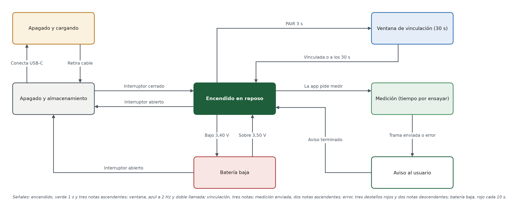

**Figura 2.0 “Estados de operación del equipo”**

La operación en terreno involucra a cuatro actores. Con la cuenta y el equipo previamente registrados, la captura, la interpretación local y el guardado funcionan sin cobertura. La consulta meteorológica y el respaldo usan red; un pronóstico guardado sólo se reutiliza si resulta aplicable a la captura.

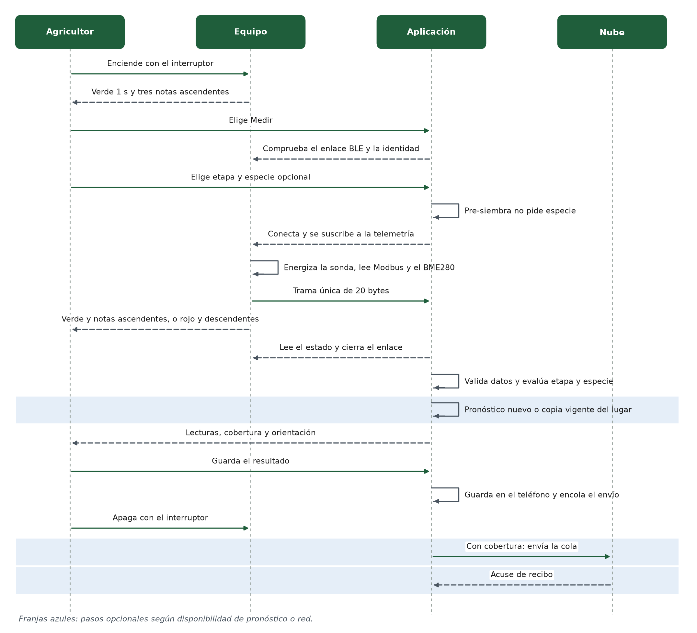

**Figura 2.1 “Secuencia de una jornada de medición”**

### Capacidades y características

Una sola ficha técnica reúne las capacidades del producto y del servicio, con el origen de cada cifra y su estado. La columna de estado distingue cuatro grados que el informe no mezcla en ningún otro lugar: **declarado**, cuando la cifra la afirma la hoja de datos o el manual del fabricante y todavía no se ha comprobado sobre el equipo armado; **diseñado**, cuando es un cálculo o una decisión del proyecto; **implementado**, cuando existe en la placa, el firmware o la aplicación y funciona, pero sin un ensayo con criterio de aceptación; y **verificado**, cuando un ensayo con criterio de aceptación se ejecutó y dejó registro, caso en el que se cita su identificador. Una especificación declarada por el fabricante no es una capacidad verificada del instrumento, y el informe no la presenta como tal. Los rangos de la sonda provienen del manual de su fabricante, ComWinTop, para el modelo cotizado y adquirido, la CWT-Soil-NPKPHCTH-S (anexo A) [20], y los del BME280 de su hoja de datos [13].

| Parámetro | Valor | Fuente | Estado |
|---|---|---|---|
| Variables de suelo | 7: humedad volumétrica, temperatura, CE, pH, N, P y K | Manual de la sonda [20] | **Implementado** en el firmware; ensayo D-14 con avance parcial (primera lectura Modbus válida con CRC el 03-10-2026) y exactitud en suelo pendiente de la campaña de laboratorio |
| Humedad volumétrica | 0–100 %, ±2 % entre 0 y 50 % y ±3 % entre 50 y 100 % | Manual de la sonda | **Declarado** por el manual de la sonda; se contrasta en D-13 y en la campaña de validación |
| Temperatura del suelo | −40 a +80 °C; ±5 °C a 25 °C según la publicación del fabricante | Ficha de la sonda [20] | **Declarado** por el fabricante; la adquisición está implementada y el desempeño del equipo se contrasta en la campaña de validación |
| Conductividad eléctrica | 0–20.000 µS/cm, ±3 % hasta 10.000 µS/cm y ±5 % sobre ese valor | Manual de la sonda | **Declarado** por el manual de la sonda; se contrasta en la campaña de validación |
| pH | 3,0–9,0, ±0,3 | Manual de la sonda | **Declarado** por el manual de la sonda; se contrasta en la campaña de validación |
| N, P y K | 1–1.999 mg/kg cada uno, resolución de 1 mg/kg, ±2 % de la escala completa según el fabricante; derivados de la CE, registros informativos | Manual de la sonda | **Declarado** por el manual de la sonda; sin medición químicamente independiente, se conservan como registros informativos y no se validan como concentraciones |
| Variables ambientales | 3: temperatura del aire −40 a +85 °C (±1,0 °C), humedad relativa 0–100 % (±3 %), presión 300–1.100 hPa (±1,0 hPa) | Hoja de datos del BME280 [13] | **Declarado** por la hoja de datos del BME280; se contrasta contra patrón en F-08 |
| Batería en la trama | 1 (porcentaje con curva típica de LiPo, sin calibrar) | Firmware | **Implementado** en el firmware; la curva se calibra en D-10 |
| Resolución de la trama | Humedad 0,1 %; temperatura de suelo 0,1 °C; pH 0,1; CE 1 µS/cm; temperatura del aire 0,1 °C; humedad relativa 0,5 %; presión 1 hPa | Contrato de la trama de 20 bytes | **Verificado** en W-01: el decodificador reproduce el vector del contrato |
| Ciclo de medición | 16 s: 12 s de anuncio y conexión, 3 s de adquisición, 1 s de envío | Modelo de diseño | **Diseñado**; se cronometra en F-07 |
| Tensiones del equipo | VBUS (línea de 5 V del conector USB) 5 V; celda 3,0 a 4,2 V; riel de 3,3 V; 5 V de la sonda (≈ 5,00 V) | Arquitectura del instrumento (Tabla 8.0) | **Diseñado**; se mide en D-03, D-04 y D-05 |
| Celda | LiPo 3,7 V y 2.000 mAh (≈ 7,4 Wh) con protección incluida | Decisión del proyecto | **Diseñado**; certificados del proveedor pendientes en N-06 |
| Autonomía en uso habitual | ≈ 125,6 días (≈ 17,9 semanas) calculados con el modelo energético del instrumento; requerimiento R07: al menos 8 semanas | Modelo energético del instrumento | **Diseñado**: calculada con el modelo energético y sin medición en banco; se mide en D-07 y D-08 |
| Tiempo de carga | ≈ 5 a 5,5 h con 444 mA desde 3,0 V | Cálculo de Tabla 8.0 | **Diseñado**; se mide en D-15 |
| Memoria del equipo | 520 KB de SRAM y 4 MB de flash; no guarda mediciones ni historial | Hoja del módulo [61] | **Declarado** por la hoja del módulo |
| Almacenamiento de datos | En el teléfono (persistente, con cola de envío) y respaldo en la nube | Aplicación | **Implementado**; W-01 verifica la lógica en computador (436 de 436 pruebas). T-01 comprueba el recorrido sobre teléfono físico |
| Enlace BLE | Bluetooth 4.2 (BR/EDR y BLE), GATT (perfil de atributos genéricos), trama de 20 bytes en una notificación; alcance objetivo 10 m | Hoja del módulo [61] y contrato BLE | **Implementado**: la trama corre en el equipo; el alcance es **diseñado** y se mide en S-06 |
| Potencia de transmisión | +9 dBm (≈ 8 mW), presupuesto de diseño | Hoja del módulo | **Declarado** por la hoja del módulo; se mide en N-05 |
| Bus de la sonda | RS-485 con Modbus RTU: 4.800 baudios, 8 bits, sin paridad y 1 bit de parada, dirección 1 y función 03 de fábrica; la sonda admite reconfigurarse a 2.400 o 9.600 baudios. El driver consulta a 4.800 y, si no hay respuesta, a 9.600 | Manual de la sonda [20] y Modbus V1.1b3 [32] | **Implementado**; D-14 con avance parcial y las 1.000 lecturas consecutivas pendientes |
| Bus ambiental | I²C a 100 kHz (400 kHz admitidos), BME280 en la dirección 0x76 o 0x77 | Hoja del BME280 | **Implementado** en el firmware |
| USB | USB 2.0 Full Speed por un puente USB-serie; carga y programación, no transporta mediciones | Hoja del CH340C [62] | **Diseñado** |
| Identidad | ID de 15 dígitos derivado de la dirección física; no se guarda ni cambia | Firmware | **Implementado** en el firmware; se audita en F-04 |
| Interfaz | 3 LED (azul, verde, rojo), buzzer pasivo a 2,7 kHz y pulsador PAIR (3 s abre 30 s) | Firmware | **Implementado** en el firmware; se recorre en F-09 |
| Aviso de batería | Equipo: bajo 3,40 V con rearme sobre 3,50 V; aplicación: 15 % con rearme sobre 20 % | Firmware y aplicación | **Implementado** en el firmware y en la aplicación; se mide en F-12 |
| Temperatura | Operación de −5 a +50 °C; carga de 0 a 45 °C (límite de la celda) | Hojas del módulo y del cargador | **Diseñado**; se ensaya en N-03 |
| Grado de protección | Objetivo IP67; se declara «objetivo de diseño IP67» hasta aprobar el ensayo acreditado | Diseño de la carcasa | **Diseñado**: se declara «objetivo de diseño IP67» hasta aprobar el ensayo acreditado N-01 |
| Dimensiones | 99 × 87 × 31 mm, para una placa de 90 × 64 mm | Plano de la carcasa (anexo D) | **Diseñado** sobre el plano de la carcasa |
| Masa | ≈ 516 g sin embalaje (carcasa 210 g, sonda con cable 180 g, celda 38 g, placa 27 g, componentes ≈ 21 g y montaje 40 g); estimación sin pesar el prototipo | Diseño | **Diseñado**: estimación por componente, sin pesar el prototipo |
| Aplicación | Android e iOS, español e inglés, offline primero, accesibilidad con contraste 4,5:1 y área táctil de 48 dp | Aplicación | **Implementado**; W-01 verifica su lógica en computador (436 de 436 pruebas), y T-01 a T-05 comprueban el recorrido sobre teléfonos físicos |
| Backoffice | Consola web de soporte (cuenta única): búsqueda, ficha, aprobación, reset y catálogo de firmware | Consola web | **Implementado**; W-02 verifica ocho casos de presentación y formato. La aceptación del aislamiento por cuenta corresponde a W-04 |
| Servicio | Garantía legal de 6 meses [40], celda extraíble, un solo canal de soporte, sin cuotas | Plan de servicio | **Diseñado** |
| Actualización de firmware | Por BLE desde la aplicación; el catálogo existe y la recepción en el equipo requiere particiones, transporte, verificación de integridad y recuperación ante interrupciones | Plan de firmware | **Diseñado** y no implementado: no se declara como capacidad del producto hasta implementar y ensayar la transferencia, la integridad y la recuperación ante interrupciones |

**Tabla 6.5 “Ficha técnica del producto y del servicio”**

Las exactitudes del BME280 corresponden a condiciones específicas [13]: ±1 °C entre 0 y 65 °C, ±3 puntos de humedad relativa entre 20 y 80 % a 25 °C, y ±1 hPa entre 300 y 1.100 hPa y entre 0 y 65 °C. Los ensayos deben registrar esas condiciones y evaluar separadamente los extremos de uso. La resolución de la trama no equivale a exactitud. Las especificaciones corresponden al modelo identificado en la compra; una ficha de otra variante no constituye evidencia de exactitud para ese modelo.

Los límites de producto que el cliente debe conocer quedan así: el equipo mide siete variables de suelo y tres ambientales (la adquisición de suelo está implementada, con una primera lectura válida en banco), pero no entrega concentraciones de nutrientes; la recomendación es cualitativa, por etapa y especie opcional; renovar el pronóstico depende de red y ubicación, y reutilizarlo exige vigencia y cercanía; y la estanqueidad IP67 es un objetivo de diseño que se certifica con el ensayo acreditado.

### Interpretación agronómica por etapa y especie

La aplicación distingue cuatro etapas y conserva la especie sólo para la medición en curso. En vegetativo, floración y cosecha permite buscar por nombre común, científico o sinónimo, o continuar sin especie con una evaluación general. Cada medición nueva parte sin especie seleccionada; cambiar a pre-siembra también elimina la selección. El catálogo vigente reúne 111 especies de hortalizas, frutales, berries, cereales y otros cultivos, forrajeras, aromáticas y forestales. Disponer de un perfil no significa que todas sus variables tengan umbrales validados: cada criterio conserva su fuente, etapa, alcance y, cuando corresponde, la analogía con otra especie.

En pre-siembra no se exige elegir un cultivo. Se comparan temperatura y pH del suelo con 32 perfiles de establecimiento correspondientes a 31 especies, diferenciando siembra, trasplante, tubérculo o plantación perenne. Las coincidencias son parciales y orientativas, no una garantía de aptitud del terreno. La conductividad medida directamente no se convierte en salinidad de un extracto de laboratorio ni se usa para excluir cultivos sin acreditar la compatibilidad del método; N, P y K no intervienen en la selección ni en dosis de fertilización.

El diagnóstico diferencia disponibilidad del dato, calidad de la captura y posibilidad de interpretación. Cuando faltan criterios o datos suficientes, indica que ese aspecto no se pudo evaluar; ausencia de alertas no equivale a condición favorable. El flujo no solicita ni infiere textura, por lo que no atribuye un umbral hídrico específico a un suelo desconocido. Las recomendaciones conservan las razones, las observaciones y las limitaciones de las reglas aplicadas.

El ambiente procede del sensor del equipo. Con temperatura y humedad válidas pueden calcularse indicadores continuos, como déficit de presión de vapor y punto de rocío, sin presentarlos como sensores adicionales. Los criterios de frío compatibles pueden utilizar el aire medido aunque no haya red; una lectura puntual no demuestra ausencia de heladas futuras ni permite reconstruir el clima diario. El pronóstico distingue condiciones actuales, lo que resta del día y cinco fechas futuras, con cobertura parcial explícita. La aplicación puede reutilizar una consulta de la misma cuenta con antigüedad de hasta tres horas y distancia de hasta un kilómetro; fuera de esas condiciones no incorpora esa copia al diagnóstico.

Al guardar, se conserva una instantánea con etapa, especie o ausencia explícita, lecturas, razones, cobertura y versiones. El historial muestra la interpretación guardada y no asigna retrospectivamente otra especie. La cola persiste antes del envío y cada medición conserva un identificador estable para que los reintentos actualicen el mismo registro; su integridad con cierre forzado, cortes de red y recuperación se acepta mediante T-01, S-04 y S-07, además de las pruebas automatizadas de lógica.

El firmware energiza la sonda, espera la estabilización, consulta por Modbus a 4.800 baudios y dispone de intentos a 9.600; verifica estructura, CRC y rangos antes de publicar suelo. Si la batería no es válida, descarta el suelo de esa captura; si falta ambiente, conserva los centinelas. El controlador ambiental distingue BME280 de BMP280: este último puede aportar temperatura y presión, pero no humedad. La observación de banco documentada corresponde a un BMP280 y no verifica las tres variables exigidas al BME280 del producto. El monitor de mantenimiento permite revisar batería, luces, sonidos, ambiente y bus sin publicar esas pruebas locales como mediciones del usuario.

### Requerimientos técnicos y matrices de decisión por componente

Cada bloque del equipo recorre el mismo formato: el requisito que debe cumplir (tensión, corriente, encapsulado soldable, temperatura, disponibilidad en LCSC o DigiKey, ciclo de vida y costo), de dos a tres alternativas reales con criterios ponderados (escala de 1 a 10, la misma de la matriz de arquitecturas) y una frase de justificación. Los puntajes son juicio de diseño sobre datos de hoja de datos y de catálogo; cuando una diferencia es menor que la incertidumbre de los puntajes, se dice. El anexo A contiene los precios de los elementos seleccionados y menciona alternativas; no constituye una cotización comparativa completa de todas ellas.

**Microcontrolador, por nivel de integración.** El ESP32 ya está decidido a nivel de familia; falta decidir en qué forma se compra. Requisito: alimentación de 3,0 a 3,6 V, Bluetooth 4.2 compatible con Android e iOS, antena y radio certificadas, soldable como componente de montaje superficial y disponible para producción.

| Criterio | Peso | Circuito integrado ESP32-D0WD (QFN) | Módulo ESP32-WROOM-32D | Placa de desarrollo ESP32-DevKitC (opción de prototipo) |
|---|---:|---:|---:|---:|
| Radio y antena certificadas | 25 % | 3 | 10 | 10 |
| Esfuerzo y riesgo de diseño de la placa | 20 % | 2 | 8 | 10 |
| Consumo propio en estados de ahorro | 15 % | 10 | 9 | 3 |
| Disponibilidad para producción (LCSC o DigiKey) | 20 % | 6 | 9 | 4 |
| Costo por unidad | 10 % | 9 | 8 | 7 |
| Continuidad del firmware y de los pines | 10 % | 4 | 10 | 10 |
| **Puntaje ponderado** | 100 % | 5,15 | **9,05** | 7,45 |

**Tabla 6.6 “Matriz de decisión del ESP32 por nivel de integración”**

**El módulo ESP32-WROOM-32D porque trae la radio, el cristal, la memoria flash de 4 MB y la antena impresa ya certificados, y se suelda como un componente más.** El circuito integrado desnudo (QFN de 5 × 5 mm) no trae antena, flash ni cristal: obligaría a diseñar la red de adaptación y la antena y a certificar la radiofrecuencia desde cero. La placa de desarrollo es un módulo de desarrollo: su abastecimiento no está asegurado para producción, ocupa espacio y su regulador consume del orden de 6 mA aunque el microcontrolador duerma [48, 49]. El módulo se conecta con sus contactos laterales a la placa, conserva el firmware y los pines actuales y exige una fuente de al menos 500 mA [61]. Riesgo declarado: Espressif no recomienda el 32D para diseños nuevos; su reemplazo directo, de igual huella y pines (18 × 25,5 mm), es el ESP32-WROOM-32E [63]. Si el 32D se discontinúa, el 32E entra sin cambiar la placa ni el firmware; su ciclo de vida se confirma contra la ficha del fabricante antes de cada orden de compra.

**Sonda de suelo.** Requisito: siete variables por RS-485, alimentación desde el elevador de 5 V, material resistente a los cloruros del suelo y costo por variable viable. La comparación cualitativa de la ingeniería conceptual (Tabla 1.6) justifica ensayar la sonda 7-en-1; su exactitud en suelo la acredita la campaña de laboratorio.

| Requisito | Valor exigido | Qué declara la sonda elegida | Cómo se verifica |
|---|---|---|---|
| Interfaz | RS-485 con Modbus RTU | RS-485 Modbus RTU a 4.800 baudios, dirección 1 [20] | Ensayo del bus con analizador lógico |
| Variables | 7 de suelo | Humedad, temperatura, CE, pH, N, P y K | Campaña de 30 puntos contra laboratorio |
| Alimentación | 5 V del elevador (4,75 a 5,25 V) | 4,5 a 30 V [20] | Exactitud a 5 V en ensayo de banco; contingencia: elevador de 12 V detrás del mismo corte |
| Consumo | 30 mA a 5 V (supuesto de 150 mW constantes) | 0,5 W como máximo a 24 V [20]; una sonda equivalente declara 0,15 W a 12 V [50] | Medición en banco a 5 V |
| Material | Resistencia a la corrosión por cloruros | Acero inoxidable 316L (declaración del vendedor) | Certificado de material o ensayo |

**Tabla 6.7 “Requisitos técnicos de la sonda de suelo”**

**Esta sonda porque entrega las siete variables por RS-485 y funciona desde 5 V**; la alternativa de investigación requiere una cotización de alcance equivalente. La sonda cotizada es la ComWinTop CWT-Soil-NPKPHCTH-S, de siete variables (humedad, temperatura, CE, pH, N, P y K) [20]: $34.700 más $9.694 de envío a Chile, sin IVA (anexo A). La muestra ya adquirida confirma el modelo, y su manual fija la alimentación desde 4,5 V, el bus a 4.800 baudios y los colores del cable. Queda el ensayo en banco a 5 V: que la muestra responda por el bus y entregue lecturas estables a esa tensión.

**Sensor ambiental.** Requisito: temperatura, humedad relativa y presión en un solo componente, alimentación de 3,3 V por I²C, encapsulado soldable con esténcil y disponibilidad en el catálogo de montaje de placas.

| Criterio | Peso | BME280 (circuito integrado LGA-8) | SHT40 más BMP280 (dos circuitos integrados) | Módulo BME280 de desarrollo |
|---|---:|---:|---:|---:|
| Mide temperatura, humedad y presión en un componente | 30 % | 10 | 5 | 10 |
| Alimentación 1,71 a 3,6 V e I²C | 10 % | 10 | 10 | 7 |
| Disponibilidad en catálogo de montaje | 20 % | 9 | 8 | 3 |
| Facilidad de montaje | 15 % | 6 | 5 | 9 |
| Exactitud de temperatura | 10 % | 6 | 9 | 6 |
| Costo | 15 % | 8 | 6 | 7 |
| **Puntaje ponderado** | 100 % | **8,50** | 6,65 | 7,30 |

**Tabla 6.8 “Matriz de decisión del sensor ambiental”**

**El BME280 como circuito integrado porque mide las tres magnitudes en un solo componente de 3,3 V con I²C y está en el catálogo de montaje.** El SHT40 es más exacto en temperatura (±0,2 °C frente a ±1,0 °C) pero no mide presión, y el módulo de desarrollo no tiene abastecimiento asegurado. Su cápsula LGA de 2,5 × 2,5 mm no se puede soldar a mano: exige esténcil y horno o placa calefactora, o el montaje del fabricante, lo que decide el método de ensamble del capítulo VIII.

**Cargador de la celda.** Requisito: entrada de 5 V desde USB, carga de corriente y tensión constantes hasta 4,20 V para una celda de litio de una serie, corriente programable de hasta 0,5 C, terminación automática y encapsulado soldable.

| Criterio | Peso | TP4056 (ESOP-8) | MCP73831 (SOT-23-5) | BQ24074 (VQFN-16) |
|---|---:|---:|---:|---:|
| Corriente programable hasta 1 A | 20 % | 10 | 6 | 10 |
| Entrada de 4,0 a 8,0 V desde USB | 10 % | 10 | 9 | 9 |
| Disponibilidad en catálogo | 25 % | 10 | 7 | 5 |
| Costo | 15 % | 10 | 8 | 4 |
| Ruta de potencia integrada | 15 % | 3 | 3 | 10 |
| Disipación térmica | 15 % | 5 | 7 | 7 |
| **Puntaje ponderado** | 100 % | **8,20** | 6,55 | 7,30 |

**Tabla 6.9 “Matriz de decisión del cargador de la celda”**

**El TP4056 porque entrega la corriente de carga programable que la celda de 2.000 mAh necesita, trabaja con los 5 V del puerto USB y es el más disponible y barato.** El BQ24074 es superior en gestión de ruta de potencia (alimenta el sistema y carga la celda a la vez), pero cuesta más y su encapsulado sin patas es más difícil de abastecer y de retrabajar; esa función se resuelve en el TP4056 con un P-MOSFET y un diodo Schottky. La protección de sobrecarga, sobredescarga y cortocircuito la trae la celda, no el cargador.

**Regulador de 3,3 V.** Requisito: alimentar el módulo ESP32, el BME280 y el transceptor desde la celda (3,0 a 4,2 V) o desde USB, con corriente propia mínima y al menos 500 mA de salida, porque el módulo lo exige y el pico de transmisión BLE ronda los 150 mA.

| Criterio | Peso | RT9080-33 (LDO, TSOT-23-5) | ME6211C33 (LDO, SOT-23-5) | TPS63001 (convertidor reductor-elevador) |
|---|---:|---:|---:|---:|
| Corriente propia (Iq) baja | 25 % | 10 | 6 | 4 |
| Caída de tensión pequeña con la celda baja | 25 % | 7 | 7 | 10 |
| Corriente de salida de 500 mA o más | 15 % | 9 | 8 | 10 |
| Disponibilidad en catálogo | 20 % | 8 | 10 | 6 |
| Costo | 15 % | 8 | 10 | 4 |
| **Puntaje ponderado** | 100 % | **8,40** | 7,95 | 6,80 |

**Tabla 7.0 “Matriz de decisión del regulador de 3,3 V”**

**El RT9080-33 porque tiene una corriente propia de unos 2 µA y entrega 600 mA, con una caída de 0,31 V típica y 0,53 V máxima a plena corriente [64].** Es un LDO (*Low Dropout*, regulador lineal de baja caída). El ME6211 queda a menos de medio punto y es la alternativa de abastecimiento, con la misma huella: tiene entre 40 y 60 µA de corriente propia y 500 mA [65]. El convertidor reductor-elevador TPS63001 regula 3,3 V incluso con la celda baja, pero consume decenas de microamperes y cuesta más; se descarta porque la caída del LDO es de apenas 0,1 V a 150 mA y el módulo funciona hasta 3,0 V.

**Elevador de 5 V de la sonda.** Requisito: 5 V (4,75 a 5,25 V) para la sonda desde una celda de 3,0 a 4,2 V, con 30 mA nominales y una cota de 150 mA, un pin de habilitación (EN) que gobierne el microcontrolador y un corte que deje la sonda en 0 V fuera de la medición.

| Criterio | Peso | MT3608 (SOT-23-6) | TPS61023 (SOT-583) | SX1308 (SOT-23-6) |
|---|---:|---:|---:|---:|
| Pin de habilitación EN | 25 % | 10 | 10 | 10 |
| Corriente de apagado baja | 15 % | 6 | 10 | 6 |
| Eficiencia | 15 % | 8 | 9 | 8 |
| Disponibilidad en catálogo | 25 % | 10 | 7 | 9 |
| Costo | 20 % | 10 | 6 | 10 |
| **Puntaje ponderado** | 100 % | **9,10** | 8,30 | 8,85 |

**Tabla 7.1 “Matriz de decisión del elevador de 5 V”**

**El MT3608 porque tiene pin EN, límite de corriente de 4 A y es el más disponible y barato [66].** El TPS61023 es mejor en corriente de apagado y eficiencia, pero más caro y menos disponible. El MT3608 tiene una limitación que decide el resto del bloque: **no desconecta la carga con EN en nivel bajo**, porque queda un camino por la bobina y el diodo y la salida se queda en ≈ VBAT menos la caída del diodo (unos 3,4 V). Por eso la placa del instrumento **corta la sonda con un P-MOSFET en serie**: un P-MOSFET AO3401A en serie con la salida de 5 V, cuya compuerta conmuta un N-MOSFET AO3400A. El mismo pin IO5 gobierna el EN del elevador y la compuerta del AO3400A: con IO5 en alto el elevador arranca y el AO3401A conduce; con IO5 en bajo el elevador deja de conmutar y el AO3401A abre el circuito, de modo que la sonda queda en 0 V. Una resistencia de 4,7 kΩ a tierra en IO5 mantiene ambos apagados mientras arranca el microcontrolador. El par cuesta ≈ $136 por equipo con sus resistencias, conserva el pin y el firmware vigentes y permite especificar el corte, que debe verificarse en el prototipo.

**Transceptor RS-485.** Requisito: alimentación de 3,3 V sin adaptar niveles hacia el microcontrolador, velocidad muy sobre los 4.800 o 9.600 baudios de la sonda, consumo bajo y encapsulado soldable.

| Criterio | Peso | SP3485EN (SOIC-8) | MAX3485 (SOIC-8) | THVD1410 (SOIC-8) |
|---|---:|---:|---:|---:|
| Alimentación de 3,3 V directa | 30 % | 10 | 10 | 10 |
| Velocidad sobre 9.600 baudios | 10 % | 10 | 10 | 9 |
| Consumo | 15 % | 7 | 7 | 9 |
| Disponibilidad en catálogo | 25 % | 9 | 9 | 7 |
| Costo | 20 % | 8 | 6 | 5 |
| **Puntaje ponderado** | 100 % | **8,90** | 8,50 | 8,00 |

**Tabla 7.2 “Matriz de decisión del transceptor RS-485”**

**El SP3485 porque trabaja a 3,3 V, tolera 10 Mbps y consume unos 2 mA con el driver activo [24].** Es el mismo circuito del prototipo, de modo que el firmware y la polaridad del bus no cambian. El THVD1410 consume menos pero es menos disponible; el MAX3485 es equivalente en función y queda como alternativa de abastecimiento.

**Puente USB-serie.** Requisito: programar y monitorear el microcontrolador por el mismo conector USB-C que carga la celda, sin cristal externo y con autoprogramación (líneas DTR y RTS hacia EN e IO0).

| Criterio | Peso | CH340C (SOIC-16) | CH340K (ESSOP-10) | CP2102N (QFN-28) |
|---|---:|---:|---:|---:|
| Sin cristal externo | 20 % | 10 | 10 | 10 |
| Alimentación directa de 5 V del puerto | 10 % | 10 | 10 | 7 |
| Encapsulado soldable | 15 % | 9 | 6 | 4 |
| Disponibilidad en catálogo | 25 % | 10 | 8 | 8 |
| Costo | 30 % | 10 | 9 | 4 |
| **Puntaje ponderado** | 100 % | **9,85** | 8,60 | 6,50 |

**Tabla 7.3 “Matriz de decisión del puente USB-serie”**

**El CH340C porque no necesita cristal, se alimenta de los 5 V del puerto y su encapsulado SOIC-16 se suelda con esténcil o a mano [62].** El CP2102N es más robusto pero cuesta varias veces más. El puente se alimenta sólo desde VBUS: sin cable USB no consume nada de la celda.

**Celda.** Requisito: energía suficiente para semanas de uso, carga por USB con un solo circuito integrado, protección integrada, descarga hasta −20 °C y volumen que quepa bajo la placa.

| Criterio | Peso | LiPo 3,7 V 2.000 mAh con protección | Li-ion 18650 con portapilas | Tres pilas AAA alcalinas |
|---|---:|---:|---:|---:|
| Energía por volumen | 25 % | 8 | 9 | 3 |
| Carga de una serie con un circuito integrado | 20 % | 10 | 10 | 1 |
| Protección integrada en la celda | 20 % | 9 | 5 | 7 |
| Temperatura de descarga | 10 % | 6 | 6 | 4 |
| Cabe en la carcasa | 10 % | 9 | 5 | 5 |
| Costo | 15 % | 7 | 6 | 8 |
| **Puntaje ponderado** | 100 % | **8,35** | 7,25 | 4,45 |

**Tabla 7.4 “Matriz de decisión de la celda de energía”**

**La LiPo de 3,7 V y 2.000 mAh con protección incluida porque aporta unos 7,4 Wh en 10 × 34 × 54 mm y se carga por USB.** Como la protección de sobrecarga, sobredescarga y cortocircuito viene en la celda, no se duplica en la placa (no llevan DW01A ni FS8205A). La celda debe traer su certificación IEC 62133-2 [28].

**Indicadores.** Requisito: informar sin pantalla con un significado por color, consumo nulo en reposo y vinculación con un gesto físico.

| Criterio | Peso | Tres LED, buzzer pasivo y pulsador | LED RGB y buzzer activo | Pantalla OLED |
|---|---:|---:|---:|---:|
| Consumo en reposo | 25 % | 10 | 10 | 5 |
| Señales distintas sin pantalla | 25 % | 9 | 6 | 9 |
| Estanqueidad | 20 % | 9 | 9 | 3 |
| Legibilidad al sol | 15 % | 6 | 6 | 4 |
| Costo | 15 % | 9 | 8 | 5 |
| **Puntaje ponderado** | 100 % | **8,80** | 7,90 | 5,45 |

**Tabla 7.5 “Matriz de decisión de la interfaz de usuario”**

**Tres LED y un buzzer pasivo porque no consumen en reposo y permiten seis patrones sonoros diferenciados con tono y color.** Un buzzer activo tiene un solo tono; la pantalla consume y abre una ventana de ingreso de agua. En la placa del instrumento el buzzer se maneja con un transistor y un diodo de rueda libre, lo que cierra el riesgo de corriente por el pin del microcontrolador que tenía la placa de laboratorio.

**Interruptor, prensaestopa, respiradero y tapón, según el grado IP.** PG7 es una medida normalizada de prensaestopa y M3, M6 y M12 designan el diámetro nominal, en milímetros, de una rosca métrica. Cada penetración de la carcasa es un punto por el que puede entrar agua, de modo que el requisito común es IP67 como mínimo.

| Elemento | Requisito | Alternativas | Elegido | Justificación |
|---|---|---|---|---|
| Interruptor general | IP67 en el vástago; accionable con guantes | Palanca con capuchón de goma; deslizante sin sello; pulsador con retención | Palanca mini de panel con capuchón estanco (rosca de 6 mm) | Porque el capuchón sella el vástago y la palanca se maneja con guantes |
| Salida del cable de la sonda | IP67 mínimo y alivio de tracción | Prensaestopa PG7 IP68; prensaestopa plástico genérico IP54; pasacable de goma | Prensaestopa PG7 IP68 con tuerca (cables de 3 a 6,5 mm) | Porque es IP68 y evita que un tirón llegue a las soldaduras |
| Respiradero del BME280 | Deja pasar aire y vapor y detiene el agua líquida | Respiradero M12 × 1,5 con membrana ePTFE; orificio con malla; sin respiradero | Respiradero M12 × 1,5 con membrana ePTFE | Porque ventila el sensor sin romper el IP67; sin respiradero el BME280 mediría el interior de la caja |
| Puerto USB-C | Cerrado cuando no se carga | Tapón de silicona; tapa impresa; conector USB-C IP67 | Tapón de silicona | Porque es el más barato y no exige cambiar el conector |

**Tabla 7.6 “Selección de interruptor, prensaestopa, respiradero y tapón por grado IP”**

**Material de la carcasa.** Requisito (el PETG es plástico PET modificado con glicol y el ASA, acrilonitrilo estireno acrilato): resistencia a la radiación UV y a una temperatura interior de unos 60 °C al sol, estanqueidad de la impresión, resistencia a caídas e imprimibilidad en la impresora del taller.

| Criterio | Peso | PETG | ASA | PLA | ABS |
|---|---:|---:|---:|---:|---:|
| Resistencia a UV y a la intemperie | 20 % | 7 | 10 | 3 | 4 |
| Temperatura (transición vítrea) | 15 % | 6 | 8 | 3 | 8 |
| Estanqueidad de la impresión | 20 % | 8 | 7 | 6 | 6 |
| Facilidad de impresión | 20 % | 9 | 6 | 10 | 5 |
| Resistencia al impacto | 15 % | 8 | 7 | 3 | 8 |
| Costo | 10 % | 8 | 6 | 10 | 7 |
| **Puntaje ponderado** | 100 % | **7,70** | 7,45 | 5,70 | 6,10 |

**Tabla 7.7 “Matriz de decisión del material de la carcasa”**

**El PETG porque se imprime con facilidad, sella bien entre capas y resiste los golpes, con una transición vítrea de unos 80 °C.** El ASA es superior en radiación UV y en temperatura: al subir UV de 20 a 30 % y bajar facilidad de impresión de 20 a 10 %, manteniendo 100 % total, ASA obtiene 7,85 y PETG 7,50, y por eso queda como contingencia explícita. Si el ensayo de temperatura o la exposición al sol dañan la carcasa de PETG, se cambia a ASA en la misma impresora de cámara cerrada, sin cambiar el diseño. El PLA se descarta por su baja temperatura de transición y el ABS por sus emanaciones y su deformación al enfriarse.

**Impresora 3D del taller.** Requisito: cámara cerrada para imprimir PETG o ASA sin deformaciones, volumen que permita varias carcasas por cama y precio puesto en Chile.

| Criterio | Peso | Creality K1C (220 × 220 × 250 mm) | Bambu Lab P1S (256 × 256 × 256 mm) | Prusa Core One (250 × 220 × 270 mm) |
|---|---:|---:|---:|---:|
| Cámara cerrada | 20 % | 10 | 10 | 10 |
| Volumen útil | 20 % | 7 | 9 | 9 |
| Precio puesto en Chile | 30 % | 9 | 6 | 4 |
| Repuestos, soporte y ecosistema | 20 % | 6 | 8 | 7 |
| Velocidad de impresión | 10 % | 9 | 8 | 8 |
| **Puntaje ponderado** | 100 % | **8,20** | 8,00 | 7,20 |

**Tabla 7.8 “Matriz de decisión de la impresora 3D”**

**La Creality K1C porque tiene cámara cerrada y el menor precio de lista registrado de las tres: US$399, frente a US$579 de la Bambu Lab P1S y US$1.299 de la Prusa Core One armada (tiendas oficiales, consulta del 02-10-2026).** Es un empate técnico con la Bambu Lab P1S: la diferencia de puntaje es menor que la incertidumbre de los puntajes, y la inclina el precio, US$180 menos por impresora y US$360 en las dos del taller. Su volumen de 220 × 220 mm es el menor de las tres, por lo que la cantidad de carcasas por cama se calcula en el capítulo VIII con la huella conservadora de 110 × 100 mm de la carcasa de laboratorio, mantenida como base del presupuesto.

### Arquitectura eléctrica de la placa del instrumento

La placa del instrumento reúne todos los circuitos como componentes soldados y conserva el contrato de pines del firmware actual para no reabrirlo. Su estado es **de diseño**: la placa está ruteada y sus vistas están en el anexo C, y la placa se fabrica para el prototipo de diciembre de 2026. La figura siguiente muestra el diagrama de bloques; la que sigue, el árbol de alimentación, del producto. En ellas, PTC es un resistor de coeficiente de temperatura positivo que actúa como fusible rearmable y TVS, un supresor de tensiones transitorias.

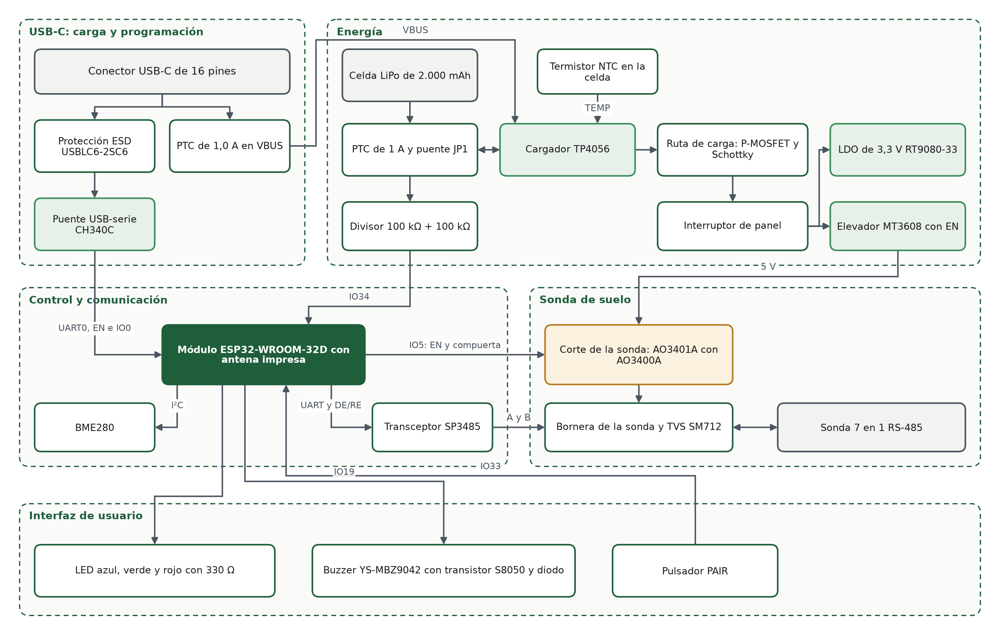

**Figura 2.2 “Diagrama de bloques del hardware del instrumento”**

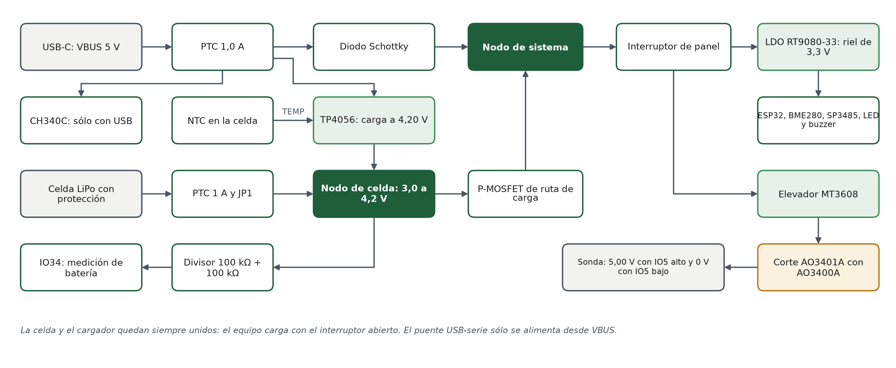

**Figura 2.3 “Árbol de alimentación del instrumento”**

Cuatro decisiones del árbol explican su forma. Primero, **la celda y el cargador están siempre conectados entre sí**, de modo que el equipo se carga con el interruptor abierto; el interruptor corta la entrada del sistema, no la celda. Segundo, **la ruta de carga** (un P-MOSFET entre la celda y el sistema, gobernado por VBUS, más un diodo Schottky desde VBUS) alimenta el sistema desde USB mientras carga: sin ella, la carga del sistema engañaría al cargador, que nunca vería caer la corriente bajo su umbral de término. Tercero, **el LDO y el elevador cuelgan del mismo nodo**: la rama de 3,3 V se alimenta directamente desde la celda a través del regulador lineal. Cuarto, **el puente USB sólo se alimenta desde VBUS**: sin cable no consume nada de la celda.

La asignación de pines del instrumento es compatible con el firmware del prototipo. IO5 gobierna el corte de la sonda y la habilitación del elevador; el puerto USB utiliza las señales de programación y comunicación indicadas en la tabla.

| Función | Pin del ESP32 | Conexión en la placa del instrumento | Relación con el firmware | Estado |
|---|---|---|---|---|
| Medición de batería | IO34 (sólo entrada, ADC1) | Divisor de 100 kΩ + 100 kΩ desde el nodo de celda | Igual al firmware vigente | Implementado |
| Pulsador PAIR | IO33 | Pulsador a tierra con pull-up; activo en nivel bajo | Igual al firmware vigente | Implementado |
| LED azul | IO25 | Resistencia de 330 Ω y LED a tierra; activo en nivel alto | Igual al firmware vigente | Implementado |
| LED verde | IO26 | Ídem | Igual al firmware vigente | Implementado |
| LED rojo | IO27 | Ídem | Igual al firmware vigente | Implementado |
| Buzzer | IO19 | Base del transistor NPN S8050 con resistencia de 1 kΩ; resistencia de 47 Ω en serie con el buzzer y diodo de rueda libre 1N4148W | Pin mantenido; excitación nueva | Implementado; excitación de diseño |
| Bus I²C | SDA en IO21, SCL en IO22 | BME280 con pull-ups de 4,7 kΩ | Igual al firmware vigente | Implementado |
| Corte de la sonda y habilitación del elevador | IO5 (pin de arranque) | Entrada EN del MT3608 y compuerta del AO3400A que conmuta el AO3401A; resistencia de 4,7 kΩ a tierra | Pin del firmware vigente; nuevo el EN del elevador | De diseño |
| UART de la sonda | TX en IO17, RX en IO16 | Transceptor SP3485 | Igual al firmware vigente | De diseño; lectura inicial ensayada en banco de laboratorio |
| Dirección del bus RS-485 | IO4 | Terminales DE y RE (habilitación del driver y del receptor) unidos del SP3485 | Igual al firmware vigente | De diseño; lectura inicial ensayada en banco de laboratorio |
| USB-serie | IO1 (TX0) e IO3 (RX0) | CH340C; la línea TXD pasa por un divisor de 10 kΩ y 20 kΩ | Nuevo en el diseño | De diseño |
| Autoprogramación | EN e IO0 | Dos transistores NPN comandados por DTR y RTS del CH340C | Nuevo en el diseño | De diseño |
| Reinicio y arranque | EN e IO0 | Pulsadores de reinicio y de arranque; red de 10 kΩ y 1 µF en EN | Nuevo en el diseño | De diseño |

**Tabla 7.9 “Asignación de pines del módulo ESP32 en la placa del instrumento”**

El pin IO5 es de arranque: durante el reinicio, el pull-up interno del módulo lo lleva a nivel alto antes de que el programa lo fije. Con la resistencia de 4,7 kΩ a tierra el nodo queda en unos 0,3 V, bajo el umbral de encendido del elevador y bajo el umbral mínimo de compuerta del AO3400A (0,65 V), de modo que la sonda no se energiza durante el reinicio. Ese comportamiento es una hipótesis de diseño que el ensayo de arranque verifica con osciloscopio.

**Cálculos de dimensionamiento.** Cada cálculo lleva su fórmula, los datos de hoja de datos o de diseño y su margen. Los datos marcados como supuesto de diseño se confirman en los ensayos.

| Cálculo | Fórmula | Datos | Resultado | Margen o criterio |
|---|---|---|---|---|
| Tensión del elevador | Vout = 0,6 V · (1 + R1/R2) | R1 = 220 kΩ; R2 = 30 kΩ; referencia 0,6 V [66] | 5,00 V | Banda de la sonda 4,75 a 5,25 V; con resistencias de 1 % y referencia de ±2 %, ≈ ±0,2 V |
| Corriente de pico en la bobina | Ipico = Pout/(η · Vin) + ΔI/2, con ΔI = Vin · D/(f · L) y D = 1 − Vin/Vout | Vin = 3,0 V; Iout = 150 mA (cota de la sonda); η = 0,85; f = 1,2 MHz; L = 22 µH | ΔI = 45 mA; corriente media 0,29 A; Ipico ≈ 0,32 A | Bobina con corriente de saturación de 1 A o más (factor 3); límite del conmutador de 4 A (factor 12) |
| Diodo Schottky del elevador | IF = Iout; VR = Vout | 0,15 A y 5 V con un diodo SS34 de 3 A y 40 V | — | Factor 20 en corriente y 8 en tensión |
| Disipación del LDO | P = (Vsistema − 3,3 V) · I; ΔT = P · θJA | I = 150 mA (pico de transmisión BLE); 4,2 V con la celda llena y 4,5 V con USB; θJA ≈ 250 °C/W (supuesto, cobre mínimo) | 0,135 W con la celda llena y 0,18 W con USB; ΔT de 34 K y 45 K | Con 45 °C de ambiente la unión llega a 79 y 90 °C, bajo 125 °C; la transmisión dura 1 s de cada 16 s |
| Límite de regulación del LDO | Vin,mín = Vsalida + caída | Caída de 0,31 V típica y 0,53 V máxima a 600 mA [64], ≈ 0,1 V a 150 mA (estimada, proporcional) | 3,4 V para regular 3,3 V; 3,1 V para mantener 3,0 V | El aviso de 3,40 V coincide con el límite de regulación; el equipo sigue operando hasta ≈ 3,1 V (mínimo del módulo: 3,0 V) |
| Corriente desde la celda en el escenario nominal | I = I3,3V + Psonda/(η · Vcelda) + Ibuzzer | 0,150 A + 0,150 W/(0,85 · 3,0 V) + 0,052 A | 0,26 A | PTC de 1 A: factor 3,8 (3,1 con 20 % de reducción por temperatura) |
| Corriente de carga | Icarga = 1.200 V/RPROG [67] | RPROG = 2,7 kΩ | 444 mA (0,22 C) | Menos de 0,5 C (1,0 A) de la celda y de 0,5 A del puerto USB 2.0 con el sistema apagado |
| Tiempo de carga | t ≈ C/I más la fase de tensión constante | 2.000 mAh y 444 mA | 4,5 h más 0,5 a 1 h: ≈ 5 a 5,5 h | Cumple R08 (6 h o menos) |
| Disipación del TP4056 | P = (VBUS − Vcelda) · Icarga; ΔT = P · θJA | 5 V; 3,0 V; 0,444 A; θJA ≈ 40 °C/W con almohadilla soldada (supuesto) | 0,89 W; ΔT de 36 K | Con 45 °C de ambiente: 81 °C, bajo el límite térmico de 120 °C; a 1 A serían 2 W y el cargador reduciría su corriente |
| Ancho de pistas | I = k · ΔT^0,44 · A^0,725 (IPC-2221, k = 0,048 en capa externa, A en mil²) | 1 A; ΔT = 10 K; cobre de 35 µm | Ancho de 0,30 mm para 1 A y de 0,06 mm para 0,32 A | Pistas de potencia de 0,7 mm: factor 2,3 |
| Resistencias de los LED | R = (3,3 V − Vf)/I | 330 Ω; rojo con Vf ≈ 2,0 V; verde y azul con Vf ≈ 2,9 a 3,1 V | Rojo 3,9 mA; verde y azul 0,6 a 1,2 mA | Factor de 5 o más bajo los 20 mA típicos |
| Buzzer con transistor | Ipico = 3,3 V/(Rbobina + Rserie) | Bobina de 42 Ω según el código del YS-MBZ9042C05R42, que se confirma en banco; el diseño conserva la cota de 16 Ω, el extremo inferior de los buzzers magnéticos de 9 mm; resistencia en serie de 47 Ω [68] | 37 mA (42 Ω) y 52 mA como cota de diseño (16 Ω), bajo los 60 mA nominales del buzzer; promedio de 19 a 26 mA con onda cuadrada | La corriente sale del riel de 3,3 V y no del pin (≈ 2,6 mA por IO19 con resistencia de base de 1 kΩ); la resistencia disipa ≈ 64 mW de 250 mW |
| Divisor de batería | VADC = Vcelda/2 | 100 kΩ + 100 kΩ; celda de 3,0 a 4,2 V | 1,5 a 2,1 V; 18,5 µA a 3,7 V | Dentro del rango del conversor analógico (hasta 3,3 V) |
| Nivel de IO5 al reiniciar | V = 3,3 V · Rpd/(Rpd + Rpull-up) | Rpd = 4,7 kΩ; pull-up interno de IO5 ≈ 45 kΩ [61] | 0,31 V | Bajo el umbral de encendido del elevador y bajo el umbral mínimo de 0,65 V del AO3400A [69]: factor 2 (se confirma con osciloscopio) |
| Divisor de la línea TXD del CH340C | V = 5 V · R2/(R1 + R2) | R1 = 10 kΩ; R2 = 20 kΩ | 3,33 V | Menos de 3,6 V, máximo del módulo |
| Resistencias CC del USB-C | Rd = 5,1 kΩ ±1 % en CC1 y CC2 | Especificación del conector USB-C | El cargador reconoce al equipo como receptor y entrega 5 V | — |
| Retardo de reinicio | τ = R · C | 10 kΩ y 1 µF | 10 ms | Recomendación de la guía de diseño del fabricante [70] |

**Tabla 8.0 “Cálculos de dimensionamiento de la electrónica del instrumento”**

Los 0,26 A desde la celda corresponden a la sonda de 30 mA. Con la cota de diseño de 150 mA a 5 V, la fórmula entrega aproximadamente 0,50 A a 3,0 V; este escenario debe incluirse en protecciones y pistas. Un LDO no eleva tensión: con celda a 3,0 V no garantiza el mínimo de 3,0 V del ESP32. La descarga utilizable y el fin de operación se validan bajo carga; el 80 % de capacidad usado en autonomía es un supuesto. La temperatura de encapsulado del cargador y la estimación de temperatura de unión son magnitudes distintas.

Tres puntos de esta tabla definen decisiones del diseño. **Primero, el MT3608 no desconecta la carga cuando EN está en nivel bajo:** queda un camino por la bobina y el diodo y la salida se queda en ≈ 3,4 a 3,9 V. Por eso el corte de la sonda no se confía al EN: lo hace el P-MOSFET AO3401A en serie con la salida, gobernado por el AO3400A desde el mismo pin IO5. El ensayo de corte comprueba que la sonda queda en 0 V con IO5 en bajo. **Segundo,** el valor de la resistencia de programación, 2,7 kΩ, limita la corriente de carga a 444 mA para no sobrepasar el puerto USB 2.0 de 500 mA; con el equipo midiendo mientras carga desde un puerto USB-A la corriente total lo superaría, y por eso se recomienda cargar con el equipo apagado. **Tercero,** con el pin TEMP del cargador a tierra el cargador no vigila la temperatura de la celda: la placa del instrumento lleva una huella para un termistor NTC de 10 kΩ adosado a la celda, cuya red resistiva debe verificarse contra los umbrales del cargador para garantizar la ventana de 0 a 45 °C; incluir el termistor no demuestra por sí solo ese cumplimiento.

La autonomía de la placa del instrumento y su comparación con la placa de laboratorio se calculan en el apartado de eficiencia energética.

### Eficiencia energética

La regla que gobierna el diseño es una sola: toda energía que el instrumento consume fuera del instante de medición es energía desperdiciada, y se paga dos veces, en autonomía perdida para el usuario y en batería adicional que comprar. Esta sección la aplica al equipo y también al taller que lo fabrica. Las cifras de energía salen del modelo energético de la placa del instrumento, construido con las corrientes de diseño de la tabla siguiente; son cifras de diseño que se miden en el prototipo.

**Potencia instalada del equipo.** La potencia instalada es la suma de las potencias nominales de todos los consumidores, hayan o no de funcionar a la vez. La tabla da la corriente de diseño y la potencia de cada uno en su propio nodo de tensión; la potencia total desde la celda incluye además las pérdidas de conversión.

| Consumidor | Nodo | Corriente de diseño | Potencia en el nodo | Origen de la cifra |
|---|---|---|---|---|
| Módulo ESP32 transmitiendo BLE (pico) | 3,3 V | 150 mA | 495 mW | Hoja del módulo: 130 a 150 mA en transmisión BLE [61] |
| Sonda 7-en-1 (excitación y lectura) | 5 V | 30 mA | 150 mW | Supuesto de potencia constante: el manual sólo da el máximo, 0,5 W a 24 V [20]; una sonda equivalente declara 0,15 W a 12 V [50]; se mide en banco |
| Transceptor SP3485 con el driver activo | 3,3 V | 2 mA | 6,6 mW | Hoja del transceptor [24] |
| BME280 muestreando a 1 Hz | 3,3 V | 0,0036 mA | 0,01 mW | Hoja del BME280 [13] |
| LED rojo (el más exigente de los tres) | 3,3 V | 3,9 mA | 12,9 mW | Cálculo con 330 Ω (Tabla 8.0) |
| Buzzer YS-MBZ9042 con transistor (pico) | 3,3 V | 52 mA | 173 mW | Cota de diseño con bobina de 16 Ω y 47 Ω en serie; con la bobina de 42 Ω de su código serían 37 mA (Tabla 8.0) |
| Divisor de batería | 3,7 V | 0,0185 mA | 0,07 mW | Cálculo directo |
| Polarización del corte de la sonda (10 kΩ entre compuerta y 5 V, sólo midiendo) | 5 V | 0,5 mA | 2,5 mW | Cálculo directo |
| Puente USB-serie CH340C (sólo con cable) | 5 V | 12 mA típicos (30 mA como máximo) | 60 mW (150 mW como máximo) | Hoja del CH340 [62] |
| Cargador TP4056 (sólo cargando) | 5 V | 444 mA | 2,2 W | Cálculo de Tabla 8.0 |
| Pérdidas del elevador y del LDO | — | — | ≈ 0,110 W (LDO ≈ 0,083 W para todos los consumidores de 3,3 V y elevador ≈ 0,027 W) | Cálculo del modelo energético del instrumento |
| **Potencia total instalada del equipo, desde la celda** | — | — | 0,949 W desde la celda (0,839 W en los nodos; las pérdidas ya están incluidas en la primera cifra) | Modelo energético del instrumento |

**Tabla 8.1 “Potencia instalada del equipo por consumidor”**

**Base del cálculo.** La batería tiene capacidad nominal de 2.000 mAh. La espera de 18 mA corresponde al escenario de diseño con ahorro y el escenario sin esa optimización presupone 40 mA; ninguno sustituye la medición del piloto. Los 125,6 días son un resultado calculado bajo el patrón de dos jornadas semanales de dos horas y apagado entre jornadas. El interruptor desconecta el sistema, pero el balance mantiene el divisor de batería, las fugas del cargador y la autodescarga. D-07 registra los consumos y D-08 comprueba la duración con el firmware y la batería instalados.

**Modos de consumo.** El equipo transita entre estados bien delimitados y la jornada tipo del uso habitual (2 horas encendido con 10 mediciones) reparte su tiempo así: cada medición dura 16 s (12 s de anuncio y conexión, 3 s de adquisición y 1 s de envío), de modo que las 10 mediciones ocupan 160 s y el resto, 7.040 s, es espera.

| Modo | Qué permanece activo | Potencia desde la celda | Tiempo por jornada de 2 h |
|---|---|---|---|
| Apagado (interruptor abierto) | Divisor de batería y corriente propia del cargador; sin sistema | 0,076 mW de divisor y cargador, más 4,93 mWh diarios de autodescarga | Resto del día y de la semana |
| Anuncio y conexión BLE | Radio, módulo y LDO | 148,1 mW | 120 s |
| Espera encendido con enlace disponible | Módulo con el enlace BLE en espera | 66,7 mW | 7.040 s |
| Adquisición | Elevador, sonda, transceptor, BME280 y módulo | 538,4 mW | 30 s |
| Envío del resultado y aviso | Radio en transmisión, buzzer y LED | 555,1 mW | 10 s |
| Carga por USB-C | Cargador, celda y puente USB | 2,28 W (5 V × 456 mA, con el CH340C) | Unas 5 h por carga completa |

**Tabla 8.2 “Modos de consumo del equipo y tiempo por jornada”**

Con esa jornada, la energía por medición es de 1,106 mWh y la energía por jornada de 141,5 mWh. El uso habitual son dos jornadas por semana, es decir 104 jornadas al año, de modo que el **consumo anual por equipo** es de 17,16 Wh calculados desde la celda (con la autodescarga) y de 0,031 kWh tomados de la red al cargar, con una eficiencia de carga de 0,562 (cargador lineal, celda y adaptador). Con uso intensivo (una jornada diaria) serían 54,04 Wh y 0,096 kWh. Para la flota vendida en el horizonte (7.481 equipos), el consumo de carga considerando los equipos de los últimos cinco años en servicio, es de 826 kWh acumulados en el horizonte (150,5 kWh en 2036), equivalentes a unos $165.150 a $200 por kWh; es un dato de impacto y no de costo, porque lo paga el agricultor.

**Gestión de cargas.** Estas son las medidas que evitan que un consumidor gaste cuando no se usa:

| Medida | Cómo se materializa | Efecto | Estado |
|---|---|---|---|
| Corte de la sonda por MOSFET y habilitación del elevador | El pin IO5 habilita el elevador y cierra el corte AO3401A sólo durante los 3 s de adquisición; la resistencia de 4,7 kΩ a tierra los mantiene apagados durante el reinicio | Sin el corte, la sonda se sumaría de forma continua a la espera: 176,5 mW desde la celda, frente a los 66,7 mW de la espera: más que triplicaría el consumo de espera (de 66,7 a 243 mW) | De diseño |
| LDO de baja corriente propia | RT9080-33 con unos 2 µA de corriente propia | Reduce la corriente propia de regulación | De diseño |
| Puente USB sin alimentación desde la celda | El CH340C toma energía sólo de VBUS | Sin cable USB, consumo nulo desde la celda | De diseño |
| LED y buzzer apagados en reposo | Sólo avisos breves de décimas de segundo | El aviso de una medición es una fracción de un punto porcentual del ciclo | Implementado |
| Interruptor general | Corta la entrada del sistema; el cargador sigue conectado a la celda | El equipo apagado conserva su carga durante meses | De diseño |
| Procesamiento en el teléfono | Sin pantalla ni inferencia embebida | Evita añadir pantalla y procesamiento agronómico al instrumento | Decisión de diseño; ahorro no cuantificado |

**Tabla 8.3 “Gestión de cargas del equipo”**

**Taller.** El taller es también un sistema con potencia instalada. La potencia instalada de un conjunto de equipos es la suma de sus potencias de placa: diez consumidores de 1 W suman 10 W instalados, aunque nunca funcionen todos a la vez. Las horas de uso al año salen del dimensionamiento de capacidad del capítulo VIII, y la potencia de cada equipo, de la ficha del modelo cotizado en el anexo A; la impresora consume en promedio unos 262 W al imprimir PETG (75 % de su potencia de placa).

| Equipo del taller | Horas de uso al año (de dónde salen) | Potencia instalada y energía anual |
|---|---|---|
| Impresoras 3D (2 Creality K1C, 350 W de placa cada una) | Horas de impresión por carcasa por unidades anuales (capítulo VIII): 816 h en 2027 y 4.424 h en 2036 | 700 W; 214 kWh/año en 2027 y 1.159 kWh/año en 2036 |
| Estación de soldadura (2 Hakko FX-888D, 70 W) | Minutos de retoque y revisión por equipo por unidades anuales | 140 W; 6 kWh/año en 2027 y 13 kWh/año en 2036 |
| Aire caliente (1.000 W) y placa calefactora (400 W) | Retrabajo y lotes de prototipos | 1.400 W; 73 kWh/año en 2027 y 76 kWh/año en 2036 |
| Osciloscopio (50 W) y fuente de laboratorio (150 W) | Minutos de FAT y de puesta en marcha por unidades anuales | 200 W; 41 kWh/año en 2027 y 58 kWh/año en 2036 |
| Notebooks (3 de 65 W) y monitores (3 de 25 W) | Jornada de trabajo de las personas de la dotación (2.000 h) | 270 W; 423 kWh/año en ambos años |
| Microscopio, analizador lógico, impresora de oficina e iluminación LED de la oficina (desde 2028) | Horas de funcionamiento del taller y de la oficina | 411 W y 4 kWh/año en 2027 (sin oficina); 711 W y 605 kWh/año en 2036 |
| **Total del taller** | — | 3.121 W y 761 kWh/año en 2027; 3.421 W y 2.333 kWh/año en 2036 |

**Tabla 8.4 “Potencia instalada y consumo anual del taller”**

A la tarifa presupuestaria de $200 por kWh, la demanda calculada cuesta $152.298 al año en 2027 ($12.692 mensuales) y $466.690 en 2036 ($38.891 mensuales), en pesos base de 2027. Las horas anuales de impresión y retoque son totales del taller: se reparten entre las máquinas y no se multiplican nuevamente por su cantidad. Se conservan los presupuestos de electricidad de $20.000 sin oficina y $60.000 con oficina como holgura conservadora, no como consumo medido; los servicios básicos totales permanecen en $110.000 y $330.000 mensuales. Para el costeo, la electricidad variable de impresión está en la carcasa y se excluye de la electricidad fija del taller. Los presupuestos fijos de $20.000 y $60.000 mensuales se asignan a los demás consumidores y a reserva de operación; no se añade nuevamente el consumo completo de las impresoras. El balance físico de esta tabla sí reúne todos los consumidores, independientemente de su clasificación contable. Se prevé imprimir por lotes, apagar las estaciones sin uso y utilizar iluminación LED.

**Fuentes de eficiencia aplicadas.** En conjunto, el diseño obtiene su eficiencia de cuatro fuentes:

| Fuente de eficiencia | Qué cambia | Ahorro |
|---|---|---|
| Conversión | El LDO alimenta la electrónica de 3,3 V directamente desde la celda y sólo la sonda pasa por el elevador | Eficiencia del LDO de 3,3 V/3,7 V = 89 %; si la rama de 3,3 V pasara por el elevador y luego por un regulador lineal, llegaría sólo el 56 % de la energía de la celda |
| Conmutación de cargas | Elevador y corte de la sonda activos sólo en la adquisición; buzzer y LED apagados | La sonda no se suma a la espera (véase la gestión de cargas) |
| Carga por USB frente a pilas primarias | Una celda recargable de unos 7,4 Wh en lugar de pilas desechables | Del orden de cuatro celdas en diez años en lugar de un juego de pilas por temporada; la celda sigue siendo un residuo prioritario de la Ley REP |

**Tabla 8.5 “Fuentes de eficiencia y su ahorro”**

### Digitalización e Industria 4.0

La digitalización de TerraSense transforma un proceso manual y no trazable (la estimación visual, la memoria del agricultor o un cuaderno) en un flujo de datos estructurado: cada medición queda georreferenciada, con fecha, equipo y usuario. Se evalúa con los pilares de Industria 4.0 (IoT, *Internet of Things*, internet de las cosas; nube; análisis de datos; integración vertical; trazabilidad y ciberseguridad) y con una decisión de fondo: **el equipo y la aplicación miden y recomiendan sin red**; la nube sólo respalda y administra.

| Pilar | Qué implementa TerraSense | Estado |
|---|---|---|
| IoT y conectividad | Equipo con radio BLE; trama única de 20 bytes; el teléfono hace de pasarela hacia la nube | Trama implementada; decodificador verificado |
| Independencia de la red | Medir, diagnosticar, georreferenciar y guardar no dependen de cobertura; cola de envío idempotente | Verificado en su lógica; prueba en teléfono real programada |
| Aplicación móvil | Motor agronómico determinista, historial por campo, georreferencia, español e inglés | Lógica verificada en W-01 (436 de 436 pruebas) |
| Backoffice y panel de control | Consola web de soporte: búsqueda de equipos, ficha con las últimas mediciones, aprobación de usuarios, reset y catálogo de firmware | Implementado; la aceptación por cuenta y rol se comprueba en W-04 |
| Avisos | Cuatro avisos de acceso por notificación; batería baja como estado en la aplicación | Avisos implementados; W-03 verifica el despachador y T-05 comprueba la recepción en teléfono |
| Análisis de datos | Diagnóstico por etapa y especie, cobertura explícita y registros informativos; pronóstico aplicable al lugar para contextualizar | Implementado; umbrales sin auditar con un experto |
| Integración vertical | Sonda, equipo, teléfono, nube y consola forman una cadena de datos sin saltos manuales | Verificada en su lógica |
| Trazabilidad | Medición con fecha, equipo y usuario; ID de 15 dígitos por equipo; versión de firmware informada; registro FAT por número de serie (propuesto) | Implementada salvo el registro FAT |

**Tabla 8.6 “Pilares de Industria 4.0 y su implementación”**

La aplicación y la consola de soporte están implementadas sobre la misma base de datos. Las capturas que siguen corresponden a la aplicación instalada en un teléfono Android, en tema claro y oscuro, y a la consola web de soporte en operación.

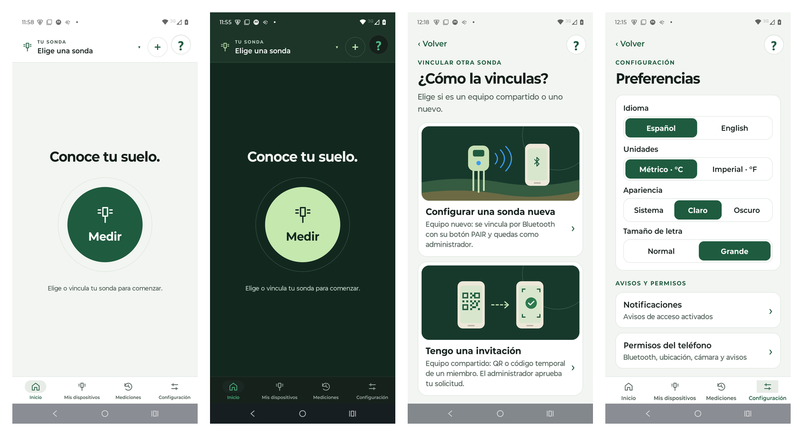

**Figura 2.4 “Aplicación móvil: inicio, tema oscuro, vinculación y preferencias”**

La pantalla de inicio concentra la acción principal, Medir, con letra ampliable y contraste alto; la vinculación distingue el equipo nuevo, que se registra con el pulsador PAIR, del equipo compartido, que se agrega con un código QR temporal que el administrador aprueba.

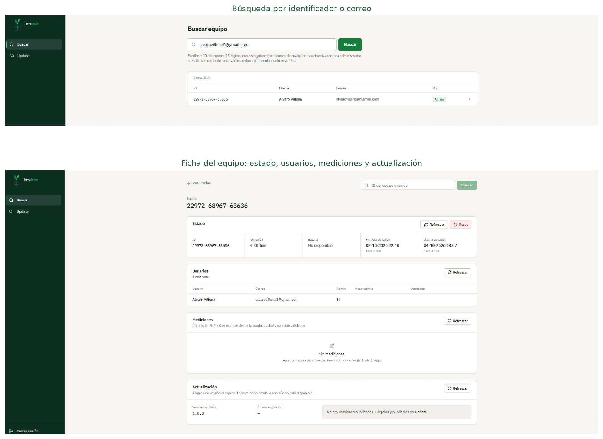

**Figura 2.5 “Consola de soporte: búsqueda de equipos y ficha del equipo”**

La consola de soporte usa una cuenta única con contraseña. Busca un equipo por su identificador de 15 dígitos o por el correo de cualquier usuario enlazado, y su ficha reúne el estado de conexión, la batería, la primera y la última conexión, los usuarios con su rol y su aprobación, las últimas cinco mediciones y la versión de firmware asignada. Es la única vía para reiniciar un equipo, con el botón Reset y su confirmación.

**Por qué no hay SCADA ni alarmas agronómicas por notificación.** Un sistema SCADA (supervisión y adquisición de datos) vigila una planta fija de forma continua y exige telemetría permanente. TerraSense es un instrumento portátil que se usa en jornadas de unos minutos con el agricultor de pie sobre el punto; una alarma agronómica por notificación lo avisaría de algo que no puede atender en ese momento y que, además, depende de una medición que sólo existe cuando él la toma. Por eso los únicos avisos por notificación son los de acceso a equipos, que sí exigen una acción del usuario.

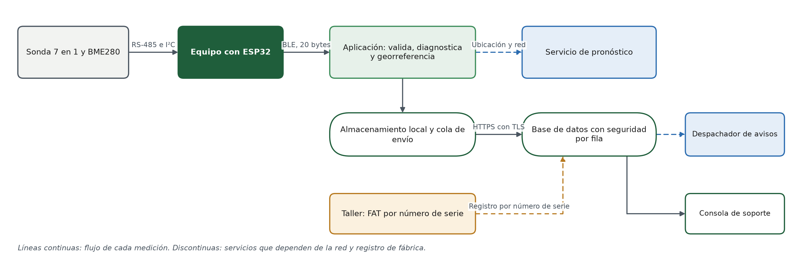

**Figura 2.6 “Flujo de datos y digitalización del proceso”**

La figura muestra los flujos continuos (implementados) y los punteados (opcionales o propuestos). Cada medición conserva su fecha, su equipo, su usuario y su ubicación como texto; el equipo no guarda nada del propietario, y el análisis agronómico ocurre en el teléfono, de modo que la nube no es una dependencia del diagnóstico.

**Ciberseguridad.** Se separa lo que ya existe de lo que se propone, sin presentar lo segundo como resuelto.

| Superficie | Implementado | Propuesto |
|---|---|---|
| Cuentas y acceso | Autenticación de cuentas; seguridad a nivel de fila: cada cuenta sólo accede a los equipos de los que es miembro; consola abierta sólo a la cuenta de soporte | Autenticación de dos factores para la cuenta de soporte |
| Datos en tránsito | TLS (seguridad de la capa de transporte, HTTPS) del teléfono hacia la nube | Fijado de certificados en la aplicación |
| Enlace BLE | La aplicación comprueba la ventana de 30 s abierta con PAIR; la validación de presencia en el servidor se incorpora antes de la primera venta | Prueba de presencia validada por el servidor y emparejamiento BLE cifrado; hoy un teléfono cercano puede leer identidad y telemetría |
| Firmware | Versión informada en la característica de estado | Firmware firmado con arranque seguro y cifrado de la memoria flash del ESP32 |
| Actualización | Catálogo de firmware con huella SHA-256 en el backoffice | Actualización inalámbrica firmada y con partición definida antes de repartir equipos |
| Operación | Reset sólo desde el backoffice, con confirmación | Registro de auditoría de las acciones de soporte |
| Datos personales | Aislamiento por equipo y rol | Procedimiento de notificación de vulneraciones (Ley N° 21.719) |

**Tabla 8.7 “Ciberseguridad: implementada y propuesta”**

### Marco normativo aplicable al producto

El marco regulatorio y su clasificación (Tabla 5.5) se establecieron en la ingeniería conceptual y se aplican también al producto. La placa del instrumento sólo cambia dónde se cumplen algunos requisitos: la protección de la celda la trae la propia celda, de modo que su certificado IEC 62133-2 pasa a ser un requisito de compra [28]; la protección contra descargas electrostáticas del puerto USB y del bus RS-485 se resuelve con circuitos dedicados, ensayados según IEC 61000-4-2 [59]; y la conformidad de radio se tramita sobre el equipo terminado. El equipo se vende sin adaptador de red, con cable USB-C: al no incluir una fuente conectada a la red domiciliaria no se configura la certificación eléctrica de producto, y esa decisión se mantiene.

## VII. Ingeniería de Detalle

La ingeniería de detalle responde la pregunta ¿cómo se construirá, comprará e instalará? Baja la ingeniería básica hasta lo que hace falta para comprar cada componente y equipo, verificar que cumple su hoja de datos, fabricar la placa y la carcasa, armar el equipo siguiendo una secuencia que un tercero pueda repetir, e instalarlo en el campo. Cada ítem del producto y del taller recorre el ciclo especificar, justificar, cotizar, dimensionar y probar. Lo que sigue es la especificación de diseño de la placa del instrumento y de su carcasa, con sus planos en los anexos C y D.

### Especificación de compra del producto

La tabla enumera, por bloque, qué se compra, con qué número de parte, en qué cantidad por equipo y a quién. Los circuitos integrados y componentes electrónicos se abastecen en LCSC [45] como proveedor principal y en DigiKey [71] como alternativa; la placa de circuito impreso se fabrica en JLCPCB [47], y la sonda, la celda y los accesorios mecánicos mantienen las fuentes del prototipo [46], con su justificación. Los valores unitarios y totales están en el anexo A.

| Bloque | Equipo o componente | Modelo o número de parte | Cant. | Proveedor principal y alternativa |
|---|---|---|---|---|
| Procesamiento y radio | Módulo ESP32 con antena impresa | ESP32-WROOM-32D (flash de 4 MB); alternativa de abastecimiento ESP32-WROOM-32E | 1 | LCSC; DigiKey |
| Sensor ambiental | Sensor de temperatura, humedad y presión | BME280 (LGA-8) | 1 | LCSC; DigiKey |
| Cargador | Cargador de celda de litio | TP4056 (ESOP-8) | 1 | LCSC; DigiKey |
| Regulador | LDO de 3,3 V | RT9080-33GJ5 (TSOT-23-5); alternativa ME6211C33 | 1 | LCSC; DigiKey |
| Elevador y corte de la sonda | Elevador de 5 V con habilitación, bobina de 22 µH de 7,3 × 7,3 mm, diodo SS34 y divisor de realimentación; corte con P-MOSFET en serie y N-MOSFET de mando | MT3608 (SOT-23-6); AO3401A y AO3400A (SOT-23) | 1; 1 y 1 | LCSC; DigiKey |
| Bus de la sonda | Transceptor RS-485 y protección del bus | SP3485EN y TVS SM712 | 1 y 1 | LCSC; DigiKey |
| USB-C | Conector, puente USB-serie, protección ESD y PTC de 1,0 A | Receptáculo USB-C de 16 pines GCT USB4105, CH340C (SOIC-16) con divisor de 10 kΩ y 20 kΩ en TXD, USBLC6-2SC6 y PTC 0603L100SLYR | 1, 1, 1 y 1 | LCSC; DigiKey |
| Interfaz | LED azul, verde y rojo, más los dos LED de estado del cargador; buzzer pasivo magnético de 9 mm de montaje pasante con transistor NPN S8050, diodo 1N4148W y resistencia de 47 Ω; pulsadores PAIR, EN y BOOT | LED 0603; buzzer YS-MBZ9042C05R42; pulsador SMD TS-1187A de 5,1 mm | 5; 1; 3 | LCSC; DigiKey |
| Protección y ruta de carga | PTC de 1 A en la celda, diodo M7, P-MOSFET AO3401A y diodo Schottky de la ruta de carga, termistor NTC de 10 kΩ adosado a la celda con su red de 4,7 kΩ y 47 kΩ, puente de medición | PTC 0603L100 de 1 A; M7 (SMA); AO3401A; NTC MF52A103F3950 | 1 de cada uno | LCSC; DigiKey |
| Pasivos y conectores | Resistencias de 1 % y 250 mW y condensadores cerámicos en encapsulado 1206; borneras de paso 5 mm (celda, interruptor, termistor y sonda) | Según la lista del anexo A | Según anexo A | LCSC; DigiKey |
| Placa | Placa de circuito impreso de 2 capas | Diseño propio, FR-4 de 1,6 mm | 1 | JLCPCB |
| Sonda | Sonda de suelo 7 en 1 RS-485 | ComWinTop CWT-Soil-NPKPHCTH-S, variante T-H-EC-NPK-PH [20] | 1 | AliExpress; no hay alternativa nacional (muestra ya adquirida) |
| Energía | Celda LiPo con protección | EEMB LP103454, 3,7 V y 2.000 mAh | 1 | AliExpress, tienda del fabricante |
| Carcasa | Cuerpo y tapa de PETG impresos | Diseño propio | 1 | Taller propio |
| Sellado | Interruptor de palanca con capuchón, prensaestopa PG7 IP68, respiradero M12 con ePTFE, tapón de silicona del USB-C y cordón de silicona de 2 mm | Según la selección de Tabla 7.6 | 1 de cada uno | MCI Electronics (prensaestopa y tornillería); AliExpress |
| Fijación | Insertos M3 de latón, tornillos M3 y M2, separadores | Según Tabla 9.9 | 4; 4; 4; 4 | MCI Electronics; AliExpress |
| Cableado y embalaje | Cable de silicona de 22 AWG, termorretráctil, caja, manual y etiqueta | Según Tabla 9.8 | Según anexo A | AliExpress; imprenta local (guía de inicio) |

**Tabla 8.8 “Especificación de compra del producto por bloque”**

### Congelación de la especificación y control de revisiones

Una especificación de compra sólo sirve si está congelada: mientras un componente conserve alternativas abiertas, dos unidades fabricadas con la misma lista de materiales pueden no ser el mismo producto, y ningún ensayo sobre una de ellas respalda a la otra. Por eso la liberación de la especificación de compra se rige por tres reglas; seleccionarla en el diseño no acredita compra, stock ni validación.

**Número de parte único de producción.** Cada bloque de la tabla anterior se compra con un solo número de parte. El módulo de radio se congela en el **ESP32-WROOM-32D con flash de 4 MB**, y no en la familia WROOM-32 genérica: las variantes de la familia difieren en encapsulado de memoria y en revisión de silicio, de modo que nombrar la familia no es una especificación de compra. Donde el informe nombra la familia lo hace para hablar del sistema en chip y de su radio; donde especifica qué se compra, nombra el 32D.

**Las segundas fuentes no son reemplazos directos hasta validarse.** La tabla anterior lista alternativas de abastecimiento (el ESP32-WROOM-32E de igual huella, el ME6211C33 en lugar del RT9080-33) para no quedar detenidos ante una falta de stock. Ninguna de ellas está validada: no se ha fabricado ni ensayado una unidad con esas piezas. Hasta que una segunda fuente apruebe los ensayos de desarrollo que afectan su bloque, el informe la declara **alternativa de abastecimiento no validada** y no reemplazo directo. Sustituir una pieza sin ese paso invalida los ensayos de la unidad.

**Cada unidad queda amarrada a su revisión.** El producto son cuatro piezas que evolucionan por separado (placa, carcasa, firmware y aplicación) y una unidad en terreno es una combinación concreta de las cuatro. La tabla fija la revisión vigente de cada una y cómo se vincula con el número de serie del equipo.

| Elemento | Revisión | Alcance de la revisión | Vínculo con la unidad fabricada |
|---|---|---|---|
| Placa del instrumento | V3, referencia de diseño | Placa de dos capas de 90 × 64 mm representada en el anexo C. Los planos ilustran el diseño; no constituyen por sí solos un paquete de fabricación liberado | La revisión se identifica en placa y formulario FAT al liberar el lote; la aceptación exige archivos de fabricación y revisión de reglas correspondientes a esa misma revisión |
| Carcasa | A, referencia de diseño | Envolvente nominal de 99 × 87 × 31 mm del anexo D. La liberación exige modelo fabricable, control de interferencias y validación del cierre | La revisión se marca en la tapa y en el formulario FAT al liberar el lote |
| Firmware | 1.0.0 | Arranque e identidad, interfaz de LED y buzzer, ventana de vinculación, trama de 20 bytes y lectura Modbus de la sonda. No incluye recepción de actualización por BLE | Se lee por la característica de estado BLE y se contrasta con la liberación instalada en F-04; se anota en el formulario FAT |
| Formato de la trama BLE | 1 | Trama única de 20 bytes con suelo, ambiente y batería | Viaja en el byte de formato de cada trama, de modo que la aplicación reconoce qué revisión la emitió |
| Aplicación móvil | 1.0.0; motor 1.4.0; catálogo de especies 2.2.0; criterios por especie 2.9.0; pre-siembra 1.0.0 | Etapa y especie opcional, alternativas de pre-siembra, calidad y cobertura, historial, cola y pronóstico con copia local controlada | La medición conserva versiones del motor, catálogo y firmware informado; el diagnóstico conserva la especie y sus reglas. FAT y SAT deben identificar también la compilación instalada |
| Consola de soporte | 1.0.0 | Búsqueda, ficha del equipo, aprobación de accesos, reset y catálogo de firmware | Queda en el registro de la consola |

**Tabla 8.9 “Revisiones de referencia del producto y su vínculo con el número de serie”**

La consecuencia práctica es que ningún resultado de ensayo se interpreta sin su combinación de revisiones: un ensayo aprobado sobre la placa V3 con firmware 1.0.0 no respalda una unidad con placa posterior, y al cambiar cualquiera de las cuatro revisiones hay que declarar qué ensayos se repiten. Las versiones nominales no sustituyen la identificación de una liberación: el acta debe incluir fecha, compilación y huella digital SHA-256 del binario y de los archivos de fabricación. Los archivos de fabricación que se emitan deben corresponder exactamente a la revisión de esta tabla; emitir una orden con archivos de otra revisión es el error que esta congelación existe para evitar.

### Equipos del taller

El taller es parte del proyecto y recorre el mismo ciclo que el producto. El taller requiere aire caliente, placa calefactora y esténcil para prototipos y retrabajo. Según el capítulo VIII, la producción en serie se encarga al fabricante (alternativa C), de modo que esos equipos quedan para los prototipos y el retrabajo. Los precios son netos, de catálogo consultado o estimados (el anexo A indica cuáles); los importados se convierten a $950 por dólar con flete, seguro y arancel.

| Equipo | Especificar | Justificar | Cotizar | Dimensionar | Probar |
|---|---|---|---|---|---|
| Impresora 3D | Cámara cerrada, volumen de al menos 220 × 220 mm, PETG | Creality K1C, por cámara cerrada y precio (Tabla 7.8) | [72]; $450.008 cada una (consultado) | 2 impresoras: 1 cubre hasta 1.083 equipos al año y la demanda de 2036 es de 1.085 (Tabla 10.6) | Carcasa de prueba que cierra con el ajuste de Tabla 9.5 |
| Estación de soldadura | Temperatura regulable y punta fina para componentes 0603 y 1206 | Retoque y retrabajo de la placa y soldadura de cableado | Hakko FX-888D en DigiKey; $145.965 cada una (consultado) | 2, una por puesto | Soldadura de una placa de prueba sin juntas frías |
| Aire caliente | Perfil de reflujo para LGA y SOIC | El BME280 en LGA no se suelda a mano; sirve para prototipos y retrabajo | Quick 861DW (T-Equipment); $332.702 (consultado) | 1 | Reflujo de una placa de prueba con inspección al microscopio |
| Placa calefactora | Precalentado de 100 × 100 mm, 400 W | Reflujo de prototipos con esténcil | UYUE 946-1010 (AliExpress); $45.114 (consultado) | 1 | Perfil de temperatura en una placa de prueba |
| Esténcil de pasta de soldar | Acero de 0,12 mm con marco, aberturas según las huellas de la placa | Aplicar pasta en los componentes pequeños | JLCPCB; $8.865 cada uno (tarifa publicada; aberturas según el plano del anexo C) | 2: uno para la placa del instrumento y uno de repuesto | Cobertura de pasta verificada con lupa |
| Microscopio estereoscópico | De 10× a 20× binocular | Inspección de puentes y juntas visibles; las uniones ocultas requieren control del proceso y, si procede, radiografía del fabricante | AmScope SE400-Z; $329.318 (tienda oficial) | 1 | Se distinguen defectos visibles; la lupa no acredita las uniones bajo el LGA |
| Osciloscopio | 4 canales y 50 MHz para el bus RS-485 y el rizado de 3,3 V | Ensayo de arranque del elevador y del bus | Rigol DS1054Z (Electro-Meters); $519.573 (consultado) | 1 | Medición de una señal de referencia |
| Fuente de laboratorio | 0 a 30 V y 0 a 5 A con limitación de corriente | Puesta en marcha por etapas | Korad KA3005P (Welectron); $111.656 (consultado) | 1 | Calibración contra una referencia |
| Multímetro | Resolución de 0,01 µA en el rango de 220 µA, para medir fugas de apagado | Medición de corrientes por JP1 | UNI-T UT61E+; $116.607 cada uno (consultado) | 2 | Calibración contra una referencia |
| Analizador lógico | 8 canales y 24 MHz, para Modbus RTU e I²C | Verificación de tramas y de CRC | SparkFun TOL-18627, compatible con sigrok (DigiKey); $30.846 (consultado) | 1 | Captura de una trama conocida |
| Equipo de ensayo FAT | Fixture con 12 pines de contacto y computador | Probar el 100 % de las unidades con el mismo procedimiento | Fixture de pogo pines P75-E2 con abrazaderas de palanca, placa FR4 y base impresa, armado en el taller; $38.528 (componentes consultados) | 1; 18 minutos por unidad (Tabla 10.5) | Una unidad patrón pasa y una defectuosa falla |

**Tabla 9.0 “Equipos del taller según el ciclo especificar, justificar, cotizar, dimensionar y probar”**

### Cotizaciones y proveedores

El anexo A reúne las cotizaciones en una planilla de Excel con las columnas equipo, modelo, cantidad, proveedor, valor unitario y valor total, más la fecha de consulta y el enlace. Aquí se resume por bloque. Los precios de los componentes electrónicos son de catálogo público de LCSC consultado el 02-10-2026, en el tramo para 200 equipos y a $950 por dólar; DigiKey se consultó para las alternativas y para parte del instrumental del taller.

Sobre el origen de los precios: **cada valor es un precio público con proveedor, fecha y enlace**, y la placa de laboratorio y la muestra de la sonda ya se compraron. Lo consultado es el catálogo de LCSC (las 57 líneas de electrónica), el de DigiKey (alternativas) y las publicaciones de AliExpress para la sonda, la celda y los accesorios, todos el 02-10-2026; el flete de los componentes sale del carrito de LCSC con destino Chile. En el producto, tres líneas son estimaciones: la placa del instrumento, su ensamble por el fabricante y la carcasa, porque su orden de compra se emite con el prototipo; se valorizan con el precio pagado por la placa de laboratorio como referencia conservadora para placas de hasta 100 × 100 mm, con las tarifas publicadas del fabricante y con el costeo del filamento. La compra de placas documentada corresponde a la placa de laboratorio; también se adquirió la muestra de sonda (las placas fueron 5 por $15.000 con envío, IVA e impuestos, es decir $3.000 por placa, en JLCPCB). Los servicios de validación y parte del taller se valorizan con tarifas publicadas de los laboratorios y fabricantes. Los demás valores son precios públicos de LCSC [45], DigiKey [71] y AliExpress, consultados en la fecha que registra el anexo. Para el volumen de producción, cada proveedor emite una cotización formal y fechada antes de la primera orden de compra.

| Bloque | Líneas | Proveedor principal | Subtotal neto por equipo | Naturaleza del precio |
|---|---:|---|---:|---|
| Sonda de suelo | 1 | AliExpress (sin alternativa nacional) | $44.394 | Publicación con fecha: $34.700 más $9.694 de envío a Chile |
| Celda de energía | 1 | AliExpress, tienda EEMB | $6.900 | Publicación con fecha (pack de 10) |
| Carcasa | 1 | Taller propio | $7.238 | Costeo de la impresión: filamento $5.250, merma $788, energía $210 y mantención $990 |
| Placa del instrumento, cargos de ensamble del fabricante, flete e internación | 3 | JLCPCB y LCSC | $6.289 | Placa y ensamble: estimación con el precio de la placa de laboratorio como referencia conservadora y las tarifas publicadas; flete: cotizado en el carrito de LCSC |
| Procesamiento y radio (ESP32-WROOM-32D) | 1 | LCSC (alternativa DigiKey) | $2.710 | Catálogo con fecha |
| USB y carga (conector USB4105, CH340C con su divisor de TXD, USBLC6-2SC6, PTC, TP4056, termistor de la celda y ruta de carga) | 20 | LCSC | $1.543 | Catálogo con fecha |
| Alimentación de 3,3 V (RT9080-33) | 1 | LCSC | $83 | Catálogo con fecha |
| Elevador de 5 V y corte de la sonda (MT3608, bobina, diodo, AO3401A y AO3400A) | 10 | LCSC (alternativa TPS61023) | $665 | Catálogo con fecha |
| Bus RS-485 (SP3485, SM712, terminación y polarización) | 4 | LCSC | $220 | Catálogo con fecha |
| Sensor ambiental (BME280) | 2 | LCSC (alternativa DigiKey) | $4.623 | Catálogo con fecha |
| Interfaz (LED, buzzer con su resistencia de 47 Ω, pulsadores) | 10 | LCSC | $229 | Catálogo con fecha |
| Protección y medición | 5 | LCSC | $731 | Catálogo con fecha |
| Pasivos de desacoplo | 4 | LCSC | $657 | Catálogo con fecha |
| Montaje y embalaje | 9 | AliExpress, MCI Electronics e imprenta local | $5.142 | Catálogo y publicaciones con fecha |
| **Total de la lista de materiales por equipo** | 72 | — | **$81.425** | — |

**Tabla 9.1 “Resumen de la lista de materiales de la placa del instrumento por bloque”**

La Ley N° 21.713 [42] regula desde el 25 de octubre de 2025 el IVA de ventas remotas de bienes de hasta US$500 a consumidores finales. TerraSense debe informar su condición de contribuyente y documentar las importaciones o compras nacionales para sustentar el crédito fiscal; no se presume recuperable el impuesto de una compra personal. La electrónica de la placa suma $11.462 (14,1 % de la lista) y la sonda $44.394 (54,5 %); el resto corresponde a placa, ensamble, carcasa, celda y montaje. Los plazos referenciales son de 1 a 3 semanas para JLCPCB, de 1 a 2 semanas para LCSC con mensajería internacional y de 2 a 4 semanas para AliExpress; se confirman al emitir la orden.

### Verificación contra hojas de datos

La verificación contrasta, componente por componente, lo que el diseño le exige con lo que dice su hoja de datos. Los valores son nominales y se confirman con la hoja del lote recibido.

| Componente | Parámetro verificado | Requerido por el diseño | Valor de hoja de datos | Margen | Resultado contra la hoja de datos |
|---|---|---|---|---|---|
| Módulo ESP32-WROOM-32D | Alimentación, temperatura y fuente | 3,3 V del LDO; 150 mA en transmisión BLE; interior de hasta ≈ 60 °C | 3,0 a 3,6 V; −40 a +85 °C; 130 a 150 mA en BLE; fuente de al menos 500 mA [61] | 25 °C de margen en calor; el LDO entrega 600 mA contra 500 mA recomendados (factor 1,2) | Compatible con la hoja de datos; se ensaya en el prototipo |
| RT9080-33 (U de 3,3 V) | Tensión de entrada, corriente y caída | Entrada de 3,0 a 4,6 V; 150 mA de pico | Entrada de 1,2 a 5,5 V; 600 mA; 0,31 V típica y 0,53 V máxima de caída a 600 mA; unos 2 µA de corriente propia [64] | Corriente: factor 4; entrada máxima 4,6 V frente a 5,5 V | Compatible con la hoja de datos; se ensaya en el prototipo |
| BME280 | Rangos y alimentación | Aire de −5 a +50 °C; 0 a 100 % HR; 550 a 1.050 hPa; 3,3 V | −40 a +85 °C (±1,0 °C); 0 a 100 % (±3 %); 300 a 1.100 hPa (±1,0 hPa); 1,71 a 3,6 V; 3,6 µA a 1 Hz [13] | 35 °C de margen en calor | Cumple; verificar la respuesta térmica tras el respiradero |
| SP3485EN | Alimentación y velocidad | 3,3 V; 4.800 baudios (9.600 si se reconfigura la sonda) | 3,0 a 3,6 V; hasta 10 Mbps; ≈ 2 mA con driver activo [24] | 1.000 veces la velocidad requerida | Compatible con la hoja de datos; se ensaya en el prototipo |
| TVS SM712 | Rango del bus | Líneas A y B de RS-485 (−7 a +12 V de modo común) | Protege las líneas de datos en el rango −7 a +12 V [73] | Cubre el rango completo del estándar | Compatible con la hoja de datos; se ensaya en el prototipo |
| MT3608 | Entrada, salida y corriente | Entrada de 3,0 a 4,2 V; 5,00 V; 0,32 A de pico | Salida hasta 28 V; límite de conmutador de 4 A; 1,2 MHz [66] | Corriente: factor 12 | Cumple; como no desconecta la carga con EN bajo (la salida queda en ≈ VBAT menos la caída del diodo), el corte de la sonda lo hace el AO3401A en serie |
| TP4056 | Entrada, tensión de flotación y corriente | 5 V; 4,20 V; 0,444 A | Entrada de 4,0 a 8,0 V; 4,2 V ± 1,5 % (±63 mV); hasta 1 A; límite térmico de 120 °C [67] | Corriente: factor 2,3 | Cumple con control: la tolerancia de ±1,5 % (hasta 4,263 V) se controla midiendo la tensión de flotación en el FAT de cada unidad y rechazando la placa que supere 4,25 V, el límite de la celda; red del NTC medida en el prototipo |
| CH340C | Alimentación y velocidad | 5 V de VBUS; 115.200 baudios | Alimentación de 5 V (admite 3,3 V); hasta 2 Mbps [62] | Velocidad: 17 veces | Compatible con la hoja de datos; se ensaya en el prototipo |
| USBLC6-2SC6 | Protección ESD del puerto | ±8 kV de contacto en D+, D− y VBUS | ±8 kV de contacto y ±15 kV en aire (IEC 61000-4-2, nivel 4) [74] | Cumple el nivel requerido | Compatible con la hoja de datos; se ensaya en el prototipo |
| PTC de 1,0 A en VBUS | Corriente de mantenimiento | 0,7 A en el peor caso (carga 0,444 A y sistema 0,26 A) | 1,0 A de mantenimiento a 20 °C; la serie 0603L conserva el 82 % a 40 °C y el 74 % a 50 °C [75], ≈ 0,78 A a 45 °C | Factor 1,1 a 45 °C; sobre 45 °C el termistor suspende la carga y la corriente cae a 0,26 A (factor 2,8 a 50 °C) | Compatible con la hoja de datos; se ensaya en el prototipo |
| AO3400A y AO3401A (corte de la sonda y ruta de carga) | Umbral, corriente y tensión | Compuerta del AO3400A a 3,3 V; AO3401A con −5 V entre compuerta y fuente; 30 mA de la sonda y hasta 0,7 A en la ruta de carga; 5 V | AO3400A: umbral de 0,65 a 1,45 V, 5,7 A y 30 V [69]; AO3401A: umbral de −0,5 a −1,3 V, 4,0 A y −30 V [76] | Compuerta 1,85 V sobre el umbral máximo; corriente: factor 5,7 en la ruta de carga y más de 100 en la sonda | Compatible con la hoja de datos; se ensaya en el prototipo |
| S8050 (buzzer y autoprogramación) | Corriente de colector | 52 mA del buzzer | 500 mA de colector | Factor 9,6 | Compatible con la hoja de datos; se ensaya en el prototipo |
| Buzzer YS-MBZ9042 con transistor y 47 Ω | Corriente por el pin | 20 mA por pin como máximo recomendado | La corriente (37 a 52 mA) la entrega el riel de 3,3 V; por el pin pasa sólo la corriente de base [77] | ≈ 2,6 mA por IO19 con 1 kΩ de base | Cumple: el riesgo de corriente del buzzer queda cerrado en el diseño; falta el ensayo |
| PTC de 1 A y diodo M7 | Coordinación ante inversión de batería | Corriente de cortocircuito limitada antes de dañar la placa | Curvas de disparo del PTC y energía de pulso del diodo [78] | El factor de tensión inversa no demuestra protección | Cálculo de coordinación y ensayo con fuente limitada en el prototipo |
| Celda LiPo de 2.000 mAh | Tensión y régimen | 3,0 a 4,2 V; descarga de 0,13 C; carga de 0,22 C | Carga de 4,20 V ± 50 mV; carga estándar de 0,5 C y máxima de 1 C [79] | Carga a menos de la mitad de 0,5 C | Cumple con condición: certificado IEC 62133-2 y protección de la celda comprada |
| LED 0603 con 330 Ω | Corriente | Visibilidad con 1 a 4 mA | 20 mA nominales; el azul XL-1608UBC-04 entrega 300 mcd a 20 mA con 3,3 V de tensión directa | Factor de 5 o más | Cumple: azul y verde quedan en torno a 1 mA (≈ 15 mcd), visibles en interior y a la sombra; al sol directo cada aviso se repite con el buzzer y en la aplicación |
| Resistencias y condensadores | Potencia y tensión | 47 Ω a 52 mA disipa 64 mW; rieles de 5 V | Resistencias de 250 mW; condensadores de 35 y 50 V | Factor 3,9 en potencia; factor 7 en tensión | Compatible con la hoja de datos; se ensaya en el prototipo |
| Sonda CWT-Soil-NPKPHCTH-S | Alimentación y consumo | 5,00 V del elevador; ≈ 30 mA | 4,5 a 30 V; 0,5 W como máximo a 24 V [20] | 0,50 V sobre el mínimo (0,30 V con la tolerancia del elevador) | Cumple; exactitud a 5 V en ensayo de banco; contingencia: elevador de 12 V |
| Carcasa de PETG | Temperatura de uso | Interior de hasta ≈ 60 °C al sol | Temperatura de deflexión bajo carga de 74,5 °C y ablandamiento Vicat de 83 °C (Creality Hyper PETG) [80] | 14,5 °C | Cumple con condición (ensayo de temperatura); contingencia: ASA |

**Tabla 9.2 “Verificación de los componentes de la placa del instrumento frente a las hojas de datos”**

El elevador de la lista es el MT3608 y el corte real de la sonda lo hace el AO3401A en serie con su salida. Requieren cierre documental, cálculo o ensayo: la tolerancia de la tensión de carga, la certificación de la celda, la exactitud de la sonda a 5 V y la temperatura de la carcasa. La excitación del buzzer por transistor reduce la corriente del pin, pero requiere verificar corriente, temperatura y audibilidad en el prototipo. Un regulador de 100 mA no cubre el pico de transmisión BLE; el RT9080-33 se selecciona por su capacidad nominal de 600 mA, con su verificación térmica y de caída de tensión programada en el prototipo.

### Geometría de la placa del instrumento

La placa representada en el anexo C tiene un contorno de diseño de 90,0 × 64,0 mm, con radio de esquina de 3,0 mm y ruteo previsto en dos capas: las señales van en pistas de 0,25 mm, la potencia en pistas de 0,7 mm y la masa en planos de cobre que cubren ambas caras, unidos por vías de costura junto a cada pin de masa y en una retícula de 5 mm. Al no rutear la masa con pistas, cada componente encuentra su retorno en el plano más cercano y las pistas quedan libres para las señales. Las figuras 2.7 a 2.9 muestran la placa en vista tridimensional, su plano con las cotas y el ruteo de cada cara. Las coordenadas se expresan en milímetros, desde la esquina superior izquierda del contorno, con X hacia la derecha e Y hacia abajo, vista por la cara de componentes. El anexo C contiene estas vistas.

La lista de materiales y los costos se mantienen por decisión del proyecto: el contorno de 90 × 64 mm cae en el mismo tramo de precio de la placa de laboratorio (hasta 100 × 100 mm), y la carcasa conserva el presupuesto de material, energía y capacidad de impresión de la envolvente de laboratorio de 110 × 100 × 40 mm. Los modelos tridimensionales de encapsulados son representativos y no sustituyen la especificación de compra de los componentes.

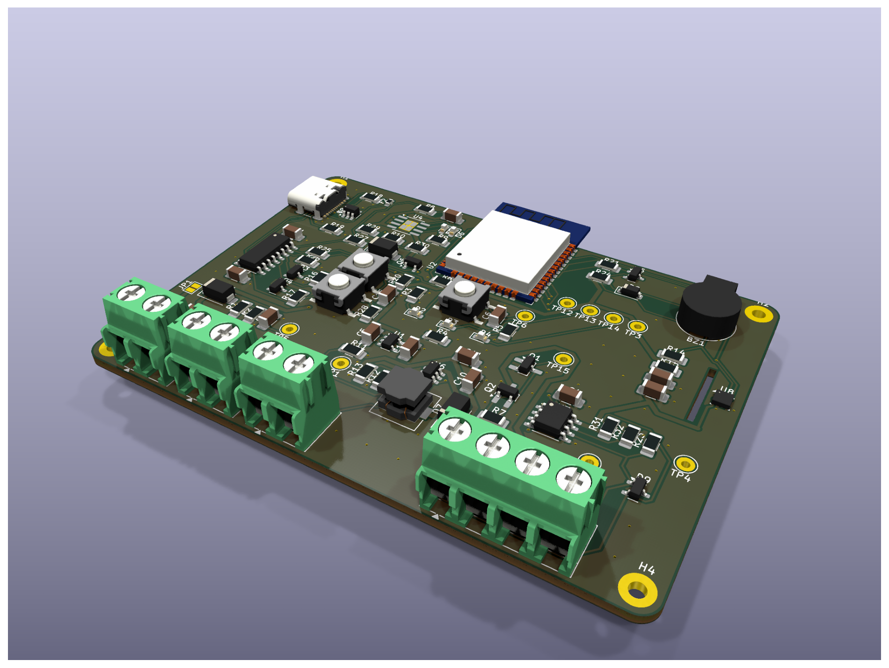

**Figura 2.7 “Placa del instrumento: vista tridimensional”**

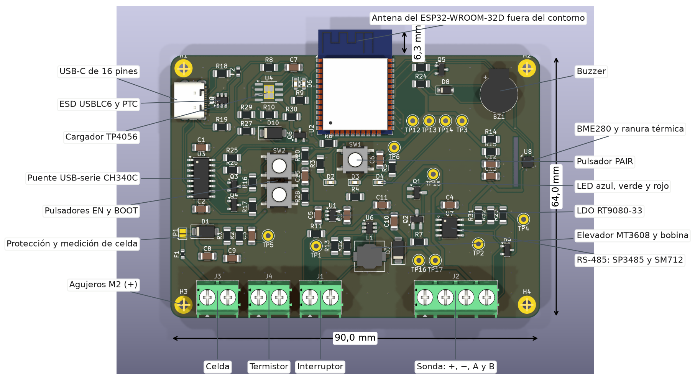

**Figura 2.8 “Plano de la placa del instrumento”**

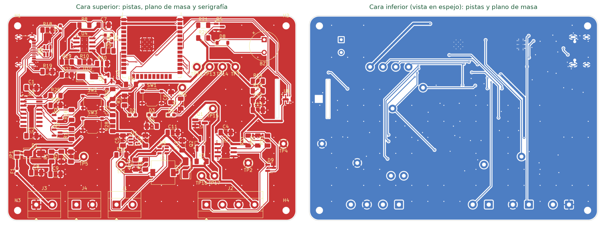

**Figura 2.9 “Ruteo de la placa: cara superior e inferior”**

| Parámetro | Valor | Observación |
|---|---|---|
| Contorno | 90,0 × 64,0 mm, con esquinas de 3 mm de radio | Mismo tramo de precio del fabricante que la placa de laboratorio |
| Capas y sustrato | 2 capas de cobre; FR-4 de 1,6 mm | Tolerancia de espesor típica de ±10 % |
| Cobre | 1 oz (35 µm) en ambas caras | Estándar del fabricante |
| Planos de masa | Masa en ambas caras con separación de 0,3 mm a las demás redes y alivio térmico en los pines; vías de costura de 0,3 mm de taladro | Vías térmicas bajo la almohadilla del cargador y del módulo; sin cobre bajo el BME280 |
| Ancho y separación de pistas | 0,25 mm en señales; 0,7 mm en potencia (celda, VBUS, 5 V, 3,3 V y salida del elevador); separación mínima de 0,2 mm | Las pistas de potencia llevan hasta 1 A (Tabla 8.0) |
| Vías | Taladro de 0,3 mm con pad de 0,6 mm en señales y de 0,4 mm con pad de 0,8 mm en potencia | Dentro de la capacidad del fabricante |
| Agujeros de montaje | 4 agujeros M2 de 2,2 mm con isla de cobre unida a masa | Posiciones en el anexo C |
| Coordenadas de los agujeros de montaje | (3,2; 3,2), (86,8; 3,2), (3,2; 60,8) y (86,8; 60,8) | Origen superior izquierdo del contorno; centros de taladro |
| Posición de los conectores | USB-C: origen de huella en (4,6; 11,0), abertura hacia el borde izquierdo; borneras de celda, termistor e interruptor: primer terminal en (9,0; 59,0), (21,5; 59,0) y (34,0; 59,0); sonda: primer terminal en (62,0; 59,0) | Paso de 5,0 mm; entrada de cables hacia el borde inferior |
| Posición del módulo ESP32 y zona libre de la antena | Origen de huella en (45,0; 9,5); antena hacia el borde superior, sobresale 6,3 mm del contorno | Sin cobre ni componentes bajo la antena; criterio de integración en Tabla 9.4 |
| Posición del BME280 y de su ranura térmica | Sensor en (87,0; 26,0); ranura de 1,0 × 12,0 mm, de X 83,6 a 84,6 e Y 20,0 a 32,0 | Cargador en (24,0; 9,0) y LDO en (39,5; 39,0), ambos a más de 45 mm del sensor |
| Posición de los LED, el buzzer y el pulsador PAIR | LED azul, verde y rojo en (39,0; 31,0), (45,0; 31,0) y (51,0; 31,0); PAIR en (45,0; 25,5); origen de huella del buzzer en (80,0; 7,5) | Centro del cuerpo del buzzer en (80,0; 8,75); alineación nominal con la tapa |
| Pulsadores de reinicio y de arranque | EN en (26,5; 27,0) y BOOT en (26,5; 34,0) | Sólo para programación; quedan bajo la tapa |
| Acabado superficial | ENIG, sin plomo | La planitud del acabado favorece el LGA y el esténcil; HASL sin plomo es una alternativa |
| Máscara y serigrafía | Estándar del fabricante; designadores y rotulado de conectores | Los puntos de prueba se rotulan con el nombre del nodo |
| Puntos de prueba | 5 V del elevador, 5 V de la sonda, 3,3 V, batería, compuerta del corte de la sonda, PAIR, los tres LED y dos de masa | Agujeros metalizados de 1 mm para la punta del instrumento, sin componente montado; miden el árbol de alimentación y las señales sin cambiar la punta de sitio |
| Pedido | Lote de prototipo y lote anual | Costo en el anexo A; la placa de laboratorio se compró en 5 placas por $15.000 con envío, IVA e impuestos |

**Tabla 9.3 “Datos de fabricación de la placa del instrumento”**

Las **zonas críticas** de la placa son las que aseguran que el equipo mida bien y se comunique:

| Zona | Regla | Motivo | Verificación |
|---|---|---|---|
| Antena del módulo ESP32 | Módulo en el borde de la placa, con la antena fuera del contorno o sobre una zona libre conforme a la guía de integración del módulo [70], sin cobre, pistas ni componentes dentro de la región de antena y su separación requerida; la celda no se ubica bajo la antena | El cobre cercano degrada el enlace BLE | Ensayo de alcance BLE con el equipo cerrado |
| BME280 y aislación térmica | En el borde, junto al respiradero, a 20 mm o más del cargador y del LDO, con una ranura de 1 mm que lo aísla térmicamente y sin vertido de cobre bajo su cápsula | El calor del cargador y del módulo sesga la temperatura del aire | Autocalentamiento menor que 0,5 °C a los 10 min |
| Cargador TP4056 | Vertido de cobre con vías térmicas bajo la almohadilla, lejos del BME280 | Disipa hasta 0,9 W | Temperatura del cargador bajo 60 °C durante la carga |
| Elevador | Bobina, diodo y condensadores de salida a menos de 10 mm del MT3608 y lazo de corriente corto | Reduce el rizado y la emisión | Rizado de 5 V medido con osciloscopio |
| Bornera de la sonda | En el borde inferior, a 5 mm o más del borde, con el TVS SM712 pegado a los terminales | Un tirón o una descarga entra primero por aquí | Alivio de tracción y descarga ESD |
| Conector USB-C | En el borde, con el USBLC6-2SC6 pegado al conector y D+ y D− paralelas y cortas | Descarga electrostática y calidad de la señal | Ensayo ESD |

**Tabla 9.4 “Zonas críticas y distancias de la placa del instrumento”**

### Carcasa, conectores, cableado y montaje

**Carcasa.** La envolvente mide 99 × 87 × 31 mm. El anexo D presenta la planta, la vista frontal y el corte del conjunto. Las cotas en planta se miden desde la esquina exterior superior izquierda, con X hacia la derecha e Y hacia abajo; las alturas se miden desde la cara exterior de la base. La placa queda desplazada 4,5 mm en X y 10,3 mm en Y, y su cara inferior se sitúa a 14,0 mm de la base. El costo conserva los 210 g de PETG y las demás hipótesis de la carcasa de laboratorio como presupuesto conservador, sin equipararlos a la masa de esta envolvente.

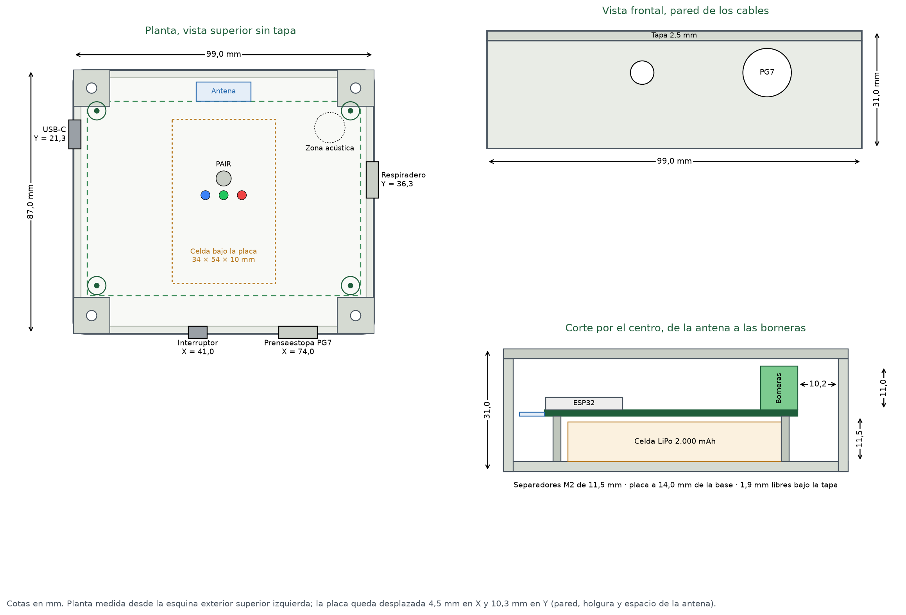

**Figura 3.0 “Carcasa: planta, vista frontal y corte”**

| Parámetro | Valor nominal | Tolerancia o criterio |
|---|---|---|
| Dimensiones exteriores | 99,0 × 87,0 × 31,0 mm | ±0,3 mm por dimensión, tras calibrar la impresora |
| Paredes, base y tapa | 2,5 mm | Al menos 4 perímetros sólidos; relleno de 40 a 60 %; capa de 0,16 a 0,20 mm |
| Holgura entre placa y pared | 2,0 mm nominales en los laterales; 1,5 mm desde la antena a la pared interior superior; 10,2 mm desde el contorno inferior a la pared | Cotas de la envolvente conceptual |
| Soporte de la placa | 4 separadores M2 de 11,5 mm con tornillo M2 | ±0,2 mm en la posición de los postes |
| Celda | 10 × 34 × 54 mm sobre la base, retenida por nervios de 2 mm | 1,5 mm nominales entre celda y placa con separadores de 11,5 mm, antes de tolerancias; reservar espacio para expansión según la ficha de la celda y evitar la antena |
| Junta | Cordón de silicona de 2 mm en un canal de 2,6 mm de ancho y 1,55 mm de profundidad | Compresión del 22,5 % (de 2,0 a 1,55 mm), dentro del rango de 20 a 25 %; el ancho de 2,6 mm deja volumen libre para el material desplazado y la tapa asienta sobre topes |
| Insertos M3 de latón | 4, en bloques de esquina de 12 × 12 mm ubicados en los 10 mm superiores del cuerpo, sobre el nivel de la placa | Agujero de 4,0 mm y 6,5 mm de profundidad para el inserto de 5,7 mm de largo y 4,6 mm de diámetro exterior |
| Tornillos de cierre | 4 tornillos M3 × 8 mm inoxidables con avellanado de 6,0 mm | Apriete uniforme hasta comprimir el cordón |
| Borde superior del cuerpo | Engrosado a 5,0 mm en los últimos 4 mm | Contingencia: 6,0 mm si el ensayo de estanqueidad del prototipo lo exige |

**Tabla 9.5 “Dimensiones y tolerancias de la carcasa”**

| Abertura | Cara | Dimensión | Elemento asociado | Posición X e Y desde la esquina |
|---|---|---|---|---|
| Visores de los tres LED | Tapa | Guía de luz de 3,0 mm de diámetro y longitud ajustada al apilamiento nominal, de la cara interior de la tapa al LED, con sello continuo | LED azul, verde y rojo | (43,5; 41,3), (49,5; 41,3) y (55,5; 41,3) |
| Acceso al pulsador PAIR | Tapa | Empujador de 4,0 mm en un agujero de 5,0 mm, sellado con una membrana de silicona de 0,5 mm | Pulsador PAIR | (49,5; 35,8) |
| Zona acústica del buzzer | Tapa | Círculo de 10 mm adelgazado a 1,0 mm, sin orificio | Buzzer | (84,5; 19,05) |
| Puerto USB-C | Pared lateral | Abertura de 9,5 × 3,8 mm con tapón de silicona | Conector USB-C | Pared izquierda: Y = 21,3; centro a 17,2 mm de la base |
| Interruptor general | Pared inferior | Agujero de 6,2 mm de diámetro | Interruptor de palanca | Pared inferior: X = 41,0; centro a 20,0 mm de la base |
| Salida de la sonda | Pared inferior | Agujero de 12,8 mm de diámetro | Prensaestopa PG7 | Pared inferior: X = 74,0; centro a 20,0 mm de la base |
| Respiradero | Pared lateral, a la altura del BME280 | Agujero roscado M12 × 1,5 con asiento plano de 16 mm para la junta del respiradero | Respiradero M12 × 1,5 | Pared derecha: Y = 36,3; centro a 20,0 mm de la base |
| Tornillos de cierre | Tapa | Agujero de 3,4 mm con avellanado de 6,0 mm | Insertos M3 | (6,0; 6,0), (93,0; 6,0), (6,0; 81,0) y (93,0; 81,0) |
| Postes de la placa | Base | Poste de 6 mm con agujero piloto de 1,8 mm | Separadores M2 | (7,7; 13,5), (91,3; 13,5), (7,7; 71,1) y (91,3; 71,1) |

**Tabla 9.6 “Aberturas y elementos de fijación de la carcasa”**

Las posiciones en planta se miden desde la esquina exterior superior izquierda de la carcasa vista desde arriba, y las de las paredes, a lo largo de la pared y en altura desde la base; coinciden con el plano del anexo D y con las coordenadas de la placa desplazadas 4,5 mm en X y 10,3 mm en Y. La celda se retira con el equipo apagado y sin cable USB: se abre la tapa y se aflojan los dos tornillos de la bornera de batería con un destornillador Phillips convencional. Se libera la fijación de la celda, se reemplaza por una de la especificación admitida y se restituye la polaridad, la retención y el sello. La placa permanece fijada con sus tornillos M2. El ensayo D-18 cronometra el procedimiento completo y verifica el cierre posterior.

**Conectores y pinout.**

| Conector | Pin o terminal | Señal | Observación |
|---|---|---|---|
| USB-C de 16 pines (carga y datos) | A4, B4, A9, B9 | VBUS (5 V) | Pasa por el PTC y el USBLC6-2SC6 |
| USB-C de 16 pines | A1, B1, A12, B12 | Tierra | — |
| USB-C de 16 pines | A5 y B5 | CC1 y CC2 | Cada uno con 5,1 kΩ a tierra |
| USB-C de 16 pines | A6, B6 y A7, B7 | D+ y D− | Hacia el CH340C |
| Bornera de la sonda (4 vías, paso de 5,0 mm) | 1 | Línea B de RS-485 | Cable azul |
| Bornera de la sonda | 2 | Línea A de RS-485 | Cable amarillo |
| Bornera de la sonda | 3 | Tierra | Cable negro |
| Bornera de la sonda | 4 | +5 V de la sonda | Cable marrón |
| Bornera de la celda (2 vías) | 1 | Negativo de la celda | Cable negro |
| Bornera de la celda | 2 | Positivo de la celda | Cable rojo; pasa por el fusible |
| Bornera del interruptor (2 vías) | 1 y 2 | Contactos del interruptor, sin polaridad | Cables blancos |
| Bornera del termistor (2 vías) | 1 y 2 | Termistor NTC de la celda hacia el pin TEMP del cargador, sin polaridad | Cables blancos; el termistor va pegado a la cara de la celda |

**Tabla 9.7 “Lista de conectores y pinout”**

Los colores del cable de la sonda son los de su manual [20]: marrón (+), negro (−), amarillo (A+) y azul (B−).

**Lista de cableado y torques.**

| Cable | De | A | Sección | Color | Largo | Terminación |
|---|---|---|---|---|---|---|
| Celda positivo | Celda | Bornera de la celda, terminal 2 | 22 AWG | Rojo | 80 mm | Puntera adecuada a la bornera |
| Celda negativo | Celda | Bornera de la celda, terminal 1 | 22 AWG | Negro | 80 mm | Puntera adecuada a la bornera |
| Interruptor, línea 1 | Bornera del interruptor, terminal 1 | Contacto 1 del interruptor | 22 AWG | Blanco | 70 mm | Puntera adecuada a la bornera y termorretráctil |
| Interruptor, línea 2 | Bornera del interruptor, terminal 2 | Contacto 2 del interruptor | 22 AWG | Blanco | 70 mm | Puntera adecuada a la bornera y termorretráctil |
| Cable de la sonda | Bornera de la sonda, terminales 1 a 4 | Sonda de suelo | Cable de fábrica de la sonda | Marrón, negro, amarillo y azul | El de fábrica, sin cortar; 120 mm dentro de la carcasa, del prensaestopa a la bornera | Pasa por el prensaestopa con alivio de tracción |
| Termistor | Bornera del termistor, terminales 1 y 2 | Cara de la celda | 22 AWG soldado a las patas del termistor | Blanco | 90 mm | Termorretráctil en cada pata |

**Tabla 9.8 “Lista de cableado”**

| Fijación | Rosca | Torque de diseño | Nota |
|---|---|---|---|
| Tornillos de cierre de la tapa | M3 inoxidable en inserto de latón | 0,4 N·m, en cruz y en dos pasadas | No exceder el inserto |
| Separadores de la placa | M2 | 0,2 N·m | Sin deformar la placa |
| Tuerca del prensaestopa | PG7 | 1,5 N·m | Hasta que el cable no se desplace |
| Respiradero | M12 × 1,5 | 1,0 N·m | Membrana sin tocar |
| Tuerca del interruptor | M6 | 0,8 N·m | Con la arandela de goma |
| Terminales de las borneras | Paso entre polos de 5,0 mm; tornillo según fabricante | 0,5 N·m | Conductor sin hebras sueltas |

**Tabla 9.9 “Torques de apriete”**

Los torques son valores de diseño que se validan en el ensayo de estanqueidad y se corrigen con el resultado.

**Secuencia de montaje.** Se arma en un orden que no obliga a deshacer operaciones: la placa se prueba antes de entrar a la carcasa y la carcasa no se cierra hasta que la prueba eléctrica lo permite.

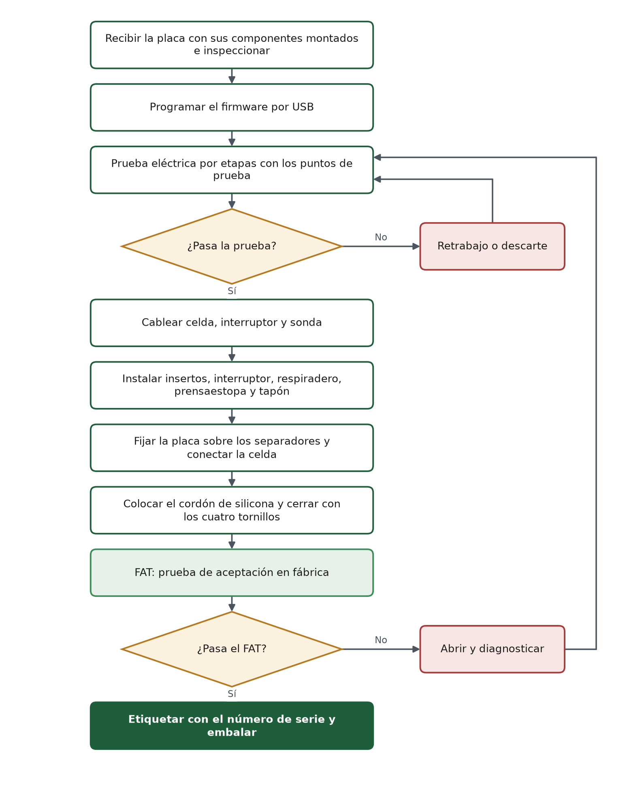

**Figura 3.1 “Secuencia de montaje del equipo”**

| Paso | Operación | Herramienta o instrumento | Control antes de continuar |
|---|---|---|---|
| 1 | Recibir la placa con sus componentes montados; inspeccionar contorno, agujeros y soldaduras | Lupa o microscopio y calibre | Sin puentes ni juntas frías; cotas del plano |
| 2 | Cargar el firmware por USB y leer el identificador de 15 dígitos | Computador con monitor serie | Versión correcta e identificador igual a la representación decimal de 15 dígitos de la dirección física |
| 3 | Prueba eléctrica por etapas: celda, 3,3 V, elevador y corte de la sonda con IO5 en bajo (0 V en la bornera) y en alto (5,00 V), divisor de batería | Fuente limitada inicialmente a 100 mA con cargas aisladas; aumentar según etapa antes de activar radio y sonda; multímetro y osciloscopio | Valores de la matriz de ensayos de la placa |
| 4 | Cablear la celda, el interruptor y la sonda (esta última por el prensaestopa), según Tabla 9.8 | Pelacables y termorretráctil | Colores y largos de la lista; alivio de tracción apretado |
| 5 | Instalar los insertos con calor y montar interruptor, respiradero, prensaestopa y tapón USB-C, con los torques de Tabla 9.9 | Soldador de insertos y llave de torque | Cada elemento sin juego ni deformación |
| 6 | Fijar la placa sobre los 4 separadores y poner la celda bajo la placa, lejos de la antena | Destornillador | Holguras de Tabla 9.5 |
| 7 | Colocar el cordón de silicona en el canal y cerrar con los 4 tornillos M3 en cruz | Destornillador con torque | Cordón comprimido de manera uniforme |
| 8 | FAT sobre el equipo cerrado (Tabla 10.9) | Fixture de ensayo | Todas las pruebas aprobadas |
| 9 | Etiquetar con el número de serie de 15 dígitos y embalar con cable USB-C y manual | Impresora de etiquetas | Etiqueta igual al identificador leído en el paso 2 |

**Tabla 10.0 “Pasos de montaje y controles”**

**Prueba del tercero.** Las tablas y los anexos C y D describen geometría nominal, conectores, cableado, torques y secuencia de montaje. La liberación a fabricación exige además el diseño editable, los archivos de producción de la misma revisión, la revisión de reglas y el modelo fabricable de carcasa, junto con la validación de interferencias y del cierre. Los planos ilustrativos no acreditan por sí solos que ese paquete esté liberado.

### Instalación y puesta en marcha en campo

La puesta en marcha en el campo del cliente alimenta la prueba de aceptación en sitio (SAT) del capítulo IX.

| Paso | Qué se hace | Quién | Criterio de término |
|---|---|---|---|
| 1 | Recibir el equipo, con su cable USB-C y su manual; revisar la etiqueta con el número de serie | Agricultor | Etiqueta legible |
| 2 | Cargar la celda por USB-C con el equipo apagado | Agricultor | Luz de fin de carga encendida (unas 5 h) |
| 3 | Instalar la aplicación desde la tienda y crear la cuenta y registrar el equipo con internet antes del trabajo sin cobertura | Agricultor | Sesión iniciada |
| 4 | Encender el equipo con el interruptor | Agricultor | LED verde 1 s y un pitido |
| 5 | Mantener el pulsador PAIR 3 s y buscar el equipo en la aplicación dentro de la ventana de 30 s y completar el registro con internet | Agricultor | El agricultor queda como administrador; el aviso verde sólo ocurre si la confirmación llega dentro de la ventana |
| 6 | Insertar la sonda en el suelo hasta su marca, en un suelo con humedad suficiente para el contacto, sin piedras; la profundidad y la humedad mínima se fijan con la ficha del modelo y la campaña de laboratorio | Agricultor | Sonda firme y sin aire alrededor |
| 7 | Tomar la primera medición con la fase fenológica elegida y ubicación activa | Agricultor | Veredicto con las 10 variables y ubicación como texto |
| 8 | Guardar la medición; con cobertura, se sincroniza | Agricultor | Medición en el historial y en la nube |
| 9 | Apagar el equipo al terminar, limpiar la sonda y recargar cuando la aplicación avise | Agricultor | Equipo apagado y limpio |

**Tabla 10.1 “Instalación y puesta en marcha en el campo”**

### Trazabilidad maestra

Cierra el capítulo la tabla que recorre, para cada requerimiento, el ciclo especificar, justificar, cotizar, dimensionar y probar, apuntando a la tabla donde se cumple cada paso.

| ID | Especificar | Justificar | Cotizar | Dimensionar | Probar |
|---|---|---|---|---|---|
| R01 | Tabla 6.5 | Tabla 6.7 | Tabla 9.1 | Tabla 8.0 | Tabla 10.7 |
| R02 | Tabla 6.5 | Tabla 6.8 | Tabla 9.1 | Tabla 9.4 | Tabla 10.7 |
| R03 | Tabla 6.5 | Tabla 6.6 | Tabla 9.1 | Tabla 8.2 | Tabla 10.7 |
| R04 | Tabla 6.5 | Tabla 6.7 | Tabla 2.5 | Tabla 5.6 | Tabla 10.7 |
| R05 | Tabla 6.3 | Tabla 1.8 | Anexo B | Tabla 8.6 | Tabla 10.7 |
| R06 | Tabla 6.5 | Tabla 6.6 | Tabla 9.1 | Tabla 9.4 | Tabla 10.7 |
| R07 | Tabla 6.5 | Tabla 7.4 | Tabla 9.1 | Tabla 8.2 | Tabla 10.7 |
| R08 | Tabla 6.5 | Tabla 6.9 | Tabla 9.1 | Tabla 8.0 | Tabla 10.7 |
| R09 | Tabla 6.5 | Tabla 7.6 | Tabla 9.1 | Tabla 9.5 | Tabla 10.7 |
| R10 | Tabla 6.5 | Tabla 7.7 | Tabla 9.1 | Tabla 9.2 | Tabla 10.7 |
| R11 | Tabla 6.5 | Tabla 7.7 | Tabla 9.1 | Tabla 9.5 | Tabla 10.7 |
| R12 | Tabla 6.3 | Tabla 7.5 | Tabla 9.1 | Tabla 8.0 | Tabla 10.7 |
| R13 | Tabla 6.3 | Tabla 6.2 | Anexo B | Tabla 7.9 | Tabla 10.7 |
| R14 | Tabla 6.5 | Tabla 6.6 | Anexo B | Tabla 7.9 | Tabla 10.7 |
| R15 | Tabla 6.5 | Tabla 7.2 | Tabla 9.1 | Tabla 7.9 | Tabla 10.7 |
| R16 | Tabla 6.5 | Tabla 5.5 | Tabla 9.1 | Tabla 8.0 | Tabla 10.7 |
| R17 | Tabla 6.3 | Tabla 7.4 | Tabla 9.1 | Tabla 8.0 | Tabla 10.7 |
| R18 | Tabla 5.5 | Tabla 7.4 | Tabla 9.1 | Tabla 9.2 | Tabla 10.7 |
| R19 | Tabla 5.5 | Tabla 6.6 | Tabla 2.5 | Tabla 9.2 | Tabla 10.7 |
| R20 | Tabla 3.7 | Tabla 3.4 | Tabla 9.1 | Tabla 3.6 | Tabla 10.7 |
| R21 | Tabla 6.2 | Tabla 8.6 | Anexo B | Tabla 3.6 | Tabla 10.7 |
| R22 | Tabla 6.5 | Tabla 7.8 | Tabla 9.0 | Tabla 10.6 | Tabla 10.7 |
| R23 | Tabla 8.6 | Tabla 8.7 | Anexo B | Tabla 10.5 | Tabla 10.7 |
| R24 | Tabla 8.8 | Tabla 7.0 | Tabla 9.1 | Tabla 8.8 | Tabla 10.7 |
| R25 | Tabla 6.2 | Tabla 8.7 | Anexo B | Tabla 8.6 | Tabla 10.7 |
| R26 | Tabla 6.5 | Tabla 5.5 | Anexo B | Tabla 6.5 | Tabla 10.7 |
| R27 | Tabla 6.5 | Tabla 7.4 | Tabla 9.1 | Tabla 9.5 | Tabla 10.7 |

**Tabla 10.2 “Trazabilidad maestra: requerimiento, especificar, justificar, cotizar, dimensionar y probar”**

## VIII. Fabricación

La fabricación responde la pregunta ¿con qué proceso, capacidad y control se produce? Define cómo se ensambla la placa, en qué estaciones se arma el equipo, qué capacidad necesita el taller para sostener el plan de ventas y cómo se identifica cada unidad.

### Alternativas de ensamble de la placa

La placa del instrumento se especifica con componentes de catálogo compatibles con montaje industrial; la disponibilidad y la elegibilidad efectiva para ensamble se confirman en la cotización formal. Se comparan el ensamble en taller y el ensamble contratado al fabricante.

| Criterio | A. Taller propio con esténcil y placa calefactora | C. Ensamble completo del fabricante (PCBA, *Printed Circuit Board Assembly*, placa con sus componentes ya montados) |
|---|---|---|
| Qué se compra | Placa desnuda a JLCPCB; componentes en LCSC o DigiKey; esténcil | Placa con todos los componentes montados, con las piezas del catálogo de LCSC |
| Qué se suelda en el taller | Todo: pasta con esténcil, colocación y reflujo; el módulo ESP32 y los conectores a mano | Sólo retoque y revisión, cableado, interruptor y celda |
| Equipos del taller | Aire caliente, placa calefactora, esténcil y microscopio (Tabla 9.0): $395.546 los tres primeros | Sólo inspección |
| Riesgo técnico | BME280 en LGA, CH340C en SOIC y almohadilla del TP4056: exigen perfil de reflujo y retrabajo | Menor: proceso industrial, con inspección del fabricante |
| Plazo | Inmediato una vez que llegan los componentes | De 1 a 3 semanas con envío internacional |
| Tiempo de ensamble de la placa | 62 min por unidad (estimado) | 10 min de retoque y revisión por unidad |
| Costo por placa en un lote de 200 | $8.258: mano de obra $7.004 (a $6.778 por hora), consumibles y merma $858 y equipo prorrateado $396 | $2.344: cargos del fabricante $1.214 y retoque $1.130 |

**Tabla 10.3 “Alternativas de ensamble de la placa del instrumento: A (taller) y C (fabricante)”**

El costo de C tiene una parte fija por pedido (preparación y esténcil de US$8 y US$1,50 en servicio económico; US$25 y US$7,86 en servicio estándar para el lote de 200, 16 piezas «extendidas» a US$3 cada una y envío estimado de US$25) y otra variable por placa (US$0,0016 por cada una de las 274 juntas y US$0,31 de envío), de modo que su costo por placa baja con el lote; el de A es casi constante. Las cifras son estimaciones sobre las tarifas publicadas del fabricante.

| Placas por lote | A: taller propio (equipo prorrateado) | C: fabricante | Alternativa conveniente |
| ---: | ---: | ---: | --- |
| 5 | $23.685 | $17.516 | C |
| 12 | $14.455 | $8.372 | C |
| 50 | $9.445 | $3.852 | C |
| 200 | $8.258 | $2.344 | C |
| 1.085 | $7.936 | $1.933 | C |

**Tabla 10.4 “Costo por placa del ensamble según el tamaño del lote”**

**Gana C en producción, en todos los lotes desde 5 placas.** Con el equipo de A ya comprado (se cuenta sólo el costo incremental de $7.863 por placa), A es más barato únicamente hasta lotes de 13 placas; con su equipo prorrateado, A nunca supera a C. Por eso el equipo de A, que se compra igual (aire caliente, placa calefactora y esténcil), queda para lo que C no hace bien: los **prototipos** (como el de diciembre de 2026, cuando el plazo de 1 a 3 semanas del fabricante obliga a pedir con anticipación), el **retrabajo** de placas con fallas y las revisiones de diseño. La lista de materiales de Tabla 9.1 ya incluye los cargos de ensamble del fabricante.

### Proceso por estaciones

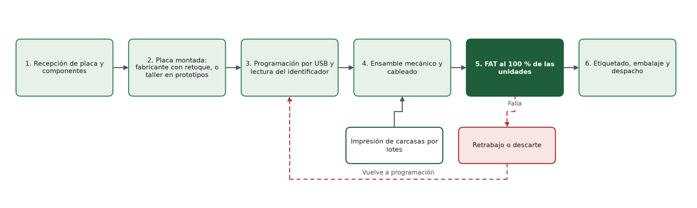

**Figura 3.2 “Proceso de fabricación por estaciones”**

| Estación | Operación | Equipos | Control | Minutos por unidad |
|---|---|---|---|---:|
| 1. Recepción | Inspección de la placa y de los componentes contra la lista de materiales | Lupa y calibre | Cotas del plano; componentes completos | 3 |
| 2. PCBA | Retoque y revisión de la placa montada por el fabricante (C); con ensamble en el taller (A) toma 62 min en lugar de 10 | Microscopio y estación de soldadura | Inspección de juntas | 10 |
| 3. Programación | Carga del firmware por USB; lectura del identificador | Computador y fixture | Versión e identificador | 3 |
| 4. Ensamble mecánico | Cableado, sellado, fijación y cierre con torque (Tabla 10.0) | Herramientas y llave de torque | Controles de cada paso | 20 |
| 5. FAT | Pruebas de aceptación del capítulo IX | Fixture de ensayo | Todas las pruebas aprobadas | 18 |
| 6. Embalaje | Etiqueta, cable USB-C, manual y caja | Impresora de etiquetas | Etiqueta igual al identificador | 5 |
| 7. Atención de la impresión | Retiro de las piezas y preparación de la cama | Impresoras 3D | Piezas sin defectos | 3 |
| **Total con ensamble del fabricante (C)** | — | — | — | **62** |

**Tabla 10.5 “Estaciones de fabricación, controles y tiempos por unidad”**

Con ensamble en el taller (A), el total sube a 114 minutos por unidad. Los tiempos son estimaciones de diseño que el prototipo debe medir.

### Capacidad del taller

El dimensionamiento convierte la demanda anual del plan de ventas (200 equipos en 2027 y 1.085 en 2036) en horas de máquina y de persona, y las compara con la capacidad instalada. Es la verificación de que el activo fijo sostiene las ventas.

| Recurso | Fórmula | Datos | Resultado |
|---|---|---|---|
| Carcasas por cama de impresión | Piezas por cama de 220 × 220 mm con huella y separación; una carcasa son dos piezas (base y tapa) | Huella conservadora de la carcasa de laboratorio de 110 × 100 mm con separación de 5 mm | 2 piezas por cama: 1 carcasa por cama |
| Horas de impresión por carcasa | Horas por cama, con sobretiempo | 210 g de PETG, flujo de 15 mm³/s y 25 % de sobretiempo; 4,08 h por ciclo con el cambio de cama | 3,83 h de impresión; ≈ 4,1 h por carcasa |
| Horas de impresión al año | Horas por carcasa × equipos por año | Plan de ventas | 816 h en 2027 y 4.424 h en 2036 |
| Capacidad de una impresora | Horas disponibles ÷ horas por carcasa | 300 días × 16 h × 92 % de éxito = 4.416 h | 1.083 carcasas por impresora al año |
| Número de impresoras | Horas al año ÷ horas disponibles por impresora | 0,18 en 2027 y 1,00 en 2036 | 1 impresora hasta 2035; 2 en 2036, cuando la demanda (1.085) excede las 1.083 de una |
| Horas de persona en el taller | Minutos por unidad (Tabla 10.5) × equipos por año ÷ 60 | 62 min con C; 114 min con A | 207 h en 2027 y 1.121 h en 2036 con C |
| Ocupación de una persona de taller | Horas de trabajo ÷ horas productivas de una persona | 1.800 h efectivas × 85 % de ocupación = 1.530 h | 14 % en 2027 y 73 % en 2036 con C (25 % y 135 % con A) |

**Tabla 10.6 “Dimensionamiento de la capacidad del taller”**

Dos impresoras quedan justificadas para 1.085 equipos en 2036 (y dan redundancia ante fallas); el dimensionamiento conserva por decisión del proyecto la huella de 110 × 100 mm de la carcasa de laboratorio, sin anticipar ahorro por la envolvente más pequeña del instrumento. Respecto de las personas, la carga de ensamble y FAT equivale al 73 % del tiempo productivo anual de una persona con ensamble del fabricante en 2036, frente a 4 ensambladores en la dotación del modelo (más los 2 socios). Esa dotación no sale del tiempo de ensamble: su holgura es una decisión conservadora que cubre además el retrabajo, la garantía, la calibración de sondas, la logística y la contingencia, y se registra como mejora propuesta revisar la dotación de taller.

### Control de calidad y trazabilidad por número de serie

El control de calidad no es una etapa final sino el FAT al 100 % de las unidades, con los controles de cada estación. La trazabilidad se apoya en el **número de serie: el ID de 15 dígitos, derivado de la dirección física (MAC) del microcontrolador** (48 bits expresados en decimal con ceros a la izquierda). Ese número se lee por USB en la estación 3, se imprime en la etiqueta de la estación 6 y es el mismo que el equipo anuncia por BLE y que la aplicación registra al vincularlo. Así, cada unidad queda asociada a su lote de fabricación, a su registro FAT y, más tarde, a su cliente. El formulario FAT de cada número de serie anota además la combinación de revisiones con que la unidad salió del taller (placa, carcasa, firmware y formato de trama, según la tabla de revisiones de referencia del capítulo VII), de modo que ante una desviación en terreno se pueda saber si afecta a una unidad, a un lote o a una revisión completa. Sin ese amarre, un resultado de ensayo no se puede atribuir a una configuración concreta del producto.

El registro FAT por número de serie es una función **propuesta** para el backoffice: hoy el backoffice conoce el equipo desde que se vincula, no desde la fábrica. Mientras no exista, el registro FAT se conserva en los formularios del anexo E, indexados por número de serie. La trazabilidad del lote es la base del control de deriva de la flota del plan de calibración: sin ella no se puede saber si una desviación es de un equipo o de un lote.

## IX. Ensayos y Pruebas

El capítulo responde la pregunta ¿cómo se demuestra que cumple? Cada requerimiento del capítulo II tiene al menos una prueba y cada prueba tiene un criterio de aceptación numérico o binario. Las pruebas se organizan en cuatro etapas: **desarrollo** (sobre prototipos, antes de producir), **FAT** (prueba de aceptación en fábrica, sobre el 100 % de las unidades, en el taller y antes de embalar), **SAT** (prueba de aceptación en sitio, en el campo del cliente, durante la puesta en marcha de febrero de 2027) y **normativa** (ensayos acreditados que exige o respalda una norma). Cada ensayo del capítulo tiene un identificador que indica su etapa: **D** de desarrollo, **F** de FAT, **S** de SAT, **N** de normativo, **W** de prueba automatizada de software y **T** de prueba sobre teléfono físico. La matriz requerimiento-prueba cita esos identificadores, de modo que cada requerimiento apunta al ensayo que lo demuestra y al registro donde consta el resultado. El veredicto de cada requerimiento se declara con tres valores y ninguno más: **Cumple**, cuando el criterio de aceptación completo está satisfecho y existe un registro que lo acredita; **No cumple**, cuando el ensayo se ejecutó y el criterio no se alcanzó; y **Pendiente**, cuando el ensayo no se ha ejecutado por completo, incluso si hay avance parcial, que se anota en la columna de evidencia. Un dato de hoja de datos del fabricante no constituye verificación del equipo. Los ensayos de hardware sobre la placa del instrumento se ejecutan con el prototipo de diciembre de 2026; a la fecha están ejecutadas las pruebas automatizadas de software y una primera lectura Modbus válida en el banco de laboratorio, del 03-10-2026. El BME280 se contrasta contra patrones en los ensayos de desarrollo y en el FAT. Las tramas Modbus se validan con su verificación de redundancia cíclica (CRC), que detecta errores de transmisión sin garantizar la detección de toda alteración posible.

### Matriz Requerimiento → Prueba

| ID | Ensayos | Prueba y método | Criterio de aceptación | Veredicto | Evidencia | Registro, informe o fotografía |
|---|---|---|---|---|---|---|
| R01 | D-13, D-14, F-06, S-03 | Lectura de las siete variables de suelo. Aplicación leyendo la trama con la sonda patrón conectada | 7 de 7 campos distintos del centinela en el FAT; 95 % o más de las mediciones del piloto | Pendiente | D-14 del 03-10-2026: primera trama Modbus válida con verificación de redundancia cíclica (CRC) correcta; F-06 y S-03 sin ejecutar | Sin acta experimental de cierre |
| R02 | F-08, S-03 | Exactitud del BME280 y autocalentamiento. Termohigrómetro y barómetro patrón en ambiente estable; lectura al encender y a los 10 min | ±1,0 °C, ±3 % HR y ±1,0 hPa; deriva menor que 0,5 °C | Pendiente | Declarada por la hoja de datos del BME280; el contraste contra patrón está programado en F-08 sobre el prototipo del 17-12-2026 | Sin acta experimental de cierre |
| R03 | F-07 | Tiempo del ciclo de medición. Cronómetro y monitor serie en 10 mediciones | Adquisición y envío en 10 s o menos; ciclo completo en 20 s o menos | Pendiente | Programada sobre el prototipo funcional del 17-12-2026 | Sin acta experimental de cierre |
| R04 | D-13, S-05 | Validación contra laboratorio. Protocolo de Tabla 5.6 con 30 puntos pareados y conversión de humedad de Tabla 5.7 | RMSE de pH ≤ 0,3; CE con RMSE ≤ 10 % o 200 µS/cm; humedad con RMSE ≤ 4 puntos; R² ≥ 0,80; intervalo de confianza del 95 % de la pendiente de Passing-Bablok dentro de 0,90–1,10 | Pendiente | Programada en la campaña de 30 puntos pareados de enero y febrero de 2027 | Sin acta experimental de cierre |
| R05 | W-01, T-01, S-04, S-07 | Operación sin red. Teléfono de prueba en modo avión, con Bluetooth y ubicación reactivados y sin Wi-Fi ni datos móviles | Medir, diagnosticar, georreferenciar y guardar completos; la cola se sincroniza sin pérdidas ni duplicados | Pendiente | W-01 verifica 436 casos automatizados; no acredita la cola completa en dispositivos reales; T-01, S-04 y S-07 sin ejecutar sobre teléfono y en campo | W-01, 29-10-2026; sin registro físico T-01/S-04/S-07 |
| R06 | S-06 | Alcance BLE. Aplicación; 20 intentos a 1, 3, 5 y 10 m en campo abierto, con el equipo cerrado y en el suelo | 20 de 20 lecturas a 1, 3 y 5 m; registrar éxitos a 10 m | Pendiente | Programada en el SAT del piloto del 26-02-2027 | Sin acta experimental de cierre |
| R07 | D-04, D-06, D-07, D-08, F-02, F-03 | Autonomía real. Registro de corriente en JP1 en dos jornadas de 2 h con 10 mediciones y descarga hasta el aviso | Energía de la jornada dentro de ±20 % del modelo; autonomía de 8 semanas o más y de 80 % o más de la calculada | Pendiente | Calculada con el modelo energético; la medición está programada en D-07 y D-08 sobre el prototipo del 17-12-2026 | Sin acta experimental de cierre |
| R08 | D-15, F-11, S-01 | Carga por USB-C. Ensayo completo desde 3,0 V hasta plena carga, más control de corriente a 3,7 V, con fuentes USB de 1 A y 2 A; multímetro y termopar | Corriente de 0,5 A o menos; tensión final dentro del límite de la celda (4,20 V ± 0,05 V); tensión de flotación medida en el FAT de cada unidad; carga completa en 6 h o menos; cargador bajo 60 °C | Pendiente | Programada sobre el prototipo funcional del 17-12-2026 | Sin acta experimental de cierre |
| R09 | N-01, D-16, D-17, F-01, F-13 | Estanqueidad IP67. Laboratorio acreditado, IEC 60529 [27]: cámara de polvo y sumersión a 1 m durante 30 min con todos los accesorios | Sin ingreso de polvo ni agua; el equipo funciona. Hasta aprobar N-01: «objetivo de diseño IP67» | Pendiente | Programada en el ensayo acreditado N-01, con holgura de 20 días hábiles en la carta Gantt; hasta aprobarlo el equipo se declara «objetivo de diseño IP67», y F-13 es un control de proceso que no acredita el grado | Sin acta experimental de cierre |
| R10 | N-03, D-17 | Temperatura de operación. Cámara o ambiente controlado a −5, +5, +25 y +50 °C, IEC 60068-2-1 y 2-2 [81], con 2 h de estabilización | Trama, BLE, batería y BME280 correctos; carcasa sin deformación mayor que 0,5 mm; la carga se inhibe fuera de 0 a 45 °C | Pendiente | Programada sobre el prototipo funcional del 17-12-2026 | Sin acta experimental de cierre |
| R11 | N-02 | Caída libre. Seis caídas, una por cara, desde 1,0 m sobre superficie dura, IEC 60068-2-31 [81] | Sin grietas ni aflojamiento de insertos; cierre estanco (se repite la sumersión); equipo funcional | Pendiente | Programada sobre el prototipo funcional del 17-12-2026 | Sin acta experimental de cierre |
| R12 | D-09, F-09 | Señales luminosas y sonoras. Observación y monitor serie recorriendo cada evento de Tabla 6.3 | El 100 % de los eventos produce su señal | Pendiente | Implementado en el firmware; D-09 y F-09 sin ejecutar | Sin acta experimental de cierre |
| R13 | D-12, F-05, F-09, S-02 | Ventana de vinculación. Cronómetro y observación del LED azul | Pulsación menor que 3 s no abre; mantenida 3 s abre una ventana de 30 ± 1 s | Pendiente | Implementado en el firmware; D-12, F-05 y S-02 sin ejecutar | Sin acta experimental de cierre |
| R14 | W-01, F-05 | Trama de 20 bytes. Aplicación de depuración BLE y vector de ejemplo del contrato; prueba automatizada del decodificador | 20 bytes, formato 1; ausencias en 0xFF; trama idéntica al vector | Pendiente | W-01 verifica el decodificador contra el vector del contrato; el empaquetado en el equipo y F-05 sin ejecutar | W-01, 29-10-2026; sin acta del equipo ensamblado |
| R15 | D-05, D-14, F-06 | Bus RS-485 y Modbus RTU. Osciloscopio diferencial y analizador lógico contra el mapa de registros de la sonda | Diferencial de al menos ±1,5 V sobre 54 Ω; silencio ≥ 3,5 caracteres (adoptar ≥ 8,1 ms a 4.800 baudios y ≥ 4,1 ms a 9.600) [32]; 1.000 lecturas consecutivas sin error de CRC | Pendiente | D-14 del 03-10-2026: primera trama válida con CRC correcto; faltan las 1.000 lecturas consecutivas | Sin acta experimental de cierre |
| R16 | D-02, D-03, D-05, D-15, F-10, N-04 | Protecciones eléctricas. Fuente de 4,2 V invertida y limitada a 3 A sobre una placa de sacrificio; generador de descargas electrostáticas en el USB y en las bornes del bus | La protección limita la corriente antes de superar los límites térmicos del diodo y la placa, según curvas y ensayo de coordinación; 10 descargas de ±8 kV de contacto sin pérdida de función | Pendiente | Programada sobre el prototipo del 17-12-2026, con el ensayo de descarga electrostática a cotizar junto al de radiofrecuencia | Sin acta experimental de cierre |
| R17 | D-04, D-10, F-12, S-08 | Aviso de batería baja. Fuente de laboratorio en la entrada de celda, bajando y subiendo la tensión | Latido rojo y dos tonos graves una sola vez bajo 3,40 V; se apaga sobre 3,50 V; la aplicación avisa al 15 % y se rearma sobre el 20 % | Pendiente | Implementado en el firmware y en la aplicación; D-04, D-10, F-12 y S-08 sin ejecutar | Sin acta experimental de cierre |
| R18 | N-06 | Seguridad de la celda. Certificados IEC 62133-2 y UN 38.3 del proveedor [28]; prueba de las protecciones de la celda | Certificados vigentes y corte correcto en sobrecarga, sobredescarga y cortocircuito | Pendiente | Certificados por incorporar al expediente de la celda; no se adjunta certificado ni acta de protección | Sin acta experimental de cierre |
| R19 | N-05 | Radiofrecuencia. Laboratorio acreditado en 2,4 GHz sobre la unidad armada; declaración de conformidad con código QR | Potencia bajo el límite acreditado, con margen; informe conforme y declaración publicada antes de comercializar | Pendiente | Programada en el laboratorio acreditado de 2,4 GHz, con holgura de 15 días hábiles en la carta Gantt, antes de comercializar | Sin acta experimental de cierre |
| R20 | Modelo económico y anexo B | Evaluación económica bajo los supuestos declarados. Modelo con precios de catálogo fechados, estimaciones identificadas y análisis de sensibilidad | VAN positivo al 20 % y caja nunca negativa a 10 años | Cumple | Modelo económico y anexo B con precios de catálogo fechados: VAN positivo al 20 % y caja mínima positiva en los diez años; se recalcula al recibir las cotizaciones formales | Anexo B y evaluación económica del capítulo V |
| R21 | W-01 | Cero suscripciones. Revisión de la aplicación y del modelo comercial | Ninguna función de medición condicionada a un pago | Cumple | W-01 y revisión del modelo comercial: ninguna función de medición queda condicionada a un pago recurrente | Revisión funcional y comercial del 29-10-2026; alcance documental |
| R22 | Cronometraje del FAT (F-01 a F-15) | Capacidad de producción. Tiempos de estación medidos en el prototipo contra el dimensionamiento de Tabla 10.6 | Horas de impresión, ensamble y FAT dentro de la capacidad instalada para 200 y 1.085 equipos | Pendiente | Dimensionada por diseño; el cronometraje de estación está programado con el FAT del prototipo del 17-12-2026 | Sin acta experimental de cierre |
| R23 | D-11, F-04, F-15, S-09 | Trazabilidad por número de serie. Auditoría de los formularios del lote | El 100 % de las unidades con ID de 15 dígitos y registro FAT asociado | Pendiente | Identidad implementada en el firmware; la auditoría de los formularios está programada con el FAT del primer lote | Sin acta experimental de cierre |
| R24 | Anexo A, Tabla 8.8 y ensayos de desarrollo del bloque sustituido | Disponibilidad y especificación de compra. Contrastar número de parte, huella, proveedor y aprobación de cada alternativa | Un número de parte de producción y proveedor comprobados por circuito integrado; alternativas identificadas y separadas de sustituciones validadas | Pendiente | Anexo A: referencias de catálogo consultadas el 02-10-2026. No acredita stock actual, cotización formal ni liberación completa. ESP32-WROOM-32D es la selección de diseño; ninguna alternativa se declara reemplazo directo | Anexo A: catálogo fechado; sin acta de liberación |
| R25 | W-04, S-07 | Aislamiento por equipo y rol. Secuencias de acceso cruzado con cuentas de prueba sobre una réplica local de la base de datos | Ninguna cuenta accede a equipos ajenos | Pendiente | Control de acceso por equipo y rol implementado en la base de datos y en los servicios. W-04 establece la aceptación mediante un acta de acceso cruzado; W-02 comprueba presentación y formato, no aislamiento | Sin acta experimental de cierre |
| R26 | T-02, T-04 | Accesibilidad. Auditoría de las pantallas, según Tabla 5.5 | Contraste de 4,5:1 o más, área táctil de 48 dp o más y ninguna información sólo por color | Pendiente | Contraste y área táctil implementados en la aplicación; la auditoría sobre teléfono físico está programada en T-02 y T-04 | Sin acta experimental de cierre |
| R27 | D-18, F-14 | Celda extraíble. Desmontaje cronometrado con destornillador en una unidad por lote | 5 min o menos, sin dañar placa ni cableado | Pendiente | Programada sobre el prototipo funcional del 17-12-2026 | Sin acta experimental de cierre |

**Tabla 10.7 “Matriz requerimiento-prueba”**

Cada registro experimental debe identificar ensayo, fecha, operador, instrumentos y calibración, número de serie, revisiones de placa y carcasa, firmware y compilación de la aplicación, condiciones, datos medidos y decisión frente al criterio. La columna de registro identifica evidencia existente; no asigna números ficticios a ensayos futuros. Una fotografía complementa los datos y no sustituye el registro de medición.

El veredicto corresponde a la aceptación del requerimiento completo. Dos requerimientos cumplen dentro del alcance documental declarado: la evaluación económica bajo sus supuestos (R20) y la ausencia de suscripciones (R21). Los otros 25 conservan aceptación pendiente; un avance de implementación o un antecedente de banco no equivale al ensayo completo. La disponibilidad de componentes (R24) exige cerrar la compra y la configuración con evidencia identificable. El calendario de prototipo, campaña y SAT expresa objetivos de ejecución, no resultados ya obtenidos.

### Ensayos de desarrollo de la placa y del firmware

Estos ensayos detallan los procedimientos de la puesta en marcha por etapas y sustentan varios requerimientos de la matriz. Cada uno supone aprobado el anterior, de modo que una falla temprana detiene el avance antes de gastar tiempo en ensayos caros. Las referencias de corriente son las del modelo energético del instrumento.

| ID | Ensayo | Método e instrumento | Criterio de aceptación | Requerimientos | Veredicto | Evidencia |
|---|---|---|---|---|---|---|
| D-01 | Inspección de la placa desnuda | Lupa y calibre sobre las placas del pedido | Contorno y agujeros del plano con ±0,2 mm; sin cobre levantado | R24 | Pendiente | Programada sobre el prototipo funcional del 17-12-2026 |
| D-02 | Continuidad y cortos | Multímetro contra el esquemático, en continuidad y en resistencia entre rieles | Cada red continua; ningún valor menor que 10 Ω entre rieles y tierra | R16 | Pendiente | Programada sobre el prototipo funcional del 17-12-2026 |
| D-03 | Etapa 1: celda | Fuente de 3,7 V limitada a 100 mA en la bornera de la celda | 3,7 V ± 0,1 V en el punto de celda y menos de 1 mA | R16 | Pendiente | Programada sobre el prototipo funcional del 17-12-2026 |
| D-04 | Etapa 2: riel de 3,3 V | Multímetro y osciloscopio en el riel de 3,3 V, con la celda a 4,2 V y a 3,4 V, y durante el pico de excitación de la sonda | De 3,2 a 3,4 V anunciando con la celda a 4,2 V y a 3,4 V; rizado menor que 100 mV; sin caída bajo 3,0 V en el pico de adquisición | R07, R17 | Pendiente | Programada sobre el prototipo funcional del 17-12-2026 |
| D-05 | Etapa 3: elevador y corte de la sonda | Osciloscopio y multímetro en IO5 y en la bornera de la sonda | Con IO5 en bajo, la bornera queda bajo 0,1 V y la corriente hacia la sonda bajo 10 µA; con IO5 en alto, de 4,75 a 5,25 V | R07, R15, R16 | Pendiente | Programada sobre el prototipo funcional del 17-12-2026 |
| D-06 | Arranque del elevador | Osciloscopio en EN y en 5 V de la sonda durante el reinicio | IO5 bajo 0,5 V durante todo el reinicio; bornera de la sonda en 0 V | R07 | Pendiente | Programada sobre el prototipo funcional del 17-12-2026 |
| D-07 | Corriente por JP1 en cada modo | Multímetro con registro y osciloscopio con resistencia de medición | Cada valor dentro de ±25 % del modelo; si excede, se corrige el modelo con el dato medido | R07 | Pendiente | Programada sobre el prototipo funcional del 17-12-2026 |
| D-08 | Autonomía del equipo con interruptor | Batería nominal de 2.000 mAh cargada por el circuito del equipo; dos jornadas semanales de 2 h con 10 mediciones y apagado entre jornadas. Registrar tensión, energía, lecturas y tiempo hasta aviso de batería baja; comparar con el mismo punto de término del modelo | Al menos 8 semanas y 80 % de la autonomía calculada, sin pérdidas de mediciones; actualizar el balance con D-07 antes de aceptar el resultado | R07 | Pendiente | Protocolo definido para el piloto; registro de descarga completo por incorporar |
| D-09 | Corriente del buzzer | Osciloscopio en el pin IO19 y en el riel mientras suena el tono de 2,7 kHz | Corriente por el pin de ≈ 2,6 mA (corriente de base); corriente por el riel de 52 mA o menos | R12 | Pendiente | Programada sobre el prototipo funcional del 17-12-2026 |
| D-10 | Lectura y calibración de batería | Fuente en la celda a 3,0, 3,5, 3,7 y 4,2 V con multímetro de referencia | Error de la tensión leída menor que 2 %; curva de tensión a porcentaje definida | R17 | Pendiente | Programada sobre el prototipo funcional del 17-12-2026 |
| D-11 | Arranque e identidad | Monitor serie a 115.200 baudios; dirección física leída por separado | LED verde 1 s y pitido; identificador de 15 dígitos igual a la dirección física y estable tras reiniciar | R23 | Pendiente | Programada sobre el prototipo funcional del 17-12-2026 |
| D-12 | Característica de estado | Aplicación de depuración BLE | 5 bytes; el bit de ventana cambia al abrir y cerrar | R13 | Pendiente | Programada sobre el prototipo funcional del 17-12-2026 |
| D-13 | Consumo y exactitud de la sonda a 5 V | Multímetro en serie y comparación a 5 y a 12 V sobre las mismas soluciones patrón de pH y de conductividad, con la sonda de muestra | 50 mA o menos; desviación entre 5 y 12 V dentro del umbral agronómico de cada variable; si no se cumple, se adopta la contingencia de diseño ya prevista: un elevador de 12 V dedicado a la sonda, detrás del mismo corte por MOSFET | R01, R04 | Pendiente | Programada con la sonda de muestra ya adquirida, antes de comprometer el volumen de compra |
| D-14 | Lectura estable de la sonda por Modbus | Mil lecturas consecutivas con la sonda enterrada, registrando cada verificación de redundancia cíclica (CRC), los reintentos y el tiempo entre tramas | 1.000 de 1.000 lecturas sin error de CRC; todo reintento queda registrado; ninguna lectura estimada | R15 | Pendiente | Banco de laboratorio, 03-10-2026: primera trama Modbus válida con CRC correcto; faltan las 1.000 lecturas consecutivas |
| D-15 | Carga y ruta de alimentación | Carga desde 3,0 V hasta plena carga con fuentes USB de 1 A y de 2 A; multímetro en serie, termopar en el cargador y en la celda, y el equipo encendido y apagado durante la carga | Corriente de carga de 0,5 A o menos; tensión de flotación de 4,20 V ± 0,05 V; cargador bajo 60 °C y celda dentro de 0 a 45 °C; inhibición de carga fuera del intervalo permitido; el equipo opera durante la carga sin que la celda alimente el consumo | R08, R16 | Pendiente | Programada sobre el prototipo funcional del 17-12-2026 |
| D-16 | Torque de cierre y repetibilidad del sello | Llave dinamométrica sobre los cuatro tornillos M3; cinco ciclos de apertura y cierre sobre la misma carcasa, repitiendo la inmersión de control tras cada cierre | Los cuatro tornillos a 0,4 N·m sin deformar el cordón ni arrancar el inserto; cinco de cinco cierres sin ingreso de agua; el torque que cumple queda fijado como especificación de montaje | R09, R27 | Pendiente | Programada sobre el prototipo funcional del 17-12-2026 |
| D-17 | Compatibilidad ambiental del PETG | Exposición de una carcasa impresa a 60 °C durante 500 h y a radiación solar directa durante una temporada, con medición de cotas, dureza superficial y repetición de la inmersión de control | Sin fisuras ni amarilleamiento que afecte la función; cotas dentro de ±0,5 mm; el cierre conserva su estanqueidad. Si no se cumple, se adopta la contingencia de ASA | R09, R10 | Pendiente | Programada sobre el prototipo funcional del 17-12-2026 |
| D-18 | Cambio de celda en terreno | Equipo apagado y USB desconectado: abrir tapa, aflojar los dos tornillos de la bornera con Phillips, liberar y sustituir la celda, comprobar polaridad y retención, cerrar y repetir control de estanqueidad | Procedimiento completo en 5 min o menos, sin dañar placa, terminales ni cableado; el cierre recupera su estanqueidad | R27 | Pendiente | Acceso y herramienta definidos; duración y sello posterior se verifican sobre el piloto |

**Tabla 10.8 “Ensayos de desarrollo de la placa y del firmware”**

### Prueba de aceptación en fábrica (FAT)

El FAT se aplica al 100 % de las unidades, en la estación 5 del proceso, con el fixture de ensayo y un computador, y antes de embalar, según la estructura de pruebas de aceptación de la norma IEC 62381 [60]. Cada resultado se registra con el número de serie en el formulario del anexo E. Los 18 minutos de estación son una estimación de diseño que se cronometra con este protocolo completo y con los ensayos por muestreo. La prueba de 1.000 lecturas, la carga completa, la estabilidad térmica y la autonomía pertenecen a desarrollo; no se presumen ejecutadas dentro del FAT breve. Una falla de estanqueidad retiene el lote y exige corregir la causa y ampliar el control al 100 %.

| ID | Prueba | Método | Criterio de aceptación | Requerimientos |
|---|---|---|---|---|
| F-01 | Inspección visual y de cierre | Revisión del cordón de silicona, los 4 tornillos con su torque y la etiqueta | Cordón uniforme; tornillos a 0,4 N·m; etiqueta igual al identificador | R09, R23 |
| F-02 | Corriente en espera | Multímetro en el puente JP1 con el fixture, equipo encendido sin medir | 18 mA ± 25 % | R07 |
| F-03 | Corriente en adquisición | Multímetro con registro en JP1 durante una medición | 146 mA ± 25 % | R07 |
| F-04 | Programación y versión | Leer identidad y versión por BLE y contrastar el binario instalado con la liberación registrada | Versión de la liberación vigente; identificador de 15 dígitos igual a la dirección física | R23 |
| F-05 | BLE y trama | Vinculación con la aplicación de prueba y lectura de una trama | Trama de 20 bytes con formato 1 | R13, R14 |
| F-06 | Lectura de la sonda de cada unidad | Verificar la sonda que se despacha, en soluciones separadas de pH 7,00 y CE 1.413 µS/cm; enjuagar entre patrones | Siete campos válidos y CRC correcto; pH 7,00 ± 0,3; CE 1.413 ± 200 µS/cm; N, P y K sólo informativos | R01, R15 |
| F-07 | Tiempo de medición | Cronometrar 10 mediciones consecutivas con la aplicación | Adquisición y envío ≤ 10 s; ciclo con conexión ≤ 20 s en cada intento | R03 |
| F-08 | BME280 contra la referencia | Comparación con termohigrómetro y barómetro patrón | ±1,0 °C; ±3 % HR; ±1,0 hPa | R02 |
| F-09 | LED, buzzer y pulsador PAIR | Recorrido de los eventos de la filosofía operativa | Tres colores y seis patrones sonoros; ventana de vinculación de 30 ± 1 s | R12, R13 |
| F-10 | Corte de la sonda | Tensión en la bornera de la sonda con el equipo encendido y sin medir | Menos de 0,1 V | R16 |
| F-11 | Carga | Cargador USB de 1 A; corriente por JP1, tensión de flotación en la bornera de la celda y luz de carga | Corriente de 0,5 A o menos; tensión de flotación de 4,20 V ± 0,05 V; señal de carga y terminación correctas | R08 |
| F-12 | Aviso de batería baja | Fuente ajustable: bajar de 3,40 V y subir sobre 3,50 V; comprobar también el aviso de la aplicación | Equipo: aviso con tensión < 3,40 V y rearme > 3,50 V; aplicación: aviso con carga ≤ 15 % y rearme > 20 %; un aviso por ciclo | R17 |
| F-13 | Estanqueidad por muestreo | Inmersión de 10 min a 0,5 m (1 de cada 10 unidades y las 5 primeras de cada lote) | Sin ingreso de agua; si la unidad no está en la muestra, se marca «No aplica» | R09 |
| F-14 | Celda extraíble por muestreo | Una unidad por lote, apagada y sin USB: abrir tapa, aflojar los dos tornillos de la bornera con Phillips, recambiar la celda, verificar polaridad y repetir cierre y estanqueidad | ≤ 5 min sin daño; No aplica sólo fuera de la muestra documentada | R27 |
| F-15 | Registro | Formulario por número de serie, fecha, instrumentos, operador y resultados | Sin casillas pendientes y con firmas; No aplica sólo en muestreo justificado | R23 |

**Tabla 10.9 “Pruebas de aceptación en fábrica (FAT)”**

### Prueba de aceptación en sitio (SAT)

El ESP32-WROOM-32D soporta Bluetooth de bajo consumo [61], pero no define una distancia garantizada para el producto terminado. El alcance depende de potencia, sensibilidad de ambos extremos, antenas, orientación, carcasa, obstáculos e interferencias [82]. Por ello S-06 conserva 5 m como mínimo de aceptación y 10 m como objetivo, medidos con el equipo cerrado. La implementación móvil contempla Android e iOS; usar el mismo protocolo no sustituye la comprobación de permisos, conexión y recorrido completo en modelos físicos identificados.

El SAT se ejecuta en el campo del cliente durante la puesta en marcha de febrero de 2027 (carta Gantt del capítulo X) y sigue los pasos de la instalación del capítulo VII. Cierra con la firma de recepción del cliente en el formulario del anexo E.

| ID | Prueba | Método | Criterio de aceptación | Requerimientos |
|---|---|---|---|---|
| S-01 | Recepción | Revisión de la etiqueta y de la carga completa | Número de serie legible y celda cargada | R08, R23 |
| S-02 | Vinculación | Con red: PAIR durante 3 s, buscar dentro de la ventana de 30 s y completar el registro | El agricultor queda como administrador; aviso verde sólo si la confirmación llega dentro de la ventana | R13 |
| S-03 | Primera medición con ubicación | Medir con etapa elegida y ubicación activa; recorrer especie indicada y sin especie, y pre-siembra sin selector | Diez registros y ubicación como texto; N, P y K informativos; especie y cobertura coherentes en resultado e historial | R01, R02, R05 |
| S-04 | Operación sin red | Con cuenta y equipo registrados: modo avión, reactivar Bluetooth y ubicación; medir, guardar, cerrar la aplicación y reabrir sin red | Lecturas, etapa, especie y diagnóstico permanecen en historial y cola; pronóstico ausente o guardado identificado, nunca inventado | R05 |
| S-05 | Comparación con una muestra de laboratorio | Muestra del punto medido y cilindro de 100 cm³ para la humedad, enviados a laboratorio (sólo en el piloto) | Registrar el par, los métodos, la humedad gravimétrica y la densidad aparente; aceptación estadística al completar ≥ 30 puntos: RMSE pH ≤ 0,3; RMSE de CE ≤ 10 % o 200 µS/cm; RMSE humedad ≤ 4 puntos; R² ≥ 0,80; intervalo de confianza del 95 % de la pendiente de Passing-Bablok dentro de 0,90–1,10. No aplica fuera del piloto | R04 |
| S-06 | Alcance BLE | Equipo cerrado en el suelo: 20 intentos por distancia a 1, 3, 5 y 10 m | 20 de 20 lecturas a 1, 3 y 5 m; registrar éxitos a 10 m como objetivo | R06 |
| S-07 | Sincronización con la nube | Registrar identificadores y valores de las lecturas locales; recuperar red, interrumpir un envío y reintentar; comparar con nube y consola | Mismos identificadores, cantidad y valores en local y nube; cero duplicados y pérdidas; cola vacía sólo tras confirmar los envíos | R05, R25 |
| S-08 | Aviso de batería | Estado de batería en la aplicación frente a la tensión medida con voltímetro | Porcentaje coherente con la tensión medida | R17 |
| S-09 | Firma de recepción | Formulario del anexo E | Firmado por cliente y técnico, con ensayos aplicables aprobados | R23 |

**Tabla 11.0 “Pruebas de aceptación en sitio (SAT)”**

El piloto en campo cierra el ciclo. Se propone con los equipos del primer lote, durante una temporada, y su criterio son medidas operativas: al menos 95 % de las mediciones con las diez variables completas, ninguna medición perdida o duplicada tras la sincronización, ninguna falla de estanqueidad, autonomía medida de al menos 8 semanas y 80 % del modelo y al menos 80 % de las personas que usan el equipo por primera vez logran vincular y medir sin ayuda (mínimo cinco usuarios observados). Se ejecuta con los equipos del primer lote.

### Ensayos normativos

La retención de la placa con tornillos M2, la carcasa y la junta de cierre son medidas de diseño para resistir manipulación, humedad e impactos. Su presencia no determina por sí sola un grado IP ni la resistencia a seis caídas de un metro: se evalúa el conjunto armado y su funcionamiento después de cada ensayo. La carcasa limita el contacto directo con la electrónica, pero los puertos y el cableado exterior siguen siendo vías que se deben evaluar frente a descarga electrostática; no se considera la sonda una barrera de aislamiento galvánico sin documentación que lo acredite. Las protecciones del bus y los conectores se verifican como sistema [83].

Los ensayos acreditados respaldan la declaración comercial del producto. Conviene separar dos cosas que se parecen y no son equivalentes: el **ensayo IP67 normativo** (N-01) se ejecuta en un laboratorio acreditado, sobre el conjunto completo con prensaestopa, respiradero, tapón del USB-C e interruptor, incluye la cámara de polvo y es lo único que habilita a declarar el grado de protección; la **prueba de estanqueidad del FAT** (F-13) es un control de proceso por muestreo, de 10 minutos a 0,5 m y sin cámara de polvo, cuyo objeto es detectar un cierre mal ejecutado en la línea de montaje. F-13 no acredita IP67 ni lo reemplaza, y aprobar F-13 en el 100 % de las unidades no autoriza a retirar la expresión «objetivo de diseño IP67» mientras N-01 no esté aprobado. Los valores de temperatura y de caída son criterios de diseño que deben revisarse antes de usarse como criterio de aceptación comercial; hasta aprobar N-01 el equipo se declara «objetivo de diseño IP67» [41].

| ID | Ensayo | Norma | Qué se verifica | Proveedor y presupuesto (anexo A) | Veredicto | Evidencia |
|---|---|---|---|---|---|---|
| N-01 | Estanqueidad | IEC 60529 [27] | R09: sumersión a 1 m durante 30 min con prensaestopa, respiradero, tapón e interruptor | Laboratorio de ensayo IP (JJR Lab u otro acreditado); $475.000, estimación sobre tarifa publicada | Pendiente | Programada con el laboratorio de ensayo IP presupuestado, con holgura de 20 días hábiles en la carta Gantt |
| N-02 | Caída libre | IEC 60068-2-31 [81] | R11: seis caídas desde 1,0 m | Sin presupuesto propio: ensayo interno con el prototipo | Pendiente | Programada sobre el prototipo funcional del 17-12-2026 |
| N-03 | Temperatura | IEC 60068-2-1 y 2-2 [81] | R10: funcionamiento a −5, +5, +25 y +50 °C | Sin presupuesto propio: ensayo interno con el prototipo | Pendiente | Programada sobre el prototipo funcional del 17-12-2026 |
| N-04 | Descarga electrostática | IEC 61000-4-2 [59] | R16: ±8 kV de contacto en USB y bus | Sin presupuesto propio: se cotiza junto con el de radiofrecuencia | Pendiente | Programada con el laboratorio acreditado, a cotizar junto con el ensayo de radiofrecuencia |
| N-05 | Radiofrecuencia | Res. Exenta N° 1.985/2017 [29] y Res. N° 737/2025 [58] | R19: potencia del enlace BLE y verificación formal | Laboratorio acreditado y gestor de la declaración; $1.300.000, estimación | Pendiente | Programada con el laboratorio acreditado y el gestor de la declaración, con holgura de 15 días hábiles, antes de comercializar |
| N-06 | Seguridad de la celda | IEC 62133-2 y UN 38.3 [28] | R18: certificados y protecciones | Certificados del fabricante de la celda (EEMB), sin costo adicional | Pendiente | Certificados por incorporar al expediente de la celda; no se adjunta certificado ni acta de protección |

**Tabla 11.1 “Ensayos normativos”**

### Validación contra laboratorio, calibración y deriva

El protocolo de validación contra laboratorio (Tabla 5.6), su criterio estadístico de equivalencia, la conversión de la humedad gravimétrica a volumétrica (Tabla 5.7) y el plan de calibración y control de deriva (Tabla 5.8) se fijaron en la ingeniería conceptual y rigen también en esta etapa. Este capítulo agrega lo necesario para ejecutar la campaña:

| Elemento | Especificación |
|---|---|
| Laboratorio y presupuesto | Laboratorio de Química de Suelos y Aguas de la Universidad de Chile, lista 2026: fertilidad completa (pH, CE, materia orgánica y N, P y K disponibles) a 1,00 UF por muestra; 30 muestras a $40.845 por UF suman $1.225.350, más unos $75.000 de patrones: $1.300.000 en el activo nominal. El alcance que se solicita en la cotización formal debe incluir humedad, densidad aparente y textura; la tarifa publicada no acredita que estén incluidas |
| Muestreo de humedad | Un cilindro de acero de 100 cm³ por punto, hincado sin compactar a no más de 10 cm de la sonda y a la profundidad de sus electrodos, dentro de los 15 minutos siguientes a la lectura; sellado y pesado dentro de 24 horas |
| Registro de cada punto | Fecha y hora, coordenadas, clase textural, lectura in situ de cada variable, número de cilindro, masas húmeda y seca, y método de extracción de pH y CE del laboratorio |
| Análisis estadístico | Por variable, por clase textural y para el conjunto: número de pares, RMSE en unidades originales, R de Pearson y R², pendiente y ordenada de Passing-Bablok con intervalos del 95 %, sesgo y límites de concordancia de Bland-Altman con sus intervalos. Informar pares excluidos y motivos; no sustituir datos reales por ejemplos |
| Calibración y validación independientes | Los coeficientes que se ajusten con una campaña se validan con una campaña distinta, nunca con los mismos datos |

**Tabla 11.2 “Ejecución de la campaña de validación”**

**Preparación y alcance contratado.** Antes de muestrear se acuerdan con el laboratorio los métodos, la masa de suelo, los recipientes, la conservación, el plazo de recepción y el alcance de su acreditación. El servicio debe incluir pH, conductividad, humedad gravimétrica, densidad aparente y textura; un paquete de fertilidad que incluya nutrientes no necesariamente cubre la caracterización física. El laboratorio identifica el medio y la relación suelo:solución del pH, el extracto usado para conductividad y su temperatura de referencia. La lectura directa en suelo y un extracto de laboratorio no se consideran el mismo método: la comparación debe declarar esa diferencia y no usar una regresión para atribuir a la sonda una determinación química que no realiza.

**Campaña pareada.** Se seleccionan 30 puntos independientes, distribuidos en al menos tres clases texturales con diez puntos por clase. La textura definitiva la determina el laboratorio. Cada punto recibe un identificador único que vincula la lectura, la muestra, el cilindro y el certificado. Primero se mide con la sonda a 5 V en suelo sin alterar; se registra tensión durante la captura, profundidad, hora, condiciones y estabilidad. Las repeticiones de una inserción o de un mismo punto sirven para cuantificar repetibilidad, pero no cuentan como nuevos puntos. Después se toma la muestra próxima a los electrodos y el cilindro de volumen conocido, sin compactarlo; se preserva su humedad y se remite según las instrucciones acordadas.

**Datos que se conservan.** El registro de campo reúne punto, coordenadas, fecha, operador, número de serie, revisiones, tensión de alimentación y lecturas originales de humedad, temperatura, pH y conductividad, junto con las repeticiones y sus incidencias. El registro de laboratorio incorpora número de informe, método, unidades, textura, masas y densidad aparente, y resultados de referencia. Para humedad se compara el porcentaje volumétrico de la sonda con el obtenido de humedad gravimétrica y densidad aparente del mismo cilindro, según la Tabla 5.7; no se compara directamente un porcentaje en masa con uno en volumen.

**Análisis y criterio de cierre.** Para cada variable se entrega la tabla de pares y un análisis agregado y por textura con número de puntos, RMSE, R y R², recta de Passing-Bablok con intervalos de confianza y gráfico de Bland-Altman con sesgo y límites de concordancia. El resultado identifica unidades, exclusiones justificadas y condiciones de validez. Los límites de aceptación son los de la Tabla 5.6 y no se ajustan después de ver los datos. Si la incertidumbre no permite decidir, se amplía la campaña. Si se corrige una calibración con esos puntos, la corrección requiere validación con puntos independientes. R04 se cierra con el registro de campo, los informes del laboratorio, los análisis y un acta que compare los resultados con cada criterio; N, P y K permanecen informativos.

Los umbrales son objetivos agronómicos que se revisan con un especialista y con la incertidumbre del método de referencia; cerca de un límite de clasificación, incluso un error pequeño puede cambiar una recomendación. La campaña debe informar sesgo, dispersión y desempeño por clase textural, además del resultado agregado. Los 30 pares son puntos independientes, con al menos 10 en cada una de tres clases; las repeticiones de una misma muestra no aumentan ese número. R y R² describen asociación y no sustituyen la concordancia [56]. Cada resultado se vincula con el certificado del laboratorio, el registro de campo y la configuración del equipo. El protocolo establece la aceptación experimental; los indicadores de concordancia se informan al completar y documentar la campaña.

La validación responde si el instrumento concuerda con el laboratorio en un momento dado; la calibración y el control de deriva responden si el dato sigue siendo confiable dos temporadas después. El ajuste de coeficientes, su almacenamiento persistente y su actualización remota se implementan con el plan de calibración. El manual de la sonda ofrece además registros de calibración en la propia sonda (desplazamientos de temperatura, humedad, conductividad y pH, y un coeficiente y un desplazamiento lineales para N, P y K) [20]; usarlos en lugar de la memoria del microcontrolador queda como alternativa a evaluar con la muestra.

### Pruebas del software y matriz de teléfonos

Las funciones del firmware, la aplicación y los servicios tienen alcances de verificación distintos. W-01, W-02 y W-03 se ejecutaron el 29 de octubre de 2026 en computador: comprueban lógica y presentación. W-04 define las pruebas de aceptación del control de acceso implementado en la base de datos. La matriz de teléfonos complementa estas comprobaciones con el recorrido físico del usuario.

| ID | Prueba | Alcance | Resultado de la última ejecución | Veredicto |
|---|---|---|---|---|
| W-01 | Aplicación | Lógica de telemetría, vinculación, historial, permisos, etapa y especie, cobertura, indicadores y pronóstico; no constituye ensayo físico ni de sincronización integral | 436 de 436 aprobadas el 29-10-2026 | Cumple |
| W-02 | Consola de soporte | Formatos, veredicto y resumen del pronóstico | 8 de 8 aprobadas el 29-10-2026 | Cumple |
| W-03 | Despachador de avisos | Cliente del servicio de notificaciones y clasificación de errores | 29 de 29 aprobadas el 29-10-2026 en computador | Cumple |
| W-04 | Base de datos | Esquema, aislamiento por cuenta y rol, avisos de acceso únicos, reintentos y concurrencia | Control de acceso implementado; la aceptación requiere el acta de pruebas de acceso cruzado con cuentas, casos y resultados identificados | Pendiente |

**Tabla 11.3 “Pruebas automatizadas del software y del servicio”**

Los ensayos que sólo pueden hacerse con teléfonos físicos se organizan en una matriz de dispositivos. El criterio común es el recorrido completo: registrar, vincular, medir, guardar, perder la cobertura, recuperarla y sincronizar sin duplicar ni perder mediciones, en español e inglés.

| ID | Perfil de teléfono | Sistema | Qué se comprueba | Veredicto | Evidencia |
|---|---|---|---|---|---|
| T-01 | Motorola G55 | Android 12 o posterior | Recorrido completo con el equipo; permisos de Bluetooth, ubicación, cámara y notificaciones; modo avión; cierre del proceso con cola pendiente | Pendiente | Programada entre el prototipo del 17-12-2026 y la publicación de la aplicación del 31-03-2027 |
| T-02 | Android compacto de 360 × 640 | Android (versión por registrar) | Diseño de las pantallas con texto ampliado; lectura de los avisos y de las diez variables | Pendiente | Programada entre el prototipo del 17-12-2026 y la publicación de la aplicación del 31-03-2027 |
| T-03 | Android anterior a la versión 12 | Android 11 o anterior | Permisos heredados de Bluetooth y ubicación para buscar equipos | Pendiente | Programada entre el prototipo del 17-12-2026 y la publicación de la aplicación del 31-03-2027 |
| T-04 | iPhone compacto de 375 × 667 | iOS (versión por registrar) | Diseño con texto grande; permiso de Bluetooth; QR y código de invitación | Pendiente | Programada entre el prototipo del 17-12-2026 y la publicación de la aplicación del 31-03-2027 |
| T-05 | iPhone físico con compilación de tienda | iOS | Recepción de avisos de acceso en primer plano, segundo plano y arranque frío; lectura del permiso de Bluetooth | Pendiente | Programada entre el prototipo del 17-12-2026 y la publicación de la aplicación del 31-03-2027 |

**Tabla 11.4 “Matriz de teléfonos de prueba”**

## X. Planificación del Proyecto

La carta Gantt es la del proyecto, no la del curso: no incluye evaluaciones. Va de agosto de 2026 a julio de 2027 y se divide por trimestres, del Q3 de 2026 al Q3 de 2027, con los meses como subdivisión; está completa en el anexo F con su estructura de desglose del trabajo (EDT), el área responsable, las predecesoras, la duración en días hábiles, la holgura y la ruta crítica de cada actividad. El proyecto parte con la ingeniería conceptual en agosto de 2026 y termina el 30 de julio de 2027, cuando se entrega la placa revisada con lo aprendido en el piloto, junto con la documentación final. Su hito fijo es la **entrega del prototipo funcional el 17 de diciembre de 2026**. Le siguen la prueba de aceptación en sitio (SAT) del piloto aprobada el 26 de febrero de 2027, la aplicación aprobada en las tiendas el 31 de marzo, el lanzamiento comercial el 19 de abril y la entrega del proyecto. Las ventas que empiezan con el lanzamiento son operación de la empresa y continúan después del cierre: se muestran para situarlas, pero no forman parte del alcance. Las fechas anteriores al corte del 04-10-2026 registran lo ejecutado; las posteriores son planificadas.

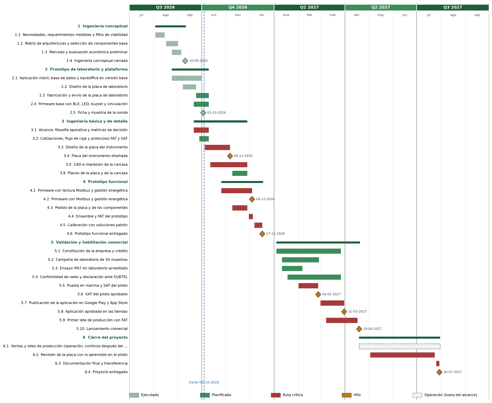

**Figura 3.3 “Carta Gantt del proyecto”**

| Hito | Fecha | Estado al 04-10-2026 | Criterio de cumplimiento |
|---|---|---|---|
| Ingeniería conceptual cerrada | 10-09-2026 | Cumplido | Informe de ingeniería conceptual |
| Ficha y muestra de la sonda | 03-10-2026 | Cumplido | Manual del fabricante y unidad de muestra |
| Placa del instrumento diseñada | 06-11-2026 | Programado | Revisión de diseño aprobada y pedido emitido |
| Firmware con Modbus y gestión energética | 04-12-2026 | Programado | 1.000 lecturas consecutivas sin error de CRC |
| **Prototipo funcional entregado** | **17-12-2026 (fijo)** | Programado | Prototipo armado, calibrado y con FAT aprobado |
| SAT del piloto aprobado | 26-02-2027 | Programado | SAT aprobado y firmado |
| Aplicación aprobada en las tiendas | 31-03-2027 | Programado | Versión descargable e instalable |
| Lanzamiento comercial | 19-04-2027 | Programado | Primer lote disponible para la venta |
| **Proyecto entregado** | **30-07-2027** | Programado | Placa revisada liberada y documentación aceptada |

**Tabla 11.5 “Hitos del proyecto”**

**Ruta crítica.** La holgura total se calcula hacia atrás desde cada hito, en días hábiles, porque los hitos son fechas comprometidas. La entrega de diciembre no tiene holgura: el cierre de la ingeniería básica, el diseño de la placa del instrumento con su pedido, el CAD de la carcasa, el firmware con Modbus y gestión energética, el ensamble con FAT y la calibración convergen en el prototipo del 17 de diciembre de 2026, de modo que un día de atraso en cualquiera de esas actividades mueve la entrega. En 2027 son críticas la puesta en marcha con SAT del piloto, la publicación de la aplicación, el primer lote de producción, la revisión de la placa y la documentación final. Tienen holgura los planos de los anexos C y D (13 días hábiles), la constitución de la empresa con su crédito y la conformidad de radio (15 cada una), el ensayo IP67 (20) y la campaña de laboratorio (35); entre las actividades en curso, la fabricación de la placa de laboratorio y su firmware (10) y las cotizaciones con sus anexos (20).

**Dependencias de cierre.** La muestra permite validar Modbus; el firmware estable permite calibrar; la placa y carcasa terminadas permiten ensamble y FAT. La entrega de diciembre depende de todas esas ramas, sin holgura. Para vender, deben estar cerrados la validación del piloto, la conformidad de radio, los ensayos del producto, el financiamiento, la publicación de la aplicación y el FAT del primer lote. El lanzamiento se sitúa el 19 de abril de 2027, después del término previsto del lote el 16 de abril. Estos plazos son objetivos sujetos a verificación.

**Coherencia con el modelo económico.** El modelo trata 2027 como el año 1, con 200 equipos. Con ventas desde abril, esas 200 unidades se venden en nueve meses (unas 22 por mes), de modo que el primer lote de producción debe cubrir al menos el primer trimestre de ventas. Si el calendario se desplaza, se revisan las ventas, los cobros y el capital de trabajo del modelo; no se conserva una proyección incompatible con las fechas reales.

## XI. Propuestas de Mejora

El capítulo reúne las mejoras surgidas al pasar por las ingenierías conceptual, básica y de detalle. Se distinguen las medidas **incorporadas** en la especificación vigente, de las **propuestas**, que quedan para la próxima revisión de la placa, del firmware o de la fabricación.

| Origen | Observación | Mejora | Estado | Efecto |
|---|---|---|---|---|
| Ingeniería conceptual | El financiamiento debe conciliar la inversión, el crédito y el aporte de los socios en fuentes y usos | El banco desembolsa el total de la inversión y el pie de $9.000.000 se abona como cuotas pagadas por anticipado; fuentes y usos se igualan y el pie entra a la amortización, al flujo y al VAN | Incorporada | El pie cubre las primeras 22,3 cuotas; VAN de $121.326.245 y TIR de 53,50 % |
| Ingeniería conceptual | La selección de financiamiento requiere comparar alternativas y su certeza de obtención | Matriz de decisión de cuatro alternativas; los instrumentos públicos quedan como escenario favorable fuera del caso base | Incorporada | La puesta en marcha no depende de un fondo concursable ni de una garantía que asigna el banco |
| Ingeniería conceptual | La ausencia de sesgo proporcional requiere un criterio de equivalencia | Criterio de equivalencia: intervalo de confianza del 95 % de la pendiente de Passing-Bablok dentro de 0,90–1,10 | Incorporada | Un resultado no significativo con pocos puntos no acredita equivalencia; si el intervalo es ancho, el resultado es no concluyente |
| Ingeniería conceptual | La comparación de humedades requiere expresar ambos métodos sobre una base volumétrica | Fórmula de conversión, cilindro de volumen conocido y densidad aparente medida en cada punto | Incorporada | Se elimina un error de hasta 4 puntos de humedad atribuible a una densidad supuesta |
| Ingeniería conceptual | La decisión de arquitectura requiere la evaluación formal de alternativas, balance energético por nodo, separación de las economías, sensibilidad financiera, alcance de la sonda NPK, matriz normativa y protocolo de validación | Filtro de viabilidad y matriz de arquitecturas, balance por nodo de tensión, economías del proyecto, del negocio y del cliente, sensibilidad, matriz normativa y protocolo con plan de calibración | Incorporada | La ingeniería conceptual queda cerrada como base de la ingeniería básica |
| Ingeniería conceptual | Fijar el precio antes del costo obliga a ajustar los costos a una cifra elegida | Precio derivado del costo con 30 % de utilidad | Incorporada | Precio de lista de $467.463 con IVA y VAN de $121.326.245 al 20 % |
| Ingeniería básica | La bobina del buzzer puede requerir más corriente que la admisible por un pin del microcontrolador | Transistor, resistencia de 47 Ω y diodo de rueda libre en la placa del instrumento | Incorporada en el diseño | Por el pin pasa sólo la corriente de base (≈ 2,6 mA), que se mide en el ensayo de desarrollo |
| Ingeniería básica | Los módulos del prototipo no tienen abastecimiento asegurado en volumen | Placa del instrumento con los mismos circuitos integrados de los módulos, soldados directamente y comprados en el catálogo de LCSC | Incorporada en el diseño | Abastecimiento y ensamble completo viables sin cambiar el firmware; placa del prototipo de diciembre de 2026 |
| Ingeniería de detalle | La huella, la antena y el símbolo deben corresponder al módulo especificado para la compra | Módulo 32D definido, con el 32E de igual huella como alternativa | Incorporada en el diseño | Coherencia entre esquemático, compra y lista de materiales |
| Ingeniería conceptual | La placa de desarrollo consumía unos 6 mA aunque el microcontrolador durmiera | LDO de unos 2 µA y módulo sin placa de desarrollo | Incorporada en el diseño | Reduce el consumo propio de la electrónica de regulación |
| Ingeniería de detalle | Soldar a mano no escala y el BME280 es LGA | Ensamble completo del fabricante (alternativa C) en producción; el taller con esténcil y placa calefactora queda para prototipos y retrabajo | Incorporada en el diseño | C cuesta $2.344 por placa en un lote de 200 frente a $8.258 de A, con el equipo de A prorrateado |
| Ingeniería de detalle | Alta dependencia de comercio exterior | Formalizar el abastecimiento como importación; LCSC y DigiKey | Propuesta | Habilita el crédito fiscal del IVA |
| Ingeniería básica | Un reset desde la aplicación o el equipo borraría datos sin control | Reset sólo en el backoffice, con confirmación | Implementada | Operación restringida a soporte; W-04 y S-07 comprueban los permisos y la sincronización |
| Ingeniería básica | Una lectura ausente no debe confundirse con una medición real | Centinela en la trama y rechazo en la aplicación; nunca se estima | Incorporada | Verificada con pruebas automatizadas |
| Ingeniería básica | Los avisos deben limitarse a lo que el usuario puede atender | Cuatro avisos de acceso y batería baja como estado | Implementada | El despachador aprueba W-03; la recepción se comprueba en T-05 |
| Ingeniería de detalle | El MT3608 no desconecta la carga con EN bajo: su salida queda en ≈ VBAT menos la caída del diodo | Corte con P-MOSFET AO3401A en serie, gobernado por un AO3400A desde el mismo pin IO5 que habilita el elevador | Incorporada en el diseño | Sonda en 0 V fuera de la medición por ≈ $136 por equipo, sin cambiar el firmware |
| Ingeniería de detalle | La dotación de taller (hasta 4 ensambladores en 2036) excede la carga de ensamble y FAT (73 % del tiempo anual de una persona con ensamble del fabricante y 135 % con ensamble en taller) | Revisar la dotación de taller; la holgura se mantiene de forma conservadora, para retrabajo, garantía, calibración de sondas y logística | Propuesta | La dotación del modelo no se deriva del tiempo de ensamble |
| Ingeniería de detalle | El cargador no vigila la temperatura de la celda sin termistor | Termistor NTC adosado a la celda | Incorporada en el diseño | Hace efectiva la ventana de carga de 0 a 45 °C |
| Ingeniería básica | La carcasa de PETG no resiste tanto el sol como el ASA | ASA como contingencia si falla el ensayo de temperatura o de exposición | Propuesta (condicional) | Misma impresora y mismo diseño |
| Ingeniería básica | El catálogo de firmware necesita una partición de actualización en el equipo | Instalación por BLE con partición definida antes de repartir equipos | Diseñada como ampliación | La partición sólo se cambia por USB. Mientras no esté implementada y ensayada, la actualización por BLE no se ofrece como capacidad comercial ni se menciona en el material de venta; el catálogo de firmware de la consola existe y el equipo todavía no recibe |
| Ingeniería básica | Cualquier teléfono cercano puede leer la identidad y la telemetría | Emparejamiento BLE cifrado | Propuesta | Protege los datos del agricultor |
| Ingeniería de detalle | Un dato de la hoja de datos del fabricante y un ensayo propio ya ejecutado no pueden pesar lo mismo al declarar una capacidad del equipo | Escalera única de cuatro grados en la ficha técnica: declarado por el fabricante, diseñado, implementado y verificado | Incorporada | Se distingue la declaración del fabricante de la verificación del instrumento ensamblado |
| Ingeniería de detalle | Cada requerimiento necesita apuntar al registro concreto que lo demuestra, y no sólo a la prueba que lo demostrará | Registro de ensayos con identificador por etapa (D, F, S, N, W y T) citado desde la matriz requerimiento-prueba, con veredicto de tres valores y columna de evidencia | Incorporada | Cada requerimiento identifica su método de aceptación; los formularios FAT y SAT del anexo E conservan el identificador de cada ensayo |
| Ingeniería de detalle | La reproducibilidad de los ensayos requiere una configuración de componentes identificada por lote | Número de parte único de producción por bloque, con el módulo congelado en el ESP32-WROOM-32D, y las alternativas declaradas de abastecimiento no validado | Incorporada | Un ensayo sobre una unidad respalda a las demás del lote; sustituir una pieza sin validarla invalida sus ensayos |
| Ingeniería de detalle | Placa, carcasa, firmware y aplicación evolucionan por separado y una unidad en terreno es una combinación concreta de las cuatro | Tabla de revisiones congeladas y anotación de la combinación de revisiones en el formulario FAT de cada número de serie | Incorporada | Una desviación en terreno se puede atribuir a una unidad, a un lote o a una revisión completa |
| Ingeniería básica | La prueba de estanqueidad del FAT y el ensayo IP67 acreditado se parecen lo suficiente para confundirse, y sólo el segundo acredita el grado | Separación explícita: N-01 acreditado con cámara de polvo y conjunto completo, frente a F-13 como control de proceso por muestreo | Incorporada | Aprobar F-13 en el 100 % de las unidades no autoriza a retirar la expresión «objetivo de diseño IP67» |
| Ingeniería básica | El aviso de batería baja ocurre en dos capas, una por tensión de celda y otra por carga estimada, y su relación debe quedar declarada | Dos avisos independientes implementados: el equipo por tensión de celda medida y la aplicación por carga estimada | Incorporada | No se exige que coincidan en el tiempo, porque uno mide una tensión y el otro estima una carga |
| Ingeniería de detalle | Verificar el riel de 3,3 V sólo con la celda cargada deja fuera su peor caso de tensión de entrada y de corriente | Ensayo D-04 con la celda a 4,2 V y a 3,4 V y durante el pico de excitación de la sonda | Incorporada en el diseño | El protocolo verifica el riel en las condiciones críticas de tensión de entrada y corriente |
| Ingeniería de detalle | La lectura estable de la sonda y el circuito de carga con su ruta de alimentación concentran la incertidumbre del equipo y exigen un ensayo propio con criterio numérico | Ensayos D-14 (1.000 lecturas consecutivas con registro de verificación de redundancia cíclica) y D-15 (carga completa con corriente, tensión de flotación y temperatura) | Incorporada en el diseño | Las dos funciones con más incertidumbre del equipo quedan con criterio de aceptación numérico |
| Ingeniería de detalle | El torque de cierre, la resistencia del PETG a la intemperie y el recambio de la celda son propiedades mecánicas del cierre que no se resuelven con un cálculo | Ensayos D-16 (cinco ciclos de cierre con inmersión de control), D-17 (exposición térmica y solar con contingencia de ASA) y D-18 (recambio cronometrado con cierre posterior) | Incorporada en el diseño | Las tres propiedades mecánicas del cierre pasan de criterio de diseño a ensayo con criterio de aceptación |

**Tabla 11.6 “Mejoras propias del equipo y su estado”**

Dos de las propuestas condicionan el calendario de producción: la partición del firmware, que debe decidirse antes de repartir equipos porque sólo se cambia por USB, y el emparejamiento BLE cifrado, que conviene incorporar antes de la primera venta para no tener que actualizar equipos ya entregados.

La actualización por BLE se diseña como transferencia por bloques desde la aplicación a una partición de firmware inactiva, con comprobación de compatibilidad e integridad antes de seleccionar la nueva imagen de arranque. Debe conservar la versión operativa ante una interrupción y confirmar el arranque correcto antes de dar la instalación por terminada. La publicación de binarios en la consola no ejecuta esta recepción: el receptor, el protocolo y la recuperación del equipo se aceptan mediante ensayos antes de ofrecer la función comercialmente.

### Revisión de cumplimiento de la segunda entrega

| Criterio de la rúbrica | Evidencia en el informe | Estado |
|---|---|---|
| 1.1.4.1 Considera lo establecido en ingeniería conceptual | Capítulo V y Tabla 6.1 | Desarrollado: cada decisión conceptual se enlaza con su solución de ingeniería básica |
| 1.1.4.2 Alcance y filosofías operativas | Tablas 6.2 y 6.3; Figuras 2.0 y 2.1 | Desarrollado |
| 1.1.4.3 Capacidades y características del producto y del servicio | Tabla 6.5 y requerimientos R01 a R27 | Desarrollado: cada capacidad con su cifra, su origen y su grado de evidencia, en la escalera declarado, diseñado, implementado y verificado |
| 1.1.4.4 Selección de materiales y equipos según especificaciones | Matrices de decisión por componente, desde la Tabla 6.6 hasta la Tabla 7.8 | Desarrollado; los números de parte de producción se especifican en la Tabla 8.8 y las revisiones se identifican en la Tabla 8.9 |
| 1.1.4.5 Eficiencia energética y digitalización | Tablas 8.1 a 8.7 | Desarrollado como cálculo; el consumo por estado se mide en los ensayos D-07 y D-08, que están pendientes |
| 1.1.5.6 Materiales y equipos a adquirir, con cotizaciones y proveedores | Tablas 8.8 a 9.1 y anexo A | Desarrollado con precios de catálogo fechados; las cotizaciones formales se piden antes de la primera orden de compra |
| 1.1.5.7 Selección de materiales y equipos en la ingeniería de detalle | Tabla 9.2 | Desarrollado contra las hojas de datos; la tensión de flotación se controla en F-11 y la coordinación de protecciones se ensaya en D-02, D-15 y N-04 |
| 1.1.5.8 Aspectos geométricos y dimensionales para fabricar y montar | Tablas 9.3 a 10.0, Figura 3.1 y anexos C y D | Desarrollado; el torque de cierre y la repetibilidad del sello se verifican experimentalmente en D-16 |
| 1.1.5.9 Ensayos y pruebas de equipos y sistemas | Capítulo IX y anexo E | Desarrollado: 18 ensayos de desarrollo, 15 de FAT, 9 de SAT, 6 normativos, 4 de software y 5 de teléfonos, cada uno con identificador, criterio de aceptación y formulario de registro |
| 1.1.6.10 Propuestas de mejora de las ingenierías conceptual y básica, retroalimentadas por el mandante | Capítulo XI y Tabla 11.6 | Desarrollado: cada mejora con su origen, la observación que la motivó, su estado y su efecto sobre el producto o sobre el modelo |
| 1.1.6.11 Formato institucional | Portada, índices de contenido, de figuras y de tablas, capítulos numerados, 108 tablas y 24 figuras rotuladas de forma corrida y sin repetición, referencias numeradas y anexos A a F adjuntos | Desarrollado; la numeración y los índices se verifican de extremo a extremo y los seis anexos acompañan la entrega |

**Tabla 11.7 “Cobertura de los criterios de la segunda entrega”**

La tabla relaciona cada criterio de la rúbrica con la evidencia que lo sustenta en el informe. Conviene leerla junto con la matriz requerimiento-prueba: que un criterio esté desarrollado significa que el informe lo especifica, lo justifica y lo dimensiona, no que el producto ya lo tenga demostrado en banco o en campo.

## XII. Conclusiones

La ingeniería desarrollada en este informe establece una solución técnica diseñada e implementada parcialmente y una viabilidad económica proyectada para acercar la tecnología agrícola con una sonda portátil multivariable de diagnóstico agronómico para el pequeño agricultor, y la lleva desde la decisión conceptual hasta una especificación que orienta la compra, el armado y las pruebas.

**Problema y requerimientos.** La necesidad del agricultor quedó traducida a 27 requerimientos con valor, unidad y criterio de aceptación (R01 a R27), de modo que lo que el instrumento debe lograr es medible y no una intención.

**Ingeniería conceptual.** La arquitectura de un nodo portátil de captura que transfiere los datos al teléfono del usuario responde directamente a las dos barreras de la problemática, porque traslada al teléfono el costo de la pantalla, el cómputo y el almacenamiento, y con ello el precio del instrumento. Supera el filtro de viabilidad y gana la matriz de decisión con amplio margen. La ingeniería conceptual queda cerrada en tres frentes: el financiamiento se ordena en fuentes y usos, con el pie de los socios abonado como cuotas pagadas por anticipado; la ausencia de sesgo proporcional se declara sólo cuando el intervalo de confianza de la pendiente cae dentro de un margen fijado de antemano; y la humedad de laboratorio se convierte a volumétrica con la densidad aparente medida en cada punto.

**Ingeniería básica.** Quedó **especificado** el comportamiento del equipo en una matriz de condición, fase, acción y señal; **justificado** cada componente del producto con una matriz propia; **dimensionado** el circuito con fórmula, dato de hoja y margen; y descrita la eficiencia energética, con la potencia instalada del equipo y del taller, y la digitalización con el marco de Industria 4.0. La placa del instrumento suelda directamente todos sus circuitos integrados, con decisiones que responden a la energía, a la seguridad y a la norma del bus: el regulador de baja corriente propia, la habilitación del elevador con el corte de la sonda, la corriente de carga dentro del límite del puerto USB, la protección de la celda sin duplicar y la terminación de 120 Ω. Con ellas, la autonomía calculada en uso habitual es de unos 125,6 días, cerca de 18 semanas. Los puntos sensibles del diseño cuentan con controles especificados cuya eficacia debe medirse: la temperatura de carga, con el termistor adosado a la celda; la tensión de flotación del cargador, con su medición en el FAT de cada unidad; y la sonda en 0 V fuera de la medición, con el corte por MOSFET que verifica el ensayo de arranque.

**Ingeniería de detalle y fabricación.** Quedó **presupuestado** el producto y el taller por bloque (anexo A), contrastados los requisitos eléctricos de los componentes y representadas la distribución conceptual de la placa y la envolvente de la carcasa (anexos C y D), con coordenadas nominales, conectores, cableado, torques y secuencia de montaje. El ensamble completo del fabricante gana en producción desde lotes de 5 placas, y el taller con esténcil y placa calefactora queda para prototipos y retrabajo. La capacidad se dimensiona contra la demanda de 200 a 1.085 equipos anuales: dos impresoras quedan justificadas para 2036, y la carga de ensamble y FAT es menor que la dotación del modelo, cuya holgura se declara conservadora y se propone revisar.

**Pruebas y planificación.** Cada requerimiento tiene su prueba, con identificador, método, criterio de aceptación y registro: 18 ensayos de desarrollo, 15 de FAT sobre el 100 % de las unidades, 9 de SAT en el campo, 6 normativos, 4 de software y 5 sobre teléfonos físicos. La aplicación aprueba 436 de 436 pruebas automatizadas y la consola 8 de 8, y el banco del prototipo registra una primera lectura Modbus válida con verificación de redundancia cíclica correcta; los ensayos de la placa del instrumento, el FAT y el SAT se ejecutan con el prototipo de diciembre de 2026 y el piloto de febrero de 2027. La carta Gantt, mes a mes de agosto de 2026 a julio de 2027, muestra que la entrega del prototipo del 17 de diciembre de 2026 no tiene holgura.

**Evaluación económica.** **El precio es un resultado y no un supuesto**: se construyó primero la estructura completa de costos y el precio se derivó de ella exigiendo un 30 % de utilidad sobre el costo total, lo que arroja un precio de lista de $467.463 con IVA. La inversión inicial de $28.807.059 la desembolsa íntegramente un crédito a diez años y 12 % efectivo anual, con cuota fija de $403.147; los socios aportan un pie de $9.000.000 con capital propio, que el banco imputa como cuotas pagadas por anticipado y que cubre las primeras 22,3 cuotas, de modo que fuentes y usos se igualan. Con ese financiamiento el proyecto alcanza un VAN de $121.326.245 al 20 %, una TIR de 53,50 %, un payback simple de 3,46 años y uno descontado de 4,27 años; la caja mínima es de $16.943.555 y la deuda queda saldada en 2036. Las sensibilidades muestran que el proyecto resiste una caída del 10 % en las ventas y un alza del 15 % en el costo de materiales sin quedarse sin caja, pero se queda sin ella si el precio de lista baja de $420.933 y deja de crear valor si las ventas caen un 25 % o si el precio baja de $398.095. La garantía FOGAPE y los fondos concursables de Sercotec y CORFO se evaluaron y quedaron fuera del caso base, no porque el proyecto no califique, sino porque su obtención no es segura y los socios prefieren asegurar la puesta en marcha con su propio capital y un crédito que pueden comprometer de antemano.

**Desde la perspectiva del cliente**, bajo la intensidad habitual el instrumento no se paga el primer año; cruza a favor en el año 3 frente al laboratorio y en el año 5 frente a la asesoría, y el argumento estructural es el costo marginal cero de la medición repetida. Ese ahorro pertenece al agricultor y no aparece en ninguna línea del flujo de caja de la empresa.

**Implementación y validación del sistema.** TerraSense cuenta con la lectura Modbus y su control de integridad implementados en el firmware, el enlace BLE de 20 bytes, la vinculación, los indicadores del equipo y la lectura de batería. La aplicación implementa el diagnóstico por etapa y especie, las alternativas de pre-siembra, la cobertura explícita, el historial persistente, la cola de sincronización y el pronóstico con reutilización controlada; la consola implementa la gestión de equipos, los accesos y el catálogo de versiones. El guardado conserva las versiones del motor, del catálogo de cultivos y del firmware para identificar la lógica aplicada. Las pruebas automatizadas de la aplicación, la consola y el despachador de avisos verifican sus alcances de software; la primera lectura Modbus válida en banco respalda la implementación de la adquisición. La matriz del capítulo IX separa estos resultados de la aceptación integrada: dos requerimientos cumplen en su alcance documental y 25 conservan aceptación pendiente. La autonomía de 125,6 días procede del cálculo energético; IP67 es un objetivo de diseño. El ahorro entre jornadas se apoya en el interruptor; la recepción de actualizaciones por BLE corresponde a una ampliación diseñada. Los registros N, P y K se presentan como información derivada de la conductividad, sin atribuirles una medición química independiente. La ingeniería define así el sistema implementado, su configuración y las pruebas que permiten aceptar el producto ensamblado.

**Verificaciones programadas.** El estudio deja establecido que la arquitectura es coherente con el problema, que la selección electrónica está documentada y verificada contra hojas de datos, que la estructura de costos cierra con el precio propuesto, que el financiamiento es coherente en fuentes y usos y que, con el plan de ventas, el negocio crea valor y paga su deuda. Las verificaciones que siguen tienen fecha, método y criterio de aceptación:

1. El prototipo funcional del 17 de diciembre de 2026 mide el consumo de la placa del instrumento en cada modo, la autonomía y el corte de la sonda, con los ensayos de desarrollo y el FAT.
2. El firmware del mismo hito cierra la lectura estable de la sonda, con 1.000 lecturas consecutivas sin error de CRC, y la caracterización de consumo con apagado entre jornadas.
3. La campaña de 30 muestras de enero y febrero de 2027 contrasta la sonda con el laboratorio, con el criterio de equivalencia y la conversión de humedad del capítulo V.
4. El ensayo IP67 en laboratorio acreditado y el de caída libre confirman la estanqueidad y la robustez de la carcasa.
5. El piloto con SAT de febrero de 2027 mide el alcance del enlace Bluetooth, la operación sin red y la experiencia de los primeros usuarios.
6. Las cotizaciones formales de la sonda y de los componentes en volumen, y la oferta del banco, se piden antes de la primera orden de compra y del desembolso del crédito.

La decisión que el estudio respalda es continuar el desarrollo con ese calendario: cada verificación tiene su costo en el modelo y su lugar en la carta Gantt.

En síntesis, la ingeniería de TerraSense responde a su objetivo general: definir, especificar y preparar para fabricar un sistema en el que una medición física se convierta, en el mismo lugar y sin conexión a internet, en una decisión agronómica accionable. Al eliminar los costos recurrentes y traducir valores numéricos planos en instrucciones de manejo, el diseño apunta a reducir el riesgo de pérdida de cosecha y a proteger el patrimonio familiar del pequeño agricultor; la magnitud efectiva de ese beneficio se medirá con los pilotos previstos, no se declara aquí.

## XIII. Referencias Bibliográficas

Nota sobre los supuestos de mercado. Los costos de referencia del análisis de laboratorio y de la visita de asesoría agronómica no figuran en esta lista porque no provienen de una fuente bibliográfica publicable. Se declaran como supuestos de trabajo, identificados como S1 y S2, en la Tabla 5.9 “Supuestos de Mercado Declarados”, junto con su método de obtención y la cotización formal que los reemplazará.

1. Centro de Ciencia del Clima y la Resiliencia (CR)². (s.f.). Informe a la Nación: La mega sequía 2010–2015, una lección para el futuro. Recuperado de https://www.cr2.cl/megasequia/
2. Instituto Nacional de Estadísticas (INE), Chile. (2021). Censo Agropecuario y Forestal 2021. Resultados finales, gráficas nacionales. Recuperado de https://www.ine.gob.cl/censoagropecuario/resultados-finales/graficas-nacionales
3. ODEPA. (2024). Censo Agropecuario y Forestal 2021: distribución de las unidades productivas y sus cambios respecto al Censo 2007. Recuperado de https://www.odepa.gob.cl/publicaciones/articulos/censo-agropecuario-y-forestal-2021-distribucion-de-las-unidades-productivas
4. INDAP. (s.f.). Agricultura Familiar Campesina. Recuperado de https://www.indap.gob.cl/agricultura-familiar-campesina
5. ODEPA. (s.f.). Boletín macroeconómico y evolución reciente de los precios de los fertilizantes. Recuperado de https://www.odepa.gob.cl/publicaciones/articulos/evolucion-reciente-de-los-precios-de-los-fertilizantes
6. Hanna Instruments. (s.f.). GroLine HI9814. Precio de referencia US$294. Recuperado de https://hannainst.com/groline-waterproof-portable-ph-ec-tds-meter/
7. Spectrum Technologies. (s.f.). FieldScout TDR 350. Precio de referencia US$1.495. Recuperado de https://www.specmeters.com/FieldScout-TDR350-Soil-Moisture-Meter
8. STMicroelectronics. (s.f.). STM32WB55xx / STM32WB35xx Datasheet (consumo de radio BLE a 0 dBm). Recuperado de https://www.st.com/resource/en/datasheet/stm32wb55rg.pdf
9. Nordic Semiconductor. (s.f.). nRF52840 Product Brief (consumo de radio BLE a 0 dBm). Recuperado de https://www.mouser.com/pdfdocs/Nordic_nRF52840_PB.pdf
10. METER Group. (s.f.). TEROS 12 Soil Moisture, Temperature and EC Sensor, representativo de la categoría de sondas de grado de investigación citada junto a Delta-T WET150 y Stevens HydraProbe. Recuperado de https://metergroup.com/products/teros-12/
11. Sensirion AG. (2023). Datasheet SHT4x (exactitud de temperatura ±0,2 °C). Recuperado de https://sensirion.com/media/documents/33FD6951/6555C40E/Sensirion_Datasheet_SHT4x.pdf
12. Bosch Sensortec. (2021). BMP280 Datasheet (exactitud de temperatura ±1,0 °C, sin medición de humedad). Recuperado de https://www.bosch-sensortec.com/media/boschsensortec/downloads/datasheets/bst-bmp280-ds001.pdf
13. Bosch Sensortec. (2024). BME280 Datasheet (exactitud ±1,0 °C / ±3 % HR / ±1,0 hPa; consumo 0,1 µA en reposo y 3,6 µA por muestreo en forced mode). Recuperado de https://www.bosch-sensortec.com/media/boschsensortec/downloads/datasheets/bst-bme280-ds002.pdf
14. Food and Agriculture Organization (FAO). (1998). Crop Evapotranspiration – Guidelines for Computing Crop Water Requirements, FAO Irrigation and Drainage Paper 56 (corrección del cálculo de evapotranspiración por presión atmosférica/altitud). Recuperado de https://www.fao.org/4/x0490e/x0490e00.htm
15. Subsecretaría de Telecomunicaciones (SUBTEL). (2024). X Encuesta de Acceso y Usos de Internet 2023: uso habitual de smartphone 88,5 % en zonas rurales. Recuperado de https://www.subtel.gob.cl/wp-content/uploads/2024/03/Informe_Final_Acceso_y_uso_Internet_2023_VF.pdf
16. Banco Central de Chile. (s.f.). Dólar Observado — Base de Datos Estadísticos, tipo de cambio de referencia usado para la conversión CLP/US$. Recuperado de https://si3.bcentral.cl/indicadoressiete/secure/indicadoresdiarios.aspx
17. Subsecretaría de Telecomunicaciones (SUBTEL). (2025). Resolución N° 737: Actualización del régimen de certificación de equipos de telecomunicaciones. Recuperado de https://www.subtel.gob.cl/
18. Ministerio de Hacienda / Biblioteca del Congreso Nacional (BCN). (2020). Síntesis de la Ley N° 21.210 de Modernización Tributaria — Régimen Pro Pyme. Recuperado de https://obtienearchivo.bcn.cl/obtienearchivo?id=repositorio/10221/28765/2/BCN_Reforma_Tributaria_2020_edit.pdf
19. Espressif Systems. (s.f.). ESP32-WROOM-32 Datasheet (características eléctricas del módulo y FCC ID 2AC7Z-ESPWROOM32). Recuperado de https://www.espressif.com/sites/default/files/documentation/esp32-wroom-32_datasheet_en.pdf
20. ComWinTop (CWT Co., Limited). (s.f.). CWT-SOIL, variante NPKPHCTH-S: ficha del fabricante y manual de comunicación RS-485. Alimentación de 4,5 a 30 V DC, potencia máxima de 0,5 W a 24 V, rangos y exactitudes declarados; el intervalo de conductividad adoptado por el sistema se precisa en la Tabla 4.3. Recuperado de https://store.comwintop.com/products/rs485-4-20ma-soil-temperature-humidity-moisture-conductivity-ec-ph-sensor
21. INJOINIC Technology. (s.f.). IP5306: Multi-functional High-Efficiency Charging and Discharging Chip (corriente de pérdida en reposo y eficiencia de conversión boost, representativo de la PCB combinada USB-C carga + boost). Recuperado de https://www.lcsc.com/product-detail/C181692.html
22. Holtek Semiconductor. (s.f.). HT75xx-3 100 mA TinyPower LDO (corriente de quiescente típica 2,5 µA). Recuperado de https://www.holtek.com/documents/10179/116711/HT75xx-3v140.pdf
23. World Wide Web Consortium (W3C). (2018). Web Content Accessibility Guidelines (WCAG) 2.1, nivel AA. Recuperado de https://www.w3.org/TR/WCAG21/
24. MaxLinear (ex Exar / Sipex). (s.f.). SP3485: 3.3 V Low Power Half-Duplex RS-485 Transceiver with 10 Mbps Data Rate. Datasheet. Recuperado de https://www.maxlinear.com/ds/sp3485.pdf
25. Bluelab. (s.f.). Pulse Multimedia EC/MC Meter. Precio de lista US$339. Recuperado de https://bluelab.com/products/bluelab-pulse-multimedia-ec-mc-meter
26. Ministerio del Medio Ambiente. (2016). Ley N° 20.920: Marco para la gestión de residuos, la responsabilidad extendida del productor y fomento al reciclaje (REP). Recuperado de https://www.bcn.cl/leychile/navegar?idNorma=1091081
27. International Electrotechnical Commission (IEC). (s.f.). IEC 60529: Degrees of protection provided by enclosures (IP Code). Recuperado de https://webstore.iec.ch/publication/2452
28. Organización de las Naciones Unidas (ONU) / IEC. (s.f.). UN 38.3 / IEC 62133-2: Ensayos y seguridad de celdas y baterías secundarias de ion-litio. Recuperado de https://webstore.iec.ch/en/publication/32662; https://unece.org/transport/publications/recommendations-transport-dangerous-goods-manual-tests-and-criteria-2
29. Subsecretaría de Telecomunicaciones (SUBTEL). (2017). Resolución Exenta N° 1.985: Fija norma técnica de equipos de alcance reducido. Recuperado de https://www.bcn.cl/leychile/navegar?idNorma=1109333
30. Federal Communications Commission (FCC). (s.f.). Título 47 CFR Parte 15, subpartes B y C. Recuperado de https://www.ecfr.gov/current/title-47/chapter-I/subchapter-A/part-15
31. Telecommunications Industry Association (TIA). (1998). Norma TIA/EIA-485-A: Características eléctricas de los generadores y receptores para su uso en sistemas multipunto digitales balanceados. Recuperado de https://global.ihs.com/
32. Modbus Organization. (2012). Modbus Application Protocol Specification V1.1b3. Recuperado de https://www.modbus.org/modbus-specifications
33. Organización Internacional de Normalización (ISO). (2021). ISO 10390: Calidad del suelo — Determinación del pH. Recuperado de https://www.iso.org/standard/75243.html
34. Organización Internacional de Normalización (ISO). (1994). ISO 11265: Calidad del suelo — Determinación de la conductividad eléctrica específica. Recuperado de https://www.iso.org/standard/19243.html
35. Organización Internacional de Normalización (ISO). (2009). ISO 11277: Calidad del suelo — Determinación de la distribución del tamaño de partícula en material de suelo mineral (granulometría y textura). Recuperado de https://www.iso.org/standard/54151.html
36. Organización Internacional de Normalización (ISO). (1993). ISO 11465: Calidad del suelo — Determinación del contenido de materia seca y de agua sobre base másica. Método gravimétrico. Recuperado de https://www.iso.org/standard/20886.html
37. Ministerio Secretaría General de la Presidencia. (1999). Ley N° 19.628 sobre Protección de la Vida Privada. Recuperado de https://www.bcn.cl/leychile/navegar?idNorma=141599
38. Ministerio Secretaría General de la Presidencia. (2024). Ley N° 21.719 que regula la protección y el tratamiento de los datos personales y crea la Agencia de Protección de Datos Personales. Recuperado de https://www.bcn.cl/leychile/navegar?idNorma=1208650
39. Organización Internacional de Normalización (ISO) / IEC. (2022). ISO/IEC 27001:2022 (Sistemas de gestión de seguridad de la información) e ISO/IEC 25010 (Calidad de software). Recuperado de https://www.iso.org/standard/27001.html
40. Ministerio de Economía, Fomento y Turismo. (2021). Ley N° 21.398 (“Pro Consumidor”). Recuperado de https://www.bcn.cl/leychile/navegar?idNorma=1170464
41. Ministerio de Economía, Fomento y Turismo. (1997). Ley N° 19.496: Establece normas sobre protección de los derechos de los consumidores. Recuperado de https://www.bcn.cl/leychile/navegar?idNorma=61438
42. Servicio de Impuestos Internos (SII), Chile. (2025). Ley N° 21.713 sobre cumplimiento de las obligaciones tributarias: aplicación de IVA a bienes adquiridos en el extranjero por hasta US$500 y fin de la exención bajo US$41. Recuperado de https://www.sii.cl/
43. Ministerio del Trabajo y Previsión Social / Superintendencia de Pensiones. (2025). Ley N° 21.735 de reforma previsional: cotización de cargo del empleador y su calendario gradual. Recuperado de https://www.spensiones.cl/portal/institucional/594/w3-propertyvalue-10906.html
44. Senado de la República de Chile. (2026). Reajuste del ingreso mínimo mensual. Recuperado de https://www.senado.cl/comunicaciones/noticias/ley-reajuste-al-ingreso-minimo-mensual
45. LCSC Electronics. (2026). Catálogo de componentes electrónicos: precios unitarios por tramo de cantidad, empleados para los discretos de la lista de materiales. Recuperado de https://www.lcsc.com/
46. AliExpress. (2026). Precios de referencia con envío Choice a Chile de los módulos, la sonda de suelo y la celda de litio de la lista de materiales. Recuperado de https://www.aliexpress.com/
47. JLCPCB. (2026). Fabricación de circuito impreso de dos capas: precio según cantidad y envío a Chile. Recuperado de https://jlcpcb.com/
48. Advanced Monolithic Systems. (s.f.). AMS1117: 1A Low Dropout Voltage Regulator. Datasheet (corriente de reposo típica de 5 mA, representativa del regulador de las placas de desarrollo ESP32). Recuperado de http://www.advanced-monolithic.com/pdf/ds1117.pdf
49. Espressif Systems. (s.f.). ESP32-DevKitC V4 Getting Started Guide, placa de desarrollo del prototipo de laboratorio: alimentación de la placa, regulador de 3,3 V y LED de alimentación. Recuperado de https://docs.espressif.com/projects/esp-idf/en/latest/esp32/hw-reference/esp32/get-started-devkitc.html
50. Sumeet Instruments. (s.f.). 7 in 1 Integrated Soil Sensor NPK-pH-EC-Temperature-Moisture, RS485, alimentación 5–24 V DC. Ficha técnica de una sonda equivalente (0,15 W a 12 V DC; 0,5 W a 24 V DC). Recuperado de https://sumeetinstruments.com/Soil-NPK-pH-EC-Temperature-Moisture-7in1-Sensor-RS485
51. Comisión para el Mercado Financiero (CMF) / BancoEstado. (2025). Fondo de Garantía para Pequeños Empresarios (FOGAPE): garantía de hasta el 80 % del crédito para empresas con ventas anuales de hasta UF 25.000, comisión de hasta 1 % anual sobre el monto garantizado y plazo de hasta diez años. Recuperado de https://www.bancoestado.cl/content/bancoestado-public/cl/es/home/inicio---bancoestado-pequena-empresa/productos/garantias-estatales---bancoestado-pequena-empresa/fogape-para-el-pequeno-empresario---bancoestado-pequenas-empresa.html
52. Servicio de Cooperación Técnica (Sercotec). (2025). Bases de convocatoria Capital Semilla Emprende, Región Metropolitana 2025: subsidio de $3.500.000 para personas naturales sin inicio de actividades. Recuperado de https://www.sercotec.cl/capital-semilla-emprende-region-metropolitana-2025/
53. Corporación de Fomento de la Producción (CORFO). (2025). Semilla Inicia: subsidio no reembolsable de hasta $15.000.000 que cofinancia hasta el 75 % del proyecto. Recuperado de https://www.corfo.gob.cl/sites/cpp/convocatoria/semilla_inicia/
54. International Organization for Standardization. (2017). ISO 11272: Soil quality — Determination of dry bulk density. Ginebra: ISO.
55. International Organization for Standardization. (2014). ISO 11461: Soil quality — Determination of soil water content as a volume fraction using coring sleeves — Gravimetric method. Ginebra: ISO.
56. Bland, J. M., & Altman, D. G. (1999). Measuring agreement in method comparison studies. Statistical Methods in Medical Research, 8(2), 135–160.
57. Passing, H., & Bablok, W. (1983). A new biometrical procedure for testing the equality of measurements from two different analytical methods. Journal of Clinical Chemistry and Clinical Biochemistry, 21(11), 709–720.
58. Subsecretaría de Telecomunicaciones (SUBTEL). (2026). Equipos de alcance reducido: aplicación de la Resolución Exenta N° 1.985/2017 y sus modificaciones; declaración, informe de ensayo, integración de módulos y código QR. Recuperado de https://www.subtel.gob.cl/equipos-de-alcance-reducido/
59. International Electrotechnical Commission (IEC). (2008). IEC 61000-4-2: Electromagnetic compatibility, Testing and measurement techniques, Electrostatic discharge immunity test. Recuperado de https://webstore.iec.ch/en/publication/4189
60. International Electrotechnical Commission (IEC). (2012). IEC 62381: Automation systems in the process industry, Factory acceptance test (FAT), site acceptance test (SAT), and site integration test (SIT). Recuperado de https://webstore.iec.ch/en/publication/6947
61. Espressif Systems. (s.f.). ESP32-WROOM-32D / ESP32-WROOM-32U Datasheet (módulo con antena impresa en la variante 32D; Bluetooth 4.2 BR/EDR y BLE; corriente recomendada y máxima de las salidas digitales). Recuperado de https://www.espressif.com/sites/default/files/documentation/esp32-wroom-32d_esp32-wroom-32u_datasheet_en.pdf
62. WCH (Nanjing Qinheng Microelectronics). (s.f.). CH340: USB to Serial Chip. Hoja de datos (CH340C con oscilador integrado). Recuperado de https://www.wch-ic.com/products/CH340.html
63. Espressif Systems. (s.f.). ESP32-WROOM-32E / ESP32-WROOM-32UE Datasheet (reemplazo recomendado del módulo 32D, de igual huella y pines). Recuperado de https://www.espressif.com/sites/default/files/documentation/esp32-wroom-32e_esp32-wroom-32ue_datasheet_en.pdf
64. Richtek Technology. (s.f.). RT9080: 600 mA, Ultra-Low Quiescent Current, Low Dropout Linear Regulator. Hoja de datos (corriente propia de 2 µA y caída de 0,31 V a 600 mA). Recuperado de https://www.richtek.com/SaveDownload.aspx?specid=RT9080
65. Microne (Nanjing Micro One Electronics). (s.f.). ME6211: 500 mA LDO regulator. Hoja de datos (corriente propia y caída de tensión). Recuperado de https://www.lcsc.com/product-detail/C82942.html
66. Aerosemi Technology. (s.f.). MT3608: 1,2 MHz, 24 V Step-Up Converter. Hoja de datos (límite del conmutador de 4 A, referencia de 0,6 V, pin de habilitación y eficiencia de hasta 93 %). Recuperado de https://www.lcsc.com/product-detail/C84817.html
67. NanJing Top Power ASIC Corp. (s.f.). TP4056: 1A Standalone Linear Li-Ion Battery Charger with Thermal Regulation in SOP-8. Hoja de datos (corriente de carga según RPROG, tensión de flotación y regulación térmica). Recuperado de https://www.lcsc.com/product-detail/C16581.html
68. LCSC Electronics. (2026). Zumbador magnético pasivo YS-MBZ9042C05R42 (C409837): 9 mm, montaje pasante, 3 a 7 V, 2,7 kHz, 60 mA nominales y bobina de 42 Ω; y zumbadores pasivos de 9 mm de la serie 9042: fichas de catálogo (resistencia de bobina, tensión nominal y frecuencia de resonancia). Recuperado de https://www.lcsc.com/product-detail/C409837.html
69. Alpha & Omega Semiconductor. (s.f.). AO3400A: 30 V N-Channel MOSFET. Hoja de datos (umbral de compuerta, resistencia de conducción y corriente de drenaje). Recuperado de https://www.aosmd.com/res/data_sheets/AO3400A.pdf
70. Espressif Systems. (s.f.). ESP32 Hardware Design Guidelines (circuito de reinicio, alimentación y zona libre bajo la antena). Recuperado de https://docs.espressif.com/projects/esp-hardware-design-guidelines/en/latest/esp32/
71. DigiKey Electronics. (2026). Catálogo de componentes electrónicos: precios por tramo y disponibilidad, empleados como alternativa de abastecimiento y para el instrumental del taller. Recuperado de https://www.digikey.com/
72. Creality. (s.f.). Creality K1C 3D Printer: ficha técnica (volumen de impresión de 220 × 220 × 250 mm y cámara cerrada). Recuperado de https://www.creality.com/products/creality-k1c-3d-printer
73. Semtech. (s.f.). SM712: TVS array for RS-485 (protección asimétrica de modo común de −7 a +12 V). Hoja de datos enlazada en la ficha del componente. Recuperado de https://www.semtech.com/products/circuit-protection/esd-protection/sm712
74. STMicroelectronics. (s.f.). USBLC6-2: Very low capacitance ESD protection. Hoja de datos (protección de D+, D− y VBUS). Recuperado de https://www.st.com/resource/en/datasheet/usblc6-2.pdf
75. Littelfuse. (2024). PolySwitch Resettable PPTC, 0603L Series: hoja de datos y curvas de corriente según temperatura. Recuperado de https://www.littelfuse.com/assetdocs/littelfuse-ptc-0603l-datasheet?assetguid=879563f9-97a7-4e71-adba-37de085b333f
76. Alpha & Omega Semiconductor. (s.f.). AO3401A: 30 V P-Channel MOSFET. Hoja de datos (umbral de compuerta, resistencia de conducción y corriente de drenaje). Recuperado de https://www.aosmd.com/res/data_sheets/AO3401A.pdf
77. Espressif Systems. (s.f.). ESP32 Series Datasheet (características de corriente de los pines de entrada y salida: 20 mA recomendados y 40 mA máximo absoluto). Recuperado de https://www.espressif.com/sites/default/files/documentation/esp32_datasheet_en.pdf
78. Diodes Incorporated y otros fabricantes. (s.f.). Serie M1–M7: rectificador de 1,0 A en encapsulado SMA (tensión inversa repetitiva de 1.000 V para el M7). Hoja de datos enlazada en la ficha del componente. Recuperado de https://www.lcsc.com/product-detail/C95872.html
79. Battery University. (2023). BU-808: How to Prolong Lithium-based Batteries (tensión de carga de 4,20 V por celda y régimen de carga y descarga en función de C). Recuperado de https://batteryuniversity.com/article/bu-808-how-to-prolong-lithium-based-batteries
80. Creality. (s.f.). Hyper PETG Filament Technical Data Sheet, versión 1.0 (temperatura de deflexión bajo carga de 74,5 °C y ablandamiento Vicat de 83 °C). Recuperado de https://3dmarket.rs/market/wp-content/uploads/2025/08/TDS_HYPER_PETG_EN_.pdf
81. International Electrotechnical Commission (IEC). (s.f.). IEC 60068-2: Environmental testing, partes 2-1 (frío), 2-2 (calor seco) y 2-31 (caída libre y vuelco). Recuperado de https://webstore.iec.ch/

82. Bluetooth SIG. (s.f.). Understanding Bluetooth Range. Recuperado de https://www.bluetooth.com/learn-about-bluetooth/key-attributes/range/

83. Texas Instruments. (s.f.). TIDA-00730: IEC ESD protection of RS-485 interfaces. Recuperado de https://www.ti.com/tool/TIDA-00730

## Anexos

Los anexos A a F acompañan este informe como seis archivos que deben entregarse junto con el documento. Su existencia no acredita la ejecución de los ensayos ni convierte precios de catálogo en cotizaciones formales. Cada archivo se identifica por la letra y el título del anexo que se describen a continuación.

- **Anexo A. Cotizaciones (planilla de Excel).** Una hoja para el producto, otra para el taller, otra para los servicios de fabricación y validación, y un resumen por proveedor. Columnas: equipo, modelo, cantidad, proveedor, valor unitario y valor total, más la fecha de consulta y el enlace público. Los totales son fórmulas.
- **Anexo B. Flujo de caja (planilla de Excel).** Una hoja por tema, enlazadas por fórmulas: resumen, inversión, ventas, costos operacionales, gastos de administración, gastos de comercialización, financiamiento (con la imputación del pie a las primeras cuotas), costo financiero, depreciación, amortización, estado de resultados y flujo de caja.
- **Anexo C. Placa del instrumento (PDF).** Vista tridimensional, vista superior con el contorno, los agujeros de montaje y la ubicación de los componentes, y ruteo de ambas caras.
- **Anexo D. Geometría de la carcasa (PDF).** Planta, vista frontal y corte con las dimensiones exteriores, posición nominal de aberturas y apilamiento del conjunto.
- **Anexo E. Protocolos FAT y SAT (planilla de Excel).** Formularios de registro, una hoja por protocolo, con número de serie, fecha, operador, resultado de cada prueba y firma.
- **Anexo F. Carta Gantt (planilla de Excel).** Carta del proyecto mes a mes, de agosto de 2026 a julio de 2027: EDT, actividad, área responsable, inicio, término, duración en días hábiles, predecesoras, entregable, estado a la fecha de corte, holgura y ruta crítica, con barras por mes e hitos. Una segunda hoja reúne los hitos y una tercera explica el método.
