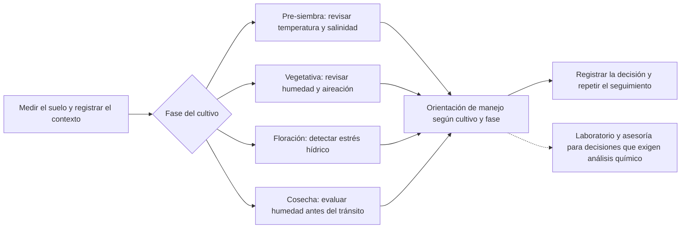
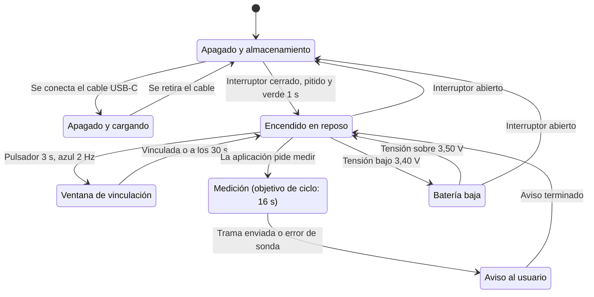
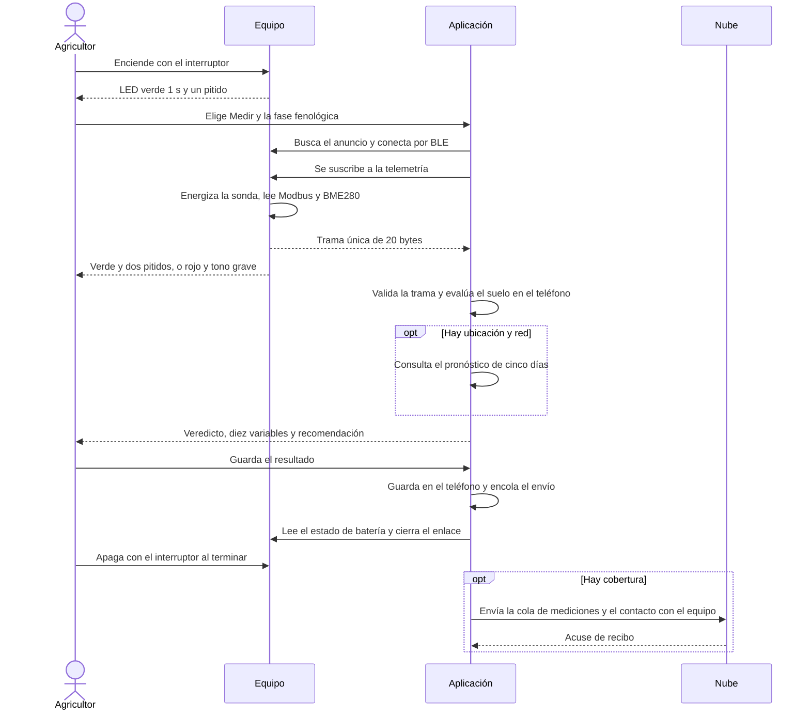
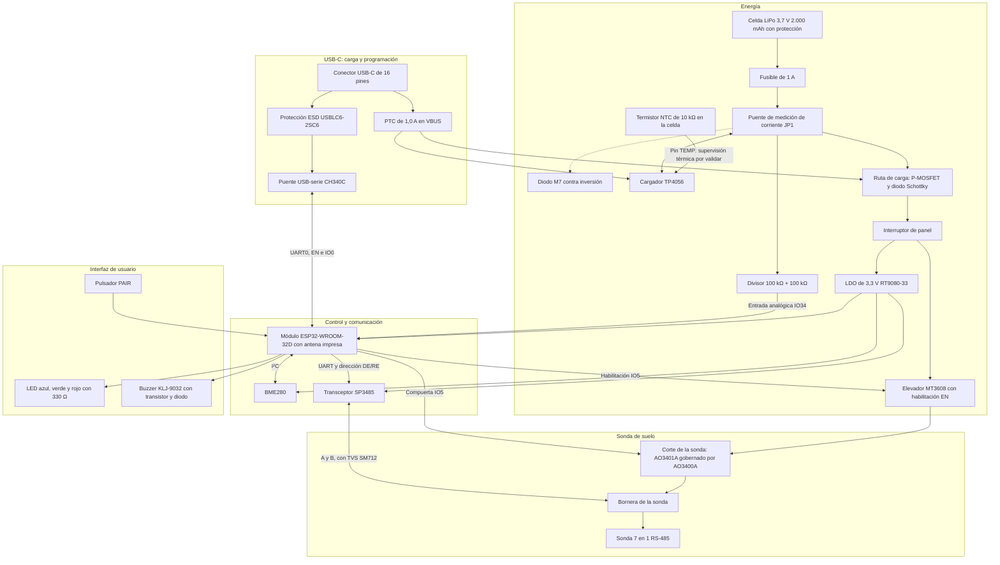
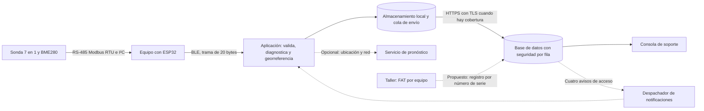
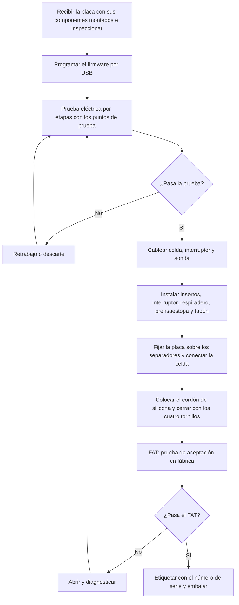
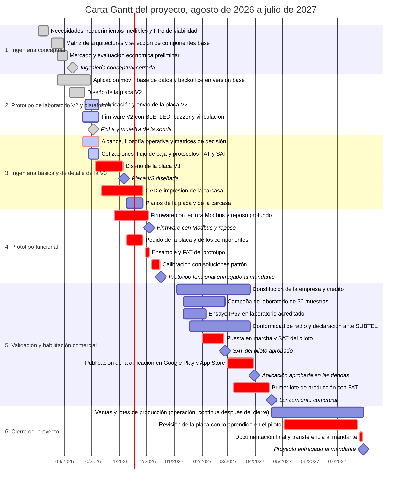

### TERRASENSE

Informe de avance: ingeniería conceptual, básica y de detalle

### Álvaro Nicolás Villena Torrejón

Alan Paul Escobar Rojas

Académico guía: Carlos Alberto Castillo Torres

Santiago − Chile

AÑO 2026

### Índice general

- I. Introducción
- II. Problemática y Requerimientos
- III. Ingeniería Conceptual
- IV. Ingeniería Básica
- V. Ingeniería de Detalle
- VI. Fabricación
- VII. Ensayos y Pruebas
- VIII. Evaluación Económica
- IX. Planificación del Proyecto
- X. Propuestas de Mejora
- XI. Conclusiones
- XII. Referencias Bibliográficas
- Anexos

### Índice de figuras

- Figura 1.0 “Diagrama de Decisiones y Consecuencias”
- Figura 1.1 “Estados de operación del equipo”
- Figura 1.2 “Secuencia de una jornada de medición”
- Figura 1.3 “Diagrama de bloques del hardware de la placa V3”
- Figura 1.4 “Árbol de alimentación de la placa V3”
- Figura 1.5 “Flujo de datos y digitalización del proceso”
- Figura 1.6 “Secuencia de montaje del equipo”
- Figura 1.7 “Proceso de fabricación por estaciones”
- Figura 1.8 “Carta Gantt del proyecto”

### Índice de tablas

- Tabla 1.0 “Necesidades y requerimientos técnicos medibles”
- Tabla 1.1 “Distribución de responsabilidades funcionales del sistema”
- Tabla 1.2 “Filtro de Viabilidad”
- Tabla 1.3 “Arquitecturas evaluadas frente al filtro de viabilidad”
- Tabla 1.4 “Matriz de Decisiones”
- Tabla 1.5 “Comparativa de Microcontroladores”
- Tabla 1.6 “Comparativa de Sondas de Suelo”
- Tabla 1.7 “Comparativa de Sensores de Temperatura / Humedad / Presión Barométrica”
- Tabla 1.8 “Frontera Offline / Online del Sistema”
- Tabla 1.9 “Dimensionamiento de mercado (TAM, SAM y SOM)”
- Tabla 2.0 “Trazabilidad de la ingeniería conceptual a la ingeniería básica”
- Tabla 2.1 “Alcance incluido y excluido del proyecto”
- Tabla 2.2 “Filosofía operativa: condición, fase, acción del sistema y señal al usuario”
- Tabla 2.3 “Ficha técnica del producto y del servicio”
- Tabla 2.4 “Matriz de decisión del ESP32 por nivel de integración”
- Tabla 2.5 “Requisitos técnicos de la sonda de suelo”
- Tabla 2.6 “Matriz de decisión del sensor ambiental”
- Tabla 2.7 “Matriz de decisión del cargador de la celda”
- Tabla 2.8 “Matriz de decisión del regulador de 3,3 V”
- Tabla 2.9 “Matriz de decisión del elevador de 5 V”
- Tabla 3.0 “Matriz de decisión del transceptor RS-485”
- Tabla 3.1 “Matriz de decisión del puente USB-serie”
- Tabla 3.2 “Matriz de decisión de la celda de energía”
- Tabla 3.3 “Matriz de decisión de la interfaz de usuario”
- Tabla 3.4 “Selección de interruptor, prensaestopa, respiradero y tapón por grado IP”
- Tabla 3.5 “Matriz de decisión del material de la carcasa”
- Tabla 3.6 “Matriz de decisión de la impresora 3D”
- Tabla 3.7 “Asignación de pines del módulo ESP32 en la placa V3”
- Tabla 3.8 “Cálculos de dimensionamiento de la electrónica V3”
- Tabla 3.9 “Potencia instalada del equipo por consumidor”
- Tabla 4.0 “Modos de consumo del equipo y tiempo por jornada”
- Tabla 4.1 “Gestión de cargas del equipo”
- Tabla 4.2 “Potencia instalada y consumo anual del taller”
- Tabla 4.3 “Fuentes de eficiencia y su ahorro”
- Tabla 4.4 “Pilares de Industria 4.0 y su implementación”
- Tabla 4.5 “Ciberseguridad: implementada y propuesta”
- Tabla 4.6 “Clasificación normativa: obligatoria, voluntaria y de mercado futuro”
- Tabla 4.7 “Especificación de compra del producto por bloque”
- Tabla 4.8 “Equipos del taller según el ciclo especificar, justificar, cotizar, dimensionar y probar”
- Tabla 4.9 “Resumen de la lista de materiales de la placa V3 por bloque”
- Tabla 5.0 “Verificación de los componentes de la placa V3 frente a las hojas de datos”
- Tabla 5.1 “Datos de fabricación de la placa V3”
- Tabla 5.2 “Zonas críticas y distancias de la placa V3”
- Tabla 5.3 “Dimensiones y tolerancias de la carcasa”
- Tabla 5.4 “Aberturas y elementos de fijación de la carcasa”
- Tabla 5.5 “Lista de conectores y pinout”
- Tabla 5.6 “Lista de cableado”
- Tabla 5.7 “Torques de apriete”
- Tabla 5.8 “Pasos de montaje y controles”
- Tabla 5.9 “Instalación y puesta en marcha en el campo”
- Tabla 6.0 “Trazabilidad maestra: requerimiento, especificar, justificar, cotizar, dimensionar y probar”
- Tabla 6.1 “Alternativas de ensamble de la placa V3: A (taller) y C (fabricante)”
- Tabla 6.2 “Costo por placa del ensamble según el tamaño del lote”
- Tabla 6.3 “Estaciones de fabricación, controles y tiempos por unidad”
- Tabla 6.4 “Dimensionamiento de la capacidad del taller”
- Tabla 6.5 “Matriz requerimiento-prueba”
- Tabla 6.6 “Ensayos de desarrollo de la placa y del firmware”
- Tabla 6.7 “Pruebas de aceptación en fábrica (FAT)”
- Tabla 6.8 “Pruebas de aceptación en sitio (SAT)”
- Tabla 6.9 “Ensayos normativos”
- Tabla 7.0 “Protocolo de Validación In Situ vs. Laboratorio de Referencia”
- Tabla 7.1 “Plan de Calibración y Control de Deriva”
- Tabla 7.2 “Pruebas automatizadas del software y del servicio”
- Tabla 7.3 “Matriz de teléfonos de prueba”
- Tabla 7.4 “Economías del análisis”
- Tabla 7.5 “Costo variable por equipo”
- Tabla 7.6 “Inversión inicial total”
- Tabla 7.7 “Condiciones del financiamiento”
- Tabla 7.8 “Determinación del precio de venta”
- Tabla 7.9 “Resumen anual: ventas, utilidad, flujo de fondos y caja”
- Tabla 8.0 “Indicadores de la evaluación económica”
- Tabla 8.1 “Comparación del horizonte de evaluación: cinco y diez años”
- Tabla 8.2 “Análisis de sensibilidad”
- Tabla 8.3 “Costo total de propiedad para el agricultor”
- Tabla 8.4 “Supuestos de Mercado Declarados”
- Tabla 8.5 “Hitos del proyecto”
- Tabla 8.6 “Retroalimentación del mandante y su estado”
- Tabla 8.7 “Mejoras propias del equipo y su estado”
- Tabla 8.8 “Cobertura de los criterios de la segunda entrega”

## I. Introducción

Este informe desarrolla la ingeniería conceptual, básica y de detalle de TerraSense, un instrumento portátil para medir suelo y ambiente, interpretar los resultados en una aplicación móvil y respaldarlos cuando existe conectividad. Su propósito es transformar las necesidades del pequeño agricultor en requerimientos de compra, fabricación, montaje y prueba verificables.

Cada etapa responde una pregunta: ¿qué necesidad existe y cómo se mide? (capítulo II), ¿qué solución se selecciona? (III), ¿cómo funcionará técnicamente? (IV), ¿cómo se construirá e instalará? (V), ¿con qué proceso y capacidad se produce? (VI) y ¿cómo se demuestra su cumplimiento? (VII). Los requerimientos R01 a R27 se relacionan con especificaciones, selección, cotizaciones, dimensionamiento y ensayos. Los capítulos VIII a X presentan la evaluación económica, la planificación y las mejoras propuestas.

El producto se especifica sobre una placa V3 con componentes soldados directamente, incluido el módulo de radio ESP32 con antena integrada. La placa V2 se utiliza como prototipo de laboratorio. El taller se dimensiona para la demanda proyectada; las pruebas se organizan en aceptación en fábrica (FAT, *Factory Acceptance Test*) y en sitio (SAT, *Site Acceptance Test*). La entrega prevista del prototipo funcional es el 17 de diciembre de 2026.

El documento distingue la especificación de diseño, la implementación y la evidencia de ensayo. Las cifras de costo del producto, del taller y de la evaluación económica se detallan en los anexos A (cotizaciones) y B (flujo de caja), que acompañan este informe como planillas de Excel; el cuerpo sólo contiene resúmenes. Los planos de la placa y de la carcasa se reservan para los anexos C y D, todavía no adjuntos, y los formularios de FAT y SAT en el anexo E. Y todo lo que se afirma lleva su estado: **verificado**, **implementado sin ensayo** o **de diseño**; la placa V3 aún no está fabricada y la estanqueidad IP67, la autonomía y el alcance del enlace Bluetooth no se han ensayado.

## II. Problemática y Requerimientos

### Contexto y problema central

Según el último Censo Agropecuario y Forestal, el cual se realiza cada 10 años, existen más de 175.000 unidades productivas a nivel nacional [1, 2]. Dentro de este universo, la Agricultura Familiar Campesina (AFC) y los productores pequeños (con campos de 0,5 a 20 hectáreas) representan la base productiva del mercado interno [3]. Sin embargo, este sector se encuentra actualmente en un punto de vulnerabilidad histórica debido a la convergencia de dos factores extremos:

En primer lugar, el país atravesó una “mega sequía” ininterrumpida desde 2010, con un déficit de precipitaciones cercano al 30 % en la zona centro-sur [4]. Esta crisis hídrica no solo limita el riego, sino que altera las condiciones físico-químicas del terreno, promoviendo la salinización y degradación del suelo.

En segundo lugar, el escenario económico ha provocado una escalada sostenida en los costos operativos, especialmente impulsada por el alza internacional en los precios de los fertilizantes y agroquímicos [5].

El problema radica en que el pequeño y mediano agricultor no tiene acceso a herramientas tecnológicas adaptadas a su realidad económica y técnica para tomar decisiones agronómicas. Si bien existen en el mercado instrumentos para medir parámetros vitales como la humedad, temperatura, pH y conductividad eléctrica (CE), estos presentan una doble barrera de entrada para la Agricultura Familiar Campesina:

La Barrera Económica: El problema no es únicamente que estos instrumentos tengan una etiqueta de precio alto en términos absolutos, sino que entregan poca capacidad de medición e interpretación por cada peso invertido, y que esa inversión debe repetirse porque la alternativa formal es un servicio, no un activo.

Un medidor portátil básico como el Hanna HI9814 cuesta US$294 [6] y mide únicamente 4 variables (pH, CE, TDS —sólidos disueltos totales— y temperatura) en soluciones hidropónicas, sin ninguna capa de interpretación agronómica; las sondas de precisión de grado investigación superan los US$1.495 [7]. La alternativa formal, el análisis de laboratorio acreditado, cuesta en Chile del orden de $50.000 por muestra; a ese costo, diez muestras de $50.000 ya superan el precio de lista de $466.027, sin que el agricultor pueda repetir la medición al día siguiente sin costo marginal, ni reciba una recomendación de manejo lista para aplicar en el momento. La barrera real, entonces, no es el precio de compra aislado, sino la relación entre lo que el instrumento mide, interpreta y permite repetir en el tiempo, frente a lo que cuesta sostener esa misma información por la vía del servicio. Esa es la relación que este proyecto reformula, y su comparación completa de costo total de propiedad para el agricultor se desarrolla también en este informe, junto con la estrategia de precios.

La Barrera de Interpretación: Incluso si el agricultor logra adquirir uno de estos equipos, las herramientas actuales entregan “datos planos” (por ejemplo, un valor aislado de 2.500 µS/cm o un pH de 5.5). La mayoría de los pequeños productores no cuenta con la formación técnica especializada para interpretar si ese número es letal para su cultivo específico, ni saben cómo traducir ese dato crudo en una acción correctiva concreta (como calcular cuántos litros de agua aplicar para lavar las sales).

El costo de operar a ciegas se concentra en cuatro momentos de la temporada en que la decisión ya no se puede deshacer, las mismas cuatro fases fenológicas sobre las que opera la solución: en la **pre-siembra**, sembrar en un suelo frío o salino pierde la semilla; en la fase **vegetativa**, el riego por costumbre asfixia las raíces o frena el desarrollo; en la **floración**, un estrés hídrico inadvertido provoca aborto floral y pérdida del rendimiento; y en la **cosecha**, entrar con maquinaria sobre suelo húmedo compacta la tierra e hipoteca la temporada siguiente.

**Figura 1.0 “Diagrama de Decisiones y Consecuencias”**

Actualmente, las alternativas formales como los análisis de laboratorio son lentas (15 a 30 días) y costosas, entregando resultados cuando la fase crítica ya pasó. Por otro lado, pagar asesorías agronómicas continuas para que un profesional interprete los datos escapa del presupuesto operativo.

Corresponde precisar el alcance exacto de esta brecha, porque el proyecto no se plantea como un reemplazo del laboratorio. Un análisis acreditado determina propiedades químicas mediante extracción y método normalizado; un instrumento de terreno entrega una lectura directa, en un punto y en un instante.

Son procedimientos distintos que responden preguntas distintas, y confundirlos sería el error de fondo más grave que podría cometer este proyecto. TerraSense apunta al vacío que existe entre dos análisis de laboratorio: las decenas de decisiones de riego, siembra y manejo que el agricultor toma cada semana y que hoy resuelve por intuición, porque no existe ninguna herramienta que las acompañe con un dato propio de su campo. Los servicios de laboratorio y de asesoría conservan íntegramente su función en las decisiones que exigen determinaciones específicas, en particular las de fertilización.

### De la necesidad al requerimiento técnico

Las necesidades anteriores se traducen en requerimientos medibles, cada uno con un identificador, un valor numérico, su unidad y un criterio de aceptación verificable. Estos identificadores son las filas de la matriz que relaciona cada requerimiento con su prueba (capítulo VII) y de la trazabilidad maestra (capítulo V).

| ID | Necesidad del agricultor | Requerimiento técnico | Valor | Unidad | Criterio de aceptación |
|---|---|---|---|---|---|
| R01 | Conocer el estado real del suelo en el punto | Medir siete variables de suelo: humedad volumétrica, temperatura, conductividad eléctrica (CE), pH, nitrógeno, fósforo y potasio | 7 | variables por medición | Los 7 campos de suelo distintos del centinela «sin lectura» en al menos 95 % de las mediciones del piloto |
| R02 | Contextualizar la medición con el ambiente | Medir temperatura del aire, humedad relativa (HR) y presión | 3 (±1,0 °C; ±3 % HR; ±1,0 hPa) | variables | Sensor contrastado con una referencia dentro de la exactitud de su hoja de datos |
| R03 | Decidir de pie sobre el punto | Tiempo de medición | ≤ 10 (adquisición y envío); ≤ 20 (ciclo con conexión) | s | Cronometrado en 10 mediciones consecutivas: ambos tiempos cumplidos |
| R04 | Confiar en el dato | Concordancia con laboratorio acreditado | pH con error cuadrático medio (RMSE) ≤ 0,3; CE con error cuadrático normalizado ≤ 1 según Tabla 7.0; humedad con RMSE ≤ 4; R² ≥ 0,80 | unidades de cada variable (humedad en puntos porcentuales) | Campaña de 30 puntos pareados según el protocolo de validación |
| R05 | Trabajar sin cobertura móvil | Operación completa sin red | 100 | % de las funciones de medición | En modo avión, con Bluetooth y ubicación reactivados: medir, diagnosticar, georreferenciar y guardar; la cola se sincroniza después sin pérdidas |
| R06 | Medir sin cable al teléfono | Alcance del enlace Bluetooth de bajo consumo (BLE) con el equipo cerrado y apoyado en el suelo | ≥ 5 (mínimo); 10 (objetivo) | m | 20 de 20 lecturas a 5 m; se registra la distancia a 10 m |
| R07 | Llegar a la jornada siguiente sin recargar | Autonomía con una carga en uso habitual (dos jornadas semanales de 2 h con 10 mediciones) | ≥ 8 | semanas | Autonomía medida de al menos 8 semanas y 80 % de la calculada |
| R08 | Cargar con un cargador de teléfono | Carga por USB-C a 5 V | ≤ 6 | h (de 3,0 V a plena carga) | Corriente de carga ≤ 0,5 A y tensión final dentro del límite de la celda (4,20 V ± 0,05 V); compatibilidad del cargador pendiente |
| R09 | Soportar barro, lluvia e inmersión accidental | Estanqueidad de la carcasa | IP67 (protección contra polvo e inmersión) | grado de protección | Norma IEC 60529 de la Comisión Electrotécnica Internacional: 30 min a 1 m de profundidad sin ingreso de agua ni polvo |
| R10 | Trabajar al sol y al frío | Temperatura de operación | −5 a +50 (operación); 0 a 45 (carga) | °C | Funcional a −5, +25 y +50 °C; carga sólo dentro de 0 a 45 °C |
| R11 | Sobrevivir a caídas sobre grava | Resistencia a caídas | 6 caídas desde 1,0 m | caídas | IEC 60068-2-31: sin grietas, cierre estanco y equipo funcional |
| R12 | Recibir avisos sin pantalla | Señales luminosas y sonoras con un significado cada una | 3 LED y 1 buzzer | señales | Cada evento de la tabla de filosofía operativa produce su señal |
| R13 | Evitar vinculaciones accidentales desde la aplicación | Inicio de vinculación mediante pulsador | 3 (pulsación) y 30 (ventana) | s | Pulsación menor que 3 s no abre; la ventana dura 30 ± 1 s |
| R14 | Datos íntegros hasta el teléfono | Trama BLE única | 20 | bytes | 20 bytes con formato 1; ausencias marcadas y nunca estimadas |
| R15 | Leer la sonda sin errores | Bus RS-485 (comunicación serial diferencial) con Modbus RTU (protocolo serial binario) | 4.800 (velocidad de fábrica de la sonda; 9.600 si se reconfigura) | baudios | 1.000 lecturas consecutivas sin error de CRC (verificación de redundancia cíclica) |
| R16 | Un equipo que no se daña en el campo | Protección eléctrica: inversión de batería, descarga electrostática (ESD), cortocircuito | ±8 (contacto) | kV | Protección coordinada con el diodo, sin daño y dentro de sus límites térmicos con batería invertida; sin daño tras 10 descargas en USB y en el bus |
| R17 | No quedarse sin energía sin aviso | Aviso de batería baja | 3,40 (rearme 3,50) | V | Aviso una sola vez al bajar de 3,40 V; se apaga sobre 3,50 V |
| R18 | Una celda segura | Seguridad de la celda de litio | IEC 62133-2 | certificado | Certificado vigente y protección integrada verificada |
| R19 | Usar el espectro legalmente | Radiofrecuencia del enlace BLE | Bajo el límite de SUBTEL (Subsecretaría de Telecomunicaciones) | potencia | Medición en laboratorio y declaración de conformidad publicada antes de vender |
| R20 | Un precio justo y una empresa sostenible | Precio derivado del costo con utilidad de 30 %; VAN (valor actual neto) positivo al 20 % | 30 y 20 | % | VAN > 0 y caja nunca negativa en los 10 años |
| R21 | No pagar cuotas | Cero suscripciones | 0 | pesos por mes al agricultor | Ninguna función de medición condicionada a un pago recurrente |
| R22 | Poder producirlo | Capacidad de producción del taller | 200 (2027) a 1.085 (2036) | equipos por año | Horas de impresión, ensamble y FAT dentro de la capacidad instalada |
| R23 | Respaldar cada equipo | Trazabilidad por número de serie | 100 | % de las unidades con registro | Cada unidad con su ID de 15 dígitos y su registro FAT |
| R24 | Poder reponer el equipo en el tiempo | Disponibilidad de componentes | 100 | % de los circuitos integrados con proveedor y alternativa | Cada circuito integrado en LCSC o DigiKey y con una alternativa identificada |
| R25 | Que sus datos sean sólo suyos | Aislamiento por equipo y rol | 0 | lecturas de equipos ajenos | Batería de pruebas de acceso cruzado sin una sola lectura ajena |
| R26 | Usarlo con distinta alfabetización digital | Accesibilidad de la aplicación | 4,5:1 (contraste) y 48 × 48 (área táctil) | relación; dp | Auditoría de las pantallas |
| R27 | Cambiar la celda al fin de su vida | Celda extraíble con herramientas comunes | ≤ 5 | min | Desmontaje cronometrado con destornillador |

**Tabla 1.0 “Necesidades y requerimientos técnicos medibles”**

Los requerimientos R01 a R04 y R14 a R15 definen la medición; R05 a R08 y R17 la energía y la comunicación; R09 a R11 y R16 la robustez; R12 y R13 la interfaz; R18 y R19 la seguridad y la ley; R20 a R24 el negocio y la producción; y R25 a R27 el servicio. Ningún requisito posterior del informe se introduce sin un identificador de esta tabla.

## III. Ingeniería Conceptual

La ingeniería conceptual responde qué solución se implementará. Define los requisitos obligatorios, compara las arquitecturas y selecciona los componentes base que sustentan la ingeniería básica.

### III.1 Filosofía y propuesta de valor

El fin último no es el campo productivo, sino el ser humano cuyo sustento familiar depende de él. Un cultivo que se pierde por acidez o salinidad es, en el fondo, un problema agronómico menor comparado con lo que realmente está en juego, una familia que queda endeudada durante un año entero por tomar una decisión sin la información adecuada. Ese es el problema social y económico que TerraSense ataca. Por ello, toda decisión de diseño se resuelve preguntando cuál alternativa reduce más el riesgo económico del productor, no cuál es la más sofisticada desde el punto de vista técnico. De esta premisa central se desprenden cuatro principios que gobiernan el diseño del sistema:

- No Entregamos Datos, Entregamos Respuestas: Un dato aislado, un valor de pH o una lectura de conductividad no es información útil para quien no sabe interpretarlo. Un dato sin contexto es, en la práctica, “un vacío” con unidades. TerraSense no entrega la medición en bruto, sino la cadena completa: desde la captura de la variable física hasta una recomendación concreta de manejo (qué hacer, cuánto y por qué).

- El Teléfono es el Cerebro del Sistema: La idea central que ordena todo el diseño es sencilla y radical en sus consecuencias: el teléfono que el agricultor ya posee es el instrumento de registro más potente que existe. Tiene pantalla legible, ubicación satelital, capacidad de cálculo y memoria.

Fabricar un instrumento nuevo que vuelva a incluir todas esas capacidades sería cobrarle dos veces al agricultor por algo que ya tiene. Por eso, el aparato físico se reduce a lo mínimo indispensable: hacer lo único que el teléfono no puede hacer por sí solo (tomar contacto físico con la tierra y el ambiente). Todo el resto ocurre en el teléfono. Además de que el 100 % del procesamiento agronómico ocurre en el procesador del teléfono sin depender de cobertura de red móvil (3G/4G/5G). La nube actúa exclusivamente como respaldo posterior.

- Diseño para el Campo Real, no para el Laboratorio: El instrumento no vivirá sobre un escritorio; se caerá sobre tierra y piedras, se mojará y viajará quizás en la caja de una camioneta.

Cada elección de materiales responde a esa realidad de uso, priorizando la austeridad y la resistencia sobre la estética.

- Cero Suscripciones Recurrentes: El agricultor paga una vez por su instrumento y sus mediciones le pertenecen; puede consultarlas y usarlas libremente. A diferencia de la instrumentación importada que depende de plataformas por suscripción, aquí no existe una cuota mensual que condicione el funcionamiento del equipo. La tecnología no debe convertirse en una carga financiera mensual para quien ya enfrenta suficiente incertidumbre. Este principio tiene una consecuencia económica directa y asumida; los costos de soporte, servicios digitales, mantenimiento y reposición permanecen en el presupuesto de la empresa y están explícitamente cuantificados en la evaluación económica de este informe.

TerraSense toma la información física del suelo y del aire, la cruza con el conocimiento agronómico del cultivo y con las condiciones climáticas del lugar exacto de la medición, entregando en segundos y sin necesidad de conexión a internet una recomendación concreta y accionable. Es, en esencia, la diferencia entre entregarle a alguien un termómetro y entregarle una orientación de manejo ya interpretada. El modelo comercial que sostiene esa promesa es la venta del instrumento con la aplicación incluida y sin cobro por lectura, el usuario dispone de una herramienta de seguimiento permanente, mientras los servicios de laboratorio y asesoría conservan su función en aquellas decisiones que requieren determinaciones específicas.

La responsabilidad se reparte de forma estricta entre tres capas, de modo que cada una haga sólo lo que las otras no pueden hacer:

| Capa del sistema | Componente físico | Responsabilidad asignada | Lo que deliberadamente no realiza |
|---|---|---|---|
| 1. Instrumento de captura | Placa electrónica con el módulo ESP32-WROOM-32D, la sonda 7-en-1 y el sensor BME280 | Energizar la sonda, leer los buses RS-485 e I²C, verificar sumas de control y transmitir la trama BLE | No procesa algoritmos agronómicos, no almacena historial ni lleva pantalla |
| 2. Inteligencia local | Aplicación móvil con almacenamiento persistente del teléfono y cola de sincronización diferida | Ejecutar el motor agronómico determinista, desplegar el Grid 2×5 y guardar el histórico local | No genera tensiones de excitación ni depende de servidores para evaluar |
| 3. Respaldo y soporte | Base de datos en la nube (Supabase, sobre PostgreSQL) y consola web de soporte | Respaldar mediciones al detectar red, administrar cuentas, soporte posventa y consulta del histórico | No bloquea la operación en campo sin conectividad |

**Tabla 1.1 “Distribución de responsabilidades funcionales del sistema”**

### III.2 Filtro de viabilidad y matriz de arquitecturas

Antes de comparar alternativas se fijan cinco requisitos obligatorios; una arquitectura que no los cumple queda eliminada sin puntuar.

| ID | Requisito | Qué exige |
|---|---|---|
| RO-1 | Alimentar y comunicarse con la sonda | Operar por bus diferencial RS-485 con sonda industrial. |
| RO-2 | Interpretar, no solo mostrar | Entregar un veredicto interpretado, no una lectura plana. |
| RO-3 | Operar sin cobertura celular | Completar la medición en el momento, sin depender de señal de datos. |
| RO-4 | Muestrear múltiples puntos | Permitir recorrer y medir distintos puntos de un mismo campo en una jornada. |
| RO-5 | Ser físicamente realizable | Construirse con componentes de catálogo real, no con tecnología hipotética. |

**Tabla 1.2 “Filtro de Viabilidad”**

Se comparan seis arquitecturas por su capacidad para cumplir los requisitos obligatorios del sistema:

| Arquitectura | Filtro | Razón principal |
|---|---|---|
| Instrumento autónomo de 8 bits con pantalla y Bluetooth Classic | Eliminada | El perfil serial de Bluetooth Classic exige certificación MFi (Made for iPhone) en iOS, lo que limita la compatibilidad directa con iOS; la memoria del microcontrolador restringe el motor de interpretación propuesto |
| Instrumento autónomo con inferencia embebida y pantalla | Pasa a puntuar | La pantalla y el procesamiento embebido añaden consumo y exigencias de sellado, pendientes de cuantificar; corregir el conocimiento agronómico exige publicar un firmware nuevo |
| Datalogger estacionario con red móvil | Eliminada (RO-3 y RO-4) | Un solo punto por equipo, cobertura celular exacta en el punto e impone una suscripción recurrente |
| Red de nodos LoRaWAN con estación concentradora | Pasa a puntuar | Medir 20 puntos exigiría 20 nodos y una estación propia; el agricultor decide de pie sobre el punto, no a distancia |
| Sonda conectada directo al teléfono | Eliminada (RO-1 y RO-5) | La conexión directa carece de adaptación RS-485 y alimentación especificada; una solución con adaptador activo sería otra arquitectura por evaluar |
| Instrumento portátil inalámbrico de bajo consumo con el teléfono como intérprete | Pasa a puntuar | Resuelve sólo lo que el teléfono no puede hacer (energía, protocolo y medición física) y delega el resto |

**Tabla 1.3 “Arquitecturas evaluadas frente al filtro de viabilidad”**

Sólo las tres que superaron el filtro se puntúan (escala de 1 a 10), con ocho criterios ponderados:

| Criterio | Peso | Instrumento autónomo con inferencia embebida y pantalla | Red de nodos LoRaWAN con estación concentradora | Instrumento portátil inalámbrico de bajo consumo, con el teléfono como intérprete |
|---|---|---|---|---|
| Cobertura espacial | 15 % | 8 | 5 | 10 |
| Calidad de interfaz | 13 % | 4 | 7 | 10 |
| Capacidad de interpretación | 15 % | 6 | 8 | 10 |
| Autonomía energética | 14 % | 4 | 8 | 9 |
| Costo total a 5 años | 16 % | 6 | 2 | 8 |
| Robustez mecánica | 10 % | 6 | 9 | 9 |
| Actualización del conocimiento | 9 % | 5 | 8 | 10 |
| Independencia de infraestructura | 8 % | 9 | 5 | 7 |
| Puntaje ponderado final | 100 % | 5,91 | 6,32 | 9,20 |

**Tabla 1.4 “Matriz de Decisiones”**

Conclusión y Sensibilidad: La arquitectura de un instrumento portátil inalámbrico de bajo consumo, con el teléfono como intérprete gana con margen amplio por su cobertura de múltiples puntos, capacidad de interpretación y facilidad de actualización. Los puntajes ponderados se calculan como suma de peso por nota; son una valoración del equipo, no un resultado experimental. No se declara una sensibilidad cuantitativa sin especificar los pesos alternativos.

### III.3 Componentes base

La segunda capa de decisiones elige el componente de cada bloque. El microcontrolador se puntúa sobre cinco criterios declarados antes de comparar; el ATmega328P con HC-05 queda descartado de entrada por el mismo bloqueo MFi de iOS.

| Microcontrolador | Consumo de radio en Tx BLE (20 %) | Actualización del firmware por Bluetooth (20 %) | Concurrencia (15 %) | Ecosistema y documentación (25 %) | Disponibilidad y costo (20 %) | Puntaje ponderado | Veredicto |
|---|---|---|---|---|---|---|---|
| STM32WB55 | 10 (~5–6 mA [8]) | 8 | 8 (2 núcleos) | 5 | 4 | 6,85 | Descartado |
| nRF52840 | 10 (~5–6 mA [9]) | 10 | 5 (1 núcleo) | 7 | 5 | 7,50 | Descartado |
| ESP32 | 4 (~130–150 mA [10]) | 7 | 10 (2 núcleos) | 10 | 10 | 8,20 | Seleccionado |

**Tabla 1.5 “Comparativa de Microcontroladores”**

El ESP32 supera a los demás en los criterios de mayor peso (ecosistema, disponibilidad y doble núcleo para separar la radio de la temporización Modbus), a cambio de un consumo de radio mayor: el nRF52840 y el STM32WB55 gastan mucho menos en transmisión BLE, y esa ventaja se declara. El producto no usa el Wi-Fi del ESP32 y la actualización de firmware por Bluetooth es una función diseñada y pendiente. Qué nivel de integración del ESP32 se usa (circuito integrado, módulo o placa de desarrollo) se decide en la ingeniería básica.

La sonda aporta 7 de las 10 variables y es la decisión de abastecimiento más crítica; se comparó la sonda 7-en-1 RS-485 con instrumentos de grado de investigación [11]:

| Sonda | Variables entregadas | Exactitud | Costo y adecuación | Resultado |
| --- | --- | --- | --- | --- |
| Grado de investigación (TEROS 12 como referencia) | Humedad, temperatura y CE | Especificación del fabricante [11] | Requiere complementar las variables faltantes y cotizar el conjunto | Alternativa técnica; no se asigna puntaje sin ponderaciones |
| Sonda 7-en-1 RS-485 | Siete registros de suelo | Pendiente de validación de la muestra | Costo de referencia en el anexo A; N, P y K sólo informativos | Seleccionada para el prototipo, condicionada a validación |

**Tabla 1.6 “Comparativa de Sondas de Suelo”**

La selección prioriza la integración y el costo de referencia; no demuestra equivalencia metrológica ni permite afirmar una razón de precios de veinte veces sin cotizar equipos comparables. La limitación principal se declara: N, P y K no se miden por electrodo ion-selectivo sino que se derivan de la conductividad eléctrica; la aplicación los presenta como registros informativos con advertencia permanente, y con CE sobre 1.000 µS/cm se activa un veto de confianza. Nunca se muestra una clase agronómica ni una dosis derivada de ellos.

El sensor ambiental se eligió por función, no por desempeño:

| Sensor | Exactitud Temperatura | Mide Humedad Relativa | Mide Presión Barométrica | Veredicto |
|---|---|---|---|---|
| Sensirion SHT40 | ±0,2 °C [12] | Sí | No | Descartado por función |
| Bosch BMP280 | ±1,0 °C [13] | No | Sí | Descartado por función |
| Bosch BME280 | ±1,0 °C [14] | Sí (±3 % HR) | Sí (±1,0 hPa) | Seleccionado |

**Tabla 1.7 “Comparativa de Sensores de Temperatura / Humedad / Presión Barométrica”**

El BME280 es el único de los tres que entrega las tres magnitudes que el Grid reserva al ambiente local; la presión podría emplearse en una futura estimación de evapotranspiración por altitud [15]. La aplicación registra la presión como variable ambiental; el cálculo de evapotranspiración no está implementado. Su temperatura depende críticamente de su ubicación dentro de la carcasa, requisito que se resuelve en la geometría de la placa y de la carcasa.

### III.4 Arquitectura de conectividad y frontera offline-online

La comunicación se divide en cuatro enlaces, cada uno elegido por consumo y robustez:

- Sonda de Suelo → ESP32 (Bus RS-485 Modbus RTU): Se eligió esta interfaz frente a alternativas más simples (como UART directo, el transmisor-receptor asíncrono universal) porque transmite una señal diferencial robusta e inmune al ruido electromagnético en campo abierto. Además, al ser el estándar universal para instrumentación industrial, permite intercambiar sondas de distintos fabricantes en el futuro sin necesidad de rediseñar la placa base del equipo. Conviene separar las dos capas involucradas:

RS-485 define la capa eléctrica diferencial, mientras Modbus define la estructura de los mensajes; en su implementación serial RTU se verifican longitud, dirección, función, CRC-16 (verificación de redundancia cíclica) y temporización entre tramas.

- Sensor Ambiental BME280 → ESP32 (Bus I2C): Para la captura de datos atmosféricos (temperatura del aire, humedad relativa y presión barométrica), se utiliza una comunicación serie de dos hilos (I²C). Al estar el sensor integrado para lectura ambiental local, directamente en la placa o a muy corta distancia del microcontrolador, el protocolo I²C es el estándar ideal por su simplicidad técnica y bajo consumo, sin verse afectado por las limitaciones de distancia que sufriría en campo abierto.

- ESP32 → Teléfono (Bluetooth Low Energy): Se optó por un enlace BLE puntual debido a su bajo consumo energético. El equipo envía paquetes de datos muy pequeños (tramas de 20 bytes en el contrato vigente) y se conecta solo durante los segundos que dura la medición. Al utilizar BLE se evita la barrera de certificación MFi que afecta al perfil serial de Bluetooth Classic en iOS, habilitando compatibilidad con Android y Apple sin costos de hardware adicionales.

- Teléfono → Nube (HTTPS, el protocolo seguro de la web, y Supabase): El sistema implementa una arquitectura estrictamente offline-first. La falta de cobertura en zonas rurales es la principal causa de fallo en agrotecnología, por lo que el motor de interpretación agronómica corre localmente en el teléfono sobre almacenamiento local persistente. La conexión a la nube ocurre de manera diferida y en segundo plano, interviniendo únicamente para sincronizar historiales y respaldar información cuando el teléfono detecta señal de internet.

La independencia tiene un límite preciso, que se declara función por función:

| Función del sistema | Conectividad requerida | Comportamiento sin cobertura |
|---|---|---|
| Emparejamiento y lectura BLE del instrumento | Ninguna | Funciona íntegramente; el enlace es punto a punto entre equipo y teléfono |
| Validación de la trama y marcado de lecturas ausentes | Ninguna | Funciona íntegramente; una variable no recibida se almacena como ausente, nunca se estima |
| Motor agronómico: diagnóstico y recomendación de labor | Ninguna | Funciona íntegramente; las reglas y umbrales residen en la aplicación, no en un servidor |
| Georreferenciación de la medición | Ninguna | Funciona con el GPS satelital del teléfono, que no requiere datos móviles |
| Guardado en la base local y consulta del histórico ya almacenado | Ninguna | Funciona íntegramente sobre el almacenamiento del teléfono |
| Creación de cuenta, inicio de sesión inicial y recuperación de credenciales | Requiere internet | No disponible; la sesión ya iniciada permanece válida y permite seguir midiendo |
| Registro de un equipo nuevo en la cuenta | Requiere internet | No disponible; se completa al recuperar cobertura |
| Sincronización y respaldo del histórico hacia la nube | Requiere internet | Las mediciones se encolan localmente y se envían solas al recuperar señal; no se pierde ninguna |
| Pronóstico meteorológico a cinco días | Requiere internet | La aplicación indica expresamente que el pronóstico no está disponible y no lo sustituye por un valor estimado |

**Tabla 1.8 “Frontera Offline / Online del Sistema”**

La operación local requiere cuenta y equipo registrados, sesión conservada, permisos y disponibilidad del enlace BLE; la ubicación requiere señal satelital y permiso del teléfono. Bajo esas condiciones, medir, diagnosticar, georreferenciar y guardar no requieren cobertura de datos móviles. Lo que sí depende de ella es administrar la cuenta, respaldar en la nube y contextualizar con el clima previsto, es decir, funciones que el agricultor ejecuta antes o después de la jornada de terreno, no durante. Un teléfono sin señal en medio del campo conserva la totalidad de la cadena que convierte una medición física en una decisión agronómica; lo único que posterga es el respaldo. Esta distinción también acota la promesa comercial: el sistema no ofrece pronóstico sin internet ni sincronización mágica, y ninguna de las dos carencias impide tomar la decisión en terreno.

### III.5 Mercado

El dimensionamiento comercial usa tres niveles: TAM (*Total Addressable Market*, mercado total), SAM (*Serviceable Available Market*, mercado atendible) y SOM (*Serviceable Obtainable Market*, mercado obtenible por el proyecto).

| Nivel | Definición | Valor | Respaldo |
|---|---|---|---|
| TAM | Unidades productivas agropecuarias y forestales del país | 175.556 (138.628 agropecuarias y 36.928 forestales) | Censo Agropecuario y Forestal 2021 [1, 2]; verificado |
| SAM | Explotaciones de 0,5 a 20 ha que el equipo puede atender | ≈ 120.000 | Supuesto de trabajo sin tabla de respaldo: no aplica rubro ni disposición a pagar |
| SOM | Equipos vendidos según el plan comercial | 200 en 2027; 2.550 acumulados a 5 años; 7.481 a 10 años | Plan de ventas del modelo económico |
| SOM sobre SAM | Penetración implícita del plan | 0,17 %; 2,1 %; 6,2 % | Cálculo sobre el supuesto de SAM |

**Tabla 1.9 “Dimensionamiento de mercado (TAM, SAM y SOM)”**

Una explotación no equivale a un cliente ni a un equipo: un asesor visita muchos campos y un campo puede no comprar nunca. Por eso el SAM se trata como supuesto y se acota la conclusión: lo que el plan exige es una penetración baja del SAM declarado, no una demanda comprobada.

### III.6 El prototipo de laboratorio (placa V2) y el producto (placa V3)

La placa V2, fabricada y comprada, es el **prototipo de laboratorio**: una placa portadora de 99,9 × 90 mm sobre la que se enchufan módulos comerciales de desarrollo (la placa ESP32-DevKitC-32U con módulo WROOM-32UE y antena externa, el módulo de carga y elevación LX-LCBST, un módulo con el transceptor SP3485 y un módulo ambiental, identificado en banco como BMP280 y pendiente de reemplazo por BME280). Se utiliza para desarrollar y ensayar firmware y aplicación. Como plataforma de producción tiene limitaciones: el abastecimiento de módulos de desarrollo no está asegurado para producción, y la placa de desarrollo consume del orden de 6 mA aunque el microcontrolador duerma, lo que mantiene consumo residual aunque el microcontrolador entre en reposo profundo.

La placa V3, que aún no está fabricada, es el **producto**: los mismos circuitos como componentes soldados directamente, sin módulos de desarrollo. Todo el estudio de especificación, costos, energía y ensayos de los capítulos siguientes se hace sobre la V3; la V2 aporta el firmware, la aplicación y la experiencia de armado.

### III.7 Trazabilidad de lo conceptual a lo básico

| Decisión conceptual | Requerimientos que sostiene | Solución de ingeniería básica | Dónde se detalla |
|---|---|---|---|
| Instrumento portátil inalámbrico con el teléfono como intérprete (Tabla 1.4) | R05, R12 | Motor agronómico en la aplicación; el equipo sólo captura y transmite | Tabla 2.2, Tabla 2.3 |
| Alimentar y leer la sonda por RS-485 (RO-1) | R01, R15, R16 | Elevador con habilitación y corte de la sonda por MOSFET, transceptor SP3485 con protección | Tabla 2.9, Tabla 3.0, Tabla 3.8 |
| Microcontrolador ESP32 (Tabla 1.5) | R03, R06, R14 | Módulo ESP32-WROOM-32D con antena impresa soldado a la placa | Tabla 2.4 |
| Sonda 7-en-1 por costo por variable (Tabla 1.6) | R01, R04 | Sonda 7-en-1 y protocolo de validación de 30 muestras | Tabla 2.5, Tabla 7.0 |
| Sensor BME280 (Tabla 1.7) | R02 | Circuito integrado BME280 con respiradero y aislación térmica | Tabla 2.6, Tabla 5.1 |
| Operación offline primero (Tabla 1.8) | R05 | Cola local idempotente y sincronización diferida | Tabla 2.3, Tabla 4.4 |
| Regla energética: no consumir fuera de la medición | R07, R08, R17 | Elevador con habilitación y corte de la sonda por MOSFET, reposo profundo, LDO (*Low Dropout*, regulador lineal de baja caída) de baja corriente propia | Tabla 4.0, Tabla 4.1 |
| Diseño para el campo real | R09, R10, R11 | Carcasa de PETG (PET modificado con glicol) con junta, prensaestopa y respiradero | Tabla 3.5, Tabla 3.4 |
| Precio derivado del costo con 30 % de utilidad | R20, R21 | Lista de materiales (BOM, *Bill of Materials*) V3 con costos de compra y fabricación | Tabla 4.9, Tabla 8.0 |

**Tabla 2.0 “Trazabilidad de la ingeniería conceptual a la ingeniería básica”**

Cinco decisiones se tratan como cerradas y la ingeniería básica no las reabre: el crédito financia el 100 % de la inversión inicial y el pie de los socios es una condición de entrada, no una segunda fuente; el precio se deriva del costo exigiendo 30 % de utilidad; el horizonte es de diez años (2027–2036) con comparación a cinco; la trama BLE es una sola de 20 bytes (los 16 bytes son sólo una tolerancia del decodificador para prototipos sin BME280); y el sistema opera primero sin red.

## IV. Ingeniería Básica

La ingeniería básica responde la pregunta ¿cómo funcionará técnicamente? Convierte la solución conceptual en requisitos que se pueden comprobar: qué hace el sistema y en qué condiciones, con qué cifras, con qué componentes y por qué esos, cómo se alimenta, cuánta energía usa y cómo se digitaliza. Cada capacidad se rotula con uno de tres estados:

- **Verificado:** comprobado con una prueba que sí se ejecutó (pruebas automatizadas de software, reconstrucción de la base de datos en una réplica local) o contrastado con la hoja de datos del componente exacto. No significa ensayado en un equipo físico ni en un teléfono real.
- **Implementado sin ensayo:** existe en el firmware, en la aplicación o en la placa V2, compila o se ejecuta en lógica, pero no se ha probado sobre el equipo armado ni sobre un teléfono.
- **De diseño:** cifra, cálculo o componente especificado para la placa V3 (no fabricada) o función aún no implementada, sin medición que la respalde.

### IV.1 Alcance y filosofía operativa

El fin último del proyecto es el ingreso de una familia que se juega el año en cada siembra, no el instrumento. De ahí se desprenden cinco reglas de operación:

1. **Un dato sin contexto no sirve.** El equipo entrega la medición; la aplicación la convierte en una recomendación según la fase fenológica del cultivo. Nunca se prescribe una dosis de fertilizante o de enmienda a partir de los registros de nitrógeno, fósforo y potasio, porque se derivan de la conductividad eléctrica y no son determinaciones químicas independientes.
2. **Medir, diagnosticar, georreferenciar y guardar no dependen de la cobertura.** Lo que sí la necesita (administrar la cuenta, respaldar en la nube, consultar el pronóstico) ocurre antes o después de la jornada de terreno.
3. **El equipo no guarda nada del propietario.** Su identificador sale de la dirección física del microcontrolador y no cambia nunca; quién lo usa y qué mide se decide en la nube y en el teléfono. Por eso el equipo no se «resetea»: se libera desde el servicio de soporte.
4. **La aplicación exige una acción física para iniciar la vinculación.** Mantener PAIR durante 3 segundos abre una ventana de búsqueda de 30 segundos. La base de datos aún no verifica una prueba criptográfica de esa presencia: conocer el identificador de un equipo libre permite intentar registrarlo por fuera de la aplicación. El control actual no acredita propiedad por sí solo.
5. **El equipo nunca inventa un dato.** Si la sonda no responde, la trama viaja con un centinela de «sin lectura» y la aplicación se niega a guardarla; si el BME280 no responde, el campo ambiental viaja marcado como ausente.

Lo que queda fuera del alcance no es una carencia accidental sino una decisión:

| Ámbito | Incluido | Fuera del alcance | Motivo |
|---|---|---|---|
| Medición | Diez variables por medición (siete de suelo y tres ambientales), trama única de 20 bytes con la batería | Lecturas simuladas o plausibles en producción | La confianza del agricultor depende de que cada cifra sea real |
| Interpretación | Diagnóstico determinista en el teléfono por fase; N, P y K como registros informativos | Dosis de fertilizante o de enmienda; diagnóstico nutricional | Esos tres valores derivan de la conductividad |
| Ubicación | Latitud, longitud y precisión de cada medición, mostradas como texto | Mapas, perímetros de campo y extensión geoespacial en la base de datos | El mapa no cambia la decisión y encarece el servicio |
| Pronóstico y avisos | Pronóstico a cinco días con red; cuatro avisos de acceso por notificación; batería baja como estado en la aplicación | Alarmas agronómicas o meteorológicas por notificación | Un pronóstico inventado sería peor que ninguno; se evita el ruido |
| Administración | Roles de administrador y usuario, invitación por código QR de 5 minutos, reset sólo desde el backoffice | Reset desde la aplicación o el equipo | El reset es una operación de soporte con confirmación y registro |
| Firmware | Vinculación, pulsador, LED, buzzer, trama de 20 bytes, estado de batería y lectura Modbus de la sonda (escrita, en ensayo de banco) | Reposo profundo, actualización por BLE y cifrado del enlace (pendientes) | Se declaran pendientes para no prometerlos como operativos |

**Tabla 2.1 “Alcance incluido y excluido del proyecto”**

La filosofía operativa se resume en la matriz que sigue: para cada condición en que puede estar el equipo, la fase en que se encuentra, lo que hace el sistema y lo que percibe el usuario. El significado de cada color es único: azul, vinculación; verde, operación correcta; rojo, necesita atención.

| Condición | Fase | Acción del sistema | Señal al usuario |
|---|---|---|---|
| Equipo apagado (interruptor abierto) | Almacenamiento | Sin alimentación del sistema; con cable USB-C el cargador sigue cargando la celda | Ninguna |
| Interruptor cerrado | Arranque | El microcontrolador inicia, deriva su identificador de 15 dígitos de la dirección física y comienza a anunciarse por BLE | LED verde fijo 1 s y un pitido de 80 ms |
| Equipo sin vincular | Reposo | Se anuncia por BLE y no acepta la confirmación de vinculación | LED y buzzer apagados |
| Pulsador PAIR mantenido 3 s | Ventana de vinculación | Abre una ventana de 30 s en la que la aplicación puede registrar el equipo | LED azul a 2 Hz y un pitido de 60 ms |
| Vinculado y conectado | Conexión | La aplicación se conecta por BLE y se suscribe a la telemetría | Ninguna |
| La aplicación pide medir | Medición | Habilita el elevador, cierra el corte de la sonda, la lee por Modbus (3 s presupuestados, estabilización por medir), lee el BME280 y arma la trama | Ninguna durante el ciclo |
| Trama enviada | Aviso de éxito | Notifica los 20 bytes; la aplicación valida y diagnostica | Verde con tres destellos y dos pitidos ascendentes |
| Sonda sin respuesta o con CRC inválido | Aviso de error | Envía la trama con el centinela FF en los campos de suelo; la aplicación la rechaza y no guarda nada | Rojo con tres destellos y tono grave de 0,4 s |
| Vinculación fuera de ventana o con identificador ajeno | Aviso de rechazo | No cierra la vinculación; el registro en la nube se conserva | Rojo con tres destellos y tono grave |
| Falla del BME280 | Degradado | Envía el centinela en los 32 bits ambientales; la aplicación marca las variables como ausentes, sin estimarlas | En el equipo, ninguna; la aplicación declara la captura incompleta |
| Batería bajo 3,40 V (rearme sobre 3,50 V) | Aviso persistente | La aplicación avisa al 15 % y se rearma sobre el 20 % | Un destello rojo de 80 ms cada 10 s y dos tonos graves al entrar |
| Cargando por USB-C | Carga | El cargador regula la corriente y corta a 4,20 V; el sistema se alimenta de VBUS mientras carga | Luz de carga del cargador (LED CHRG) |
| Carga completa | Carga terminada | El cargador pasa a espera con la celda llena | Luz de fin de carga del cargador (LED STDBY) |
| Teléfono sin red | Operación offline | Mide, diagnostica, georreferencia y guarda; encola el envío; el pronóstico no está disponible | La aplicación informa que no hay pronóstico |
| Reset desde el backoffice | Servicio | El soporte libera el equipo: borra usuarios y mediciones; el identificador no cambia | El equipo vuelve a quedar disponible para vincularse |
| Reposo entre mediciones | Reposo profundo (pendiente) | Despertaría por el pulsador; hoy el equipo se apaga con el interruptor entre jornadas | Ninguna |

**Tabla 2.2 “Filosofía operativa: condición, fase, acción del sistema y señal al usuario”**

**Figura 1.1 “Estados de operación del equipo”**

La operación en terreno involucra a cuatro actores. Todo lo que ocurre entre el encendido y el guardado local funciona sin cobertura; la nube sólo aparece al final.

**Figura 1.2 “Secuencia de una jornada de medición”**

### IV.2 Capacidades y características

Una sola ficha técnica reúne las capacidades del producto V3 y del servicio, con el origen de cada cifra y su estado. Los rangos de la sonda provienen del manual de su fabricante, ComWinTop, para el modelo cotizado y adquirido, la CWT-Soil-NPKPHCTH-S (anexo A) [16], y los del BME280 de su hoja de datos [14].

| Parámetro | Valor | Fuente | Estado |
|---|---|---|---|
| Variables de suelo | 7: humedad volumétrica, temperatura, CE, pH, N, P y K | Manual de la sonda [16] | Primera lectura Modbus válida con CRC en banco el 03-10-2026; exactitud en suelo pendiente |
| Humedad volumétrica | 0–100 %, ±2 % entre 0 y 50 % y ±3 % entre 50 y 100 % | Manual de la sonda | Verificado contra el manual |
| Temperatura del suelo | −40 a +80 °C, ±0,5 °C a 25 °C | Manual de la sonda | Verificado contra el manual |
| Conductividad eléctrica | 0–20.000 µS/cm, ±3 % hasta 10.000 µS/cm y ±5 % sobre ese valor | Manual de la sonda | Verificado contra el manual |
| pH | 3,0–9,0, ±0,3 | Manual de la sonda | Verificado contra el manual |
| N, P y K | 1–1.999 mg/kg cada uno, resolución de 1 mg/kg, ±2 % de la escala completa según el fabricante; derivados de la CE, registros informativos | Manual de la sonda | Verificado contra el manual |
| Variables ambientales | 3: temperatura del aire −40 a +85 °C (±1,0 °C), humedad relativa 0–100 % (±3 %), presión 300–1.100 hPa (±1,0 hPa) | Hoja de datos del BME280 [14] | Especificación documental; BME280 real pendiente de ensayo (el módulo de banco es BMP280) |
| Batería en la trama | 1 (porcentaje con curva típica de LiPo, sin calibrar) | Firmware | Implementado sin ensayo |
| Resolución de la trama | Humedad 0,1 %; temperatura de suelo 0,1 °C; pH 0,1; CE 1 µS/cm; temperatura del aire 0,1 °C; humedad relativa 0,5 %; presión 1 hPa | Contrato de la trama de 20 bytes | Verificado (decodificador con pruebas automatizadas) |
| Ciclo de medición | 16 s: 12 s de anuncio y conexión, 3 s de adquisición, 1 s de envío | Modelo de diseño | De diseño |
| Tensiones del equipo | VBUS (línea de 5 V del conector USB) 5 V; celda 3,0 a 4,2 V; riel de 3,3 V; 5 V de la sonda (≈ 4,98 V) | Arquitectura V3 (Tabla 3.8) | De diseño |
| Celda | LiPo 3,7 V y 2.000 mAh (≈ 7,4 Wh) con protección incluida | Decisión del proyecto | De diseño |
| Autonomía en uso habitual | ≈ 125,6 días (≈ 17,9 semanas) calculados con el modelo energético V3, frente a 34,5 días de la placa V2 con el firmware actual; requerimiento R07: al menos 8 semanas | Modelo energético V3 | De diseño (calculada, no medida) |
| Tiempo de carga | ≈ 5 a 5,5 h con 444 mA desde 3,0 V | Cálculo de Tabla 3.8 | De diseño |
| Memoria del equipo | 520 KB de SRAM y 4 MB de flash; no guarda mediciones ni historial | Hoja del módulo [17] | Verificado contra la hoja |
| Almacenamiento de datos | En el teléfono (persistente, con cola de envío) y respaldo en la nube | Aplicación | Verificado en su lógica (277 de 277 pruebas) |
| Enlace BLE | Bluetooth 4.2 (BR/EDR y BLE), GATT (perfil de atributos genéricos), trama de 20 bytes en una notificación; alcance objetivo 10 m | Hoja del módulo [17] y contrato BLE | Trama implementada sin ensayo; alcance de diseño |
| Potencia de transmisión | +9 dBm (≈ 8 mW), presupuesto de diseño | Hoja del módulo | De diseño |
| Bus de la sonda | RS-485 con Modbus RTU: 4.800 baudios, 8 bits, sin paridad y 1 bit de parada, dirección 1 y función 03 de fábrica; la sonda admite reconfigurarse a 2.400 o 9.600 baudios. El driver consulta a 4.800 y, si no hay respuesta, a 9.600 | Manual de la sonda [16] y Modbus V1.1b3 [18] | Primera lectura válida en banco; campaña de estabilidad pendiente |
| Bus ambiental | I²C a 100 kHz (400 kHz admitidos), BME280 en la dirección 0x76 o 0x77 | Hoja del BME280 | Implementado sin ensayo |
| USB | USB 2.0 Full Speed por un puente USB-serie; carga y programación, no transporta mediciones | Hoja del CH340C [19] | De diseño |
| Identidad | ID de 15 dígitos derivado de la dirección física; no se guarda ni cambia | Firmware | Implementado sin ensayo |
| Interfaz | 3 LED (azul, verde, rojo), buzzer pasivo a 2,7 kHz y pulsador PAIR (3 s abre 30 s) | Firmware | Implementado sin ensayo |
| Aviso de batería | Equipo: bajo 3,40 V con rearme sobre 3,50 V; aplicación: 15 % con rearme sobre 20 % | Firmware y aplicación | Implementado sin ensayo |
| Temperatura | Operación de −5 a +50 °C; carga de 0 a 45 °C (límite de la celda) | Hojas del módulo y del cargador | De diseño |
| Grado de protección | Objetivo IP67; se declara «objetivo de diseño IP67, sin ensayo acreditado» mientras no exista ensayo | Diseño de la carcasa | De diseño |
| Dimensiones | 110 × 100 × 40 mm como cota superior (la de la V2); se recalcula cuando exista el contorno de la placa V3 | Diseño | De diseño |
| Masa | ≈ 516 g sin embalaje (carcasa 210 g, sonda con cable 180 g, celda 38 g, placa 27 g, componentes ≈ 21 g y montaje 40 g); estimación sin pesar el prototipo | Diseño | De diseño |
| Aplicación | Android e iOS, español e inglés, offline primero, accesibilidad con contraste 4,5:1 y área táctil de 48 dp | Aplicación | Lógica verificada; en teléfono, implementada sin ensayo |
| Backoffice | Consola web de soporte (cuenta única): búsqueda, ficha, aprobación, reset y catálogo de firmware | Consola web | Verificado en réplica local |
| Servicio | Garantía legal de 6 meses [20], celda extraíble, un solo canal de soporte, sin cuotas | Plan de servicio | De diseño |
| Actualización de firmware | Por BLE desde la aplicación; el catálogo existe y el equipo aún no lo recibe | Plan de firmware | De diseño (no implementada) |

**Tabla 2.3 “Ficha técnica del producto y del servicio”**

Las exactitudes del BME280 corresponden a condiciones específicas [14]: ±1 °C entre 0 y 65 °C, ±3 puntos de humedad relativa entre 20 y 80 % a 25 °C, y ±1 hPa entre 300 y 1.100 hPa y entre 0 y 65 °C. Los ensayos deben registrar esas condiciones y evaluar separadamente los extremos de uso. La resolución de la trama no equivale a exactitud. Las diferencias entre manuales de sonda son especificaciones por confirmar con el fabricante.

Los límites de producto que el cliente debe conocer quedan así: el equipo mide siete variables de suelo y tres ambientales (la lectura de la sonda está escrita y en ensayo de banco), pero no entrega concentraciones de nutrientes; la recomendación es cualitativa y por fase; el pronóstico depende de red y de ubicación; y la estanqueidad IP67 es un objetivo de diseño sin certificar.

### IV.3 Requerimientos técnicos y matrices de decisión por componente

Cada bloque del equipo recorre el mismo formato: el requisito que debe cumplir (tensión, corriente, encapsulado soldable, temperatura, disponibilidad en LCSC o DigiKey, ciclo de vida y costo), de dos a tres alternativas reales con criterios ponderados (escala de 1 a 10, la misma de la matriz de arquitecturas) y una frase de justificación. Los puntajes son juicio de diseño sobre datos de hoja de datos y de catálogo; cuando una diferencia es menor que la incertidumbre de los puntajes, se dice. El anexo A contiene los precios de los elementos seleccionados y menciona alternativas; no constituye una cotización comparativa completa de todas ellas.

**Microcontrolador, por nivel de integración.** El ESP32 ya está decidido a nivel de familia; falta decidir en qué forma se compra. Requisito: alimentación de 3,0 a 3,6 V, Bluetooth 4.2 compatible con Android e iOS, antena y radio certificadas, soldable como componente de montaje superficial y disponible para producción.

| Criterio | Peso | Circuito integrado ESP32-D0WD (QFN) | Módulo ESP32-WROOM-32D | Placa de desarrollo ESP32-DevKitC (la del prototipo V2) |
|---|---:|---:|---:|---:|
| Radio y antena certificadas | 25 % | 3 | 10 | 10 |
| Esfuerzo y riesgo de diseño de la placa | 20 % | 2 | 8 | 10 |
| Consumo propio en reposo profundo | 15 % | 10 | 9 | 3 |
| Disponibilidad para producción (LCSC o DigiKey) | 20 % | 6 | 9 | 4 |
| Costo por unidad | 10 % | 9 | 8 | 7 |
| Continuidad del firmware y de los pines | 10 % | 4 | 10 | 10 |
| **Puntaje ponderado** | 100 % | 5,15 | **9,05** | 7,45 |

**Tabla 2.4 “Matriz de decisión del ESP32 por nivel de integración”**

**El módulo ESP32-WROOM-32D porque trae la radio, el cristal, la memoria flash de 4 MB y la antena impresa ya certificados, y se suelda como un componente más.** El circuito integrado desnudo (QFN de 5 × 5 mm) no trae antena, flash ni cristal: obligaría a diseñar la red de adaptación y la antena y a certificar la radiofrecuencia desde cero. La placa de desarrollo es un módulo de desarrollo: su abastecimiento no está asegurado para producción, ocupa espacio y su regulador consume del orden de 6 mA aunque el microcontrolador duerma. El módulo se conecta con sus contactos laterales a la placa, conserva el firmware y los pines actuales y exige una fuente de al menos 500 mA [17]. Riesgo declarado: Espressif no recomienda el 32D para diseños nuevos; su reemplazo directo, de igual huella y pines (18 × 25,5 mm), es el ESP32-WROOM-32E [21]. Si el 32D se discontinúa, el 32E entra sin cambiar la placa ni el firmware; su ciclo de vida se confirma contra la ficha del fabricante antes de cada orden de compra.

**Sonda de suelo.** Requisito: siete variables por RS-485, alimentación desde el elevador de 5 V, material resistente a los cloruros del suelo y costo por variable viable. La comparación cualitativa de la ingeniería conceptual (Tabla 1.6) justifica ensayar la sonda 7-en-1; no acredita todavía su exactitud en suelo.

| Requisito | Valor exigido | Qué declara la sonda elegida | Cómo se verifica |
|---|---|---|---|
| Interfaz | RS-485 con Modbus RTU | RS-485 Modbus RTU a 4.800 baudios, dirección 1 [16] | Ensayo del bus con analizador lógico |
| Variables | 7 de suelo | Humedad, temperatura, CE, pH, N, P y K | Campaña de 30 puntos contra laboratorio |
| Alimentación | 5 V del elevador (4,75 a 5,25 V) | 4,5 a 30 V [16] | Exactitud a 5 V en ensayo de banco; contingencia: elevador de 12 V detrás del mismo corte |
| Consumo | 30 mA a 5 V (supuesto de 150 mW constantes) | 0,5 W como máximo a 24 V [16]; una sonda equivalente declara 0,15 W a 12 V [51] | Medición en banco a 5 V |
| Material | Resistencia a la corrosión por cloruros | Acero inoxidable 316L (declaración del vendedor) | Certificado de material o ensayo |

**Tabla 2.5 “Requisitos técnicos de la sonda de suelo”**

**Esta sonda porque entrega las siete variables por RS-485 y funciona desde 5 V**; la alternativa de investigación requiere una cotización de alcance equivalente. La sonda cotizada es la ComWinTop CWT-Soil-NPKPHCTH-S, de siete variables (humedad, temperatura, CE, pH, N, P y K) [16]: $34.700 más $9.694 de envío a Chile, sin IVA (anexo A). La muestra ya adquirida confirma el modelo, y su manual fija la alimentación desde 4,5 V, el bus a 4.800 baudios y los colores del cable. Queda el ensayo en banco a 5 V: que la muestra responda por el bus y entregue lecturas estables a esa tensión.

**Sensor ambiental.** Requisito: temperatura, humedad relativa y presión en un solo componente, alimentación de 3,3 V por I²C, encapsulado soldable con esténcil y disponibilidad en el catálogo de montaje de placas.

| Criterio | Peso | BME280 (circuito integrado LGA-8) | SHT40 más BMP280 (dos circuitos integrados) | Módulo BME280 de desarrollo |
|---|---:|---:|---:|---:|
| Mide temperatura, humedad y presión en un componente | 30 % | 10 | 5 | 10 |
| Alimentación 1,71 a 3,6 V e I²C | 10 % | 10 | 10 | 7 |
| Disponibilidad en catálogo de montaje | 20 % | 9 | 8 | 3 |
| Facilidad de montaje | 15 % | 6 | 5 | 9 |
| Exactitud de temperatura | 10 % | 6 | 9 | 6 |
| Costo | 15 % | 8 | 6 | 7 |
| **Puntaje ponderado** | 100 % | **8,50** | 6,65 | 7,30 |

**Tabla 2.6 “Matriz de decisión del sensor ambiental”**

**El BME280 como circuito integrado porque mide las tres magnitudes en un solo componente de 3,3 V con I²C y está en el catálogo de montaje.** El SHT40 es más exacto en temperatura (±0,2 °C frente a ±1,0 °C) pero no mide presión, y el módulo de desarrollo no tiene abastecimiento asegurado. Su cápsula LGA de 2,5 × 2,5 mm no se puede soldar a mano: exige esténcil y horno o placa calefactora, o el montaje del fabricante, lo que decide el método de ensamble del capítulo VI.

**Cargador de la celda.** Requisito: entrada de 5 V desde USB, carga de corriente y tensión constantes hasta 4,20 V para una celda de litio de una serie, corriente programable de hasta 0,5 C, terminación automática y encapsulado soldable.

| Criterio | Peso | TP4056 (ESOP-8) | MCP73831 (SOT-23-5) | BQ24074 (VQFN-16) |
|---|---:|---:|---:|---:|
| Corriente programable hasta 1 A | 20 % | 10 | 6 | 10 |
| Entrada de 4,0 a 8,0 V desde USB | 10 % | 10 | 9 | 9 |
| Disponibilidad en catálogo | 25 % | 10 | 7 | 5 |
| Costo | 15 % | 10 | 8 | 4 |
| Ruta de potencia integrada | 15 % | 3 | 3 | 10 |
| Disipación térmica | 15 % | 5 | 7 | 7 |
| **Puntaje ponderado** | 100 % | **8,20** | 6,55 | 7,30 |

**Tabla 2.7 “Matriz de decisión del cargador de la celda”**

**El TP4056 porque entrega la corriente de carga programable que la celda de 2.000 mAh necesita, trabaja con los 5 V del puerto USB y es el más disponible y barato.** El BQ24074 es superior en gestión de ruta de potencia (alimenta el sistema y carga la celda a la vez), pero cuesta más y su encapsulado sin patas es más difícil de abastecer y de retrabajar; esa función se resuelve en el TP4056 con un P-MOSFET y un diodo Schottky. La protección de sobrecarga, sobredescarga y cortocircuito la trae la celda, no el cargador.

**Regulador de 3,3 V.** Requisito: alimentar el módulo ESP32, el BME280 y el transceptor desde la celda (3,0 a 4,2 V) o desde USB, con corriente propia mínima para permitir el reposo profundo y al menos 500 mA de salida, porque el módulo lo exige y el pico de transmisión BLE ronda los 150 mA.

| Criterio | Peso | RT9080-33 (LDO, TSOT-23-5) | ME6211C33 (LDO, SOT-23-5) | TPS63001 (convertidor reductor-elevador) |
|---|---:|---:|---:|---:|
| Corriente propia (Iq) baja | 25 % | 10 | 6 | 4 |
| Caída de tensión pequeña con la celda baja | 25 % | 7 | 7 | 10 |
| Corriente de salida de 500 mA o más | 15 % | 9 | 8 | 10 |
| Disponibilidad en catálogo | 20 % | 8 | 10 | 6 |
| Costo | 15 % | 8 | 10 | 4 |
| **Puntaje ponderado** | 100 % | **8,40** | 7,95 | 6,80 |

**Tabla 2.8 “Matriz de decisión del regulador de 3,3 V”**

**El RT9080-33 porque tiene una corriente propia de unos 2 µA y entrega 600 mA, con una caída de 0,31 V típica y 0,53 V máxima a plena corriente [22].** Es un LDO (*Low Dropout*, regulador lineal de baja caída). El ME6211 queda a menos de medio punto y es la alternativa de abastecimiento, con la misma huella: tiene entre 40 y 60 µA de corriente propia y 500 mA [23]. El convertidor reductor-elevador TPS63001 regula 3,3 V incluso con la celda baja, pero consume decenas de microamperes y cuesta más; se descarta porque la caída del LDO es de apenas 0,1 V a 150 mA y el módulo funciona hasta 3,0 V.

**Elevador de 5 V de la sonda.** Requisito: 5 V (4,75 a 5,25 V) para la sonda desde una celda de 3,0 a 4,2 V, con 30 mA nominales y una cota de 150 mA, un pin de habilitación (EN) que gobierne el microcontrolador y un corte que deje la sonda en 0 V fuera de la medición.

| Criterio | Peso | MT3608 (SOT-23-6) | TPS61023 (SOT-583) | SX1308 (SOT-23-6) |
|---|---:|---:|---:|---:|
| Pin de habilitación EN | 25 % | 10 | 10 | 10 |
| Corriente de apagado baja | 15 % | 6 | 10 | 6 |
| Eficiencia | 15 % | 8 | 9 | 8 |
| Disponibilidad en catálogo | 25 % | 10 | 7 | 9 |
| Costo | 20 % | 10 | 6 | 10 |
| **Puntaje ponderado** | 100 % | **9,10** | 8,30 | 8,85 |

**Tabla 2.9 “Matriz de decisión del elevador de 5 V”**

**El MT3608 porque tiene pin EN, límite de corriente de 4 A y es el más disponible y barato [24].** El TPS61023 es mejor en corriente de apagado y eficiencia, pero más caro y menos disponible. El MT3608 tiene una limitación que decide el resto del bloque: **no desconecta la carga con EN en nivel bajo**, porque queda un camino por la bobina y el diodo y la salida se queda en ≈ VBAT menos la caída del diodo (unos 3,4 V). Por eso la V3 **conserva el corte de la sonda de la placa V2**: un P-MOSFET AO3401A en serie con la salida de 5 V, cuya compuerta conmuta un N-MOSFET AO3400A. El mismo pin IO5 gobierna el EN del elevador y la compuerta del AO3400A: con IO5 en alto el elevador arranca y el AO3401A conduce; con IO5 en bajo el elevador deja de conmutar y el AO3401A abre el circuito, de modo que la sonda queda en 0 V. Una resistencia de 4,7 kΩ a tierra en IO5 mantiene ambos apagados mientras arranca el microcontrolador. El par cuesta ≈ $136 por equipo con sus resistencias, conserva el pin y el firmware de la V2 y permite especificar el corte, que debe verificarse en el prototipo.

**Transceptor RS-485.** Requisito: alimentación de 3,3 V sin adaptar niveles hacia el microcontrolador, velocidad muy sobre los 4.800 o 9.600 baudios de la sonda, consumo bajo y encapsulado soldable.

| Criterio | Peso | SP3485EN (SOIC-8) | MAX3485 (SOIC-8) | THVD1410 (SOIC-8) |
|---|---:|---:|---:|---:|
| Alimentación de 3,3 V directa | 30 % | 10 | 10 | 10 |
| Velocidad sobre 9.600 baudios | 10 % | 10 | 10 | 9 |
| Consumo | 15 % | 7 | 7 | 9 |
| Disponibilidad en catálogo | 25 % | 9 | 9 | 7 |
| Costo | 20 % | 8 | 6 | 5 |
| **Puntaje ponderado** | 100 % | **8,90** | 8,50 | 8,00 |

**Tabla 3.0 “Matriz de decisión del transceptor RS-485”**

**El SP3485 porque trabaja a 3,3 V, tolera 10 Mbps y consume unos 2 mA con el driver activo [25].** Es el mismo circuito del prototipo, de modo que el firmware y la polaridad del bus no cambian. El THVD1410 consume menos pero es menos disponible; el MAX3485 es equivalente en función y queda como alternativa de abastecimiento.

**Puente USB-serie.** Requisito: programar y monitorear el microcontrolador por el mismo conector USB-C que carga la celda, sin cristal externo y con autoprogramación (líneas DTR y RTS hacia EN e IO0).

| Criterio | Peso | CH340C (SOIC-16) | CH340K (ESSOP-10) | CP2102N (QFN-28) |
|---|---:|---:|---:|---:|
| Sin cristal externo | 20 % | 10 | 10 | 10 |
| Alimentación directa de 5 V del puerto | 10 % | 10 | 10 | 7 |
| Encapsulado soldable | 15 % | 9 | 6 | 4 |
| Disponibilidad en catálogo | 25 % | 10 | 8 | 8 |
| Costo | 30 % | 10 | 9 | 4 |
| **Puntaje ponderado** | 100 % | **9,85** | 8,60 | 6,50 |

**Tabla 3.1 “Matriz de decisión del puente USB-serie”**

**El CH340C porque no necesita cristal, se alimenta de los 5 V del puerto y su encapsulado SOIC-16 se suelda con esténcil o a mano [19].** El CP2102N es más robusto pero cuesta varias veces más. El puente se alimenta sólo desde VBUS: sin cable USB no consume nada de la celda.

**Celda.** Requisito: energía suficiente para semanas de uso, carga por USB con un solo circuito integrado, protección integrada, descarga hasta −20 °C y volumen que quepa bajo la placa.

| Criterio | Peso | LiPo 3,7 V 2.000 mAh con protección | Li-ion 18650 con portapilas | Tres pilas AAA alcalinas |
|---|---:|---:|---:|---:|
| Energía por volumen | 25 % | 8 | 9 | 3 |
| Carga de una serie con un circuito integrado | 20 % | 10 | 10 | 1 |
| Protección integrada en la celda | 20 % | 9 | 5 | 7 |
| Temperatura de descarga | 10 % | 6 | 6 | 4 |
| Cabe en la carcasa | 10 % | 9 | 5 | 5 |
| Costo | 15 % | 7 | 6 | 8 |
| **Puntaje ponderado** | 100 % | **8,35** | 7,25 | 4,45 |

**Tabla 3.2 “Matriz de decisión de la celda de energía”**

**La LiPo de 3,7 V y 2.000 mAh con protección incluida porque aporta unos 7,4 Wh en 10 × 34 × 54 mm y se carga por USB.** Como la protección de sobrecarga, sobredescarga y cortocircuito viene en la celda, no se duplica en la placa (no llevan DW01A ni FS8205A). La celda debe traer su certificación IEC 62133-2 [26].

**Indicadores.** Requisito: informar sin pantalla con un significado por color, consumo nulo en reposo y vinculación con un gesto físico.

| Criterio | Peso | Tres LED, buzzer pasivo y pulsador | LED RGB y buzzer activo | Pantalla OLED |
|---|---:|---:|---:|---:|
| Consumo en reposo | 25 % | 10 | 10 | 5 |
| Señales distintas sin pantalla | 25 % | 9 | 6 | 9 |
| Estanqueidad | 20 % | 9 | 9 | 3 |
| Legibilidad al sol | 15 % | 6 | 6 | 4 |
| Costo | 15 % | 9 | 8 | 5 |
| **Puntaje ponderado** | 100 % | **8,80** | 7,90 | 5,45 |

**Tabla 3.3 “Matriz de decisión de la interfaz de usuario”**

**Tres LED y un buzzer pasivo porque no consumen en reposo y permiten cinco señales distintas con tono y color.** Un buzzer activo tiene un solo tono; la pantalla consume y abre una ventana de ingreso de agua. En la V3 el buzzer se maneja con un transistor y un diodo de rueda libre, lo que cierra el riesgo de corriente por el pin del microcontrolador que tenía la V2.

**Interruptor, prensaestopa, respiradero y tapón, según el grado IP.** PG7 es una medida normalizada de prensaestopa y M3, M6 y M12 designan el diámetro nominal, en milímetros, de una rosca métrica. Cada penetración de la carcasa es un punto por el que puede entrar agua, de modo que el requisito común es IP67 como mínimo.

| Elemento | Requisito | Alternativas | Elegido | Justificación |
|---|---|---|---|---|
| Interruptor general | IP67 en el vástago; accionable con guantes | Palanca con capuchón de goma; deslizante sin sello; pulsador con retención | Palanca mini de panel con capuchón estanco (rosca de 6 mm) | Porque el capuchón sella el vástago y la palanca se maneja con guantes |
| Salida del cable de la sonda | IP67 mínimo y alivio de tracción | Prensaestopa PG7 IP68; prensaestopa plástico genérico IP54; pasacable de goma | Prensaestopa PG7 IP68 con tuerca (cables de 3 a 6,5 mm) | Porque es IP68 y evita que un tirón llegue a las soldaduras |
| Respiradero del BME280 | Deja pasar aire y vapor y detiene el agua líquida | Respiradero M12 × 1,5 con membrana ePTFE; orificio con malla; sin respiradero | Respiradero M12 × 1,5 con membrana ePTFE | Porque ventila el sensor sin romper el IP67; sin respiradero el BME280 mediría el interior de la caja |
| Puerto USB-C | Cerrado cuando no se carga | Tapón de silicona; tapa impresa; conector USB-C IP67 | Tapón de silicona | Porque es el más barato y no exige cambiar el conector |

**Tabla 3.4 “Selección de interruptor, prensaestopa, respiradero y tapón por grado IP”**

**Material de la carcasa.** Requisito (el PETG es plástico PET modificado con glicol y el ASA, acrilonitrilo estireno acrilato): resistencia a la radiación UV y a una temperatura interior de unos 60 °C al sol, estanqueidad de la impresión, resistencia a caídas e imprimibilidad en la impresora del taller.

| Criterio | Peso | PETG | ASA | PLA | ABS |
|---|---:|---:|---:|---:|---:|
| Resistencia a UV y a la intemperie | 20 % | 7 | 10 | 3 | 4 |
| Temperatura (transición vítrea) | 15 % | 6 | 8 | 3 | 8 |
| Estanqueidad de la impresión | 20 % | 8 | 7 | 6 | 6 |
| Facilidad de impresión | 20 % | 9 | 6 | 10 | 5 |
| Resistencia al impacto | 15 % | 8 | 7 | 3 | 8 |
| Costo | 10 % | 8 | 6 | 10 | 7 |
| **Puntaje ponderado** | 100 % | **7,70** | 7,45 | 5,70 | 6,10 |

**Tabla 3.5 “Matriz de decisión del material de la carcasa”**

**El PETG porque se imprime con facilidad, sella bien entre capas y resiste los golpes, con una transición vítrea de unos 80 °C.** El ASA es superior en radiación UV y en temperatura: al subir UV de 20 a 30 % y bajar facilidad de impresión de 20 a 10 %, manteniendo 100 % total, ASA obtiene 7,85 y PETG 7,50, y por eso queda como contingencia explícita. Si el ensayo de temperatura o la exposición al sol dañan la carcasa de PETG, se cambia a ASA en la misma impresora de cámara cerrada, sin cambiar el diseño. El PLA se descarta por su baja temperatura de transición y el ABS por sus emanaciones y su deformación al enfriarse.

**Impresora 3D del taller.** Requisito: cámara cerrada para imprimir PETG o ASA sin deformaciones, volumen que permita varias carcasas por cama y precio puesto en Chile.

| Criterio | Peso | Creality K1C (220 × 220 × 250 mm) | Bambu Lab P1S (256 × 256 × 256 mm) | Prusa Core One (250 × 220 × 270 mm) |
|---|---:|---:|---:|---:|
| Cámara cerrada | 20 % | 10 | 10 | 10 |
| Volumen útil | 20 % | 7 | 9 | 9 |
| Precio puesto en Chile | 30 % | 9 | 6 | 4 |
| Repuestos, soporte y ecosistema | 20 % | 6 | 8 | 7 |
| Velocidad de impresión | 10 % | 9 | 8 | 8 |
| **Puntaje ponderado** | 100 % | **8,20** | 8,00 | 7,20 |

**Tabla 3.6 “Matriz de decisión de la impresora 3D”**

**La Creality K1C porque tiene cámara cerrada y el menor precio de lista registrado de las tres: US$399, frente a US$579 de la Bambu Lab P1S y US$1.299 de la Prusa Core One armada (tiendas oficiales, consulta del 02-10-2026).** Es un empate técnico con la Bambu Lab P1S: la diferencia de puntaje es menor que la incertidumbre de los puntajes, y la inclina el precio, US$180 menos por impresora y US$360 en las dos del taller. Su volumen de 220 × 220 mm es el menor de las tres, por lo que la cantidad de carcasas por cama se calcula en el capítulo VI cuando exista el contorno de la placa V3.

### IV.4 Arquitectura eléctrica de la placa V3

La placa V3 reúne todos los circuitos como componentes soldados, sin módulos de desarrollo, y conserva el contrato de pines del firmware actual para no reabrirlo. Su estado es **de diseño**: la placa aún no está dibujada ni fabricada, y los designadores definitivos se fijan en el plano del anexo C. La figura siguiente muestra el diagrama de bloques; la que sigue, el árbol de alimentación, del producto. En ellas, PTC es un resistor de coeficiente de temperatura positivo que actúa como fusible rearmable y TVS, un supresor de tensiones transitorias.

**Figura 1.3 “Diagrama de bloques del hardware de la placa V3”**

```mermaid
flowchart LR
    USB["USB-C: VBUS 5 V"] --> PTC["PTC de 1,0 A"]
    PTC --> TP["TP4056: carga de la celda"]
    PTC --> SCH["Diodo Schottky"]
    CEL["Celda LiPo con protección"] --> FUS["Fusible 1 A"]
    FUS --> JP["Puente JP1"]
    JP --> NB(["Nodo de celda VBAT: 3,0 a 4,2 V"])
    TP -->|"4,20 V nominal; tolerancia por verificar"| NB
    NTC["Termistor NTC adosado a la celda"] -->|"TEMP: ventana de carga por validar"| TP
    NB -.->|"batería invertida"| D1["Diodo M7 a tierra"]
    NB --> DIV["Divisor 100 kΩ + 100 kΩ"]
    DIV --> ADC["IO34: medición de batería"]
    NB --> PM["P-MOSFET de ruta de carga"]
    SCH --> VS(["Nodo de sistema"])
    PM --> VS
    VS --> SW["Interruptor de panel"]
    SW --> VI(["Entrada del sistema: 3,0 a 4,6 V"])
    VI --> LDO["LDO RT9080-33"]
    LDO --> V33(["Riel de 3,3 V"])
    V33 --> ESP["Módulo ESP32-WROOM-32D"]
    V33 --> BME["BME280"]
    V33 --> SP["Transceptor SP3485"]
    V33 --> BZ["Buzzer y LED"]
    VI --> ELE["Elevador MT3608"]
    ESP -->|"IO5: habilitación EN"| ELE
    ELE --> COR["Corte AO3401A con AO3400A"]
    ESP -->|"IO5: compuerta del corte"| COR
    COR --> V5(["5 V de la sonda: 4,98 V con IO5 alto; 0 V con IO5 bajo"])
    V5 --> SOND["Sonda 7 en 1"]
    PTC --> CH["CH340C: sólo con USB"]
```

**Figura 1.4 “Árbol de alimentación de la placa V3”**

Cuatro decisiones del árbol explican su forma. Primero, **la celda y el cargador están siempre conectados entre sí**, de modo que el equipo se carga con el interruptor abierto; el interruptor corta la entrada del sistema, no la celda. Segundo, **la ruta de carga** (un P-MOSFET entre la celda y el sistema, gobernado por VBUS, más un diodo Schottky desde VBUS) alimenta el sistema desde USB mientras carga: sin ella, la carga del sistema engañaría al cargador, que nunca vería caer la corriente bajo su umbral de término. Tercero, **el LDO y el elevador cuelgan del mismo nodo**: la rama de 3,3 V se alimenta directamente desde la celda a través del regulador lineal. Cuarto, **el puente USB sólo se alimenta desde VBUS**: sin cable no consume nada de la celda.

La asignación de pines de la V3 es compatible con el firmware del prototipo. IO5 gobierna el corte de la sonda y la habilitación del elevador; el puerto USB utiliza las señales de programación y comunicación indicadas en la tabla.

| Función | Pin del ESP32 | Conexión en la placa V3 | Origen | Estado |
|---|---|---|---|---|
| Medición de batería | IO34 (sólo entrada, ADC1) | Divisor de 100 kΩ + 100 kΩ desde el nodo de celda | Mantenido de la V2 | Implementado sin ensayo |
| Pulsador PAIR | IO33 | Pulsador a tierra con pull-up; activo en nivel bajo | Mantenido de la V2 | Implementado sin ensayo |
| LED azul | IO25 | Resistencia de 330 Ω y LED a tierra; activo en nivel alto | Mantenido de la V2 | Implementado sin ensayo |
| LED verde | IO26 | Ídem | Mantenido de la V2 | Implementado sin ensayo |
| LED rojo | IO27 | Ídem | Mantenido de la V2 | Implementado sin ensayo |
| Buzzer | IO19 | Base del transistor NPN S8050 con resistencia de 1 kΩ; resistencia de 47 Ω en serie con el buzzer y diodo de rueda libre 1N4148W | Pin mantenido; excitación nueva | Implementado sin ensayo (excitación de diseño) |
| Bus I²C | SDA en IO21, SCL en IO22 | BME280 con pull-ups de 4,7 kΩ | Mantenido de la V2 | Implementado sin ensayo |
| Corte de la sonda y habilitación del elevador | IO5 (pin de arranque) | Entrada EN del MT3608 y compuerta del AO3400A que conmuta el AO3401A; resistencia de 4,7 kΩ a tierra | Pin y corte mantenidos de la V2; nuevo el EN del elevador | De diseño |
| UART de la sonda | TX en IO17, RX en IO16 | Transceptor SP3485 | Mantenido de la V2 | De diseño V3; lectura inicial ensayada en banco V2 |
| Dirección del bus RS-485 | IO4 | Terminales DE y RE (habilitación del driver y del receptor) unidos del SP3485 | Mantenido de la V2 | De diseño V3; lectura inicial ensayada en banco V2 |
| USB-serie | IO1 (TX0) e IO3 (RX0) | CH340C; la línea TXD pasa por un divisor de 10 kΩ y 20 kΩ | Nuevo en la V3 | De diseño |
| Autoprogramación | EN e IO0 | Dos transistores NPN comandados por DTR y RTS del CH340C | Nuevo en la V3 | De diseño |
| Reinicio y arranque | EN e IO0 | Pulsadores de reinicio y de arranque; red de 10 kΩ y 1 µF en EN | Nuevo en la V3 | De diseño |

**Tabla 3.7 “Asignación de pines del módulo ESP32 en la placa V3”**

El pin IO5 es de arranque: durante el reinicio, el pull-up interno del módulo lo lleva a nivel alto antes de que el programa lo fije. Con la resistencia de 4,7 kΩ a tierra el nodo queda en unos 0,3 V, bajo el umbral de encendido del elevador y bajo el umbral mínimo de compuerta del AO3400A (0,65 V), de modo que la sonda no se energiza durante el reinicio. Ese comportamiento es una hipótesis de diseño que el ensayo de arranque verifica con osciloscopio.

**Cálculos de dimensionamiento.** Cada cálculo lleva su fórmula, los datos de hoja de datos o de diseño y su margen. Los datos marcados como supuesto de diseño se confirman en los ensayos.

| Cálculo | Fórmula | Datos | Resultado | Margen o criterio |
|---|---|---|---|---|
| Tensión del elevador | Vout = 0,6 V · (1 + R1/R2) | R1 = 100 kΩ; R2 = 13,7 kΩ; referencia 0,6 V [24] | 4,98 V | Banda de la sonda 4,75 a 5,25 V; con resistencias de 1 % y referencia de ±2 %, ≈ ±0,2 V |
| Corriente de pico en la bobina | Ipico = Pout/(η · Vin) + ΔI/2, con ΔI = Vin · D/(f · L) y D = 1 − Vin/Vout | Vin = 3,0 V; Iout = 150 mA (cota de la sonda); η = 0,85; f = 1,2 MHz; L = 22 µH | ΔI = 45 mA; corriente media 0,29 A; Ipico ≈ 0,32 A | Bobina con corriente de saturación de 1 A o más (factor 3); límite del conmutador de 4 A (factor 12) |
| Diodo Schottky del elevador | IF = Iout; VR = Vout | 0,15 A y 5 V con un diodo SS34 de 3 A y 40 V | — | Factor 20 en corriente y 8 en tensión |
| Disipación del LDO | P = (Vsistema − 3,3 V) · I; ΔT = P · θJA | I = 150 mA (pico de transmisión BLE); 4,2 V con la celda llena y 4,5 V con USB; θJA ≈ 250 °C/W (supuesto, cobre mínimo) | 0,135 W con la celda llena y 0,18 W con USB; ΔT de 34 K y 45 K | Con 45 °C de ambiente la unión llega a 79 y 90 °C, bajo 125 °C; la transmisión dura 1 s de cada 16 s |
| Límite de regulación del LDO | Vin,mín = Vsalida + caída | Caída de 0,31 V típica y 0,53 V máxima a 600 mA [22], ≈ 0,1 V a 150 mA (estimada, proporcional) | 3,4 V para regular 3,3 V; 3,1 V para mantener 3,0 V | El aviso de 3,40 V coincide con el límite de regulación; el equipo sigue operando hasta ≈ 3,1 V (mínimo del módulo: 3,0 V) |
| Corriente desde la celda en el escenario nominal | I = I3,3V + Psonda/(η · Vcelda) + Ibuzzer | 0,150 A + 0,150 W/(0,85 · 3,0 V) + 0,052 A | 0,26 A | Fusible de 1 A: factor 3,8 (3,1 con 20 % de reducción por temperatura) |
| Corriente de carga | Icarga = 1.200 V/RPROG [27] | RPROG = 2,7 kΩ | 444 mA (0,22 C) | Menos de 0,5 C (1,0 A) de la celda y de 0,5 A del puerto USB 2.0 con el sistema apagado |
| Tiempo de carga | t ≈ C/I más la fase de tensión constante | 2.000 mAh y 444 mA | 4,5 h más 0,5 a 1 h: ≈ 5 a 5,5 h | Cumple R08 (6 h o menos) |
| Disipación del TP4056 | P = (VBUS − Vcelda) · Icarga; ΔT = P · θJA | 5 V; 3,0 V; 0,444 A; θJA ≈ 40 °C/W con almohadilla soldada (supuesto) | 0,89 W; ΔT de 36 K | Con 45 °C de ambiente: 81 °C, bajo el límite térmico de 120 °C; a 1 A serían 2 W y el cargador reduciría su corriente |
| Ancho de pistas | I = k · ΔT^0,44 · A^0,725 (IPC-2221, k = 0,048 en capa externa, A en mil²) | 1 A; ΔT = 10 K; cobre de 35 µm | Ancho de 0,30 mm para 1 A y de 0,06 mm para 0,32 A | Pistas de potencia de 0,8 a 1,5 mm: factor 2,7 a 5 |
| Resistencias de los LED | R = (3,3 V − Vf)/I | 330 Ω; rojo con Vf ≈ 2,0 V; verde y azul con Vf ≈ 2,9 a 3,1 V | Rojo 3,9 mA; verde y azul 0,6 a 1,2 mA | Factor de 5 o más bajo los 20 mA típicos |
| Buzzer con transistor | Ipico = 3,3 V/(Rbobina + Rserie) | Bobina de 16 a 42 Ω, rango de los buzzers magnéticos de 9 mm: la ficha del KLJ-9032-3627 no la publica y se mide en banco; resistencia en serie de 47 Ω [28] | 52 mA (16 Ω) a 37 mA (42 Ω), bajo los 100 mA nominales del buzzer; promedio de 19 a 26 mA con onda cuadrada | La corriente sale del riel de 3,3 V y no del pin (≈ 2,6 mA por IO19 con resistencia de base de 1 kΩ); la resistencia disipa ≈ 64 mW de 250 mW |
| Divisor de batería | VADC = Vcelda/2 | 100 kΩ + 100 kΩ; celda de 3,0 a 4,2 V | 1,5 a 2,1 V; 18,5 µA a 3,7 V | Dentro del rango del conversor analógico (hasta 3,3 V) |
| Nivel de IO5 al reiniciar | V = 3,3 V · Rpd/(Rpd + Rpull-up) | Rpd = 4,7 kΩ; pull-up interno de IO5 ≈ 45 kΩ [17] | 0,31 V | Bajo el umbral de encendido del elevador y bajo el umbral mínimo de 0,65 V del AO3400A [39]: factor 2 (se confirma con osciloscopio) |
| Divisor de la línea TXD del CH340C | V = 5 V · R2/(R1 + R2) | R1 = 10 kΩ; R2 = 20 kΩ | 3,33 V | Menos de 3,6 V, máximo del módulo |
| Resistencias CC del USB-C | Rd = 5,1 kΩ ±1 % en CC1 y CC2 | Especificación del conector USB-C | El cargador reconoce al equipo como receptor y entrega 5 V | — |
| Retardo de reinicio | τ = R · C | 10 kΩ y 1 µF | 10 ms | Recomendación de la guía de diseño del fabricante [29] |

**Tabla 3.8 “Cálculos de dimensionamiento de la electrónica V3”**

Los 0,26 A desde la celda corresponden a la sonda de 30 mA. Con la cota de diseño de 150 mA a 5 V, la fórmula entrega aproximadamente 0,50 A a 3,0 V; este escenario debe incluirse en protecciones y pistas. Un LDO no eleva tensión: con celda a 3,0 V no garantiza el mínimo de 3,0 V del ESP32. La descarga utilizable y el fin de operación se validan bajo carga; el 80 % de capacidad usado en autonomía es un supuesto. La temperatura de encapsulado del cargador y la estimación de temperatura de unión son magnitudes distintas.

Tres puntos de esta tabla se declaran como riesgos abiertos o decisiones de la V3. **Primero, el MT3608 no desconecta la carga cuando EN está en nivel bajo:** queda un camino por la bobina y el diodo y la salida se queda en ≈ 3,4 a 3,9 V. Por eso el corte de la sonda no se confía al EN: lo hace el P-MOSFET AO3401A en serie con la salida, gobernado por el AO3400A desde el mismo pin IO5, igual que en la placa V2. El ensayo de corte comprueba que la sonda queda en 0 V con IO5 en bajo. **Segundo,** el valor de la resistencia de programación, 2,7 kΩ, limita la corriente de carga a 444 mA para no sobrepasar el puerto USB 2.0 de 500 mA; con el equipo midiendo mientras carga desde un puerto USB-A la corriente total lo superaría, y por eso se recomienda cargar con el equipo apagado. **Tercero,** con el pin TEMP del cargador a tierra el cargador no vigila la temperatura de la celda: la V3 lleva una huella para un termistor NTC de 10 kΩ adosado a la celda, cuya red resistiva debe verificarse contra los umbrales del cargador para garantizar la ventana de 0 a 45 °C; incluir el termistor no demuestra por sí solo ese cumplimiento.

La autonomía de la placa V3 y su comparación con la V2 se calculan en el apartado de eficiencia energética.

### IV.5 Eficiencia energética

La regla que gobierna el diseño es una sola: toda energía que el instrumento consume fuera del instante de medición es energía desperdiciada, y se paga dos veces, en autonomía perdida para el usuario y en batería adicional que comprar. Esta sección la aplica al equipo y también al taller que lo fabrica. Las cifras de energía salen del modelo energético de la placa V3, construido con las corrientes de diseño de la tabla siguiente; ninguna está medida, porque la placa aún no está fabricada.

**Potencia instalada del equipo.** La potencia instalada es la suma de las potencias nominales de todos los consumidores, hayan o no de funcionar a la vez. La tabla da la corriente de diseño y la potencia de cada uno en su propio nodo de tensión; la potencia total desde la celda incluye además las pérdidas de conversión.

| Consumidor | Nodo | Corriente de diseño | Potencia en el nodo | Origen de la cifra |
|---|---|---|---|---|
| Módulo ESP32 transmitiendo BLE (pico) | 3,3 V | 150 mA | 495 mW | Hoja del módulo: 130 a 150 mA en transmisión BLE [17] |
| Sonda 7-en-1 (excitación y lectura) | 5 V | 30 mA | 150 mW | Supuesto de potencia constante: el manual sólo da el máximo, 0,5 W a 24 V [16]; una sonda equivalente declara 0,15 W a 12 V [51]; se mide en banco |
| Transceptor SP3485 con el driver activo | 3,3 V | 2 mA | 6,6 mW | Hoja del transceptor [25] |
| BME280 muestreando a 1 Hz | 3,3 V | 0,0036 mA | 0,01 mW | Hoja del BME280 [14] |
| LED rojo (el más exigente de los tres) | 3,3 V | 3,9 mA | 12,9 mW | Cálculo con 330 Ω (Tabla 3.8) |
| Buzzer KLJ-9032 con transistor (pico) | 3,3 V | 52 mA | 173 mW | Cálculo con bobina de 16 Ω supuesta y 47 Ω en serie (Tabla 3.8) |
| Divisor de batería | 3,7 V | 0,0185 mA | 0,07 mW | Cálculo directo |
| Polarización del corte de la sonda (10 kΩ entre compuerta y 5 V, sólo midiendo) | 5 V | 0,5 mA | 2,5 mW | Cálculo directo |
| Puente USB-serie CH340C (sólo con cable) | 5 V | 12 mA típicos (30 mA como máximo) | 60 mW (150 mW como máximo) | Hoja del CH340 [19] |
| Cargador TP4056 (sólo cargando) | 5 V | 444 mA | 2,2 W | Cálculo de Tabla 3.8 |
| Pérdidas del elevador y del LDO | — | — | ≈ 0,110 W (LDO ≈ 0,083 W para todos los consumidores de 3,3 V y elevador ≈ 0,027 W) | Cálculo del modelo energético V3 |
| **Potencia total instalada del equipo, desde la celda** | — | — | 0,949 W desde la celda (0,839 W en los nodos; las pérdidas ya están incluidas en la primera cifra) | Modelo energético V3 |

**Tabla 3.9 “Potencia instalada del equipo por consumidor”**

**Base del cálculo.** La espera de 18 mA supone reposo ligero todavía por verificar; el firmware actual se presupone en 40 mA sin esa optimización. Los 125,6 días corresponden al escenario de diseño y no a una autonomía observada. El apagado mantiene el divisor de batería y una fuga estimada del cargador de 2 µA; el reposo profundo usa el divisor de 100 kΩ de la lista de materiales. Las proyecciones de más de un año son límites del balance con autodescarga constante, no una garantía de vida de la celda.

**Modos de consumo.** El equipo transita entre estados bien delimitados y la jornada tipo del uso habitual (2 horas encendido con 10 mediciones) reparte su tiempo así: cada medición dura 16 s (12 s de anuncio y conexión, 3 s de adquisición y 1 s de envío), de modo que las 10 mediciones ocupan 160 s y el resto, 7.040 s, es espera.

| Modo | Qué permanece activo | Potencia desde la celda | Tiempo por jornada de 2 h |
|---|---|---|---|
| Apagado (interruptor abierto) | Divisor de batería y corriente propia del cargador; sin sistema | 0,076 mW de divisor y cargador, más 4,93 mWh diarios de autodescarga | Resto del día y de la semana |
| Reposo profundo (pendiente de firmware) | Reloj de tiempo real y pulsador PAIR para despertar | 0,119 mW (con divisor vigente de 100 kΩ + 100 kΩ) | Entre mediciones, si se implementa |
| Anuncio y conexión BLE | Radio, módulo y LDO | 148,1 mW | 120 s |
| Espera encendido con enlace disponible | Módulo con el enlace BLE en espera | 66,7 mW | 7.040 s |
| Adquisición | Elevador, sonda, transceptor, BME280 y módulo | 538,4 mW | 30 s |
| Envío del resultado y aviso | Radio en transmisión, buzzer y LED | 555,1 mW | 10 s |
| Carga por USB-C | Cargador, celda y puente USB | 2,28 W (5 V × 456 mA, con el CH340C) | Unas 5 h por carga completa |

**Tabla 4.0 “Modos de consumo del equipo y tiempo por jornada”**

Con esa jornada, la energía por medición es de 1,106 mWh y la energía por jornada de 141,5 mWh. El uso habitual son dos jornadas por semana, es decir 104 jornadas al año, de modo que el **consumo anual por equipo** es de 17,16 Wh calculados desde la celda (con la autodescarga) y de 0,031 kWh tomados de la red al cargar, con una eficiencia de carga de 0,562 (cargador lineal, celda y adaptador). Con uso intensivo (una jornada diaria) serían 54,04 Wh y 0,096 kWh. Para la flota vendida en el horizonte (7.481 equipos), el consumo de carga considerando los equipos de los últimos cinco años en servicio, es de 826 kWh acumulados en el horizonte (150,5 kWh en 2036), equivalentes a unos $165.150 a $200 por kWh; es un dato de impacto y no de costo, porque lo paga el agricultor.

**Gestión de cargas.** Estas son las medidas que evitan que un consumidor gaste cuando no se usa:

| Medida | Cómo se materializa | Efecto | Estado |
|---|---|---|---|
| Corte de la sonda por MOSFET y habilitación del elevador | El pin IO5 habilita el elevador y cierra el corte AO3401A sólo durante los 3 s de adquisición; la resistencia de 4,7 kΩ a tierra los mantiene apagados durante el reinicio | Sin el corte, la sonda se sumaría de forma continua a la espera: 176,5 mW desde la celda, frente a los 66,7 mW de la espera: más que triplicaría el consumo de espera (de 66,7 a 243 mW) | De diseño |
| Reposo profundo con despertar por el pulsador | El módulo duerme a 10 µA entre mediciones y despierta con PAIR | En el equipo olvidado encendido, de 3,7 a 760,6 días (limitado en la práctica por la autodescarga); en uso habitual, de 125,6 a ≈ 595,6 días (cálculo derivado del modelo, sin medir) | De diseño (firmware pendiente) |
| LDO de baja corriente propia | RT9080-33 con unos 2 µA, frente a los ≈ 6 mA de la placa de desarrollo del prototipo | 3.000 veces menos corriente propia | De diseño |
| Puente USB sin alimentación desde la celda | El CH340C toma energía sólo de VBUS | Sin cable USB, consumo nulo desde la celda | De diseño |
| LED y buzzer apagados en reposo | Sólo avisos breves de décimas de segundo | El aviso de una medición es una fracción de un punto porcentual del ciclo | Implementado sin ensayo |
| Interruptor general | Corta la entrada del sistema; el cargador sigue conectado a la celda | El equipo apagado conserva su carga durante meses | De diseño |
| Procesamiento en el teléfono | Sin pantalla ni inferencia embebida | Evita añadir pantalla y procesamiento agronómico al instrumento; ahorro por medir | Decisión de diseño; ahorro no cuantificado |

**Tabla 4.1 “Gestión de cargas del equipo”**

**Taller.** El taller es también un sistema con potencia instalada. La potencia instalada de un conjunto de equipos es la suma de sus potencias de placa: diez consumidores de 1 W suman 10 W instalados, aunque nunca funcionen todos a la vez. Las horas de uso al año salen del dimensionamiento de capacidad del capítulo VI, y la potencia de cada equipo, de la ficha del modelo cotizado en el anexo A; la impresora consume en promedio unos 262 W al imprimir PETG (75 % de su potencia de placa).

| Equipo del taller | Horas de uso al año (de dónde salen) | Potencia instalada y energía anual |
|---|---|---|
| Impresoras 3D (2 Creality K1C, 350 W de placa cada una) | Horas de impresión por carcasa por unidades anuales (capítulo VI): 816 h en 2027 y 4.424 h en 2036 | 700 W; 214 kWh/año en 2027 y 1.159 kWh/año en 2036 |
| Estación de soldadura (2 Hakko FX-888D, 70 W) | Minutos de retoque y revisión por equipo por unidades anuales | 140 W; 6 kWh/año en 2027 y 13 kWh/año en 2036 |
| Aire caliente (1.000 W) y placa calefactora (400 W) | Retrabajo y lotes de prototipos | 1.400 W; 73 kWh/año en 2027 y 76 kWh/año en 2036 |
| Osciloscopio (50 W) y fuente de laboratorio (150 W) | Minutos de FAT y de puesta en marcha por unidades anuales | 200 W; 41 kWh/año en 2027 y 58 kWh/año en 2036 |
| Notebooks (3 de 65 W) y monitores (3 de 25 W) | Jornada de trabajo de las personas de la dotación (2.000 h) | 270 W; 423 kWh/año en ambos años |
| Microscopio, analizador lógico, impresora de oficina e iluminación LED de la oficina (desde 2028) | Horas de funcionamiento del taller y de la oficina | 411 W y 4 kWh/año en 2027 (sin oficina); 711 W y 605 kWh/año en 2036 |
| **Total del taller** | — | 3.121 W y 761 kWh/año en 2027; 3.421 W y 2.333 kWh/año en 2036 |

**Tabla 4.2 “Potencia instalada y consumo anual del taller”**

A la tarifa presupuestaria de $200 por kWh, la demanda calculada cuesta $152.298 al año en 2027 ($12.692 mensuales) y $466.690 en 2036 ($38.891 mensuales), en pesos base de 2027. Las horas anuales de impresión y retoque son totales del taller: se reparten entre las máquinas y no se multiplican nuevamente por su cantidad. Se conservan los presupuestos de electricidad de $20.000 sin oficina y $60.000 con oficina como holgura conservadora, no como consumo medido; los servicios básicos totales permanecen en $110.000 y $330.000 mensuales. Para el costeo, la electricidad variable de impresión está en la carcasa y se excluye de la electricidad fija del taller. Los presupuestos fijos de $20.000 y $60.000 mensuales se asignan a los demás consumidores y a reserva de operación; no se añade nuevamente el consumo completo de las impresoras. El balance físico de esta tabla sí reúne todos los consumidores, independientemente de su clasificación contable. Se prevé imprimir por lotes, apagar las estaciones sin uso y utilizar iluminación LED.

**Fuentes de eficiencia aplicadas.** En conjunto, el diseño obtiene su eficiencia de cuatro fuentes:

| Fuente de eficiencia | Qué cambia | Ahorro |
|---|---|---|
| Conversión | El LDO alimenta la electrónica de 3,3 V directamente desde la celda y sólo la sonda pasa por el elevador | Eficiencia del LDO de 3,3 V/3,7 V = 89 %, frente al 56 % de la placa V2, donde la rama de 3,3 V pasaba por el elevador y por el regulador de la placa de desarrollo |
| Reposo | Reposo profundo del módulo y LDO de baja corriente propia | De 141,5 a 11,3 mWh por jornada: 130,2 mWh menos, el 92 % de la energía de la jornada |
| Conmutación de cargas | Elevador y corte de la sonda activos sólo en la adquisición; buzzer y LED apagados | La sonda no se suma a la espera (véase la gestión de cargas) |
| Carga por USB frente a pilas primarias | Una celda recargable de unos 7,4 Wh en lugar de pilas desechables | Del orden de cuatro celdas en diez años en lugar de un juego de pilas por temporada; la celda sigue siendo un residuo prioritario de la Ley REP |

**Tabla 4.3 “Fuentes de eficiencia y su ahorro”**

### IV.6 Digitalización e Industria 4.0

La digitalización de TerraSense transforma un proceso manual y no trazable (la estimación visual, la memoria del agricultor o un cuaderno) en un flujo de datos estructurado: cada medición queda georreferenciada, con fecha, equipo y usuario. Se evalúa con los pilares de Industria 4.0 (IoT, *Internet of Things*, internet de las cosas; nube; análisis de datos; integración vertical; trazabilidad y ciberseguridad) y con una decisión de fondo: **el equipo y la aplicación miden y recomiendan sin red**; la nube sólo respalda y administra.

| Pilar | Qué implementa TerraSense | Estado |
|---|---|---|
| IoT y conectividad | Equipo con radio BLE; trama única de 20 bytes; el teléfono hace de pasarela hacia la nube | Trama implementada sin ensayo; decodificador verificado |
| Independencia de la red | Medir, diagnosticar, georreferenciar y guardar no dependen de cobertura; cola de envío idempotente | Verificado en su lógica; prueba en teléfono real pendiente |
| Aplicación móvil | Motor agronómico determinista, historial por campo, georreferencia, español e inglés | Lógica verificada (277 de 277 pruebas) |
| Backoffice y panel de control | Consola web de soporte: búsqueda de equipos, ficha con las últimas mediciones, aprobación de usuarios, reset y catálogo de firmware | Verificado en réplica local |
| Avisos | Cuatro avisos de acceso por notificación; batería baja como estado en la aplicación | Avisos verificados en réplica local; recepción en teléfono pendiente |
| Análisis de datos | Diagnóstico por fase fenológica con semáforo por variable; pronóstico de cinco días para contextualizar | Implementado sin ensayo; umbrales sin auditar con un experto |
| Integración vertical | Sonda, equipo, teléfono, nube y consola forman una cadena de datos sin saltos manuales | Verificada en su lógica |
| Trazabilidad | Medición con fecha, equipo y usuario; ID de 15 dígitos por equipo; versión de firmware informada; registro FAT por número de serie (propuesto) | Implementada salvo el registro FAT |

**Tabla 4.4 “Pilares de Industria 4.0 y su implementación”**

**Por qué no hay SCADA ni alarmas agronómicas por notificación.** Un sistema SCADA (supervisión y adquisición de datos) vigila una planta fija de forma continua y exige telemetría permanente. TerraSense es un instrumento portátil que se usa en jornadas de unos minutos con el agricultor de pie sobre el punto; una alarma agronómica por notificación lo avisaría de algo que no puede atender en ese momento y que, además, depende de una medición que sólo existe cuando él la toma. Por eso los únicos avisos por notificación son los de acceso a equipos, que sí exigen una acción del usuario.

**Figura 1.5 “Flujo de datos y digitalización del proceso”**

La figura muestra los flujos continuos (implementados) y los punteados (opcionales o propuestos). Cada medición conserva su fecha, su equipo, su usuario y su ubicación como texto; el equipo no guarda nada del propietario, y el análisis agronómico ocurre en el teléfono, de modo que la nube no es una dependencia del diagnóstico.

**Ciberseguridad.** Se separa lo que ya existe de lo que se propone, sin presentar lo segundo como resuelto.

| Superficie | Implementado | Propuesto |
|---|---|---|
| Cuentas y acceso | Autenticación de cuentas; seguridad a nivel de fila: cada cuenta sólo accede a los equipos de los que es miembro; consola abierta sólo a la cuenta de soporte | Autenticación de dos factores para la cuenta de soporte |
| Datos en tránsito | TLS (seguridad de la capa de transporte, HTTPS) del teléfono hacia la nube | Fijado de certificados en la aplicación |
| Enlace BLE | La aplicación comprueba la ventana de 30 s abierta con PAIR; la base no acredita presencia física al registrar un equipo libre | Prueba de presencia validada por el servidor y emparejamiento BLE cifrado; hoy un teléfono cercano puede leer identidad y telemetría |
| Firmware | Versión informada en la característica de estado | Firmware firmado con arranque seguro y cifrado de la memoria flash del ESP32 |
| Actualización | Catálogo de firmware con huella SHA-256 en el backoffice | Actualización inalámbrica firmada y con partición definida antes de repartir equipos |
| Operación | Reset sólo desde el backoffice, con confirmación | Registro de auditoría de las acciones de soporte |
| Datos personales | Aislamiento por equipo y rol | Procedimiento de notificación de vulneraciones (Ley N° 21.719) |

**Tabla 4.5 “Ciberseguridad: implementada y propuesta”**

### IV.7 Marco normativo aplicable

El marco regulatorio se organiza en seis dominios: hardware y seguridad eléctrica, radiofrecuencia, buses industriales, estándares edafológicos, datos y accesibilidad, y consumidor, más las obligaciones tributarias y laborales que tocan al abastecimiento y a la dotación. Se distinguen las normas de cumplimiento legal ineludible, los estándares adoptados de forma voluntaria y las referencias de un mercado futuro. En la V3, la protección de la celda la trae la propia celda, de modo que su certificado IEC 62133-2 pasa a ser un requisito de compra [26].

| Norma | Carácter | Requisito de diseño derivado | Método de verificación, criterio de aceptación y evidencia | Estado |
|---|---|---|---|---|
| Ley N° 20.920 (responsabilidad extendida del productor, Ley REP) | Obligatoria (Chile) | Diseño desmontable con celdas extraíbles y canal de recepción al fin de vida útil | Ensayo funcional de desmontaje sin herramientas especiales y convenio escrito con gestor autorizado. Criterio: celda extraíble y punto de recepción operativo. Evidencia: procedimiento de desmontaje y convenio firmado | Pendiente |
| SUBTEL, Res. Exenta N° 1.985/2017 | Obligatoria (Chile) | Enlace BLE a +9 dBm (≈8 mW), con margen frente al límite aplicable | Medición en banda 2,4 GHz sobre la unidad ensamblada, previa confirmación documental de cuál es el límite vigente y sobre qué magnitud se mide. Criterio: cumplir el límite acreditado con margen. Evidencia: extracto de la resolución vigente e informe de medición | Pendiente |
| SUBTEL, Resolución N° 737/2025 | Obligatoria (Chile) | Desde el 22-02-2026 un equipo de alcance reducido sin red celular se habilita con una declaración de conformidad publicada con código QR, respaldada por un informe de radiofrecuencia de laboratorio acreditado; $1.300.000 en el activo nominal (servicio de declaración y ensayo) | Informe de ensayo y declaración publicada. Criterio: informe conforme y código QR en el embalaje antes de comercializar. Evidencia: informe de laboratorio y página de la declaración | Pendiente |
| UN 38.3 / IEC 62133-2 | UN 38.3: requisito de transporte aplicable; IEC 62133-2: estándar de seguridad adoptado como requisito de compra | Celdas comerciales con certificación de origen y protección electrónica integrada en la celda | Solicitud de certificados al proveedor de celdas y ensayo de las protecciones de la celda y del cargador. Criterio: certificados vigentes y corte por sobrecarga, sobredescarga y cortocircuito. Evidencia: certificados y acta de ensayo | Pendiente |
| Ley N° 19.628 (Protección de la Vida Privada) | Obligatoria (Chile) | Aislamiento por equipo y rol; derechos del titular atendidos a través del correo de contacto | Pruebas de acceso cruzado entre cuentas y registro de solicitudes. Criterio: cero lecturas de equipos ajenos y respuesta a cada solicitud del titular en el plazo legal. Evidencia: batería de pruebas de aislamiento y registro de solicitudes | Parcial: aislamiento implementado, procedimiento de solicitudes pendiente |
| Ley N° 21.719 (Protección de Datos Personales) [52] | Obligatoria desde el 01-12-2026 (Chile) | Registro de actividades de tratamiento y procedimiento escrito de notificación de vulneraciones | Revisión documental antes de abrir la primera cuenta comercial. Criterio: registro y procedimiento redactados, con responsable designado. Evidencia: documentos firmados | Pendiente |
| Ley N° 21.398 (“Pro Consumidor”) | Obligatoria (Chile) | Garantía legal de 6 meses más provisión del 5 % de BOM para atenderla | Revisión legal de las condiciones de garantía y provisión contable. Criterio: cobertura ≥ 6 meses y provisión del 5 % de BOM reservada. Evidencia: texto de garantía y asiento de provisión | Parcial |
| Ley N° 19.496 (Protección al Consumidor) | Obligatoria (Chile) | Declaración comercial como “objetivo de diseño IP67, sin ensayo acreditado” hasta contar con ensayo de laboratorio | Auditoría del material comercial. Criterio: ninguna pieza declara IP67 certificado mientras no exista ensayo. Evidencia: material revisado y aprobado | Compatible nominalmente; ensayo pendiente |
| Ley N° 21.713 [30] (cumplimiento de obligaciones tributarias) | Obligatoria (Chile) | Abastecimiento formalizado como importación, con Declaración de Ingreso, para que el IVA de los insumos constituya crédito fiscal | Revisión de la carpeta tributaria de importación antes de la primera orden de volumen. Criterio: toda compra de insumos respaldada con Declaración de Ingreso (DIN) o factura nacional. Evidencia: declaraciones de ingreso y registro de crédito fiscal | Pendiente |
| Ley N° 21.735 [31] (reforma previsional) | Obligatoria (Chile) | Cotización de cargo del empleador aplicada según el calendario gradual vigente, además de cesantía y mutualidad | Revisión de las declaraciones previsionales mensuales. Criterio: tasa del período correctamente aplicada sobre cada remuneración. Evidencia: certificados de pago previsional | Pendiente |
| IEC 60529 (grado IP67) | Voluntaria como estándar; exigible como declaración una vez publicada, por efecto de la Ley N° 19.496 | Envolvente PETG con junta de cordón de silicona, prensaestopa PG7 y respiradero de ePTFE para el sensor ambiental | Ensayo IP67 en laboratorio acreditado sobre el conjunto ensamblado, incluido el respiradero. Criterio: sin ingreso de agua tras 30 min a 1 m. Evidencia: informe de ensayo | Pendiente |
| Métodos oficiales del SAG (Servicio Agrícola y Ganadero) y del INIA (Instituto de Investigaciones Agropecuarias) | Voluntaria (referencia técnica nacional adoptada) | Umbrales de la matriz de cultivos trazables a criterios oficiales publicados | Contraste de cada umbral de la matriz de cultivos con su fuente oficial. Criterio: trazabilidad documental de cada umbral. Evidencia: tabla de correspondencia umbral–fuente, con fecha de consulta | Pendiente |
| RoHS (restricción de sustancias peligrosas) 2011/65/EU y RoHS 3 | Voluntaria en Chile / referencia de mercado futuro | Soldadura SAC305 y declaración de conformidad de proveedores | Recopilación de declaraciones de conformidad de proveedores. Criterio: cobertura documental de los componentes de la BOM. Evidencia: carpeta de declaraciones | Pendiente |
| FCC (Comisión Federal de Comunicaciones de EE. UU.), Título 47 CFR Parte 15 | Referencia de mercado futuro (EE. UU., no exigible en Chile) | Cubierto de forma incidental por el módulo ESP32 pre-certificado | Verificación del FCC ID del módulo y de las condiciones de uso del certificado modular. Criterio: integración dentro del alcance declarado. Evidencia: ficha del módulo | No aplica en Chile |
| TIA/EIA-485-A y Modbus V1.1b3 | Voluntaria (estándares técnicos abiertos) | Base de diseño del bus RS-485 y la trama Modbus RTU hacia la sonda | Prueba de bus con analizador lógico sobre la trama Modbus RTU. Criterio: terminación correcta y cero errores de CRC en 1.000 lecturas consecutivas. Evidencia: captura y registro de errores | Parcial |
| ISO 10390, ISO 11265, ISO 11277, ISO 11465 | Voluntaria (métodos de referencia de laboratorio) | Métodos de contraste del protocolo de validación in situ | Protocolo de validación in situ contra laboratorio acreditado bajo ISO/IEC 17025. Criterio: el fijado en el propio protocolo. Evidencia: informes de laboratorio y análisis de concordancia | Pendiente |
| ISO/IEC 27001:2022 e ISO/IEC 25010 | Voluntaria (certificación de gestión y calidad de software) | Cifrado en tránsito y reposo, control de acceso segmentado | Revisión de configuración de cifrado y de segmentación de accesos. Criterio: TLS vigente y ausencia de credenciales embebidas. Evidencia: informe de revisión | Parcial |
| WCAG 2.1, nivel AA (pautas de accesibilidad para el contenido web) | Voluntaria (no exigida por ley a aplicaciones privadas en Chile) | Contraste ≥ 4,5:1, área táctil ≥ 48×48 dp y color no exclusivo como portador de información | Auditoría de accesibilidad sobre las pantallas de la aplicación. Criterio: contraste ≥ 4,5:1 y ninguna información transmitida solo por color. Evidencia: informe de auditoría | Pendiente |
| IEC 61000-4-2 (descarga electrostática) [32] | Voluntaria (referencia técnica adoptada) | Protección ESD en el puerto USB (USBLC6-2SC6) y en el bus RS-485 (SM712) | Ensayo de ±8 kV de contacto, 10 descargas, sobre el puerto USB y las bornes del bus. Criterio: sin pérdida de función. Evidencia: informe de ensayo | Pendiente |
| IEC 62381 (pruebas de aceptación en fábrica y en sitio) [33] | Voluntaria (referencia metodológica) | Estructura de las pruebas FAT y SAT del capítulo VII | Formularios de FAT y SAT del anexo E. Criterio: cada prueba con criterio numérico o binario. Evidencia: formularios firmados | De diseño |

**Tabla 4.6 “Clasificación normativa: obligatoria, voluntaria y de mercado futuro”**

Las obligaciones que más condicionan el diseño son la conformidad de radio y publicación mediante QR (puede utilizarse el informe del módulo acompañado de una declaración de integración, según SUBTEL [48], si representa la configuración final), la declaración comercial «objetivo de diseño IP67, sin ensayo acreditado» hasta contar con el ensayo, el abastecimiento formalizado como importación y el canal de recepción de la celda al fin de su vida, que el diseño facilita con una celda extraíble con herramientas comunes. El equipo se vende sin adaptador de red, con cable USB-C: al no incluir una fuente conectada a la red domiciliaria no se configura la certificación eléctrica de producto, y esa decisión se mantiene.

## V. Ingeniería de Detalle

La ingeniería de detalle responde la pregunta ¿cómo se construirá, comprará e instalará? Baja la ingeniería básica hasta lo que hace falta para comprar cada componente y equipo, verificar que cumple su hoja de datos, fabricar la placa y la carcasa, armar el equipo siguiendo una secuencia que un tercero pueda repetir, e instalarlo en el campo. Cada ítem del producto y del taller recorre el ciclo especificar, justificar, cotizar, dimensionar y probar. La placa V3 y la carcasa V3 no existen todavía: lo que sigue es su especificación de diseño, con planos por completar y adjuntar como anexos C y D. La documentación actual no está liberada para fabricar.

### V.1 Especificación de compra del producto

La tabla enumera, por bloque, qué se compra, con qué número de parte, en qué cantidad por equipo y a quién. Los circuitos integrados y componentes electrónicos se abastecen en LCSC [34] como proveedor principal y en DigiKey [35] como alternativa; la sonda, la celda y los accesorios mecánicos mantienen las fuentes del prototipo, con su justificación. Los valores unitarios y totales están en el anexo A.

| Bloque | Equipo o componente | Modelo o número de parte | Cant. | Proveedor principal y alternativa |
|---|---|---|---|---|
| Procesamiento y radio | Módulo ESP32 con antena impresa | ESP32-WROOM-32D (flash de 4 MB); alternativa de abastecimiento ESP32-WROOM-32E | 1 | LCSC; DigiKey |
| Sensor ambiental | Sensor de temperatura, humedad y presión | BME280 (LGA-8) | 1 | LCSC; DigiKey |
| Cargador | Cargador de celda de litio | TP4056 (ESOP-8) | 1 | LCSC; DigiKey |
| Regulador | LDO de 3,3 V | RT9080-33GJ5 (TSOT-23-5); alternativa ME6211C33 | 1 | LCSC; DigiKey |
| Elevador y corte de la sonda | Elevador de 5 V con habilitación, bobina de 22 µH, diodo SS34 y divisor de realimentación; corte con P-MOSFET en serie y N-MOSFET de mando | MT3608 (SOT-23-6); AO3401A y AO3400A (SOT-23) | 1; 1 y 1 | LCSC; DigiKey |
| Bus de la sonda | Transceptor RS-485 y protección del bus | SP3485EN y TVS SM712 | 1 y 1 | LCSC; DigiKey |
| USB-C | Conector, puente USB-serie, protección ESD y PTC de 1,0 A | Receptáculo USB-C de 16 pines, CH340C (SOIC-16), USBLC6-2SC6 y PTC 0603L100SLYR | 1, 1, 1 y 1 | LCSC; DigiKey |
| Interfaz | LED azul, verde y rojo, más los dos LED de estado del cargador; buzzer pasivo magnético SMD de 9 mm (KLJ-9032) con transistor NPN S8050, diodo 1N4148W y resistencia de 47 Ω; pulsadores PAIR, EN y BOOT | LED 0603; buzzer KLJ-9032-3627; pulsador SMD TS-1187A de 5,1 mm | 5; 1; 3 | LCSC; DigiKey |
| Protección y ruta de carga | Fusible de 1 A, diodo M7, P-MOSFET AO3401A y diodo Schottky de la ruta de carga, termistor NTC de 10 kΩ adosado a la celda con su red de 4,7 kΩ y 47 kΩ, puente de medición | PTC 0603L100 de 1 A; M7 (SMA); AO3401A; NTC MF52A103F3950 | 1 de cada uno | LCSC; DigiKey |
| Pasivos y conectores | Resistencias, condensadores y borneras de paso 5 mm (celda, interruptor y termistor) y 5,08 mm (sonda) | Según la lista del anexo A | Según anexo A | LCSC; DigiKey |
| Placa | Placa de circuito impreso de 2 capas | Diseño propio, FR-4 de 1,6 mm | 1 | JLCPCB |
| Sonda | Sonda de suelo 7 en 1 RS-485 | ComWinTop CWT-Soil-NPKPHCTH-S, variante T-H-EC-NPK-PH [16] | 1 | AliExpress; no hay alternativa nacional (muestra ya adquirida) |
| Energía | Celda LiPo con protección | EEMB LP103454, 3,7 V y 2.000 mAh | 1 | AliExpress, tienda del fabricante |
| Carcasa | Cuerpo y tapa de PETG impresos | Diseño propio | 1 | Taller propio |
| Sellado | Interruptor de palanca con capuchón, prensaestopa PG7 IP68, respiradero M12 con ePTFE, tapón de silicona del USB-C y cordón de silicona de 2 mm | Según la selección de Tabla 3.4 | 1 de cada uno | MCI Electronics (prensaestopa y tornillería); AliExpress |
| Fijación | Insertos M3 de latón, tornillos M3 y M2, separadores | Según Tabla 5.7 | 4; 4; 4; 4 | MCI Electronics; AliExpress |
| Cableado y embalaje | Cable de silicona de 22 AWG, termorretráctil, caja, manual y etiqueta | Según Tabla 5.6 | Según anexo A | AliExpress; imprenta local (guía de inicio) |

**Tabla 4.7 “Especificación de compra del producto por bloque”**

### V.2 Equipos del taller

El taller es parte del proyecto y recorre el mismo ciclo que el producto. El taller requiere aire caliente, placa calefactora y esténcil para prototipos y retrabajo. Según el capítulo VI, la producción en serie se encarga al fabricante (alternativa C), de modo que esos equipos quedan para los prototipos y el retrabajo. Los precios son netos, de catálogo consultado o estimados (el anexo A indica cuáles); los importados se convierten a $950 por dólar con flete, seguro y arancel.

| Equipo | Especificar | Justificar | Cotizar | Dimensionar | Probar |
|---|---|---|---|---|---|
| Impresora 3D | Cámara cerrada, volumen de al menos 220 × 220 mm, PETG | Creality K1C, por cámara cerrada y precio (Tabla 3.6) | [36]; $450.008 cada una (consultado) | 2 impresoras: 1 cubre hasta 1.083 equipos al año y la demanda de 2036 es de 1.085 (Tabla 6.4) | Carcasa de prueba que cierra con el ajuste de Tabla 5.3 |
| Estación de soldadura | Temperatura regulable y punta fina para componentes 0603 y 1206 | Retoque y retrabajo de la placa y soldadura de cableado | Hakko FX-888D en DigiKey; $145.965 cada una (consultado) | 2, una por puesto | Soldadura de una placa de prueba sin juntas frías |
| Aire caliente | Perfil de reflujo para LGA y SOIC | El BME280 en LGA no se suelda a mano; sirve para prototipos y retrabajo | Quick 861DW (T-Equipment); $332.702 (consultado) | 1 | Reflujo de una placa de prueba con inspección al microscopio |
| Placa calefactora | Precalentado de 100 × 100 mm, 400 W | Reflujo de prototipos con esténcil | UYUE 946-1010 (AliExpress); $45.114 (consultado) | 1 | Perfil de temperatura en una placa de prueba |
| Esténcil de pasta de soldar | Acero de 0,12 mm con marco, aberturas según las huellas de la V3 | Aplicar pasta en los componentes pequeños | JLCPCB; $8.865 cada uno (tarifa publicada; las aberturas se fijan con la placa V3) | 2: uno para la V3 y uno de repuesto | Cobertura de pasta verificada con lupa |
| Microscopio estereoscópico | De 10× a 20× binocular | Inspección de puentes y juntas visibles; las uniones ocultas requieren control del proceso y, si procede, radiografía del fabricante | AmScope SE400-Z; $329.318 (tienda oficial) | 1 | Se distinguen defectos visibles; la lupa no acredita las uniones bajo el LGA |
| Osciloscopio | 4 canales y 50 MHz para el bus RS-485 y el rizado de 3,3 V | Ensayo de arranque del elevador y del bus | Rigol DS1054Z (Electro-Meters); $519.573 (consultado) | 1 | Medición de una señal de referencia |
| Fuente de laboratorio | 0 a 30 V y 0 a 5 A con limitación de corriente | Puesta en marcha por etapas | Korad KA3005P (Welectron); $111.656 (consultado) | 1 | Calibración contra una referencia |
| Multímetro | Resolución de 0,01 µA en el rango de 220 µA, para el reposo profundo | Medición de corrientes por JP1 | UNI-T UT61E+; $116.607 cada uno (consultado) | 2 | Calibración contra una referencia |
| Analizador lógico | 8 canales y 24 MHz, para Modbus RTU e I²C | Verificación de tramas y de CRC | SparkFun TOL-18627, compatible con sigrok (DigiKey); $30.846 (consultado) | 1 | Captura de una trama conocida |
| Equipo de ensayo FAT | Fixture con 12 pines de contacto y computador | Probar el 100 % de las unidades con el mismo procedimiento | Fixture de pogo pines P75-E2 con abrazaderas de palanca, placa FR4 y base impresa, armado en el taller; $38.528 (componentes consultados) | 1; 18 minutos por unidad (Tabla 6.3) | Una unidad patrón pasa y una defectuosa falla |

**Tabla 4.8 “Equipos del taller según el ciclo especificar, justificar, cotizar, dimensionar y probar”**

### V.3 Cotizaciones y proveedores

El anexo A reúne las cotizaciones en una planilla de Excel con las columnas equipo, modelo, cantidad, proveedor, valor unitario y valor total, más la fecha de consulta y el enlace. Aquí se resume por bloque. Los precios de los componentes electrónicos son de catálogo público de LCSC consultado el 02-10-2026, en el tramo para 200 equipos y a $950 por dólar; DigiKey se consultó para las alternativas y para parte del instrumental del taller.

Antes de leerla, una declaración sobre el origen de los precios: **salvo la placa de la V2, no existen cotizaciones formales ni órdenes de compra de la V3.** Lo consultado es el catálogo de LCSC (las 56 líneas de electrónica), el de DigiKey (alternativas) y las publicaciones de AliExpress para la sonda, la celda y los accesorios, todos el 02-10-2026; el flete de los componentes sale del carrito de LCSC con destino Chile. En el producto, tres líneas son estimaciones: la placa V3, su ensamble por el fabricante y la carcasa, porque dependen del contorno de la placa y del modelo 3D, ambos en curso. La compra de placas documentada corresponde a la V2; también se adquirió la muestra de sonda (las placas fueron 5 por $15.000 con envío, IVA e impuestos, es decir $3.000 por placa, en JLCPCB). Los servicios de validación y parte del taller contienen presupuestos referenciales, no cotizaciones cerradas. Los demás valores son precios públicos de LCSC [34], DigiKey [35] y AliExpress, consultados en la fecha que registra el anexo. Un precio de catálogo informa el orden de magnitud pero no compromete a nadie: el abastecimiento de volumen exigirá cotizaciones formales y fechadas antes de la primera orden.

| Bloque | Líneas | Proveedor principal | Subtotal neto por equipo | Naturaleza del precio |
|---|---:|---|---:|---|
| Sonda de suelo | 1 | AliExpress (sin alternativa nacional) | $44.394 | Publicación con fecha: $34.700 más $9.694 de envío a Chile |
| Celda de energía | 1 | AliExpress, tienda EEMB | $6.900 | Publicación con fecha (pack de 10) |
| Carcasa | 1 | Taller propio | $7.238 | Estimación hasta tener el modelo 3D: filamento $5.250, merma $788, energía $210 y mantención $990 |
| Placa V3, cargos de ensamble del fabricante, flete e internación | 3 | JLCPCB y LCSC | $6.312 | Placa y ensamble: estimación hasta fijar el contorno (precio de la V2 y tarifas publicadas); flete: cotizado en el carrito de LCSC |
| Procesamiento y radio (ESP32-WROOM-32D) | 1 | LCSC (alternativa DigiKey) | $2.710 | Catálogo con fecha |
| USB y carga (conector, CH340C, USBLC6-2SC6, PTC, TP4056 y termistor de la celda) | 18 | LCSC | $1.054 | Catálogo con fecha |
| Alimentación de 3,3 V (RT9080-33) | 1 | LCSC | $83 | Catálogo con fecha |
| Elevador de 5 V y corte de la sonda (MT3608, bobina, diodo, AO3401A y AO3400A) | 10 | LCSC (alternativa TPS61023) | $614 | Catálogo con fecha |
| Bus RS-485 (SP3485 y SM712) | 5 | LCSC | $249 | Catálogo con fecha |
| Sensor ambiental (BME280) | 2 | LCSC (alternativa DigiKey) | $4.613 | Catálogo con fecha |
| Interfaz (LED, buzzer con su resistencia de 47 Ω, pulsadores) | 10 | LCSC | $382 | Catálogo con fecha |
| Protección y medición | 5 | LCSC | $730 | Catálogo con fecha |
| Pasivos de desacoplo | 4 | LCSC | $213 | Catálogo con fecha |
| Montaje y embalaje | 9 | AliExpress, MCI Electronics e imprenta local | $5.142 | Catálogo y publicaciones con fecha |
| **Total de la lista de materiales por equipo** | 71 | — | **$80.632** | — |

**Tabla 4.9 “Resumen de la lista de materiales de la placa V3 por bloque”**

La Ley N° 21.713 [30] regula desde el 25 de octubre de 2025 el IVA de ventas remotas de bienes de hasta US$500 a consumidores finales. TerraSense debe informar su condición de contribuyente y documentar las importaciones o compras nacionales para sustentar el crédito fiscal; no se presume recuperable el impuesto de una compra personal. La electrónica de la placa suma $10.645 (13,2 % de la lista) y la sonda $44.394 (55,1 %); el resto corresponde a placa, ensamble, carcasa, celda y montaje. Los plazos referenciales son de 1 a 3 semanas para JLCPCB, de 1 a 2 semanas para LCSC con mensajería internacional y de 2 a 4 semanas para AliExpress; deben confirmarse al ordenar.

### V.4 Verificación contra hojas de datos

La verificación contrasta, componente por componente, lo que el diseño le exige con lo que dice su hoja de datos. Los valores son nominales y deben confirmarse con la hoja del lote efectivamente recibido.

| Componente | Parámetro verificado | Requerido por el diseño | Valor de hoja de datos | Margen | Resultado documental, sin ensayo V3 |
|---|---|---|---|---|---|
| Módulo ESP32-WROOM-32D | Alimentación, temperatura y fuente | 3,3 V del LDO; 150 mA en transmisión BLE; interior de hasta ≈ 60 °C | 3,0 a 3,6 V; −40 a +85 °C; 130 a 150 mA en BLE; fuente de al menos 500 mA [17] | 25 °C de margen en calor; el LDO entrega 600 mA contra 500 mA recomendados (factor 1,2) | Compatible nominalmente; ensayo pendiente |
| RT9080-33 (U de 3,3 V) | Tensión de entrada, corriente y caída | Entrada de 3,0 a 4,6 V; 150 mA de pico | Entrada de 1,2 a 5,5 V; 600 mA; 0,31 V típica y 0,53 V máxima de caída a 600 mA; unos 2 µA de corriente propia [22] | Corriente: factor 4; entrada máxima 4,6 V frente a 5,5 V | Compatible nominalmente; ensayo pendiente |
| BME280 | Rangos y alimentación | Aire de −5 a +50 °C; 0 a 100 % HR; 550 a 1.050 hPa; 3,3 V | −40 a +85 °C (±1,0 °C); 0 a 100 % (±3 %); 300 a 1.100 hPa (±1,0 hPa); 1,71 a 3,6 V; 3,6 µA a 1 Hz [14] | 35 °C de margen en calor | Cumple; verificar la respuesta térmica tras el respiradero |
| SP3485EN | Alimentación y velocidad | 3,3 V; 4.800 baudios (9.600 si se reconfigura la sonda) | 3,0 a 3,6 V; hasta 10 Mbps; ≈ 2 mA con driver activo [25] | 1.000 veces la velocidad requerida | Compatible nominalmente; ensayo pendiente |
| TVS SM712 | Rango del bus | Líneas A y B de RS-485 (−7 a +12 V de modo común) | Protege las líneas de datos en el rango −7 a +12 V [37] | Cubre el rango completo del estándar | Compatible nominalmente; ensayo pendiente |
| MT3608 | Entrada, salida y corriente | Entrada de 3,0 a 4,2 V; 4,98 V; 0,32 A de pico | Salida hasta 28 V; límite de conmutador de 4 A; 1,2 MHz [24] | Corriente: factor 12 | Cumple; como no desconecta la carga con EN bajo (la salida queda en ≈ VBAT menos la caída del diodo), el corte de la sonda lo hace el AO3401A en serie |
| TP4056 | Entrada, tensión de flotación y corriente | 5 V; 4,20 V; 0,444 A | Entrada de 4,0 a 8,0 V; 4,2 V ± 1,5 % (±63 mV); hasta 1 A; límite térmico de 120 °C [27] | Corriente: factor 2,3 | Compatibilidad no cerrada: 4,263 V de extremo superior excede 4,250 V admitidos por la celda. Seleccionar cargador con tolerancia compatible o celda expresamente compatible; NTC por verificar |
| CH340C | Alimentación y velocidad | 5 V de VBUS; 115.200 baudios | Alimentación de 5 V (admite 3,3 V); hasta 2 Mbps [19] | Velocidad: 17 veces | Compatible nominalmente; ensayo pendiente |
| USBLC6-2SC6 | Protección ESD del puerto | ±8 kV de contacto en D+, D− y VBUS | ±8 kV de contacto y ±15 kV en aire (IEC 61000-4-2, nivel 4) [38] | Cumple el nivel requerido | Compatible nominalmente; ensayo pendiente |
| PTC de 1,0 A en VBUS | Corriente de mantenimiento | 0,7 A en el peor caso (carga 0,444 A y sistema 0,26 A) | 1,0 A de mantenimiento a 20 °C; la serie 0603L conserva el 82 % a 40 °C y el 74 % a 50 °C [49], ≈ 0,78 A a 45 °C | Factor 1,1 a 45 °C; sobre 45 °C el termistor suspende la carga y la corriente cae a 0,26 A (factor 2,8 a 50 °C) | Compatible nominalmente; ensayo pendiente |
| AO3400A y AO3401A (corte de la sonda y ruta de carga) | Umbral, corriente y tensión | Compuerta del AO3400A a 3,3 V; AO3401A con −5 V entre compuerta y fuente; 30 mA de la sonda y hasta 0,7 A en la ruta de carga; 5 V | AO3400A: umbral de 0,65 a 1,45 V, 5,7 A y 30 V [39]; AO3401A: umbral de −0,5 a −1,3 V, 4,0 A y −30 V [40] | Compuerta 1,85 V sobre el umbral máximo; corriente: factor 5,7 en la ruta de carga y más de 100 en la sonda | Compatible nominalmente; ensayo pendiente |
| S8050 (buzzer y autoprogramación) | Corriente de colector | 52 mA del buzzer | 500 mA de colector | Factor 9,6 | Compatible nominalmente; ensayo pendiente |
| Buzzer KLJ-9032 con transistor y 47 Ω | Corriente por el pin | 20 mA por pin como máximo recomendado | La corriente (37 a 52 mA) la entrega el riel de 3,3 V; por el pin pasa sólo la corriente de base [41] | ≈ 2,6 mA por IO19 con 1 kΩ de base | Cumple: el riesgo de corriente del buzzer queda cerrado en el diseño; falta el ensayo |
| PTC de 1 A y diodo M7 | Coordinación ante inversión de batería | Corriente de cortocircuito limitada antes de dañar la placa | Curvas de disparo del PTC y energía de pulso del diodo [42] | El factor de tensión inversa no demuestra protección | Pendiente de cálculo de coordinación y ensayo con fuente limitada |
| Celda LiPo de 2.000 mAh | Tensión y régimen | 3,0 a 4,2 V; descarga de 0,13 C; carga de 0,22 C | Carga de 4,20 V ± 50 mV; carga estándar de 0,5 C y máxima de 1 C [43] | Carga a menos de la mitad de 0,5 C | Cumple con condición: certificado IEC 62133-2 y protección de la celda comprada |
| LED 0603 con 330 Ω | Corriente | Visibilidad con 1 a 4 mA | 20 mA nominales; el azul XL-1608UBC-04 entrega 300 mcd a 20 mA con 3,3 V de tensión directa | Factor de 5 o más | Cumple: azul y verde quedan en torno a 1 mA (≈ 15 mcd), visibles en interior y a la sombra; al sol directo cada aviso se repite con el buzzer y en la aplicación |
| Resistencias y condensadores | Potencia y tensión | 47 Ω a 52 mA disipa 64 mW; rieles de 5 V | Resistencias de 250 mW; condensadores de 35 y 50 V | Factor 3,9 en potencia; factor 7 en tensión | Compatible nominalmente; ensayo pendiente |
| Sonda CWT-Soil-NPKPHCTH-S | Alimentación y consumo | 4,98 V del elevador; ≈ 30 mA | 4,5 a 30 V; 0,5 W como máximo a 24 V [16] | 0,48 V sobre el mínimo (0,28 V con la tolerancia del elevador) | Cumple; exactitud a 5 V en ensayo de banco; contingencia: elevador de 12 V |
| Carcasa de PETG | Temperatura de uso | Interior de hasta ≈ 60 °C al sol | Temperatura de deflexión bajo carga de 74,5 °C y ablandamiento Vicat de 83 °C (Creality Hyper PETG) [50] | 14,5 °C | Cumple con condición (ensayo de temperatura); contingencia: ASA |

**Tabla 5.0 “Verificación de los componentes de la placa V3 frente a las hojas de datos”**

El elevador de la lista es el MT3608 y el corte real de la sonda lo hace el AO3401A en serie con su salida, como en la placa V2. La selección no está liberada para fabricar. Requieren cierre documental, cálculo o ensayo: la tolerancia de la tensión de carga, la certificación de la celda, la exactitud de la sonda a 5 V y la temperatura de la carcasa. La excitación del buzzer por transistor reduce la corriente del pin, pero requiere verificar corriente, temperatura y audibilidad en el prototipo. Un regulador de 100 mA no cubre el pico de transmisión BLE; el RT9080-33 se selecciona por su capacidad nominal de 600 mA, pendiente de verificación térmica y de caída de tensión.

### V.5 Geometría de la placa V3

La placa V3 todavía no tiene contorno: su tamaño depende de la ubicación definitiva de los componentes. Mientras se dibuja, la placa V2 de 99,9 × 90 mm sirve como **cota superior**: la V3 reemplaza cuatro módulos por circuitos integrados y debería ser igual o menor. Los datos que siguen son las reglas de fabricación de diseño; las cotas, las coordenadas y los designadores definitivos se entregan en el plano del anexo C, junto con el esquemático, las capas, el plano de ensamble y la lista de materiales con designadores. Las filas de coordenadas quedan preparadas para copiarlas del plano de la V3.

| Parámetro | Valor | Observación |
|---|---|---|
| Contorno | ⟦PENDIENTE PCB V3: largo × ancho en mm⟧; cota superior de 99,9 × 90,0 mm con esquinas de 5 mm de radio | Definitivo al dibujar la placa |
| Capas y sustrato | 2 capas de cobre; FR-4 de 1,6 mm | Tolerancia de espesor típica de ±10 % |
| Cobre | 1 oz (35 µm) en ambas caras | Estándar del fabricante |
| Vertido de masa | Masa en ambas caras con separación de 0,5 mm | Vías térmicas bajo la almohadilla del cargador |
| Ancho y separación de pistas | 0,2 mm en señales; 0,8 a 1,5 mm en potencia; separación mínima de 0,2 mm | Las pistas de potencia llevan hasta 1 A (Tabla 3.8) |
| Vías | Taladro de 0,5 mm con pad de 1,0 mm | Dentro de la capacidad del fabricante |
| Agujeros de montaje | 4 agujeros M2 de 2,2 mm con isla de cobre | Posiciones en el anexo C |
| Coordenadas de los agujeros de montaje | ⟦PENDIENTE PCB V3: X e Y de los 4 centros, en mm⟧ | Origen en la esquina inferior izquierda de la placa, vista por la cara de componentes |
| Posición de los conectores | ⟦PENDIENTE PCB V3: X e Y del USB-C y de las borneras de sonda, celda, interruptor y termistor⟧ | Todos en el borde; la cota va al centro del conector |
| Posición del módulo ESP32 y zona libre de la antena | ⟦PENDIENTE PCB V3: X e Y del módulo y rectángulo sin cobre⟧ | Debe cumplir la zona libre de Tabla 5.2 |
| Posición del BME280 y de su ranura térmica | ⟦PENDIENTE PCB V3: X e Y del sensor y de la ranura⟧ | Frente al respiradero de Tabla 5.4 |
| Posición de los LED, el buzzer y el pulsador PAIR | ⟦PENDIENTE PCB V3: X e Y de cada uno⟧ | Alineados con los visores y el empujador de la tapa |
| Acabado superficial | ENIG, sin plomo | La planitud del acabado favorece el LGA y el esténcil; HASL sin plomo es una alternativa |
| Máscara y serigrafía | Estándar del fabricante; designadores y rotulado de conectores | Los puntos de prueba se rotulan con el nombre del nodo |
| Puntos de prueba | Los de la V2 más VBUS, celda, 5 V de la sonda y 3,3 V | Para medir el árbol de alimentación sin cambiar la punta de sitio |
| Pedido | Lote de prototipo y lote anual | Costo en el anexo A; la V2 se compró en 5 placas por $15.000 con envío, IVA e impuestos |

**Tabla 5.1 “Datos de fabricación de la placa V3”**

Las **zonas críticas** de la placa son las que aseguran que el equipo mida bien y se comunique:

| Zona | Regla | Motivo | Verificación |
|---|---|---|---|
| Antena del módulo ESP32 | Módulo en el borde de la placa, con la antena fuera del contorno o sobre una zona libre conforme a la guía de integración del módulo [29], sin cobre, pistas ni componentes dentro de la región de antena y su separación requerida; la celda no se ubica bajo la antena | El cobre cercano degrada el enlace BLE | Ensayo de alcance BLE con el equipo cerrado |
| BME280 y aislación térmica | En el borde, junto al respiradero, a 20 mm o más del cargador y del LDO, con una ranura de 1 mm que lo aísla térmicamente y sin vertido de cobre bajo su cápsula | El calor del cargador y del módulo sesga la temperatura del aire | Autocalentamiento menor que 0,5 °C a los 10 min |
| Cargador TP4056 | Vertido de cobre con vías térmicas bajo la almohadilla, lejos del BME280 | Disipa hasta 0,9 W | Temperatura del cargador bajo 60 °C durante la carga |
| Elevador | Bobina, diodo y condensadores de salida a menos de 10 mm del MT3608 y lazo de corriente corto | Reduce el rizado y la emisión | Rizado de 5 V medido con osciloscopio |
| Bornera de la sonda | En el borde inferior, a 5 mm o más del borde, con el TVS SM712 pegado a los terminales | Un tirón o una descarga entra primero por aquí | Alivio de tracción y descarga ESD |
| Conector USB-C | En el borde, con el USBLC6-2SC6 pegado al conector y D+ y D− paralelas y cortas | Descarga electrostática y calidad de la señal | Ensayo ESD |

**Tabla 5.2 “Zonas críticas y distancias de la placa V3”**

### V.6 Carcasa, conectores, cableado y montaje

**Carcasa.** Se diseña a partir de la cota superior de la placa V2 (110 × 100 × 40 mm, 210 g de PETG) y se recalcula cuando exista el contorno de la V3. El plano acotado de diseño asistido por computador (CAD), con vistas, cortes y tolerancias, debe completar el anexo D; no está adjunto.

| Parámetro | Valor nominal | Tolerancia o criterio |
|---|---|---|
| Dimensiones exteriores | ⟦PENDIENTE CAD: largo × ancho × alto en mm⟧; cota superior de 110 × 100 × 40 mm | ±0,3 mm por dimensión, tras calibrar la impresora |
| Paredes, base y tapa | 2,5 mm | Al menos 4 perímetros sólidos; relleno de 40 a 60 %; capa de 0,16 a 0,20 mm |
| Holgura entre placa y pared | 2,5 mm por lado | Mínimo de 2,0 mm después de la tolerancia |
| Soporte de la placa | 4 separadores M2 de 14 mm con tornillo M2 | ±0,2 mm en la posición de los postes |
| Celda | 10 × 34 × 54 mm sobre la base, retenida por nervios de 2 mm | 4 mm nominales entre celda y placa con separadores de 14 mm, antes de tolerancias; reservar espacio para expansión según la ficha de la celda y evitar la antena |
| Junta | Cordón de silicona de 2 mm; geometría del canal por redimensionar | Altura final del cordón de 1,5 a 1,6 mm para 20 a 25 % de compresión; verificar volumen libre y topes. Un canal de 1,2 mm cerrado sin holgura comprimiría 40 % |
| Insertos M3 de latón | 4, en bloques de esquina de 12 × 12 mm | Agujero de 4,0 mm y 6,5 mm de profundidad para el inserto de 5,7 mm de largo y 4,6 mm de diámetro exterior |
| Tornillos de cierre | 4 tornillos M3 × 8 mm inoxidables con avellanado de 6,0 mm | Apriete uniforme hasta comprimir el cordón |
| Borde superior del cuerpo | Engrosado a 5,0 mm en los últimos 4 mm | Se extiende a 6,0 mm si el primer prototipo no sella |

**Tabla 5.3 “Dimensiones y tolerancias de la carcasa”**

| Abertura | Cara | Dimensión | Elemento asociado | Posición X e Y desde la esquina |
|---|---|---|---|---|
| Visores de los tres LED | Tapa | Guía de luz de 3,0 mm con sello continuo; largo final según distancia a la placa | LED azul, verde y rojo | ⟦PENDIENTE CAD: mm⟧ |
| Acceso al pulsador PAIR | Tapa | Empujador con membrana o fuelle estanco; el agujero de 5,0 mm y empujador de 4,0 mm por sí solos no sellan | Pulsador PAIR | ⟦PENDIENTE CAD: mm⟧ |
| Zona acústica del buzzer | Tapa | Círculo de 10 mm adelgazado a 1,0 mm, sin orificio | Buzzer | ⟦PENDIENTE CAD: mm⟧ |
| Puerto USB-C | Pared lateral | Abertura de 9,5 × 3,8 mm con tapón de silicona | Conector USB-C | ⟦PENDIENTE CAD: mm⟧ |
| Interruptor general | Pared inferior | Agujero de 6,2 mm de diámetro | Interruptor de palanca | ⟦PENDIENTE CAD: mm⟧ |
| Salida de la sonda | Pared inferior | Agujero de 12,8 mm de diámetro | Prensaestopa PG7 | ⟦PENDIENTE CAD: mm⟧ |
| Respiradero | Pared lateral, a la altura del BME280 | Agujero de paso según cuerpo roscado y junta del respiradero adquirido; confirmar en plano | Respiradero M12 × 1,5 | ⟦PENDIENTE CAD: mm⟧ |
| Tornillos de cierre | Tapa | Agujero de 3,4 mm con avellanado de 6,0 mm | Insertos M3 | ⟦PENDIENTE CAD: mm⟧ |
| Postes de la placa | Base | Poste de 6 mm con agujero piloto de 1,8 mm | Separadores M2 | ⟦PENDIENTE CAD: mm⟧ |

**Tabla 5.4 “Aberturas y elementos de fijación de la carcasa”**

Las posiciones de cada abertura se miden desde la esquina exterior superior izquierda de la carcasa vista desde arriba; la última columna se copia del plano del anexo D, porque depende del trazado de la V3. La celda se retira abriendo la tapa con herramientas comunes, tal como exige la responsabilidad extendida del productor.

**Conectores y pinout.**

| Conector | Pin o terminal | Señal | Observación |
|---|---|---|---|
| USB-C de 16 pines (carga y datos) | A4, B4, A9, B9 | VBUS (5 V) | Pasa por el PTC y el USBLC6-2SC6 |
| USB-C de 16 pines | A1, B1, A12, B12 | Tierra | — |
| USB-C de 16 pines | A5 y B5 | CC1 y CC2 | Cada uno con 5,1 kΩ a tierra |
| USB-C de 16 pines | A6, B6 y A7, B7 | D+ y D− | Hacia el CH340C |
| Bornera de la sonda (4 vías, paso de 5,08 mm) | 1 | +5 V de la sonda | Cable marrón |
| Bornera de la sonda | 2 | Tierra | Cable negro |
| Bornera de la sonda | 3 | Línea A de RS-485 | Cable amarillo |
| Bornera de la sonda | 4 | Línea B de RS-485 | Cable azul |
| Bornera de la celda (2 vías) | 1 | Positivo de la celda | Cable rojo; pasa por el fusible |
| Bornera de la celda | 2 | Negativo de la celda | Cable negro |
| Bornera del interruptor (2 vías) | 1 y 2 | Contactos del interruptor, sin polaridad | Cables blancos |
| Bornera del termistor (2 vías) | 1 y 2 | Termistor NTC de la celda hacia el pin TEMP del cargador, sin polaridad | Cables blancos; el termistor va pegado a la cara de la celda |

**Tabla 5.5 “Lista de conectores y pinout”**

Los colores del cable de la sonda son los de su manual [16]: marrón (+), negro (−), amarillo (A+) y azul (B−).

**Lista de cableado y torques.**

| Cable | De | A | Sección | Color | Largo | Terminación |
|---|---|---|---|---|---|---|
| Celda positivo | Celda | Bornera de la celda, terminal 1 | 22 AWG | Rojo | 80 mm | Puntera adecuada a la bornera |
| Celda negativo | Celda | Bornera de la celda, terminal 2 | 22 AWG | Negro | 80 mm | Puntera adecuada a la bornera |
| Interruptor, línea 1 | Bornera del interruptor, terminal 1 | Contacto 1 del interruptor | 22 AWG | Blanco | 70 mm | Puntera adecuada a la bornera y termorretráctil |
| Interruptor, línea 2 | Bornera del interruptor, terminal 2 | Contacto 2 del interruptor | 22 AWG | Blanco | 70 mm | Puntera adecuada a la bornera y termorretráctil |
| Cable de la sonda | Bornera de la sonda, terminales 1 a 4 | Sonda de suelo | Cable de fábrica de la sonda | Marrón, negro, amarillo y azul | El de fábrica, sin cortar; 120 mm dentro de la carcasa, del prensaestopa a la bornera | Pasa por el prensaestopa con alivio de tracción |
| Termistor | Bornera del termistor, terminales 1 y 2 | Cara de la celda | 22 AWG soldado a las patas del termistor | Blanco | 90 mm | Termorretráctil en cada pata |

**Tabla 5.6 “Lista de cableado”**

| Fijación | Rosca | Torque de diseño | Nota |
|---|---|---|---|
| Tornillos de cierre de la tapa | M3 inoxidable en inserto de latón | 0,4 N·m, en cruz y en dos pasadas | No exceder el inserto |
| Separadores de la placa | M2 | 0,2 N·m | Sin deformar la placa |
| Tuerca del prensaestopa | PG7 | 1,5 N·m | Hasta que el cable no se desplace |
| Respiradero | M12 × 1,5 | 1,0 N·m | Membrana sin tocar |
| Tuerca del interruptor | M6 | 0,8 N·m | Con la arandela de goma |
| Terminales de las borneras | Paso entre polos de 5,08 mm; tornillo según fabricante | 0,5 N·m | Conductor sin hebras sueltas |

**Tabla 5.7 “Torques de apriete”**

Los torques son valores de diseño que se validan en el ensayo de estanqueidad y se corrigen con el resultado.

**Secuencia de montaje.** Se arma en un orden que no obliga a deshacer operaciones: la placa se prueba antes de entrar a la carcasa y la carcasa no se cierra hasta que la prueba eléctrica lo permite.

**Figura 1.6 “Secuencia de montaje del equipo”**

| Paso | Operación | Herramienta o instrumento | Control antes de continuar |
|---|---|---|---|
| 1 | Recibir la placa con sus componentes montados; inspeccionar contorno, agujeros y soldaduras | Lupa o microscopio y calibre | Sin puentes ni juntas frías; cotas del plano |
| 2 | Cargar el firmware por USB y leer el identificador de 15 dígitos | Computador con monitor serie | Versión correcta e identificador igual a la representación decimal de 15 dígitos de la dirección física |
| 3 | Prueba eléctrica por etapas: celda, 3,3 V, elevador y corte de la sonda con IO5 en bajo (0 V en la bornera) y en alto (4,98 V), divisor de batería | Fuente limitada inicialmente a 100 mA con cargas aisladas; aumentar según etapa antes de activar radio y sonda; multímetro y osciloscopio | Valores de la matriz de ensayos de la placa |
| 4 | Cablear la celda, el interruptor y la sonda (esta última por el prensaestopa), según Tabla 5.6 | Pelacables y termorretráctil | Colores y largos de la lista; alivio de tracción apretado |
| 5 | Instalar los insertos con calor y montar interruptor, respiradero, prensaestopa y tapón USB-C, con los torques de Tabla 5.7 | Soldador de insertos y llave de torque | Cada elemento sin juego ni deformación |
| 6 | Fijar la placa sobre los 4 separadores y poner la celda bajo la placa, lejos de la antena | Destornillador | Holguras de Tabla 5.3 |
| 7 | Colocar el cordón de silicona en el canal y cerrar con los 4 tornillos M3 en cruz | Destornillador con torque | Cordón comprimido de manera uniforme |
| 8 | FAT sobre el equipo cerrado (Tabla 6.7) | Fixture de ensayo | Todas las pruebas aprobadas |
| 9 | Etiquetar con el número de serie de 15 dígitos y embalar con cable USB-C y manual | Impresora de etiquetas | Etiqueta igual al identificador leído en el paso 2 |

**Tabla 5.8 “Pasos de montaje y controles”**

**Prueba del tercero.** La secuencia aún requiere completar datos antes de entregarse a un fabricante: las coordenadas y cotas definitivas de la placa y de la carcasa (planos de los anexos C y D, que dependen del contorno de la V3 y del modelo 3D) y los torques, que se validan con el ensayo de estanqueidad. La liberación requiere además revisar interferencias, sellos de guías de luz y PAIR, alojamiento de la celda, compatibilidad de carga, planos eléctricos y mecánicos y criterios de aceptación. Las tablas por sí solas no autorizan fabricación.

### V.7 Instalación y puesta en marcha en campo

La puesta en marcha en el campo del cliente alimenta la prueba de aceptación en sitio (SAT) del capítulo VII.

| Paso | Qué se hace | Quién | Criterio de término |
|---|---|---|---|
| 1 | Recibir el equipo, con su cable USB-C y su manual; revisar la etiqueta con el número de serie | Agricultor | Etiqueta legible |
| 2 | Cargar la celda por USB-C con el equipo apagado | Agricultor | Luz de fin de carga encendida (unas 5 h) |
| 3 | Instalar la aplicación desde la tienda y crear la cuenta y registrar el equipo con internet antes del trabajo sin cobertura | Agricultor | Sesión iniciada |
| 4 | Encender el equipo con el interruptor | Agricultor | LED verde 1 s y un pitido |
| 5 | Mantener el pulsador PAIR 3 s y buscar el equipo en la aplicación dentro de la ventana de 30 s y completar el registro con internet | Agricultor | El agricultor queda como administrador; el aviso verde sólo ocurre si la confirmación llega dentro de la ventana |
| 6 | Insertar la sonda en el suelo hasta su marca, en un suelo con humedad suficiente para el contacto, sin piedras; la profundidad y la humedad mínima se fijan con la ficha del modelo y la campaña de laboratorio | Agricultor | Sonda firme y sin aire alrededor |
| 7 | Tomar la primera medición con la fase fenológica elegida y ubicación activa | Agricultor | Veredicto con las 10 variables y ubicación como texto |
| 8 | Guardar la medición; con cobertura, se sincroniza | Agricultor | Medición en el historial y en la nube |
| 9 | Apagar el equipo al terminar, limpiar la sonda y recargar cuando la aplicación avise | Agricultor | Equipo apagado y limpio |

**Tabla 5.9 “Instalación y puesta en marcha en el campo”**

### V.8 Trazabilidad maestra

Cierra el capítulo la tabla que recorre, para cada requerimiento, el ciclo especificar, justificar, cotizar, dimensionar y probar, apuntando a la tabla donde se cumple cada paso.

| ID | Especificar | Justificar | Cotizar | Dimensionar | Probar |
|---|---|---|---|---|---|
| R01 | Tabla 2.3 | Tabla 2.5 | Tabla 4.9 | Tabla 3.8 | Tabla 6.5 |
| R02 | Tabla 2.3 | Tabla 2.6 | Tabla 4.9 | Tabla 5.2 | Tabla 6.5 |
| R03 | Tabla 2.3 | Tabla 2.4 | Tabla 4.9 | Tabla 4.0 | Tabla 6.5 |
| R04 | Tabla 2.3 | Tabla 2.5 | Tabla 7.6 | Tabla 7.0 | Tabla 6.5 |
| R05 | Tabla 2.2 | Tabla 1.8 | Anexo B | Tabla 4.4 | Tabla 6.5 |
| R06 | Tabla 2.3 | Tabla 2.4 | Tabla 4.9 | Tabla 5.2 | Tabla 6.5 |
| R07 | Tabla 2.3 | Tabla 3.2 | Tabla 4.9 | Tabla 4.0 | Tabla 6.5 |
| R08 | Tabla 2.3 | Tabla 2.7 | Tabla 4.9 | Tabla 3.8 | Tabla 6.5 |
| R09 | Tabla 2.3 | Tabla 3.4 | Tabla 4.9 | Tabla 5.3 | Tabla 6.5 |
| R10 | Tabla 2.3 | Tabla 3.5 | Tabla 4.9 | Tabla 5.0 | Tabla 6.5 |
| R11 | Tabla 2.3 | Tabla 3.5 | Tabla 4.9 | Tabla 5.3 | Tabla 6.5 |
| R12 | Tabla 2.2 | Tabla 3.3 | Tabla 4.9 | Tabla 3.8 | Tabla 6.5 |
| R13 | Tabla 2.2 | Tabla 2.1 | Anexo B | Tabla 3.7 | Tabla 6.5 |
| R14 | Tabla 2.3 | Tabla 2.4 | Anexo B | Tabla 3.7 | Tabla 6.5 |
| R15 | Tabla 2.3 | Tabla 3.0 | Tabla 4.9 | Tabla 3.7 | Tabla 6.5 |
| R16 | Tabla 2.3 | Tabla 4.6 | Tabla 4.9 | Tabla 3.8 | Tabla 6.5 |
| R17 | Tabla 2.2 | Tabla 3.2 | Tabla 4.9 | Tabla 3.8 | Tabla 6.5 |
| R18 | Tabla 4.6 | Tabla 3.2 | Tabla 4.9 | Tabla 5.0 | Tabla 6.5 |
| R19 | Tabla 4.6 | Tabla 2.4 | Tabla 7.6 | Tabla 5.0 | Tabla 6.5 |
| R20 | Tabla 8.0 | Tabla 7.8 | Tabla 4.9 | Tabla 7.9 | Tabla 6.5 |
| R21 | Tabla 2.1 | Tabla 4.4 | Anexo B | Tabla 7.9 | Tabla 6.5 |
| R22 | Tabla 2.3 | Tabla 3.6 | Tabla 4.8 | Tabla 6.4 | Tabla 6.5 |
| R23 | Tabla 4.4 | Tabla 4.5 | Anexo B | Tabla 6.3 | Tabla 6.5 |
| R24 | Tabla 4.7 | Tabla 2.8 | Tabla 4.9 | Tabla 4.7 | Tabla 6.5 |
| R25 | Tabla 2.1 | Tabla 4.5 | Anexo B | Tabla 4.4 | Tabla 6.5 |
| R26 | Tabla 2.3 | Tabla 4.6 | Anexo B | Tabla 2.3 | Tabla 6.5 |
| R27 | Tabla 2.3 | Tabla 3.2 | Tabla 4.9 | Tabla 5.3 | Tabla 6.5 |

**Tabla 6.0 “Trazabilidad maestra: requerimiento, especificar, justificar, cotizar, dimensionar y probar”**

## VI. Fabricación

La fabricación responde la pregunta ¿con qué proceso, capacidad y control se produce? Define cómo se ensambla la placa, en qué estaciones se arma el equipo, qué capacidad necesita el taller para sostener el plan de ventas y cómo se identifica cada unidad.

### VI.1 Alternativas de ensamble de la placa

La placa V3 se especifica con componentes de catálogo compatibles con montaje industrial; la disponibilidad y la elegibilidad efectiva para ensamble deben confirmarse al cotizar. Se comparan el ensamble en taller y el ensamble contratado al fabricante.

| Criterio | A. Taller propio con esténcil y placa calefactora | C. Ensamble completo del fabricante (PCBA, *Printed Circuit Board Assembly*, placa con sus componentes ya montados) |
|---|---|---|
| Qué se compra | Placa desnuda a JLCPCB; componentes en LCSC o DigiKey; esténcil | Placa con todos los componentes montados, con las piezas del catálogo de LCSC |
| Qué se suelda en el taller | Todo: pasta con esténcil, colocación y reflujo; el módulo ESP32 y los conectores a mano | Sólo retoque y revisión, cableado, interruptor y celda |
| Equipos del taller | Aire caliente, placa calefactora, esténcil y microscopio (Tabla 4.8): $395.546 los tres primeros | Sólo inspección |
| Riesgo técnico | BME280 en LGA, CH340C en SOIC y almohadilla del TP4056: exigen perfil de reflujo y retrabajo | Menor: proceso industrial, con inspección del fabricante |
| Plazo | Inmediato una vez que llegan los componentes | De 1 a 3 semanas con envío internacional |
| Tiempo de ensamble de la placa | 62 min por unidad (estimado) | 10 min de retoque y revisión por unidad |
| Costo por placa en un lote de 200 | $8.226: mano de obra $7.004 (a $6.778 por hora), consumibles y merma $826 y equipo prorrateado $396 | $2.367: cargos del fabricante $1.237 y retoque $1.130 |

**Tabla 6.1 “Alternativas de ensamble de la placa V3: A (taller) y C (fabricante)”**

El costo de C tiene una parte fija por pedido (preparación y esténcil de US$8 y US$1,50 en servicio económico; US$25 y US$7,86 en servicio estándar para el lote de 200, 17 piezas «extendidas» a US$3 cada una y envío estimado de US$25) y otra variable por placa (US$0,0016 por cada una de las 280 juntas y US$0,31 de envío), de modo que su costo por placa baja con el lote; el de A es casi constante. Las cifras son estimaciones sobre las tarifas publicadas del fabricante.

| Placas por lote | A: taller propio (equipo prorrateado) | C: fabricante | Alternativa conveniente |
| ---: | ---: | ---: | --- |
| 5 | $23.652 | $18.095 | C |
| 12 | $14.423 | $8.619 | C |
| 50 | $9.412 | $3.918 | C |
| 200 | $8.226 | $2.367 | C |
| 1.085 | $7.903 | $1.945 | C |

**Tabla 6.2 “Costo por placa del ensamble según el tamaño del lote”**

**Gana C en producción, en todos los lotes desde 5 placas.** Con el equipo de A ya comprado (se cuenta sólo el costo incremental de $7.830 por placa), A es más barato únicamente hasta lotes de 13 placas; con su equipo prorrateado, A nunca supera a C. Por eso el equipo de A, que se compra igual (aire caliente, placa calefactora y esténcil), queda para lo que C no hace bien: los **prototipos** (como el de diciembre de 2026, cuando el plazo de 1 a 3 semanas del fabricante obliga a pedir con anticipación), el **retrabajo** de placas con fallas y las revisiones de diseño. La lista de materiales de Tabla 4.9 ya incluye los cargos de ensamble del fabricante.

### VI.2 Proceso por estaciones

**Figura 1.7 “Proceso de fabricación por estaciones”**

| Estación | Operación | Equipos | Control | Minutos por unidad |
|---|---|---|---|---:|
| 1. Recepción | Inspección de la placa y de los componentes contra la lista de materiales | Lupa y calibre | Cotas del plano; componentes completos | 3 |
| 2. PCBA | Retoque y revisión de la placa montada por el fabricante (C); con ensamble en el taller (A) toma 62 min en lugar de 10 | Microscopio y estación de soldadura | Inspección de juntas | 10 |
| 3. Programación | Carga del firmware por USB; lectura del identificador | Computador y fixture | Versión e identificador | 3 |
| 4. Ensamble mecánico | Cableado, sellado, fijación y cierre con torque (Tabla 5.8) | Herramientas y llave de torque | Controles de cada paso | 20 |
| 5. FAT | Pruebas de aceptación del capítulo VII | Fixture de ensayo | Todas las pruebas aprobadas | 18 |
| 6. Embalaje | Etiqueta, cable USB-C, manual y caja | Impresora de etiquetas | Etiqueta igual al identificador | 5 |
| 7. Atención de la impresión | Retiro de las piezas y preparación de la cama | Impresoras 3D | Piezas sin defectos | 3 |
| **Total con ensamble del fabricante (C)** | — | — | — | **62** |

**Tabla 6.3 “Estaciones de fabricación, controles y tiempos por unidad”**

Con ensamble en el taller (A), el total sube a 114 minutos por unidad. Los tiempos son estimaciones de diseño que el prototipo debe medir.

### VI.3 Capacidad del taller

El dimensionamiento convierte la demanda anual del plan de ventas (200 equipos en 2027 y 1.085 en 2036) en horas de máquina y de persona, y las compara con la capacidad instalada. Es la verificación de que el activo fijo sostiene las ventas.

| Recurso | Fórmula | Datos | Resultado |
|---|---|---|---|
| Carcasas por cama de impresión | Piezas por cama de 220 × 220 mm con huella y separación; una carcasa son dos piezas (base y tapa) | Huella vigente de 110 × 100 mm con separación de 5 mm | 2 piezas por cama: 1 carcasa por cama |
| Horas de impresión por carcasa | Horas por cama, con sobretiempo | 210 g de PETG, flujo de 15 mm³/s y 25 % de sobretiempo; 4,08 h por ciclo con el cambio de cama | 3,83 h de impresión; ≈ 4,1 h por carcasa |
| Horas de impresión al año | Horas por carcasa × equipos por año | Plan de ventas | 816 h en 2027 y 4.424 h en 2036 |
| Capacidad de una impresora | Horas disponibles ÷ horas por carcasa | 300 días × 16 h × 92 % de éxito = 4.416 h | 1.083 carcasas por impresora al año |
| Número de impresoras | Horas al año ÷ horas disponibles por impresora | 0,18 en 2027 y 1,00 en 2036 | 1 impresora hasta 2035; 2 en 2036, cuando la demanda (1.085) excede las 1.083 de una |
| Horas de persona en el taller | Minutos por unidad (Tabla 6.3) × equipos por año ÷ 60 | 62 min con C; 114 min con A | 207 h en 2027 y 1.121 h en 2036 con C |
| Ocupación de una persona de taller | Horas de trabajo ÷ horas productivas de una persona | 1.800 h efectivas × 85 % de ocupación = 1.530 h | 14 % en 2027 y 73 % en 2036 con C (25 % y 135 % con A) |

**Tabla 6.4 “Dimensionamiento de la capacidad del taller”**

Dos impresoras quedan justificadas para 1.085 equipos en 2036 (y dan redundancia ante fallas); el resultado depende de la huella de la carcasa y **se recalcula con el contorno de la placa V3**: con una huella menor caben más piezas por cama y la capacidad sube. Respecto de las personas, la carga de ensamble y FAT equivale al 73 % del tiempo productivo anual de una persona con ensamble del fabricante en 2036, frente a 4 ensambladores en la dotación del modelo (más los 2 socios). Esa dotación no sale del tiempo de ensamble: su holgura es una decisión conservadora que cubre además el retrabajo, la garantía, la calibración de sondas, la logística y la contingencia, y se registra como mejora propuesta revisar la dotación de taller.

### VI.4 Control de calidad y trazabilidad por número de serie

El control de calidad no es una etapa final sino el FAT al 100 % de las unidades, con los controles de cada estación. La trazabilidad se apoya en el **número de serie: el ID de 15 dígitos, derivado de la dirección física (MAC) del microcontrolador** (48 bits expresados en decimal con ceros a la izquierda). Ese número se lee por USB en la estación 3, se imprime en la etiqueta de la estación 6 y es el mismo que el equipo anuncia por BLE y que la aplicación registra al vincularlo. Así, cada unidad queda asociada a su lote de fabricación, a su versión de firmware, a su registro FAT y, más tarde, a su cliente.

El registro FAT por número de serie es una función **propuesta** para el backoffice: hoy el backoffice conoce el equipo desde que se vincula, no desde la fábrica. Mientras no exista, el registro FAT se conserva en los formularios del anexo E, indexados por número de serie. La trazabilidad del lote es la base del control de deriva de la flota del plan de calibración: sin ella no se puede saber si una desviación es de un equipo o de un lote.

## VII. Ensayos y Pruebas

El capítulo responde la pregunta ¿cómo se demuestra que cumple? Cada requerimiento del capítulo II tiene al menos una prueba y cada prueba tiene un criterio de aceptación numérico o binario. Las pruebas se organizan en cuatro etapas: **desarrollo** (sobre prototipos, antes de producir), **FAT** (prueba de aceptación en fábrica, sobre el 100 % de las unidades, en el taller y antes de embalar), **SAT** (prueba de aceptación en sitio, en el campo del cliente, durante la puesta en marcha de febrero de 2027) y **normativa** (ensayos acreditados que exige o respalda una norma). Se distingue entre diseño y evidencia: ningún ensayo de hardware se ha ejecutado en banco sobre la placa V3 ni sobre el equipo armado; hay pruebas automatizadas de software y una primera lectura Modbus válida en banco V2 del 03-10-2026. El sensor ambiental ensayado en ese banco resultó ser un BMP280: entrega temperatura y presión, pero no humedad. No acredita el BME280 previsto para la V3. Las tramas Modbus se validan con su verificación de redundancia cíclica (CRC), que detecta errores de transmisión sin garantizar la detección de toda alteración posible.

### VII.1 Matriz Requerimiento → Prueba

| ID | Prueba | Método e instrumento | Criterio de aceptación | Etapa | Estado |
|---|---|---|---|---|---|
| R01 | Lectura de las siete variables de suelo | Aplicación leyendo la trama con la sonda patrón conectada | 7 de 7 campos distintos del centinela en el FAT; 95 % o más de las mediciones del piloto | FAT y SAT | Parcial: primera trama válida en banco V2; ensayo completo pendiente |
| R02 | Exactitud del BME280 y autocalentamiento | Termohigrómetro y barómetro patrón en ambiente estable; lectura al encender y a los 10 min | ±1,0 °C, ±3 % HR y ±1,0 hPa; deriva menor que 0,5 °C | Desarrollo y FAT | Pendiente |
| R03 | Tiempo del ciclo de medición | Cronómetro y monitor serie en 10 mediciones | Adquisición y envío en 10 s o menos; ciclo completo en 20 s o menos | Desarrollo y FAT | Pendiente |
| R04 | Validación contra laboratorio | Protocolo de Tabla 7.0 con 30 puntos pareados | RMSE de pH ≤ 0,3; CE con RMSE normalizado ≤ 1 según Tabla 7.0; humedad con RMSE ≤ 4 puntos; R² ≥ 0,80 | Desarrollo y SAT | Pendiente |
| R05 | Operación sin red | Teléfono de prueba en modo avión, con Bluetooth y ubicación reactivados y sin Wi-Fi ni datos móviles | Medir, diagnosticar, georreferenciar y guardar completos; la cola se sincroniza sin pérdidas ni duplicados | Desarrollo y SAT | Lógica ejecutada en réplica local; en teléfono pendiente |
| R06 | Alcance BLE | Aplicación; 20 intentos a 1, 3, 5 y 10 m en campo abierto, con el equipo cerrado y en el suelo | 20 de 20 lecturas a 1, 3 y 5 m; registrar éxitos a 10 m | Desarrollo y SAT | Pendiente |
| R07 | Autonomía real | Registro de corriente en JP1 en dos jornadas de 2 h con 10 mediciones y descarga hasta el aviso | Energía de la jornada dentro de ±20 % del modelo; autonomía de 8 semanas o más y de 80 % o más de la calculada | Desarrollo | Pendiente |
| R08 | Carga por USB-C | Ensayo completo desde 3,0 V hasta plena carga, más control de corriente a 3,7 V, con fuentes USB de 1 A y 2 A; multímetro y termopar | Corriente de 0,5 A o menos; tensión final dentro del límite de la celda (4,20 V ± 0,05 V); compatibilidad del cargador pendiente; carga completa en 6 h o menos; cargador bajo 60 °C | Desarrollo y FAT | Pendiente |
| R09 | Estanqueidad IP67 | Laboratorio acreditado, IEC 60529 [44]: cámara de polvo y sumersión a 1 m durante 30 min con todos los accesorios | Sin ingreso de polvo ni agua; el equipo funciona. Hasta aprobar: «objetivo de diseño IP67, sin ensayo acreditado» | Normativa | Pendiente |
| R10 | Temperatura de operación | Cámara o ambiente controlado a −5, +25 y +50 °C, IEC 60068-2-1 y 2-2 [45], con 2 h de estabilización | Trama, BLE, batería y BME280 correctos; carcasa sin deformación mayor que 0,5 mm; la carga se inhibe fuera de 0 a 45 °C | Normativa | Pendiente |
| R11 | Caída libre | Seis caídas, una por cara, desde 1,0 m sobre superficie dura, IEC 60068-2-31 [45] | Sin grietas ni aflojamiento de insertos; cierre estanco (se repite la sumersión); equipo funcional | Normativa | Pendiente |
| R12 | Señales luminosas y sonoras | Observación y monitor serie recorriendo cada evento de Tabla 2.2 | El 100 % de los eventos produce su señal | FAT | Pendiente |
| R13 | Ventana de vinculación | Cronómetro y observación del LED azul | Pulsación menor que 3 s no abre; mantenida 3 s abre una ventana de 30 ± 1 s | Desarrollo y FAT | Pendiente |
| R14 | Trama de 20 bytes | Aplicación de depuración BLE y vector de ejemplo del contrato; prueba automatizada del decodificador | 20 bytes, formato 1; ausencias en 0xFF; trama idéntica al vector | Desarrollo y FAT | Decodificador ejecutado en réplica local; empaquetado en el equipo pendiente |
| R15 | Bus RS-485 y Modbus RTU | Osciloscopio diferencial y analizador lógico contra el mapa de registros de la sonda | Diferencial de al menos ±1,5 V sobre 54 Ω; silencio ≥ 3,5 caracteres (adoptar ≥ 8,1 ms a 4.800 baudios y ≥ 4,1 ms a 9.600) [18]; 1.000 lecturas consecutivas sin error de CRC | Desarrollo y FAT | Parcial: primera trama válida en banco V2; ensayo completo pendiente |
| R16 | Protecciones eléctricas | Fuente de 4,2 V invertida y limitada a 3 A sobre una placa de sacrificio; generador de descargas electrostáticas en el USB y en las bornes del bus | La protección limita la corriente antes de superar los límites térmicos del diodo y la placa, según curvas y ensayo de coordinación; 10 descargas de ±8 kV de contacto sin pérdida de función | Desarrollo y normativa | Pendiente |
| R17 | Aviso de batería baja | Fuente de laboratorio en la entrada de celda, bajando y subiendo la tensión | Latido rojo y dos tonos graves una sola vez bajo 3,40 V; se apaga sobre 3,50 V; la aplicación avisa al 15 % y se rearma sobre el 20 % | Desarrollo y FAT | Pendiente |
| R18 | Seguridad de la celda | Certificados IEC 62133-2 y UN 38.3 del proveedor [26]; prueba de las protecciones de la celda | Certificados vigentes y corte correcto en sobrecarga, sobredescarga y cortocircuito | Normativa | Pendiente |
| R19 | Radiofrecuencia | Laboratorio acreditado en 2,4 GHz sobre la unidad armada; declaración de conformidad con código QR | Potencia bajo el límite acreditado, con margen; informe conforme y declaración publicada antes de comercializar | Normativa | Pendiente |
| R20 | Evaluación económica con cotizaciones formales | Modelo regenerado con cotizaciones fechadas y análisis de sensibilidad | VAN positivo al 20 % y caja nunca negativa a 10 años | Desarrollo | Calculada con precios de catálogo; cotizaciones formales pendientes |
| R21 | Cero suscripciones | Revisión de la aplicación y del modelo comercial | Ninguna función de medición condicionada a un pago | Desarrollo | Implementada sin ensayo |
| R22 | Capacidad de producción | Tiempos de estación medidos en el prototipo contra el dimensionamiento de Tabla 6.4 | Horas de impresión, ensamble y FAT dentro de la capacidad instalada para 200 y 1.085 equipos | Desarrollo | Pendiente |
| R23 | Trazabilidad por número de serie | Auditoría de los formularios del lote | El 100 % de las unidades con ID de 15 dígitos y registro FAT asociado | FAT | Pendiente |
| R24 | Disponibilidad de componentes | Revisión de catálogo de LCSC y DigiKey para cada circuito integrado | Un proveedor y una alternativa por circuito integrado | Desarrollo | Pendiente (se confirma con las cotizaciones del anexo A) |
| R25 | Aislamiento por equipo y rol | Secuencias de pruebas con cuentas temporales sobre una réplica local de la base de datos | Ninguna cuenta accede a equipos ajenos | Desarrollo | Ejecutada en réplica local |
| R26 | Accesibilidad | Auditoría de las pantallas, según Tabla 4.6 | Contraste de 4,5:1 o más, área táctil de 48 dp o más y ninguna información sólo por color | Desarrollo | Pendiente |
| R27 | Celda extraíble | Desmontaje cronometrado con destornillador en una unidad por lote | 5 min o menos, sin dañar placa ni cableado | FAT | Pendiente |

**Tabla 6.5 “Matriz requerimiento-prueba”**

### VII.2 Ensayos de desarrollo de la placa y del firmware

Estos ensayos detallan los procedimientos de la puesta en marcha por etapas y sustentan varios requerimientos de la matriz. Cada uno supone aprobado el anterior, de modo que una falla temprana detiene el avance antes de gastar tiempo en ensayos caros. Las referencias de corriente son las del modelo energético V3.

| Ensayo | Método e instrumento | Criterio de aceptación | Requerimientos | Estado |
|---|---|---|---|---|
| Inspección de la placa desnuda | Lupa y calibre sobre las placas del pedido | Contorno y agujeros del plano con ±0,2 mm; sin cobre levantado | R24 | Pendiente |
| Continuidad y cortos | Multímetro contra el esquemático, en continuidad y en resistencia entre rieles | Cada red continua; ningún valor menor que 10 Ω entre rieles y tierra | R16 | Pendiente |
| Etapa 1: celda | Fuente de 3,7 V limitada a 100 mA en la bornera de la celda | 3,7 V ± 0,1 V en el punto de celda y menos de 1 mA | R16 | Pendiente |
| Etapa 2: 3,3 V | Multímetro y osciloscopio en el riel de 3,3 V | De 3,2 a 3,4 V anunciando; rizado menor que 100 mV | R07 | Pendiente |
| Etapa 3: elevador y corte de la sonda | Osciloscopio y multímetro en IO5 y en la bornera de la sonda | Con IO5 en bajo, la bornera queda bajo 0,1 V y la corriente hacia la sonda bajo 10 µA; con IO5 en alto, de 4,75 a 5,25 V | R07, R15, R16 | Pendiente |
| Arranque del elevador | Osciloscopio en EN y en 5 V de la sonda durante el reinicio | IO5 bajo 0,5 V durante todo el reinicio; bornera de la sonda en 0 V | R07 | Pendiente |
| Corriente por JP1 en cada modo | Multímetro con registro y osciloscopio con resistencia de medición | Cada valor dentro de ±25 % del modelo; si excede, se corrige el modelo con el dato medido | R07 | Pendiente |
| Corriente de reposo profundo | Multímetro en rango de microamperios con el firmware de reposo | Corriente de reposo dentro de ±25 % de la calculada | R07 | Pendiente (reposo no implementado) |
| Corriente del buzzer | Osciloscopio en el pin IO19 y en el riel mientras suena el tono de 2,7 kHz | Corriente por el pin de ≈ 2,6 mA (corriente de base); corriente por el riel de 52 mA o menos | R12 | Pendiente |
| Lectura y calibración de batería | Fuente en la celda a 3,0, 3,5, 3,7 y 4,2 V con multímetro de referencia | Error de la tensión leída menor que 2 %; curva de tensión a porcentaje definida | R17 | Pendiente |
| Arranque e identidad | Monitor serie a 115.200 baudios; dirección física leída por separado | LED verde 1 s y pitido; identificador de 15 dígitos igual a la dirección física y estable tras reiniciar | R23 | Pendiente |
| Característica de estado | Aplicación de depuración BLE | 5 bytes; el bit de ventana cambia al abrir y cerrar | R13 | Pendiente |
| Consumo y exactitud de la sonda a 5 V | Multímetro en serie y comparación a 5 y a 12 V sobre las mismas soluciones | 50 mA o menos; desviación entre 5 y 12 V dentro del umbral agronómico; si no, elevador de 12 V | R01, R04 | Pendiente |

**Tabla 6.6 “Ensayos de desarrollo de la placa y del firmware”**

### VII.3 Prueba de aceptación en fábrica (FAT)

El FAT se aplica al 100 % de las unidades, en la estación 5 del proceso, con el fixture de ensayo y un computador, y antes de embalar. Cada resultado se registra con el número de serie en el formulario del anexo E. Los 18 minutos de estación son una estimación provisional: deben cronometrarse con este protocolo completo y con los ensayos por muestreo. La prueba de 1.000 lecturas, la carga completa, la estabilidad térmica y la autonomía pertenecen a desarrollo; no se presumen ejecutadas dentro del FAT breve. Una falla de estanqueidad retiene el lote y exige corregir la causa y ampliar el control al 100 %.

| Prueba | Método | Criterio de aceptación | Requerimientos |
| --- | --- | --- | --- |
| Inspección visual y de cierre | Revisión del cordón de silicona, los 4 tornillos con su torque y la etiqueta | Cordón uniforme; tornillos a 0,4 N·m; etiqueta igual al identificador | R09, R23 |
| Corriente en espera | Multímetro en el puente JP1 con el fixture, equipo encendido sin medir | 18 mA ± 25 % | R07 |
| Corriente en adquisición | Multímetro con registro en JP1 durante una medición | 146 mA ± 25 % | R07 |
| Programación y versión | Lectura de la versión de firmware y del identificador por USB | Versión de la liberación vigente; identificador de 15 dígitos igual a la dirección física | R23 |
| BLE y trama | Vinculación con la aplicación de prueba y lectura de una trama | Trama de 20 bytes con formato 1 | R13, R14 |
| Lectura de la sonda de cada unidad | Verificar la sonda que se despacha, en soluciones separadas de pH 7,00 y CE 1.413 µS/cm; enjuagar entre patrones | Siete campos válidos y CRC correcto; pH 7,00 ± 0,3; CE 1.413 ± 200 µS/cm; N, P y K sólo informativos | R01, R15 |
| Tiempo de medición | Cronometrar 10 mediciones consecutivas con la aplicación | Adquisición y envío ≤ 10 s; ciclo con conexión ≤ 20 s en cada intento | R03 |
| BME280 contra la referencia | Comparación con termohigrómetro y barómetro patrón | ±1,0 °C; ±3 % HR; ±1,0 hPa | R02 |
| LED, buzzer y pulsador PAIR | Recorrido de los eventos de la filosofía operativa | Tres colores y cinco señales sonoras; ventana de vinculación de 30 ± 1 s | R12, R13 |
| Corte de la sonda | Tensión en la bornera de la sonda con el equipo encendido y sin medir | Menos de 0,1 V | R16 |
| Carga | Cargador USB de 1 A; corriente por JP1 y luz de carga | Corriente de 0,5 A o menos; luz de carga encendida | R08 |
| Aviso de batería baja | Fuente ajustable: bajar de 3,40 V y subir sobre 3,50 V; comprobar también el aviso de la aplicación | Aviso del equipo al cruzar 3,40 V y rearme sobre 3,50 V; aplicación: aviso al 15 % y rearme sobre 20 % | R17 |
| Estanqueidad por muestreo | Inmersión de 10 min a 0,5 m (1 de cada 10 unidades y las 5 primeras de cada lote) | Sin ingreso de agua; si la unidad no está en la muestra, se marca «No aplica» | R09 |
| Celda extraíble por muestreo | Una unidad por lote: desmontar la celda con destornillador y repetir el cierre y el control de estanqueidad | ≤ 5 min sin daño; No aplica sólo fuera de la muestra documentada | R27 |
| Registro | Formulario por número de serie, fecha, instrumentos, operador y resultados | Sin casillas pendientes y con firmas; No aplica sólo en muestreo justificado | R23 |

**Tabla 6.7 “Pruebas de aceptación en fábrica (FAT)”**

### VII.4 Prueba de aceptación en sitio (SAT)

El SAT se ejecuta en el campo del cliente durante la puesta en marcha de febrero de 2027 (carta Gantt del capítulo IX) y sigue los pasos de la instalación del capítulo V. Cierra con la firma de recepción del cliente en el formulario del anexo E.

| Prueba | Método | Criterio de aceptación | Requerimientos |
| --- | --- | --- | --- |
| Recepción | Revisión de la etiqueta y de la carga completa | Número de serie legible y celda cargada | R08, R23 |
| Vinculación | Con red: PAIR durante 3 s, buscar dentro de la ventana de 30 s y completar el registro | El agricultor queda como administrador; aviso verde sólo si la confirmación llega dentro de la ventana | R13 |
| Primera medición con ubicación | Medición con la fase fenológica elegida y la ubicación activa | Diez variables y ubicación como texto | R01, R02, R05 |
| Operación sin red | Con cuenta y equipo previamente registrados: modo avión, reactivar Bluetooth y ubicación, mantener datos y Wi-Fi apagados | La medición se guarda y queda en cola | R05 |
| Comparación con una muestra de laboratorio | Muestra del punto medido enviada a laboratorio (sólo en el piloto) | Registrar el par y los métodos; aceptación estadística al completar ≥ 30 puntos: RMSE pH ≤ 0,3; RMSE de CE normalizado ≤ 1; RMSE humedad ≤ 4 puntos; R² ≥ 0,80. No aplica fuera del piloto | R04 |
| Alcance BLE | Equipo cerrado en el suelo: 20 intentos por distancia a 1, 3, 5 y 10 m | 20 de 20 lecturas a 1, 3 y 5 m; registrar éxitos a 10 m como objetivo | R06 |
| Sincronización con la nube | Recuperar la cobertura | La medición aparece en el historial y en la consola; cola vacía | R05, R25 |
| Aviso de batería | Estado de batería en la aplicación frente a la tensión medida con voltímetro | Porcentaje coherente con la tensión medida | R17 |
| Firma de recepción | Formulario del anexo E | Firmado por cliente y técnico, con ensayos aplicables aprobados | R23 |

**Tabla 6.8 “Pruebas de aceptación en sitio (SAT)”**

El piloto en campo cierra el ciclo. Se propone con los equipos del primer lote, durante una temporada, y su criterio son medidas operativas: al menos 95 % de las mediciones con las diez variables completas, ninguna medición perdida o duplicada tras la sincronización, ninguna falla de estanqueidad, autonomía medida de al menos 80 % del modelo y al menos 80 % de las personas que usan el equipo por primera vez logran vincular y medir sin ayuda (mínimo cinco usuarios observados). Su estado es pendiente.

### VII.5 Ensayos normativos

Los ensayos acreditados respaldan la declaración comercial del producto. Los valores de temperatura y de caída son criterios de diseño que deben revisarse antes de usarse como criterio de aceptación comercial; hasta aprobar el ensayo IP67 el equipo se declara «objetivo de diseño IP67, sin ensayo acreditado» [46].

| Ensayo | Norma | Qué se verifica | Proveedor y presupuesto (anexo A) | Estado |
|---|---|---|---|---|
| Estanqueidad | IEC 60529 [44] | R09: sumersión a 1 m durante 30 min con prensaestopa, respiradero, tapón e interruptor | Laboratorio de ensayo IP (JJR Lab u otro acreditado); $475.000, estimación sobre tarifa publicada | Pendiente |
| Caída libre | IEC 60068-2-31 [45] | R11: seis caídas desde 1,0 m | Sin presupuesto propio: ensayo interno con el prototipo | Pendiente |
| Temperatura | IEC 60068-2-1 y 2-2 [45] | R10: funcionamiento a −5, +25 y +50 °C | Sin presupuesto propio: ensayo interno con el prototipo | Pendiente |
| Descarga electrostática | IEC 61000-4-2 [32] | R16: ±8 kV de contacto en USB y bus | Sin presupuesto propio: se cotiza junto con el de radiofrecuencia | Pendiente |
| Radiofrecuencia | Res. Exenta N° 1.985/2017 [47] y Res. N° 737/2025 [48] | R19: potencia del enlace BLE y verificación formal | Laboratorio acreditado y gestor de la declaración; $1.300.000, estimación | Pendiente |
| Seguridad de la celda | IEC 62133-2 y UN 38.3 [26] | R18: certificados y protecciones | Certificados del fabricante de la celda (EEMB), sin costo adicional | Pendiente |

**Tabla 6.9 “Ensayos normativos”**

### VII.6 Validación contra laboratorio, calibración y deriva

El objetivo de «validar la precisión instrumental» exige un protocolo concreto. La campaña contrasta tres variables medidas: humedad volumétrica, pH y conductividad eléctrica. La textura caracteriza los suelos de la muestra; no es una variable medida por TerraSense. Quedan fuera la temperatura del suelo (que se resuelve con un termómetro patrón en la calibración de fábrica), las magnitudes del BME280 (cuyo contraste contra patrones se programa por separado; una hoja de datos no valida el equipo armado) y, de forma deliberada, N, P y K, que no son determinaciones químicas independientes sino derivaciones de la conductividad: contrastarlos mediría la correlación entre salinidad y fertilidad y sugeriría una capacidad analítica que la sonda no tiene.

| Elemento del protocolo | Especificación |
|---|---|
| Variables validadas | Humedad volumétrica, pH y CE; textura como factor de estratificación |
| Variables excluidas y motivo | N, P y K, por ser derivaciones de la conductividad eléctrica y no determinaciones independientes; temperatura de suelo, resuelta con termómetro patrón en calibración de fábrica; magnitudes del BME280, contrastadas en los ensayos de desarrollo y FAT |
| Tamaño de muestra | N ≥ 30 puntos de medición en total y no menos de 10 por clase textural, tomados en terreno y sub muestreados el mismo día para envío a laboratorio |
| Diversidad de suelos | Al menos 3 clases texturales distintas (franco, arcilloso, arenoso), cubriendo el rango útil de pH (4,5–8,5) y de conductividad eléctrica (0–5.000 µS/cm), que es donde se toman las decisiones agronómicas reales |
| Referencia de laboratorio | pH según ISO 10390; conductividad eléctrica según ISO 11265; textura según ISO 11277; humedad gravimétrica según ISO 11465, convertida a volumétrica con densidad aparente medida mediante una muestra de volumen conocido: θv = θg × ρb/ρagua. Registrar extracción de pH y CE, temperatura y tratamiento de muestra; una lectura directa y un extracto de laboratorio no son magnitudes intercambiables sin validación de la relación. Laboratorio acreditado bajo ISO/IEC 17025 para los ensayos solicitados |
| Estadístico de concordancia | Coeficiente de determinación (R²) entre lectura in situ y laboratorio; error cuadrático medio (RMSE) en la unidad nativa de cada variable; análisis de concordancia de Bland-Altman para detectar sesgo sistemático |
| Umbral de aceptación | Umbral agronómico propio: pH, RMSE ≤ 0,3 unidades; conductividad eléctrica, raíz del promedio de [(CElectura − CEreferencia)/máximo(0,10 × CEreferencia, 200 µS/cm)]² ≤ 1; humedad volumétrica, RMSE ≤ 4 puntos porcentuales. Adicionalmente R² ≥ 0,80 y análisis de sesgo y límites de concordancia de Bland-Altman. Evaluar sesgo proporcional por regresión de diferencias sobre medias con nivel de significación de 0,05; no rechazar la hipótesis de pendiente cero no demuestra equivalencia |
| Alcance del resultado | La campaña detecta sesgo grueso y desviación sistemática. El ajuste fino de coeficientes requiere una segunda campaña sobre la base instalada, prevista en el plan de calibración |
| Laboratorio y presupuesto | Laboratorio de Química de Suelos y Aguas de la Universidad de Chile, lista 2026: fertilidad completa (pH, CE, materia orgánica y N, P y K disponibles) a 1,00 UF por muestra; 30 muestras a $40.845 por UF suman $1.225.350, más unos $75.000 de patrones: $1.300.000 en el activo nominal. Es una estimación: la cotización formal debe incluir humedad, densidad aparente y textura, que el tarifario de fertilidad no acredita |
| Acción si no se cumple el umbral | La variable se marca como “referencial” en la app (no apta para prescripción cuantitativa de dosis ni de volúmenes) hasta recalibrar el coeficiente de compensación o sustituir el sensor asociado |

**Tabla 7.0 “Protocolo de Validación In Situ vs. Laboratorio de Referencia”**

Los umbrales son objetivos agronómicos provisionales. Deben ser revisados con un especialista y con la incertidumbre del método de referencia; cerca de un límite de clasificación, incluso un error pequeño puede cambiar una recomendación. La campaña debe informar sesgo, dispersión y desempeño por clase textural, además del resultado agregado. Los ajustes obtenidos no se validan con los mismos datos empleados para calibrarlos: se necesita una campaña independiente. El presupuesto de laboratorio del anexo A es referencial y aún debe confirmar textura, densidad aparente y humedad, que no están acreditadas como incluidas en el tarifario de fertilidad utilizado.

La validación responde si el instrumento concuerda con el laboratorio en un momento dado; la calibración y el control de deriva responden si el dato sigue siendo confiable dos temporadas después. El ajuste de coeficientes, su almacenamiento persistente y su actualización remota son propuestas todavía no implementadas. El plan siguiente define procedimientos por desarrollar, no funciones disponibles para el cliente. El manual de la sonda ofrece además registros de calibración en la propia sonda (desplazamientos de temperatura, humedad, conductividad y pH, y un coeficiente y un desplazamiento lineales para N, P y K) [16]; usarlos en lugar de la memoria del microcontrolador queda como alternativa a evaluar con la muestra.

| Etapa | Qué se hace | Periodicidad | Criterio de aceptación | Evidencia que queda |
|---|---|---|---|---|
| Calibración de fábrica | Verificación de cada unidad ensamblada contra soluciones patrón de pH (4,00 y 7,00) y de conductividad (1.413 µS/cm y 12.880 µS/cm), contraste de temperatura contra termómetro patrón, y ajuste de los coeficientes de compensación en memoria no volátil | Una vez por equipo, antes del despacho | Desviación dentro del umbral agronómico del protocolo de validación | Certificado de calibración individual con número de serie, fecha y valores medidos |
| Compensación térmica de la conductividad | Verificación de la normalización de la lectura de CE a 25 °C con el coeficiente de compensación que documente el fabricante, evitando corregir dos veces una lectura ya compensada; 2 %/°C es sólo una aproximación por validar | Una vez por equipo, dentro de la calibración de fábrica | Error ≤ 3 % entre 5 °C y 35 °C | Registro de la curva de verificación térmica |
| Verificación periódica por el usuario | Comprobación con solución patrón de pH 7,00 mediante un procedimiento guiado por desarrollar, que compare la lectura con el valor esperado | Al inicio de cada temporada, o cada 6 meses | Desviación ≤ 0,3 unidades de pH | Registro guardado en el histórico del equipo, con fecha y resultado |
| Recalibración correctiva | Ajuste documentado en taller; ajuste remoto sujeto al desarrollo y validación del protocolo de calibración | Cuando la verificación periódica excede el umbral | La verificación posterior vuelve a cumplir el criterio | Registro del coeficiente anterior y del nuevo, con su justificación |
| Retiro de la variable | La variable afectada se marca como “referencial” en la aplicación y deja de sustentar recomendaciones cuantitativas | Cuando la recalibración no recupera el criterio | — | Aviso al usuario en la pantalla de la variable y en el histórico |
| Control de deriva de la flota | Seguimiento agregado de las verificaciones periódicas sincronizadas, para detectar si la desviación es de un equipo o un patrón común del lote | Revisión semestral | Ningún lote con desviación media creciente y sostenida | Informe de deriva por lote de fabricación |

**Tabla 7.1 “Plan de Calibración y Control de Deriva”**

Estado de todas las etapas: propuestas, pendientes de implementación y ensayo. La verificación de fábrica no se denomina certificado de calibración acreditada; debe registrar patrones, incertidumbre y resultados reales.

Tres precisiones sobre este plan. La primera es de alcance: la verificación del usuario emplea solución patrón de pH, que es barata, estable y de uso corriente en agricultura, y no pretende reproducir un laboratorio; su función es detectar que algo se desvió, no cuantificar cuánto con precisión metrológica. La segunda es de costo, y se conecta con el desglose económico: la calibración de fábrica es trabajo de taller y está contenida en el trabajo de los ensambladores que la nómina ya presupuesta, mientras que las soluciones patrón y el instrumental de referencia se cargan a la partida de metrología del rubro de desarrollo y validación. La tercera es de honestidad: la periodicidad semestral y los umbrales de esta tabla se fijan a partir del comportamiento típico de los electrodos de pH y de las sondas de conductividad, y deben confirmarse con la deriva que efectivamente muestre el SKU adquirido durante la primera temporada de operación; si resultara más rápida, la periodicidad se acorta antes de que el dato equivocado llegue al agricultor.

### VII.7 Pruebas del software y matriz de teléfonos

Las pruebas de software verifican lógica; además existe una lectura preliminar de sonda en banco, sin validación metrológica. Corren de forma automática en el computador de desarrollo o contra una réplica local de la base de datos y comprueban lógica, no el comportamiento sobre el equipo físico ni sobre un teléfono real.

| Prueba | Alcance | Resultado de la última ejecución | Estado |
|---|---|---|---|
| Aplicación | Decodificación de la trama, vinculación, cola de respaldo, historial, permisos y pronóstico | 277 de 277 aprobadas | Ejecutada en réplica local |
| Consola de soporte | Formatos, veredicto y resumen del pronóstico | 8 de 8 aprobadas | Ejecutada en réplica local |
| Despachador de avisos | Cliente del servicio de notificaciones y clasificación de errores | 29 de 29 informadas en el registro disponible | Resultado documentado; ejecución local |
| Base de datos | Esquema, aislamiento por cuenta y rol, avisos de acceso únicos, reintentos y concurrencia | Reconstrucción y aislamiento informados en el registro disponible | Resultado documentado; ejecución local |

**Tabla 7.2 “Pruebas automatizadas del software y del servicio”**

Los ensayos que sólo pueden hacerse con teléfonos físicos se organizan en una matriz de dispositivos. El criterio común es el recorrido completo: registrar, vincular, medir, guardar, perder la cobertura, recuperarla y sincronizar sin duplicar ni perder mediciones, en español e inglés.

| Perfil de teléfono | Sistema | Qué se comprueba | Estado |
|---|---|---|---|
| Motorola G55 | Android 12 o posterior | Recorrido completo con el equipo; permisos de Bluetooth, ubicación, cámara y notificaciones; modo avión; cierre del proceso con cola pendiente | Pendiente |
| Android compacto de 360 × 640 | Android (versión por registrar) | Diseño de las pantallas con texto ampliado; lectura de los avisos y del Grid de diez variables | Pendiente |
| Android anterior a la versión 12 | Android 11 o anterior | Permisos heredados de Bluetooth y ubicación para buscar equipos | Pendiente |
| iPhone compacto de 375 × 667 | iOS (versión por registrar) | Diseño con texto grande; permiso de Bluetooth; QR y código de invitación | Pendiente |
| iPhone físico con compilación de tienda | iOS | Recepción de avisos de acceso en primer plano, segundo plano y arranque frío; lectura del permiso de Bluetooth | Pendiente |

**Tabla 7.3 “Matriz de teléfonos de prueba”**

## VIII. Evaluación Económica

La evaluación económica se condensa: el cuerpo del informe reúne el resumen y los indicadores, y el detalle año por año (inversión, ventas, costos de operación, administración y comercialización, financiamiento, depreciación, amortización, estado de resultados y flujo de caja) está en el **anexo B**, una planilla de Excel con una hoja por tema. El costo sale de la ingeniería de detalle: la lista de materiales de la placa V3 y el taller alimentan el costo variable, la inversión y, por último, el precio. Las cifras que siguen salen del modelo regenerado con las cotizaciones del anexo A (precios de catálogo consultados el 02-10-2026 a $950 por dólar; las filas estimadas se señalan en esa planilla).

El precio de venta no es un dato de entrada sino un resultado: se costea el equipo, se dimensiona la inversión y su financiamiento, se proyectan los costos de operación, administración y comercialización, y sólo entonces se determina el precio que los cubre con la utilidad exigida. Fijar el precio antes de conocer el costo invierte la lógica del estudio. Con ese precio se construyen el estado de resultados, el flujo de fondos y los indicadores: el VAN (valor actual neto), la TIR (tasa interna de retorno) y el período de recuperación de la inversión o payback. Se distinguen tres economías, con unidades y criterios de éxito propios:

| Economía | Qué mide | Con qué se evalúa |
|---|---|---|
| Economía del proyecto | La inversión de puesta en marcha frente a los flujos bajo la convención de flujo financiado adoptada | VAN, TIR y payback sobre el flujo de fondos |
| Economía del negocio | Cuánto cuesta fabricar cada equipo y operar la empresa, y qué margen deja cada venta | BOM (lista de materiales), costo variable, estructura de costos y estado de resultados |
| Economía del cliente | Cuánto gasta el agricultor para resolver el mismo problema con TerraSense o sin él | Costo total de propiedad comparado a 1, 3, 5 y 10 años |

**Tabla 7.4 “Economías del análisis”**

La consecuencia práctica es una sola y se aplica sin excepción: **el ahorro del agricultor no es ingreso del proyecto.** Los pesos que un cliente deja de gastar en laboratorio o asesoría no aparecen en ninguna línea del flujo de caja de la empresa; se presentan únicamente como argumento de adopción, porque explican por qué alguien compraría el equipo, no cuánto factura quien lo vende.

### VIII.1 Costo variable e inversión

El costo variable de cada equipo suma la lista de materiales V3 (resumida en Tabla 4.9), la merma de fabricación, la provisión de garantía, el envío al cliente y la comisión comercial, que es la única partida que depende del precio.

| Concepto | Base | Neto CLP por equipo |
|---|---|---|
| Lista de materiales V3 | Detalle en el anexo A | $80.632 |
| Merma de fabricación | 3 % de la BOM | $2.419 |
| Provisión de reposiciones y garantía | 5 % de la BOM | $4.032 |
| Envío al cliente | Estimación de taller | $6.000 |
| Comisión comercial | 5 % sobre el precio bruto | $23.301 |
| **Costo variable total por equipo** | — | $116.384 |

**Tabla 7.5 “Costo variable por equipo”**

La inversión inicial reúne los bienes que se compran una vez y se deprecian, los gastos de constitución y desarrollo que se amortizan, y el dinero que debe quedar disponible mientras las ventas no cubren los costos. El activo fijo incluye los equipos del taller de Tabla 4.8 más los puestos de trabajo (notebooks, monitores, muebles e impresora de oficina) y las herramientas, todos cotizados en el anexo A; el capital de trabajo se dimensiona iterando hasta que la caja nunca baje de un piso de seguridad durante los diez años, con un mínimo de política de 3 meses de estructura.

| Destino | CLP | Participación |
|---|---:|---:|
| Activo fijo (equipamiento del taller y de la oficina) | $5.930.988 | 20,6 % |
| Activo nominal (puesta en marcha y desarrollo) | $7.025.000 | 24,4 % |
| Capital de trabajo | $12.719.785 | 44,2 % |
| Inventario inicial (2 meses de ventas) | $3.102.740 | 10,8 % |
| **Inversión inicial total** | $28.778.513 | 100,0 % |

**Tabla 7.6 “Inversión inicial total”**

El activo nominal de $7.025.000 reúne la constitución de la sociedad, los trámites legales y la marca ($700.000); el prototipado electrónico, con tres rondas de placa ($1.100.000); el prototipado mecánico de carcasa, juntas y estanqueidad ($450.000); el firmware ($900.000); la aplicación y la consola web ($800.000); la campaña de validación de 30 muestras pareadas ($1.300.000); el ensayo IP67 ($475.000) y la verificación ante SUBTEL ($1.300.000). Los tres últimos son servicios presupuestados en el anexo A; el desglose año por año está en el anexo B.

### VIII.2 Financiamiento

El financiamiento se evalúa bajo la condición de entrada adoptada por el proyecto; no representa una oferta bancaria aprobada. **El pie no es una fuente adicional de fondos:** los socios entregan al banco un pie equivalente al 30 % del monto solicitado como condición para que desembolse el crédito, y es el crédito el que financia el 100 % de la inversión inicial. Sumar el pie y el crédito como dos fuentes contaría dos veces el mismo dinero.

| Condición | Valor |
|---|---|
| Porcentaje de la inversión financiado con crédito | 100 % |
| Monto del crédito (capital) | $28.778.513 |
| Pie propio exigido por el banco (30 % del crédito) | $8.633.554 ($4.316.777 por socio), en partes iguales entre los dos socios |
| Sistema de amortización | Francés: cuota constante, interés decreciente, capital creciente |
| Tasa de interés | 12 % efectiva anual |
| Plazo | 10 años, 120 cuotas mensuales iguales |
| Cuota mensual | $402.747 |
| Total de intereses | $19.551.146 |

**Tabla 7.7 “Condiciones del financiamiento”**

El crédito se cancela íntegramente dentro del horizonte. La tabla de amortización está en el anexo B.

### VIII.3 Precio derivado

El criterio es que las ventas netas acumuladas superen en 30 % el costo y gasto operacional acumulado, entendido como la suma de costos operacionales, administración y comercialización del horizonte. Es un recargo sobre costo, equivalente a 23,08 % de las ventas antes de depreciación, amortización, intereses e impuesto; no es un margen neto de 30 %. Como el precio se reajusta cada año por inflación (3 %), se obtiene dividiendo las ventas necesarias por los equipos ponderados según ese reajuste.

| Concepto | Valor |
|---|---|
| Costo y gasto total de los 10 años | $2.664.596.260 |
| Margen de utilidad exigido sobre el costo total | 30 % |
| Ventas netas necesarias en los 10 años | $3.463.975.139 |
| Equipos vendidos en los 10 años | 7.481 |
| Equipos ponderados por el reajuste anual del precio (3 %) | 8.845,25 |
| **Precio neto de venta 2027** | $391.619,69 |
| IVA 19 % | $74.407,74 |
| **Precio de lista con IVA** | $466.027,43 |

**Tabla 7.8 “Determinación del precio de venta”**

El cálculo del precio se muestra con dos decimales. Los demás cuadros redondean a pesos; las operaciones conservan su precisión interna, por lo que sumar valores ya redondeados puede diferir en algunos pesos.

Como el precio sale del costo, un cambio de la lista de materiales o del taller lo mueve; los primeros ejercicios quedan por debajo del 30 % objetivo y los últimos por encima, de modo que el margen se cumple sobre el horizonte completo y no ejercicio por ejercicio. El argumento frente a los medidores de importación no es de etiqueta sino de capacidad y de costo de uso: siete variables de suelo más tres ambientales con interpretación agronómica y mediciones sin costo marginal, frente a tres o cuatro variables sin interpretación.

### VIII.4 Resultados anuales e indicadores

Las ventas siguen el plan comercial (200 equipos en 2027, el primer año con ventas desde el segundo trimestre) y la dotación se expresa en personas, desde 3 el primer año hasta 8 al final del horizonte, según el detalle del anexo B.

| Año | Equipos | Ventas netas | Utilidad del ejercicio | Flujo de fondos | Caja acumulada |
|---|---:|---:|---:|---:|---:|
| 2027 | 200 | $78.323.938 | $-1.616.164 | $-664.886 | $12.054.899 |
| 2028 | 350 | $141.178.897 | $47.907 | $802.395 | $12.857.295 |
| 2029 | 500 | $207.734.663 | $13.470.693 | $14.004.776 | $26.862.070 |
| 2030 | 650 | $278.156.714 | $30.654.953 | $30.942.182 | $57.804.252 |
| 2031 | 850 | $374.655.697 | $69.051.537 | $69.062.290 | $126.866.542 |
| 2032 | 892 | $404.963.140 | $70.057.919 | $61.667.308 | $188.533.850 |
| 2033 | 937 | $438.154.681 | $81.908.423 | $80.046.641 | $268.580.491 |
| 2034 | 984 | $473.936.534 | $95.073.894 | $92.823.682 | $361.404.173 |
| 2035 | 1.033 | $512.463.143 | $97.761.101 | $95.075.848 | $456.480.021 |
| 2036 | 1.085 | $554.407.731 | $113.586.814 | $110.414.316 | $566.894.337 |
| **Total** | **7.481** | $3.463.975.139 | $569.997.077 | $554.174.552 | — |

**Tabla 7.9 “Resumen anual: ventas, utilidad, flujo de fondos y caja”**

| Indicador | Valor | Criterio | Veredicto |
|---|---:|---|---|
| Inversión inicial | $28.778.513 | — | — |
| VAN al 20 % | $122.844.289 | VAN > 0 | Cumple en el escenario evaluado |
| TIR efectiva anual | 56,97 % | TIR > 20 % | Cumple en el escenario evaluado |
| Payback simple | 3,47 años | ≤ 5 años | Cumple en el escenario evaluado |
| Payback descontado al 20 % | 4,21 años | ≤ 5 años | Cumple en el escenario evaluado |
| Caja mínima del horizonte | $12.054.899 | > 0 | Cumple en el escenario evaluado |
| Deuda al cierre del horizonte | $0 | Crédito saldado | Cumple en el escenario evaluado |

**Tabla 8.0 “Indicadores de la evaluación económica”**

Los indicadores usan inversión total como desembolso inicial y flujos después del servicio de deuda, sin valor terminal ni recuperación final de inventario y capital de trabajo. Es la convención conservadora adoptada; no representa la rentabilidad exclusiva del aporte de los socios ni un flujo de proyecto sin financiamiento.

La evaluación principal es a diez años, porque es el plazo del crédito y el equipo tiene una vida comercial mayor que el lustro. La comparación con cinco años muestra qué parte del resultado depende de esa elección:

| Indicador | A 5 años (2027–2031) | A 10 años (2027–2036) |
|---|---:|---:|
| VAN al 20 % | $22.005.798 | $122.844.289 |
| TIR efectiva anual | 36,67 % | 56,97 % |
| Caja acumulada al cierre | $126.866.542 | $566.894.337 |
| Deuda bancaria pendiente al cierre | $18.360.355 | $0 |

**Tabla 8.1 “Comparación del horizonte de evaluación: cinco y diez años”**

### VIII.5 Sensibilidad y punto de quiebre

La sensibilidad recalcula el proyecto modificando una condición a la vez y **manteniendo congelado el financiamiento**, porque un banco no redimensiona el crédito cada vez que cambia una proyección.

| Caso | VAN a 10 años | TIR | Caja mínima |
|---|---:|---:|---:|
| Ventas −10 % | $69.685.295 | 41,7 % | $-783.976 |
| Ventas −25 % | $-12.004.315 | 15,9 % | $-37.912.395 |
| BOM +15 % | $93.684.923 | 48,4 % | $5.389.614 |
| BOM +30 % | $64.214.453 | 39,7 % | $-2.078.066 |
| Precio de lista de $439.990 (−5,6 %) | $77.864.082 | 44,0 % | $1.323.146 |
| Precio de lista de $419.990 (−9,9 %) | $42.843.012 | 33,5 % | $-8.864.713 |

**Tabla 8.2 “Análisis de sensibilidad”**

Los puntos de quiebre son dos. En volumen, la caja ya se vuelve negativa con ventas 10 % menores (con VAN todavía positivo) y el VAN se anula entre una caída del 10 % y una del 25 %. En precio, la caja llega a cero con un precio de lista de $437.003 (6,4 % bajo el calculado) y el VAN se anula con $395.836 (15,1 % bajo el calculado); con un precio hipotético de $349.990 el VAN es de $-88.941.493. La lectura que importa para el diseño es que la restricción que aparece primero es de caja y no de rentabilidad, y que el precio debe derivarse del costo y no fijarse por aspiración comercial.

### VIII.6 Costo total de propiedad para el agricultor

La pregunta que se hace el agricultor antes de comprar no es cuánto cuesta el instrumento sino cuánto le cuesta resolver el mismo problema hoy y con TerraSense en el tiempo. El costo total de propiedad (TCO, *Total Cost of Ownership*) lo responde sobre dos intensidades de uso declaradas. El ahorro del agricultor no es ingreso del proyecto.

| Alternativa | Intensidad | Año 1 | Acumulado a 3 años | Acumulado a 5 años | Acumulado a 10 años |
|---|---|---:|---:|---:|---:|
| TerraSense (equipo, kit de batería en los años 3 y 8, segundo equipo en el año 6) | Mediciones ilimitadas | $466.027 | $491.017 | $491.017 | $982.035 |
| Análisis de laboratorio (S1) | Uso habitual: 4 muestras/año | $200.000 | $600.000 | $1.000.000 | $2.000.000 |
| Análisis de laboratorio (S1) | Uso intensivo: 20 muestras/año | $1.000.000 | $3.000.000 | $5.000.000 | $10.000.000 |
| Asesoría agronómica externa (S2) | Uso habitual: 2 visitas/año | $120.000 | $360.000 | $600.000 | $1.200.000 |
| Asesoría agronómica externa (S2) | Uso intensivo: 12 visitas/año | $720.000 | $2.160.000 | $3.600.000 | $7.200.000 |

**Tabla 8.3 “Costo total de propiedad para el agricultor”**

Dos cifras que sostienen la comparación de costo total de propiedad no provienen de una fuente bibliográfica publicable, sino de consultas de mercado realizadas por el equipo. Incluirlas en la lista de referencias bibliográficas inducirá a error sobre su naturaleza, de modo que se declaran aparte, con su método de obtención y con la acción que las convertirá en dato verificable:

| Id. | Supuesto | Valor adoptado | Cómo se obtuvo | Qué falta para confirmarlo |
|---|---|---|---|---|
| S1 | Costo de un análisis de suelo en laboratorio acreditado en Chile | $50.000 por muestra | Consulta de tarifarios publicados por laboratorios de suelos universitarios y comerciales del mercado nacional, sin fuente única | Cotización formal y fechada del laboratorio que se adopte como referencia en la campaña de validación |
| S2 | Costo de una visita de asesoría agronómica externa en Chile | $60.000 por visita | Consulta de tarifarios de consultores agronómicos independientes, sin fuente única | Cotización formal y fechada de al menos dos consultores de la zona de operación |

**Tabla 8.4 “Supuestos de Mercado Declarados”**

Ambos valores se utilizan exclusivamente como término de comparación en el costo total de propiedad del agricultor y no intervienen en ninguna línea del flujo de caja del proyecto, de modo que una desviación en ellos altera el argumento de adopción pero no el VAN, la TIR ni la caja de la empresa. La Tabla 8.3 presenta además dos intensidades de uso precisamente para que el lector pueda juzgar la sensibilidad del argumento frente a estos dos supuestos.

No existe un cobro por medición; sí hay consumo de energía, desgaste, patrones y tiempo de uso. La comparación se expresa en pesos constantes de 2027, sin descuento: incluye equipo y reposiciones indicadas, pero excluye teléfono, energía, tiempo y servicios de laboratorio o asesoría que sigan siendo necesarios. Por ello no equivale a un ahorro íntegro ni a una comparación de servicios intercambiables. El laboratorio y la asesoría conservan su función en las determinaciones químicas que el instrumento no reemplaza; lo que el instrumento resuelve es el seguimiento rutinario entre temporadas, que hoy no tiene herramienta.

## IX. Planificación del Proyecto

La carta Gantt es la del proyecto, no la del curso: no incluye evaluaciones. Va de agosto de 2026 a julio de 2027, mes a mes, y está completa en el anexo F con su estructura de desglose del trabajo (EDT), el área responsable, las predecesoras, la duración en días hábiles, la holgura y la ruta crítica de cada actividad. El proyecto parte con la ingeniería conceptual en agosto de 2026 y termina el 30 de julio de 2027, cuando se entrega al mandante la placa revisada con lo aprendido en el piloto, junto con la documentación final. Su hito fijo es la **entrega del prototipo funcional al mandante el 17 de diciembre de 2026**. Le siguen la prueba de aceptación en sitio (SAT) del piloto aprobada el 26 de febrero de 2027, la aplicación aprobada en las tiendas el 31 de marzo, el lanzamiento comercial el 19 de abril y la entrega del proyecto. Las ventas que empiezan con el lanzamiento son operación de la empresa y continúan después del cierre: se muestran para situarlas, pero no forman parte del alcance. Las fechas anteriores al corte del 04-10-2026 registran lo ejecutado; las posteriores son planificadas.

**Figura 1.8 “Carta Gantt del proyecto”**

| Hito | Fecha | Estado al 04-10-2026 | Criterio de cumplimiento |
|---|---|---|---|
| Ingeniería conceptual cerrada | 10-09-2026 | Cumplido | Informe de ingeniería conceptual |
| Ficha y muestra de la sonda | 03-10-2026 | Cumplido | Manual del fabricante y unidad de muestra |
| Placa V3 diseñada | 06-11-2026 | Pendiente | Revisión de diseño aprobada y pedido emitido |
| Firmware con Modbus y reposo | 04-12-2026 | Pendiente | 1.000 lecturas consecutivas sin error de CRC |
| **Prototipo funcional entregado al mandante** | **17-12-2026 (fijo)** | Pendiente | Prototipo armado, calibrado y con FAT aprobado |
| SAT del piloto aprobado | 26-02-2027 | Pendiente | SAT aprobado y firmado |
| Aplicación aprobada en las tiendas | 31-03-2027 | Pendiente | Versión descargable e instalable |
| Lanzamiento comercial | 19-04-2027 | Pendiente | Primer lote disponible para la venta |
| **Proyecto entregado al mandante** | **30-07-2027** | Pendiente | Placa revisada liberada y documentación aceptada |

**Tabla 8.5 “Hitos del proyecto”**

**Ruta crítica.** La holgura total se calcula hacia atrás desde cada hito, en días hábiles, porque los hitos son fechas comprometidas. La entrega de diciembre no tiene holgura: el cierre de la ingeniería básica, el diseño de la placa V3 con su pedido, el CAD de la carcasa, el firmware con Modbus y reposo, el ensamble con FAT y la calibración convergen en el prototipo del 17 de diciembre de 2026, de modo que un día de atraso en cualquiera de esas actividades mueve la entrega. En 2027 son críticas la puesta en marcha con SAT del piloto, la publicación de la aplicación, el primer lote de producción, la revisión de la placa y la documentación final. Tienen holgura los planos de los anexos C y D (13 días hábiles), la constitución de la empresa con su crédito y la conformidad de radio (15 cada una), el ensayo IP67 (20) y la campaña de laboratorio (35); entre las actividades en curso, la fabricación de la placa V2 y su firmware (10) y las cotizaciones con sus anexos (20).

**Dependencias de cierre.** La muestra permite validar Modbus; el firmware estable permite calibrar; la placa y carcasa terminadas permiten ensamble y FAT. La entrega de diciembre depende de todas esas ramas, sin holgura. Para vender, deben estar cerrados la validación del piloto, la conformidad de radio, los ensayos del producto, el financiamiento, la publicación de la aplicación y el FAT del primer lote. El lanzamiento se sitúa el 19 de abril de 2027, después del término previsto del lote el 16 de abril. Estos plazos son objetivos sujetos a verificación.

**Coherencia con el modelo económico.** El modelo trata 2027 como el año 1, con 200 equipos. Con ventas desde abril, esas 200 unidades se venden en nueve meses (unas 22 por mes), de modo que el primer lote de producción debe cubrir al menos el primer trimestre de ventas. Si el calendario se desplaza, se revisan las ventas, los cobros y el capital de trabajo del modelo; no se conserva una proyección incompatible con las fechas reales.

## X. Propuestas de Mejora

El capítulo reúne las mejoras surgidas al pasar por las ingenierías conceptual, básica y de detalle, y las observaciones atribuidas al mandante (el profesor guía). No se adjunta acta ni fecha de devolución: su origen y aceptación deben confirmarse antes de presentarlas como retroalimentación formal. Se distinguen las medidas **incorporadas** en la especificación vigente, de las **propuestas**, que quedan para la próxima revisión de la placa, del firmware o de la fabricación.

| ID de observación | Observación | Mejora | Estado | Dónde |
|---|---|---|---|---|
| E1 | Transformar la necesidad en una solución técnicamente especificada | Tabla de necesidades y requerimientos medibles R01 a R27 y ficha técnica | Incorporada | Tabla 1.0, Tabla 2.3 |
| E2 | Justificar todos los equipos, incluido el taller | Matrices por componente y especificación de los equipos del taller | Incorporada | Tabla 2.4, Tabla 4.8 |
| E3 | Establecer la filosofía operativa: condiciones, fases y acciones | Matriz condición, fase, acción y señal, con diagrama de estados | Incorporada | Tabla 2.2 |
| E4 | Establecer las capacidades: sensores, rango, precisión, autonomía, tensiones y protocolos | Ficha técnica única con fuente y estado | Incorporada | Tabla 2.3 |
| E5 | Requerimientos técnicos y matriz de decisión por componente | Una matriz por bloque con la frase de justificación | Incorporada | Tabla 2.4 a Tabla 3.6 |
| E6 | Eficiencia energética: potencia instalada, modos, gestión de cargas y consumo anual | Tablas de potencia instalada del equipo y del taller, modos, gestión de cargas y fuentes | Incorporada | Tabla 3.9, Tabla 4.2 |
| E7 | Digitalización con Industria 4.0 y ciberseguridad | Pilares, flujo de datos y ciberseguridad implementada y propuesta | Incorporada | Tabla 4.4, Tabla 4.5 |
| E8 | Cotización en Excel con proveedores LCSC y DigiKey | Anexo A y resumen por bloque | Incorporada | Tabla 4.7, Tabla 4.9 |
| E9 | Geometría completa para que un tercero pueda construir | Reglas de fabricación, carcasa, conectores, cableado, torques y montaje; anexos C y D | En curso: planos pendientes del contorno de la placa V3 | Tabla 5.1, Tabla 5.8 |
| E10 | Ensayos requerimiento-prueba, con FAT y SAT | Matriz requerimiento-prueba, FAT, SAT y formularios del anexo E | Incorporada | Tabla 6.5, Tabla 6.7, Tabla 6.8 |
| E11 | Sin módulos de desarrollo: ESP32 con antena, BME280, cargador y elevador como circuitos integrados y USB-C con puente | Placa V3 y su verificación | Incorporada en el diseño; placa por fabricar | Figura 1.3, Tabla 5.0 |
| E12 | Introducción con objetivo y alcance; conclusiones vinculadas a evidencia | Objetivo, alcance y conclusiones coherentes con las evidencias | Incorporada | Capítulos I y XI |
| E13 | Reducir el flujo de caja del informe y entregarlo ordenado como anexo | Resumen económico en el capítulo VIII y detalle en el anexo B | Incorporada | Tabla 7.9 |
| E14 | Carta Gantt real del proyecto por trimestres | Carta Gantt mes a mes de agosto de 2026 a julio de 2027, con EDT, holguras, ruta crítica e hitos (anexo F) | Incorporada | Figura 1.8, Tabla 8.5 |

**Tabla 8.6 “Retroalimentación del mandante y su estado”**

| Origen | Observación | Mejora | Estado | Efecto |
|---|---|---|---|---|
| Ingeniería conceptual | Fijar el precio antes del costo obliga a ajustar los costos a una cifra elegida | Precio derivado del costo con 30 % de utilidad | Incorporada | Precio de lista de $466.027 con IVA y VAN de $122.844.289 al 20 % |
| Ingeniería básica | El buzzer iba directo a un pin del microcontrolador y su bobina podía pedir más de 20 mA | Transistor, resistencia de 47 Ω y diodo de rueda libre en la V3 | Incorporada en el diseño | Por el pin pasa sólo la corriente de base (≈ 2,6 mA); falta el ensayo |
| Ingeniería básica | Los módulos de desarrollo no tienen abastecimiento asegurado | Placa V3 sin módulos, con circuitos integrados del catálogo de LCSC | Incorporada en el diseño | Abastecimiento y ensamble completo viables; placa por fabricar |
| Ingeniería de detalle | La huella y el símbolo del módulo correspondían al 32U | Módulo 32D definido, con el 32E de igual huella como alternativa | Incorporada en el diseño | Coherencia entre esquemático, compra y lista de materiales |
| Ingeniería conceptual | La placa de desarrollo consumía unos 6 mA aunque el microcontrolador durmiera | LDO de unos 2 µA y módulo sin placa de desarrollo | Incorporada en el diseño | Habilita el reposo profundo |
| Ingeniería básica | El firmware actual no duerme entre mediciones | Reposo profundo con despertar por el pulsador | Propuesta | Autonomía en uso habitual de 125,6 días a ≈ 595,6 días (cálculo con el modelo, sin medir) y de 3,7 a 760,6 días con el equipo olvidado encendido |
| Ingeniería de detalle | Soldar a mano no escala y el BME280 es LGA | Ensamble completo del fabricante (alternativa C) en producción; el taller con esténcil y placa calefactora queda para prototipos y retrabajo | Incorporada en el diseño | C cuesta $2.361 por placa en un lote de 200 frente a $8.220 de A, con el equipo de A prorrateado |
| Ingeniería de detalle | Alta dependencia de comercio exterior | Formalizar el abastecimiento como importación; LCSC y DigiKey | Propuesta | Habilita el crédito fiscal del IVA |
| Ingeniería básica | Un reset desde la aplicación o el equipo borraría datos sin control | Reset sólo en el backoffice, con confirmación | Incorporada | Verificado en réplica local |
| Ingeniería básica | Una lectura ausente no debe confundirse con una medición real | Centinela en la trama y rechazo en la aplicación; nunca se estima | Incorporada | Verificada con pruebas automatizadas |
| Ingeniería básica | Los avisos deben limitarse a lo que el usuario puede atender | Cuatro avisos de acceso y batería baja como estado | Incorporada | Verificada en réplica local |
| Ingeniería de detalle | El MT3608 no desconecta la carga con EN bajo: su salida queda en ≈ VBAT menos la caída del diodo | Se conserva el corte de la placa V2: P-MOSFET AO3401A en serie, gobernado por un AO3400A desde el mismo pin IO5 que habilita el elevador | Incorporada en el diseño | Sonda en 0 V fuera de la medición por ≈ $136 por equipo, sin cambiar el firmware |
| Ingeniería de detalle | La dotación de taller (hasta 4 ensambladores en 2036) excede la carga de ensamble y FAT (73 % del tiempo anual de una persona con ensamble del fabricante y 135 % con ensamble en taller) | Revisar la dotación de taller; la holgura se mantiene de forma conservadora, para retrabajo, garantía, calibración de sondas y logística | Propuesta | La dotación del modelo no se deriva del tiempo de ensamble |
| Ingeniería de detalle | El cargador no vigila la temperatura de la celda sin termistor | Termistor NTC adosado a la celda | Incorporada en el diseño | Hace efectiva la ventana de carga de 0 a 45 °C |
| Ingeniería básica | La carcasa de PETG no resiste tanto el sol como el ASA | ASA como contingencia si falla el ensayo de temperatura o de exposición | Propuesta (condicional) | Misma impresora y mismo diseño |
| Ingeniería básica | El catálogo de firmware existe pero el equipo no lo recibe | Instalación por BLE con partición definida antes de repartir equipos | Propuesta | La partición sólo se cambia por USB |
| Ingeniería básica | Cualquier teléfono cercano puede leer la identidad y la telemetría | Emparejamiento BLE cifrado | Propuesta | Protege los datos del agricultor |

**Tabla 8.7 “Mejoras propias del equipo y su estado”**

Dos de las propuestas condicionan el calendario de producción: la partición del firmware, que debe decidirse antes de repartir equipos porque sólo se cambia por USB, y el emparejamiento BLE cifrado, que conviene incorporar antes de la primera venta para no tener que actualizar equipos ya entregados.

### X.1 Revisión de cumplimiento de la segunda entrega

| Criterio de la rúbrica | Evidencia en el informe | Estado y condición de cierre |
|---|---|---|
| 1.1.4.1 Ingeniería conceptual | Capítulo III y Tabla 2.0 | Desarrollado; explicita las decisiones conceptuales que sustentan el diseño |
| 1.1.4.2 Alcance y filosofía operativa | Tablas 2.1 y 2.2; Figuras 1.1 y 1.2 | Desarrollado; separar comportamiento actual y objetivos |
| 1.1.4.3 Capacidades del producto y servicio | Tabla 2.3 y requerimientos R01–R27 | Especificado; capacidades físicas pendientes de ensayo |
| 1.1.4.4 Selección según especificaciones | Tablas 2.4 a 3.6 | Justificación documentada, con puntajes de diseño |
| 1.1.4.5 Energía y digitalización | Tablas 3.9 a 4.5 | Cálculos y alcance documentados; consumo por medir |
| 1.1.5.6 Compra, cotizaciones y proveedores | Tablas 4.7 a 4.9 y anexo A | Parcial: catálogos y estimaciones; faltan cotizaciones formales y alcance completo de laboratorio |
| 1.1.5.7 Selección en ingeniería de detalle | Tabla 5.0 | Parcial: faltan cierre de carga, regulación y coordinación de protecciones |
| 1.1.5.8 Geometría para fabricación y montaje | Tablas 5.1 a 5.8 | Incompleto: contorno, coordenadas, tolerancias de interfaces y anexos C y D pendientes |
| 1.1.5.9 Ensayos y pruebas | Capítulo VII y anexo E | Protocolos definidos; falta ejecutar y registrar resultados físicos |
| 1.1.6.10 Mejoras con retroalimentación | Tablas 8.6 y 8.7 | Parcial: confirmar fecha, origen y aceptación del mandante |
| 1.1.6.11 Formato institucional | Portada, índices, capítulos y bibliografía | Revisar en la versión paginada contra la plantilla institucional; no se presume acreditado por el Markdown |

**Tabla 8.8 “Cobertura de los criterios de la segunda entrega”**

Esta revisión identifica cobertura y brechas; no asigna una calificación. La paginación, los márgenes, la tipografía, las firmas y la legibilidad de figuras y tablas se verifican en el documento final exportado.

## XI. Conclusiones

Este informe desarrolla las etapas posteriores a la definición del proyecto y sostiene que es técnica y económicamente plausible un instrumento portátil de medición de suelo para el pequeño agricultor, con una especificación que orienta la compra, el armado y las pruebas, pendiente de liberar planos de fabricación. La palabra plausible es deliberada: la viabilidad se apoya en cálculos y selección preliminar, con ingeniería de detalle y verificación experimental aún pendientes.

**Problema.** La necesidad del agricultor quedó traducida a 27 requerimientos con valor, unidad y criterio de aceptación (R01 a R27), de modo que lo que el instrumento debe lograr es medible y no una intención.

**Ingeniería conceptual.** La arquitectura de un instrumento portátil inalámbrico con el teléfono como intérprete se selecciona: supera el filtro de viabilidad y gana la matriz con amplio margen. El producto utiliza componentes soldados directamente; el prototipo de laboratorio se mantiene como plataforma de ensayo.

**Ingeniería básica.** Quedó **especificado** el comportamiento del equipo en una matriz de condición, fase, acción y señal; **justificado** cada componente con una matriz propia (el módulo ESP32-WROOM-32D frente al circuito integrado y la placa de desarrollo, el TP4056, el RT9080-33, el MT3608, el SP3485, el CH340C, la celda, los indicadores, el sellado y la carcasa, y la impresora Creality K1C); **dimensionado** el circuito con fórmula, dato de hoja y margen; y descrita la eficiencia energética (potencia instalada del equipo y del taller) y la digitalización con el marco de Industria 4.0. Dos salvedades quedaron declaradas como riesgos de diseño: el cargador necesita un termistor para vigilar la temperatura de la celda y su tolerancia de tensión excede la de la celda propuesta, por lo que esa combinación no está liberada. El elevador requiere además el corte de la sonda por MOSFET, cuyo desempeño se debe verificar.

**Ingeniería de detalle y fabricación.** Quedó **presupuestado** el producto y el taller por bloque (anexo A), contrastados los requisitos eléctricos de los componentes y descritas reglas de geometría, conectores, cableado, torques y montaje. Faltan los planos acotados C y D y la validación de las protecciones; un tercero aún no dispone de toda la información para fabricar. Se ha comparado el ensamble en el taller con el ensamble completo del fabricante, previsto para una placa sin módulos de desarrollo: gana el fabricante (alternativa C) en producción desde lotes de 5 placas, y el taller con esténcil y placa calefactora queda para prototipos y retrabajo. La capacidad se dimensiona contra la demanda de 200 a 1.085 equipos anuales: dos impresoras quedan justificadas para 2036, y la carga de ensamble y FAT (73 % del tiempo productivo anual de una persona con ensamble del fabricante) es menor que la dotación del modelo, cuya holgura se declara conservadora y se propone revisar.

**Pruebas.** Cada requerimiento tiene su prueba, con FAT sobre el 100 % de las unidades, SAT en el campo y ensayos normativos. La aplicación aprueba 277 de 277 pruebas y la consola 8 de 8 (ejecución del 04-10-2026). El banco V2 registra una primera lectura Modbus válida; no se han completado FAT, SAT ni ensayos de la V3.

**Evaluación económica.** Con el precio derivado del costo y un 30 % de utilidad, el crédito por el 100 % de la inversión (con el pie como condición de entrada) y un horizonte de diez años, el proyecto arroja un VAN de $122.844.289 al 20 % y una TIR de 56,97 %, con un precio de lista de $466.027 con IVA y una inversión inicial de $28.778.513; la caja mínima es de $12.054.899 y la deuda queda saldada en 2036. El punto de tensión es de arranque y no de rentabilidad, y las sensibilidades del capítulo VIII acotan el margen de error.

**Lo que este estudio acredita y lo que no.** Acredita que la arquitectura es coherente con el problema, que existe una selección electrónica documentada con compatibilidades y riesgos abiertos, que la estructura de costos cierra con el precio propuesto, que el financiamiento es consistente y que, de cumplirse el plan de ventas, el negocio crea valor y paga su deuda. No acredita:

1. Que el precio de la sonda se sostenga en volumen, porque es el de una publicación para una unidad y aún no existe una orden de compra en volumen.
2. Que la placa V3 funcione, porque no está fabricada: los cálculos de consumo y de autonomía vienen de hojas de datos y de estimaciones, no de una medición.
3. Que la demanda responda como proyecta el plan comercial, porque todavía no hay un piloto pagado.
4. Que el banco otorgue el crédito en las condiciones supuestas, porque no hay oferta formal.
5. Que la carcasa contenga y selle la placa y que el equipo alcance IP67, porque la carcasa es un diseño a validar y el ensayo no se ha ejecutado.
6. Que la sonda concuerde con el laboratorio dentro del umbral agronómico fijado, porque la campaña de 30 muestras es un plan y no un resultado.
7. Que el equipo ya lea la sonda y duerma entre mediciones, porque una primera trama Modbus válida en banco no demuestra estabilidad ni exactitud en suelo, y el reposo profundo no está implementado.
8. Que el alcance del enlace Bluetooth y la autonomía cumplan lo esperado, porque no se han ensayado.

Ninguna de esas verificaciones pendientes es un obstáculo oculto: todas están identificadas con su método y su criterio de aceptación. **El próximo hito es el prototipo funcional del 17 de diciembre de 2026**, cuyos ensayos de desarrollo y FAT deben abordar las verificaciones 2 y 7; la autonomía y el alcance de la 8 requieren pruebas específicas adicionales, y cuyo piloto de febrero de 2027 aborda la 6. La decisión que el estudio respalda es continuar el desarrollo y ejecutar esas verificaciones, no comprometer volumen de compra ni declarar una viabilidad comprobada.

## XII. Referencias Bibliográficas

Nota sobre los supuestos de mercado. Los costos de referencia del análisis de laboratorio y de la visita de asesoría agronómica no figuran en esta lista porque no provienen de una fuente bibliográfica publicable. Se declaran como supuestos de trabajo, identificados como S1 y S2, en la Tabla 8.4, junto con su método de obtención y la cotización formal que los reemplazará.

1. Instituto Nacional de Estadísticas (INE), Chile. (2021). Censo Agropecuario y Forestal 2021. Resultados finales, gráficas nacionales. Recuperado de https://www.ine.gob.cl/censoagropecuario/resultados-finales/graficas-nacionales
2. ODEPA. (2021). Censo Agropecuario y Forestal 2021: distribución de las unidades productivas y sus cambios respecto al Censo 2007. Recuperado de https://www.odepa.gob.cl/publicaciones/articulos/censo-agropecuario-y-forestal-2021-distribucion-de-las-unidades-productivas
3. INDAP. (s.f.). Agricultura Familiar Campesina. Recuperado de https://www.indap.gob.cl/agricultura-familiar-campesina
4. Centro de Ciencia del Clima y la Resiliencia (CR)². (s.f.). Informe a la Nación: La mega sequía 2010–2015, una lección para el futuro. Recuperado de https://www.cr2.cl/megasequia/
5. ODEPA. (s.f.). Boletín macroeconómico y evolución reciente de los precios de los fertilizantes. Recuperado de https://www.odepa.gob.cl/publicaciones/articulos/evolucion-reciente-de-los-precios-de-los-fertilizantes
6. Hanna Instruments. (s.f.). GroLine HI9814. Precio de referencia US$294. Recuperado de https://hannainst.com/groline-waterproof-portable-ph-ec-tds-meter/
7. Spectrum Technologies. (s.f.). FieldScout TDR 350. Precio de referencia US$1.495. Recuperado de https://www.specmeters.com/FieldScout-TDR350-Soil-Moisture-Meter
8. STMicroelectronics. (s.f.). STM32WB55xx / STM32WB35xx Datasheet (consumo de radio BLE a 0 dBm). Recuperado de https://www.st.com/resource/en/datasheet/stm32wb55rg.pdf
9. Nordic Semiconductor. (s.f.). nRF52840 Product Brief (consumo de radio BLE a 0 dBm). Recuperado de https://www.mouser.com/
10. Espressif Systems. (s.f.). ESP32-WROOM-32 Datasheet (consumo dinámico, reposo profundo del módulo y FCC ID 2AC7Z-ESPWROOM32). Recuperado de https://www.espressif.com/sites/default/files/documentation/esp32-wroom-32_datasheet_en.pdf
11. METER Group. (s.f.). TEROS 12 Soil Moisture, Temperature and EC Sensor, representativo de la categoría de sondas de grado de investigación citada junto a Delta-T WET150 y Stevens HydraProbe. Recuperado de https://metergroup.com/products/teros-12/
12. Sensirion AG. (2023). Datasheet SHT4x (exactitud de temperatura ±0,2 °C). Recuperado de https://sensirion.com/media/documents/33FD6951/6555C40E/Sensirion_Datasheet_SHT4x.pdf
13. Bosch Sensortec. (2021). BMP280 Datasheet (exactitud de temperatura ±1,0 °C, sin medición de humedad). Recuperado de https://www.bosch-sensortec.com/media/boschsensortec/downloads/datasheets/bst-bmp280-ds001.pdf
14. Bosch Sensortec. (2024). BME280 Datasheet (exactitud ±1,0 °C / ±3 % HR / ±1,0 hPa; consumo 0,1 µA en reposo y 3,6 µA por muestreo en forced mode). Recuperado de https://www.bosch-sensortec.com/media/boschsensortec/downloads/datasheets/bst-bme280-ds002.pdf
15. Food and Agriculture Organization (FAO). (1998). Crop Evapotranspiration – Guidelines for Computing Crop Water Requirements, FAO Irrigation and Drainage Paper 56 (corrección del cálculo de evapotranspiración por presión atmosférica/altitud). Recuperado de https://www.fao.org/4/x0490e/x0490e00.htm
16. ComWinTop (CWT Co., Limited). (s.f.). Soil sensor (5PIN Probe, RS485 output type) manual, versión 1.0, válido para el modelo NPKPHCTH-S: alimentación de 4,5 a 30 V DC y 0,5 W como máximo a 24 V; RS-485 Modbus RTU a 4.800 baudios 8N1, dirección 1; mapa de registros, registros de calibración y colores del cable. La exactitud de temperatura figura como ±5 °C y el rango de conductividad como 0–200.000 µS/cm, valores discordantes con el manual V1.4 de la misma serie (modelo THCPH-S) declara ±0,5 °C y 0–20.000 µS/cm. Recuperado de https://www.comwintop.com/
17. Espressif Systems. (s.f.). ESP32-WROOM-32D / ESP32-WROOM-32U Datasheet (módulo con antena impresa en la variante 32D; Bluetooth 4.2 BR/EDR y BLE; corriente recomendada y máxima de las salidas digitales). Recuperado de https://www.espressif.com/sites/default/files/documentation/esp32-wroom-32d_esp32-wroom-32u_datasheet_en.pdf
18. Modbus Organization. (2012). Modbus Application Protocol Specification V1.1b3; y (2006), MODBUS over Serial Line Specification and Implementation Guide V1.02 (temporización RTU). Recuperado de https://www.modbus.org/modbus-specifications y https://www.modbus.org/docs/Modbus_over_serial_line_V1_02.pdf
19. WCH (Nanjing Qinheng Microelectronics). (s.f.). CH340: USB to Serial Chip. Hoja de datos (CH340C con oscilador integrado). Recuperado de https://www.wch-ic.com/products/CH340.html
20. Ministerio de Economía, Fomento y Turismo. (2021). Ley N° 21.398 (“Pro Consumidor”). Recuperado de https://www.bcn.cl/leychile/navegar?idNorma=1170464
21. Espressif Systems. (s.f.). ESP32-WROOM-32E / ESP32-WROOM-32UE Datasheet (reemplazo recomendado del módulo 32D, de igual huella y pines). Recuperado de https://www.espressif.com/sites/default/files/documentation/esp32-wroom-32e_esp32-wroom-32ue_datasheet_en.pdf
22. Richtek Technology. (s.f.). RT9080: 600 mA, Ultra-Low Quiescent Current, Low Dropout Linear Regulator. Hoja de datos (corriente propia de 2 µA y caída de 0,31 V a 600 mA). Recuperado de https://www.richtek.com/SaveDownload.aspx?specid=RT9080
23. Microne (Nanjing Micro One Electronics). (s.f.). ME6211: 500 mA LDO regulator. Hoja de datos (corriente propia y caída de tensión). Recuperado de https://www.lcsc.com/product-detail/C82942.html
24. Aerosemi Technology. (s.f.). MT3608: 1,2 MHz, 24 V Step-Up Converter. Hoja de datos (límite del conmutador de 4 A, referencia de 0,6 V y pin de habilitación). Recuperado de https://www.lcsc.com/
25. MaxLinear (ex Exar / Sipex). (s.f.). SP3485: 3.3 V Low Power Half-Duplex RS-485 Transceiver with 10 Mbps Data Rate. Datasheet. Recuperado de https://www.maxlinear.com/ds/sp3485.pdf
26. Organización de las Naciones Unidas (ONU) / IEC. (s.f.). UN 38.3 / IEC 62133-2: Ensayos y seguridad de celdas y baterías secundarias de ion-litio. Recuperado de https://webstore.iec.ch/publication/60070
27. NanJing Top Power ASIC Corp. (s.f.). TP4056: 1A Standalone Linear Li-Ion Battery Charger with Thermal Regulation in SOP-8. Hoja de datos (corriente de carga según RPROG, tensión de flotación y regulación térmica). Recuperado de https://www.lcsc.com/
28. LCSC Electronics. (2026). Zumbador magnético pasivo KLJ-9032-3627 (C201039): 3,6 V, 2,731 kHz y 100 mA nominales; y zumbadores pasivos de 9 mm de la serie 9042: fichas de catálogo (resistencia de bobina, tensión nominal y frecuencia de resonancia). Recuperado de https://www.lcsc.com/
29. Espressif Systems. (s.f.). ESP32 Hardware Design Guidelines (circuito de reinicio, alimentación y zona libre bajo la antena). Recuperado de https://docs.espressif.com/projects/esp-hardware-design-guidelines/en/latest/esp32/
30. Servicio de Impuestos Internos (SII), Chile. (2025). Ley N° 21.713 sobre cumplimiento de las obligaciones tributarias: aplicación de IVA a bienes adquiridos en el extranjero por hasta US$500 y fin de la exención bajo US$41. Recuperado de https://www.sii.cl/destacados/iva_bienes/ y https://www.sii.cl/normativa_legislacion/circulares/2025/circu39.pdf
31. Ministerio del Trabajo y Previsión Social / Superintendencia de Pensiones. (2025). Ley N° 21.735 de reforma previsional: cotización de cargo del empleador y su calendario gradual. Recuperado de https://www.spensiones.cl/portal/institucional/594/w3-propertyvalue-10906.html
32. International Electrotechnical Commission (IEC). (2008). IEC 61000-4-2: Electromagnetic compatibility, Testing and measurement techniques, Electrostatic discharge immunity test. Recuperado de https://webstore.iec.ch/
33. International Electrotechnical Commission (IEC). (2012). IEC 62381: Automation systems in the process industry, Factory acceptance test (FAT), site acceptance test (SAT), and site integration test (SIT). Recuperado de https://webstore.iec.ch/
34. LCSC Electronics. (2026). Catálogo de componentes electrónicos: precios unitarios por tramo de cantidad, empleados para los discretos de la lista de materiales. Recuperado de https://www.lcsc.com/
35. DigiKey Electronics. (2026). Catálogo de componentes electrónicos: precios por tramo y disponibilidad, empleados como alternativa de abastecimiento y para el instrumental del taller. Recuperado de https://www.digikey.com/
36. Creality. (s.f.). Creality K1C 3D Printer: ficha técnica (volumen de impresión de 220 × 220 × 250 mm y cámara cerrada). Recuperado de https://www.creality.com/products/creality-k1c-3d-printer
37. Semtech. (s.f.). SM712: TVS array for RS-485 (protección asimétrica de modo común de −7 a +12 V). Hoja de datos enlazada en la ficha del componente. Recuperado de https://www.lcsc.com/
38. STMicroelectronics. (s.f.). USBLC6-2: Very low capacitance ESD protection. Hoja de datos (protección de D+, D− y VBUS). Recuperado de https://www.st.com/resource/en/datasheet/usblc6-2.pdf
39. Alpha & Omega Semiconductor. (s.f.). AO3400A: 30 V N-Channel MOSFET. Hoja de datos (umbral de compuerta, resistencia de conducción y corriente de drenaje). Recuperado de https://www.aosmd.com/res/data_sheets/AO3400A.pdf
40. Alpha & Omega Semiconductor. (s.f.). AO3401A: 30 V P-Channel MOSFET. Hoja de datos (umbral de compuerta, resistencia de conducción y corriente de drenaje). Recuperado de https://www.aosmd.com/res/data_sheets/AO3401A.pdf
41. Espressif Systems. (s.f.). ESP32 Series Datasheet (características de corriente de los pines de entrada y salida: 20 mA recomendados y 40 mA máximo absoluto). Recuperado de https://www.espressif.com/sites/default/files/documentation/esp32_datasheet_en.pdf
42. Diodes Incorporated y otros fabricantes. (s.f.). Serie M1–M7: rectificador de 1,0 A en encapsulado SMA (tensión inversa repetitiva de 1.000 V para el M7). Hoja de datos enlazada en la ficha del componente. Recuperado de https://www.lcsc.com/
43. Battery University. (2023). BU-808: How to Prolong Lithium-based Batteries (tensión de carga de 4,20 V por celda y régimen de carga y descarga en función de C). Recuperado de https://batteryuniversity.com/article/bu-808-how-to-prolong-lithium-based-batteries
44. International Electrotechnical Commission (IEC). (s.f.). IEC 60529: Degrees of protection provided by enclosures (IP Code). Recuperado de https://webstore.iec.ch/publication/2452
45. International Electrotechnical Commission (IEC). (s.f.). IEC 60068-2: Environmental testing, partes 2-1 (frío), 2-2 (calor seco) y 2-31 (caída libre y vuelco). Recuperado de https://webstore.iec.ch/
46. Ministerio de Economía, Fomento y Turismo. (1997). Ley N° 19.496: Establece normas sobre protección de los derechos de los consumidores. Recuperado de https://www.bcn.cl/leychile/navegar?idNorma=61438
47. Subsecretaría de Telecomunicaciones (SUBTEL). (2017). Resolución Exenta N° 1.985: Fija norma técnica de equipos de alcance reducido. Recuperado de https://www.bcn.cl/leychile/navegar?idNorma=1109333
48. Subsecretaría de Telecomunicaciones (SUBTEL). (2026). Equipos de alcance reducido: aplicación de la Resolución Exenta N° 1.985/2017 y sus modificaciones; declaración, informe de ensayo, integración de módulos y código QR. Recuperado de https://www.subtel.gob.cl/equipos-de-alcance-reducido/
49. Littelfuse. (2024). PolySwitch Resettable PPTC, 0603L Series: hoja de datos (corriente de mantenimiento según la temperatura ambiente). Recuperado de https://www.littelfuse.com/
50. Creality. (2024). Hyper PETG Filament Technical Data Sheet, versión 1.0 (temperatura de deflexión bajo carga de 74,5 °C y ablandamiento Vicat de 83 °C). Recuperado de https://www.creality.com/
51. Sumeet Instruments. (s.f.). 7 in 1 Integrated Soil Sensor NPK-pH-EC-Temperature-Moisture, RS485, alimentación 5–24 V DC. Ficha técnica de referencia de familia de producto (0,15 W a 12 V DC; 0,5 W a 24 V DC). Recuperado de https://sumeetinstruments.com/Soil-NPK-pH-EC-Temperature-Moisture-7in1-Sensor-RS485

52. Biblioteca del Congreso Nacional de Chile. (2024). Ley N° 21.719, regula la protección y el tratamiento de los datos personales. Vigencia: 1 de diciembre de 2026. Recuperado de https://www.bcn.cl/leychile/navegar?i=1209272

## Anexos

Se adjuntan las planillas A, B, E y F. Los anexos C y D están pendientes: esta entrega no acredita todavía el cierre geométrico exigido para fabricar y montar.

- **Anexo A. Cotizaciones (planilla de Excel).** Una hoja para el producto, otra para el taller, otra para los servicios de fabricación y validación, y un resumen por proveedor. Columnas: equipo, modelo, cantidad, proveedor, valor unitario y valor total, más la fecha de consulta y el enlace público. Los totales son fórmulas.
- **Anexo B. Flujo de caja (planilla de Excel).** Una hoja por tema, enlazadas por fórmulas: resumen, inversión, ventas, costos operacionales, gastos de administración, gastos de comercialización, financiamiento, costo financiero, depreciación, amortización, estado de resultados y flujo de caja.
- **Anexo C. Planos de la placa (PDF).** Seis láminas de la placa V3: esquemático completo; capas superior e inferior con serigrafía; plano de fabricación acotado con contorno, agujeros y origen de coordenadas (el de Tabla 5.1); plano de ensamble con designadores; lista de materiales con designadores y número de LCSC; y archivo de posición de los componentes para el montaje del fabricante. ⟦PENDIENTE PCB V3: exportar las seis láminas⟧
- **Anexo D. Planos de la carcasa (PDF).** Cuatro láminas de la carcasa: vistas superior, frontal y lateral acotadas con las tolerancias de Tabla 5.3; corte por el canal de la junta y los bloques de los insertos; posición de cada abertura de Tabla 5.4 desde la esquina de referencia; y vista explosionada con la secuencia de Tabla 5.8. ⟦PENDIENTE CAD: exportar las cuatro láminas⟧
- **Anexo E. Protocolos FAT y SAT.** Formularios de registro, una hoja por protocolo, con número de serie, fecha, operador, resultado de cada prueba y firma.
- **Anexo F. Carta Gantt (planilla de Excel).** Carta del proyecto mes a mes, de agosto de 2026 a julio de 2027: EDT, actividad, área responsable, inicio, término, duración en días hábiles, predecesoras, entregable, estado a la fecha de corte, holgura y ruta crítica, con barras por mes e hitos. Una segunda hoja reúne los hitos y una tercera explica el método.

