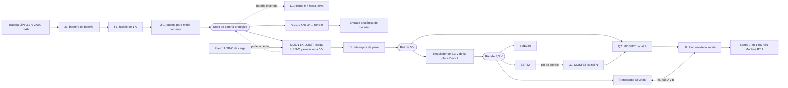
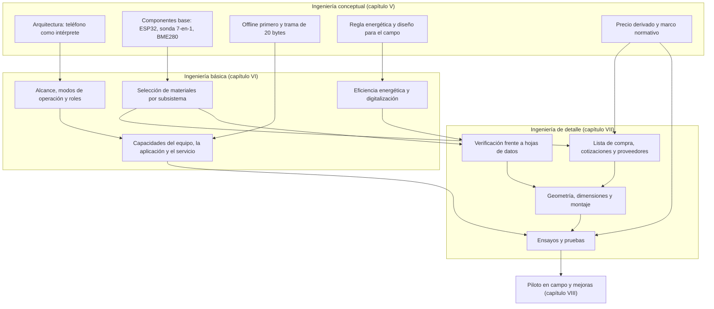
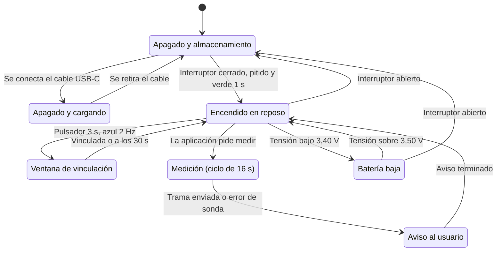
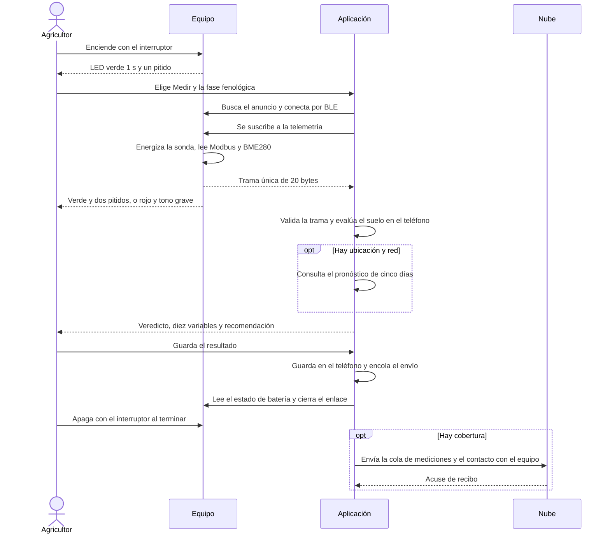
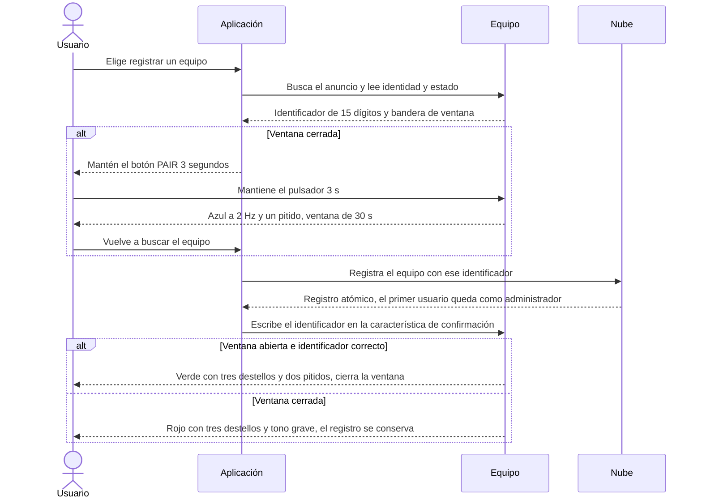
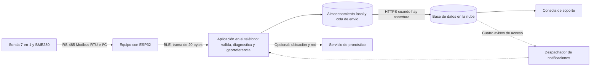
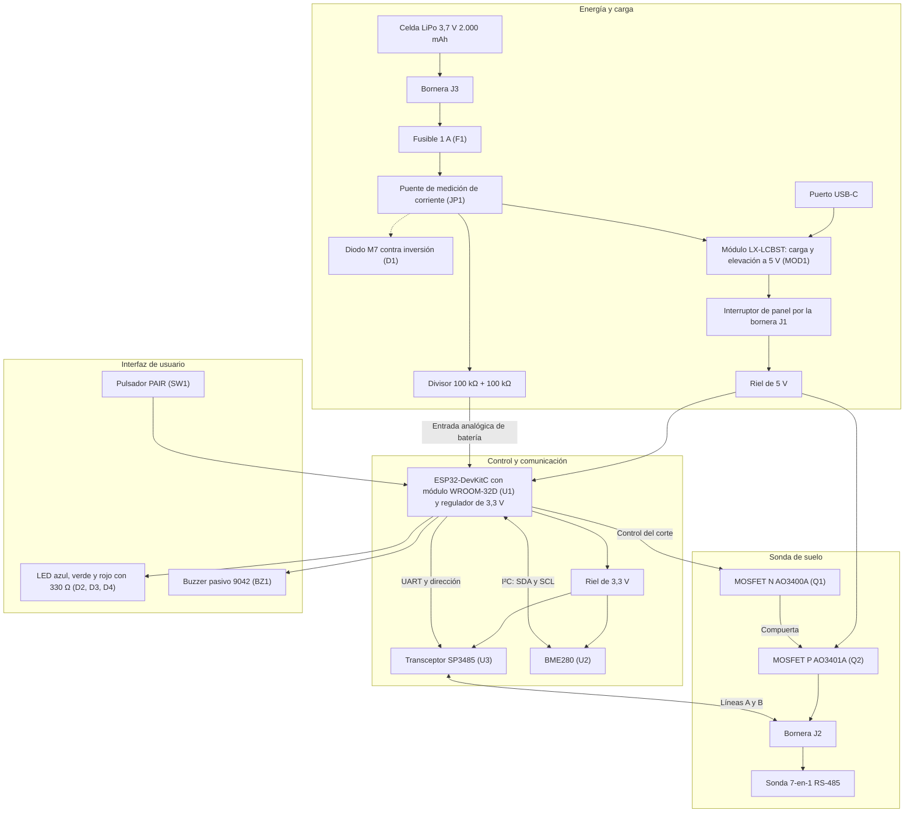
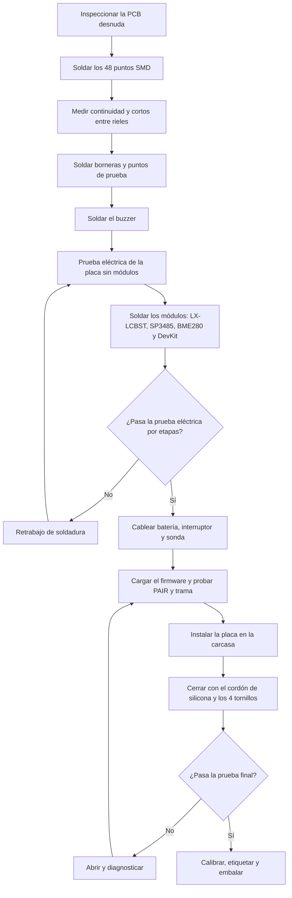
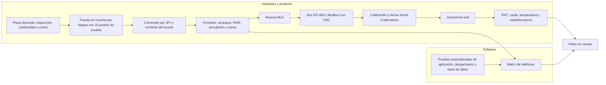

### TERRASENSE

Informe de avance: ingeniería conceptual, básica y de detalle

### Álvaro Nicolás Villena Torrejón

Alan Paul Escobar Rojas

Académico guía: Carlos Alberto Castillo Torres

Santiago − Chile

AÑO 2026

### Índice general

- I. Introducción
- II. Descripción de la Problemática
- III. Propuesta de Solución Tecnológica
- IV. Objetivos del Proyecto
- V. Ingeniería Conceptual
- VI. Ingeniería Básica
- VII. Ingeniería de Detalle
- VIII. Propuestas de Mejora
- IX. Conclusiones
- X. Referencias Bibliográficas

### Índice de figuras

- Figura 1.0 “Diagrama de Decisiones y Consecuencias”
- Figura 1.1 “Diagrama de Flujo Arquitectura 8 Bits + Bluetooth Classic”
- Figura 1.2 “Diagrama de Flujo Arquitectura de Sistema Embebido y Pantalla”
- Figura 1.3 “Diagrama de Flujo Arquitectura con Datalogger Estacionario”
- Figura 1.4 “Diagrama de Flujo Arquitectura de Nodos con LoRaWAN”
- Figura 1.5 “Diagrama de Flujo Arquitectura de Sonda conectada al Teléfono”
- Figura 1.6 “Diagrama de Flujo Arquitectura de Sistema Embebido de Bajo Consumo”
- Figura 1.7 “Diagrama de Flujo Arquitectura de Conectividad”
- Figura 1.8 “Árbol de Alimentación y Nodos de Tensión”
- Figura 1.9 “Representación Conceptual de Carcasa”
- Figura 2.0 “De la ingeniería conceptual a la ingeniería de detalle”
- Figura 2.1 “Estados de operación del equipo”
- Figura 2.2 “Secuencia de una jornada de medición”
- Figura 2.3 “Vinculación con la ventana PAIR”
- Figura 2.4 “Flujo de datos y digitalización del proceso”
- Figura 2.5 “Diagrama de bloques del hardware”
- Figura 2.6 “Esquemático eléctrico de la placa portadora”
- Figura 2.7 “Diseño de la PCB, vista de fabricación con cotas”
- Figura 2.8 “Secuencia de montaje del equipo”
- Figura 2.9 “Secuencia de ensayos, de la placa al piloto”

### Índice de tablas

- Tabla 1.0 “Distribución de Responsabilidades Funcionales del Sistema”
- Tabla 1.1 “Filtro de Viabilidad”
- Tabla 1.2 “Matriz de Decisiones”
- Tabla 1.3 “Comparativa de Microcontroladores”
- Tabla 1.4 “Comparativa de Sondas de Suelo”
- Tabla 1.5 “Comparativa de Sensores de Temperatura / Humedad / Presión Barométrica”
- Tabla 1.6 “Frontera Offline / Online del Sistema”
- Tabla 1.7 “Economías del análisis”
- Tabla 1.8 “Estructura de costos de fabricación (BOM) por equipo”
- Tabla 1.9 “Costeo de la carcasa impresa en taller propio”
- Tabla 2.0 “Costo variable por equipo”
- Tabla 2.1 “Equipamiento e inversión en activo fijo”
- Tabla 2.2 “Activo nominal (gastos de puesta en marcha)”
- Tabla 2.3 “Inversión inicial total”
- Tabla 2.4 “Condiciones del financiamiento”
- Tabla 2.5 “Tabla de amortización del crédito”
- Tabla 2.6 “Dotación por año”
- Tabla 2.7 “Sueldo bruto mensual por cargo y costo laboral anual”
- Tabla 2.8 “Desglose estimado de servicios básicos mensuales”
- Tabla 2.9 “Costos operacionales, de administración y de comercialización”
- Tabla 3.0 “Determinación del precio de venta”
- Tabla 3.1 “Estado de resultados proyectado”
- Tabla 3.2 “Flujo de fondos para la evaluación del proyecto”
- Tabla 3.3 “Evaluación económica”
- Tabla 3.4 “Comparación del horizonte de evaluación: cinco y diez años”
- Tabla 3.5 “VAN ante distintas tasas de descuento”
- Tabla 3.6 “Análisis de sensibilidad y punto de quiebre”
- Tabla 3.7 “Costo total de propiedad para el agricultor”
- Tabla 3.8 “Especificaciones Técnicas ESP32”
- Tabla 3.9 “Especificaciones Técnicas Sonda”
- Tabla 4.0 “Contrato de Datos BLE (20 bytes)”
- Tabla 4.1 “Estado Probatorio de las Especificaciones de Hardware”
- Tabla 4.2 “Gestión Energética”
- Tabla 4.3 “Interfaz Hardware”
- Tabla 4.4 “Pilares de Digitalización del Proceso Agrícola”
- Tabla 4.5 “Estados Energéticos y Medidas de Diseño”
- Tabla 4.6 “Balance Energético por Nodo de Tensión”
- Tabla 4.7 “Energía por Ciclo de Medición”
- Tabla 4.8 “Autonomía según el Patrón de Uso”
- Tabla 4.9 “Sensibilidad de la Autonomía al Consumo y al Uso”
- Tabla 5.0 “Análisis Comparativo de Parámetros”
- Tabla 5.1 “Clasificación Normativa: Obligatoria, Voluntaria y de Mercado Futuro”
- Tabla 5.2 “Protocolo de Validación In Situ vs. Laboratorio de Referencia”
- Tabla 5.3 “Plan de Calibración y Control de Deriva”
- Tabla 5.4 “Supuestos de Mercado Declarados”
- Tabla 5.5 “Trazabilidad de la ingeniería conceptual a la ingeniería básica”
- Tabla 5.6 “Alcance incluido y excluido del proyecto”
- Tabla 5.7 “Modos de operación del equipo”
- Tabla 5.8 “Roles y permisos de operación”
- Tabla 5.9 “Capacidades del equipo”
- Tabla 6.0 “Capacidades de la aplicación”
- Tabla 6.1 “Capacidades del backoffice y del servicio”
- Tabla 6.2 “Selección de materiales y equipos por subsistema”
- Tabla 6.3 “Criterios de eficiencia energética aplicados en el diseño”
- Tabla 6.4 “Energía de los avisos del equipo (estimada)”
- Tabla 6.5 “Medidas de mejora de la eficiencia y su efecto estimado”
- Tabla 6.6 “Eslabones de la digitalización del proceso”
- Tabla 6.7 “Lista de compra por equipo, con proveedor, referencia y tipo de precio”
- Tabla 6.8 “Resumen de compra por proveedor”
- Tabla 6.9 “Plazos referenciales y alternativas por proveedor”
- Tabla 7.0 “Equipos del taller y su uso en la fabricación y los ensayos”
- Tabla 7.1 “Alternativas de fabricación de la placa”
- Tabla 7.2 “Costo de montar los puntos SMD por placa según el tamaño del lote”
- Tabla 7.3 “Verificación de la potencia y la protección frente a las hojas de datos”
- Tabla 7.4 “Verificación de la señal, la interfaz y la parte mecánica frente a las hojas de datos”
- Tabla 7.5 “Datos de fabricación de la PCB”
- Tabla 7.6 “Coordenadas de los agujeros de montaje y de los componentes de interfaz y conexión”
- Tabla 7.7 “Dimensiones y tolerancias de la carcasa propuesta”
- Tabla 7.8 “Aberturas, ubicaciones y elementos de fijación de la carcasa”
- Tabla 7.9 “Pasos de montaje y controles”
- Tabla 8.0 “Ensayos de la placa y de la electrónica”
- Tabla 8.1 “Ensayos del firmware, la comunicación y la sonda”
- Tabla 8.2 “Ensayos del producto terminado y normativos”
- Tabla 8.3 “Ensayos automatizados del software y del servicio”
- Tabla 8.4 “Matriz de teléfonos de prueba”
- Tabla 8.5 “Mejoras incorporadas y propuestas, por origen”

## I. Introducción

La agricultura nacional enfrentó hasta hace muy poco tiempo un período decisivo marcado por la escasez hídrica persistente en la zona centro-sur y el encarecimiento de los insumos agroquímicos esenciales [1].

En este contexto, optimizar el uso del agua y los nutrientes es un requisito estricto de supervivencia económica para el pequeño y mediano productor. Sin embargo, existe una profunda brecha tecnológica que margina a este sector, los instrumentos de medición disponibles son económicamente difíciles de adquirir además de que entregan datos crudos (como valores aislados de conductividad o pH) que resultan incomprensibles sin una formación técnica especializada.

Para dar respuesta a esta problemática, el presente informe detalla el desarrollo y evaluación de TerraSense, un sistema integral de apoyo a la decisión sobre el terreno. Más que un simple sensor, la propuesta se basa en una arquitectura de bajo consumo que captura las variables físicas del suelo (mediante bus RS-485, de comunicación serial diferencial, con protocolo Modbus en su variante serial binaria RTU) y del ambiente inmediato del punto de muestreo (mediante el sensor BME280 en bus serial de dos hilos I²C). Su innovación radica en delegar el procesamiento complejo al teléfono del agricultor vía Bluetooth Low Energy (BLE), transformando datos crudos en recomendaciones agronómicas accionables de forma inmediata, sin necesidad de conexión a internet durante la medición ni de suscripciones de pago. A lo largo de este documento se expone la ingeniería conceptual del sistema, justificando la selección de componentes, el diseño de gestión energética, el cumplimiento del marco regulatorio y la evaluación económica que respalda su viabilidad técnica y financiera.

En el teléfono una aplicación con motor agronómico determinista opera de manera estrictamente offline, interpretando las variables y presentándolas bajo un Grid 2×5 de fácil asimilación, categorizada por código de colores tipo semáforo y enriquecida con recomendaciones directas de labor según el cultivo, el tipo de suelo y la etapa fenológica (Pre-siembra, Vegetativo, Floración o Cosecha). Como complemento a la lectura local, el sistema consulta un pronóstico meteorológico a 5 días que contextualiza la labor a mediano plazo (evitando, por ejemplo, sembrar antes de un pronóstico temporal).

La ingeniería conceptual que fundamenta el proyecto se desarrolla en las siguientes secciones: la evaluación de alternativas, el dimensionamiento de mercado, el diseño electrónico y mecánico, el modelo financiero de rentabilidad a diez años, con comparación a cinco años, el marco normativo y el protocolo de validación experimental que sustentan su factibilidad técnica y económica.

## II. Descripción de la Problemática

### Contexto del Sector Agrícola Nacional

La agricultura chilena es un pilar fundamental para la seguridad alimentaria y el desarrollo rural del país.

Según el último Censo Agropecuario y Forestal, el cual se realiza cada 10 años, existen más de 175.000 unidades productivas a nivel nacional [2, 3]. Dentro de este universo, la Agricultura Familiar Campesina (AFC) y los productores pequeños (con campos de 0,5 a 20 hectáreas) representan la base productiva del mercado interno [4]. Sin embargo, este sector se encuentra actualmente en un punto de vulnerabilidad histórica debido a la convergencia de dos factores extremos:

En primer lugar, el país atravesó una “mega sequía” ininterrumpida desde 2010, con un déficit de precipitaciones cercano al 30 % en la zona centro-sur [1]. Esta crisis hídrica no solo limita el riego, sino que altera las condiciones físico-químicas del terreno, promoviendo la salinización y degradación del suelo.

En segundo lugar, el escenario económico ha provocado una escalada sostenida en los costos operativos, especialmente impulsada por el alza internacional en los precios de los fertilizantes y agroquímicos [5].

En este escenario de estrechez hídrica y alto costo de insumos, la eficiencia productiva ya no es solo una oportunidad de mejora, sino un requisito estricto. La agricultura moderna exige optimizar cada gota de agua y cada gramo de nutriente aplicado. No obstante, para lograr esta eficiencia es imperativo contar con información precisa y en tiempo real sobre las condiciones del suelo, un requisito que choca frontalmente con la realidad tecnológica y económica del pequeño o mediano agricultor.

### El Problema Central

El problema radica en que el pequeño y mediano agricultor no tiene acceso a herramientas tecnológicas adaptadas a su realidad económica y técnica para tomar decisiones agronómicas. Si bien existen en el mercado instrumentos para medir parámetros vitales como la humedad, temperatura, pH y conductividad eléctrica (CE), estos presentan una doble barrera de entrada para la Agricultura Familiar Campesina:

La Barrera Económica: El problema no es únicamente que estos instrumentos tengan una etiqueta de precio alto en términos absolutos, sino que entregan poca capacidad de medición e interpretación por cada peso invertido, y que esa inversión debe repetirse porque la alternativa formal es un servicio, no un activo.

Un medidor portátil básico como el Hanna HI9814 cuesta US$294 [6] y mide únicamente 4 variables (pH, CE, TDS —sólidos disueltos totales— y temperatura) en soluciones hidropónicas, sin ninguna capa de interpretación agronómica; las sondas de precisión de grado investigación superan los US$1.495 [7]. La alternativa formal, el análisis de laboratorio acreditado, cuesta en Chile del orden de $50.000 por muestra; a ese costo, nueve muestras ya igualan el precio completo de un instrumento propio, sin que el agricultor pueda repetir la medición al día siguiente sin costo marginal, ni reciba una recomendación de manejo lista para aplicar en el momento. La barrera real, entonces, no es el precio de compra aislado, sino la relación entre lo que el instrumento mide, interpreta y permite repetir en el tiempo, frente a lo que cuesta sostener esa misma información por la vía del servicio. Esa es la relación que este proyecto reformula, y su comparación completa de costo total de propiedad para el agricultor se desarrolla también en este informe, junto con la estrategia de precios.

La Barrera de Interpretación: Incluso si el agricultor logra adquirir uno de estos equipos, las herramientas actuales entregan “datos planos” (por ejemplo, un valor aislado de 2.500 µS/cm o un pH de 5.5). La mayoría de los pequeños productores no cuenta con la formación técnica especializada para interpretar si ese número es letal para su cultivo específico, ni saben cómo traducir ese dato crudo en una acción correctiva concreta (como calcular cuántos litros de agua aplicar para lavar las sales).

Esta falta de herramientas accesibles e intuitivas obliga al agricultor a operar “a ciegas” durante todo el proceso productivo. El costo de esa ceguera no se reparte de manera pareja a lo largo de la temporada: se concentra en cuatro momentos en los que la decisión, una vez tomada, ya no se puede deshacer. Son las mismas cuatro etapas fenológicas sobre las que opera la solución propuesta.

- Pre-Siembra: Sin medir la conductividad eléctrica, el productor desconoce cuánta sal dejó acumulada la sequía en su terreno; sin medir la temperatura del suelo, no sabe si la tierra alcanzó el mínimo que exige la germinación. Siembra igual, guiado por el calendario heredado. La semilla se pierde en un suelo frío o demasiado salino, y esa pérdida sólo se vuelve visible varias semanas más tarde, cuando ya no queda ventana para resembrar.

- Vegetativo: Con la inversión ya comprometida, el riego se ajusta por costumbre y no por la humedad real del terreno. El exceso de agua desplaza el aire del suelo y asfixia las raíces, y de paso arrastra hacia abajo el fertilizante recién aplicado, que el cultivo ya no alcanza a absorber; la falta de agua, en el otro extremo, frena el desarrollo. En ambos casos el productor paga dos veces: el insumo perdido y el crecimiento que no ocurrió.

- Floración: Es la ventana más corta y la más cara de todas. Un estrés hídrico que pase inadvertido durante esos días provoca aborto floral masivo, y con él se pierde el rendimiento de la temporada completa aunque la planta siga verde y aparentemente sana. Es exactamente el tipo de daño que la inspección visual no alcanza a detectar a tiempo, porque cuando se hace evidente ya está consumado.

- Cosecha: Entrar al campo con maquinaria sobre un suelo con exceso de humedad compacta la tierra y destruye su estructura. El costo no se paga en la cosecha que se está levantando, sino en la siguiente: un suelo compactado infiltra peor, retiene menos agua y obliga a más labores de preparación. La decisión que hipoteca la temporada que viene se toma, sin saberlo, al cerrar la actual.

### Impacto de las Decisiones Tradicionales

Ante la falta de instrumental comprensible, el productor toma decisiones basadas en la tradición o en inspecciones sensoriales superficiales ( tocar la tierra con la mano, observar el polvo en superficie o guiarse por el calendario astronómico). Este método empírico induce fallos agronómicos severos en los cuatro momentos clave del cultivo:

> *[Figura del informe original, sin cambios]*

**Figura 1.0 “Diagrama de Decisiones y Consecuencias”**

Diagrama que encadena, para cada una de las cuatro etapas fenológicas, la decisión tomada sin medición, el fallo agronómico que produce y la consecuencia económica en que termina.

### Relación con los Servicios Formales de Análisis y Asesoría

Actualmente, las alternativas formales como los análisis de laboratorio son lentas (15 a 30 días) y costosas, entregando resultados cuando la fase crítica ya pasó. Por otro lado, pagar asesorías agronómicas continuas para que un profesional interprete los datos escapa del presupuesto operativo.

Corresponde precisar el alcance exacto de esta brecha, porque el proyecto no se plantea como un reemplazo del laboratorio. Un análisis acreditado determina propiedades químicas mediante extracción y método normalizado; un instrumento de terreno entrega una lectura directa, en un punto y en un instante.

Son procedimientos distintos que responden preguntas distintas, y confundirlos sería el error de fondo más grave que podría cometer este proyecto. TerraSense apunta al vacío que existe entre dos análisis de laboratorio: las decenas de decisiones de riego, siembra y manejo que el agricultor toma cada semana y que hoy resuelve por intuición, porque no existe ninguna herramienta que las acompañe con un dato propio de su campo. Los servicios de laboratorio y de asesoría conservan íntegramente su función en las decisiones que exigen determinaciones específicas, en particular las de fertilización.

En síntesis, el pequeño productor queda atrapado entre una crisis climática que le exige más precisión que nunca, un mercado de instrumentación que lo deja fuera por la relación entre lo que cobra y lo que entrega, y equipos que, cuando los alcanza, le devuelven un número que no sabe leer. Las dos barreras se refuerzan entre sí: la económica le impide comprar el instrumento, y la de interpretación vuelve inútil el instrumento que sí lograra comprar. El resultado es un productor que decide a ciegas y descubre sus errores al final de la temporada, cuando la pérdida de la cosecha y el endeudamiento del año ya son irreversibles.

## III. Propuesta de Solución Tecnológica

### Filosofía del Proyecto

Antes de cualquier decisión técnica o de diseño más focalizado, el proyecto responde a una pregunta fundamental: ¿Para qué existe esta herramienta? La respuesta no es "para cuidar plantas", sino para proteger el patrimonio de una familia que se juega el año entero en cada siembra.

Esta distinción no es un matiz retórico; cambia el criterio con el que se evalúa cada decisión de desarrollo.

El fin último no es el campo productivo, sino el ser humano cuyo sustento familiar depende de él. Un cultivo que se pierde por acidez o salinidad es, en el fondo, un problema agronómico menor comparado con lo que realmente está en juego, una familia que queda endeudada durante un año entero por tomar una decisión sin la información adecuada. Ese es el problema social y económico que TerraSense ataca. Por ello, toda decisión de diseño se resuelve preguntando cuál alternativa reduce más el riesgo económico del productor, no cuál es la más sofisticada desde el punto de vista técnico. De esta premisa central se desprenden cuatro principios que gobiernan el diseño del sistema:

- No Entregamos Datos, Entregamos Respuestas: Un dato aislado, un valor de pH o una lectura de conductividad no es información útil para quien no sabe interpretarlo. Un dato sin contexto es, en la práctica, “un vacío” con unidades. TerraSense no entrega la medición en bruto, sino la cadena completa: desde la captura de la variable física hasta una recomendación concreta de manejo (qué hacer, cuánto y por qué).

- El Teléfono es el Cerebro del Sistema: La idea central que ordena todo el diseño es sencilla y radical en sus consecuencias: el teléfono que el agricultor ya posee es el instrumento de registro más potente que existe. Tiene pantalla legible, ubicación satelital, capacidad de cálculo y memoria.

Fabricar un instrumento nuevo que vuelva a incluir todas esas capacidades sería cobrarle dos veces al agricultor por algo que ya tiene. Por eso, el aparato físico se reduce a lo mínimo indispensable: hacer lo único que el teléfono no puede hacer por sí solo (tomar contacto físico con la tierra y el ambiente). Todo el resto ocurre en el teléfono. Además de que el 100 % del procesamiento agronómico ocurre en el procesador del teléfono sin depender de cobertura de red móvil (3G/4G/5G). La nube actúa exclusivamente como respaldo posterior.

- Diseño para el Campo Real, no para el Laboratorio: El instrumento no vivirá sobre un escritorio; se caerá sobre tierra y piedras, se mojará y viajará quizás en la caja de una camioneta.

Cada elección de materiales responde a esa realidad de uso, priorizando la austeridad y la resistencia sobre la estética .

- Cero Suscripciones Recurrentes: El agricultor paga una vez por su instrumento y sus mediciones le pertenecen; puede consultarlas y usarlas libremente. A diferencia de la instrumentación importada que depende de plataformas por suscripción, aquí no existe una cuota mensual que condicione el funcionamiento del equipo. La tecnología no debe convertirse en una carga financiera mensual para quien ya enfrenta suficiente incertidumbre. Este principio tiene una consecuencia económica directa y asumida; los costos de soporte, servicios digitales, mantenimiento y reposición permanecen en el presupuesto de la empresa y están explícitamente cuantificados en la evaluación económica de este informe.

### Beneficiarios de la Solución

El beneficiario directo y principal es el pequeño y mediano productor comercial (Agricultura Familiar Campesina), quien hoy queda fuera de toda la oferta de instrumentación profesional. Sin embargo, el diseño contempla un impacto expansivo hacia otros actores:

La Familia y el Equipo de Trabajo: El sistema está diseñado para que cualquier persona en el campo pueda tomar una medición sin necesitar formación técnica previa.

Asesores Técnicos y Extensionistas: Quienes hoy deben estimar las condiciones del suelo a través de la observación, podrán pasar de “estimar” a “medir”, dejando un registro histórico de cada medición.

Cabe precisar, para efectos del dimensionamiento comercial, que la cantidad de campos visitados por un asesor no equivale a la cantidad de equipos comprados.

Instituciones Públicas: Podrían apoyarse en esta información agregada para focalizar sus programas de fomento, paliando la actual falta de datos de suelo georreferenciados a escala de campo individual.

El Medio Ambiente: Una fertilización y riego ajustados a la necesidad real del cultivo en lugar de aplicaciones preventivas por exceso de precaución reduce el desperdicio hídrico y la contaminación de napas por lixiviación.

### La Propuesta de Valor

TerraSense toma la información física del suelo y del aire, la cruza con el conocimiento agronómico del cultivo y con las condiciones climáticas del lugar exacto de la medición, entregando en segundos y sin necesidad de conexión a internet una recomendación concreta y accionable. Es, en esencia, la diferencia entre entregarle a alguien un termómetro y entregarle una orientación de manejo ya interpretada. El modelo comercial que sostiene esa promesa es la venta del instrumento con la aplicación incluida y sin cobro por lectura, el usuario dispone de una herramienta de seguimiento permanente, mientras los servicios de laboratorio y asesoría conservan su función en aquellas decisiones que requieren determinaciones específicas.

### Estructura del Ecosistema

Para optimizar costos de manufactura y maximizar la durabilidad en terreno, las responsabilidades se distribuyen de forma estricta entre el hardware, la aplicación móvil y la infraestructura backend:

| Capa del Sistema | Componente Físico | Responsabilidad Asignada | Lo Que Deliberadamente No Realiza |
|---|---|---|---|
| 1. Instrumento de Captura | Placa ESP32 DevKitC (módulo ESP32-WROOM-32D) + Sonda 7-en-1 + BME280 | Excitar sensores, leer buses RS-485 e I²C, verificar checksums y transmitir trama BLE. | No procesa algoritmos agronómicos, no almacena historial ni requiere pantalla gráfica propia. |
| 2. Inteligencia Local | App móvil (React Native) con almacenamiento local persistente del teléfono y cola de sincronización diferida | Ejecutar motor agronómico determinista, desplegar Grid 2×5 y almacenar histórico local. | No genera voltajes de excitación industrial ni depende de servidores externos para evaluar. |
| 3. Respaldo y soporte | Supabase (PostgreSQL) + Consola Web | Respaldar mediciones al detectar red, control de cuentas, soporte posventa y consulta del histórico de cada equipo. | No bloquea la operación en campo en ausencia de conectividad. |

**Tabla 1.0 “Distribución de Responsabilidades Funcionales del Sistema”**

Sobre la segunda fila conviene una precisión, porque de ella dependen las afirmaciones de operación sin red que el informe sostiene más adelante. La aplicación no utiliza un motor de base de datos embebido, conserva las mediciones en el almacenamiento persistente del propio teléfono y mantiene una cola de envío diferido, mientras el motor agronómico y las definiciones de cultivos residen en el código de la aplicación y no en un servidor. El efecto para el usuario de medir, diagnosticar y consultar sin cobertura es el mismo que ofrecería una base de datos local.

## IV. Objetivos del Proyecto

### Objetivo General

Diseñar, construir y validar un instrumento portátil de medición de suelo que resuelva, de punta a punta, la toma de decisiones del pequeño agricultor: capturando en terreno las variables físicas y químicas relevantes del suelo y su ambiente, interpretándolas de inmediato mediante un sistema de razonamiento agronómico ejecutado en el teléfono del usuario, y entregando una recomendación de manejo clara y aplicable en cuestión de segundos, sin costos recurrentes por suscripción.

En síntesis: lograr que una medición física se convierta, en el mismo lugar, en una decisión agronómica correcta.

### Objetivos Específicos

Para materializar este objetivo general, el proyecto se estructura en los siguientes frentes de trabajo:

- Definir la arquitectura de hardware y comunicación: Comparar explícitamente distintas combinaciones de componentes y protocolos de transmisión hacia el teléfono, justificando técnica y económicamente la elección final en lugar de asumir la primera opción disponible.

- Diseñar el sistema de adquisición de datos: Lograr una integración confiable entre la sonda edáfica (que penetra la tierra) y los sensores ambientales, asegurando que el equipo capture un panorama físico-químico completo y no sólo datos aislados.

- Optimizar la autonomía energética: Desarrollar un sistema de alimentación capaz de sostener un uso frecuente en terreno durante varios meses sin requerir recargas constantes ni mantenimiento especializado, garantizando su disponibilidad durante toda la temporada agrícola.

- Desarrollar el motor de razonamiento agronómico: Construir el algoritmo (el “corazón” del sistema) que convierta las variables físicas capturadas en orientaciones cualitativas ajustadas a la etapa fenológica específica del cultivo y su etapa (siembra, desarrollo, floración o cosecha).

- Programar la interfaz móvil (App) para entornos rurales: Desarrollar una aplicación intuitiva y accesible para usuarios de distintos niveles de alfabetización digital, que opere de forma offline al momento de medir y sincronizar los datos cuando recupere la cobertura de red.

- Diseñar el encapsulado industrial (Carcasa): Crear una estructura física robusta, pensada explícitamente para el rigor del trabajo agrícola, que proteja los componentes electrónicos del barro, polvo, sol directo, humedad e inmersiones accidentales.

- Validar la precisión instrumental: Contrastar empíricamente las mediciones del equipo contra muestras analizadas por un laboratorio de referencia acreditado, respaldando con evidencia científica que los datos capturados reflejan fielmente la realidad del suelo, y declarar con igual claridad qué variables quedan fuera de esa validación y por qué.

- Asegurar el cumplimiento normativo: Identificar y cumplir el marco regulatorio aplicable, abarcando la seguridad eléctrica del hardware, el uso permitido del espectro radioeléctrico, y la protección de datos personales y derechos del consumidor, expresando cada norma como un requisito de diseño con método de verificación y criterio de aceptación.

- Evaluar la viabilidad económica y financiera: Estructurar el modelo de negocio, analizando rigurosamente la estructura de costos, proyecciones de flujo de caja y fuentes de financiamiento, para asegurar que la solución tecnológica sea sostenible como empresa en el tiempo.

## V. Ingeniería Conceptual

La ingeniería conceptual constituye el puente crítico entre la problemática diagnosticada y la materialización de la solución. En esta etapa, los principios filosóficos del proyecto, movilidad, independencia de red, bajo costo y el uso del teléfono como núcleo de procesamiento se traducen en requerimientos técnicos concretos. El objetivo de esta fase no es simplemente elegir componentes al azar, sino definir y justificar la arquitectura de hardware y software óptima que garantice la viabilidad del equipo en el mundo real, equilibrando rendimiento, robustez y usabilidad para el pequeño agricultor.

A partir de estas premisas, se desarrolla el siguiente análisis de viabilidad técnica, como también viabilidad económica en donde se evalúan las distintas alternativas para materializar el sistema.

### Análisis de Viabilidad Técnica

Antes de comparar cualquier alternativa, el proyecto fija dos capas de exigencia, porque confundirlas es el error metodológico más común en un estudio de ingeniería conceptual.

- Requisitos Obligatorios (filtro de viabilidad): Son condiciones de cumplimiento innegociable: una arquitectura que no las satisface queda eliminada antes de puntuar, sin importar su desempeño en el resto de los criterios.

| ID | Requisito | Qué exige |
|---|---|---|
| RO-1 | Alimentar y comunicarse con la sonda | Operar por bus diferencial RS-485 con sonda industrial. |
| RO-2 | Interpretar, no solo mostrar | Entregar un veredicto interpretado, no una lectura plana. |
| RO-3 | Operar sin cobertura celular | Completar la medición en el momento, sin depender de señal de datos. |
| RO-4 | Muestrear múltiples puntos | Permitir recorrer y medir distintos puntos de un mismo campo en una jornada. |
| RO-5 | Ser físicamente realizable | Construirse con componentes de catálogo real, no con tecnología hipotética. |

**Tabla 1.1 “Filtro de Viabilidad”**

Criterios Ponderados: Solo entre las arquitecturas que sobreviven el filtro se aplica una matriz de puntuación (escala 1 a 10) sobre ocho criterios: cobertura espacial (15 %), calidad de interfaz (13 %), capacidad de interpretación (15 %), autonomía energética (14 %), costo total a cinco años para el agricultor (16 %), robustez mecánica y ambiental (10 %), facilidad de actualizar el conocimiento agronómico (9 %) e independencia de infraestructura externa (8 %).

Esta separación en dos capas evita "aprobar" una arquitectura inviable con un buen puntaje ponderado, un caso real que aparece más adelante y que el propio proyecto descarta por honestidad tecnológica.

Alternativas Evaluadas: Se compararon seis arquitecturas; ninguna es hipotética, las seis existen hoy como productos comerciales o como proyectos publicados en la literatura técnica.

- Instrumento autónomo (8 bits + pantalla + Bluetooth Classic): La arquitectura por defecto de la electrónica educativa y de buena parte de los medidores genéricos de importación, un microcontrolador simple, una pantalla LCD u OLED pequeña, y un módulo Bluetooth Classic para vinculación.

> *[Figura del informe original, sin cambios]*

**Figura 1.1 “Diagrama de Flujo Arquitectura 8 Bits + Bluetooth Classic”**

Evaluación: Los módulos Bluetooth Classic más usados implementan un perfil de comunicación que iOS no permite usar sin certificación MFi (Made for iPhone) de Apple. Adoptarla significa renunciar a la mitad del mercado de teléfonos. Además, la memoria disponible no alcanza para el motor de interpretación y no hay forma de actualizar el firmware de forma remota. Incumple el filtro de viabilidad y queda eliminada.

- Instrumento autónomo con inferencia embebida y pantalla: La versión seria de la alternativa anterior. Todo el sistema incluido el motor de interpretación agronómica viviría dentro del microcontrolador, sin depender de un teléfono.

> *[Figura del informe original, sin cambios]*

**Figura 1.2 “Diagrama de Flujo Arquitectura de Sistema Embebido y Pantalla”**

Evaluación: Incorporar una pantalla activa y el motor de interpretación agronómica reduce la autonomía en más de tres cuartas partes; la ventana de la pantalla es un riesgo de estanqueidad frente a la humedad; sin GPS ni conectividad, se pierde la capa del motor que cruza la medición con el clima previsto; y corregir el conocimiento agronómico exigiría publicar un nuevo firmware y forzar al usuario a instalarlo. Sí supera el filtro de viabilidad y llega a la etapa de puntuación.

- Datalogger estacionario con telemetría de red móvil: La arquitectura típica de las parcelas de investigación: equipo fijo, alimentado por panel solar, con una sonda enterrada en un único punto y un módem de red móvil que sube datos a una web por suscripción.

> *[Figura del informe original, sin cambios]*

**Figura 1.3 “Diagrama de Flujo Arquitectura con Datalogger Estacionario”**

Evaluación: Resuelve bien un problema distinto. La variabilidad de un campo es espacial; mapear veinte puntos exigiría veinte equipos. Requiere cobertura celular exacta en el punto de instalación e impone una suscripción recurrente (incompatible con el proyecto). Incumple RO-3 y RO-4 y queda eliminada.

- Red de nodos LoRaWAN con estación controladora en el campo: Reemplaza el módem de red móvil por una radio de largo alcance y bajísimo consumo hacia una estación concentradora en el campo.

> *[Figura del informe original, sin cambios]*

**Figura 1.4 “Diagrama de Flujo Arquitectura de Nodos con LoRaWAN”**

Evaluación: Es la alternativa técnicamente más elegante entre las descartadas, pero medir 20 puntos exigiría 20 nodos a un costo prohibitivo, y exige instalar infraestructura propia (la estación). Además, no resuelve el caso de uso real: el agricultor está de pie sobre el punto cuando necesita la decisión, no a distancia. Cumple los requisitos y pasa a puntuar con esa reserva.

- Sonda conectada directo al teléfono (electrónica intermedia): La alternativa más radical: eliminar la radio del medio y conectar la sonda al teléfono por cable.

> *[Figura del informe original, sin cambios]*

**Figura 1.5 “Diagrama de Flujo Arquitectura de Sonda conectada al Teléfono”**

Evaluación: Si se puntuara, obtendría el segundo mejor resultado al heredar gratis todas las capacidades del teléfono. Sin embargo, es físicamente irrealizable, la sonda opera en un rango de 5 a 24 V de corriente continua (DC) que técnicamente incluye los 5 V que entrega un puerto USB, el puerto de un teléfono convencional en modo host no puede sostener la corriente de excitación que exige la sonda industrial durante la medición, y ningún teléfono comercial genera de forma nativa la señalización diferencial RS-485 que el protocolo exige.

El límite no es de tensión sino de corriente entregable y de capa física. Incumple RO-1 y RO-5 y queda eliminada sin puntuar.

- Instrumento portátil inalámbrico de bajo consumo, con el teléfono como intérprete: La síntesis de las lecciones anteriores: un equipo portátil mínimo que resuelve únicamente lo que el teléfono no puede hacer (proveer la tensión, protocolo y medición física), y delega en el teléfono la interpretación, posición geográfica, pantalla y almacenamiento mediante un enlace inalámbrico BLE (Bluetooth Low Energy).

> *[Figura del informe original, sin cambios]*

**Figura 1.6 “Diagrama de Flujo Arquitectura de Sistema Embebido de Bajo Consumo”**

Evaluación: El teléfono reúne capacidades que duplicar en el instrumento sería un gasto innecesario. Asume que el usuario dispone de un teléfono, supuesto respaldado por la alta penetración del smartphone en zonas rurales [15].

### Matriz de Decisión: Puntuando sólo a las arquitecturas que superaron el filtro.

| Criterio | Peso | Instrumento autónomo con inferencia embebida y pantalla | Red de nodos LoRaWAN con estación concentradora campo | Instrumento portátil inalámbrico de bajo consumo, con el teléfono como intérprete |
|---|---|---|---|---|
| Cobertura espacial | 15 % | 8 | 5 | 10 |
| Calidad de interfaz | 13 % | 4 | 7 | 10 |
| Capacidad de interpretación | 15 % | 6 | 8 | 10 |
| Autonomía energética | 14 % | 4 | 8 | 9 |
| Costo total a 5 años | 16 % | 6 | 2 | 8 |
| Robustez mecánica | 10 % | 6 | 9 | 9 |
| Actualización del conocimiento | 9 % | 5 | 8 | 10 |
| Independencia de infraestructura | 8 % | 9 | 5 | 7 |
| Puntaje ponderado final | 100 % | 5,91 | 6,32 | 9,20 |

**Tabla 1.2 “Matriz de Decisiones”**

Conclusión y Sensibilidad: La arquitectura de un instrumento portátil inalámbrico de bajo consumo, con el teléfono como intérprete gana con margen amplio por su ventaja insuperable en cobertura espacial ilimitada, capacidad de interpretación y facilidad de actualización del software. Tras un análisis de sensibilidad elevando los pesos de distintos criterios, esta arquitectura mantiene su ventaja.

Selección de Componentes Base: Decidida la arquitectura general, la segunda capa de decisiones define con qué componente concreto se construye cada bloque.

Se aplicó la misma disciplina, evaluación de candidatos reales, criterios declarados antes de comparar, y honestidad explícita cuando la alternativa descartada es superior en alguna dimensión. Sobre once subsistemas evaluados, en siete existe una alternativa técnicamente superior en alguna métrica, y el proyecto lo declara en lugar de presentar una selección irreal donde el componente elegido gane en todo.

Microcontrolador: Se evaluaron cuatro candidatos: ESP32, nRF52840, STM32WB55 y ATmega328P + HC-05. Este último queda descartado de entrada: su módulo Bluetooth Classic sufre el mismo bloqueo de iOS (certificación MFi) visto en la evaluación de arquitecturas.

Los tres restantes se puntúan sobre cinco criterios declarados antes de comparar, en la misma escala de 1 a 10 usada en la matriz de arquitecturas: consumo de radio en transmisión BLE (20 %), actualización del firmware por Bluetooth (20 %), concurrencia disponible para separar la pila de radio de la temporización Modbus (15 %), ecosistema y soporte de documentación (25 %) y disponibilidad y costo en el mercado local (20 %). Cada celda de la tabla es la nota del criterio y el puntaje ponderado, la suma de cada nota por su peso.

| Microcontrolador | Consumo de radio en Tx BLE (20 %) | Actualización del firmware por Bluetooth (20 %) | Concurrencia (15 %) | Ecosistema y documentación (25 %) | Disponibilidad y costo (20 %) | Puntaje ponderado | Veredicto |
|---|---|---|---|---|---|---|---|
| STM32WB55 | 10 (~5–6 mA [8]) | 8 | 8 (2 núcleos) | 5 | 4 | 6,85 | Descartado |
| nRF52840 | 10 (~5–6 mA [9]) | 10 | 5 (1 núcleo) | 7 | 5 | 7,50 | Descartado |
| ESP32 | 4 (~130–150 mA [19]) | 7 | 10 (2 núcleos) | 10 | 10 | 8,20 | Seleccionado |

**Tabla 1.3 “Comparativa de Microcontroladores”**

Justificación de la Selección: Aunque los chips nRF52840 y STM32WB55 superan al ESP32 por un factor enorme en eficiencia de radio, al modelar el presupuesto energético completo del equipo esa ventaja de radio sólo se traduce en una fracción mínima de autonomía total, porque la carga dominante es el consumo propio de la placa de control mientras el equipo está encendido, no la radio. A cambio de resignar ese porcentaje, el ESP32 gana en los criterios de mayor peso: el ecosistema de desarrollo y el soporte de la comunidad, la disponibilidad y el costo en el mercado local, y el doble núcleo para sostener la temporización de la sonda sin perder el Bluetooth. En actualización del firmware por Bluetooth queda detrás del nRF52840, cuyo mecanismo de actualización por BLE es maduro: el ESP32 aporta las particiones y la interfaz de actualización, pero el transporte por Bluetooth lo implementa el propio firmware. El producto no usa el Wi-Fi integrado del ESP32; el firmware se actualiza por Bluetooth desde la aplicación. Dentro de la familia, el equipo adquiere la placa de desarrollo ESP32 DevKitC con el módulo ESP32-WROOM-32D, cuya antena está impresa en el propio módulo y que implementa Bluetooth 4.2 (BR/EDR, velocidad básica y mejorada, y BLE) [50]; no lleva conector para antena externa.

Sobre la cifra de consumo conviene fijar una sola referencia, porque este informe la utiliza en dos lugares distintos, el módulo presenta un rango dinámico total de 95 a 380 mA medido en su propio pin de 3,3 V, dentro del cual la transmisión BLE se sitúa en el orden de 130 a 150 mA. El balance energético de este informe adopta 150 mA para la fase de envío, es decir el extremo superior de esa banda, por prudencia.

Sonda de Suelo: Aporta 7 de las 10 variables del sistema, siendo la decisión más crítica. Se comparó la sonda 7-en-1 RS-485 contra instrumentos de grado de investigación (METER TEROS 12, Delta-T WET150, Stevens HydraProbe) [10].

Los criterios declarados y sus pesos son: número de variables entregadas (30 %), exactitud declarada (25 %), viabilidad económica medida como costo por variable (30 %) y robustez e idoneidad para uso portátil en terreno (15 %).

| Sonda | Variables entregadas | Exactitud Pura | Viabilidad Económica | Robustez | Puntaje Ponderado |
|---|---|---|---|---|---|
| Grado Investigación (TEROS 12, etc.) | 3 a 4 variables | 10 / 10 | Muy Baja (Costo x20) | 10 | 5,50 |
| Sonda 7-en-1 RS-485 | 7 variables | 7 / 10 | Alta | 7 | 8,50 |

**Tabla 1.4 “Comparativa de Sondas de Suelo”**

Justificación de la Selección: Se sacrifica exactitud absoluta a cambio de viabilidad. Obtener las siete variables con sensores de investigación multiplicaría el costo del producto por veinte, lo que contradice el objetivo mismo del proyecto. La limitación técnica más importante se declara explícitamente: la estimación de N, P y K no se mide por electrodo ion-selectivo, sino que se deriva de la conductividad eléctrica. En suelo salino se puede leer erróneamente un estado “fértil”. Para mitigarlo, la aplicación presenta N, P y K como registros informativos, acompañados de forma permanente por una advertencia de que no constituyen un diagnóstico nutricional y no permiten prescribir dosis de fertilizante; además, cuando la conductividad eléctrica supera los 1.000 µS/cm se activa un veto de confianza que refuerza esa advertencia en pantalla. En ningún caso se presenta una clase agronómica ni una dosis derivada de estos tres valores.

### Sensor Ambiental: Compite el Bosch BME280, BMP280 y el Sensirion SHT40.

| Sensor | Exactitud Temperatura | Mide Humedad Relativa | Mide Presión Barométrica | Veredicto |
|---|---|---|---|---|
| Sensirion SHT40 | ±0,2 °C [11] | Sí | No | Descartado por función |
| Bosch BMP280 | ±1,0 °C [12] | No | Sí | Descartado por función |
| Bosch BME280 | ±1,0 °C [13] | Sí (±3 % HR) | Sí (±1,0 hPa) | Seleccionado |

**Tabla 1.5 “Comparativa de Sensores de Temperatura / Humedad / Presión Barométrica”**

Justificación de la Selección: Se elige por una razón funcional, no de desempeño. El BME280 es el único de los tres candidatos que entrega simultáneamente las tres magnitudes que el Grid 2×5 reserva al ambiente local. El SHT40 es más exacto en temperatura pero no mide presión; el BMP280, frecuentemente confundido con el BME280 por su encapsulado casi idéntico, no aporta humedad relativa y por lo tanto no constituye un reemplazo funcional. La presión barométrica se utiliza además para corregir el cálculo de evapotranspiración por altitud [14]. Cabe precisar que la temperatura del BME280 se emplea también en la compensación interna del propio sensor, y su correspondencia con el aire exterior depende críticamente de su ubicación física dentro de la carcasa, requisito que se aborda en el diseño mecánico.

### Arquitectura de Conectividad

La estrategia de comunicación del sistema se divide en distintas etapas, cada una diseñada para optimizar los recursos energéticos y superar las barreras del entorno agrícola:

- Sonda de Suelo → ESP32 (Bus RS-485 Modbus RTU): Se eligió esta interfaz frente a alternativas más simples (como UART directo, el transmisor-receptor asíncrono universal) porque transmite una señal diferencial robusta e inmune al ruido electromagnético en campo abierto. Además, al ser el estándar universal para instrumentación industrial, permite intercambiar sondas de distintos fabricantes en el futuro sin necesidad de rediseñar la placa base del equipo. Conviene separar las dos capas involucradas:

RS-485 define la capa eléctrica diferencial, mientras Modbus define la estructura de los mensajes; en su implementación serial RTU se verifican longitud, dirección, función, CRC-16 (verificación de redundancia cíclica) y temporización entre tramas.

- Sensor Ambiental BME280 → ESP32 (Bus I2C): Para la captura de datos atmosféricos (temperatura del aire, humedad relativa y presión barométrica), se utiliza una comunicación serie de dos hilos (I²C). Al estar el sensor integrado para lectura ambiental local, directamente en la placa o a muy corta distancia del microcontrolador, el protocolo I²C es el estándar ideal por su simplicidad técnica y bajo consumo, sin verse afectado por las limitaciones de distancia que sufriría en campo abierto.

- ESP32 → Teléfono (Bluetooth Low Energy): Se optó por un enlace BLE puntual debido a su bajo consumo energético. El equipo envía paquetes de datos muy pequeños (tramas de 20 bytes en el contrato vigente) y se conecta solo durante los segundos que dura la medición. Al utilizar BLE se evita la barrera de certificación MFi que afecta al perfil serial de Bluetooth Classic en iOS, habilitando compatibilidad con Android y Apple sin costos de hardware adicionales.

- Teléfono → Nube (HTTPS, el protocolo seguro de la web, y Supabase): El sistema implementa una arquitectura estrictamente offline-first. La falta de cobertura en zonas rurales es la principal causa de fallo en agrotecnología, por lo que el motor de interpretación agronómica corre localmente en el teléfono sobre almacenamiento local persistente. La conexión a la nube ocurre de manera diferida y en segundo plano, interviniendo únicamente para sincronizar historiales y respaldar información cuando el teléfono detecta señal de internet.

Esta independencia tiene un límite preciso, y conviene declarar la frontera función por función en lugar de afirmar genéricamente que el sistema “funciona offline”. La siguiente tabla es la definición operativa de esa frontera.

| Función del sistema | Conectividad requerida | Comportamiento sin cobertura |
|---|---|---|
| Emparejamiento y lectura BLE del instrumento | Ninguna | Funciona íntegramente; el enlace es punto a punto entre equipo y teléfono |
| Validación de la trama y marcado de lecturas ausentes | Ninguna | Funciona íntegramente; una variable no recibida se almacena como ausente, nunca se estima |
| Motor agronómico: diagnóstico y recomendación de labor | Ninguna | Funciona íntegramente; las reglas y umbrales residen en la aplicación, no en un servidor |
| Georreferenciación de la medición | Ninguna | Funciona con el GPS satelital del teléfono, que no requiere datos móviles |
| Guardado en la base local y consulta del histórico ya almacenado | Ninguna | Funciona íntegramente sobre el almacenamiento del teléfono |
| Creación de cuenta, inicio de sesión inicial y recuperación de credenciales | Requiere internet | No disponible; la sesión ya iniciada permanece válida y permite seguir midiendo |
| Registro de un equipo nuevo en la cuenta | Requiere internet | No disponible; se completa al recuperar cobertura |
| Sincronización y respaldo del histórico hacia la nube | Requiere internet | Las mediciones se encolan localmente y se envían solas al recuperar señal; no se pierde ninguna |
| Pronóstico meteorológico a cinco días | Requiere internet | La aplicación indica expresamente que el pronóstico no está disponible y no lo sustituye por un valor estimado |

**Tabla 1.6 “Frontera Offline / Online del Sistema”**

La regla que resume la tabla es simple y define el diseño completo: medir, diagnosticar, georreferenciar y guardar no dependen jamás de la cobertura. Lo que sí depende de ella es administrar la cuenta, respaldar en la nube y contextualizar con el clima previsto, es decir, funciones que el agricultor ejecuta antes o después de la jornada de terreno, no durante. Un teléfono sin señal en medio del campo conserva la totalidad de la cadena que convierte una medición física en una decisión agronómica; lo único que posterga es el respaldo. Esta distinción también acota la promesa comercial: el sistema no ofrece pronóstico sin internet ni sincronización mágica, y ninguna de las dos carencias impide tomar la decisión en terreno.

Se adjunta un diagrama de flujo para comprender de manera visual la ruta de la información, desde la captura en terreno hasta el almacenamiento diferido en la nube:

> *[Figura del informe original, sin cambios]*

**Figura 1.7 “Diagrama de Flujo Arquitectura de Conectividad”**

### Análisis de Viabilidad Económica

El análisis que sigue determina si el proyecto es económicamente sostenible y, sobre todo, **a qué precio**. El precio de venta no es un dato de entrada sino un resultado: se construye primero la estructura completa de costos e inversión, y el precio se deriva de ella exigiendo un margen de utilidad definido. Fijar el precio antes de conocer el costo invierte la lógica del estudio, porque obliga a ajustar los costos a una cifra elegida de antemano.

La secuencia es la siguiente: se costea el equipo componente por componente, se dimensiona la inversión inicial y su financiamiento, se proyectan los costos de operación, administración y comercialización, y solo entonces se determina el precio que cubre todo eso con el margen exigido. Con ese precio se construyen el estado de resultados, el flujo de fondos y los indicadores de rentabilidad: el VAN (valor actual neto), la TIR (tasa interna de retorno) y el período de recuperación de la inversión o payback.

### Las tres economías del análisis

Antes de la primera cifra conviene fijar una separación que este informe mantiene en todo su desarrollo, porque mezclarlas vuelve incomparable cualquier evaluación. El análisis distingue tres economías con unidades, destinatarios y criterios de éxito propios.

| Economía | Qué mide | Con qué se evalúa |
|---|---|---|
| Economía del proyecto | La inversión de puesta en marcha frente a los flujos que genera la actividad | VAN, TIR y payback sobre el flujo de fondos |
| Economía del negocio | Cuánto cuesta fabricar cada equipo y operar la empresa, y qué margen deja cada venta | BOM (lista de materiales), costo variable, estructura de costos y estado de resultados |
| Economía del cliente | Cuánto gasta el agricultor para resolver el mismo problema con TerraSense o sin él | Costo total de propiedad comparado a 1, 3, 5 y 10 años |

**Tabla 1.7 “Economías del análisis”**

La consecuencia práctica es una sola y se aplica sin excepción: **el ahorro del agricultor no es ingreso del proyecto.** Los pesos que un cliente deja de gastar en laboratorio o asesoría no aparecen en ninguna línea del flujo de caja de la empresa; se presentan únicamente como argumento de adopción, porque explican por qué alguien compraría el equipo, no cuánto factura quien lo vende.

### Estructura de costos de fabricación

El costo de materiales de cada unidad se detalla en la BOM (*Bill of Materials*, lista de materiales): el desglose de todo lo que entra físicamente en un equipo, componente por componente, con su cantidad y su costo neto. La lista incluye los componentes del esquemático de la placa, la placa misma, la carcasa y el flete, y también los materiales de montaje, sellado y embalaje con que el equipo sale terminado: interruptor de panel, prensaestopa, respiradero, tapón del puerto USB-C, insertos roscados, tornillería, cordón de silicona de la junta, cableado interno y caja con manual y etiqueta. Los precios se cotizaron en el mercado efectivo de abastecimiento del proyecto [45, 46, 47], convertidos a pesos al tipo de cambio de referencia [16], y cada línea declara su origen, de modo que se distinga lo verificado de lo presupuestado. En la tabla, M2, M3 y M12 designan el diámetro nominal, en milímetros, de una rosca métrica; PG7 es una medida normalizada de prensaestopa, e IP67 e IP68 son grados de protección contra polvo e inmersión definidos por la norma IEC 60529 de la Comisión Electrotécnica Internacional.

| Material o servicio por equipo | Cant. | Neto unitario | Subtotal | Origen del precio |
|---|---:|---:|---:|---|
| Sonda de suelo 7-en-1 RS-485 Modbus RTU | 1 | $48.000 | $48.000 | AliExpress; presupuesto conservador, el mercado va de $12.100 a $82.100 |
| Carcasa de PETG (plástico PET modificado con glicol) impresa en taller propio (110 × 100 × 40 mm) | 1 | $7.196 | $7.196 | costeo propio, detallado en la tabla siguiente |
| Placa de desarrollo ESP32 DevKitC con módulo WROOM-32D (antena impresa) | 1 | $4.800 | $4.800 | AliExpress Choice $3.506-$6.600; en Chile $8.148 con IVA (impuesto al valor agregado) |
| Batería LiPo 3,7 V 2.000 mAh con protección | 1 | $4.400 | $4.400 | AliExpress: $4.784 unitaria, $4.350 por unidad en pack de 10 |
| PCB (placa de circuito impreso) portadora de 2 capas, 99,9 × 90 mm, fabricación y envío (sin ensamblar) | 1 | $3.000 | $3.000 | JLCPCB, compra real: pedido mínimo de 5 placas por $15.000 con envío, IVA e impuestos |
| Módulo ambiental BME280 (I²C) | 1 | $1.050 | $1.050 | AliExpress Choice $990-$1.064 |
| Módulo de carga USB-C y elevación a 5 V | 1 | $900 | $900 | AliExpress: equivalentes de carga y elevación $703-$900 |
| Módulo transceptor SP3485 RS-485 3,3 V | 1 | $900 | $900 | AliExpress: módulo $1.555; integrado suelto $285 por unidad en pack de 10 |
| MOSFET (transistor de efecto de campo) canal N AO3400A (control del corte de la sonda) | 1 | $19 | $19 | LCSC, precio de catálogo por tramo; compra no realizada |
| MOSFET canal P AO3401A (interruptor de la rama de 5 V de la sonda) | 1 | $19 | $19 | LCSC, precio de catálogo por tramo; compra no realizada |
| Bornera de 2 vías, paso 5 mm (batería e interruptor) | 2 | $95 | $190 | LCSC, precio de catálogo por tramo; compra no realizada |
| Bornera de 4 vías, paso 5 mm (sonda) | 1 | $190 | $190 | LCSC, precio de catálogo por tramo; compra no realizada |
| Condensador electrolítico 100 µF 35 V | 2 | $29 | $58 | LCSC, precio de catálogo por tramo; compra no realizada |
| Condensador cerámico 100 nF 50 V (1206) | 4 | $4 | $16 | LCSC, precio de catálogo por tramo; compra no realizada |
| Resistencia 100 kΩ (1206), divisor de batería | 2 | $2 | $4 | LCSC, precio de catálogo por tramo; compra no realizada |
| Resistencia 330 Ω (1206), LED (diodo emisor de luz) indicadores | 3 | $2 | $6 | LCSC, precio de catálogo por tramo; compra no realizada |
| Resistencia 10 kΩ (1206), polarización del MOSFET y del pulsador | 2 | $2 | $4 | LCSC, precio de catálogo por tramo; compra no realizada |
| LED 0603 azul, rojo y verde | 3 | $8 | $24 | LCSC, precio de catálogo por tramo; compra no realizada |
| Pulsador SMD (de montaje superficial) 4 mm | 1 | $19 | $19 | LCSC, precio de catálogo por tramo; compra no realizada |
| Buzzer pasivo magnético 9042 (avisos sonoros, IO19) | 1 | $140 | $140 | LCSC, estimación sobre catálogo de buzzers 9042 (US$0,10-0,20); compra no realizada |
| Fusible 1 A (0603) | 1 | $19 | $19 | LCSC, precio de catálogo por tramo; compra no realizada |
| Diodo rectificador M7 (SMA), protección contra inversión | 1 | $4 | $4 | LCSC, verificado en US$0,0042 |
| Flete de los componentes LCSC, prorrateado por equipo | 1 | $150 | $150 | LCSC cobra el envío; prorrateado a 200 unidades |
| Interruptor de palanca mini de panel (rosca 6 mm) con capuchón estanco | 1 | $500 | $500 | AliExpress: interruptores de 6 mm con capuchón de goma desde US$0,25 el capuchón y US$1,09 el set de 10; consulta 01-10-2026 |
| Prensaestopa PG7 IP68 con tuerca (salida del cable de la sonda) | 1 | $390 | $390 | MCI Electronics (Chile): pack de 10 por $3.900; $990 unitaria; consulta 01-10-2026 |
| Respiradero M12 × 1,5 con membrana ePTFE (ventilación del BME280) | 1 | $950 | $950 | AliExpress: pack de 10 por US$9,95, a $950/US$; consulta 01-10-2026 |
| Tapón de silicona para el puerto USB-C | 1 | $200 | $200 | AliExpress: US$0,21 por unidad en pack de 50; consulta 01-10-2026 |
| Inserto roscado M3 de latón para la tapa | 4 | $25 | $100 | AliExpress: US$1,09-2,33 por 100 unidades; consulta 01-10-2026 |
| Tornillería: 4 tornillos M3 inoxidables de cierre y 4 tornillos M2 con separador para la PCB | 1 | $800 | $800 | MCI Electronics (Chile): kits de tornillos y separadores de $7.590-$8.490, prorrateados; consulta 01-10-2026 |
| Cordón de silicona de 2 mm para la junta de la tapa (≈ 45 cm) | 1 | $300 | $300 | estimación sobre catálogo AliExpress de cordón de silicona por metro |
| Cableado interno: cable de silicona 22 AWG (calibre americano) y termorretráctil | 1 | $300 | $300 | estimación de taller |
| Embalaje: caja de cartón, manual impreso y etiqueta | 1 | $1.500 | $1.500 | estimación: caja $800, manual $500, etiqueta $200 |
| **Total BOM neto por equipo** | — | — | **$76.148** | — |

**Tabla 1.8 “Estructura de costos de fabricación (BOM) por equipo”**

La sonda de suelo representa **$48.000, equivalente al 63,0 % del costo de materiales**, y es por lejos la decisión de abastecimiento más crítica del proyecto. El mercado de sondas 7-en-1 RS-485 muestra una dispersión enorme, entre $12.100 y $82.100, que refleja productos genuinamente distintos en número de variables, calidad de construcción y material del vástago. El presupuesto adopta $48.000, en el tramo alto de esa banda, precisamente porque una sonda barata no sirve si no sostiene la exactitud que el protocolo de validación exige.

Los materiales de montaje, sellado y embalaje suman $5.040 por equipo, el 6,6 % de la BOM; son piezas baratas, pero sin ellas el equipo no es estanco ni se puede despachar. La BOM supone además que la placa portadora se compra desnuda y que los módulos y componentes discretos se sueldan a mano en el taller propio, alternativa que el capítulo de ingeniería de detalle compara con el ensamble SMT (*Surface Mount Technology*, montaje de componentes sobre la superficie de la placa) que ofrece el fabricante de la PCB.

En el otro extremo, los componentes discretos de la placa portadora (borneras, condensadores, resistencias, indicadores, los dos transistores MOSFET que cortan la alimentación de la sonda y las protecciones de la batería) suman apenas $862 por equipo, un 1,1 % de la BOM. La conclusión de diseño es directa: el costo del instrumento se decide en la sonda, la placa de control y la batería, y ninguna economía sobre los discretos cambia el resultado, de modo que en ellos se privilegia la robustez sobre el ahorro.

Dos precisiones sobre el abastecimiento tienen consecuencias que conviene declarar:

- **Régimen tributario de las compras importadas.** Desde octubre de 2025, la Ley N° 21.713 [42] eliminó la exención que liberaba de IVA a las importaciones bajo US$41: hoy toda compra internacional paga IVA, y las plataformas inscritas ante el Servicio de Impuestos Internos lo recaudan en el momento de la compra para pedidos de hasta US$500, sin arancel aduanero adicional. Ese IVA solo constituye crédito fiscal si la compra se formaliza como importación con Declaración de Ingreso. Comprando al detalle, la exposición es de **$11.742 por equipo**, del orden de $2.348.400 anuales al volumen del primer año. El proyecto asume formalizar el abastecimiento antes de comprometer volumen, y esta cifra dimensiona lo que está en juego si no lo hace.
- **La placa de control es una placa de desarrollo, no un módulo desnudo.** El presupuesto adquiere el ESP32 en formato DevKit, que ya incorpora su propio regulador de 3,3 V, el conversor USB-serie y el circuito de arranque. Esto simplifica la placa portadora y el montaje, a cambio de un consumo propio de la placa que no se apaga con el reposo del microcontrolador; el capítulo de gestión energética cuantifica ese efecto y explica por qué el equipo se apaga con un interruptor entre jornadas.

La carcasa se imprime en taller propio: el proyecto adquiere dos impresoras 3D, que figuran en el activo fijo, y el costo de cada carcasa se construye así:

| Concepto | Neto en pesos chilenos (CLP) | Base de cálculo |
|---|---:|---|
| Filamento PETG, 210 g a $25.000/kg (carcasa de 110 × 100 × 40 mm para la placa de 99,9 × 90 mm) | $5.250 | AliExpress $20.700-$35.800 por kg |
| Merma de impresión, 15 % (fallos, soportes y purga) | $788 | estimación de taller |
| Energía, ~1,05 kWh por carcasa a $160/kWh | $168 | tarifa residencial de referencia |
| Mantención de impresora prorrateada (boquillas, correas, cama) | $990 | $100.000 anuales por impresora, sobre 100 carcasas por impresora |
| **Total por carcasa** | **$7.196** | — |

**Tabla 1.9 “Costeo de la carcasa impresa en taller propio”**

El filamento explica el 73 % del costo de cada carcasa; la merma, la energía y la mantención de las impresoras completan el resto. Imprimir en taller propio mantiene bajo control el plazo de entrega y permite corregir el diseño de la envolvente entre lotes sin depender de un proveedor externo, lo que importa mientras la estanqueidad IP67 no esté ensayada.

A los materiales se suman los costos que solo existen cuando hay una venta, y que por lo tanto pertenecen al costo variable y no a la estructura:

| Concepto | Neto CLP |
|---|---:|
| Materiales y servicios de la BOM | $76.148 |
| Merma de fabricación, 3 % de la BOM | $2.284 |
| Provisión de reposiciones y garantía, 5 % de la BOM | $3.807 |
| Envío al cliente | $6.000 |
| **Subtotal sin comisión** | **$88.240** |
| Comisión comercial, 5 % sobre el precio bruto | $23.043 |
| **Costo variable total por equipo** | **$111.283** |

**Tabla 2.0 “Costo variable por equipo”**

El costo variable total, $111.283 por equipo, equivale al 28,7 % del precio neto de venta. Cada unidad vendida deja por lo tanto un margen de contribución de $275.991, que es lo que queda disponible para cubrir la estructura fija de la empresa, los intereses y la utilidad. La comisión comercial es la única partida que depende del precio; todas las demás dependen de la BOM y del envío, y por eso una variación en el costo de la sonda se transmite casi íntegra al costo variable.

### Inversión inicial

La puesta en marcha exige tres tipos de desembolso de naturaleza distinta, que conviene no mezclar: los bienes que se compran una vez y se deprecian, los gastos de constitución y desarrollo que se amortizan, y el dinero que debe quedar disponible para sostener la operación mientras las ventas todavía no cubren los costos.

El equipamiento se dimensionó **según la dotación real del proyecto**, no sobre una plantilla genérica: tres puestos de trabajo el primer año, dos impresoras para producir las carcasas e instrumental de laboratorio suficiente para el montaje y la verificación de cada unidad.

| Componente del activo fijo | Cant. | Valor unitario | Valor total | Vida útil | Depreciación anual |
|---|---:|---:|---:|---:|---:|
| Impresora 3D | 2 | $800.000 | $1.600.000 | 5 años | $320.000 |
| Notebook | 3 | $1.000.000 | $3.000.000 | 5 años | $600.000 |
| Osciloscopio digital portátil | 1 | $500.000 | $500.000 | 5 años | $100.000 |
| Fuente de alimentación de laboratorio | 1 | $300.000 | $300.000 | 5 años | $60.000 |
| Multímetro | 2 | $100.000 | $200.000 | 5 años | $40.000 |
| Soldador de temperatura regulable | 2 | $150.000 | $300.000 | 5 años | $60.000 |
| Herramientas | 1 | $1.000.000 | $1.000.000 | 5 años | $200.000 |
| Muebles de oficina (sillas, escritorios) | 3 | $500.000 | $1.500.000 | 5 años | $300.000 |
| Monitores | 3 | $150.000 | $450.000 | 5 años | $90.000 |
| Impresora de oficina | 1 | $150.000 | $150.000 | 5 años | $30.000 |
| **Total activo fijo** | — | — | **$9.000.000** | — | **$1.800.000** |

**Tabla 2.1 “Equipamiento e inversión en activo fijo”**

El activo fijo suma $9.000.000 y se deprecia en línea recta a cinco años, a razón de $1.800.000 anuales que se cargan al estado de resultados. Al agotarse esa vida útil los equipos se renuevan: en 2032 el proyecto vuelve a comprarlos por $10.433.467, valor reajustado por inflación, y esa compra figura como reinversión en el flujo de fondos. Así la depreciación de los años siguientes corresponde a equipos efectivamente pagados.

| Partida | Neto CLP |
|---|---:|
| Constitución de sociedad, trámites legales y marca | $700.000 |
| Prototipado electrónico (tres rondas de PCB portadora) | $1.100.000 |
| Prototipado mecánico (carcasa, juntas, estanqueidad) | $450.000 |
| Firmware del ESP32 | $900.000 |
| Aplicación móvil y consola web | $800.000 |
| Metrología y campaña de validación (30 muestras pareadas) | $600.000 |
| Ensayo IP67 en laboratorio acreditado | $350.000 |
| Verificación SUBTEL (Subsecretaría de Telecomunicaciones; Res. N° 737/2025) | $300.000 |
| **Total activo nominal** | **$5.200.000** |
| Amortización anual (5 años) | $1.040.000 |

**Tabla 2.2 “Activo nominal (gastos de puesta en marcha)”**

Del activo nominal, $4.500.000 (el 87 %) corresponde al desarrollo técnico que el propio informe declara pendiente: prototipos de placa y carcasa, programa del microcontrolador, aplicación, campaña de validación, ensayo IP67 y verificación ante SUBTEL. Solo $700.000 son trámites de constitución de la sociedad. Estos gastos no se deprecian porque no son bienes físicos; se amortizan en cinco años.

El capital de trabajo no se fijó por una regla de tantos meses, sino **iterando hasta que la caja nunca baje de un piso de seguridad** durante los diez años, con un mínimo de política de 3 meses de estructura. El cálculo es circular y conviene declararlo: más capital de trabajo exige más crédito, que genera más intereses, que profundizan la pérdida de los primeros años, que a su vez exigen más capital de trabajo. El modelo resuelve ese bucle por aproximaciones sucesivas.

| Destino | CLP | Participación |
|---|---:|---:|
| Equipamiento y activo fijo | $9.000.000 | 30,0 % |
| Activo nominal (puesta en marcha) | $5.200.000 | 17,3 % |
| Capital de trabajo (3,0 meses de estructura) | $12.839.785 | 42,8 % |
| Inventario inicial (2 meses de ventas) | $2.941.328 | 9,8 % |
| **Inversión inicial total** | **$29.981.113** | **100,0 %** |

**Tabla 2.3 “Inversión inicial total”**

La partida más grande de la inversión no es un bien físico sino el capital de trabajo: $12.839.785, el 42,8 % del total. Es el dinero que financia la pérdida de los dos primeros ejercicios y los dos meses de inventario con que parte la producción. El equipamiento y el activo nominal, que son lo que habitualmente se asocia a «montar la empresa», representan juntos menos de la mitad.

### Financiamiento

El financiamiento se estructura de la forma en que opera la banca con una empresa nueva. **El pie no es una fuente adicional de fondos.** Los socios entregan al banco un pie equivalente al 30 % del monto solicitado como condición para que este desembolse el crédito, y es el crédito el que financia el 100 % de la inversión inicial. Sumar el pie y el crédito como si fueran dos fuentes contaría dos veces el mismo dinero.

| Condición | Valor |
|---|---|
| Inversión inicial total del proyecto | $29.981.113 |
| Porcentaje financiado con préstamo bancario | 100,00 % |
| Monto del préstamo (capital) | $29.981.113 |
| Pie propio exigido por el banco (30 % del crédito) | $8.994.334 |
| Aporte por socio (2 socios, partes iguales) | $4.497.167 |
| Sistema de amortización | Francés: cuota constante, interés decreciente, capital creciente |
| Tasa de interés | 12 % efectiva anual (0,9489 % mensual) |
| Plazo | 10 años, 120 cuotas mensuales iguales |
| Cuota mensual | $419.577 |
| Total intereses del crédito | $20.368.151 |
| Total pagado al banco | $50.349.264 |

**Tabla 2.4 “Condiciones del financiamiento”**

Sobre el sistema de amortización: se adopta el **francés**, de cuota constante con interés decreciente y capital creciente, porque es el que la banca chilena aplica al crédito empresarial de largo plazo. La cuota fija facilita además la planificación de caja de una empresa que en sus primeros ejercicios opera con holgura estrecha. La cuota anual, $5.034.926, equivale al 6,5 % de las ventas netas del primer año y al 0,9 % de las del último, de modo que su peso sobre la operación se diluye a medida que el negocio crece.

| Periodo | Saldo inicial | Cuota de capital | Intereses | Cuota total | Saldo final |
|---|---:|---:|---:|---:|---:|
| 2027 | $29.981.113 | $1.708.449 | $3.326.478 | $5.034.926 | $28.272.664 |
| 2028 | $28.272.664 | $1.913.463 | $3.121.464 | $5.034.926 | $26.359.202 |
| 2029 | $26.359.202 | $2.143.078 | $2.891.848 | $5.034.926 | $24.216.124 |
| 2030 | $24.216.124 | $2.400.247 | $2.634.679 | $5.034.926 | $21.815.876 |
| 2031 | $21.815.876 | $2.688.277 | $2.346.649 | $5.034.926 | $19.127.599 |
| 2032 | $19.127.599 | $3.010.870 | $2.024.056 | $5.034.926 | $16.116.729 |
| 2033 | $16.116.729 | $3.372.175 | $1.662.752 | $5.034.926 | $12.744.554 |
| 2034 | $12.744.554 | $3.776.836 | $1.258.091 | $5.034.926 | $8.967.719 |
| 2035 | $8.967.719 | $4.230.056 | $804.870 | $5.034.926 | $4.737.663 |
| 2036 | $4.737.663 | $4.737.663 | $297.264 | $5.034.926 | $0 |
| **Total** | — | **$29.981.113** | **$20.368.151** | **$50.349.264** | — |

**Tabla 2.5 “Tabla de amortización del crédito”**

El crédito se cancela íntegramente dentro del horizonte de evaluación: al cierre de 2036 la deuda es cero. Los $20.368.151 de intereses son el precio del financiamiento y están descontados en el estado de resultados de cada ejercicio.

### Estructura de costos de operación

La dotación crece de forma escalonada y deliberada: el primer año operan solo los dos socios y un contador, sin oficina y con la gestión comercial resuelta por los propios socios con publicidad digital. La oficina en Providencia entra el segundo año, el cargo de marketing el tercero, y los ensambladores se incorporan a medida que el volumen los exige.

| Año | Socios | Contador | Marketing | Ensambladores | Total personas | Oficina |
|---|---:|---:|---:|---:|---:|---|
| 2027 | 2 | 1 | 0 | 0 | 3 | no |
| 2028 | 2 | 1 | 0 | 1 | 4 | sí |
| 2029 | 2 | 1 | 1 | 1 | 5 | sí |
| 2030 | 2 | 1 | 1 | 2 | 6 | sí |
| 2031 | 2 | 1 | 1 | 2 | 6 | sí |
| 2032 | 2 | 1 | 1 | 3 | 7 | sí |
| 2033 | 2 | 1 | 1 | 3 | 7 | sí |
| 2034 | 2 | 1 | 1 | 3 | 7 | sí |
| 2035 | 2 | 1 | 1 | 4 | 8 | sí |
| 2036 | 2 | 1 | 1 | 4 | 8 | sí |

**Tabla 2.6 “Dotación por año”**

La dotación se expresa en personas y no en horas: el primer ensamblador entra en 2028, cuando el volumen supera lo que los socios pueden montar y verificar por sí mismos, y el cuarto en 2035, cuando las ventas se acercan a 1.033 equipos anuales.

Cada cargo tiene su propio sueldo. Los socios siguen una escala progresiva que parte cerca del ingreso mínimo mientras la empresa no es rentable y sube por escalones hasta $1.200.000 en 2031, desde donde solo se reajusta por inflación. Los empleados no siguen esa escala: se pagan a valor de mercado desde el primer mes, porque a un trabajador contratado no se le puede diferir la remuneración como un socio difiere la suya. El contador y el cargo de marketing parten en $1.000.000 brutos mensuales cada uno y el ensamblador en $700.000, todos en pesos de 2027 y reajustados por una inflación del 3 % anual:

| Año | Socio (c/u) | Contador | Marketing | Ensamblador (c/u) | Masa salarial bruta mensual | Cargas del empleador y provisiones | Costo laboral anual |
|---|---:|---:|---:|---:|---:|---:|---:|
| 2027 | $600.000 | $1.000.000 | — | — | $2.200.000 | 23,8 % | $32.689.140 |
| 2028 | $700.000 | $1.030.000 | — | $721.000 | $3.151.000 | 24,6 % | $47.103.354 |
| 2029 | $850.000 | $1.060.900 | $1.060.900 | $742.630 | $4.564.430 | 25,3 % | $68.631.682 |
| 2030 | $1.000.000 | $1.092.727 | $1.092.727 | $764.909 | $5.715.272 | 26,0 % | $86.416.053 |
| 2031 | $1.200.000 | $1.125.509 | $1.125.509 | $787.856 | $6.226.730 | 26,7 % | $94.672.448 |
| 2032 | $1.236.000 | $1.159.274 | $1.159.274 | $811.492 | $7.225.024 | 27,4 % | $110.457.607 |
| 2033 | $1.273.080 | $1.194.052 | $1.194.052 | $835.837 | $7.441.774 | 28,1 % | $114.396.445 |
| 2034 | $1.311.272 | $1.229.874 | $1.229.874 | $860.912 | $7.665.028 | 28,5 % | $118.203.924 |
| 2035 | $1.350.611 | $1.266.770 | $1.266.770 | $886.739 | $8.781.718 | 28,5 % | $135.424.622 |
| 2036 | $1.391.129 | $1.304.773 | $1.304.773 | $913.341 | $9.045.169 | 28,5 % | $139.487.361 |

**Tabla 2.7 “Sueldo bruto mensual por cargo y costo laboral anual”**

La masa salarial bruta pasa de $2.200.000 mensuales en 2027 a $9.045.169 en 2036, porque se combinan tres efectos: más personas, la escala de los socios y la inflación. El costo laboral anual es mayor que doce veces la masa bruta porque le suma las cargas del empleador y las provisiones. Sobre ese costo, el modelo no pondera los tramos legales por sus meses de vigencia: siete meses del tramo de enero y cinco del tramo que comienza en agosto. La Ley N° 21.735 [43] establece 3,5 % desde agosto de 2026, 4,25 % desde agosto de 2027 y aumentos hasta 8,5 % desde agosto de 2033; estos tramos ya incluyen el Seguro de Invalidez y Sobrevivencia. A eso se agregan el seguro de cesantía (2,4 % en contrato indefinido) y la cotización de la mutualidad, más las provisiones presupuestarias de vacaciones e indemnización, que no son tasas legales de cotización. La carga sobre el sueldo bruto pasa así de **23,8 % en 2027 a 28,5 % en 2036**. Aparte de la remuneración, cada persona recibe $150.000 mensuales de colación y movilización, que se registran en su propia línea de costos.

Conviene verificar además que la escala salarial se mantenga sobre el piso legal durante todo el horizonte. El ingreso mínimo mensual quedó en $553.553 [44] desde mayo de 2026 y se reajusta por índice de precios; el cargo peor remunerado del proyecto, el de ensamblador, parte en $700.000 y termina el horizonte en $913.341, holgadamente por encima de la proyección del mínimo.

| Concepto | Con oficina (desde 2028) | Sin oficina (2027) |
|---|---:|---:|
| Electricidad | $180.000 | $60.000 |
| Gastos comunes del edificio | $160.000 | $20.000 |
| Internet de fibra | $45.000 | $45.000 |
| Agua y gas | $65.000 | $25.000 |
| **Total mensual** | **$450.000** | **$150.000** |

**Tabla 2.8 “Desglose estimado de servicios básicos mensuales”**

El primer año la empresa opera desde un taller domiciliario, y los servicios básicos corresponden a la proporción de ese hogar que ocupa la actividad. Desde el segundo año la oficina en Providencia agrega un arriendo de $1.500.000 mensuales, fijado en el extremo superior de los avisos de oficinas comparables en la comuna, y servicios completos por $450.000. Ambos se reajustan por inflación.

| Concepto | 2027 | 2028 | 2029 | 2030 | 2031 | 2032 | 2033 | 2034 | 2035 | 2036 |
|---|---|---|---|---|---|---|---|---|---|---|
| Materiales y costo variable | $22.256.523 | $40.117.383 | $59.029.863 | $79.040.987 | $106.462.129 | $115.074.290 | $124.505.995 | $134.673.763 | $145.621.481 | $157.540.451 |
| Nómina y cargas | $32.689.140 | $47.103.354 | $68.631.682 | $86.416.053 | $94.672.448 | $110.457.607 | $114.396.445 | $118.203.924 | $135.424.622 | $139.487.361 |
| Colación y movilización | $5.400.000 | $7.416.000 | $9.548.100 | $11.801.452 | $12.155.495 | $14.606.853 | $15.045.059 | $15.496.411 | $18.241.489 | $18.788.734 |
| Arriendo de oficina | $0 | $18.540.000 | $19.096.200 | $19.669.086 | $20.259.159 | $20.866.933 | $21.492.941 | $22.137.730 | $22.801.861 | $23.485.917 |
| Servicios básicos | $1.800.000 | $5.562.000 | $5.728.860 | $5.900.726 | $6.077.748 | $6.260.080 | $6.447.882 | $6.641.319 | $6.840.558 | $7.045.775 |
| Patente comercial | $70.000 | $72.100 | $74.263 | $76.491 | $78.786 | $81.149 | $83.584 | $86.091 | $88.674 | $91.334 |
| Softwares y planes cloud | $3.600.000 | $3.708.000 | $3.819.240 | $3.933.817 | $4.051.832 | $4.173.387 | $4.298.588 | $4.427.546 | $4.560.372 | $4.697.183 |
| Materiales de oficina | $600.000 | $618.000 | $636.540 | $655.636 | $675.305 | $695.564 | $716.431 | $737.924 | $760.062 | $782.864 |
| Mantención de equipos | $1.200.000 | $1.236.000 | $1.273.080 | $1.311.272 | $1.350.611 | $1.391.129 | $1.432.863 | $1.475.849 | $1.520.124 | $1.565.728 |
| Publicidad digital | $6.000.000 | $10.815.000 | $15.913.500 | $21.308.176 | $28.700.475 | $31.022.174 | $33.564.810 | $36.305.877 | $39.257.205 | $42.470.367 |
| **Costo y gasto total** | $73.615.663 | $135.187.837 | $183.751.329 | $230.113.696 | $274.483.986 | $304.629.167 | $321.984.598 | $340.186.433 | $375.116.450 | $395.955.715 |

**Tabla 2.9 “Costos operacionales, de administración y de comercialización”**

La tabla muestra dónde está el costo de la empresa. En 2027 el personal, sumando nómina, cargas, colación y movilización, se lleva el 52 % del costo total y los materiales solo el 30 %: es una empresa que todavía paga más estructura de la que su volumen justifica. En 2036 la proporción se ha acercado (40 % el personal y 40 % los materiales), porque la estructura crece por escalones mientras las ventas crecen todos los años. La publicidad digital se presupuesta en $30.000 por equipo vendido, de modo que acompaña al volumen en lugar de ser un monto fijo.

### Determinación del precio de venta

Con la estructura completa de costos ya construida, el precio deja de ser una decisión arbitraria y pasa a ser un cálculo. El criterio es que **cada venta deje una utilidad de al menos el 30 % sobre el costo total**, entendido como la suma de los costos operacionales, los gastos de administración y los gastos de comercialización de todo el horizonte.

| Concepto | Valor |
|---|---:|
| Costo y gasto total de los 10 años | $2.635.024.874 |
| Margen de utilidad exigido sobre el costo total | 30 % |
| Ventas netas necesarias en los 10 años (costo total + 30 %) | $3.425.532.337 |
| Equipos vendidos en los 10 años | 7.481 |
| Equipos ponderados por el reajuste anual del precio (3 %) | 8.845,25 |
| **Precio neto de venta 2027 (ventas ÷ equipos ponderados)** | **$387.274** |
| IVA 19 % | $73.582 |
| **Precio de lista con IVA** | **$460.856** |

**Tabla 3.0 “Determinación del precio de venta”**

El precio de lista resultante es de **$460.856 con IVA**, expresado en pesos de 2027 y reajustado cada año por inflación, igual que los costos; por eso se obtiene dividiendo las ventas necesarias por los equipos ponderados según ese reajuste, y no multiplicando un costo medio por el margen. Conviene explicitar cómo se comporta ese margen en el tiempo: al ser un precio único aplicado sobre una estructura que se diluye con el volumen, los primeros ejercicios quedan por debajo del 30 % objetivo y los últimos por encima, de modo que el margen se cumple sobre el horizonte completo y no ejercicio por ejercicio. Esa es exactamente la razón por la que los años 2027 y 2028 arrojan pérdida: son los años en que se construye la empresa.

Este resultado define el posicionamiento competitivo. A $460.856, TerraSense queda por encima del precio de un medidor básico de importación como el Hanna HI9814 (US$294) o el Bluelab Pulse (US$339). **El argumento no es de etiqueta sino de capacidad y de costo de uso**: TerraSense entrega 7 variables de suelo más 3 ambientales con interpretación agronómica y mediciones ilimitadas sin costo marginal, frente a 3 o 4 variables sin interpretación de los equipos comparados, y cuesta menos que dos años y medio de análisis de laboratorio al ritmo habitual de cuatro muestras por año.

### Estado de resultados proyectado

| Concepto | 2027 | 2028 | 2029 | 2030 | 2031 | 2032 | 2033 | 2034 | 2035 | 2036 |
|---|---|---|---|---|---|---|---|---|---|---|
| (+) Ventas netas | $77.454.707 | $139.612.110 | $205.429.248 | $275.069.763 | $370.497.811 | $400.468.905 | $433.292.090 | $468.676.840 | $506.775.886 | $548.254.977 |
| (-) Costos operacionales | $22.256.523 | $40.117.383 | $59.029.863 | $79.040.987 | $106.462.129 | $115.074.290 | $124.505.995 | $134.673.763 | $145.621.481 | $157.540.451 |
| (-) Gastos de estructura | $51.359.140 | $95.070.454 | $124.721.465 | $151.072.709 | $168.021.857 | $189.554.877 | $197.478.603 | $205.512.670 | $229.494.969 | $238.415.264 |
| (-) Depreciación | $1.800.000 | $1.800.000 | $1.800.000 | $1.800.000 | $1.800.000 | $2.086.693 | $2.086.693 | $2.086.693 | $2.086.693 | $2.086.693 |
| (-) Amortización del activo nominal | $1.040.000 | $1.040.000 | $1.040.000 | $1.040.000 | $1.040.000 | $0 | $0 | $0 | $0 | $0 |
| (-) Costo financiero (intereses) | $3.326.478 | $3.121.464 | $2.891.848 | $2.634.679 | $2.346.649 | $2.024.056 | $1.662.752 | $1.258.091 | $804.870 | $297.264 |
| **(=) Utilidad antes de impuesto** | $-2.327.433 | $-1.537.190 | $15.946.071 | $39.481.387 | $90.827.176 | $91.728.988 | $107.558.047 | $125.145.623 | $128.767.872 | $149.915.305 |
| (-) Impuesto a la renta | $0 | $0 | $3.020.362 | $9.870.347 | $22.706.794 | $22.932.247 | $26.889.512 | $31.286.406 | $32.191.968 | $37.478.826 |
| **(=) Utilidad del ejercicio** | $-2.327.433 | $-1.537.190 | $12.925.709 | $29.611.040 | $68.120.382 | $68.796.741 | $80.668.535 | $93.859.217 | $96.575.904 | $112.436.478 |

**Tabla 3.1 “Estado de resultados proyectado”**

El primer ejercicio cierra con una pérdida de $2.327.433 y el segundo con $1.537.190. No es un defecto del modelo sino su hallazgo más útil: con 200 equipos vendidos, la estructura mínima que exige operar formalmente —dos socios, un contador, cotizaciones, servicios digitales y publicidad— no se cubre todavía. A partir de 2029 el resultado es positivo y creciente.

El impuesto a la renta se calcula bajo el régimen Pro Pyme [18], con las tasas de 12,5 % en 2027, 15 % en 2028 y 25 % desde 2029, y con arrastre de pérdidas: los $3.864.624 perdidos en los dos primeros ejercicios se descuentan de la base imponible de 2029, que por eso tributa sobre una utilidad menor que la contable. La depreciación y la amortización reducen el impuesto sin ser salidas de dinero, y por esa razón se suman de vuelta en el flujo de fondos.

### Flujo de fondos y evaluación

| Concepto | 2027 | 2028 | 2029 | 2030 | 2031 | 2032 | 2033 | 2034 | 2035 | 2036 |
|---|---|---|---|---|---|---|---|---|---|---|
| Utilidad del ejercicio | $-2.327.433 | $-1.537.190 | $12.925.709 | $29.611.040 | $68.120.382 | $68.796.741 | $80.668.535 | $93.859.217 | $96.575.904 | $112.436.478 |
| (+) Depreciación y amortización | $2.840.000 | $2.840.000 | $2.840.000 | $2.840.000 | $2.840.000 | $2.086.693 | $2.086.693 | $2.086.693 | $2.086.693 | $2.086.693 |
| (-) Cuota de capital del préstamo | $1.708.449 | $1.913.463 | $2.143.078 | $2.400.247 | $2.688.277 | $3.010.870 | $3.372.175 | $3.776.836 | $4.230.056 | $4.737.663 |
| (-) Reinversión en activo fijo | $0 | $0 | $0 | $0 | $0 | $10.433.467 | $0 | $0 | $0 | $0 |
| **(=) Flujo de fondos** | $-1.195.882 | $-610.653 | $13.622.631 | $30.050.793 | $68.272.105 | $57.439.098 | $79.383.054 | $92.169.075 | $94.432.541 | $109.785.509 |
| Caja acumulada | $11.643.903 | $11.033.250 | $24.655.881 | $54.706.674 | $122.978.779 | $180.417.876 | $259.800.930 | $351.970.005 | $446.402.546 | $556.188.055 |

**Tabla 3.2 “Flujo de fondos para la evaluación del proyecto”**

El flujo de fondos parte de la utilidad, le devuelve la depreciación y la amortización que no son salidas de caja, y le descuenta lo que sí sale de la empresa sin pasar por resultados: el capital del préstamo y, en 2032, la renovación del activo fijo. La caja nunca baja de $11.033.250, que ocurre en 2028. Ese es el piso que el capital de trabajo fue dimensionado para sostener.

| Indicador | Valor | Criterio | Veredicto |
|---|---:|---|---|
| Inversión inicial | $29.981.113 | — | — |
| VAN al 20 % | $117.269.640 | VAN > 0 | Cumple |
| TIR efectiva anual | 54,37 % | TIR > 20 % | Cumple |
| Payback simple | 3,60 años | ≤ 5 años | Cumple |
| Payback descontado al 20 % | 4,33 años | ≤ 5 años | Cumple |
| Caja mínima del horizonte | $11.033.250 | > 0 | Cumple |
| Deuda al cierre del horizonte | $0 | Crédito saldado | Cumple |

**Tabla 3.3 “Evaluación económica”**

Todos los indicadores cumplen su criterio. El VAN de $117.269.640 indica excedente económico después de remunerar el capital al 20 % anual; la TIR de 54,37 % supera esa exigencia en 34,37 puntos porcentuales; y la inversión se recupera en 3,60 años nominales o 4,33 descontados, dentro del plazo de cinco años que el proyecto se fijó como criterio.

La evaluación principal es a diez años porque es el plazo del crédito y porque el equipo tiene una vida comercial que excede el lustro. La comparación con un horizonte de cinco años muestra qué parte del resultado depende de esa elección:

| Indicador | A 5 años (2027–2031) | A 10 años (2027–2036) |
|---|---:|---:|
| VAN al 20 % | $18.410.836 | $117.269.640 |
| TIR efectiva anual | 33,57 % | 54,37 % |
| Caja acumulada al cierre | $122.978.779 | $556.188.055 |
| Deuda bancaria pendiente al cierre | $19.127.599 | $0 |

**Tabla 3.4 “Comparación del horizonte de evaluación: cinco y diez años”**

A cinco años el proyecto ya crea valor, con un VAN de $18.410.836, pero conserva una deuda bancaria de $19.127.599 que a diez años está saldada. El grueso del VAN se genera en la segunda mitad del horizonte, cuando la estructura ya está pagada y cada venta adicional aporta casi todo su margen de contribución: evaluar a cinco años subestimaría el negocio, pero no cambiaría la decisión.

| Tasa efectiva anual | VAN | Interpretación |
|---:|---:|---|
| 5 % | $348.242.143 | Positivo |
| 8 % | $278.158.635 | Positivo |
| 10 % | $240.110.803 | Positivo |
| 15 % | $167.385.982 | Positivo |
| 20 % | $117.269.640 | Positivo |
| 30 % | $56.566.032 | Positivo |
| 40 % | $24.104.816 | Positivo |
| 50 % | $5.558.409 | Positivo |
| TIR: 54,37 % | $0 | VAN aproximadamente cero |

**Tabla 3.5 “VAN ante distintas tasas de descuento”**

El VAN decrece monótonamente al subir la tasa de descuento y cruza cero exactamente en la TIR, tal como exige la definición de ambos indicadores, y se mantiene positivo hasta exigencias de rentabilidad muy superiores al 20 % de referencia.

### Análisis de sensibilidad y punto de quiebre

Para verificar la robustez del resultado se recalculó el proyecto modificando una condición a la vez y **manteniendo congelado el financiamiento**, porque un banco no redimensiona el crédito cada vez que cambia una proyección.

| Caso | Precio de lista | Utilidad del año 1 | VAN a 10 años | TIR | Caja mínima |
|---|---:|---:|---:|---:|---:|
| Caso base | $460.856 | $-2.327.433 | $117.269.640 | 54,4 % | $11.033.250 |
| Ventas -10 % | $460.856 | $-7.214.617 | $63.826.556 | 39,4 % | $-2.655.750 |
| Ventas -25 % | $460.856 | $-14.545.393 | $-18.379.893 | 13,9 % | $-42.672.045 |
| Ventas -35 % | $460.856 | $-19.432.576 | $-77.996.838 | -8,8 % | $-86.798.332 |
| Ventas +20 % | $460.856 | $6.516.067 | $224.401.761 | 82,4 % | $20.453.882 |
| BOM +15 % | $460.856 | $-4.840.252 | $89.695.457 | 46,5 % | $3.980.825 |
| BOM +30 % | $460.856 | $-7.353.071 | $61.829.958 | 38,4 % | $-3.071.601 |
| Precio rebajado a $439.990 (−4,5 %) | $439.990 | $-5.625.587 | $81.208.693 | 44,3 % | $1.790.176 |
| Precio rebajado a $409.990 (−11,0 %) | $409.990 | $-10.367.603 | $28.523.244 | 28,9 % | $-16.180.875 |
| Precio rebajado a $389.990 (−15,4 %) | $389.990 | $-13.528.948 | $-7.095.385 | 17,7 % | $-33.425.219 |
| Precio rebajado a $369.990 (−19,7 %) | $369.990 | $-16.690.292 | $-43.902.630 | 5,0 % | $-61.756.145 |

**Tabla 3.6 “Análisis de sensibilidad y punto de quiebre”**

Tres lecturas se desprenden de la tabla:

- **El punto de quiebre del volumen está entre una caída del 10 % y una del 25 % en las ventas.** Con −10 % el VAN sigue positivo en $63.826.556 pero la caja se vuelve negativa, de modo que el proyecto destruiría liquidez antes de destruir valor: la restricción que aparece primero es de caja, no de rentabilidad.
- **El costo de materiales admite desviación.** Un alza del 15 % en la BOM deja el VAN en $89.695.457 y la caja positiva; a +30 % el VAN sigue siendo de $61.829.958, pero la caja mínima cae a $-3.071.601. El margen resiste, pero confirma que la cotización de la sonda no admite descuido.
- **El precio no admite rebaja.** Con el financiamiento dimensionado, la caja se vuelve negativa con cualquier precio de lista inferior a $435.949, apenas un 5,4 % bajo el precio calculado, y el proyecto deja de crear valor bajo $393.916. Ese resultado confirma que el precio debe derivarse del costo y no fijarse por aspiración comercial: un precio elegido para parecer competitivo, sin mirar la estructura, deja a la empresa sin caja en su segundo año.

### Costo total de propiedad para el agricultor

La pregunta que un agricultor se hace antes de comprar no es cuánto cuesta el instrumento, sino cuánto le cuesta hoy resolver el mismo problema y cuánto le costaría resolverlo con TerraSense en el tiempo. El costo total de propiedad (TCO, *Total Cost of Ownership*) responde exactamente eso. La comparación se desarrolla sobre dos intensidades de uso declaradas, porque presentar una sola sería construir el argumento sobre un supuesto cómodo.

| Alternativa | Intensidad | Año 1 | Acumulado a 3 años | Acumulado a 5 años | Acumulado a 10 años |
|---|---|---:|---:|---:|---:|
| TerraSense (equipo, kit de batería en los años 3 y 8, segundo equipo en el año 6) | Mediciones ilimitadas | $460.856 | $485.846 | $485.846 | $971.691 |
| Análisis de laboratorio (S1) | Uso habitual: 4 muestras/año | $200.000 | $600.000 | $1.000.000 | $2.000.000 |
| Análisis de laboratorio (S1) | Uso intensivo: 20 muestras/año | $1.000.000 | $3.000.000 | $5.000.000 | $10.000.000 |
| Asesoría agronómica externa (S2) | Uso habitual: 2 visitas/año | $120.000 | $360.000 | $600.000 | $1.200.000 |
| Asesoría agronómica externa (S2) | Uso intensivo: 12 visitas/año | $720.000 | $2.160.000 | $3.600.000 | $7.200.000 |

**Tabla 3.7 “Costo total de propiedad para el agricultor”**

Los valores S1 y S2 son supuestos de mercado declarados, no referencias bibliográficas, y figuran como tales en la tabla de supuestos de mercado al final del capítulo.

Bajo la intensidad habitual, que es el caso base, el instrumento **no se paga el primer año**: $460.856 de compra frente a $200.000 de laboratorio. Frente al laboratorio el cruce ocurre en el año 3 y la ventaja se mantiene hasta el final: a diez años la diferencia es de $2.000.000 contra $971.691, 2,1 veces. Frente a la asesoría habitual el resultado es más estrecho y no es monótono: TerraSense pasa adelante en el año 5, la compra del segundo equipo en el año 6 lo deja atrás durante 3 años, y recupera la ventaja en el año 9, para cerrar la década con una diferencia de 1,2 veces. Bajo uso intensivo las distancias se abren a 10,3 y 7,4 veces respectivamente.

El argumento estructural, en todo caso, no depende del precio: **el costo marginal de cada medición adicional es cero**. Un agricultor que tome cien mediciones al año acumula mil en diez años, de modo que cada una le cuesta $972 frente a los $50.000 de una muestra de laboratorio. El laboratorio y la asesoría conservan íntegramente su función en las determinaciones químicas que el instrumento no reemplaza; lo que el instrumento resuelve es el seguimiento rutinario entre temporadas, que hoy no tiene herramienta.

### Especificaciones Técnicas del Proyecto

Arquitectura General y Estrategia de Hardware: El diseño de hardware se articula en torno a una topología de bajo consumo, orientada a maximizar la autonomía del equipo en jornadas de terreno. La arquitectura separa lógicamente el sistema en un dominio de control digital (siempre energizado, pero capaz de entrar en reposo profundo) y un dominio de potencia analógico/periférico que se aísla mediante power gating cuando no está en ciclo de medición.

La fuente de energía primaria es una celda LiPo protegida de 2.000 mAh a 3,7 V nominales, equivalente a una energía de referencia de aproximadamente 7,4 Wh. Antes de llegar a cualquier otro circuito, la celda pasa por un fusible de 1 A y un diodo de protección contra inversión de polaridad: si la batería se conecta al revés, el diodo conduce y el fusible corta, de modo que ninguno de los dos protege por sí solo. Un puente soldable en serie permite además intercalar un amperímetro para medir en banco el consumo real del equipo. Desde ese punto derivan cuatro ramas:

- Rama de Carga y Elevación: un módulo combinado USB-C carga la celda con sus protecciones (sobrecarga, sobredescarga y cortocircuito) y eleva su tensión a 5 V. Esa salida alimenta todo el equipo a través del interruptor mecánico de encendido, que corta la salida del módulo y no la celda: así el equipo puede cargarse estando apagado.

- Rama de Control: la placa de desarrollo ESP32 recibe los 5 V en su entrada y los reduce a 3,3 V con su propio regulador lineal, del que se alimentan también el sensor ambiental y el transceptor RS-485. Ese regulador y el LED de alimentación de la placa consumen del orden de 6 mA mientras el equipo está encendido, aunque el microcontrolador esté en reposo, y por eso la autonomía se gestiona apagando el equipo entre jornadas y no con el reposo profundo del microcontrolador.

- Rama de Medición Conmutada: un par de transistores MOSFET, uno de canal P en serie con la alimentación de la sonda y uno de canal N gobernado por el microcontrolador, entrega los 5 V a la sonda de suelo RS-485 solo durante la lectura.

- Rama de Interfaz: tres LED indicadores y un zumbador pasivo, gobernados por el microcontrolador, y un divisor resistivo de 100 kΩ + 100 kΩ, conectado a la celda después de sus protecciones, que entrega la mitad de la tensión de batería, entre 1,5 y 2,1 V, a una entrada analógica del ESP32.

El divisor drena de forma permanente 18,5 µA (I = V/R = 3,7 V / 200 kΩ), incluso con el equipo apagado. El valor se adopta por dos razones. La primera es de medición: el conversor analógico del ESP32 muestrea cargando un condensador interno, y una fuente de alta impedancia, como un divisor de 1 MΩ + 1 MΩ, entrega lecturas más ruidosas y lentas de estabilizar; con 100 kΩ la lectura es estable sin componentes adicionales. La segunda es de proporción: en esta placa el drenaje del divisor es menor que el consumo en vacío del módulo de carga y elevación, de modo que reducirlo diez veces solo alargaría la autonomía en un 1,5 %. Las resistencias se montan en encapsulado 1206, la misma huella que admite valores de 1 MΩ: si una revisión posterior reduce el resto del consumo en apagado hasta que el divisor pese, el cambio se resuelve reemplazando dos resistencias, sin rediseñar la placa.

La carga y la elevación de tensión se resuelven mediante una PCB combinada USB-C de carga y boost, integrada como un único componente. Concentrar ambas funciones en un solo módulo reduce el número de referencias de la BOM, el área de placa portadora y los puntos de soldadura del ensamblaje, sin renunciar a las protecciones de sobrecarga, sobredescarga y cortocircuito que exige la celda de litio.

Todos los circuitos descritos se reúnen en una placa portadora de circuito impreso de dos capas, de 99,9 × 90 mm, en laminado FR-4 (fibra de vidrio con resina epoxi) de 1,6 mm con cobre de 35 µm (1 oz). Los componentes van en su cara superior y la placa de desarrollo se enchufa sobre ella, con una zona libre de cobre bajo la antena impresa del módulo para no degradar el enlace. Cuatro agujeros para tornillos M2 en las esquinas, a 90 × 80 mm entre centros, la fijan a la carcasa. Las resistencias y los condensadores usan encapsulado 1206 y los LED el 0603, tamaños que admiten soldadura manual en el taller, y la placa dispone de quince puntos de prueba para medir cada red durante la puesta en marcha. La primera fabricación fue una compra real al fabricante JLCPCB: el pedido mínimo de 5 placas costó $15.000 con envío, IVA e impuestos, es decir $3.000 por placa.

### Sistema de Procesamiento y Conectividad

El núcleo del procesamiento recae en el módulo ESP32-WROOM-32D [19, 50], montado en una placa de desarrollo ESP32 DevKitC y con la antena impresa en el propio módulo. La elección de este SoC (sistema en un chip) específico sobre alternativas mononúcleo responde a una exigencia de estabilidad concurrente: el procesador Xtensa LX6 de 32 bits y doble núcleo permite dedicar un núcleo de forma exclusiva a mantener la pila de radio (Wi-Fi/Bluetooth) y el sistema operativo en tiempo real (FreeRTOS), mientras el segundo núcleo gestiona la temporización estricta del protocolo Modbus RTU hacia la sonda. Compartir estas tareas en un solo núcleo introduciría el riesgo inaceptable de perder la conexión inalámbrica o corromper tramas de datos durante la lectura.

| Especificación | Detalle Técnico |
|---|---|
| Microcontrolador | Placa de desarrollo ESP32 DevKitC con módulo ESP32-WROOM-32D |
| Antena | Impresa en el módulo; sin conector para antena externa |
| Procesamiento | Xtensa LX6, 32 bits, doble núcleo, hasta 240 MHz |
| Memoria | 520 KB SRAM interna / 4 MB Flash SPI (particiones OTA, de actualización inalámbrica, duales) |
| Conectividad | Wi-Fi 802.11 b/g/n + Bluetooth 4.2 (BR/EDR y BLE) |
| Consumo Dinámico | 95–380 mA (dependiente del estado del transceptor de radio); transmisión BLE en el orden de 130–150 mA |
| Consumo Deep-Sleep | 10 µA del módulo reteniendo RTC y memoria RTC (de reloj en tiempo real) / 5 µA en hibernación. No incluye el regulador, el LED de alimentación ni el puente USB-UART de la placa de desarrollo |
| Certificación RF (radiofrecuencia) | Módulo de la familia ESP32-WROOM-32, pre-certificado con FCC (Comisión Federal de Comunicaciones de EE. UU.) ID 2AC7Z-ESPWROOM32 |

**Tabla 3.8 “Especificaciones Técnicas ESP32”**

El rango de 95 a 380 mA describe el consumo del módulo medido en su propio pin de alimentación de 3,3 V, no el consumo del sistema completo: el extremo inferior corresponde a CPU activa con radio en reposo (el estado que domina durante la fase de adquisición Modbus) y el extremo superior a un pico instantáneo de transmisión Wi-Fi a máxima potencia, que este proyecto no utiliza porque toda la comunicación con el teléfono ocurre por BLE. Durante el advertising BLE de bajo duty cycle, el consumo promedio del módulo es menor que ese piso de 95 mA porque la radio se activa en pulsos breves y espaciados; el valor de 40 mA usado en la Fase 1 del ciclo de medición corresponde a ese promedio y no contradice el rango declarado, que describe el consumo en los instantes en que el núcleo de radio está activo.

La última fila de la tabla es una cifra del módulo y no del equipo. La BOM adquiere una placa de desarrollo que mantiene alimentados su regulador y su LED de alimentación mientras recibe tensión, con un consumo propio del orden de 6 mA [48, 49], varios cientos de veces el reposo profundo del módulo. En esta placa, por lo tanto, la herramienta de ahorro no es el reposo profundo sino el interruptor, que corta la alimentación de la placa completa; la sección de gestión energética cuantifica el efecto.

### Adquisición de Datos y Sensado

- Sonda de Suelo 7-en-1 (RS-485 Modbus RTU): El nodo extrae 7 de las 10 variables del sistema mediante una sonda multiparamétrica de grado industrial, construida en acero inoxidable 316L para prevenir la corrosión por picadura inducida por cloruros en el suelo.

| Parámetro | Rango de Operación | Exactitud Declarada |
|---|---|---|
| Humedad Volumétrica | 0 – 100 % | ±2 % (en rango 0–50 %) |
| Temperatura de Suelo | −40 °C a +80 °C | ±0,3 °C |
| Conductividad Eléctrica | 0 – 20.000 µS/cm | ±3 % |
| pH | 3,0 – 9,0 | ±0,1 |
| Macronutrientes (N, P, K) | 1 – 1.999 mg/kg c/u | ±5 % (según fabricante) |

**Tabla 3.9 “Especificaciones Técnicas Sonda”**

Estas cifras provienen de la ficha de una sonda representativa de la familia [20] y no del SKU (referencia comercial exacta) finalmente adquirido, que aún no cuenta con ficha propia publicada. La distinción no es formal: el protocolo de validación de este informe fija su criterio de aceptación sobre umbrales agronómicos propios precisamente porque la exactitud del fabricante no está verificada.

El rango de alimentación de 5 a 24 V DC es representativo de la familia de sondas 7-en-1 RS-485 industriales [20]; dentro de ese rango, el proyecto opera la sonda en su extremo inferior (5 V, entregados por el elevador de tensión descrito más adelante) porque coincide con la tensión que el mismo elevador ya entrega a la placa de control y evita añadir un segundo convertidor. Esta decisión se declara explícitamente como una condición de diseño a validar contra la ficha técnica definitiva del SKU adquirido, dado que otras sondas de la misma familia sólo alcanzan su exactitud declarada operando a 12 V o más; si la validación en laboratorio mostrara desviación en la lectura al operar a 5 V, la contingencia de diseño es agregar un elevador de 12 V dedicado a la sonda, detrás del mismo corte por MOSFET, lo que no altera la arquitectura general pero sí el consumo de la Rama de Medición Conmutada.

Conviene además declarar el supuesto con que se estima el consumo de la sonda, porque no se lee directamente de ninguna ficha. La descripción del vendedor entrega 0,15W a 12 V y 0,5W a 24 V, de modo que la potencia no es constante con la tensión de alimentación. El balance energético de este informe adopta, a falta de dato a 5 V, un supuesto de potencia constante de 150 mW en el extremo inferior del rango, equivalente a 30 mA a 5 V. Ese supuesto se declara aquí como tal y figura entre las mediciones de banco que el plan de trabajo ejecuta antes de comprometer el volumen de compra. Su peso en el resultado es acotado, porque la fase de adquisición dura tres segundos, pero el método exige nombrarlo.

La comunicación se establece a 9.600 baudios vía Modbus RTU. Para mitigar variaciones entre lotes de proveedores, el mapa de registros Modbus, la dirección del esclavo y los coeficientes de calibración no estarán fijados en el firmware, sino que residirán parametrizados en la memoria no volátil (NVS) del ESP32, permitiendo ajustes remotos por actualización remota.

- Sensor Ambiental (Bosch BME280): Para las variables climáticas superficiales se integra un sensor BME280 en el bus I²C. Este componente aporta mediciones de temperatura (±1,0 °C), humedad relativa (±3 % HR) y presión barométrica (±1,0 hPa) [13]. Dado que su consumo en reposo es de apenas 0,1 µA, una cifra inferior a la corriente de fuga intrínseca de los transistores convencionales, se prescinde de un circuito de corte dedicado. El sensor operará en forced mode, autogestionando su transición a reposo tras cada muestreo; los 3,6 µA son el consumo medio a 1 Hz declarado en la hoja de datos, no la corriente instantánea durante la conversión.

- Trama de Datos BLE: El instrumento actúa como puente entre dos entornos distintos: hacia la sonda ejecuta una consulta Modbus RTU y verifica la respuesta; hacia el teléfono publica los datos ya decodificados en una característica GATT (perfil de atributos genéricos de BLE). La aplicación no necesita generar señales RS-485 ni procesar el cableado industrial, sino consumir un contrato de datos de aplicación. El contrato es único y de longitud fija: 20 bytes, con valores multibyte en formato big-endian. El equipo transmite siempre las diez variables (siete de suelo, tres de ambiente) más el estado de batería en una sola notificación; no existen tramas parciales ni modos reducidos.

| Bytes | Contenido | Tipo y escala | Interpretación en la App |
|---|---|---|---|
| 0–1 | Humedad volumétrica de suelo | uint16, ÷10 | Porcentaje con un decimal |
| 2–3 | Temperatura de suelo | int16 con signo, ÷10 | Grados Celsius, admite valores bajo cero |
| 4–5 | Conductividad eléctrica | uint16 | µS/cm directo |
| 6–7 | pH | uint16, ÷10 | Unidades de pH con un decimal |
| 8–9 | Nitrógeno (N) | uint16 | mg/kg, presentado como registro informativo |
| 10–11 | Fósforo (P) | uint16 | mg/kg, presentado como registro informativo |
| 12–13 | Potasio (K) | uint16 | mg/kg, presentado como registro informativo |
| 14 | Batería | uint8 | Porcentaje 0–100, no milivoltios |
| 15 | Identificador de formato | uint8 | Constante 0x01, que identifica este contrato de 20 bytes |
| 16–19 | Ambiente BME280 | 32 bits empaquetados | Temperatura del aire (12 bits, °C × 10 + 400), presión (12 bits, hPa − 300) y humedad relativa (8 bits, % × 2) |

**Tabla 4.0 “Contrato de Datos BLE (20 bytes)”**

Un cambio de orden de bytes o de escala puede producir cifras plausibles pero incorrectas, mucho más difíciles de detectar que una desconexión visible: una humedad de 35,0 % leída como 8.960 se advierte de inmediato, pero un pH mal escalado que arroje 6,5 en lugar de 5,6 puede pasar inadvertido y provocar una recomendación equivocada.

Las tres magnitudes del BME280 viajan dentro de la misma trama y no en una característica GATT separada: los bytes 16 a 19 empaquetan temperatura del aire, presión y humedad relativa en 12, 12 y 8 bits respectivamente. La razón de ese empaquetado es exacta y no estética: 20 bytes es la carga útil máxima que cabe en una notificación BLE con el MTU (unidad máxima de transmisión) por defecto de 23 bytes (20 de datos más 3 de cabecera del protocolo). Al caber entera en un solo paquete, la medición de suelo y la de ambiente pertenecen por construcción a la misma captura, sin necesidad de emparejar dos paquetes, sin riesgo de mezclar lecturas de instantes distintos y sin negociar un MTU mayor que algunos teléfonos Android no conceden.

El byte 15 no es un selector de funciones opcionales sino un identificador de formato: vale 0x01 y su única función es permitir que una revisión futura del firmware cambie la disposición de los campos sin romper la aplicación instalada, que verificará ese byte antes de decodificar y rechazará una trama cuyo formato no reconozca. Es exactamente el fallo silencioso descrito más arriba lo que ese identificador previene.

Cuando el BME280 no responde, el firmware escribe un centinela de todos unos (0xFFF en cada campo de 12 bits, 0xFF en el de 8) y la aplicación almacena un valor nulo: la trama conserva su largo de 20 bytes, la ausencia queda marcada como tal y nunca se sustituye un dato faltante por un valor plausible.

### Estado Probatorio de las Especificaciones Declaradas

Las tablas anteriores mezclan, inevitablemente, cifras de distinta solidez: algunas provienen de la hoja de datos del componente exacto que se va a montar, otras de una ficha representativa de la familia mientras no se cierre el SKU, y otras son estimaciones de diseño aún no medidas en banco. Presentarlas todas con el mismo peso sería engañoso, de modo que se clasifican explícitamente. A las categorías de solidez de la cifra se suman dos que describen el estado del desarrollo: lo que ya está implementado pero todavía no se ha ensayado en banco, y lo que aún no existe:

| Especificación declarada | Origen de la cifra | Nivel de evidencia | Qué falta para confirmar |
|---|---|---|---|
| ESP32-WROOM-32D: procesamiento, memoria, radio, antena impresa | Hojas de datos del módulo [19, 50] | Confirmada por hoja de datos del componente seleccionado | Nada |
| ESP32: reposo profundo 10 µA | Hoja de datos del módulo [19] | Confirmada para el módulo; no determina la autonomía, porque la placa de desarrollo tiene un consumo propio mayor | Nada |
| Consumo propio de la placa de desarrollo: ≈6 mA en su entrada de 5 V (regulador y LED de alimentación) | Hoja de datos de un regulador representativo de la categoría y guía de la placa [48, 49] | Representativa, no medida sobre la placa adquirida | Medir en banco la corriente de la placa encendida con el microcontrolador en reposo |
| ESP32: FCC ID 2AC7Z-ESPWROOM32 | Certificado modular del fabricante | Confirmada | Verificar que el identificador cubre la variante 32D adquirida y que la integración respeta las condiciones del certificado modular |
| BME280: ±1,0 °C, ±3 % HR, ±1,0 hPa, 0,1 µA en reposo | Hoja de datos Bosch del componente exacto [13] | Confirmada por hoja de datos del componente seleccionado | Nada; verificar la respuesta térmica una vez montado tras el respiradero |
| SP3485: 2 mA con driver habilitado | Hoja de datos del transceptor exacto [24] | Confirmada por hoja de datos del componente seleccionado | Nada |
| Interruptor de encendido después del módulo de carga | Decisión de diseño del esquemático | Definida, no medida | Medir la corriente de la celda con el interruptor abierto, usando el puente soldable de medición |
| Sonda 7-en-1: rangos y exactitudes de las 7 variables | Ficha de una sonda representativa de la familia [20]; el SKU no tiene ficha propia publicada | Representativa de la familia, no del SKU | Exigir la ficha técnica del SKU al proveedor antes de la orden de compra, y contrastar con la campaña de validación de 30 muestras |
| Sonda: alimentación 5–24 V DC y consumo 30 mA a 5 V | Descripción del vendedor (4,5–30 V; 0,15 W a 12 V; 0,5 W a 24 V) más supuesto propio de potencia constante | Supuesto de diseño sobre declaración del vendedor | Medir consumo y exactitud operando a 5 V; si la exactitud se degradara, la contingencia es elevar a 12 V |
| Sonda: acero inoxidable 316L | Descripción del vendedor | Declaración del vendedor | Certificado de material o ensayo; afecta la vida útil en suelos salinos |
| Módulo de carga y elevación en vacío: 30–100 µA | Integrado de referencia de la categoría [21] | Estimación de diseño, no medida | Medir en banco sobre el módulo finalmente adquirido |
| Elevador: eficiencia η ≈ 0,85 | Valor típico de convertidores elevadores de esta clase y corriente | Estimación de diseño, no medida | Medir la eficiencia real a la corriente de excitación de la sonda |
| Divisor de batería: 18,5 µA | Cálculo directo (3,7 V / 200 kΩ) sobre el valor de resistencia adoptado | Calculada a partir de una decisión de diseño | Nada; verificar con las resistencias reales y su tolerancia |
| Placa portadora de 99,9 × 90 mm, 2 capas, FR-4 de 1,6 mm | Contorno del diseño de la placa y compra real de 5 unidades al fabricante | Diseñada y comprada; sin armar ni probar | Armar la primera unidad, inspeccionar la placa desnuda y verificar la continuidad de cada red |
| Carcasa PETG de 110 × 100 × 40 mm y 210 g | Dimensionamiento a partir de la placa, la batería y los espesores de pared | Especificación de diseño; sin modelo CAD ni prototipo impreso | Imprimir el primer prototipo, verificar el ajuste de la placa y de la batería y ensayar la estanqueidad |
| Estanqueidad IP67 | Diseño de la carcasa y de sus sellos | Especificación de diseño; sin ensayo | Ensayo en laboratorio acreditado sobre el conjunto armado, incluido el respiradero |
| Vinculación BLE, identificador de 15 dígitos derivado de la dirección MAC (identificador único de la interfaz de red) y característica de estado | Firmware del equipo | Implementado; sin ensayo en banco | Ensayar con la placa armada y con una matriz de teléfonos Android y iOS |
| Pulsador de emparejamiento (3 s para abrir una ventana de 30 s), indicadores luminosos y buzzer a 2,7 kHz | Firmware y esquemático | Implementado; sin ensayo en banco | Medir la corriente real del buzzer (riesgo H1, descrito en la sección de interfaz física) y verificar su audibilidad y la visibilidad de los LED en terreno |
| Aviso de batería baja: equipo bajo 3,40 V con histéresis hasta 3,50 V; aplicación al 15 % con rearme sobre el 20 % | Firmware y aplicación | Implementado; sin ensayo con la celda real | Calibrar la curva de carga contra la celda y confirmar el factor del divisor con la placa armada |
| Lectura Modbus de la sonda | Firmware del equipo | Pendiente: el equipo envía el centinela de «sin lectura» y la aplicación no guarda esa trama | Implementar el controlador RS-485, verificar el CRC y ensayar con la sonda real |
| Reposo profundo del microcontrolador | Firmware del equipo | Pendiente: hoy el equipo se apaga solo con el interruptor | Implementarlo y medir la corriente con el equipo encendido en reposo |
| Calibración de fábrica y contraste con laboratorio | Protocolos de este informe | Pendiente | Ejecutar la calibración con soluciones patrón y la campaña de 30 muestras pareadas |
| Autonomía: ≈ 8,5 semanas por carga en uso habitual (59,6 días); 34,5 días con el firmware actual sin reposo | Balance energético por nodo sobre las líneas anteriores | Calculada; hereda la incertidumbre de las estimaciones anteriores | Medir la energía de una jornada tipo y la corriente con el equipo apagado |

**Tabla 4.1 “Estado Probatorio de las Especificaciones de Hardware”**

La conclusión que se desprende de esta clasificación es concreta y define la prioridad de la etapa siguiente.

La electrónica de control está confirmada por hojas de datos de los componentes exactos, y la incertidumbre relevante se concentra en dos puntos: la sonda de suelo, que concentra además el 63,0 % del costo de materiales, y el consumo propio de la placa de desarrollo y del módulo de carga, que en esta placa determinan la autonomía. De ahí que las dos primeras acciones del plan de trabajo sean exigir al proveedor la ficha del SKU específico junto a una unidad de muestra para medición en banco, y medir el consumo del conjunto ensamblado encendido y apagado, ambas antes de comprometer cualquier volumen de compra. Conviene registrar, por último, lo que la tabla no dice: ninguna de sus filas proviene de una medición sobre el equipo armado. Lo implementado en el firmware (vinculación, indicadores, buzzer y aviso de batería) funciona según el código, pero espera el primer ensayo en banco; la lectura de la sonda, el reposo profundo, la calibración, la estanqueidad y la autonomía medida son trabajo pendiente, y este informe no los presenta como resultados.

### Gestión Energética

La autonomía del dispositivo depende de dos cortes: el que el microcontrolador aplica a la sonda en cada medición y el que el usuario aplica al equipo completo entre jornadas.

| Componente de Potencia | Función en la Arquitectura |
|---|---|
| Fusible de 1 A y diodo de protección | Protección de la celda contra cortocircuito e inversión de polaridad: el diodo detecta la inversión y el fusible corta. |
| PCB combinada USB-C (carga + boost) | Carga de la celda de litio por USB-C con protecciones (sobrecarga, sobredescarga, cortocircuito) y elevación a 5 V para todo el equipo, en un solo módulo. |
| Interruptor mecánico de encendido | Corta la salida de 5 V del módulo hacia el resto del equipo; la celda queda conectada al módulo para poder cargar con el equipo apagado. |
| Regulador de 3,3 V de la placa de desarrollo | Alimenta el microcontrolador, el sensor ambiental y el transceptor RS-485 a partir de los 5 V. |
| MOSFET de canal P y de canal N | Corte de la alimentación de 5 V de la sonda, gobernado por un pin del microcontrolador. |
| Divisor resistivo 100 kΩ + 100 kΩ | Lectura del estado de batería por la entrada analógica del microcontrolador. |

**Tabla 4.2 “Gestión Energética”**

El corte de la sonda está resuelto para fallar hacia el lado seguro. El MOSFET de canal P, en serie con los 5 V de la sonda, mantiene su compuerta en alto mediante una resistencia de 10 kΩ, de modo que la rama queda apagada por defecto; el microcontrolador la habilita encendiendo el MOSFET de canal N, que lleva esa compuerta a tierra. Si el programa se detiene o el microcontrolador se reinicia, la sonda queda desconectada, y en operación normal solo se energiza durante los tres segundos de la adquisición. Sin ese corte, sus 176,5 mW referidos a la batería se sumarían de forma continua a los 141,2 mW que el equipo consume en espera, más que duplicándolos.

Con el equipo encendido y el microcontrolador en reposo, el consumo no baja de la decena de miliamperios. La placa de desarrollo mantiene alimentados su regulador y su LED, y como la placa recibe 5 V desde el elevador, cada miliamperio de la rama de 3,3 V le cuesta a la batería la potencia de un miliamperio a 5 V dividida por la eficiencia del elevador. Solo el consumo propio de la placa representa 35,3 mW desde la batería, varios cientos de veces lo que consumiría el módulo ESP32 en reposo profundo. Por eso, en esta placa, dejar el equipo encendido entre jornadas no es una opción de operación: el equipo se enciende al llegar al campo y se apaga al terminar.

Con el interruptor abierto quedan conectados a la celda solo dos consumos: el divisor de batería, 18,5 µA, y el módulo de carga y elevación en vacío, entre 30 y 100 µA según su modo de reposo [21]. El balance adopta el extremo superior, a confirmar en banco, lo que da ≈0,12 mA en total, dos órdenes de magnitud bajo el consumo del equipo encendido.

Esta arquitectura tiene un camino de mejora identificado para una versión de producción: reemplazar la placa de desarrollo por el módulo ESP32 desnudo, alimentado desde la celda por un regulador de baja corriente de reposo, como el HT7533 de 2,5 µA [22]. Eso permitiría dejar el equipo en reposo profundo entre mediciones sin apagarlo, a cambio de incorporar a la placa portadora el regulador, el conversor USB-serie y el circuito de arranque que hoy aporta la placa de desarrollo.

A modo de referencia del árbol de alimentación completo, incluyendo el punto de corte del MOSFET y los dos nodos de tensión regulada:

**Figura 1.8 “Árbol de Alimentación y Nodos de Tensión”**

El diagrama hace explícito lo que el balance energético por nodo cuantifica más adelante: toda la energía pasa primero por el elevador de 5 V, y la rama de 3,3 V cuelga de él a través del regulador lineal de la placa, de modo que ninguna corriente puede sumarse directamente a otra sin antes referirla a la batería. El diodo D1 no queda en serie con la celda sino en paralelo con ella, hacia tierra: con la batería bien conectada no conduce, y si se conecta al revés entra en conducción y funde el fusible F1. El divisor que mide la batería se conecta después del puente JP1, de modo que su lectura refleja la tensión de la celda ya protegida. La rama de la sonda sale de los 5 V posteriores al interruptor a través de Q2, que Q1 habilita desde el microcontrolador; apagada por defecto, la sonda solo recibe energía durante la lectura.

Interfaz Física de Usuario: El panel físico del equipo se reduce deliberadamente a lo mínimo indispensable para la operación en terreno. Los tres LED, el pulsador de emparejamiento y el puerto USB-C de carga se disponen sobre el borde izquierdo de la placa, y las entradas de cableado (batería, interruptor y sonda), sobre su borde inferior, de modo que las interacciones del operador queden separadas de los conductores:

> *[Figura del informe original, sin cambios]*

**Figura 1.9 “Representación Conceptual de Carcasa”**

La figura es una representación conceptual de la distribución de los elementos del panel; las dimensiones vigentes de la envolvente son las de la sección «Carcasa del Dispositivo». La interfaz consta de tres luces indicadoras (LED), un zumbador, un pulsador de emparejamiento (PAIR), un puerto USB-C de carga y un interruptor de palanca con capuchón de goma que enciende y apaga el equipo; su accionamiento con guantes de trabajo se verificará con el primer prototipo. El pulsador tiene una única función: mantenido durante 3 s abre una ventana de vinculación de 30 s, con antirrebote de 30 ms, dentro de la cual la aplicación puede registrar el equipo. No existe reset por pulsador: restablecer un equipo es una operación exclusiva del soporte técnico, que la ejecuta desde la consola web, de modo que una pulsación accidental no puede restablecerlo. Las luces y el zumbador comunican los estados relevantes del equipo sin necesidad de abrir la aplicación. En reposo permanecen apagados y en silencio, y cada color tiene un único significado: azul, vinculación; verde, operación correcta; rojo, necesita atención. El zumbador es un buzzer pasivo magnético de la serie 9042, excitado con una onda cuadrada de 2,7 kHz; sus tonos graves usan la mitad de esa frecuencia:

| Estado Operativo | Indicador Activo | Patrón de Señalización | Sonido | Significado Técnico |
|---|---|---|---|---|
| Encendido | 🟢 Verde | Fijo durante 1 s, una vez | Un pitido corto (80 ms) | El equipo arrancó y está listo para vincularse o medir. |
| Ventana de vinculación | 🔵 Azul | Parpadeo de 2 Hz durante 30 s | Un pitido corto (60 ms) al abrirse | Se mantuvo el botón 3 s; mientras dure, la aplicación puede vincular el equipo. |
| Vinculación confirmada | 🟢 Verde | Tres destellos | Dos pitidos ascendentes (70 y 90 ms) | La aplicación registró el equipo y se lo confirmó. |
| Vinculación rechazada | 🔴 Rojo | Tres destellos | Tono grave de 0,4 s | La ventana estaba cerrada o el identificador no corresponde al equipo. |
| Medición enviada | 🟢 Verde | Tres destellos | Dos pitidos ascendentes (70 y 90 ms) | La lectura llegó al teléfono. |
| Error de sonda | 🔴 Rojo | Tres destellos | Tono grave de 0,4 s | La lectura llegó sin datos de suelo: sonda desconectada, sin respuesta Modbus o con CRC inválido. |
| Batería baja | 🔴 Rojo | Un destello corto cada 10 s | Dos tonos graves de 120 ms, sólo al entrar en batería baja | Tensión de batería bajo el umbral de aviso; requiere recarga por USB-C. |

**Tabla 4.3 “Interfaz Hardware”**

Mientras el firmware no implemente la lectura Modbus, toda medición solicitada desde la aplicación termina en la señal de error de sonda (LED rojo y tono grave), porque el equipo envía el centinela de «sin lectura»: la señal de medición enviada no puede observarse todavía y su ensayo queda pendiente.

Riesgo de corriente del buzzer (H1). El buzzer está conectado directamente entre una salida del microcontrolador y tierra, sin transistor ni diodo de protección. La bobina de un buzzer magnético 9042 mide entre 16 y 42 Ω, de modo que a 3,3 V podría demandar más de los 20 mA recomendados para una salida del ESP32 (el máximo absoluto es de 40 mA) y devolver picos inductivos al pin [19, 50]. El modelo energético supone 30 mA, una cifra estimada que no se ha medido. La mitigación tiene dos pasos: medir la corriente real con un multímetro en serie apenas se arme la primera placa y, si supera unos 20 mA, agregar en esta placa una resistencia en serie de 47 a 100 Ω, de costo despreciable frente a la BOM; en la próxima revisión de la placa, excitar el buzzer con el transistor AO3400A, que la BOM ya incluye, y un diodo 1N4148 en antiparalelo con la bobina.

### Carcasa del Dispositivo

Aislada de la interfaz de usuario, la envolvente física se enfoca exclusivamente en la estanqueidad, durabilidad e integración de los sensores en entornos agrícolas agresivos. La carcasa que se propone es un diseño a validar con el primer prototipo impreso: todavía no existe un modelo de diseño asistido por computador (CAD) ni una unidad fabricada, de modo que las medidas que siguen resultan de dimensionar la envolvente a partir de la placa, la batería, el espesor de pared y la holgura de impresión.

- Material y Estructura: La carcasa se fabrica en PETG mediante impresión 3D FDM (modelado por deposición fundida). A diferencia del PLA o ABS, el PETG resiste la intemperie y la radiación ultravioleta (UV). La rigidez frente a caídas sobre gravilla se logra mediante un relleno al 40–60 %, mientras que la estanqueidad depende de la configuración de perímetros sólidos (≥ 4 capas, altura de 0,16–0,20 mm).

- Dimensiones: 110 × 100 × 40 mm exteriores, apenas mayor que la placa portadora de 99,9 × 90 mm. Con paredes de 2,5 mm, el interior útil es de 105 × 95 × 35 mm y deja una holgura de 2 mm alrededor de la placa. La placa se apoya sobre cuatro separadores M2 de 14 mm que se atornillan en sus agujeros de fijación, y la batería LiPo de 2.000 mAh, de unos 10 × 34 × 54 mm, queda bajo la placa, sobre la base. Quedan unos 19 mm de altura libre sobre la placa, que deben verificarse con la placa de desarrollo montada. La pieza consume 210 g de PETG.

- Cierre y Accesos: la tapa se fija al cuerpo con cuatro tornillos M3 inoxidables que se enroscan en insertos de latón. Los tres LED se asoman por visores en el lado izquierdo, donde también queda el acceso al pulsador de emparejamiento; el puerto USB-C de carga queda en el mismo lado y el interruptor de encendido en una pared lateral.

### Sellado de Componentes

- Junta Principal: Un cordón de silicona de 2 mm de diámetro, alojado en un canal de la tapa, se comprime de forma controlada mediante los cuatro insertos roscados M3 entre la tapa y el cuerpo.

- Salida de Sonda: El cable hacia la sonda de suelo emplea un prensaestopa PG7 con grado IP68 en la cara inferior. Actúa como sellado y alivio de tracción; sin él, cualquier tirón transmitirá el esfuerzo mecánico directo a las soldaduras de la PCB.

- Ventilación del Sensor Ambiental: un respiradero M12 con membrana de politetrafluoroetileno expandido (ePTFE) deja pasar el aire y el vapor hacia el BME280, de modo que el sensor mida el ambiente y no el interior de la caja, pero detiene el agua líquida. Su efecto sobre la respuesta térmica del sensor debe verificarse una vez armado el equipo.

- Puerto de Carga y Mandos: un tapón de silicona cierra el puerto USB-C cuando no se carga, y el interruptor de palanca mini lleva un capuchón de goma que sella su vástago. Cada una de estas penetraciones es un punto a comprobar en el ensayo IP67.

La estanqueidad IP67 es, por lo tanto, un objetivo de diseño con su ensayo de aceptación previsto y no un resultado obtenido.

### Criterios de Eficiencia Energética y Digitalización

Toda la ingeniería de energía del equipo se reduce a una sola regla, declarada de forma explícita y aplicada sin excepción a cada decisión de diseño, desde la elección del microcontrolador hasta el tipo de LED montado en el panel:

Toda energía que el instrumento consume fuera del instante de medición es energía desperdiciada, y esa energía desperdiciada se paga dos veces: en autonomía perdida para el usuario y en batería adicional que hay que comprar.

Esta regla es la que explica, con hilo conductor, las decisiones de hardware adoptadas: por qué el equipo no lleva pantalla, por qué existe un MOSFET dedicado solo a cortar la alimentación de la sonda, por qué los avisos se resuelven con tres LED y un zumbador de pitidos breves y no con una pantalla y por qué el equipo lleva un interruptor mecánico que corta la alimentación de la placa completa entre jornadas.

Digitalización del Proceso Agrícola: El segundo eje, tan determinante como la eficiencia energética, es la digitalización del proceso de toma de decisiones en terreno. TerraSense transforma un proceso hoy manual y no trazable, la estimación visual, la memoria del agricultor o, en el mejor de los casos, un cuaderno de papel en un flujo digital estructurado: cada medición queda georreferenciada, con marca de tiempo y sincronizada a una base histórica consultable. El agricultor pasa de "estimar" a "medir y registrar", cerrando la brecha de datos que hoy impide a instituciones públicas y privadas focalizar sus políticas de apoyo al sector. Esta digitalización se sostiene sobre cuatro pilares técnicos:

| Pilar de digitalización | Cómo se implementa en TerraSense |
|---|---|
| Offline-first con store & forward | El motor agronómico, el almacenamiento local persistente del teléfono y la captura BLE operan sin red; las mediciones se encolan localmente y se sincronizan de forma diferida en cuanto el teléfono detecta cobertura, sin bloquear ni degradar la operación en terreno. |
| Roles por equipo | Cada equipo tiene un administrador y usuarios aprobados por él; con seguridad a nivel de fila, cada cuenta accede sólo a los equipos de los que es miembro. Los usuarios operan únicamente desde la aplicación: la consola web es exclusiva del soporte técnico. |
| Actualización remota (OTA) | El firmware se actualiza por Bluetooth desde la aplicación, sin Wi-Fi: la consola web de soporte publica cada versión y la aplicación la transfiere al equipo. El mapa de registros Modbus, la dirección del esclavo y los coeficientes de calibración se diseñan para residir en la memoria no volátil del microcontrolador y ajustarse por esa misma vía, sin reemplazar el firmware completo; la app móvil se distribuye por los canales estándar de actualización de cada tienda de aplicaciones. |
| Accesibilidad digital (WCAG 2.1 AA, pautas de accesibilidad para el contenido web) [23] | Contraste mínimo de 4,5:1 entre texto y fondo, área táctil mínima de 48×48 dp y prohibición del color como único portador de información, pensado para usuarios de distintos niveles de alfabetización digital y para la lectura bajo sol directo en terreno. |

**Tabla 4.4 “Pilares de Digitalización del Proceso Agrícola”**

Esta digitalización habilita capacidades imposibles bajo el modelo análogo, tales como comparar la evolución de un mismo punto del campo a lo largo de distintas temporadas y mantener un registro histórico respaldado. De este modo, el agricultor puede compartir información precisa con su asesor técnico sin depender de la memoria ni de anotaciones manuales.

### Arquitectura de la Gestión Eficiente de Energía

El rendimiento real lo dictan componentes básicos implementados estratégicamente. La sonda no permanece alimentada mientras el equipo está encendido: dos MOSFET gobernados por el microcontrolador cortan su alimentación salvo durante los segundos exactos en que se toma una lectura. Sin ese corte, la sonda sola consumiría más que todo el resto del equipo en espera. Los dos MOSFET cuestan en conjunto $38 y son, proporcionalmente, la mejor inversión electrónica del diseño.

Sin embargo, el componente que más autonomía aporta no es electrónico, sino mecánico: el interruptor que permite al usuario apagar el equipo por completo en lugar de dejarlo emitiendo advertising Bluetooth de forma permanente. La diferencia entre un equipo apagado y uno en publicidad continua es de varios órdenes de magnitud en consumo, y la determina una pieza de menos de $1.000 CLP.

### Los Estados de Consumo

El equipo no tiene un único nivel de consumo, sino que transita entre estados bien delimitados. Dado que el dispositivo pasa la mayor parte de su vida útil en reposo, el diseño se enfoca en gestionar estas transiciones y en acotar el tiempo que permanece conectado:

| Estado | Qué permanece activo | Medida de diseño |
|---|---|---|
| Almacenamiento | Circuitos no desconectados por el interruptor y autodescarga de la celda | Identificar rutas reales de consumo y verificar el método de apagado |
| Reposo | Control, regulación y periféricos retenidos | Medir la corriente del conjunto; revisar LED de alimentación y puente USB-UART |
| Publicidad y conexión | Radio BLE y control | Ventanas acotadas de advertising y reintento controlado |
| Medición | Sonda, interfaces RS-485 y lectura ambiental | Habilitar solo durante estabilización y adquisición |
| Entrega y espera | Comunicación y procesamiento | Confirmar envío y regresar al estado de menor consumo |
| Carga | Circuito USB-C y celda | Verificar corriente, temperatura y efecto del calor sobre la lectura ambiental |

**Tabla 4.5 “Estados Energéticos y Medidas de Diseño”**

### Modelo de Autonomía en el Campo

Cada vez que el usuario pulsa “Medir”, se dispara una lectura y el equipo recorre tres fases consecutivas, a las que se suma un aviso al usuario que ocurre durante el envío. Entre una medición y otra el equipo permanece encendido en espera, con el enlace BLE disponible, y al final de la jornada se apaga con el interruptor.

El error metodológico más común al estimar autonomía es sumar corrientes de distintos nodos de tensión como si fueran directamente equivalentes. El equipo no opera a una única tensión: la celda entrega 3,7 V nominales, el elevador la lleva a 5 V para todo el equipo, y la rama digital trabaja a 3,3 V detrás del regulador lineal de la placa de desarrollo. Un miliamperio-hora no significa lo mismo en cada uno de esos nodos, de modo que el balance completo se plantea en unidades de energía (mWh) y no de carga (mAh): la energía sí es aditiva entre nodos de distinta tensión, la carga no.

La conversión hacia la batería sigue una sola cadena. El elevador, de eficiencia η ≈ 0,85 [21], entrega los 5 V a costa de un 15 % de pérdida. El regulador lineal de la placa entrega a la rama de 3,3 V la misma corriente que toma de los 5 V, y disipa como calor la diferencia de tensión. Por eso la potencia desde la batería de cualquier componente de la rama de 3,3 V es 5 V × corriente del nodo / η, y solo el 56 % de la energía que sale de la celda llega efectivamente a la electrónica de 3,3 V. La sonda, que cuelga directamente de los 5 V, pierde solo la eficiencia del elevador.

| Fase | Componente | Nodo / tensión | Corriente en el nodo | Potencia en el nodo | Potencia desde la batería (3,7 V) |
|---|---|---|---|---|---|
| Todas | Consumo propio de la placa de desarrollo (regulador y LED) | 5 V (entrada de la placa) | 6 mA | 30,0 mW | 35,3 mW |
| Espera encendido | ESP32 con enlace BLE en espera | 3,3 V (regulador de la placa) | 18 mA | 59,4 mW | 105,9 mW |
| 1. Publicidad y conexión | ESP32 en advertising BLE | 3,3 V (regulador de la placa) | 40 mA | 132 mW | 235,3 mW |
| 2. Adquisición del conjunto | ESP32 (temporización Modbus) | 3,3 V (regulador de la placa) | 95 mA | 313,5 mW | 558,8 mW |
| 2. Adquisición del conjunto | Transceptor SP3485 (driver activo) [24] | 3,3 V (regulador de la placa) | 2 mA | 6,6 mW | 11,8 mW |
| 2. Adquisición del conjunto | BME280 (muestreo forced-mode) | 3,3 V (regulador de la placa) | 0,0036 mA | 0,012 mW | 0,021 mW |
| 2. Adquisición del conjunto | Sonda 7-en-1 (excitación y lectura) | 5 V (elevador, η≈0,85) | 30 mA | 150 mW | 150 mW / 0,85 ≈ 176,5 mW |
| 2. Adquisición del conjunto | Polarización del corte de la sonda (10 kΩ) | 5 V (elevador, η≈0,85) | 0,5 mA | 2,5 mW | 2,9 mW |
| 3. Envío del resultado | ESP32 transmitiendo BLE | 3,3 V (regulador de la placa) | 150 mA | 495 mW | 882,4 mW |
| 4. Aviso al usuario | Buzzer pasivo 9042 (dos pitidos, 160 ms; estimado) | 3,3 V (salida del microcontrolador) | 30 mA | 99,0 mW | 176,5 mW |
| 4. Aviso al usuario | LED verde con 330 Ω (tres destellos, 360 ms) | 3,3 V (salida del microcontrolador) | 1 mA | 3,3 mW | 5,9 mW |

**Tabla 4.6 “Balance Energético por Nodo de Tensión”**

| Fase Operativa | Potencia desde la batería | Duración | Energía por ciclo |
|---|---|---|---|
| 1. Publicidad y conexión | 270,6 mW | 12 s | 0,902 mWh |
| 2. Adquisición del conjunto | 785,3 mW | 3 s | 0,654 mWh |
| 3. Envío del resultado | 917,6 mW | 1 s | 0,255 mWh |
| 4. Aviso al usuario (buzzer y LED verde) | 176,5 mW | 0,36 s, simultáneo al envío | 0,008 mWh |
| Total por ciclo | Variable | 16 s | 1,820 mWh |

**Tabla 4.7 “Energía por Ciclo de Medición”**

La cuarta fila de ambas tablas incorpora el aviso al usuario, que el equipo emite al confirmar una medición con el zumbador y el LED verde mientras se envía el resultado. Como la corriente de ambos no se ha medido, el modelo la estima en 30 mA para el zumbador durante los 160 ms de sus dos pitidos y en 1 mA para el LED durante sus tres destellos de 120 ms. El zumbador cuesta 176,5 mW desde la batería y el LED 5,9 mW, de modo que el aviso completo consume 0,008 mWh por medición, alrededor del 0,5 % de los 1,820 mWh del ciclo. Es un costo despreciable frente a la publicidad BLE y la adquisición, y justifica conservar una señal cuyo valor para el operador es alto: confirmar la medición sin mirar la pantalla. La cifra depende, con todo, de la corriente estimada del buzzer, que es la misma que el riesgo H1 exige medir.

Tres precisiones sostienen estas tablas frente a un cálculo por suma directa de corrientes. La sonda toma 150 mW en su nodo de 5 V, pero exige 176,5 mW a la batería: el factor 1/η = 1,176 que impone el elevador es energía perdida en la conversión. La rama de 3,3 V exhibe una pérdida mayor: los 40 mA de la Fase 1 valen 132 mW en su nodo, pero cuestan 235,3 mW de batería, porque el regulador lineal y el elevador pierden en serie. Y el consumo propio de la placa, 35,3 mW desde la batería, está presente en todas las fases y en la espera, de modo que la energía de la jornada la determina el tiempo que el equipo permanece encendido, no el número de mediciones. La corriente de transmisión del ESP32 en la Fase 3 se fija en 150 mA, el extremo superior de la banda de transmisión BLE declarada en la comparativa de microcontroladores; el consumo del transceptor SP3485 se toma del extremo superior de su hoja de datos [24]; y el de la sonda, del supuesto de potencia constante ya declarado.

### Autonomía según el Patrón de Uso

Como el equipo se apaga entre jornadas, la autonomía no se expresa en tiempo de reposo sino en jornadas de trabajo por carga. El ejercicio supone jornadas de 2 horas encendido con 10 mediciones cada una (294,3 mWh por jornada), una capacidad útil de 1.600 mAh equivalente a 5.920 mWh a 3,7 V, el consumo con el equipo apagado de la sección anterior (0,44 mW) y una autodescarga de la celda del 2 % mensual (4,93 mWh por día):

| Patrón de uso | Jornadas | Autonomía con una carga | Mediciones por carga |
|---|---|---|---|
| Equipo olvidado encendido, sin medir | Continuo | 41,9 horas (≈ 1,7 días) | — |
| Uso intensivo: una jornada diaria de 2 h con 10 mediciones | Diario | 19,2 días (≈ 2,7 semanas) | 190 |
| Uso habitual: dos jornadas semanales de 2 h con 10 mediciones | 2 por semana | 59,6 días (≈ 8,5 semanas) | 170 |
| Almacenado apagado, sin uso | Ninguno | 383,0 días (≈ 12,6 meses) | — |

**Tabla 4.8 “Autonomía según el Patrón de Uso”**

La tabla muestra la consecuencia de operar con placa de desarrollo: el mismo equipo que almacenado apagado conserva su carga durante más de un año, se descarga en menos de dos días si se olvida encendido. Bajo el uso habitual, dos jornadas por semana, una carga dura del orden de 8,5 semanas y 170 mediciones; bajo uso intensivo diario, del orden de 3 semanas. En ambos casos la recarga se resuelve con el mismo cargador USB-C del teléfono, y el equipo puede cargarse apagado.

### Sensibilidad de la Autonomía

Las cifras anteriores heredan dos estimaciones no medidas: el consumo propio de la placa de desarrollo y el consumo en vacío del módulo de carga. La siguiente tabla acota su efecto sobre el uso habitual:

| Variación sobre el uso habitual | Autonomía con una carga | Cambio frente al diseño adoptado |
|---|---|---|
| Diseño adoptado (valores de la tabla de balance) | 59,6 días (≈ 8,5 semanas) | — |
| Consumo propio de la placa del doble de lo estimado (12 mA) | 49,6 días (≈ 7,1 semanas) | −16,9 % |
| Fuga no identificada de 1 mA con el equipo apagado | 31,8 días (≈ 4,5 semanas) | −46,6 % |
| Jornadas de 4 h en lugar de 2 h | 32,9 días (≈ 4,7 semanas) | −44,8 % |
| Divisor de batería de 1 MΩ + 1 MΩ | 60,5 días (≈ 8,6 semanas) | +1,5 % |
| ESP32 sin reposo con BLE anunciando (40 mA en espera, firmware actual) | 34,5 días (≈ 4,9 semanas) | −42,1 % |

**Tabla 4.9 “Sensibilidad de la Autonomía al Consumo y al Uso”**

Las variables decisivas son el tiempo que el equipo pasa encendido y lo que consume apagado: duplicar la duración de las jornadas reduce la autonomía en un 45 %, duplicar el consumo propio de la placa en un 17 % y una fuga de 1 mA con el equipo apagado en un 47 %. El divisor de batería, en cambio, casi no pesa: reemplazarlo por uno de 1 MΩ + 1 MΩ la alarga apenas un 1,5 %, y por eso se conserva el de 100 kΩ, que entrega una lectura más estable.

La última fila de la tabla recoge una limitación del firmware actual y no del diseño. El balance base supone que, entre mediciones, el microcontrolador espera con el enlace BLE disponible a 18 mA; el firmware vigente, en cambio, todavía no implementa el reposo del microcontrolador y mantiene la publicidad BLE de forma continua, con un consumo estimado de 40 mA en espera. Con ese comportamiento, la autonomía de uso habitual baja de 59,6 a 34,5 días (−42,1 %), una pérdida comparable a duplicar la duración de las jornadas. Recuperar la cifra de diseño depende de implementar el reposo, trabajo pendiente que el hardware no resuelve por sí solo, y los 40 mA son una estimación que también debe medirse.

La cifra de referencia que se sostiene de aquí en adelante, de forma consistente en Síntesis y Conclusiones, es la del uso habitual: aproximadamente 8,5 semanas (170 mediciones) con una sola carga, con un piso de 4,5 semanas si se materializara una fuga de 1 mA antes de validarse en laboratorio, y de unas 4,9 semanas si el firmware no incorpora el reposo del microcontrolador.

Corresponde subrayar el carácter de esta cifra: es un resultado calculado, no medido. Procede del balance energético por nodo con las eficiencias declaradas, y su confirmación exige medir el consumo del conjunto ensamblado encendido y apagado. Esa medición es la primera de las verificaciones pendientes que este informe enumera en sus conclusiones.

### Sostenibilidad Ambiental y Análisis Competitivo

Al comparar el sistema contra los estándares de la industria, el proyecto enfrenta con honestidad las diferencias de arquitectura. Las referencias siguientes son dos casos puntuales documentados y no una descripción exhaustiva del mercado:

| Equipo | Fuente de energía especificada | Recambio y continuidad operativa | Parámetros medidos |
|---|---|---|---|
| Bluelab Pulse [25] | 1 pila AA alcalina | Sustituir la pila agotada; conviene disponer de repuesto | 3 (conductividad, humedad y temperatura), con app |
| Hanna HI9814 [6] | 3 pilas AAA de 1,5 V | Sustituir el juego completo; ~600 horas de uso continuo declaradas | 4 (pH, EC, TDS y temperatura), en soluciones hidropónicas |
| TerraSense | 1 celda LiPo recargable de 2.000 mAh, carga USB-C | Recargar la misma celda; sustituirla al degradarse | 7 registros de suelo + 3 ambientales, con interpretación agronómica móvil |

**Tabla 5.0 “Análisis Comparativo de Parámetros”**

TerraSense busca reducir el recambio habitual de pilas primarias al recuperar la carga de la misma celda durante muchos ciclos de uso, lo que para el agricultor significa menos compras de repuestos y la posibilidad de cargar el equipo antes de una jornada mediante USB-C. Conviene reconocer, sin embargo, la ventaja operativa que conservan las pilas intercambiables: permiten reanudar el trabajo de inmediato con un repuesto, mientras que la batería integrada obliga a planificar la carga y a asegurar acceso a energía.

Esta arquitectura se alinea además con la normativa ambiental, aunque conviene enunciar el alcance con precisión. Un instrumento dependiente de pilas primarias genera un flujo constante de residuos: un juego de pilas por temporada, o varios, durante toda la vida útil del equipo. El uso de una celda de litio recargable mediante USB-C reduce ese flujo a una celda cada varios años: del orden de cuatro en diez años según el propio cuadro de costo total de propiedad (la original, las de los kits de batería de los años 3 y 8 y la del segundo equipo del año 6). Lo que no hace, y sería incorrecto afirmarlo, es eliminar el residuo: una celda de litio recargable es igualmente un residuo prioritario bajo la Ley N° 20.920 de responsabilidad extendida del productor (Ley REP) [26], y precisamente por eso el diseño contempla celdas extraíbles con herramientas comunes y la habilitación de un canal de recepción al fin de la vida útil, obligaciones que se detallan en la matriz normativa.

### Síntesis de Eficiencia Energética

El diseño del sistema prioriza la autonomía como un atributo crítico de confiabilidad. Con la placa de desarrollo que adquiere la BOM, esa autonomía se obtiene cortando la energía donde no se usa: la sonda solo recibe alimentación durante la lectura y el equipo completo se apaga entre jornadas. Bajo el uso habitual, una carga sostiene aproximadamente 8,5 semanas de trabajo (170 mediciones) según el balance energético por nodo. Esta eficiencia es fruto de tres pilares de diseño:

- Aislamiento Activo (Power Gating): Utilización de dos MOSFET para desconectar físicamente la sonda fuera de la lectura, de modo que su consumo no se suma a la espera.

- Apagado Completo entre Jornadas: Un interruptor mecánico corta la salida del módulo de carga hacia la placa, dejando conectados a la celda solo el divisor de batería y el módulo en vacío, del orden de 0,12 mA.

- Optimización de Radio y Gestión Local: Empleo de Bluetooth Low Energy (BLE) con tramas de 20 bytes de longitud fija y ciclos de medición acotados (16 segundos), mientras el procesamiento offline en el teléfono libera al instrumento de tareas de cómputo intensivas y de almacenamiento.

### Condiciones Técnicas y Normativas Respecto al Diseño

El marco regulatorio aplicable al proyecto TerraSense organiza su cumplimiento normativo en seis dominios fundamentales: hardware y seguridad eléctrica, radiofrecuencia y telecomunicaciones, buses industriales, estándares edafológicos, protección de datos y accesibilidad, y protección al consumidor.

### Hardware

- IEC 60529 [27]: Exige un grado de protección IP67 (estanco al polvo, sin depósito interior, e inmersión a 1 metro de profundidad durante 30 minutos). En el proyecto, esto se aborda mediante una envolvente en PETG con perímetros sólidos, junta de cordón de silicona, prensaestopa PG7 y respiradero de ePTFE.

- UN 38.3 / IEC 62133-2 [28]: Define los ensayos de estrés (altitud, choque térmico, cortocircuito) para celdas de ion-litio secundarias. El diseño lo aborda integrando celdas comerciales con certificación de origen, complementadas por la protección electrónica del módulo cargador.

- RoHS (restricción de sustancias peligrosas) 2011/65/EU y RoHS 3 (2015/863): Restringe el uso de metales pesados en la electrónica.

El proyecto exige el uso de soldadura sin plomo (aleación SAC305) y componentes con declaración de conformidad del proveedor.

- Ley N° 20.920 (Ley REP, Chile) [26]: Establece la responsabilidad extendida del productor sobre residuos prioritarios, incluyendo baterías. Se cumple mediante un diseño desmontable con herramientas comunes y celdas extraíbles, requiriendo habilitar un canal de recepción al fin de la vida útil del equipo.

- Alimentación y Aprobación Eléctrica: El equipo se comercializa sin adaptador de red: se entrega con cable USB-C y se carga desde un cargador de teléfono que el usuario ya posee. Esta decisión se declara expresamente porque delimita el alcance regulatorio: al no incluir el proyecto ninguna fuente de alimentación conectada a la red domiciliaria, no se configura la obligación de certificación de producto eléctrico ante la Superintendencia de Electricidad y Combustibles. Si en el futuro se decidiera incluir un adaptador en el empaque, ese adaptador deberá contar con el protocolo de aprobación correspondiente antes de su comercialización.

### Radiofrecuencia y Telecomunicaciones

- SUBTEL, Resolución Exenta N° 1.985/2017 [29]: Norma técnica para equipos de alcance reducido en Chile, que fija los límites de potencia aplicables a la banda de 2,4 GHz bajo régimen exento de licencia. El presupuesto de diseño del enlace Bluetooth es de +9 dBm, equivalentes a aproximadamente 8 mW radiados, cifra que se sitúa muy por debajo de cualquiera de las lecturas posibles del límite aplicable, ya sea que se mida como potencia de salida en bornes de antena o como potencia radiada. El valor exacto del límite y la magnitud sobre la que se mide deben confirmarse contra el texto vigente de la resolución al preparar el expediente, y así se consigna en la matriz de verificación: estar holgadamente bajo el límite no exime de acreditar cuál es el límite.

- SUBTEL, Resolución N° 737/2025 [17]: Actualización del régimen de certificación de equipos de telecomunicaciones, pendiente de verificación formal antes del lanzamiento comercial. Las obligaciones aplican al producto terminado y no al módulo de radio, de modo que la certificación modular del ESP32 no sustituye este trámite.

- FCC, Título 47 CFR (Código de Regulaciones Federales de EE. UU.) Parte 15, subpartes B y C [30]: Límites de emisiones para dispositivos no licenciados en Estados Unidos. Se encuentra cubierto de forma incidental al utilizar un módulo de la familia ESP32-WROOM-32, pre-certificado con FCC ID 2AC7Z-ESPWROOM32. No es exigible en Chile y se conserva como referencia de mercado futuro.

### Buses Industriales

- TIA/EIA-485-A [31] (Asociación de la Industria de las Telecomunicaciones y Alianza de Industrias Electrónicas): Define los niveles eléctricos y la terminación de un bus diferencial multipunto.

Es el fundamento técnico-normativo para elegir RS-485 sobre I²C para la comunicación cableada en terreno.

- Modbus Application Protocol Specification V1.1b3 [32]: Rige la estructura de la comunicación, definiendo la función 0x03 (lectura de registros holding), el mecanismo de verificación CRC-16 y los tiempos de silencio exigidos entre tramas con la sonda de suelo.

### Estándares Edafológicos

- ISO 10390:2021 [33]: Método de referencia para la determinación del pH del suelo mediante electrodo en suspensión suelo-agua o suelo-CaCl₂. Dado que el pH sustenta directamente las recomendaciones de encalado que entrega el motor agronómico, esta norma es la que fija el método de contraste del protocolo de validación in situ.

- ISO 11265 [34]: Método de referencia para la conductividad eléctrica específica del suelo.

Fundamenta la normalización de la lectura de CE a 25 °C, aplicando un coeficiente térmico de 2 %/°C.

- ISO 11277 [35]: Método de granulometría y textura. Actúa como base para la clasificación textural declarada por el usuario en la aplicación móvil, alimentando el factor de corrección analítico.

- ISO 11465 [36]: Método gravimétrico para la determinación del contenido de materia seca y de agua del suelo. Es el método de contraste para la humedad volumétrica, la variable de uso más frecuente del instrumento y la que sustenta las recomendaciones de riego.

- Métodos oficiales SAG (Servicio Agrícola y Ganadero) / INIA (Instituto de Investigaciones Agropecuarias): Criterios de interpretación agronómica nacional utilizados para calibrar los umbrales de la matriz de cultivos.

### Datos, Seguridad de la Información y Accesibilidad

- Ley N° 19.628 [37]: Exige consentimiento y derechos del titular. A nivel de arquitectura se aplica mediante seguridad a nivel de fila en la base de datos, garantizando aislamiento por campo y por rol.

- Ley N° 21.719 (Protección de Datos Personales) [38]: No es un apéndice de la anterior sino un régimen nuevo, con obligaciones propias: creación de una autoridad fiscalizadora, deber de notificar vulneraciones de seguridad, registro de actividades de tratamiento y un cuadro de sanciones distinto. El proyecto la trata como obligación diferenciada y no como continuidad de la Ley N° 19.628, y su cumplimiento se organiza sobre tres frentes: la atención de los derechos del titular a través del correo de contacto que informa la aplicación, el aislamiento por equipo y rol ya implementado y un procedimiento escrito de notificación de incidentes que debe existir antes de la primera cuenta comercial.

- ISO/IEC 27001:2022 e ISO/IEC 25010 [39]: El desarrollo de la plataforma se rige por cifrado en tránsito (TLS, seguridad de la capa de transporte) y reposo, control de acceso segmentado y criterios internacionales de fiabilidad, usabilidad y mantenibilidad de software.

- WCAG 2.1, nivel AA [23]: Pautas de accesibilidad digital implementadas en la app (área táctil mínima de 48×48 dp, contraste mínimo de 4,5:1, y prohibición del uso del color como único portador de información).

### Protección al Consumidor

- Ley N° 21.398 ("Pro Consumidor") [40]: Extiende la garantía legal a 6 meses y obliga a informar la vida útil y disponibilidad de repuestos. A nivel de negocio, el proyecto incorpora una provisión del 5 % del costo unitario para atender esta garantía y asume el compromiso de mantener stock de partes.

- Ley N° 19.496 [41]: Prohíbe la publicidad engañosa. Constituye la barrera normativa formal por la cual el proyecto declara el equipo comercialmente como "diseñado conforme a IP67" en lugar de "certificado IP67", hasta que los laboratorios documenten el ensayo final.

### Obligaciones Tributarias y Laborales

- Ley N° 21.713 [42] (cumplimiento de obligaciones tributarias): desde octubre de 2025 eliminó la exención que liberaba de IVA a las importaciones bajo US$41. Toda compra internacional paga IVA, y las plataformas inscritas ante el Servicio de Impuestos Internos lo recaudan al momento de la compra para pedidos de hasta US$500, sin arancel aduanero adicional. La consecuencia de diseño es económica y no técnica: ese IVA sólo constituye crédito fiscal si la compra se formaliza como importación con Declaración de Ingreso, de modo que el abastecimiento debe formalizarse antes de comprometer volumen.

- Ley N° 21.735 [43] (reforma previsional): introdujo una cotización de cargo del empleador que parte en 3,5 % y sube de forma gradual hasta completar 8,5 % junto con el Seguro de Invalidez y Sobrevivencia. El proyecto la incorpora año a año en el costo laboral, porque sobre un horizonte de diez años la diferencia frente a un recargo fijo es material.

### Clasificación de Cumplimiento Obligatorio vs. Voluntario

El listado anterior mezcla, deliberadamente, normas de cumplimiento legal ineludible en Chile con estándares técnicos adoptados de forma voluntaria como buena práctica de ingeniería y con referencias pensadas para una eventual exportación futura. Presentarlas todas al mismo nivel sin distinguir su carácter sería engañoso, así que se clasifican aquí explícitamente:

| Norma | Carácter | Requisito de diseño derivado | Método de verificación, criterio de aceptación y evidencia | Estado |
|---|---|---|---|---|
| Ley N° 20.920 (Ley REP) | Obligatoria (Chile) | Diseño desmontable con celdas extraíbles y canal de recepción al fin de vida útil | Ensayo funcional de desmontaje sin herramientas especiales y convenio escrito con gestor autorizado. Criterio: celda extraíble y punto de recepción operativo. Evidencia: procedimiento de desmontaje y convenio firmado | Pendiente |
| SUBTEL, Res. Exenta N° 1.985/2017 | Obligatoria (Chile) | Enlace BLE a +9 dBm (≈8 mW), con margen frente al límite aplicable | Medición en banda 2,4 GHz sobre la unidad ensamblada, previa confirmación documental de cuál es el límite vigente y sobre qué magnitud se mide. Criterio: cumplir el límite acreditado con margen. Evidencia: extracto de la resolución vigente e informe de medición | Pendiente |
| SUBTEL, Resolución N° 737/2025 | Obligatoria (Chile) | Verificación formal del producto terminado, con cargo al rubro de desarrollo y validación | Trámite formal de verificación ante la autoridad sectorial. Criterio: resolución favorable previa a la comercialización. Evidencia: expediente y resolución | Pendiente |
| UN 38.3 / IEC 62133-2 | Obligatoria (transporte y comercialización de celdas de litio) | Celdas comerciales con certificación de origen y protección electrónica del cargador | Solicitud de certificados al proveedor de celdas y ensayo de las protecciones del cargador. Criterio: certificados vigentes y corte por sobrecarga, sobredescarga y cortocircuito. Evidencia: certificados y acta de ensayo | Pendiente |
| Ley N° 19.628 (Protección de la Vida Privada) | Obligatoria (Chile) | Aislamiento por equipo y rol; derechos del titular atendidos a través del correo de contacto | Pruebas de acceso cruzado entre cuentas y registro de solicitudes. Criterio: cero lecturas de equipos ajenos y respuesta a cada solicitud del titular en el plazo legal. Evidencia: batería de pruebas de aislamiento y registro de solicitudes | Parcial: aislamiento implementado, procedimiento de solicitudes pendiente |
| Ley N° 21.719 (Protección de Datos Personales) | Obligatoria (Chile) | Registro de actividades de tratamiento y procedimiento escrito de notificación de vulneraciones | Revisión documental antes de abrir la primera cuenta comercial. Criterio: registro y procedimiento redactados, con responsable designado. Evidencia: documentos firmados | Pendiente |
| Ley N° 21.398 (“Pro Consumidor”) | Obligatoria (Chile) | Garantía legal de 6 meses más provisión del 5 % de BOM para atenderla | Revisión legal de las condiciones de garantía y provisión contable. Criterio: cobertura ≥ 6 meses y provisión del 5 % de BOM reservada. Evidencia: texto de garantía y asiento de provisión | Parcial |
| Ley N° 19.496 (Protección al Consumidor) | Obligatoria (Chile) | Declaración comercial como “diseñado conforme a IP67” hasta contar con ensayo de laboratorio | Auditoría del material comercial. Criterio: ninguna pieza declara IP67 certificado mientras no exista ensayo. Evidencia: material revisado y aprobado | Cumple |
| Ley N° 21.713 [42] (cumplimiento de obligaciones tributarias) | Obligatoria (Chile) | Abastecimiento formalizado como importación, con Declaración de Ingreso, para que el IVA de los insumos constituya crédito fiscal | Revisión de la carpeta tributaria de importación antes de la primera orden de volumen. Criterio: toda compra de insumos respaldada con Declaración de Ingreso (DIN) o factura nacional. Evidencia: declaraciones de ingreso y registro de crédito fiscal | Pendiente |
| Ley N° 21.735 [43] (reforma previsional) | Obligatoria (Chile) | Cotización de cargo del empleador aplicada según el calendario gradual vigente, además de cesantía y mutualidad | Revisión de las declaraciones previsionales mensuales. Criterio: tasa del período correctamente aplicada sobre cada remuneración. Evidencia: certificados de pago previsional | Pendiente |
| IEC 60529 (grado IP67) | Voluntaria como estándar; exigible como declaración una vez publicada, por efecto de la Ley N° 19.496 | Envolvente PETG con junta de cordón de silicona, prensaestopa PG7 y respiradero de ePTFE para el sensor ambiental | Ensayo IP67 en laboratorio acreditado sobre el conjunto ensamblado, incluido el respiradero. Criterio: sin ingreso de agua tras 30 min a 1 m. Evidencia: informe de ensayo | Pendiente |
| Métodos oficiales SAG / INIA | Voluntaria (referencia técnica nacional adoptada) | Umbrales de la matriz de cultivos trazables a criterios oficiales publicados | Contraste de cada umbral de la matriz de cultivos con su fuente oficial. Criterio: trazabilidad documental de cada umbral. Evidencia: tabla de correspondencia umbral–fuente, con fecha de consulta | Pendiente |
| RoHS 2011/65/EU y RoHS 3 | Voluntaria en Chile / referencia de mercado futuro | Soldadura SAC305 y declaración de conformidad de proveedores | Recopilación de declaraciones de conformidad de proveedores. Criterio: cobertura documental de los componentes de la BOM. Evidencia: carpeta de declaraciones | Pendiente |
| FCC, Título 47 CFR Parte 15 | Referencia de mercado futuro (EE. UU., no exigible en Chile) | Cubierto de forma incidental por el módulo ESP32 pre-certificado | Verificación del FCC ID del módulo y de las condiciones de uso del certificado modular. Criterio: integración dentro del alcance declarado. Evidencia: ficha del módulo | No aplica en Chile |
| TIA/EIA-485-A y Modbus V1.1b3 | Voluntaria (estándares técnicos abiertos) | Base de diseño del bus RS-485 y la trama Modbus RTU hacia la sonda | Prueba de bus con analizador lógico sobre la trama Modbus RTU. Criterio: terminación correcta y cero errores de CRC en 1.000 lecturas consecutivas. Evidencia: captura y registro de errores | Parcial |
| ISO 10390, ISO 11265, ISO 11277, ISO 11465 | Voluntaria (métodos de referencia de laboratorio) | Métodos de contraste del protocolo de validación in situ | Protocolo de validación in situ contra laboratorio acreditado bajo ISO/IEC 17025. Criterio: el fijado en el propio protocolo. Evidencia: informes de laboratorio y análisis de concordancia | Pendiente |
| ISO/IEC 27001:2022 e ISO/IEC 25010 | Voluntaria (certificación de gestión y calidad de software) | Cifrado en tránsito y reposo, control de acceso segmentado | Revisión de configuración de cifrado y de segmentación de accesos. Criterio: TLS vigente y ausencia de credenciales embebidas. Evidencia: informe de revisión | Parcial |
| WCAG 2.1, nivel AA | Voluntaria (no exigida por ley a aplicaciones privadas en Chile) | Contraste ≥ 4,5:1, área táctil ≥ 48×48 dp y color no exclusivo como portador de información | Auditoría de accesibilidad sobre las pantallas de la aplicación. Criterio: contraste ≥ 4,5:1 y ninguna información transmitida solo por color. Evidencia: informe de auditoría | Pendiente |

**Tabla 5.1 “Clasificación Normativa: Obligatoria, Voluntaria y de Mercado Futuro”**

### Protocolo de Validación de la Medición In Situ contra Laboratorio de Referencia

El objetivo específico de “validar la precisión instrumental” exige un protocolo concreto y no sólo la intención declarada de contrastar contra un laboratorio acreditado. Se define aquí ese protocolo.

Antes del detalle corresponde una decisión de alcance que este informe declara en lugar de omitir: la campaña valida cuatro de las diez variables del sistema, y hay razones distintas para cada exclusión. Se validan humedad volumétrica, pH, conductividad eléctrica y textura, porque las tres primeras sustentan directamente las recomendaciones de riego, encalado y lavado de sales, y la cuarta es el parámetro que el usuario declara y que modula los umbrales. Quedan fuera la temperatura del suelo, cuya trazabilidad se resuelve con un termómetro patrón dentro de la calibración de fábrica y no requiere laboratorio, y las tres magnitudes del sensor ambiental, cuya exactitud está confirmada por la hoja de datos del componente exacto y cuyo riesgo real es de montaje, no de sensor. Quedan fuera también, y esto es lo más importante, N, P y K.

La exclusión de N, P y K es deliberada y coherente con el resto del informe: esos tres valores no son determinaciones químicas independientes sino derivaciones de la conductividad eléctrica, de modo que contrastarlos contra un método de laboratorio mediría la correlación entre salinidad y fertilidad de los suelos muestreados, no la exactitud del instrumento. Validarlos sugeriría una capacidad analítica que la sonda no tiene. Por esa misma razón la aplicación los presenta como registros informativos con advertencia permanente, no construye diagnóstico nutricional con ellos y no permite prescribir dosis: la limitación se resuelve en la interfaz, no en la campaña de laboratorio.

| Elemento del protocolo | Especificación |
|---|---|
| Variables validadas | Humedad volumétrica, pH, conductividad eléctrica y textura |
| Variables excluidas y motivo | N, P y K, por ser derivaciones de la conductividad eléctrica y no determinaciones independientes; temperatura de suelo, resuelta con termómetro patrón en calibración de fábrica; magnitudes del BME280, confirmadas por hoja de datos del componente exacto |
| Tamaño de muestra | N ≥ 30 puntos de medición en total y no menos de 10 por clase textural, tomados en terreno y sub muestreados el mismo día para envío a laboratorio |
| Diversidad de suelos | Al menos 3 clases texturales distintas (franco, arcilloso, arenoso), cubriendo el rango útil de pH (4,5–8,5) y de conductividad eléctrica (0–5.000 µS/cm), que es donde se toman las decisiones agronómicas reales |
| Referencia de laboratorio | pH según ISO 10390; conductividad eléctrica según ISO 11265; textura según ISO 11277; humedad volumétrica por gravimetría según ISO 11465. Laboratorio acreditado bajo ISO/IEC 17025 para los ensayos solicitados |
| Estadístico de concordancia | Coeficiente de determinación (R²) entre lectura in situ y laboratorio; error cuadrático medio (RMSE) en la unidad nativa de cada variable; análisis de concordancia de Bland-Altman para detectar sesgo sistemático |
| Umbral de aceptación | Umbral agronómico propio: pH, RMSE ≤ 0,3 unidades; conductividad eléctrica, RMSE ≤ 10 % de la lectura o 200 µS/cm, el mayor de ambos; humedad volumétrica, RMSE ≤ 4 puntos porcentuales. Adicionalmente R² ≥ 0,80 y ausencia de sesgo proporcional significativo (p < 0,05) en Bland-Altman |
| Alcance del resultado | La campaña detecta sesgo grueso y desviación sistemática. El ajuste fino de coeficientes requiere una segunda campaña sobre la base instalada, prevista en el plan de calibración |
| Acción si no se cumple el umbral | La variable se marca como “referencial” en la app (no apta para prescripción cuantitativa de dosis ni de volúmenes) hasta recalibrar el coeficiente de compensación o sustituir el sensor asociado |

**Tabla 5.2 “Protocolo de Validación In Situ vs. Laboratorio de Referencia”**

Por qué un umbral propio y no el del fabricante. Una formulación aparentemente más rigurosa sería exigir que el error del instrumento no supere la exactitud declarada por el fabricante de la sonda, es decir ±0,1 unidades de pH. Este informe no la adopta, por dos razones. La primera es de evidencia: esa exactitud proviene de la ficha de una sonda representativa de la familia y no del SKU adquirido, como declara la tabla de estado probatorio, de modo que fijar el criterio de aprobación contra ella significaría medirse contra un número que el propio proyecto reconoce no tener verificado. La segunda es de pertinencia: ±0,1 unidades de pH es una exigencia de laboratorio, y el producto de este instrumento no es una cifra sino una decisión de manejo. Un error de 0,3 unidades de pH no cambia la recomendación de encalado para ningún cultivo de la matriz; uno de 0,8 sí la cambia. El umbral debe fijarse donde la decisión cambia, y por eso se declara en términos agronómicos y no metrológicos. El mismo criterio explica los umbrales de conductividad y de humedad: un error de 4 puntos de humedad volumétrica no altera el veredicto de riego, mientras que uno de 10 puntos sí lo altera.

### Plan de Calibración y Control de Deriva

La validación descrita responde una pregunta puntual: si el instrumento concuerda con el laboratorio en un momento dado. No responde la siguiente, que es la que determina si el dato sigue siendo confiable dos temporadas después: cómo se calibra cada equipo antes de salir de taller y cómo se detecta y corrige la deriva del sensor con el uso. Ambas cosas se planifican por separado.

La calibración no se ejecuta reescribiendo el firmware, sino ajustando los coeficientes que residen en la memoria no volátil del ESP32 y que, por diseño, son actualizables de forma remota. Esa decisión de arquitectura es la que hace viable el plan que sigue: corregir la deriva de un equipo en terreno no exige recuperarlo físicamente.

| Etapa | Qué se hace | Periodicidad | Criterio de aceptación | Evidencia que queda |
|---|---|---|---|---|
| Calibración de fábrica | Verificación de cada unidad ensamblada contra soluciones patrón de pH (4,00 y 7,00) y de conductividad (1.413 µS/cm y 12.880 µS/cm), contraste de temperatura contra termómetro patrón, y ajuste de los coeficientes de compensación en memoria no volátil | Una vez por equipo, antes del despacho | Desviación dentro del umbral agronómico del protocolo de validación | Certificado de calibración individual con número de serie, fecha y valores medidos |
| Compensación térmica de la conductividad | Verificación de la normalización de la lectura de CE a 25 °C con el coeficiente de 2 %/°C exigido por ISO 11265 | Una vez por equipo, dentro de la calibración de fábrica | Error ≤ 3 % entre 5 °C y 35 °C | Registro de la curva de verificación térmica |
| Verificación periódica por el usuario | Comprobación con solución patrón de pH 7,00 mediante la rutina guiada de la aplicación, que compara la lectura con el valor esperado | Al inicio de cada temporada, o cada 6 meses | Desviación ≤ 0,3 unidades de pH | Registro guardado en el histórico del equipo, con fecha y resultado |
| Recalibración correctiva | Ajuste remoto de los coeficientes sobre el equipo específico, sin recuperarlo ni reemplazar el firmware | Cuando la verificación periódica excede el umbral | La verificación posterior vuelve a cumplir el criterio | Registro del coeficiente anterior y del nuevo, con su justificación |
| Retiro de la variable | La variable afectada se marca como “referencial” en la aplicación y deja de sustentar recomendaciones cuantitativas | Cuando la recalibración no recupera el criterio | — | Aviso al usuario en la pantalla de la variable y en el histórico |
| Control de deriva de la flota | Seguimiento agregado de las verificaciones periódicas sincronizadas, para detectar si la desviación es de un equipo o un patrón común del lote | Revisión semestral | Ningún lote con desviación media creciente y sostenida | Informe de deriva por lote de fabricación |

**Tabla 5.3 “Plan de Calibración y Control de Deriva”**

Tres precisiones sobre este plan. La primera es de alcance: la verificación del usuario emplea solución patrón de pH, que es barata, estable y de uso corriente en agricultura, y no pretende reproducir un laboratorio; su función es detectar que algo se desvió, no cuantificar cuánto con precisión metrológica. La segunda es de costo, y se conecta con el desglose económico: la calibración de fábrica es trabajo de taller y está contenida en el trabajo de los ensambladores que la nómina ya presupuesta, mientras que las soluciones patrón y el instrumental de referencia se cargan a la partida de metrología del rubro de desarrollo y validación. La tercera es de honestidad: la periodicidad semestral y los umbrales de esta tabla se fijan a partir del comportamiento típico de los electrodos de pH y de las sondas de conductividad, y deben confirmarse con la deriva que efectivamente muestre el SKU adquirido durante la primera temporada de operación; si resultara más rápida, la periodicidad se acorta antes de que el dato equivocado llegue al agricultor.

### Supuestos de Mercado

Dos cifras que sostienen la comparación de costo total de propiedad no provienen de una fuente bibliográfica publicable, sino de consultas de mercado realizadas por el equipo. Incluirlas en la lista de referencias bibliográficas inducirá a error sobre su naturaleza, de modo que se declaran aparte, con su método de obtención y con la acción que las convertirá en dato verificable:

| Id. | Supuesto | Valor adoptado | Cómo se obtuvo | Qué falta para confirmarlo |
|---|---|---|---|---|
| S1 | Costo de un análisis de suelo en laboratorio acreditado en Chile | $50.000 por muestra | Consulta de tarifarios publicados por laboratorios de suelos universitarios y comerciales del mercado nacional, sin fuente única | Cotización formal y fechada del laboratorio que se adopte como referencia en la campaña de validación |
| S2 | Costo de una visita de asesoría agronómica externa en Chile | $60.000 por visita | Consulta de tarifarios de consultores agronómicos independientes, sin fuente única | Cotización formal y fechada de al menos dos consultores de la zona de operación |

**Tabla 5.4 “Supuestos de Mercado Declarados”**

Ambos valores se utilizan exclusivamente como término de comparación en el costo total de propiedad del agricultor y no intervienen en ninguna línea del flujo de caja del proyecto, de modo que una desviación en ellos altera el argumento de adopción pero no el VAN, la TIR ni la caja de la empresa. La Tabla 3.7 presenta además dos intensidades de uso precisamente para que el lector pueda juzgar la sensibilidad del argumento frente a estos dos supuestos.

## VI. Ingeniería Básica

La ingeniería básica convierte las decisiones de la ingeniería conceptual (capítulo V) en requisitos que se pueden comprobar, fija qué hace el sistema y qué deliberadamente no hace, describe con qué materiales y criterios de energía se construye cada subsistema y declara, para cada capacidad, qué evidencia la respalda hoy. El capítulo siguiente baja ese nivel hasta la lista de compra, la verificación contra hojas de datos, la geometría y los ensayos.

Una advertencia de método recorre todo el capítulo: el proyecto está en etapa de diseño y prototipo, y casi nada de lo que sigue se ha medido en banco. Para no mezclar lo que existe con lo que se espera, cada capacidad se rotula con uno de cuatro estados:

- **Verificada:** comprobada con una prueba que sí se ejecutó (pruebas automatizadas de software, reconstrucción de la base de datos en una réplica local) o contrastada con la hoja de datos del componente exacto. Verificada no significa ensayada en un equipo físico ni en un teléfono real.
- **Implementada sin ensayo:** existe en el firmware, en la aplicación o en la placa, compila o se ejecuta en lógica, pero todavía no se ha probado sobre el equipo armado ni sobre un teléfono.
- **Especificación de diseño:** es una cifra de diseño o un cálculo del modelo, sin medición que la respalde.
- **Pendiente:** no está implementada.

### Continuidad con la Ingeniería Conceptual

Cada decisión de la ingeniería conceptual tiene un requisito que la sostiene y una solución básica que lo cumple. La Tabla 5.5 hace esa trazabilidad explícita: de izquierda a derecha, qué se decidió en el capítulo V, qué exige esa decisión al diseño, cómo se resuelve en la ingeniería básica y en qué sección se detalla. Las referencias a tablas anteriores a la 5.5 remiten al informe base.

| Decisión de la ingeniería conceptual | Requisito que impone | Solución de ingeniería básica | Dónde se detalla |
|---|---|---|---|
| Arquitectura de instrumento portátil inalámbrico con el teléfono como intérprete (ver Tabla 1.2) | El equipo sólo captura y transmite; el diagnóstico ocurre en el teléfono sin cobertura (RO-2 y RO-3, ver Tabla 1.1) | Motor agronómico determinista en la aplicación; el equipo no guarda historial ni calcula recomendaciones | Tabla 5.6, Tabla 6.0 |
| Alimentar y comunicarse con la sonda por RS-485 (RO-1, ver Tabla 1.1) | Entregar 5 V a la sonda sólo durante la lectura y hablarle por bus diferencial Modbus RTU | Par de MOSFET para el corte de la sonda y transceptor SP3485 a 3,3 V | Tabla 6.2, Tabla 7.3 |
| Muestrear varios puntos de un campo en una jornada (RO-4, ver Tabla 1.1) | Equipo portátil, ciclo de medición breve y recorrido guardado con ubicación | Ciclo de 16 s, historial local y georreferencia de cada medición como texto | Tabla 5.7, Tabla 6.0 |
| Operación offline primero (ver Tabla 1.6) | Medir, diagnosticar y guardar sin cobertura; respaldo diferido | Cola local de envío idempotente y exclusión mutua por cuenta | Tabla 6.0, Figura 2.2 |
| Microcontrolador ESP32 por ecosistema, doble núcleo y disponibilidad (ver Tabla 1.3) | Bluetooth de bajo consumo compatible con Android e iOS y temporización Modbus estable | Placa de desarrollo ESP32 con módulo ESP32-WROOM-32D (antena impresa, Bluetooth 4.2) | Tabla 6.2, Tabla 7.4 |
| Sonda 7-en-1 RS-485 por costo por variable (ver Tabla 1.4) | Siete variables de suelo a un costo viable; exactitud verificada contra laboratorio | Sonda comprada en AliExpress y protocolo de validación de 30 muestras (ver Tabla 5.2) | Tabla 6.7, Tabla 8.1 |
| Sensor ambiental BME280 (ver Tabla 1.5) | Temperatura, humedad relativa y presión en un solo componente | Módulo BME280 por I²C con respiradero de membrana de PTFE expandido (ePTFE) en la carcasa | Tabla 7.4, Tabla 7.8 |
| Trama BLE única de 20 bytes (ver Tabla 4.0) | Suelo, ambiente y batería en una sola notificación; ausencias marcadas, nunca estimadas | Centinela «sin lectura» y rechazo de la trama sin suelo en la aplicación | Tabla 5.9, Tabla 8.1 |
| Regla energética: toda energía fuera del instante de medición es desperdicio (ver sección de criterios de eficiencia del capítulo V) | Cortar la sonda, apagar el equipo entre jornadas y mantener avisos breves | Corte por MOSFET, interruptor general, LED y buzzer apagados en reposo | Tabla 6.3, Tabla 6.5 |
| Diseño para el campo real (ver sección de carcasa del capítulo V) | Estanqueidad objetivo IP67, resistencia a caídas y sol directo | Carcasa de PETG con junta de silicona, prensaestopa y respiradero ePTFE | Tabla 7.7, Tabla 8.2 |
| Cero suscripciones, con soporte y garantía asumidos por la empresa | Consola de soporte, reset controlado y garantía legal de 6 meses | Backoffice de una sola cuenta de soporte y provisión de garantía en el costo variable | Tabla 6.1 |
| Precio derivado del costo con 30 % de utilidad (ver Tabla 3.0) | La lista de materiales debe contener todo lo que entra físicamente en el equipo | Lista de materiales (BOM) de $76.148 con materiales de montaje, sellado y embalaje | Tabla 6.7, Tabla 6.8 |
| Marco normativo con método y criterio de aceptación (ver Tabla 5.1) | Cada norma obligatoria se traduce en un ensayo | Matrices de ensayos con criterio de aceptación y estado | Tabla 8.2, Tabla 8.3 |

**Tabla 5.5 “Trazabilidad de la ingeniería conceptual a la ingeniería básica”**

Cinco decisiones del capítulo V se tratan como cerradas y la ingeniería básica no las reabre: el crédito financia el 100 % de la inversión inicial y el pie de los socios es una condición de entrada, no una segunda fuente; el precio se deriva del costo exigiendo un 30 % de utilidad; el horizonte de evaluación es de diez años (2027–2036) con comparación a cinco; la trama BLE es una sola de 20 bytes, de modo que los 16 bytes son apenas una tolerancia del decodificador para prototipos sin BME280 y no un modo de operación; y el sistema opera primero sin red. Lo que sí cambia respecto del capítulo V son tres precisiones de hardware que el diseño detallado obligó a corregir: el módulo comprado es el ESP32-WROOM-32D con antena impresa, y por eso no se agrega antena externa a la lista de materiales; la placa portadora mide 99,9 × 90 mm, mucho más de lo que alojaba la carcasa conceptual de 75 mm de ancho, de modo que la carcasa se redimensionó a 110 × 100 × 40 mm; y el equipo incorpora un buzzer y un pulsador de vinculación que la conceptual sólo anticipaba.

El camino completo, desde las decisiones conceptuales hasta los ensayos, se resume en la Figura 2.0.

**Figura 2.0 “De la ingeniería conceptual a la ingeniería de detalle”**

### Alcance y Filosofía Operativa

La filosofía del proyecto no cambia al pasar a la ingeniería básica: el fin último es el ingreso de una familia que se juega el año en cada siembra, no el instrumento. De ella se desprenden cinco reglas de operación que gobiernan el diseño del equipo, de la aplicación y del servicio:

1. **Un dato sin contexto no sirve.** El equipo entrega la medición; la aplicación la convierte en una recomendación según la fase fenológica del cultivo. Nunca se prescribe una dosis de fertilizante o de enmienda a partir de los registros de nitrógeno, fósforo y potasio, porque se derivan de la conductividad eléctrica y no son determinaciones químicas independientes.
2. **Medir, diagnosticar, georreferenciar y guardar no dependen de la cobertura.** Lo que sí la necesita (administrar la cuenta, respaldar en la nube, consultar el pronóstico) ocurre antes o después de la jornada de terreno.
3. **El equipo no guarda nada del propietario.** Su identificador sale de la dirección física del microcontrolador y no cambia nunca; quién lo usa y qué mide se decide en la nube y en el teléfono. Por eso el equipo no se «resetea»: se libera desde el servicio de soporte.
4. **La presencia física prueba la propiedad.** Para vincular un equipo hay que mantener su pulsador durante 3 segundos; sólo entonces se abre una ventana de 30 segundos en la que la aplicación puede registrarlo.
5. **El equipo nunca inventa un dato.** Si la sonda no responde, la trama viaja con un centinela de «sin lectura» y la aplicación se niega a guardarla; si el BME280 no responde, el campo ambiental viaja marcado como ausente.

El alcance incluido y el excluido se delimitan en la Tabla 5.6. Lo «retirado» no es una carencia accidental sino una decisión: son funciones que existieron en versiones anteriores del producto y se sacaron porque no aportan a la decisión del agricultor o porque exigen una verificación que el proyecto no puede sostener todavía.

| Ámbito | Incluido en el alcance | Fuera del alcance o retirado | Motivo |
|---|---|---|---|
| Medición física | Diez variables por medición (siete de suelo y tres ambientales), trama única de 20 bytes, batería en el mismo paquete | Variables que la sonda no mide; lecturas simuladas o plausibles en producción | La confianza del agricultor depende de que cada cifra sea real |
| Interpretación agronómica | Diagnóstico determinista en el teléfono por fase (pre-siembra, vegetativo, floración y cosecha); N, P y K como registros informativos «sin validar» | Dosis de fertilizante o de enmienda; diagnóstico nutricional con N, P y K | Esos tres valores derivan de la conductividad y no tienen validez analítica propia |
| Ubicación | Latitud, longitud y precisión de cada medición, mostradas como texto | Mapas, perímetros de campo y cualquier extensión geoespacial en la base de datos | El mapa no cambia la decisión y encarece el servicio; la georreferenciación se conserva |
| Pronóstico | Cinco días, sólo si la persona incluye ubicación y hay red; sin red la aplicación informa que no está disponible | Pronóstico sin red; alertas meteorológicas por notificación push | Un pronóstico inventado sería peor que ninguno |
| Avisos | Cuatro eventos de acceso a equipos por notificación push; batería baja y problemas de sincronización como estados dentro de la aplicación | Push agronómicas o meteorológicas, recordatorios de medir y avisos de firmware mientras no exista instalación funcional | Evitar ruido y no avisar de lo que la persona todavía no puede hacer |
| Administración de equipos | Rol de administrador y de usuario, invitación por código QR de 5 minutos, aprobación de solicitudes | Reset del equipo desde la aplicación o desde el propio equipo; cierre y borrado de cuenta (fuera del alcance actual) | El reset es una operación de soporte con confirmación y registro, no un gesto del usuario |
| Soporte y servicio | Consola web de una sola cuenta de soporte, búsqueda de equipos, reset controlado, catálogo de firmware, garantía legal de 6 meses | Portal web para agricultores; suscripciones | El producto se vende con la aplicación incluida y sin cuotas |
| Firmware | Vinculación BLE, pulsador PAIR, LED y buzzer, trama de 20 bytes, estado de batería | Lectura Modbus de la sonda, reposo profundo, instalación de firmware por BLE y cifrado del enlace (todos pendientes) | Se declaran pendientes para no prometerlos como operativos |
| Fabricación | Prototipos y piloto de menos de 12 placas con montaje en taller propio | Ensamble de la placa completa por el fabricante de la placa de circuito impreso (PCB) | Los módulos no están en su catálogo de montaje (ver comparación en el capítulo VII) |

**Tabla 5.6 “Alcance incluido y excluido del proyecto”**

La georreferenciación merece una precisión porque es fácil confundirla con el mapa retirado. Cada medición conserva latitud, longitud y precisión del GPS del teléfono, y esos datos se muestran como texto en el historial y en la consola de soporte. Lo que se retiró fue la visualización cartográfica, los perímetros dibujados por el usuario y la extensión geoespacial de la base de datos. La aplicación espera la ubicación como máximo cinco segundos; si no llega, la medición se guarda igual, sin coordenadas y sin pronóstico.

El equipo transita entre siete modos de operación bien delimitados. La Tabla 5.7 describe cómo se entra a cada uno, qué permanece activo, qué ve y oye el usuario y cuánto consume según el modelo energético del capítulo V, y la Figura 2.1 los muestra como máquina de estados. Los consumos son cifras del modelo, no mediciones.

| Modo | Cómo se entra | Qué permanece activo | Señal al usuario | Consumo de referencia desde la celda |
|---|---|---|---|---|
| Apagado y almacenamiento | Interruptor abierto | Sólo el divisor de batería (18,5 µA) y el módulo de carga en vacío (hasta 100 µA) | Ninguna | ≈ 0,12 mA (0,44 mW) |
| Apagado y cargando | Cable USB-C conectado con el interruptor abierto | Módulo de carga y celda; el microcontrolador no está alimentado | Ninguna del equipo; la luz propia del módulo, si la tiene | Corriente de carga, a medir (ver ensayos) |
| Encendido en reposo | Interruptor cerrado; arranque con un pitido corto y el LED verde fijo 1 s | Microcontrolador anunciando por BLE, regulador y LED de alimentación de la placa de desarrollo | LED y buzzer apagados | ≈ 73 mA con el firmware actual (ESP32 de 40 mA); ≈ 38 mA con la espera de 18 mA adoptada por el modelo |
| Ventana de vinculación | Pulsador mantenido 3 s | Igual que el reposo, más el parpadeo del LED azul | Azul a 2 Hz y un pitido corto, durante 30 s | Igual que el reposo, más ≈ 1 mA del LED |
| Medición | La aplicación se conecta y pide la lectura | Sonda energizada 3 s, bus RS-485, BME280 y radio | Ninguna durante el ciclo de 16 s (12 s de publicidad y conexión, 3 s de adquisición y 1 s de envío) | De ≈ 73 mA a ≈ 248 mA en el envío |
| Aviso | Fin de la medición o resultado de una vinculación | Buzzer y LED según el resultado | Éxito: verde con tres destellos y dos pitidos ascendentes. Fallo: rojo con tres destellos y un tono grave de 0,4 s | ≈ 0,5 % de la energía del ciclo |
| Batería baja | Tensión de la celda bajo 3,40 V (se sale sobre 3,50 V) | Igual que el reposo, con un latido rojo | Un destello rojo de 80 ms cada 10 s y dos tonos graves, sólo al entrar | Latido ≈ 0,2 mW promedio |

**Tabla 5.7 “Modos de operación del equipo”**

El reposo profundo del microcontrolador, que despertaría por el pulsador, está en la ingeniería pero no en el firmware; por eso hoy el equipo se apaga con el interruptor entre jornadas y no existe un modo de «suspensión». La Tabla 6.5 cuantifica lo que ese modo aportaría.

**Figura 2.1 “Estados de operación del equipo”**

La operación en terreno involucra a cuatro actores: el agricultor, el equipo, la aplicación del teléfono y la nube. La Figura 2.2 muestra una jornada completa de medición, con la dependencia de red claramente separada: todo lo que ocurre entre el encendido y el guardado local funciona sin cobertura, y la nube sólo aparece al final, cuando el teléfono encuentra señal.

**Figura 2.2 “Secuencia de una jornada de medición”**

Los permisos de operación se organizan en roles por equipo, definidos en la Tabla 5.8. El primer usuario que vincula un equipo libre, con la ventana de vinculación abierta, queda como su administrador; los demás piden acceso con un código QR o un código de invitación que vence a los 5 minutos y quedan pendientes hasta que el administrador los apruebe. El soporte técnico es un rol aparte, sin relación con los roles de equipo, y es el único que puede resetear un equipo.

| Rol | Cómo se obtiene | Puede | No puede |
|---|---|---|---|
| Administrador del equipo | Es el primer usuario que vincula un equipo libre con la ventana abierta, o recibe la administración por delegación | Operar el equipo, mostrar el código QR de invitación, aprobar o eliminar usuarios y delegar la administración | Resetear el equipo; entrar a la consola de soporte |
| Usuario aprobado | El administrador aprueba su solicitud | Operar el equipo, medir, consultar el historial y mostrar el código QR | Aprobar ni eliminar usuarios; delegar |
| Solicitante pendiente | Escanea el código QR o escribe el código de invitación | Esperar la decisión; ve sólo las iniciales del nombre y del correo del administrador | Ver mediciones ni operar el equipo |
| Soporte técnico | Cuenta única de soporte, habilitada en el servidor | Buscar equipos por identificador o correo, aprobar o rechazar solicitudes, nombrar administrador, resetear equipos y publicar firmware | Operar el equipo desde la aplicación; cambiar mediciones |

**Tabla 5.8 “Roles y permisos de operación”**

La vinculación es el momento en que se establece la propiedad, y por eso su secuencia se detalla en la Figura 2.3. Si el usuario intenta registrar el equipo sin abrir la ventana, la aplicación lo detiene y le pide mantener el pulsador; si registra el equipo y la ventana ya se cerró, el registro se conserva y el equipo sólo avisa en rojo.

**Figura 2.3 “Vinculación con la ventana PAIR”**

### Capacidades y Características del Producto y del Servicio

Esta sección declara qué puede hacer cada parte del sistema, con qué cifras y con qué evidencia. Se separan tres planos: el equipo, la aplicación y el backoffice con el servicio. Cada capacidad lleva el estado definido al comienzo del capítulo. Las cifras de rango y exactitud de la sonda provienen de la ficha de una sonda representativa de la familia y no del modelo adquirido (ver Tabla 3.9); las del BME280 provienen de su hoja de datos [13].

La primera decisión de honestidad es sobre la lectura de suelo. La sonda y su bus están en la placa, pero el firmware todavía no implementa la consulta Modbus: hoy el equipo transmite la trama con el centinela de «sin lectura de suelo» y la aplicación la rechaza sin guardar nada. Por lo tanto, las cinco filas de suelo de la Tabla 5.9 son capacidades de diseño con su respaldo documental, no resultados de medición.

| Capacidad | Valor o rango | Origen de la cifra | Estado |
|---|---|---|---|
| Humedad volumétrica del suelo | 0–100 %, ±2 % entre 0 y 50 % | Ficha de la familia de sondas [20] | Pendiente (lectura Modbus sin implementar) |
| Temperatura del suelo | −40 a +80 °C, ±0,3 °C | Ficha de la familia de sondas [20] | Pendiente (lectura Modbus sin implementar) |
| Conductividad eléctrica | 0–20.000 µS/cm, ±3 % | Ficha de la familia de sondas [20] | Pendiente (lectura Modbus sin implementar) |
| pH | 3,0–9,0, ±0,1 | Ficha de la familia de sondas [20] | Pendiente (lectura Modbus sin implementar) |
| N, P y K (registros informativos) | 1–1.999 mg/kg cada uno, ±5 % según el fabricante; derivados de la conductividad | Ficha de la familia de sondas [20] | Pendiente (lectura Modbus sin implementar) |
| Temperatura del aire | −40 a +85 °C, ±1,0 °C | Hoja de datos del BME280 [13] | Implementada sin ensayo (driver propio sin sensor para validarlo) |
| Humedad relativa del aire | 0–100 %, ±3 % | Hoja de datos del BME280 [13] | Implementada sin ensayo (driver propio sin sensor para validarlo) |
| Presión atmosférica | 300–1.100 hPa, ±1,0 hPa | Hoja de datos del BME280 [13] | Implementada sin ensayo (driver propio sin sensor para validarlo) |
| Trama de telemetría | 20 bytes con las diez variables, batería y formato; centinela de «sin lectura»; tolerancia de 16 bytes sólo para prototipos | Contrato BLE del proyecto (ver Tabla 4.0) | Implementada sin ensayo en el equipo; el decodificador de la aplicación está verificado con pruebas automatizadas |
| Vinculación BLE con ventana PAIR | Pulsador 3 s, ventana de 30 s, antirrebote de 30 ms, identificador de 15 dígitos derivado de la dirección física | Firmware actual | Implementada sin ensayo (compila; falta probarla con la aplicación y el equipo) |
| Indicadores LED y buzzer | Tres LED con un significado por color y buzzer pasivo a 2,7 kHz con cinco sonidos (ver Tabla 4.3) | Firmware actual | Implementada sin ensayo; la corriente que el buzzer pide al pin del microcontrolador es un riesgo abierto, identificado como H1 |
| Estado de batería | Lectura por divisor de 100 kΩ + 100 kΩ; aviso del equipo bajo 3,40 V con histéresis hasta 3,50 V; porcentaje con curva típica de LiPo, sin calibrar | Firmware actual | Implementada sin ensayo (divisor y umbral sin confirmar) |
| Energía | Celda LiPo de 3,7 V y 2.000 mAh (≈ 7,4 Wh), carga por USB-C con el equipo apagado | Hoja del módulo de categoría [21] y modelo energético | Especificación de diseño |
| Autonomía | 59,6 días con el consumo de espera adoptado (dos jornadas semanales de 2 h con 10 mediciones, 170 mediciones por carga); 34,5 días con el firmware actual, sin reposo | Modelo energético (ver Tabla 4.8) | Especificación de diseño (calculada, no medida) |
| Estanqueidad | Objetivo IP67; se declara «diseñado conforme a IP67» mientras no exista ensayo | Diseño de la carcasa | Especificación de diseño |
| Reposo profundo | Despertar por el pulsador | Plan de firmware | Pendiente |
| Actualización de firmware por BLE | Recepción de binarios publicados desde el backoffice | Plan de firmware | Pendiente |
| Cifrado y emparejamiento seguro del enlace BLE | Hoy cualquier teléfono cercano puede leer la identidad y la telemetría | Plan de firmware | Pendiente |

**Tabla 5.9 “Capacidades del equipo”**

La aplicación concentra la inteligencia del sistema. La Tabla 6.0 enumera sus capacidades. Los estados distinguen la lógica, que está verificada con 239 pruebas automatizadas aprobadas en la última ejecución, de lo que sólo puede comprobarse en un teléfono con el equipo, que no se ha hecho.

| Capacidad | Descripción y límite | Estado |
|---|---|---|
| Operación offline primero | Medir, diagnosticar, georreferenciar y guardar funcionan sin cobertura; la nube sólo respalda | Verificada en su lógica (pruebas automatizadas); la comprobación en teléfono real en modo avión está pendiente |
| Cola de respaldo | Cada medición recibe un identificador único antes de cualquier intento de red, se guarda de inmediato en el teléfono y se envía de forma idempotente; sale de la cola sólo tras el acuse del servidor; exclusión mutua por cuenta | Verificada (pruebas automatizadas); sincroniza sólo con la aplicación en primer plano |
| Decodificación de la trama | Valida longitud y formato, reconoce el centinela de «sin lectura de suelo», marca como ausente el ambiente no recibido y nunca estima un valor | Verificada (pruebas automatizadas) |
| Historial de mediciones | Lista cronológica con las cuatro fases, estado de sincronización y detalle del diagnóstico; las diez variables, batería y fecha de captura sobreviven al guardado | Verificada en su lógica (pruebas automatizadas) |
| Diagnóstico por fase fenológica | Fase elegida obligatoriamente (pre-siembra, vegetativo, floración y cosecha); semáforo por variable; en floración el umbral de salinidad baja al 80 % del valor del cultivo; N, P y K nunca deciden el veredicto | Implementada sin ensayo; los umbrales agronómicos no se han auditado con un experto |
| Pronóstico de cinco días | Opcional: sólo si la persona incluye ubicación y hay red; si falla, el diagnóstico se emite sin contexto climático y la aplicación lo indica | Verificada en su lógica (pruebas automatizadas); falta probarlo con respuesta real y coordenadas |
| Georreferenciación | Latitud, longitud y precisión como texto; espera máxima de 5 s; sin ubicación la medición se guarda igual | Implementada sin ensayo |
| Avisos de acceso a equipos | Cuatro eventos por notificación push: solicitud, aprobación, rechazo y traspaso de administración; un solo aviso por operación; texto en el idioma del perfil | Verificada en réplica local; la recepción en teléfonos físicos está pendiente |
| Aviso de batería baja | La aplicación avisa al 15 % y se rearma sobre el 20 %; es un estado dentro de la aplicación, no una notificación push | Implementada sin ensayo (falta probarla con la sonda real) |
| Idioma | Español e inglés, con selección guardada en el primer uso | Implementada sin ensayo |
| Accesibilidad | Contraste mínimo de 4,5:1, área táctil mínima de 48 × 48 dp, color nunca como único portador de información | Implementada sin ensayo; la auditoría está pendiente (ver Tabla 5.1) |

**Tabla 6.0 “Capacidades de la aplicación”**

El backoffice y el servicio completan el producto. Están pensados para que el costo de soporte sea el único costo recurrente que la empresa asuma, sin cuotas para el agricultor, tal como establece la filosofía del proyecto.

| Capacidad | Descripción y límite | Estado |
|---|---|---|
| Búsqueda de equipos | Por el identificador de 15 dígitos, con o sin guiones, o por el correo de cualquier usuario enlazado; devuelve una fila por par equipo y cliente con su rol | Verificada en réplica local |
| Ficha del equipo | Estado conectado o desconectado (conectado significa que un teléfono habló con el equipo hace menos de 15 minutos; el equipo no tiene internet), batería, primera y última conexión, últimas cinco mediciones con las diez variables | Verificada en su lógica; sin equipo real conectado |
| Aprobación y administración de usuarios | Aceptar o rechazar solicitudes pendientes y nombrar administrador, con confirmación; el administrador anterior pasa a usuario | Verificada en réplica local |
| Reset por soporte | Único reset que existe: borra usuarios, solicitudes, mediciones, alertas, invitaciones, historial y actualizaciones, invalida los códigos QR y conserva el identificador y las versiones; la aplicación y el equipo no tienen reset | Verificada en réplica local |
| Catálogo de firmware | Carga del binario con verificación de su cabecera y huella criptográfica SHA-256, publicación, asignación a todos los equipos con administrador y seguimiento por versión; la instalación en el equipo todavía no existe | Implementada sin ensayo; instalación por BLE pendiente |
| Aislamiento por equipo y rol | Cada cuenta accede sólo a los equipos de los que es miembro, con seguridad a nivel de fila en la base de datos; la consola sólo la abre la cuenta de soporte | Verificada en réplica local |
| Garantía y reposición | Garantía legal de 6 meses (Ley N° 21.398 [40]) con una provisión del 5 % de la BOM por equipo ($3.807); celda de batería extraíble con herramientas comunes | Especificación de diseño |
| Soporte posventa | Un único canal, la cuenta de soporte; sin cuotas para el agricultor | Implementada sin ensayo |
| Atención de derechos del titular de datos | Correo de contacto informado en la aplicación y procedimiento escrito de notificación de incidentes | Pendiente (procedimiento por redactar, ver Tabla 5.1) |

**Tabla 6.1 “Capacidades del backoffice y del servicio”**

Los límites de producto que el cliente debe conocer quedan, en consecuencia, así: el equipo mide siete variables de suelo y tres ambientales cuando esté implementado el driver Modbus, pero no entrega concentraciones de nutrientes; la recomendación es cualitativa y por fase; el pronóstico depende de red y de ubicación; y la estanqueidad IP67 es un objetivo de diseño sin certificar.

### Selección de Materiales y Equipos según Especificaciones

La selección de la ingeniería básica retoma las comparativas del capítulo V (ver Tablas 1.3 a 1.5) y las extiende a todos los subsistemas del equipo. La Tabla 6.2 ordena cada subsistema por el requisito que debe cumplir, las alternativas que se consideraron, la elegida y el criterio que decidió. Las cifras de costo corresponden a la lista de materiales por equipo del capítulo V (ver Tabla 1.8) y se detallan en el capítulo VII.

| Subsistema | Requisito | Alternativas consideradas | Elegido | Criterio de selección |
|---|---|---|---|---|
| Procesamiento y radio | BLE compatible con Android e iOS; doble núcleo para separar la radio de la temporización Modbus; disponibilidad local | nRF52840, STM32WB55 y ATmega328P con HC-05 (ver Tabla 1.3); módulo ESP32 desnudo en vez de placa de desarrollo | Placa de desarrollo ESP32 DevKitC con módulo ESP32-WROOM-32D (antena impresa, Bluetooth 4.2) | Mayor puntaje ponderado (8,20) por ecosistema, disponibilidad y doble núcleo; la placa de desarrollo trae regulador, puente USB-serie y circuito de arranque, a cambio de un consumo propio de ≈ 6 mA. Se reconoce que el nRF52840 gasta menos en radio |
| Sonda de suelo | Siete variables por RS-485 a un costo viable | Sondas de investigación como TEROS 12 (ver Tabla 1.4) | Sonda 7-en-1 RS-485 Modbus RTU de acero inoxidable 316L | Puntaje 8,50 frente a 5,50; cuesta $48.000, el 63,0 % de la BOM; se sacrifica exactitud absoluta y queda por exigir la ficha del modelo adquirido |
| Sensor ambiental | Temperatura, humedad y presión en un solo componente I²C | SHT40 y BMP280 (ver Tabla 1.5) | Módulo BME280 | Es el único candidato que mide las tres magnitudes; el SHT40 es más exacto en temperatura pero no mide presión |
| Bus de la sonda | Capa física inmune al ruido en campo abierto y estándar industrial intercambiable | UART directo; transceptor MAX485 de 5 V | RS-485 con transceptor SP3485 a 3,3 V (módulo) [24] | Se alimenta a 3,3 V sin adaptar niveles hacia el microcontrolador, tolera 10 Mbps y consume ≈ 2 mA; el MAX485 exigiría adaptación de niveles |
| Energía y carga | Autonomía de semanas, recarga con el cargador del teléfono y protecciones de la celda | Pilas AA o AAA (ver Tabla 5.0); carga y elevación en módulos separados | Celda LiPo de 3,7 V y 2.000 mAh con protección y módulo LX-LCBST de carga USB-C y elevación a 5 V | Un solo módulo reduce referencias, área y soldaduras e incluye protecciones; las pilas permiten recambio inmediato, ventaja que se reconoce y se compensa con recarga por USB-C |
| Conmutación de la sonda | Falla segura: la sonda debe quedar apagada si el programa se detiene | Pin del microcontrolador directo a la sonda; MOSFET de canal P solo; circuito integrado interruptor de carga | MOSFET de canal P AO3401A gobernado por uno de canal N AO3400A, con 10 kΩ que lo mantienen apagado por defecto | Un canal P solo no se apaga con una compuerta de 3,3 V cuando su fuente está a 5 V; el par cuesta $38 y falla hacia el lado seguro |
| Protección de la celda | Cortar ante cortocircuito y ante conexión invertida sin perder tensión en operación | Diodo en serie; MOSFET como diodo ideal | Fusible de 1 A en serie y diodo M7 en paralelo inverso | El diodo en paralelo no resta tensión ni impide cargar la celda, y al conectarse al revés conduce y funde el fusible; cuesta $23 |
| Placa portadora | Alojar los módulos y los discretos con puntos de prueba y huellas soldables a mano | Placa perforada; placa de 4 capas | PCB propia de 2 capas, FR-4 de 1,6 mm, 99,9 × 90 mm, fabricada en JLCPCB | Repetibilidad del montaje por $3.000 por placa; 2 capas bastan con vertido de masa en ambas caras |
| Interfaz de usuario | Informar sin pantalla, con un solo significado por color, y vincular con un gesto físico | Pantalla; LED RGB único; buzzer activo | Tres LED 0603 con 330 Ω, pulsador de montaje superficial (SMD) para vincular y buzzer pasivo magnético 9042 | Un buzzer pasivo permite sonidos distintos (agudo y corto, grave y largo) sin costo adicional; la pantalla se descartó por consumo y estanqueidad |
| Interruptor general | Apagar el equipo completo, accionable con guantes, sin cortar la carga | Interruptor deslizante; pulsador con retención | Interruptor de palanca mini de panel con capuchón estanco | Corta la salida del módulo de carga y no la celda; el capuchón da estanqueidad y la palanca se maneja con guantes |
| Carcasa y sellado | Estanqueidad objetivo IP67, resistencia a caídas, fabricación en taller propio | PLA, ABS; carcasa por servicio externo | PETG impreso en 3D (110 × 100 × 40 mm), junta de cordón de silicona de 2 mm, prensaestopa PG7 IP68, respiradero M12 con membrana ePTFE y tapón de silicona en el USB-C | El PETG resiste intemperie y radiación UV; imprimir en taller propio permite corregir el diseño entre lotes; el respiradero deja respirar al BME280 sin dejar entrar agua |

**Tabla 6.2 “Selección de materiales y equipos por subsistema”**

Dos precisiones sobre la tabla. La primera es que en varios subsistemas existe una alternativa técnicamente superior en alguna métrica, y el proyecto lo declara en lugar de presentar una selección en que el componente elegido gana en todo: el nRF52840 gasta menos en radio, el SHT40 es más exacto en temperatura, la sonda de investigación mide con mayor exactitud, y las pilas intercambiables permiten reanudar el trabajo al instante. La segunda es que el prensaestopa de la salida de la sonda es de rosca PG7 y no M12 como anticipaba el capítulo V: ambos tienen un diámetro de rosca similar y el PG7 está disponible en el comercio local, por lo que no hay cambio de función.

### Eficiencia Energética y Digitalización

La regla que gobierna el diseño sigue siendo la del capítulo V: toda energía que el instrumento consume fuera del instante de medición es energía desperdiciada. La ingeniería básica la aplica con cinco criterios concretos, cada uno con su efecto y su estado en la Tabla 6.3.

| Criterio aplicado | Cómo se materializa | Efecto cuantificado | Estado |
|---|---|---|---|
| Corte de la sonda | Par de MOSFET que energiza los 5 V de la sonda sólo durante los 3 s de adquisición y queda apagado por defecto | Sin el corte, los 176,5 mW de la sonda referidos a la celda se sumarían de forma continua a los 141,2 mW de espera, más que duplicándolos | Implementada en la placa, sin ensayo |
| Interruptor general | Corta la salida del módulo de carga hacia la placa; la celda queda conectada sólo al divisor y al módulo en vacío | De ≈ 38 mA a ≈ 0,12 mA: más de 300 veces menos consumo apagado | Implementada en la placa, sin ensayo |
| Avisos breves | LED y buzzer sólo para decir algo; sonidos de décimas de segundo | El aviso de una medición cuesta ≈ 0,008 mWh, alrededor de un 0,5 % de los 1,82 mWh del ciclo | Implementada en el firmware, sin ensayo |
| LED apagados en reposo | Los tres LED y el buzzer están apagados mientras no haya algo que informar | Un LED de 1 a 4 mA no es el consumo que importa frente a las decenas de mA de la radio | Implementada en el firmware, sin ensayo |
| Enlace BLE acotado | La aplicación se conecta sólo lo que dura cada operación y cierra el enlace; trama única de 20 bytes en un paquete | Ciclo de 16 s, de los cuales 12 s son publicidad y conexión | Implementada, sin ensayo |
| Procesamiento en el teléfono | El equipo no calcula recomendaciones ni guarda historial; no tiene pantalla | Evita la reducción de más de tres cuartas partes de la autonomía que implicaría una pantalla con inferencia embebida (ver sección de arquitecturas del capítulo V) | Verificada como decisión de arquitectura |

**Tabla 6.3 “Criterios de eficiencia energética aplicados en el diseño”**

El balance del capítulo V se actualizó con los dos consumidores que faltaban, el buzzer y los LED. Como son estimaciones, se hacen explícitas en la Tabla 6.4: el buzzer pasivo se modela con 30 mA promedio, los LED verde y azul con 1 mA y el rojo con 4 mA, todos con 330 Ω, y las duraciones son las del firmware. La energía de cada aviso se refiere a la celda con el mismo factor que el resto del balance, 5 V ÷ 0,85 ÷ 3.600 s, porque el buzzer y los LED se alimentan desde el pin del microcontrolador, que cuelga del regulador de la placa.

| Evento | Buzzer (mA·s) | LED (mA·s) | Total (mA·s) | Energía desde la celda (mWh) | Frente al ciclo de 1,82 mWh |
|---|---|---|---|---|---|
| Encendido (pitido de 80 ms y LED verde fijo 1 s) | 2,4 | 1,00 | 3,40 | 0,0056 | 0,3 % |
| Apertura de la ventana de vinculación (pitido de 60 ms; LED azul a 2 Hz durante 30 s, encendido la mitad del tiempo) | 1,8 | 15,00 | 16,80 | 0,0275 | 1,5 % |
| Éxito: medición enviada o vinculación confirmada (dos pitidos de 70 y 90 ms; tres destellos verdes de 120 ms) | 4,8 | 0,36 | 5,16 | 0,0084 | 0,5 % |
| Fallo: error de sonda o vinculación rechazada (tono grave de 400 ms; tres destellos rojos de 120 ms) | 12,0 | 1,44 | 13,44 | 0,0220 | 1,2 % |
| Batería baja, al entrar (dos tonos graves de 120 ms y el primer destello rojo de 80 ms) | 7,2 | 0,32 | 7,52 | 0,0123 | 0,7 % |
| Batería baja, latido rojo de 80 ms cada 10 s (por hora de uso) | — | 115,2 | 115,2 | 0,188 | 0,13 % de la energía de espera |

**Tabla 6.4 “Energía de los avisos del equipo (estimada)”**

El resultado es el que la tabla anticipa: un aviso de medición cuesta 0,008 mWh, alrededor de un 0,5 % de los 1,82 mWh de un ciclo, y el aviso más caro, el de la ventana de vinculación, cuesta 0,0275 mWh una vez por vinculación. Los avisos no son, por lo tanto, el lugar donde se gana autonomía. Hay, sin embargo, un riesgo de diseño que sí importa y que no es energético. El buzzer va conectado directamente entre un pin del microcontrolador y tierra, sin transistor ni diodo de rueda libre. Una bobina de 16 a 42 Ω alimentada con 3,3 V puede pedir más de los 20 mA que se recomiendan para un pin de este microcontrolador (el máximo absoluto es de 40 mA) y devuelve picos inductivos al pin. Este riesgo, que el proyecto identifica como H1, se mide antes de cualquier producción: en esta placa se mitiga con una resistencia en serie de 47 a 100 Ω y en la próxima revisión se excita el buzzer con un transistor, el AO3400A que ya está en la lista, y un diodo 1N4148 en antiparalelo.

Las medidas de mejora de la autonomía se cuantifican con el mismo modelo sobre el patrón de uso habitual (dos jornadas semanales de 2 h con 10 mediciones). Las mejoras se comparan con el firmware actual, que no implementa el reposo profundo y deja al microcontrolador anunciando por BLE con unos 40 mA entre mediciones, y con el consumo de espera de 18 mA que adopta el balance del capítulo V.

| Medida | Qué cambia en el modelo | Autonomía en uso habitual | Cambio | Condición o riesgo | Estado |
|---|---|---|---|---|---|
| Referencia: firmware actual sin reposo | Microcontrolador anunciando con 40 mA de espera | 34,5 días | — | Es la situación de hoy | Especificación de diseño |
| Referencia: consumo de espera adoptado por el modelo | Espera de 18 mA | 59,6 días | +72,8 % frente a la referencia anterior | Es la cifra del capítulo V | Especificación de diseño |
| Reposo profundo por el pulsador | El microcontrolador duerme a 10 µA entre mediciones y despierta con el pulsador; el consumo propio de 6 mA de la placa de desarrollo permanece | 147,4 días | +147,2 % frente a 59,6 días y 4,3 veces la referencia de hoy | Hay que definir si el equipo anuncia siempre o sólo tras una pulsación; la aplicación supone que vuelve a reposo tras cada lectura | Pendiente |
| Módulo ESP32 desnudo con regulador de baja corriente, más reposo profundo | Se elimina el regulador y el LED de la placa de desarrollo; la rama de 3,3 V se alimenta desde la celda con un regulador de unos 2,5 µA de corriente propia; la energía por ciclo baja de 1,82 a 1,10 mWh | 304,2 días (357 días si se deja encendido sin apagar) | +410,1 % frente a 59,6 días | El HT7533 entrega 100 mA [22] y la transmisión BLE se modela con 150 mA: exige un regulador de más corriente con corriente propia baja o un condensador de reserva. Cambia la placa portadora | Pendiente |
| Divisor de batería de 1 MΩ + 1 MΩ | El drenaje permanente baja de 18,5 a 1,85 µA | 60,5 días | +1,5 % | Lecturas más ruidosas del conversor analógico; las resistencias 1206 admiten el cambio sin rediseñar | Pendiente |
| Buzzer con transistor y diodo | Se retira la carga del pin; la energía del aviso baja con una corriente menor de bobina | 59,6 días | Menos de +0,1 % | Protege el pin del microcontrolador; no es una medida de autonomía | Pendiente |

**Tabla 6.5 “Medidas de mejora de la eficiencia y su efecto estimado”**

La lectura de la tabla es directa. La mejora de mayor efecto en el corto plazo es el reposo profundo, que sólo exige firmware y que multiplica por 4,3 la autonomía de hoy. El módulo desnudo con regulador de baja corriente da el mayor salto, pero reabre la placa portadora y se reserva para una versión de producción. El divisor de 1 MΩ y el buzzer con transistor se justifican por otras razones y no por autonomía. Todas las cifras son resultados del modelo con los supuestos de este informe y deben confirmarse midiendo el consumo del conjunto armado.

La digitalización, el segundo eje del capítulo V, se materializa en una cadena de datos sin saltos manuales: la sonda y el BME280 entregan sus lecturas al equipo; el equipo las transmite por BLE; la aplicación las valida, las interpreta y las guarda con su ubicación; la nube las respalda cuando hay cobertura; y la consola de soporte las consulta. La Figura 2.4 muestra el flujo y la Tabla 6.6 detalla cada eslabón.

**Figura 2.4 “Flujo de datos y digitalización del proceso”**

| Eslabón | Dato que circula | Dónde se procesa | Estado |
|---|---|---|---|
| Captura en terreno | Siete variables de suelo y tres ambientales | Sonda y BME280 | Pendiente (lectura Modbus) e implementada sin ensayo (BME280) |
| Equipo al teléfono | Trama de 20 bytes con formato y batería, o centinela de «sin lectura» | Firmware del equipo, por BLE | Implementada sin ensayo |
| Validación y decodificación | Trama validada; ausencias marcadas | Aplicación | Verificada |
| Diagnóstico | Veredicto por fase y semáforo por variable | Aplicación, sin red | Implementada sin ensayo |
| Ubicación y pronóstico | Latitud, longitud, precisión y cinco fechas de pronóstico (opcional) | Teléfono y servicio de pronóstico gratuito [51] | Verificada en su lógica |
| Almacenamiento local y cola | Mediciones con identificador único y estado de sincronización | Teléfono | Verificada |
| Respaldo en la nube | Mediciones, contacto con el equipo y estado de batería y versión | Base de datos con seguridad por fila | Verificada en réplica local |
| Consulta de soporte | Ficha del equipo, usuarios y últimas mediciones | Consola web | Verificada en réplica local |
| Avisos de acceso | Cuatro eventos por equipo, con entrega reintentada | Despachador de notificaciones | Verificada en réplica local; la recepción en teléfono físico está pendiente |

**Tabla 6.6 “Eslabones de la digitalización del proceso”**

Los cuatro pilares de digitalización del capítulo V (operación offline primero con envío diferido, roles por equipo, actualización remota y accesibilidad digital) siguen vigentes. El segundo y el cuarto están implementados y el primero está verificado en su lógica; la actualización remota está a medias, porque el backoffice ya carga, publica y asigna los binarios pero el firmware todavía no los recibe. Por eso el catálogo de firmware existe en la consola sin que haya instalación desde la aplicación, y por eso no se emiten avisos de firmware.

## VII. Ingeniería de Detalle

La ingeniería de detalle baja las decisiones de la ingeniería básica hasta lo que hace falta para comprar, fabricar, montar y ensayar el equipo: qué se adquiere, a quién y a qué precio; si cada componente cumple lo que el diseño le exige según su hoja de datos; qué dimensiones y tolerancias tiene la placa y la carcasa y en qué orden se arma; y qué ensayos, con qué instrumento y qué criterio de aceptación, separan un prototipo de un producto. Mantiene la convención de estados del capítulo anterior: ningún ensayo de este capítulo se ha ejecutado en banco, y sólo las pruebas automatizadas de software cuentan con una ejecución registrada.

### Materiales y Equipos a Adquirir, Cotizaciones y Proveedores

La lista de compra de la Tabla 6.7 desglosa, fila por fila, todo lo que entra físicamente en un equipo: la sonda, la placa de desarrollo, la celda, la PCB, los módulos, los componentes discretos de la placa y los materiales de montaje, sellado y embalaje. Es la misma lista de materiales (BOM, *Bill of Materials*) del capítulo V (ver Tabla 1.8), ahora con proveedor, referencia, tipo de precio y compra mínima. Su total neto por equipo es de **$76.148** y coincide con el que alimenta el precio y la evaluación económica.

Antes de leerla corresponde una declaración de honestidad sobre el origen de los precios. **Salvo la placa de circuito impreso (PCB), no existen cotizaciones formales ni correos de proveedores.** La PCB es la única compra efectuada: un pedido mínimo de cinco placas a JLCPCB por $15.000 con envío, IVA e impuestos, es decir $3.000 por placa. Todos los demás precios son valores de catálogo publicados por cada proveedor, consultados en la fecha que indica la tabla [45, 46, 47, REF:MCI], o estimaciones de taller que lo dicen expresamente. Un precio de catálogo informa el orden de magnitud y su variación entre vendedores, pero no compromete a nadie: el abastecimiento de volumen exigirá cotizaciones formales y fechadas antes de la primera orden.

| Ítem | Cant. | Proveedor | Referencia o número de parte | Neto unitario | Subtotal | Tipo de precio | Compra mínima o lote |
|---|---|---|---|---|---|---|---|
| Sonda de suelo 7-en-1 RS-485 Modbus RTU | 1 | AliExpress | Sonda 7-en-1 NPK, pH, CE, temperatura y humedad, RS-485; el modelo no tiene ficha propia (ficha de la familia [20]) | $48.000 | $48.000 | Catálogo con fecha (24-09-2026) | 1 unidad por equipo; muestra previa antes de comprar volumen |
| Carcasa PETG impresa en taller propio (110 × 100 × 40 mm) | 1 | Taller propio | Diseño propio, 110 × 100 × 40 mm (210 g de PETG) | $7.196 | $7.196 | Estimación de taller | Rollo de PETG de 1 kg (≈ 4,8 carcasas) |
| Placa de desarrollo ESP32 DevKitC con módulo WROOM-32D (antena impresa) | 1 | AliExpress | Placa ESP32-DevKitC con módulo ESP32-WROOM-32D [50] | $4.800 | $4.800 | Catálogo con fecha (24-09-2026) | Unidad; en Chile $8.148 con IVA |
| Batería LiPo 3,7 V 2.000 mAh con protección | 1 | AliExpress | Celda LiPo tipo 103454 (≈ 10 × 34 × 54 mm) con circuito de protección | $4.400 | $4.400 | Catálogo con fecha (24-09-2026) | Unidad a $4.784 o pack de 10 a $4.350 cada una |
| PCB portadora de 2 capas, 99,9 × 90 mm, fabricación y envío (sin ensamblar) | 1 | JLCPCB | PCB propia de 2 capas, 99,9 × 90 mm, FR-4 de 1,6 mm; sin número de parte | $3.000 | $3.000 | Compra efectuada | Pedido mínimo de 5 placas por $15.000 con envío, IVA e impuestos |
| Módulo ambiental BME280 (I²C) | 1 | AliExpress | Módulo con sensor Bosch BME280, I²C a 3,3 V [13] | $1.050 | $1.050 | Catálogo con fecha (24-09-2026) | Unidad |
| Módulo de carga USB-C y elevación a 5 V | 1 | AliExpress | Módulo LX-LCBST (carga USB-C y elevación a 5 V) | $900 | $900 | Catálogo con fecha (24-09-2026) | Unidad; equivalentes de $703 a $900 |
| Módulo transceptor SP3485 RS-485 3,3 V | 1 | AliExpress | Módulo con transceptor SP3485, RS-485 a 3,3 V [24] | $900 | $900 | Catálogo con fecha (24-09-2026) | Unidad a $1.555 o integrado suelto a $285 en pack de 10 |
| MOSFET canal N AO3400A (control del corte de la sonda) | 1 | LCSC | AO3400A, SOT-23 [52] | $19 | $19 | Catálogo con fecha (24-09-2026) | Tramo de catálogo por cantidad; flete aparte (fila de flete) |
| MOSFET canal P AO3401A (interruptor de la rama de 5 V de la sonda) | 1 | LCSC | AO3401A, SOT-23 [53] | $19 | $19 | Catálogo con fecha (24-09-2026) | Tramo de catálogo por cantidad; flete aparte (fila de flete) |
| Bornera de 2 vías, paso 5 mm (batería e interruptor) | 2 | LCSC | Bornera de tornillo de 2 vías, paso de 5,00 mm | $95 | $190 | Catálogo con fecha (24-09-2026) | Tramo de catálogo por cantidad; flete aparte (fila de flete) |
| Bornera de 4 vías, paso 5 mm (sonda) | 1 | LCSC | Bornera de tornillo de 4 vías, paso de 5,00 mm | $190 | $190 | Catálogo con fecha (24-09-2026) | Tramo de catálogo por cantidad; flete aparte (fila de flete) |
| Condensador electrolítico 100 µF 35 V | 2 | LCSC | Electrolítico de 100 µF y 35 V, montaje superficial | $29 | $58 | Catálogo con fecha (24-09-2026) | Tramo de catálogo por cantidad; flete aparte (fila de flete) |
| Condensador cerámico 100 nF 50 V (1206) | 4 | LCSC | Cerámico de 100 nF y 50 V, 1206 | $4 | $16 | Catálogo con fecha (24-09-2026) | Tramo de catálogo por cantidad; flete aparte (fila de flete) |
| Resistencia 100 kΩ (1206), divisor de batería | 2 | LCSC | Resistencia de 100 kΩ, 1206 | $2 | $4 | Catálogo con fecha (24-09-2026) | Tramo de catálogo por cantidad; flete aparte (fila de flete) |
| Resistencia 330 Ω (1206), LED indicadores | 3 | LCSC | Resistencia de 330 Ω, 1206 | $2 | $6 | Catálogo con fecha (24-09-2026) | Tramo de catálogo por cantidad; flete aparte (fila de flete) |
| Resistencia 10 kΩ (1206), polarización del MOSFET y del pulsador | 2 | LCSC | Resistencia de 10 kΩ, 1206 | $2 | $4 | Catálogo con fecha (24-09-2026) | Tramo de catálogo por cantidad; flete aparte (fila de flete) |
| LED 0603 azul, rojo y verde | 3 | LCSC | LED 0603: uno azul, uno rojo y uno verde | $8 | $24 | Catálogo con fecha (24-09-2026) | Tramo de catálogo por cantidad; flete aparte (fila de flete) |
| Pulsador SMD 4 mm | 1 | LCSC | TS-1187A, pulsador SMD [54] | $19 | $19 | Catálogo con fecha (24-09-2026) | Tramo de catálogo por cantidad; flete aparte (fila de flete) |
| Buzzer pasivo magnético 9042 (avisos sonoros, IO19) | 1 | LCSC | Buzzer magnético pasivo serie 9042 [55] | $140 | $140 | Estimación de taller sobre catálogo (US$0,10 a 0,20) | Tramo de catálogo por cantidad; flete aparte (fila de flete) |
| Fusible 1 A (0603) | 1 | LCSC | Fusible 0603 de 1 A | $19 | $19 | Catálogo con fecha (24-09-2026) | Tramo de catálogo por cantidad; flete aparte (fila de flete) |
| Diodo rectificador M7 (SMA), protección contra inversión | 1 | LCSC | Diodo M7, SMA [56] | $4 | $4 | Catálogo con fecha (24-09-2026); US$0,0042 verificado | Tramo de catálogo por cantidad; flete aparte (fila de flete) |
| Flete de los componentes LCSC, prorrateado por equipo | 1 | LCSC | Flete del pedido de componentes LCSC | $150 | $150 | Catálogo con fecha (24-09-2026) | Prorrateado a 200 unidades |
| Interruptor de palanca mini de panel (rosca 6 mm) con capuchón estanco | 1 | AliExpress | Interruptor de palanca mini de panel (rosca de 6 mm) con capuchón estanco | $500 | $500 | Catálogo con fecha (01-10-2026) | Set de 10 a US$1,09; capuchón desde US$0,25 |
| Prensaestopa PG7 IP68 con tuerca (salida del cable de la sonda) | 1 | MCI Electronics | Prensaestopa PG7 IP68 con tuerca [57] | $390 | $390 | Catálogo con fecha (01-10-2026) | Pack de 10 por $3.900 ($990 la unidad) |
| Respiradero M12 × 1,5 con membrana ePTFE (ventilación del BME280) | 1 | AliExpress | Respiradero M12 × 1,5 con membrana ePTFE | $950 | $950 | Catálogo con fecha (01-10-2026) | Pack de 10 por US$9,95 |
| Tapón de silicona para el puerto USB-C | 1 | AliExpress | Tapón de silicona para USB-C | $200 | $200 | Catálogo con fecha (01-10-2026) | Pack de 50 a US$0,21 la unidad |
| Inserto roscado M3 de latón para la tapa | 4 | AliExpress | Inserto roscado M3 de latón | $25 | $100 | Catálogo con fecha (01-10-2026) | Pack de 100 por US$1,09 a 2,33 |
| Tornillería: 4 tornillos M3 inoxidables de cierre y 4 tornillos M2 con separador para la PCB | 1 | MCI Electronics | Kit de tornillos M3 inoxidables y M2 con separadores [57] | $800 | $800 | Catálogo con fecha (01-10-2026) | Kits de $7.590 a $8.490, prorrateados |
| Cordón de silicona de 2 mm para la junta de la tapa (≈ 45 cm) | 1 | AliExpress | Cordón de silicona de 2 mm (≈ 45 cm por equipo) | $300 | $300 | Estimación de taller sobre catálogo | Rollo por metro |
| Cableado interno: cable de silicona 22 AWG y termorretráctil | 1 | Taller propio | Cable de silicona de 22 AWG y termorretráctil | $300 | $300 | Estimación de taller | Carrete de cable y bolsa de termorretráctil |
| Embalaje: caja de cartón, manual impreso y etiqueta | 1 | Taller propio | Caja de cartón $800, manual impreso $500 y etiqueta $200 | $1.500 | $1.500 | Estimación de taller | Lote de impresión y cajas |
| **Total BOM neto por equipo** | — | — | — | — | **$76.148** | — | — |

**Tabla 6.7 “Lista de compra por equipo, con proveedor, referencia y tipo de precio”**

La suma de los subtotales es **$76.148**. Dos filas se leen con cuidado. La sonda de suelo, con $48.000, equivale al 63,0 % del costo de materiales y es la decisión de abastecimiento más sensible; el presupuesto adopta un valor del tramo alto del mercado (que va de $12.100 a $82.100) y exige antes de comprar volumen la ficha técnica del modelo específico y una unidad de muestra. Y la fila de la placa de desarrollo del microcontrolador corrige el catálogo del capítulo V: el módulo comprado es el ESP32-WROOM-32D, con antena impresa en la placa, y por eso la lista no incluye antena ni cable adicionales.

La agrupación por proveedor, en la Tabla 6.8, muestra dónde se concentra el abastecimiento y qué parte depende de comercio exterior.

| Proveedor | Líneas de la lista | Subtotal por equipo | Participación | Naturaleza del precio |
|---|---|---|---|---|
| AliExpress | 11 | $62.100 | 81,6 % | Catálogo con fecha |
| Taller propio | 3 | $8.996 | 11,8 % | Estimaciones de taller (carcasa, cableado y embalaje) |
| LCSC | 15 | $862 | 1,1 % | Catálogo con fecha, con una estimación (buzzer) |
| MCI Electronics | 2 | $1.190 | 1,6 % | Catálogo con fecha |
| JLCPCB | 1 | $3.000 | 3,9 % | Compra efectuada |
| **Total** | 32 | **$76.148** | 100,0 % | — |

**Tabla 6.8 “Resumen de compra por proveedor”**

AliExpress concentra el 81,6 % del costo de materiales, casi todo en la sonda. Esa dependencia tiene una consecuencia tributaria que ya declara el capítulo V: desde octubre de 2025 toda compra internacional paga IVA, que sólo constituye crédito fiscal si la compra se formaliza como importación con Declaración de Ingreso [42]. Los plazos y las alternativas de cada proveedor, que son referenciales y deben confirmarse al ordenar, se resumen en la Tabla 6.9.

| Proveedor | Qué se compra | Plazo referencial | Compra mínima | Alternativa si falla |
|---|---|---|---|---|
| JLCPCB | PCB de 2 capas | Fabricación de 2 a 4 días hábiles más envío internacional; de 1 a 3 semanas en total | 5 placas por pedido | Otro fabricante de PCB con los mismos archivos de fabricación |
| AliExpress | Sonda, DevKit, celda, módulos, interruptor, respiradero, tapón, insertos y cordón | De 2 a 4 semanas con envío Choice | Unidad; packs de 10 a 100 unidades para los accesorios | Comercio nacional: el DevKit cuesta $8.148 con IVA, 70 % más que en AliExpress |
| LCSC | Componentes discretos del esquemático | De 1 a 2 semanas con courier internacional | Tramo de precio por cantidad; un pedido consolidado por lote de producción, del orden de 200 equipos el primer año | Distribuidores como Mouser o DigiKey, a mayor precio y con envío rápido |
| MCI Electronics | Prensaestopa PG7 y tornillería | De 1 a 3 días hábiles en Chile | Pack de 10 prensaestopas; kit de tornillería | Ferretería técnica local |
| Taller propio | Carcasa PETG, cableado y embalaje | Del orden de 12 a 16 horas de impresión por carcasa (estimación) | Rollo de filamento de 1 kg (≈ 4,8 carcasas) | Impresión por servicio externo, a un costo mayor |

**Tabla 6.9 “Plazos referenciales y alternativas por proveedor”**

El taller propio requiere equipos que el proyecto compra una sola vez y deprecia a cinco años (ver Tabla 2.1). La Tabla 7.0 los relaciona con el uso que tendrán en la fabricación y en los ensayos del capítulo.

| Equipo | Cant. | Valor unitario | Valor total | Uso en la fabricación y los ensayos |
|---|---|---|---|---|
| Impresora 3D | 2 | $800.000 | $1.600.000 | Impresión de las carcasas de PETG (dos impresoras, para sostener el ritmo de producción) |
| Notebook | 3 | $1.000.000 | $3.000.000 | Firmware, monitor serie, aplicación de depuración BLE, captura de mediciones y diseño de la placa |
| Osciloscopio digital portátil | 1 | $500.000 | $500.000 | Puntos de prueba, rizado de 3,3 V, arranque de la compuerta, bus RS-485 y picos del buzzer |
| Fuente de alimentación de laboratorio | 1 | $300.000 | $300.000 | Puesta en marcha por etapas con límite de corriente y simulación de celda descargada |
| Multímetro | 2 | $100.000 | $200.000 | Continuidad, cortos, corriente por el puente de medición y calibración del divisor de batería |
| Soldador de temperatura regulable | 2 | $150.000 | $300.000 | Soldadura de las 48 juntas SMD y de las 99 pasantes con estaño sin plomo |
| Herramientas | 1 | $1.000.000 | $1.000.000 | Herramientas manuales y de medición mecánica para el montaje de la carcasa |
| Muebles de oficina (sillas, escritorios) | 3 | $500.000 | $1.500.000 | Soporte administrativo; no interviene en la fabricación |
| Monitores | 3 | $150.000 | $450.000 | Soporte administrativo y de desarrollo; no interviene en la fabricación |
| Impresora de oficina | 1 | $150.000 | $150.000 | Manual y etiquetas; no interviene en la fabricación |
| **Total activo fijo** | — | — | **$9.000.000** | Vida útil de 5 años, depreciación lineal (ver Tabla 2.1) |

**Tabla 7.0 “Equipos del taller y su uso en la fabricación y los ensayos”**

El activo fijo total es de $9.000.000. Los instrumentos de medición, el osciloscopio, la fuente y los multímetros, son los que sostienen la puesta en marcha por etapas y las mediciones de corriente de la matriz de ensayos. Quedan fuera del activo fijo la cámara de pruebas de ingreso de agua y polvo y la campaña de laboratorio, que se contratan a un laboratorio acreditado con cargo al rubro de desarrollo y validación (ver Tabla 2.2).

#### Fabricación de la placa: con o sin ensamble del fabricante

Una decisión de detalle que mueve el costo de mano de obra es dónde se sueldan los componentes de montaje superficial (SMD, *Surface Mount Device*). El diseño de la placa tiene 48 juntas SMD, todas con huellas aptas para soldadura manual (resistencias y condensadores 1206, LED 0603, MOSFET en encapsulado SOT-23, diodo SMA, fusible 0603, pulsador y puente de medición), y 99 juntas pasantes: 38 de la placa de desarrollo, 23 del módulo del transceptor, 4 del BME280, 4 del módulo de carga, 8 de las borneras, 2 del buzzer, 15 de los puntos de prueba y 4 de los agujeros de montaje. Se compararon tres alternativas con las tarifas publicadas del servicio de ensamble económico de JLCPCB [58]: preparación de US$8,18, esténcil de US$1,53, US$0,0016 por junta SMD y US$3,07 por cada componente «extendido» (tres en este diseño: el condensador electrolítico de 100 µF, el fusible 0603 y el pulsador). El cálculo usa un tipo de cambio de $950 por dólar y un costo horario del ensamblador de ≈ $5.700, que sale de un sueldo bruto de $700.000 más cargas, colación y movilización sobre 180 horas al mes; soldar a mano las 48 juntas SMD toma ≈ 15 minutos.

| Alternativa | Qué se compra | Qué se suelda en taller | Costo por placa asociado al montaje SMD | Veredicto |
|---|---|---|---|---|
| A. PCB desnuda, módulos y discretos por separado | PCB a JLCPCB; módulos en AliExpress; discretos en LCSC | Las 147 juntas | ≈ $1.420 de mano de obra (15 min) | Elegida para prototipos y piloto |
| B. JLCPCB monta los 48 puntos SMD; módulos soldados en taller | PCB con los 48 puntos SMD montados; módulos en AliExpress | Las 99 juntas pasantes | $17.974 fijos por pedido, divididos entre las placas del lote, más $73 por placa, menos $150 de flete de LCSC que se evita | Propuesta para la producción en serie |
| C. Ensamble completo en JLCPCB | PCB con todos los componentes montados | Nada | No es viable: el DevKit, el módulo de carga, el SP3485 y el BME280 no están en su catálogo de montaje | Descartada |

**Tabla 7.1 “Alternativas de fabricación de la placa”**

La alternativa B tiene un costo fijo por pedido (los $17.974 equivalen a US$18,92: preparación, esténcil y los tres componentes extendidos) y uno variable por placa ($73 por las 48 juntas), de modo que su costo por placa es $17.974 ÷ lote + $73 − $150. La Tabla 7.2 lo compara con el costo constante de A según el tamaño del lote.

| Placas por lote | A: soldar a mano | B: ensamble del fabricante | Diferencia B − A | Alternativa conveniente |
|---|---|---|---|---|
| 5 | $1.420 | $3.518 | +$2.098 | A, soldar en taller |
| 12 | $1.420 | $1.421 | +$1 | Indiferente: el equilibrio |
| 50 | $1.420 | $282 | −$1.138 | B, ensamble del fabricante |
| 200 | $1.420 | $13 | −$1.407 | B, ensamble del fabricante |

**Tabla 7.2 “Costo de montar los puntos SMD por placa según el tamaño del lote”**

El equilibrio está en lotes de 12 placas, donde ambas alternativas cuestan lo mismo, ≈ $1.420 por placa. Por debajo de ese tamaño conviene A, y por encima conviene B: en un lote de 50 placas B ahorra ≈ $1.140 por equipo y libera ≈ 15 minutos de ensamblador por unidad. La conclusión es entonces doble. **Para los prototipos y el piloto, cuyos lotes son de menos de 12 placas, el proyecto monta la placa en taller propio (alternativa A)**, y es la que refleja la lista de compra de este informe. **Para la producción en serie desde 2027, con ventas de 200 a 1.085 equipos por año, B es más rentable y se propone como mejora** (capítulo VIII). La lista de compra se mantiene en A porque es la conservadora: el ahorro de B es de mano de obra, y en el modelo económico esa mano de obra está dentro de la dotación fija del taller, de modo que el ahorro sólo aparecería si se redujera la dotación.

### Verificación de Especificaciones de Materiales y Equipos

La verificación contrasta, componente por componente, lo que el diseño le exige con lo que dice su hoja de datos. Un componente puede estar elegido por buenas razones y aun así no cumplir la condición real de uso; el objetivo de esta sección es encontrar esos casos antes de fabricar. La Figura 2.5 muestra el diagrama de bloques del hardware y la Figura 2.6 reproduce el esquemático eléctrico de la placa portadora, que es la fuente de los nodos que se verifican.

**Figura 2.5 “Diagrama de bloques del hardware”**

> *[Imagen aportada por el equipo: esquemático eléctrico de la placa portadora]*

**Figura 2.6 “Esquemático eléctrico de la placa portadora”**

Los valores de hoja de datos que siguen son nominales y se citan para dimensionar márgenes; antes de comprar volumen deben confirmarse con la hoja del lote efectivamente recibido, porque los módulos de bajo costo cambian de componente interno entre lotes. La Tabla 7.3 verifica la parte de potencia y protección.

| Componente | Parámetro verificado | Requerido por el diseño | Valor de hoja de datos | Margen | Resultado |
|---|---|---|---|---|---|
| MOSFET canal N AO3400A (Q1) | Umbral de compuerta, corriente y tensión | Compuerta excitada con 3,3 V; corriente de ≈ 0,5 mA (10 kΩ a 5 V); tensión de drenaje de hasta 5 V | Umbral de 0,65 a 1,45 V; corriente continua 5,7 A; tensión de drenaje 30 V; tensión de compuerta ±12 V [52] | Umbral máximo de 1,45 V frente a 3,3 V (1,85 V de margen); corriente y tensión con factor de 6 o más | Cumple |
| MOSFET canal P AO3401A (Q2) | Conducción, caída de tensión y tensión de compuerta | Compuerta a 0 V con fuente a 5 V (VGS de −5 V); corriente de ≈ 30 mA, con cota de 150 mA en el arranque de la sonda | Tensión de drenaje −30 V; corriente −4,0 A; umbral −0,5 a −1,3 V; resistencia de conducción menor que 60 mΩ a −4,5 V; compuerta ±12 V [53] | Caída ≈ 2 mV a 30 mA; la corriente de diseño (cota de 150 mA) es unas 27 veces menor que el máximo; 5 V de compuerta frente a un máximo de 12 V | Cumple |
| Fusible de 1 A en 0603 (F1) | Corriente de operación | Peor caso de descarga ≈ 0,30 A desde la celda: envío BLE de 150 mA, consumo propio de 6 mA y sonda activa, referidos con η = 0,85 | Corriente de mantenimiento de 1 A a 25 °C y tensión nominal típica de 32 V (a confirmar con la hoja del lote) | 0,30 A frente a 1 A: factor 3,3; con una reducción de 20 % por temperatura el factor es 2,7 | Cumple en descarga; la carga se verifica en la fila del módulo |
| Diodo M7 en SMA (D1), en paralelo inverso con la celda | Tensión inversa y corriente de falla | Bloquear 4,2 V con la celda cargada; conducir la corriente de falla hasta que el fusible abra | Tensión inversa repetitiva 1.000 V; corriente media 1 A; pico no repetitivo 30 A durante 8,3 ms; caída directa de ≈ 1,1 V a 1 A [56] | 4,2 V frente a 1.000 V; la corriente de falla queda limitada por la protección de la celda (típica de 3 a 6 A, bajo los 30 A) | Cumple; confirmar la curva de fusión del fusible comprado |
| Módulo de carga y elevación LX-LCBST (MOD1) | Salida de 5 V y corriente de carga | Salida con ≈ 0,19 A de carga máxima (156 mA de la placa de desarrollo, 30 mA de la sonda y 0,5 mA de polarización); carga de la celda de 1 C o menos | Corriente de carga y de salida del lote: no figuran en la información del vendedor; los módulos de la categoría con circuito tipo IP5306 anuncian cargas de 1 a 2,1 A [21] | Salida: 0,19 A frente a 1 A o más (factor 5, por confirmar). Carga: si fuera de 1 A, el fusible de 1 A trabajaría en su límite | A confirmar con el módulo comprado |
| Celda LiPo de 3,7 V y 2.000 mAh | Tensión y régimen de carga y descarga | Operar entre 3,0 y 4,2 V; descargar a 0,30 A como máximo (0,15 C); cargar con el módulo | Tensión de carga 4,20 V ± 50 mV; carga estándar de 0,5 C (1,0 A) y máxima de 1 C (2,0 A); protección de la celda contra sobrecarga, sobredescarga y cortocircuito (a confirmar en la celda comprada) [59] | Descarga de 0,15 C frente a 1 C; la carga cumple si el módulo entrega 2 A o menos | Cumple con condición (corriente de carga del módulo) |
| Condensadores: electrolítico de 100 µF y cerámico de 100 nF | Tensión nominal | Rieles de 5 V y 3,3 V | Electrolítico de 35 V; cerámico de 50 V | Electrolítico: factor 7 sobre 5 V; cerámico: factor 10 sobre 5 V | Cumple |
| Resistencias 1206: 100 kΩ, 330 Ω y 10 kΩ | Potencia disipada | Peor caso: 330 Ω con 3,3 V disipa 33 mW; 10 kΩ con 5 V disipa 2,5 mW | Potencia nominal típica de 250 mW (1/4 W) a 70 °C | Factor 7,6 en el peor caso | Cumple |

**Tabla 7.3 “Verificación de la potencia y la protección frente a las hojas de datos”**

La verificación de la señal, la interfaz y la parte mecánica se resume en la Tabla 7.4. Aquí aparece el único componente que no cumple sin mitigación: el buzzer.

| Componente | Parámetro verificado | Requerido por el diseño | Valor de hoja de datos | Margen | Resultado |
|---|---|---|---|---|---|
| Módulo ESP32-WROOM-32D (U1, en la placa de desarrollo) | Alimentación, temperatura y corriente | 3,3 V desde el regulador de la placa de desarrollo; hasta 150 mA en la transmisión BLE; interior de la carcasa de hasta ≈ 60 °C al sol | Alimentación de 3,0 a 3,6 V; temperatura de operación de −40 a +85 °C; consumo de 95 a 380 mA, con 130 a 150 mA en la transmisión BLE [50] | 25 °C de margen en calor; el regulador de la placa [48] entrega hasta 1 A frente a 0,16 A (factor 6) | Cumple |
| SP3485 (U3) | Alimentación y velocidad | 3,3 V; 9.600 baudios de la sonda | Alimentación de 3,0 a 3,6 V; velocidad hasta 10 Mbps; ≈ 2 mA con el driver activo [24] | 3,3 V centrado en el rango; velocidad 1.000 veces la requerida | Cumple |
| BME280 (U2) | Rangos y alimentación | Aire exterior de −5 a +50 °C; humedad de 0 a 100 %; presión de 550 a 1.050 hPa; alimentación de 3,3 V | Temperatura de −40 a +85 °C (±1,0 °C); humedad de 0 a 100 % (±3 %); presión de 300 a 1.100 hPa (±1,0 hPa); alimentación de 1,71 a 3,6 V; I²C hasta 3,4 MHz; 3,6 µA a 1 Hz [13] | 35 °C de margen en calor; los campos de 12, 12 y 8 bits de la trama cubren los rangos con holgura | Cumple |
| Sonda 7-en-1 RS-485 | Tensión de alimentación y consumo | 5 V del elevador (de 4,75 a 5,25 V); ≈ 30 mA | Alimentación de 4,5 a 30 V según el vendedor y de 5 a 24 V según la ficha de la familia; 0,15 W a 12 V y 0,5 W a 24 V [20] | De 0,25 a 0,75 V sobre el mínimo del vendedor; sin margen frente al mínimo de la ficha de la familia | Cumple con condición: exactitud a 5 V sin verificar; contingencia, elevador de 12 V detrás del mismo corte |
| Buzzer pasivo magnético 9042 (BZ1) | Corriente por el pin | 20 mA por pin como máximo recomendado; 40 mA es el máximo absoluto [60] | Bobina de 16 a 42 Ω según el lote, 9 mm de diámetro por 4,2 mm de alto; resonancia típica de 2,3 a 4 kHz [55] | Corriente teórica a 3,3 V sin limitar: de 79 mA (42 Ω) a 206 mA (16 Ω); el pin la limita, pero excede los 20 mA. Con 100 Ω en serie: pico de 23 a 28 mA y promedio de 12 a 14 mA | No cumple sin mitigación (H1): resistencia en serie de 47 a 100 Ω ahora; transistor AO3400A y diodo 1N4148 en la próxima revisión |
| LED 0603 (D2, D3, D4) con 330 Ω | Corriente | Visibilidad con 1 a 4 mA | Corriente directa máxima típica de 20 a 25 mA | Rojo (≈ 2,0 V): 3,9 mA. Verde y azul (≈ 2,9 a 3,1 V): de 0,6 a 1,2 mA. Factor de 5 o más | Cumple en corriente; luminosidad del azul bajo sol por confirmar (si es insuficiente, bajar a 150 Ω) |
| Pulsador SMD de vinculación (SW1) | Tensión, corriente y vida mecánica | 3,3 V con resistencia de 10 kΩ (0,33 mA); pulsaciones de 3 s | Contacto típico de 12 V en continua y 50 mA, con vida de 100.000 ciclos o más [54] | Factor de 3,6 en tensión y de 150 en corriente | Cumple (valores típicos de la familia, a confirmar) |
| Interruptor de palanca mini con capuchón | Corriente de contacto | 0,19 A a 5 V, con cota de 0,30 A | Contactos típicos de 2 A a 28 V en continua (a confirmar con el lote) | Factor 6 | Cumple (a confirmar) |
| Prensaestopa PG7 IP68 | Rosca y rango de cable | Agujero de 12,8 mm en la carcasa; cable de la sonda | Rosca exterior de 12,5 mm; rango de cable típico de 3 a 6,5 mm [57] | Diámetro del cable de la sonda por medir (de 4 a 5 mm es lo habitual) | A confirmar con el cable adquirido |
| Respiradero M12 × 1,5 con membrana ePTFE | Rosca | Agujero de 12,2 mm | Rosca M12 × 1,5 | Ajuste de rosca directo | Cumple |
| Borneras de 5 mm de paso | Corriente y tensión | ≤ 0,3 A; 5 V | Típicamente 10 A y 300 V | Factor mayor que 30 | Cumple (a confirmar) |
| Carcasa de PETG | Temperatura de uso | Interior de hasta ≈ 60 °C con el equipo al sol dentro de una camioneta | Temperatura de transición vítrea del PETG de ≈ 80 °C (ficha del filamento por confirmar) | ≈ 20 °C | Cumple con condición (ensayo de temperatura) |

**Tabla 7.4 “Verificación de la señal, la interfaz y la parte mecánica frente a las hojas de datos”**

El resultado de la verificación es, entonces, ordenado. Los componentes de potencia, protección y señal cumplen con margen. Tres casos cumplen sólo con una condición que se resuelve con una medición: la corriente de carga del módulo frente al fusible de 1 A, la exactitud de la sonda cuando se alimenta a 5 V y el diámetro del cable frente al prensaestopa. Y uno no cumple sin mitigación: el buzzer excede la corriente recomendada del pin del microcontrolador, lo que obliga a la resistencia en serie en esta placa y al transistor con diodo en la próxima revisión. Dos observaciones adicionales surgen de la comparación. Primera, el regulador de baja corriente que la ingeniería conceptual propone para una versión de producción, el HT7533, entrega 100 mA [22] y la transmisión BLE se modela con 150 mA, de modo que esa mejora exige un regulador de mayor corriente. Segunda, la denominación del módulo del esquemático, que dice 32U, no coincide con el módulo comprado, el 32D, y debe corregirse en la próxima revisión de la placa, con el mismo contorno de antena.

### Geometría, Dimensiones y Montaje

La geometría reúne lo necesario para fabricar la placa, imprimir la carcasa y armar el equipo. La placa es un diseño terminado y comprado; el plano acotado, con la vista de fabricación y las cotas, se reproduce en la Figura 2.7, y las tablas siguientes transcriben las cotas que se usan para la carcasa. La carcasa, en cambio, es un diseño propuesto a partir de la placa, la batería y las holguras de impresión, **que debe validarse con el primer prototipo impreso**: no existe un modelo tridimensional definitivo y todas sus cotas deben leerse como valores de diseño.

> *[Imagen aportada por el equipo: diseño de la PCB, vista de fabricación con cotas]*

**Figura 2.7 “Diseño de la PCB, vista de fabricación con cotas”**

La Tabla 7.5 reúne los datos de fabricación de la placa. Las dimensiones del contorno, los agujeros y las posiciones salen del trazado de la placa; los valores de pistas y vías son los del diseño; el acabado superficial y la tolerancia del contorno son los del servicio de fabricación y se confirman al ordenar.

| Parámetro | Valor | Observación |
|---|---|---|
| Contorno | 99,9 × 90,0 mm, esquinas con radio de 5 mm | Medida del fabricante, coincidente con el contorno del trazado |
| Capas | 2 capas de cobre | Todos los componentes en la cara superior |
| Sustrato | FR-4 de 1,6 mm | Espesor estándar del fabricante, con una tolerancia típica de ±10 % |
| Cobre | 1 oz (35 µm) en ambas caras | Espesor estándar de cobre del fabricante |
| Vertido de masa | Masa (GND) en ambas caras, con una separación de 0,5 mm | La cara superior comparte espacio con los componentes |
| Ancho de pistas | 0,2 mm en señales; 0,8, 1,0 y 1,5 mm en potencia | Las pistas de potencia llevan hasta 1 A |
| Vías | Taladro de 0,5 mm con pad de 1,0 o 1,5 mm de diámetro; una vía con taladro de 0,3 mm y pad de 1,0 mm | El taladro mínimo de 0,3 mm está dentro de la capacidad del fabricante |
| Agujeros de montaje | 4 agujeros M2 de 2,2 mm de diámetro, con isla de cobre | Posiciones en la Tabla 7.6 |
| Zona libre de antena | Sin cobre, pistas ni puntos de prueba bajo la antena impresa del módulo; área mínima de 15 × 10 mm | El módulo comprado tiene antena impresa, de modo que la zona libre se conserva |
| Máscara de soldadura | Estándar del fabricante, con las vías cubiertas | El color se confirma al ordenar |
| Serigrafía | Estándar del fabricante; designadores y rotulado de las borneras (batería y sonda) | Los puntos de prueba se rotulan con el nombre del nodo |
| Acabado superficial | HASL (estaño nivelado con aire caliente); para el cumplimiento de RoHS (restricción de sustancias peligrosas) se exige la variante sin plomo | El acabado del pedido de prueba no está registrado en este informe |
| Juntas de soldadura | 48 juntas SMD y 99 juntas pasantes: 147 en total | SMD con huellas aptas para soldar a mano |
| Puntos de prueba | 15: 5 V, GND (tres), 3,3 V (dos), batería medida, pull-up, SDA, SCL, azul, verde, rojo, compuerta, 5 V de la sonda y 5 V de entrada | Agrupados para medir el árbol de alimentación sin cambiar la punta de sitio |
| Pedido de fabricación | 5 placas por $15.000 con envío, IVA e impuestos | Compra efectuada |

**Tabla 7.5 “Datos de fabricación de la PCB”**

Las coordenadas que usa la carcasa se miden desde la esquina superior izquierda de la placa vista desde arriba, con el eje X hacia la derecha y el eje Y hacia abajo. La Tabla 7.6 lista los agujeros de montaje y los componentes de interfaz y de conexión, con su distancia al borde más próximo.

| Elemento | Designador | X (mm) | Y (mm) | Tipo de junta | Borde más próximo y distancia |
|---|---|---|---|---|---|
| Agujero M2 superior izquierdo | — | 5,0 | 5,0 | Agujero pasante de 2,2 mm | izquierdo, 5,0 mm |
| Agujero M2 superior derecho | — | 95,0 | 5,0 | Agujero pasante de 2,2 mm | derecho, 4,9 mm |
| Agujero M2 inferior izquierdo | — | 5,0 | 85,0 | Agujero pasante de 2,2 mm | izquierdo, 5,0 mm |
| Agujero M2 inferior derecho | — | 95,0 | 85,0 | Agujero pasante de 2,2 mm | derecho, 4,9 mm |
| Bornera de la celda | J3 | 30,1 | 85,4 | Pasante, 2 vías | inferior, 4,6 mm |
| Bornera del interruptor | J1 | 44,4 | 85,4 | Pasante, 2 vías | inferior, 4,6 mm |
| Bornera de la sonda | J2 | 72,4 | 85,4 | Pasante, 4 vías | inferior, 4,6 mm |
| LED rojo | D4 | 4,8 | 21,5 | SMD 0603 | izquierdo, 4,8 mm |
| LED verde | D3 | 4,7 | 26,8 | SMD 0603 | izquierdo, 4,7 mm |
| LED azul | D2 | 4,8 | 32,4 | SMD 0603 | izquierdo, 4,8 mm |
| Pulsador de vinculación | SW1 | 6,5 | 43,0 | SMD | izquierdo, 6,5 mm |
| Módulo de carga con puerto USB-C | MOD1 | 8,6 | 50,1 | Pasante, 4 juntas | izquierdo, 8,6 mm |
| Placa de desarrollo ESP32 | U1 | 48,6 | 28,4 | Pasante, 38 juntas | superior, 28,4 mm |
| Buzzer pasivo | BZ1 | 82,3 | 28,2 | Pasante, 2 juntas | derecho, 17,6 mm |
| Transceptor SP3485 | U3 | 85,3 | 51,0 | Pasante, 23 juntas | derecho, 14,6 mm |
| Sensor BME280 | U2 | 90,5 | 17,0 | Pasante, 4 juntas | derecho, 9,4 mm |
| MOSFET de canal N AO3400A | Q1 | 61,7 | 61,1 | SMD SOT-23 | inferior, 28,9 mm |
| MOSFET de canal P AO3401A | Q2 | 68,1 | 64,5 | SMD SOT-23 | inferior, 25,5 mm |
| Fusible de 1 A | F1 | 16,7 | 83,8 | SMD 0603 | inferior, 6,2 mm |
| Puente de medición de corriente | JP1 | 10,1 | 83,8 | SMD, puente soldable | inferior, 6,2 mm |
| Diodo M7 contra inversión | D1 | 24,8 | 66,9 | SMD SMA | inferior, 23,1 mm |

**Tabla 7.6 “Coordenadas de los agujeros de montaje y de los componentes de interfaz y conexión”**

Las coordenadas son las del origen de cada huella en el trazado de la placa. Las tres borneras, el fusible, el puente de medición y los dos MOSFET ocupan la mitad inferior; los tres LED, el pulsador y el módulo de carga, el borde izquierdo; y el buzzer, el transceptor y el BME280, el derecho. Esa distribución es la que fija la ubicación de las aberturas de la carcasa.

La carcasa propuesta mide 110 × 100 × 40 mm por fuera, apenas más que la placa, con 2,5 mm de pared. La placa se apoya sobre cuatro separadores M2 de 14 mm, y la celda LiPo (≈ 10 × 34 × 54 mm) va sobre la base, bajo la placa. La Tabla 7.7 resume las dimensiones y tolerancias; las cotas de las aberturas se detallan en la Tabla 7.8.

| Parámetro | Valor nominal | Tolerancia o criterio | Observación |
|---|---|---|---|
| Dimensiones exteriores | 110 × 100 × 40 mm | ±0,3 mm por dimensión, tras calibrar la impresora | Apenas mayor que la placa de 99,9 × 90 mm |
| Dimensiones interiores | 105 × 95 × 35 mm | Mínimo nominal tras la tolerancia | Con paredes, base y tapa de 2,5 mm |
| Paredes, base y tapa | 2,5 mm | Al menos cuatro perímetros sólidos (1,6 mm); relleno de 40 a 60 %; altura de capa de 0,16 a 0,20 mm | Parámetros de impresión del capítulo V |
| Holgura entre placa y pared | 2,55 mm en X y 2,5 mm en Y, por lado | Mínimo de 2,0 mm después de la tolerancia (2,5 − 0,3 = 2,2 mm) | Cumple la holgura de diseño de 2 mm |
| Soporte de la placa | 4 separadores M2 de 14 mm con tornillo M2, en los agujeros de 90 × 80 mm entre centros | ±0,2 mm en la posición de los postes | La cara inferior de la placa queda a 16,5 mm del exterior de la base y la superior a 18,1 mm |
| Celda de batería | LiPo de ≈ 10 × 34 × 54 mm sobre la base, retenida por nervios impresos de 2 mm | Luz vertical bajo la placa: 14 − 10 = 4 mm | Se ubica en x < 62 mm para dejar libre la zona del prensaestopa |
| Altura libre sobre la placa | 35 − 14 − 1,6 = 19,4 mm | Componentes más altos de ≈ 12 mm (a medir con las piezas compradas) | ≈ 7 mm de margen vertical hasta la tapa |
| Borde superior del cuerpo | Engrosado a 5,0 mm de ancho en los últimos 4 mm de altura | Sin interferencia: los componentes llegan a ≈ 30 mm y el borde comienza a 33,5 mm | Aloja el canal del cordón de silicona |
| Junta | Cordón de silicona de 2 mm en un canal de 2,0 × 1,2 mm, centrado a 2,5 mm de la cara exterior | Compresión de 20 a 25 % (≈ 0,5 mm) | Recorrido de ≈ 40 cm más el traslape (45 cm en la lista de compra) |
| Insertos M3 de latón | 4, en bloques de esquina de 12 × 12 mm en los últimos 8 mm de altura, con agujero de 4,0 mm de diámetro y 6,5 mm de profundidad | Diámetro de agujero por confirmar con el inserto comprado | Centrados a 7,0 mm de ambas caras exteriores |
| Tornillos de cierre | 4 tornillos M3 × 8 mm inoxidables, con avellanado de 6,0 mm en la tapa | Apriete hasta comprimir el cordón, sin exceder el inserto | 2,5 mm de tapa más 5 mm de rosca útil |
| Prensaestopa PG7 | Agujero de 12,8 mm de diámetro (rosca de 12,5 mm) con refuerzo local interior de 5 mm | Rango de cable de 3 a 6,5 mm | En la pared inferior, sobre la base |
| Respiradero M12 × 1,5 | Agujero de 12,2 mm de diámetro, con refuerzo local interior de 5 mm | Tolerancia de rosca impresa por verificar con una pieza de prueba | En la pared derecha, a la altura del BME280 |
| Masa de la carcasa | ≈ 115 g si la cáscara de ≈ 91 cm³ fuera de PETG macizo (1,27 g/cm³) | Presupuesto de 210 g de PETG | El presupuesto cubre postes, refuerzos, soportes y purga; la masa real se confirma al imprimir el primer prototipo |

**Tabla 7.7 “Dimensiones y tolerancias de la carcasa propuesta”**

Dos advertencias de diseño merecen quedar escritas. La primera es mecánica: una pared de 2,5 mm es estrecha para un canal de junta, y por eso el borde superior del cuerpo se engruesa hacia el interior justo donde no hay componentes; si aun así el primer prototipo no cierra con estanqueidad, el engrosamiento se extiende a 6,0 mm. La segunda es de altura: la tapa queda a ≈ 19 mm de los LED y del pulsador, de modo que los visores de los LED se resuelven con guías de luz y el pulsador con un empujador impreso, soluciones que se validan en el prototipo.

| Abertura o elemento | Cara | Posición | Dimensión | Elemento asociado |
|---|---|---|---|---|
| Visor del LED rojo | Tapa | X = 9,85 mm; Y = 26,5 mm | Agujero de 3,0 mm con guía de luz de ≈ 21 mm | LED rojo D4 |
| Visor del LED verde | Tapa | X = 9,75 mm; Y = 31,8 mm | Agujero de 3,0 mm con guía de luz de ≈ 21 mm | LED verde D3 |
| Visor del LED azul | Tapa | X = 9,85 mm; Y = 37,4 mm | Agujero de 3,0 mm con guía de luz de ≈ 21 mm | LED azul D2 |
| Acceso al pulsador | Tapa | X = 11,55 mm; Y = 48,0 mm | Agujero de 5,0 mm con empujador impreso de 4,0 mm | Pulsador PAIR SW1 |
| Zona acústica del buzzer | Tapa | X = 87,35 mm; Y = 33,2 mm | Círculo de 10 mm de diámetro adelgazado a 1,0 mm, sin orificio | Buzzer BZ1 |
| Puerto USB-C | Pared izquierda | Y = 55,1 mm; altura ≈ 21 mm | Abertura de 9,5 × 3,8 mm con tapón de silicona | Módulo de carga MOD1 |
| Interruptor general | Pared inferior | X = 49,45 mm; altura 9 mm | Agujero de 6,2 mm de diámetro | Bornera J1 |
| Salida de la sonda | Pared inferior | X = 77,45 mm; altura 9 mm | Agujero de 12,8 mm de diámetro | Prensaestopa PG7 y bornera J2 |
| Respiradero | Pared derecha | Y = 22,0 mm; altura 26 mm | Agujero de 12,2 mm de diámetro | BME280 U2 |
| Tornillos de cierre | Tapa | (7,0; 7,0), (103,0; 7,0), (7,0; 93,0) y (103,0; 93,0) mm | Agujero de 3,4 mm con avellanado de 6,0 mm | Insertos M3 |
| Postes de la placa | Base | (10,05; 10,0), (100,05; 10,0), (10,05; 90,0) y (100,05; 90,0) mm | Poste de 6 mm con agujero piloto de 1,8 mm | Separadores M2 de 14 mm |

**Tabla 7.8 “Aberturas, ubicaciones y elementos de fijación de la carcasa”**

Las posiciones de la tapa y de las paredes se miden desde la esquina exterior superior izquierda de la carcasa vista desde arriba. Se obtienen sumando a las coordenadas de la placa el desplazamiento de 5,05 mm en X y de 5,0 mm en Y que resulta de la pared y de la holgura nominales. Las alturas se miden desde la cara exterior de la base. La celda de batería no tiene acceso externo: se retira abriendo la tapa, con herramientas comunes, tal como exige la responsabilidad extendida del productor sobre las baterías (ver Tabla 5.1).

El orden de montaje importa porque algunas operaciones no se pueden deshacer sin dañar la placa: los componentes pequeños se sueldan antes que los grandes, la placa se prueba antes de recibir los módulos caros y la carcasa no se cierra hasta que la prueba eléctrica final lo permita. La Figura 2.8 resume la secuencia y la Tabla 7.9 la detalla paso a paso.

**Figura 2.8 “Secuencia de montaje del equipo”**

| Paso | Operación | Herramienta o instrumento | Control antes de continuar |
|---|---|---|---|
| 1 | Recibir las placas e inspeccionar el contorno, los agujeros y la máscara | Lupa y calibre | Cotas de las tablas de fabricación; sin cobre levantado |
| 2 | Soldar a mano las 48 juntas SMD: resistencias y condensadores 1206, LED 0603, MOSFET, diodo, fusible, pulsador y puente de medición, en ese orden | Soldador regulable y estaño sin plomo SAC305 | Sin puentes de estaño ni juntas frías |
| 3 | Medir continuidad entre redes y cortos entre 5 V, 3,3 V y tierra | Multímetro | Ningún corto; cada red continua |
| 4 | Soldar las tres borneras (8 juntas) y colocar los 15 puntos de prueba | Soldador | Alineadas con el borde inferior |
| 5 | Soldar el buzzer, con la resistencia en serie si el riesgo H1 lo exige | Soldador | Polaridad y posición |
| 6 | Cerrar el puente de medición con una gota de estaño y energizar la placa sin módulos con una fuente de laboratorio limitada a 100 mA | Fuente y multímetro | Tensión de entrada correcta en la celda |
| 7 | Soldar por último los módulos: carga y elevación (4 juntas), transceptor (23), BME280 (4) y placa de desarrollo (38) | Soldador | BME280 lejos de fuentes de calor |
| 8 | Prueba eléctrica por etapas con los puntos de prueba: 5 V, 3,3 V, corte de la sonda y divisor de batería | Fuente, multímetro y osciloscopio | Valores de la matriz de ensayos de la placa |
| 9 | Cablear la celda a J3, el interruptor a J1 y la sonda a J2, esta última pasando por el prensaestopa | Pelacables y termorretráctil | Alivio de tracción apretado |
| 10 | Cargar el firmware por USB y probar el arranque, la ventana PAIR y la trama | Computador con monitor serie y teléfono con aplicación de depuración BLE | Procedimiento de la matriz de firmware |
| 11 | Montar en la carcasa: insertos, interruptor, respiradero, tapón USB-C, placa sobre separadores y celda bajo la placa | Soldador de insertos y destornilladores | Holguras de la tabla de dimensiones |
| 12 | Colocar el cordón de silicona en el canal y cerrar con los cuatro tornillos M3 | Destornillador | Cordón comprimido de manera uniforme |
| 13 | Prueba final eléctrica y de inmersión preliminar | Fuente, multímetro y recipiente con agua | Sin ingreso de agua y funcionamiento normal |
| 14 | Calibrar con soluciones patrón cuando exista la lectura Modbus, etiquetar con el identificador y embalar | Soluciones patrón de pH y conductividad | Certificado de calibración individual (ver Tabla 5.3) |

**Tabla 7.9 “Pasos de montaje y controles”**

### Requerimientos de Ensayos y Pruebas

Los ensayos se organizan en cuatro matrices según qué se prueba: la placa y la electrónica; el firmware, la comunicación y la sonda; el producto terminado y las normas; y el software con los teléfonos y el piloto. Cada fila declara el objetivo, el método con su instrumento, el criterio de aceptación, la etapa del proyecto en que se hace y su estado. La Figura 2.9 ordena la secuencia: cada ensayo supone aprobado el anterior, de modo que un fallo temprano detiene el avance antes de gastar tiempo en ensayos caros. Las tramas Modbus se validan con su verificación de redundancia cíclica (CRC), que detecta cualquier trama alterada en el bus.

**Figura 2.9 “Secuencia de ensayos, de la placa al piloto”**

El estado de todos los ensayos de hardware es **pendiente**: ninguno se ha ejecutado en banco. La excepción son las pruebas automatizadas de software, que sí se ejecutan y cuyo estado es «ejecutada en réplica local». La matriz de la Tabla 8.0 cubre la placa y la electrónica. Las referencias del modelo energético son corrientes desde la celda: ≈ 0,12 mA con el equipo apagado, ≈ 38 mA en espera con el consumo adoptado, ≈ 73 mA anunciando con el firmware actual, ≈ 212 mA en la adquisición y ≈ 248 mA en el envío (ver Tablas 4.6 y 4.7).

| Ensayo | Objetivo | Método e instrumento | Criterio de aceptación | Etapa | Estado |
|---|---|---|---|---|---|
| Inspección de la placa desnuda | Confirmar que la fabricación corresponde al diseño | Lupa y calibre sobre las 5 placas del pedido | Contorno de 99,9 × 90 mm y agujeros en las posiciones de la tabla de coordenadas, con ±0,2 mm; sin cobre levantado ni máscara faltante | Placa desnuda | Pendiente |
| Continuidad de redes | Verificar que cada red conecta todos sus puntos | Multímetro en continuidad contra el esquemático | Continuidad en 5 V, 3,3 V, tierra, A, B, compuerta, SDA y SCL; ninguna conexión entre redes distintas | Placa desnuda | Pendiente |
| Cortos entre rieles | Descartar cortocircuitos antes de energizar | Multímetro en resistencia entre 5 V, 3,3 V y celda frente a tierra | Ningún valor menor que 10 Ω; lectura estable | Placa desnuda | Pendiente |
| Inspección de soldaduras SMD | Detectar puentes y juntas frías en las 48 juntas | Lupa de 10 aumentos | Cero puentes y cero juntas frías | Placa armada | Pendiente |
| Puesta en marcha, etapa 1: celda | Verificar la protección y el nodo de celda | Fuente de laboratorio de 3,7 V limitada a 100 mA aplicada a la bornera de la celda, sin módulos | Tensión de 3,7 V ± 0,1 V en el punto de prueba de celda y corriente menor que 1 mA | Placa armada | Pendiente |
| Puesta en marcha, etapa 2: elevación a 5 V | Verificar el módulo de carga y elevación | Multímetro en 5 V y en 5 V de entrada, con el interruptor cerrado | De 4,75 a 5,25 V en ambos puntos | Placa armada | Pendiente |
| Puesta en marcha, etapa 3: 3,3 V | Verificar el regulador de la placa de desarrollo bajo carga | Multímetro y osciloscopio en los dos puntos de 3,3 V | De 3,2 a 3,4 V con el microcontrolador anunciando; rizado menor que 100 mV | Placa armada | Pendiente |
| Puesta en marcha, etapa 4: corte de la sonda | Verificar que el corte abre y cierra | Multímetro y osciloscopio en 5 V de la sonda y compuerta | Con la compuerta en bajo, menos de 0,2 V en 5 V de la sonda; con la compuerta en alto, 5 V con caída menor que 50 mV a 30 mA | Placa armada | Pendiente |
| Puesta en marcha, etapa 5: divisor, pull-up y bus I²C | Verificar las medidas de batería y los niveles lógicos | Multímetro en el punto de batería medida, pull-up, SDA y SCL | Batería medida igual a la mitad de la tensión de celda ± 2 %; pull-up, SDA y SCL en 3,3 V en reposo | Placa armada | Pendiente |
| Arranque del corte de la sonda (pin de arranque) | Comprobar que la sonda no se energiza durante el reinicio | Osciloscopio en la compuerta y en 5 V de la sonda mientras se reinicia el microcontrolador | Compuerta bajo 0,5 V durante todo el reinicio; 5 V de la sonda sin energizar | Placa armada | Pendiente |
| Corriente por JP1: equipo apagado | Medir el consumo de almacenamiento | Multímetro en rango de microamperios con el puente abierto | ≤ 0,15 mA, contra ≈ 0,12 mA del modelo | Placa armada | Pendiente |
| Corriente por JP1: reposo, medición y transmisión | Contrastar el modelo energético | Multímetro con registro y osciloscopio con resistencia de medición, en cada fase del ciclo | Cada valor medido dentro de ±25 % del modelo; si excede, se corrige el modelo con el dato medido y no al revés | Placa armada | Pendiente |
| Corriente del buzzer (H1) | Verificar el riesgo de sobrecorriente del pin | Multímetro en serie con el buzzer y osciloscopio mientras suena el tono de 2,7 kHz | Corriente de pico de 20 mA o menos por pin y pico inductivo menor que 3,6 V; si no, resistencia en serie de 47 a 100 Ω | Placa armada | Pendiente |
| Lectura y calibración de batería | Calibrar el divisor y el porcentaje | Fuente de laboratorio en la celda a 3,0, 3,5, 3,7 y 4,2 V, con multímetro de referencia | Error de la tensión leída menor que 2 %; curva tensión a porcentaje definida | Placa armada | Pendiente |
| Protección contra inversión de polaridad | Verificar que el fusible abre y el diodo resiste | Fuente de laboratorio de 4,2 V invertida y limitada a 3 A, sobre una placa de sacrificio | El fusible abre en menos de 1 s; el diodo y el resto de la placa quedan sin daño | Placa armada | Pendiente |
| Carga por USB-C | Verificar la corriente y el corte de carga | Multímetro en JP1 con la celda a 3,7 V y cargadores de 1 A y 2 A; termómetro infrarrojo | Corriente de carga de 1 A o menos y menor que el límite del fusible; corte a 4,20 ± 0,05 V; módulo bajo 60 °C | Placa armada | Pendiente |

**Tabla 8.0 “Ensayos de la placa y de la electrónica”**

La segunda matriz, en la Tabla 8.1, cubre el firmware, la comunicación y la sonda. El procedimiento de prueba del firmware combina el monitor serie, una aplicación de depuración BLE y la aplicación del proyecto sobre un teléfono. La lectura de la sonda depende del driver Modbus, que todavía no existe, por lo que esas filas no pueden ejecutarse antes de implementarlo.

| Ensayo | Objetivo | Método e instrumento | Criterio de aceptación | Etapa | Estado |
|---|---|---|---|---|---|
| Arranque e identidad | Verificar el arranque y el identificador | Monitor serie a 115.200 baudios; MAC leída por separado | LED verde fijo 1 s con un pitido y luego todo apagado; el identificador de 15 dígitos coincide con la MAC leída y no cambia tras reiniciar | Prototipo | Pendiente |
| Ventana PAIR | Verificar la apertura y el cierre de la ventana | Cronómetro y observación del LED azul | Una pulsación menor que 3 s no abre; mantenida 3 s abre una ventana de 30 s ± 1 s con parpadeo azul de 2 Hz y un pitido | Prototipo | Pendiente |
| Vinculación con la aplicación | Verificar el registro y los avisos de resultado | Aplicación del proyecto sobre un teléfono y monitor serie | Sin pulsar PAIR, la aplicación no registra; con ventana abierta registra y el equipo confirma con verde y dos pitidos; con la ventana cerrada, rojo y tono grave | Prototipo | Pendiente |
| Trama de 20 bytes | Verificar el contenido de la trama | Aplicación de depuración BLE y vector de ejemplo del contrato | Exactamente 20 bytes; byte de formato igual a 1; con la sonda sin driver, bytes de suelo en 0xFF; ambiente empaquetado como el vector de ejemplo | Prototipo | Pendiente |
| Característica de estado | Verificar la batería, la versión y la bandera de ventana | Aplicación de depuración BLE | 5 bytes; el bit de ventana abierta cambia al abrir y cerrar la ventana | Prototipo | Pendiente |
| Aviso de batería baja | Verificar los umbrales y la histéresis | Fuente de laboratorio en la entrada de celda, bajando y subiendo la tensión | Latido rojo y dos tonos graves una sola vez al bajar de 3,40 V; se apaga al superar 3,50 V; la aplicación avisa al 15 % y se rearma sobre el 20 % | Prototipo | Pendiente |
| BME280: exactitud y autocalentamiento | Contrastar con una referencia y descartar el efecto del calor de la placa | Termohigrómetro y barómetro patrón en un ambiente estable; lectura al encender y a los 10 min | Temperatura ± 1,0 °C, humedad ± 3 % y presión ± 1,0 hPa; deriva por autocalentamiento menor que 0,5 °C | Prototipo | Pendiente |
| Alcance BLE | Verificar el alcance con el equipo cerrado y apoyado en el suelo | Aplicación del proyecto; 20 intentos a 1, 3, 5 y 10 m en campo abierto | 20 de 20 lecturas exitosas hasta 5 m; se registra la distancia a la que cae el éxito | Prototipo | Pendiente |
| Bus RS-485 y Modbus RTU con CRC | Verificar la capa física y la trama | Osciloscopio diferencial y analizador lógico o adaptador USB-RS-485, contra el mapa de registros del modelo comprado | Diferencial de al menos ±1,5 V sobre 54 Ω; silencio entre tramas de 4 ms como mínimo a 9.600 baudios; 1.000 lecturas consecutivas sin error de CRC | Prototipo | Pendiente (depende del driver Modbus) |
| Corte y energización de la sonda | Verificar que la sonda sólo se energiza durante la adquisición | Osciloscopio en 5 V de la sonda durante un ciclo de medición | Energizada ≈ 3 s por medición y apagada el resto del tiempo | Prototipo | Pendiente (depende del driver Modbus) |
| Consumo y exactitud de la sonda a 5 V | Cerrar el supuesto de alimentación | Multímetro en serie y comparación de la lectura a 5 V y a 12 V sobre las mismas soluciones | Consumo de 50 mA o menos; desviación entre 5 y 12 V dentro del umbral agronómico; si no, elevador de 12 V | Prototipo | Pendiente |

**Tabla 8.1 “Ensayos del firmware, la comunicación y la sonda”**

La tercera matriz, en la Tabla 8.2, cubre el producto terminado. Los ensayos de calibración, validación y deriva no se repiten aquí: sus métodos, tamaños de muestra y umbrales son los de las Tablas 5.2 y 5.3 del capítulo V, y la matriz sólo los enlaza con la etapa en que se ejecutan. Los valores de temperatura y caída son criterios de diseño propuestos por el proyecto, y deben revisarse antes de usarse como criterio de aceptación comercial.

| Ensayo | Objetivo | Método e instrumento | Criterio de aceptación | Etapa | Estado |
|---|---|---|---|---|---|
| Calibración de fábrica | Calibrar cada unidad antes del despacho | Soluciones patrón de pH (4,00 y 7,00) y de conductividad (1.413 y 12.880 µS/cm) y termómetro patrón, según la Tabla 5.3 | Desviación dentro del umbral agronómico de la Tabla 5.2; certificado individual por equipo | Producto terminado | Pendiente (depende del driver Modbus) |
| Validación in situ contra laboratorio | Validar humedad, pH, conductividad y textura | 30 puntos pareados, laboratorio acreditado bajo ISO/IEC 17025, según la Tabla 5.2 | RMSE de pH ≤ 0,3; conductividad ≤ 10 % o 200 µS/cm; humedad ≤ 4 puntos; R² ≥ 0,80 | Prototipo | Pendiente |
| Deriva y verificación periódica | Detectar la deriva con el uso | Solución patrón de pH 7,00 con la rutina guiada, según la Tabla 5.3 | Desviación ≤ 0,3 unidades de pH; ningún lote con deriva creciente | Piloto | Pendiente |
| Autonomía real frente al modelo | Contrastar el modelo energético | Registro de la corriente en JP1 durante dos jornadas de 2 h con 10 mediciones y descarga completa hasta el aviso | Energía de la jornada dentro de ±20 % de 294 mWh; autonomía de al menos 80 % del modelo para el firmware vigente (34,5 días con el actual; 59,6 con la espera adoptada) | Producto terminado | Pendiente |
| Estanqueidad IP67 (IEC 60529 [27]) | Verificar el ingreso de polvo y agua del conjunto armado | Laboratorio acreditado: cámara de polvo y sumersión a 1 m durante 30 min, con prensaestopa, respiradero, tapón y interruptor instalados | Sin ingreso de polvo ni agua visibles; el equipo funciona tras el ensayo. Hasta aprobar, se declara «diseñado conforme a IP67» (Ley N° 19.496 [41]) | Producto terminado | Pendiente |
| Caída libre | Verificar la resistencia mecánica | Seis caídas, una por cara, desde 1,0 m sobre superficie dura, según IEC 60068-2-31 [61] | Sin grietas ni aflojamiento de insertos; el cierre sigue estanco (se repite la sumersión) y el equipo funciona | Producto terminado | Pendiente |
| Temperatura de operación | Verificar el funcionamiento en los extremos de uso | Cámara o ambiente controlado a −5, +25 y +50 °C, según IEC 60068-2-1 y 2-2 [61], con 2 h de estabilización | Trama, BLE, lectura de batería y BME280 correctos en cada temperatura; carcasa sin deformación mayor que 0,5 mm | Producto terminado | Pendiente |
| Radiofrecuencia | Verificar la potencia radiada del enlace BLE | Medición en laboratorio acreditado en 2,4 GHz sobre la unidad armada; verificación formal ante la autoridad sectorial (Res. Exenta N° 1.985/2017 [29] y Res. N° 737/2025 [17]) | Potencia bajo el límite acreditado, con margen; resolución favorable antes de comercializar | Producto terminado | Pendiente |
| Seguridad de la celda | Verificar las protecciones de carga | Certificados UN 38.3 e IEC 62133-2 del proveedor [28] y prueba de sobrecarga, sobredescarga y cortocircuito del módulo | Certificados vigentes y corte de carga correcto en las tres pruebas | Producto terminado | Pendiente |

**Tabla 8.2 “Ensayos del producto terminado y normativos”**

La cuarta matriz, en la Tabla 8.3, reúne las pruebas de software. Son las únicas que se han ejecutado, y por eso su estado es «ejecutada en réplica local»: se corren de forma automática en el computador de desarrollo o contra una réplica local de la base de datos, y comprueban lógica, no el comportamiento sobre el equipo físico ni sobre un teléfono real.

| Ensayo | Objetivo | Método e instrumento | Criterio de aceptación | Etapa | Estado |
|---|---|---|---|---|---|
| Pruebas unitarias e integración de la aplicación | Verificar la decodificación de la trama, la vinculación, la cola de respaldo, el historial, los permisos y el pronóstico | Ejecución automática en el computador de desarrollo | 100 % aprobadas: 239 de 239 en la última ejecución (1 de octubre de 2026) | Prototipo | Ejecutada en réplica local |
| Pruebas de la consola de soporte | Verificar los formatos, el veredicto y el resumen del pronóstico | Ejecución automática | 100 % aprobadas: 8 de 8 en la última ejecución | Prototipo | Ejecutada en réplica local |
| Pruebas del despachador de avisos | Verificar el cliente del servicio de notificaciones y la clasificación de errores | Ejecución automática | 100 % aprobadas: 29 de 29 en la última ejecución | Prototipo | Ejecutada en réplica local |
| Pruebas de la base de datos con réplica local | Verificar el esquema, el aislamiento por cuenta y rol, los avisos de acceso únicos, las reservas y reintentos de entrega, la concurrencia de dos despachadores y la recuperación de contraseña | Reconstrucción completa de la base en una réplica local y secuencias de pruebas con cuentas temporales | Reconstrucción sin errores; todas las secuencias con resultado correcto; ninguna cuenta accede a equipos ajenos | Prototipo | Ejecutada en réplica local |
| Empaquetado de la trama en el firmware | Comparar la trama armada por el firmware con el vector del contrato | Prueba automatizada en un computador, con compilador para el procesador de desarrollo | Trama idéntica al vector de ejemplo | Prototipo | Pendiente |
| Accesibilidad | Verificar contraste, área táctil y uso del color | Auditoría de las pantallas, según la Tabla 5.1 | Contraste ≥ 4,5:1 y ninguna información transmitida sólo por color | Prototipo | Pendiente |

**Tabla 8.3 “Ensayos automatizados del software y del servicio”**

Los ensayos que sólo pueden hacerse con teléfonos físicos se organizan en una matriz de dispositivos. El criterio común es el recorrido completo: registrar, vincular, medir, guardar, perder la cobertura, recuperarla y sincronizar sin duplicar ni perder mediciones, con la aplicación en español y en inglés y en tema claro y oscuro. La Tabla 8.4 define los perfiles de prueba.

| Perfil de teléfono | Sistema | Qué se comprueba | Estado |
|---|---|---|---|
| Motorola G55 | Android 12 o posterior | Recorrido completo con el equipo; permisos de Bluetooth, ubicación, cámara y notificaciones; modo avión; cierre del proceso con cola pendiente | Pendiente |
| Android compacto de 360 × 640 | Android (versión por registrar) | Diseño de las pantallas con texto ampliado; lectura de los avisos y del Grid de diez variables | Pendiente |
| Android anterior a la versión 12 | Android 11 o anterior | Permisos heredados de Bluetooth y ubicación para buscar equipos | Pendiente |
| iPhone compacto de 375 × 667 | iOS (versión por registrar) | Diseño con texto grande; permiso de Bluetooth; QR y código de invitación | Pendiente |
| iPhone físico con compilación de tienda | iOS | Recepción de avisos de acceso en primer plano, segundo plano y arranque frío; lectura del permiso de Bluetooth | Pendiente |

**Tabla 8.4 “Matriz de teléfonos de prueba”**

La etapa final, el piloto en campo, cierra el ciclo de ensayos. Se propone con los equipos del primer pedido de placas, en campos de agricultores reales durante una temporada, y su criterio de aceptación son medidas operativas: al menos el 95 % de las mediciones con las diez variables completas; ninguna medición perdida o duplicada tras la sincronización; ninguna falla de estanqueidad; autonomía medida de al menos el 80 % del modelo; y al menos el 80 % de las personas que usan el equipo por primera vez logran vincular y medir sin ayuda, con un mínimo de cinco usuarios observados. Los resultados del piloto, junto con la campaña de validación de la Tabla 5.2, son los que justifican pasar de prototipos a producción en serie. Su estado es **pendiente**.

## VIII. Propuestas de Mejora

Este capítulo reúne las mejoras que surgieron al pasar de la ingeniería conceptual a la básica y a la de detalle, ya sea porque el diseño detallado mostró que una decisión inicial no se sostenía, porque una verificación contra la hoja de datos encontró un riesgo, o porque el cálculo de energía y de costos señaló un camino mejor. Se distinguen las mejoras **incorporadas**, que ya cambiaron el diseño o el informe, de las **propuestas**, que quedan para la próxima revisión de la placa, del firmware o de la fabricación.

**La retroalimentación del profesor sobre la Evaluación 1 aún no se ha recibido.** El capítulo está preparado para incorporarla: cuando llegue, cada observación se registra en la tabla con su origen «mandante», la mejora que la atiende y su estado, y se arrastra a los capítulos que corresponda. Mientras tanto, la tabla contiene las mejoras que el propio equipo detectó, ordenadas por la etapa de la ingeniería en que surgieron.

| Origen | Observación | Mejora | Estado | Efecto |
|---|---|---|---|---|
| Ingeniería conceptual | El precio se fijaba antes de conocer el costo, lo que obliga a ajustar los costos a una cifra elegida de antemano | El precio de venta se deriva del costo total exigiendo un 30 % de utilidad | Incorporada | Precio de lista de $460.856 con IVA; valor actual neto (VAN) de $117.269.640 al 20 % y tasa interna de retorno (TIR) de 54,37 %. Con el precio de $349.990 de versiones anteriores el proyecto arroja VAN negativo |
| Ingeniería conceptual | El costo de la PCB era una estimación de $2.000 sin respaldo | Compra real a JLCPCB: 5 placas por $15.000 con envío, IVA e impuestos | Incorporada | $3.000 por placa, $1.000 más que lo estimado; la línea de la BOM pasa de estimación a compra efectuada |
| Ingeniería básica | El equipo sólo informaba con LED y no tenía un gesto físico que probara que el usuario lo tiene en la mano | Buzzer pasivo con cinco sonidos y pulsador de vinculación (3 s abren una ventana de 30 s) | Incorporada, sin ensayo en equipo | La propiedad se prueba con la presencia física; el buzzer suma $140 a la BOM y abre el riesgo H1 |
| Ingeniería básica | Un reset desde la aplicación o desde el equipo podía borrar datos sin control | El reset existe sólo en el backoffice, con confirmación; el equipo no guarda nada del propietario | Incorporada | Un único camino de reset, verificado en réplica local; el equipo vuelve con el mismo identificador y queda libre para vincularse |
| Ingeniería de detalle | La BOM omitía los materiales de montaje, sellado y embalaje | Se incorporan interruptor, prensaestopa, respiradero, tapón, insertos, tornillería, cordón, cableado y embalaje | Incorporada | $5.040 por equipo (6,6 % de la BOM vigente de $76.148) |
| Ingeniería básica | La aplicación podía avisar de más cosas de las que el usuario puede atender, y no avisaba el acceso a equipos | Cuatro avisos de acceso por notificación y aviso de batería baja al 15 % con rearme sobre el 20 %, como estado dentro de la aplicación | Incorporada | Avisos de acceso verificados en réplica local; sin avisos agronómicos ni meteorológicos que generen ruido |
| Ingeniería básica | Una lectura ausente podía confundirse con una medición real | Centinela de «sin lectura» en la trama y rechazo de la trama sin suelo en la aplicación; nunca se estiman datos | Incorporada | Ninguna medición inventada puede llegar al historial; verificada con pruebas automatizadas |
| Ingeniería de detalle | El esquemático nombra el módulo como 32U (antena externa) y el comprado es el 32D (antena impresa) | Se corrige la denominación en el informe y no se agrega antena a la BOM | Incorporada en el informe | Sin costo de antena ni cable; la zona libre de cobre bajo la antena se conserva |
| Ingeniería de detalle | La carcasa conceptual de 75 mm de ancho no alojaba una placa de 99,9 × 90 mm | Carcasa rediseñada a 110 × 100 × 40 mm con la batería bajo la placa | Incorporada, a validar con el primer prototipo | Costo de $7.196 con 210 g de PETG; geometría de la sección de detalle |
| Ingeniería de detalle | Alta dependencia de comercio exterior en la sonda y los módulos | Se registra el efecto tributario y se exige formalizar el abastecimiento antes de comprometer volumen | Propuesta | Habilita el crédito fiscal del IVA de las importaciones |
| Ingeniería de detalle | Soldar a mano las 48 juntas SMD cuesta ≈ $1.420 por placa | Ensamble SMT del fabricante de la PCB desde lotes de 12 placas (alternativa B) | Propuesta | Ahorro de ≈ $1.140 por equipo en lotes de 50 y ≈ 15 min de ensamblador liberados por unidad |
| Ingeniería básica | El firmware actual deja el microcontrolador anunciando con ≈ 40 mA entre mediciones | Reposo profundo con despertar por el pulsador | Propuesta | Autonomía en uso habitual de 34,5 a 147,4 días, 4,3 veces la de hoy |
| Ingeniería conceptual | La placa de desarrollo consume ≈ 6 mA aunque el microcontrolador duerma | Módulo ESP32 desnudo con regulador de baja corriente de reposo, con otro regulador si hace falta más de 100 mA | Propuesta | Autonomía en uso habitual de 304 días con reposo profundo, +410 % frente a 59,6 días; cambia la placa portadora |
| Ingeniería de detalle | El buzzer va directo a un pin y su bobina puede pedir más de 20 mA (riesgo H1) | Resistencia en serie de 47 a 100 Ω en esta placa; transistor AO3400A y diodo 1N4148 en la próxima revisión | Propuesta | Protege el pin del microcontrolador; efecto despreciable en la autonomía (menos de +0,1 %) |
| Ingeniería básica | El divisor de batería drena 18,5 µA de forma permanente | Divisor de 1 MΩ + 1 MΩ cuando el resto del consumo en apagado baje | Propuesta | +1,5 % de autonomía (60,5 días); las resistencias 1206 admiten el cambio |
| Ingeniería de detalle | La huella y el símbolo del módulo corresponden al 32U y no al 32D | Corregir la huella y el símbolo en la próxima revisión de la placa, con el mismo contorno de antena | Propuesta | Coherencia entre el esquemático, la placa comprada y la lista de materiales |
| Ingeniería básica | El catálogo de firmware existe en el backoffice pero el equipo no recibe actualizaciones | Instalación de firmware por BLE, con partición definida antes de repartir equipos | Propuesta | Cierra el ciclo de actualización remota; la partición sólo se cambia por USB |
| Ingeniería básica | Cualquier teléfono cercano puede leer la identidad y la telemetría del equipo | Cifrado y emparejamiento seguro del enlace BLE | Propuesta | Protege los datos del agricultor |
| Mandante | Retroalimentación del profesor sobre la Evaluación 1 | Se incorpora cuando se reciba | Por recibir | Se agrega a esta tabla con su observación, mejora y estado |

**Tabla 8.5 “Mejoras incorporadas y propuestas, por origen”**

Las mejoras incorporadas tienen en común que sus efectos son verificables hoy, ya sea porque cambiaron una cifra del modelo económico o porque se comprobaron con pruebas automatizadas; las propuestas, en cambio, dependen de una medición, de una revisión de la placa o de una decisión de producción. Tres de ellas condicionan el calendario hacia la producción en serie: la partición del firmware, que debe decidirse antes de repartir equipos porque sólo se cambia por USB; la corrección del buzzer, que debe medirse antes de fabricar un lote; y el ensamble de la placa por el fabricante, que se decide cuando el pedido supere las 12 placas.

## IX. Conclusiones

La ingeniería desarrollada en este informe, que reúne las etapas conceptual, básica y de detalle, sostiene que es técnica y económicamente plausible democratizar la tecnología agrícola sin sacrificar precisión de medición ni rentabilidad comercial. La palabra plausible es deliberada: este documento cierra una etapa de diseño y evaluación, no una de verificación experimental, y esa distinción se mantiene en cada afirmación que sigue.

Desde la perspectiva ingenieril, la arquitectura descentralizada, un nodo portátil de captura (placa ESP32 DevKitC con módulo WROOM-32D, sonda industrial y celda de ion-litio) que transfiere los datos al teléfono del usuario, responde directamente a las dos barreras identificadas en la problemática, porque traslada al teléfono el costo de la pantalla, el cómputo y el almacenamiento, y con ello el precio del instrumento. El diseño energético corta la alimentación de la sonda fuera de cada lectura y apaga el equipo completo entre jornadas, y con ello sostiene aproximadamente 8,5 semanas (59,6 días) de uso habitual (170 mediciones) con una sola carga, sin el recambio constante de pilas primarias de los dos equipos de referencia comparados. Esa cifra proviene del balance energético por nodo de tensión, con las eficiencias de conversión declaradas, y su confirmación exige medir el consumo de la placa ensamblada encendida y apagada: si apareciera una fuga no identificada de 1 mA con el equipo apagado, la autonomía caería a unas 4,5 semanas, y con el firmware actual, que todavía no implementa el reposo del microcontrolador, bajaría a 34,5 días. Alcanzar autonomías de varios meses sin apagar el equipo exige implementar ese reposo y, para la versión de producción, reemplazar la placa de desarrollo por el módulo desnudo con un regulador de baja corriente de reposo.

Desde la perspectiva económica, la evaluación a diez años (2027–2036) entrega un resultado favorable bajo las condiciones declaradas, con cada partida abierta y trazable hasta su origen. El precio es un resultado y no un supuesto: se construyó primero la estructura completa de costos, que incluye ahora los materiales de montaje, sellado y embalaje y la compra real de la placa, y el precio se derivó de ella exigiendo un 30 % de utilidad sobre el costo total, lo que arroja un precio de lista de $460.856 con IVA.

Con una inversión inicial de $29.981.113 financiada íntegramente por un crédito de igual monto a diez años y 12 % efectivo anual, con cuota fija de $419.577, y un pie propio de $8.994.334 entregado al banco en partes iguales por los socios ($4.497.167 cada uno), el proyecto alcanza un VAN de $117.269.640 al 20 % de descuento, una TIR de 54,37 %, un payback simple de 3,60 años y uno descontado de 4,33 años. La empresa renueva su activo fijo en 2032, cancela la totalidad de su deuda dentro del horizonte evaluado y cierra 2036 con $556.188.055 de caja acumulada y sin pasivo bancario. El punto de tensión está identificado y es de arranque, no de rentabilidad: los ejercicios 2027 y 2028 cierran con pérdida porque la estructura mínima para operar formalmente no se cubre con 200 equipos, y esa pérdida se financia con el capital de trabajo dimensionado para ello. Las sensibilidades acotan el margen de error: el proyecto resiste un alza del 15 % en el costo de materiales, pero se queda sin caja si las ventas caen un 10 % o si el precio de lista baja de $435.949, y deja de crear valor si las ventas caen un 25 % o si el precio baja de $393.916.

Desde la perspectiva del cliente, la comparación de costo total de propiedad se presenta sobre dos intensidades de uso declaradas, porque el resultado depende críticamente de con qué frecuencia el agricultor recurre hoy al laboratorio o a la asesoría. Bajo la intensidad habitual, que es el caso base, el instrumento no se paga el primer año; cruza a favor en el año 3 frente al laboratorio y en el año 5 frente a la asesoría, aunque frente a esta última la compra del segundo equipo lo deja atrás de forma transitoria, y acumula a diez años una ventaja de 2,1 y 1,2 veces respectivamente. El argumento estructural, sin embargo, no es el ahorro nominal sino el costo marginal cero de la medición repetida: a cien mediciones anuales, cada lectura cuesta $972 frente a los $50.000 de una muestra de laboratorio, y esa relación no depende de ningún supuesto de frecuencia. Corresponde insistir en que ese ahorro pertenece al agricultor y no aparece en ninguna línea del flujo de caja de la empresa.

Las ingenierías básica y de detalle, desarrolladas en los capítulos VI y VII, convierten esa arquitectura en un diseño que puede comprarse, armarse y ensayarse. La ingeniería básica fija el alcance y la filosofía operativa del equipo, declara sus capacidades distinguiendo lo verificado de lo que solo está declarado, justifica la selección de cada material y equipo frente a sus alternativas y cuantifica la eficiencia energética con las medidas que la mejoran. La ingeniería de detalle reúne la lista de compra con sus cotizaciones y proveedores, verifica cada componente frente a su hoja de datos, entrega la geometría de la placa y de la carcasa con su secuencia de montaje y ordena los ensayos desde la placa sin armar hasta el piloto, cada uno con su método y su criterio de aceptación. El capítulo VIII ordena las mejoras ya incorporadas y las propuestas, cada una con su estado, y queda preparado para sumar las observaciones del profesor guía.

En fabricación, la comparación entre soldar todo en el taller y encargar el ensamble SMT al fabricante de la placa lleva a una conclusión de escala. Mientras los lotes sean de menos de 12 placas, es decir, en los prototipos y en el piloto, conviene fabricar sin ensamble del fabricante (alternativa A): placa desnuda, módulos y componentes comprados por separado y soldados en el taller. Desde lotes de 12 placas, que es el punto de equilibrio, resulta más rentable el ensamble SMT de JLCPCB (alternativa B), con un ahorro de unos $1.140 por equipo en lotes de 50 y unos 15 minutos de ensamblador liberados por equipo. El ensamble completo por el fabricante (alternativa C) no es viable, porque la placa de desarrollo, el módulo de carga, el transceptor y el sensor ambiental no figuran en su catálogo de montaje. La BOM de este estudio se mantiene en la alternativa A, que es la conservadora, y la B se propone para la producción en serie desde 2027.

Corresponde por eso precisar con exactitud qué acredita y qué no acredita este resultado, porque la diferencia decide si el proyecto pasa a la etapa siguiente o se declara concluido. Lo que acredita es que la arquitectura elegida es coherente con el problema, que la estructura de costos cierra con el precio propuesto, que el financiamiento es consistente y que el negocio, de cumplirse el plan de ventas, crea valor y paga su deuda. Lo que no acredita:

1. Que el precio de la sonda sea el presupuestado, porque aún no existe una orden de compra ni ficha técnica del SKU.

2. Que el consumo del conjunto ensamblado, encendido y apagado, sea el estimado, porque el consumo propio de la placa de desarrollo, del módulo de carga y del buzzer proviene de hojas de datos representativas y de estimaciones, no de una medición.

3. Que la demanda responda como proyecta el plan comercial, porque todavía no hay un piloto pagado.

4. Que el banco otorgue el crédito en las condiciones supuestas, porque no hay oferta formal.

5. Que la carcasa propuesta contenga y selle la placa y que el equipo alcance IP67, porque la carcasa es un diseño a validar con el primer prototipo y el ensayo está presupuestado pero no ejecutado.

6. Que la sonda concuerde con el laboratorio dentro del umbral agronómico fijado, porque la campaña de 30 muestras es un plan y no un resultado.

7. Que el equipo ya lea la sonda, porque la lectura Modbus y el reposo profundo del microcontrolador no están implementados en el firmware.

Ninguna de esas siete verificaciones pendientes es un obstáculo oculto: todas están identificadas en este informe con su costo, su método y su criterio de aceptación, y ese es precisamente el aporte del trabajo de ingeniería realizado. Las dos primeras concentran además el riesgo técnico y se atacan con el mismo gasto y en el mismo mes: pedir al proveedor la ficha del SKU y una unidad de muestra, e instrumentar una placa piloto, a través de su puente soldable de medición, para medir su consumo encendida y apagada.

La decisión que el estudio respalda es continuar el desarrollo y ejecutar esas verificaciones, no comprometer volumen de compra ni declarar una viabilidad comprobada.

En síntesis, la ingeniería de TerraSense responde a su objetivo general: definir un sistema en el que una medición física se convierta, en el mismo lugar y sin conexión a internet, en una decisión agronómica accionable. Al eliminar los costos recurrentes y traducir valores numéricos planos en instrucciones de manejo, el diseño apunta a reducir el riesgo de pérdida de cosecha y a proteger el patrimonio familiar del pequeño agricultor; la magnitud efectiva de ese beneficio se medirá con los pilotos comparativos previstos, no se declara aquí. El resultado económico y el diseño técnico convergen en una misma decisión: construir una herramienta útil que pueda fabricarse, mantenerse y respaldarse con el margen presupuestado. Los próximos cierres se concentran en completar el firmware (lectura de la sonda y reposo), en la medición del consumo del conjunto ensamblado, en la integración ambiental de extremo a extremo y en los ensayos del equipo terminado, trabajos que quedan identificados con su evidencia esperada y su criterio de aceptación.

## X. Referencias Bibliográficas

Nota sobre los supuestos de mercado. Los costos de referencia del análisis de laboratorio y de la visita de asesoría agronómica no figuran en esta lista porque no provienen de una fuente bibliográfica publicable. Se declaran como supuestos de trabajo, identificados como S1 y S2, en la Tabla 5.4 “Supuestos de Mercado Declarados”, junto con su método de obtención y la cotización formal que los reemplazará.

1. Centro de Ciencia del Clima y la Resiliencia (CR)². (s.f.). Informe a la Nación: La mega sequía 2010–2015, una lección para el futuro. Recuperado de https://www.cr2.cl/megasequia/
2. Instituto Nacional de Estadísticas (INE), Chile. (2021). Censo Agropecuario y Forestal 2021. Resultados finales, gráficas nacionales. Recuperado de https://www.ine.gob.cl/censoagropecuario/resultados-finales/graficas-nacionales
3. ODEPA. (2021). Censo Agropecuario y Forestal 2021: distribución de las unidades productivas y sus cambios respecto al Censo 2007. Recuperado de https://www.odepa.gob.cl/publicaciones/articulos/censo-agropecuario-y-forestal-2021-distribucion-de-las-unidades-productivas
4. INDAP. (s.f.). Agricultura Familiar Campesina. Recuperado de https://www.indap.gob.cl/agricultura-familiar-campesina
5. ODEPA. (s.f.). Boletín macroeconómico y evolución reciente de los precios de los fertilizantes. Recuperado de https://www.odepa.gob.cl/publicaciones/articulos/evolucion-reciente-de-los-precios-de-los-fertilizantes
6. Hanna Instruments. (s.f.). GroLine HI9814. Precio de referencia US$294. Recuperado de https://hannainst.com/groline-waterproof-portable-ph-ec-tds-meter/
7. Spectrum Technologies. (s.f.). FieldScout TDR 350. Precio de referencia US$1.495. Recuperado de https://www.specmeters.com/FieldScout-TDR350-Soil-Moisture-Meter
8. STMicroelectronics. (s.f.). STM32WB55xx / STM32WB35xx Datasheet (consumo de radio BLE a 0 dBm). Recuperado de https://www.st.com/resource/en/datasheet/stm32wb55rg.pdf
9. Nordic Semiconductor. (s.f.). nRF52840 Product Brief (consumo de radio BLE a 0 dBm). Recuperado de https://www.mouser.com/pdfdocs/Nordic_nRF52840_PB.pdf
10. METER Group. (s.f.). TEROS 12 Soil Moisture, Temperature and EC Sensor, representativo de la categoría de sondas de grado de investigación citada junto a Delta-T WET150 y Stevens HydraProbe. Recuperado de https://metergroup.com/products/teros-12/
11. Sensirion AG. (2023). Datasheet SHT4x (exactitud de temperatura ±0,2 °C). Recuperado de https://sensirion.com/media/documents/33FD6951/6555C40E/Sensirion_Datasheet_SHT4x.pdf
12. Bosch Sensortec. (2021). BMP280 Datasheet (exactitud de temperatura ±1,0 °C, sin medición de humedad). Recuperado de https://www.bosch-sensortec.com/media/boschsensortec/downloads/datasheets/bst-bmp280-ds001.pdf
13. Bosch Sensortec. (2024). BME280 Datasheet (exactitud ±1,0 °C / ±3 % HR / ±1,0 hPa; consumo 0,1 µA en reposo y 3,6 µA por muestreo en forced mode). Recuperado de https://www.bosch-sensortec.com/media/boschsensortec/downloads/datasheets/bst-bme280-ds002.pdf
14. Food and Agriculture Organization (FAO). (1998). Crop Evapotranspiration – Guidelines for Computing Crop Water Requirements, FAO Irrigation and Drainage Paper 56 (corrección del cálculo de evapotranspiración por presión atmosférica/altitud). Recuperado de https://www.fao.org/4/x0490e/x0490e00.htm
15. Subsecretaría de Telecomunicaciones (SUBTEL). (2024). X Encuesta de Acceso y Usos de Internet 2023: uso habitual de smartphone 88,5 % en zonas rurales. Recuperado de https://www.subtel.gob.cl/wp-content/uploads/2024/03/Informe_Final_Acceso_y_uso_Internet_2023_VF.pdf
16. Banco Central de Chile. (s.f.). Dólar Observado — Base de Datos Estadísticos, tipo de cambio de referencia usado para la conversión CLP/US$. Recuperado de https://si3.bcentral.cl/indicadoressiete/secure/indicadoresdiarios.aspx
17. Subsecretaría de Telecomunicaciones (SUBTEL). (2025). Resolución N° 737: Actualización del régimen de certificación de equipos de telecomunicaciones. Recuperado de https://www.subtel.gob.cl/
18. Ministerio de Hacienda / Biblioteca del Congreso Nacional (BCN). (2020). Síntesis de la Ley N° 21.210 de Modernización Tributaria — Régimen Pro Pyme. Recuperado de https://obtienearchivo.bcn.cl/obtienearchivo?id=repositorio/10221/28765/2/BCN_Reforma_Tributaria_2020_edit.pdf
19. Espressif Systems. (s.f.). ESP32-WROOM-32 Datasheet (consumo dinámico, reposo profundo del módulo y FCC ID 2AC7Z-ESPWROOM32). Recuperado de https://www.espressif.com/sites/default/files/documentation/esp32-wroom-32_datasheet_en.pdf
20. Sumeet Instruments. (s.f.). 7 in 1 Integrated Soil Sensor NPK-pH-EC-Temperature-Moisture, RS485, alimentación 5–24 V DC. Ficha técnica de referencia de familia de producto (0,15 W a 12 V DC; 0,5 W a 24 V DC). Recuperado de https://sumeetinstruments.com/Soil-NPK-pH-EC-Temperature-Moisture-7in1-Sensor-RS485
21. INJOINIC Technology. (s.f.). IP5306: Multi-functional High-Efficiency Charging and Discharging Chip (corriente de pérdida en reposo y eficiencia de conversión boost, representativo de la PCB combinada USB-C carga + boost). Recuperado de https://www.lcsc.com/product-detail/C181692.html
22. Holtek Semiconductor. (s.f.). HT75xx-3 100 mA TinyPower LDO (corriente de quiescente típica 2,5 µA). Recuperado de https://www.holtek.com/documents/10179/116711/HT75xx-3v140.pdf
23. World Wide Web Consortium (W3C). (2018). Web Content Accessibility Guidelines (WCAG) 2.1, nivel AA. Recuperado de https://www.w3.org/TR/WCAG21/
24. MaxLinear (ex Exar / Sipex). (s.f.). SP3485: 3.3 V Low Power Half-Duplex RS-485 Transceiver with 10 Mbps Data Rate. Datasheet. Recuperado de https://www.maxlinear.com/ds/sp3485.pdf
25. Bluelab. (s.f.). Pulse Multimedia EC/MC Meter. Precio de lista US$339. Recuperado de https://bluelab.com/products/bluelab-pulse-multimedia-ec-mc-meter
26. Ministerio del Medio Ambiente. (2016). Ley N° 20.920: Marco para la gestión de residuos, la responsabilidad extendida del productor y fomento al reciclaje (REP). Recuperado de https://www.bcn.cl/leychile/navegar?idNorma=1091081
27. International Electrotechnical Commission (IEC). (s.f.). IEC 60529: Degrees of protection provided by enclosures (IP Code). Recuperado de https://webstore.iec.ch/publication/2452
28. Organización de las Naciones Unidas (ONU) / IEC. (s.f.). UN 38.3 / IEC 62133-2: Ensayos y seguridad de celdas y baterías secundarias de ion-litio. Recuperado de https://webstore.iec.ch/publication/60070
29. Subsecretaría de Telecomunicaciones (SUBTEL). (2017). Resolución Exenta N° 1.985: Fija norma técnica de equipos de alcance reducido. Recuperado de https://www.bcn.cl/leychile/navegar?idNorma=1109333
30. Federal Communications Commission (FCC). (s.f.). Título 47 CFR Parte 15, subpartes B y C. Recuperado de https://www.ecfr.gov/current/title-47/chapter-I/subchapter-A/part-15
31. Telecommunications Industry Association (TIA). (1998). Norma TIA/EIA-485-A: Características eléctricas de los generadores y receptores para su uso en sistemas multipunto digitales balanceados. Recuperado de https://global.ihs.com/
32. Modbus Organization. (2006). Modbus Application Protocol Specification V1.1b3. Recuperado de https://modbus.org/docs/Modbus_Application_Protocol_V1_1b3.pdf
33. Organización Internacional de Normalización (ISO). (2021). ISO 10390: Calidad del suelo — Determinación del pH. Recuperado de https://www.iso.org/standard/75243.html
34. Organización Internacional de Normalización (ISO). (1994). ISO 11265: Calidad del suelo — Determinación de la conductividad eléctrica específica. Recuperado de https://www.iso.org/standard/19243.html
35. Organización Internacional de Normalización (ISO). (2009). ISO 11277: Calidad del suelo — Determinación de la distribución del tamaño de partícula en material de suelo mineral (granulometría y textura). Recuperado de https://www.iso.org/standard/54151.html
36. Organización Internacional de Normalización (ISO). (1993). ISO 11465: Calidad del suelo — Determinación del contenido de materia seca y de agua sobre base másica. Método gravimétrico. Recuperado de https://www.iso.org/standard/20886.html
37. Ministerio Secretaría General de la Presidencia. (1999). Ley N° 19.628 sobre Protección de la Vida Privada. Recuperado de https://www.bcn.cl/leychile/navegar?idNorma=141599
38. Ministerio Secretaría General de la Presidencia. (2024). Ley N° 21.719 que regula la protección y el tratamiento de los datos personales y crea la Agencia de Protección de Datos Personales. Recuperado de https://www.bcn.cl/leychile/navegar?idNorma=1208650
39. Organización Internacional de Normalización (ISO) / IEC. (2022). ISO/IEC 27001:2022 (Sistemas de gestión de seguridad de la información) e ISO/IEC 25010 (Calidad de software). Recuperado de https://www.iso.org/standard/27001.html
40. Ministerio de Economía, Fomento y Turismo. (2021). Ley N° 21.398 (“Pro Consumidor”). Recuperado de https://www.bcn.cl/leychile/navegar?idNorma=1170464
41. Ministerio de Economía, Fomento y Turismo. (1997). Ley N° 19.496: Establece normas sobre protección de los derechos de los consumidores. Recuperado de https://www.bcn.cl/leychile/navegar?idNorma=61438
42. Servicio de Impuestos Internos (SII), Chile. (2025). Ley N° 21.713 sobre cumplimiento de las obligaciones tributarias: aplicación de IVA a bienes adquiridos en el extranjero por hasta US$500 y fin de la exención bajo US$41. Recuperado de https://www.sii.cl/
43. Ministerio del Trabajo y Previsión Social / Superintendencia de Pensiones. (2025). Ley N° 21.735 de reforma previsional: cotización de cargo del empleador y su calendario gradual. Recuperado de https://www.spensiones.cl/portal/institucional/594/w3-propertyvalue-10906.html
44. Senado de la República de Chile. (2026). Reajuste del ingreso mínimo mensual. Recuperado de https://www.senado.cl/comunicaciones/noticias/ley-reajuste-al-ingreso-minimo-mensual
45. LCSC Electronics. (2026). Catálogo de componentes electrónicos: precios unitarios por tramo de cantidad, empleados para los discretos de la lista de materiales. Recuperado de https://www.lcsc.com/
46. AliExpress. (2026). Precios de referencia con envío Choice a Chile de los módulos, la sonda de suelo y la celda de litio de la lista de materiales. Recuperado de https://www.aliexpress.com/
47. JLCPCB. (2026). Fabricación de circuito impreso de dos capas: precio según cantidad y envío a Chile. Recuperado de https://jlcpcb.com/
48. Advanced Monolithic Systems. (s.f.). AMS1117: 1A Low Dropout Voltage Regulator. Datasheet (corriente de reposo típica de 5 mA, representativa del regulador de las placas de desarrollo ESP32). Recuperado de http://www.advanced-monolithic.com/pdf/ds1117.pdf
49. Espressif Systems. (s.f.). ESP32-DevKitC V4 Getting Started Guide: alimentación de la placa, regulador de 3,3 V y LED de alimentación. Recuperado de https://docs.espressif.com/projects/esp-idf/en/latest/esp32/hw-reference/esp32/get-started-devkitc.html
50. Espressif Systems. (s.f.). ESP32-WROOM-32D / ESP32-WROOM-32U Datasheet (módulo con antena impresa en la variante 32D; Bluetooth 4.2 BR/EDR y BLE; corriente recomendada y máxima de las salidas digitales). Recuperado de https://www.espressif.com/sites/default/files/documentation/esp32-wroom-32d_esp32-wroom-32u_datasheet_en.pdf
51. Open-Meteo. (s.f.). Weather Forecast API: documentación de la API gratuita de pronóstico. Recuperado de https://open-meteo.com/en/docs
52. Alpha & Omega Semiconductor. (s.f.). AO3400A: 30 V N-Channel MOSFET. Hoja de datos (umbral de compuerta, resistencia de conducción y corriente de drenaje). Recuperado de https://www.aosmd.com/res/data_sheets/AO3400A.pdf
53. Alpha & Omega Semiconductor. (s.f.). AO3401A: 30 V P-Channel MOSFET. Hoja de datos (umbral de compuerta, resistencia de conducción y corriente de drenaje). Recuperado de https://www.aosmd.com/res/data_sheets/AO3401A.pdf
54. XKB Connectivity. (s.f.). TS-1187A: pulsador táctil SMD. Hoja de datos enlazada en la ficha del componente. Recuperado de https://www.lcsc.com/
55. LCSC Electronics. (2026). Zumbadores magnéticos pasivos de 9 mm, serie 9042: fichas de catálogo (resistencia de bobina, tensión nominal y frecuencia de resonancia). Recuperado de https://www.lcsc.com/
56. Diodes Incorporated y otros fabricantes. (s.f.). Serie M1–M7: rectificador de 1,0 A en encapsulado SMA (tensión inversa repetitiva de 1.000 V para el M7). Hoja de datos enlazada en la ficha del componente. Recuperado de https://www.lcsc.com/
57. MCI Electronics. (2026). Catálogo en línea: prensaestopas, tornillería y separadores, precios en pesos chilenos con IVA, consultados el 1 de octubre de 2026. Recuperado de https://www.mcielectronics.cl/
58. JLCPCB. (2026). PCB Assembly: tarifas publicadas del ensamble económico (preparación, esténcil, juntas SMD y componentes extendidos). Recuperado de https://jlcpcb.com/smt-assembly
59. Battery University. (2023). BU-808: How to Prolong Lithium-based Batteries (tensión de carga de 4,20 V por celda y régimen de carga y descarga en función de C). Recuperado de https://batteryuniversity.com/article/bu-808-how-to-prolong-lithium-based-batteries
60. Espressif Systems. (s.f.). ESP32 Series Datasheet (características de corriente de los pines de entrada y salida: 20 mA recomendados y 40 mA máximo absoluto). Recuperado de https://www.espressif.com/sites/default/files/documentation/esp32_datasheet_en.pdf
61. International Electrotechnical Commission (IEC). (s.f.). IEC 60068-2: Environmental testing, partes 2-1 (frío), 2-2 (calor seco) y 2-31 (caída libre y vuelco). Recuperado de https://webstore.iec.ch/
