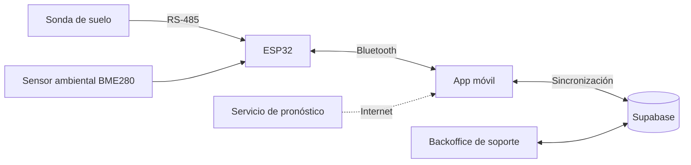

  <picture>
    <source media="(prefers-color-scheme: dark)" srcset="Logo/Logo/terrasense-wordmark-dark.svg" />
    
  </picture>

# TerraSense

TerraSense es un proyecto de instrumento portátil y aplicación móvil para medir suelo y ambiente, interpretar las lecturas según la etapa del cultivo y orientar qué revisar en el campo. Está dirigido a agricultores y asesores que necesitan consultar y guardar mediciones, incluso donde no hay cobertura de internet.

**El proyecto está en desarrollo.** La app implementa la captura por Bluetooth, la evaluación local y el historial. El firmware todavía no lee la sonda de suelo; la integración completa con el equipo y la validación en campo siguen pendientes.

## Cómo funciona

1. **El equipo reúne las lecturas.** El diseño integra una sonda de suelo y un sensor ambiental BME280 con un ESP32 que se comunica con el teléfono por Bluetooth de bajo consumo (BLE).
2. **La app interpreta la medición.** El usuario elige la etapa del cultivo y, cuando corresponde, puede indicar la especie. El motor agronómico aplica reglas locales, explica las condiciones que requieren atención y señala lo que no puede evaluar con los datos disponibles.
3. **El resultado queda guardado.** La app conserva la lectura y su evaluación en el teléfono y las sincroniza con Supabase cuando hay conexión. Si el usuario incluye su ubicación, también puede consultar el pronóstico como apoyo para organizar labores.
4. **El backoffice permite dar soporte.** La cuenta de soporte administra equipos y accesos desde la web.

La medición y la evaluación local están diseñadas para funcionar sin internet después de configurar la cuenta y vincular el equipo. El pronóstico, la gestión de accesos y el respaldo en la nube requieren conexión. Las recomendaciones son orientativas y dependen de la calidad de las lecturas y de los criterios disponibles para cada cultivo.

## Dónde encontrar cada parte

| Módulo | Qué contiene |
|---|---|
| [App móvil](App/README.md) | Funcionamiento de la app, flujo de pantallas, motor agronómico y puesta en marcha. |
| [Firmware](Firmware/README.md) | Programa del ESP32, comunicación con el teléfono y estado de integración de los sensores. |
| [Hardware](PCB/README.md) | Esquemáticos, placa electrónica, alimentación y carcasa. |
| [Backoffice web](Web/README.md) | Herramientas de soporte y ejecución de la web. |
| [Supabase](supabase/README.md) | Base de datos, autenticación, permisos y sincronización. |
| [Documentación](docs/README.md) | Informes, contratos técnicos y plan de validación. |

Para ejecutar el software, sigue la puesta en marcha de [App](App/README.md#desarrollo-local) o de [Web](Web/README.md). Cada módulo documenta su propia configuración.

<!-- FINANZAS:INICIO -->

## Modelo económico

El proyecto contempla la venta del equipo, con la app y la evaluación local sin suscripción. El precio se deriva de la estructura completa de costos y de la utilidad exigida por el modelo.

Los supuestos, el financiamiento y los resultados de viabilidad se consultan en el [modelo económico](docs/MODELO_ECONOMICO.md) y los [resultados financieros](docs/RESULTADOS_FINANCIEROS.md). Las cifras se regeneran con `python finanzas/modelo.py`.

<!-- FINANZAS:FIN -->

---

Proyecto de título de Ingeniería en Electrónica y Sistemas Inteligentes — INACAP.

Autores: Álvaro Villena y Alan.
