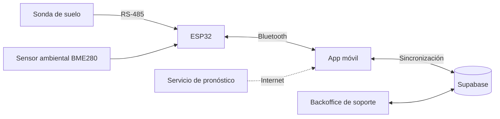

  <picture>
    <source media="(prefers-color-scheme: dark)" srcset="Logo/Logo/terrasense-wordmark-dark.svg" />
    
  </picture>

# TerraSense

TerraSense es un proyecto de instrumento portátil y aplicación móvil para medir suelo y ambiente, interpretar las lecturas según la etapa del cultivo y orientar qué revisar en el campo. Está dirigido a agricultores y asesores que necesitan consultar y guardar mediciones, incluso donde no hay cobertura de internet.

**El proyecto está en desarrollo.** La app implementa la captura por Bluetooth, la evaluación local y el historial. El firmware todavía no lee la sonda de suelo; la integración completa con el equipo y la validación en campo siguen pendientes.

## Por qué TerraSense

TerraSense no es un sensor de suelo ni un nodo de monitoreo enterrado: es una **sonda portátil multivariable de diagnóstico agronómico**. Viaja con la persona, mide donde ésta decide, entrega diez registros del mismo punto y del mismo instante, y termina en una orientación de manejo según la fase del cultivo. Esa combinación es la que no existe en el mercado al que apunta.

| | Laboratorio de suelos | Nodo fijo de monitoreo | Medidor portátil de 1 a 4 variables | **TerraSense** |
|---|---|---|---|---|
| Puntos que se pueden medir | sólo los que se pagan | uno por nodo instalado | cualquiera | **cualquiera, con su ubicación registrada** |
| Costo de la medición siguiente | el precio de otra muestra | otro nodo para cubrir otro punto | cero | **cero** |
| Registros por lectura | según el análisis contratado | los del nodo | 1 a 4 | **10: 7 medidos y 3 derivados de la conductividad** |
| Qué recibe el agricultor | concentraciones trazables, en días | series de tiempo y alertas del punto | un valor numérico | **las diez variables con semáforo y un plan de acción por fase del cultivo** |
| Sin cobertura de internet | logística de envío | requiere red permanente | funciona | **mide, diagnostica, georreferencia y guarda** |
| Suscripción mensual | se paga por muestra | habitual en la plataforma | no | **ninguna, y las mediciones son del agricultor** |
| Memoria del punto medido | informes sueltos | del punto fijo | no deja registro | **historial con fecha, ubicación y evaluación** |

Las ventajas no son atributos declarados: son consecuencias de cómo está construido el sistema.

1. **Mide donde el agricultor decide.** El campo no es homogéneo. Un nodo fijo describe con mucho detalle un solo punto; una sonda portátil describe el campo entero. Es arquitectura, no una característica que se pueda igualar bajando el precio.
2. **Diez registros en una sola inserción.** Siete variables de suelo y tres ambientales del mismo instante. Siete de las diez son magnitudes medidas de forma independiente; nitrógeno, fósforo y potasio se derivan de la conductividad y se conservan como registros informativos. Incluso contando sólo las medidas, supera a los medidores portátiles de tres o cuatro variables.
3. **Entrega un plan de acción, no un número.** El motor agronómico corre completo en el teléfono y traduce la medición en qué revisar, por qué y en qué orden. Un valor de conductividad no dice nada a quien no lo interpreta: la diferencia entre el dato y la decisión es todo el producto.
4. **La medición siguiente no cuesta nada.** Sin cobro por lectura ni suscripción, el costo marginal de volver a medir es cero. Eso cambia la conducta: se mide antes y después de fertilizar, en varios sectores, durante toda la temporada.
5. **Funciona sin cobertura.** Medir, diagnosticar, georreferenciar y guardar ocurren sin red; la nube sólo respalda después. En un campo sin señal, un producto que necesite conexión para interpretar no sirve.
6. **Deja memoria del campo.** Cada medición queda con su fecha, su ubicación y su evaluación, de modo que la segunda temporada se compara con la primera.

**Lo que no hace, dicho de frente.** No determina concentraciones reales de nutrientes: para eso sigue estando el laboratorio acreditado, y los valores de nitrógeno, fósforo y potasio son informativos. No reemplaza el criterio de un asesor agronómico. No entrega continuidad temporal en un punto, como sí hace un nodo fijo. Y la celda integrada obliga a planificar la carga, mientras un equipo con pilas intercambiables se reanuda al instante con un repuesto. TerraSense no desplaza a esas alternativas: ocupa el espacio que ninguna cubre, que es medir seguido, barato, en cualquier punto del campo e interpretado en el momento.

## Cómo funciona

1. **El equipo reúne las lecturas.** El diseño integra una sonda de suelo y un sensor ambiental BME280 con un ESP32 que se comunica con el teléfono por Bluetooth de bajo consumo (BLE).
2. **La app interpreta la medición.** El usuario elige la etapa del cultivo y, cuando corresponde, puede indicar la especie. El motor agronómico aplica reglas locales, explica las condiciones que requieren atención y señala lo que no puede evaluar con los datos disponibles.
3. **El resultado queda guardado.** La app conserva la lectura y su evaluación en el teléfono y las sincroniza con Supabase cuando hay conexión. Si el usuario incluye su ubicación, también puede consultar el pronóstico como apoyo para organizar labores.
4. **El backoffice permite dar soporte.** La cuenta de soporte administra equipos y accesos desde la web.

La medición y la evaluación local están diseñadas para funcionar sin internet después de configurar la cuenta y vincular el equipo. El pronóstico, la gestión de accesos y el respaldo en la nube requieren conexión. Las recomendaciones son orientativas y dependen de la calidad de las lecturas y de los criterios disponibles para cada cultivo.

## Dónde encontrar cada parte

| Módulo | Qué contiene |
|---|---|
| [App móvil](App/README.md) | Funcionamiento de la app, flujo de pantallas, motor agronómico y puesta en marcha. |
| [Firmware](Firmware/README.md) | Programa del ESP32, comunicación con el teléfono y estado de integración de los sensores. |
| [Hardware](PCB/README.md) | Esquemáticos, placa electrónica, alimentación y carcasa. |
| [Backoffice web](Web/README.md) | Herramientas de soporte y ejecución de la web. |
| [Supabase](supabase/README.md) | Base de datos, autenticación, permisos y sincronización. |
| [Documentación](docs/README.md) | Informes, contratos técnicos y plan de validación. |

Para ejecutar el software, sigue la puesta en marcha de [App](App/README.md#desarrollo-local) o de [Web](Web/README.md). Cada módulo documenta su propia configuración.

Lo que llega a `main`, y cada pull request, pasa por el [workflow de verificación](.github/workflows/verificacion.yml): regenera el modelo financiero y corre sus pruebas, revisa los enlaces y diagramas de la documentación, y ejecuta las pruebas de la app y las del backoffice con su construcción. Además guarda dos reglas que no se deducen leyendo el código: que ningún archivo generado se haya editado a mano y que el informe entregable se lea sin acceso al repositorio.

<!-- FINANZAS:INICIO -->

## Modelo económico

El proyecto contempla la venta del equipo, con la app y la evaluación local sin suscripción. El precio se deriva de la estructura completa de costos y de la utilidad exigida por el modelo.

Los supuestos, el financiamiento y los resultados de viabilidad se consultan en el [modelo económico](docs/MODELO_ECONOMICO.md) y los [resultados financieros](docs/RESULTADOS_FINANCIEROS.md). Las cifras se regeneran con `python finanzas/modelo.py`.

<!-- FINANZAS:FIN -->

---

Proyecto de título de Ingeniería en Electrónica y Sistemas Inteligentes — INACAP.

Autores: Álvaro Villena y Alan Escobar.
