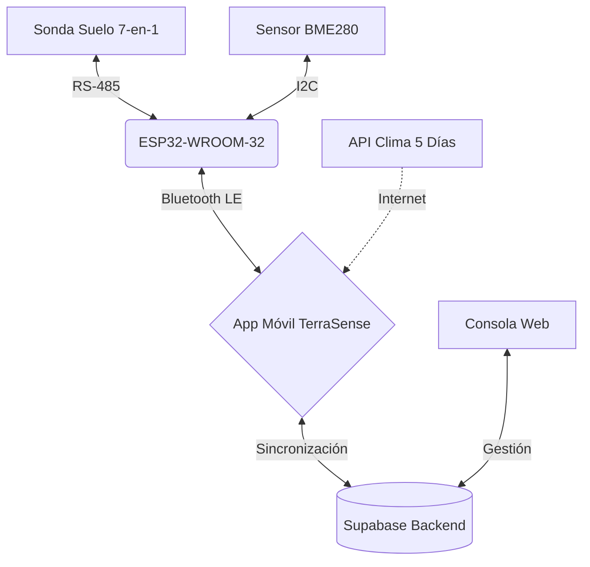

<div align="center">
  
  <picture>
    <source media="(prefers-color-scheme: dark)" srcset="Logo/Logo/terrasense-dark.svg" />
    
  </picture>

  # TerraSense
  **Diagnóstico agronómico de suelo y microclima impulsado por IoT**

  [](#)
  [](#)
  [](#)
  [](#)
  [](#)

  *Convirtiendo lecturas de terreno en recomendaciones prácticas de siembra, riego y manejo de cultivos.*

  [Índice de Documentación](docs/README.md) · [Arquitectura](#arquitectura-del-sistema)

</div>

---

## 📖 Descripción General

**TerraSense** es una herramienta portátil diseñada para pequeños y medianos agricultores, asesores agronómicos y administradores de campos. Combina una sonda de suelo 7-en-1 de nivel industrial, un sensor ambiental local (BME280), y un cerebro procesador ESP32 integrado en una carcasa portátil impresa en 3D.

El objetivo principal no es solo mostrar números crudos, sino entregar un **diagnóstico prescriptivo** del punto de muestreo según la etapa del cultivo (pre-siembra, vegetativo, floración o cosecha) sin requerir conexión a internet durante la medición. La nube interviene solo para el respaldo diferido, la gestión de cuentas y el pronóstico climático.

## 🚨 La Problemática

La problemática real radica en que los pequeños y medianos agricultores carecen de herramientas tecnológicas accesibles y comprensibles para diagnosticar el estado de su suelo. En un contexto de sequía constante y alto costo de los insumos agrícolas, optimizar el uso del agua y los fertilizantes es vital para la supervivencia del cultivo.

El problema central es que el agricultor agrícola opera **"a ciegas"**. Carece de herramientas accesibles para diagnosticar el estado de su suelo y se ve obligado a tomar decisiones críticas basándose únicamente en la intuición. 

¿Por qué ocurre esto? Principalmente por dos barreras:
*   **Barrera Económica:** Los equipos de medición profesional son financieramente inalcanzables para la agricultura familiar.
*   **Barrera de Interpretación:** Los instrumentos disponibles entregan datos técnicos crudos, incomprensibles sin estudios agronómicos avanzados, que no brindan el feedback necesario para ejecutar una acción concreta.

Este escenario genera un impacto negativo a lo largo de todo el ciclo de vida del cultivo:
*   **Pre-siembra:** Pérdida de semillas por siembra en suelos fríos o altamente salinos.
*   **Vegetativo:** Asfixia de raíces y pérdida de fertilizantes por riegos ineficientes.
*   **Floración:** Aborto floral masivo por estrés hídrico no detectado a tiempo.
*   **Cosecha:** Destrucción de la estructura del suelo por ingresar con exceso de humedad.

## ✨ Características Principales

* 📡 **Medición Integral (Grid 2×5):** Diez variables: humedad del suelo, conductividad eléctrica, temperatura del suelo, nitrógeno, fósforo, potasio y pH de la sonda; temperatura ambiente, humedad relativa ambiente y presión atmosférica ambiente del BME280. Dos columnas y cinco filas, implementadas en la App y en el detalle de la consola web.
* 🌦️ **Microclima Local + Pronóstico:** El sensor **BME280** lee temperatura, humedad relativa y presión en el lugar físico de la medición. Como **apoyo y complemento**, una API gratuita de clima aporta el pronóstico de los próximos 5 días, permitiendo planificar labores a futuro (ej. posponer siembra si hay riesgo de lluvias intensas).
* 🔋 **Diseño de Bajo Consumo:** La rama de medición se corta por MOSFET fuera del instante de lectura y la batería LiPo se recarga por USB-C, sin pilas desechables. Con reposo supuesto de ~19,4 µA, el balance en Wh da una referencia optimista de **~256 días**, antes de cerrar consumos auxiliares y condiciones reales. Es una cifra calculada: **la medición desde batería en banco sigue pendiente**.
* 📱 **Ecosistema Interconectado:** Comunicación Bluetooth Low Energy (BLE) hacia la App móvil que no requiere internet para diagnosticar, respaldado por una plataforma Web y base de datos.

---

## 🧩 Módulos del Proyecto

El repositorio está dividido en áreas de dominio específicas, cada una con su propia documentación detallada:

| Directorio | Descripción | Tecnologías |
|:---|:---|:---|
| 🪛 [**`/PCB`**](PCB/README.md) | Esquemáticos KiCad, arquitectura de potencia, contrato de trama BLE y diseño de carcasa 3D. | ESP32, BME280, RS-485 |
| 📱 [**`/App`**](App/README.md) | Aplicación móvil que recibe las lecturas vía BLE y genera el diagnóstico agronómico. | React Native, Expo, BLE |
| 💻 [**`/Web`**](Web/README.md) | Consola de administración y soporte web para gestión del sistema. | React, Vite, TypeScript |
| ☁️ [**`/supabase`**](supabase/README.md) | Funciones de backend (RPC), políticas RLS y migraciones. | PostgreSQL, Edge Functions |
| 📄 [**`/docs`**](docs/README.md) | Informes formales del proyecto de título, manuales, normativas y planes de validación. | Markdown, Documentación |
| 📈 [**`/finanzas`**](docs/MODELO_ECONOMICO.md) | Estudio de viabilidad, cálculo de costos (BOM) y simulador de flujo de caja. | Python, Excel |

---

<a id="arquitectura-del-sistema"></a>

## ⚙️ Arquitectura del Sistema



---

## 🚀 Ejecución Local Rápida

### 1. Variables de Entorno
La App utiliza el archivo `.env` en la raíz del proyecto. La consola web utiliza el suyo propio en `Web/.env`.
```env
# .env (Raíz)
EXPO_PUBLIC_SUPABASE_URL=https://<proyecto>.supabase.co
EXPO_PUBLIC_SUPABASE_ANON_KEY=<anon_key>
```

### 2. Aplicación Móvil (App)
> **Nota:** La conexión real por BLE requiere un build nativo en el teléfono físico. La simulación está disponible en desarrollo.
```bash
cd App
npm install
npm test            # Ejecutar pruebas unitarias
npx tsc --noEmit    # Chequeo de tipos
npx expo start      # Servidor de desarrollo
```

### 3. Consola Administrativa (Web)
```bash
cd Web
npm install
npm run dev         # Servidor en http://localhost:5173
```

### 4. Modelo Financiero (Scripts de simulación)
Desde la raíz del proyecto:
```bash
python -m pip install -r finanzas/requirements.txt
cd finanzas
python seccion_economica.py        # cuadros y sección económica del informe
python corregir_informe.py         # informe corregido completo
python documentacion_reformulada.py  # bloque económico del README
```

---

## 📊 Viabilidad y Modelo Comercial

TerraSense está planteado como un proyecto económicamente sustentable y escalable:
- **Modelo de ingreso:** venta directa del hardware con IVA incluido. La app y el diagnóstico local no tienen suscripción.
- **Precio:** se **deriva** del costo total con un margen exigido del 30 %; no es un supuesto de entrada.
- **Costos y margen:** la sonda RS-485 concentra el 68,9 % de la BOM. El ensamblaje se paga en la nómina y no se duplica como costo variable.
- **Financiamiento:** el pie de los socios se entrega al banco como condición de entrada y el crédito financia el 100 % de la inversión inicial. Pie y crédito **no se suman** como fuentes.
- **Evaluación:** flujos anuales sobre 10 años (2027–2036), sin valor terminal, con depreciación, amortización del activo nominal y tabla de amortización del crédito por sistema francés.

> 💡 Las cifras del bloque siguiente se generan desde `finanzas/supuestos_reformulado.json`. **No editar a mano:** ejecutar `python finanzas/documentacion_reformulada.py`.

<!-- FINANZAS:INICIO -->

## Finanzas y modelo económico

**El precio no es un supuesto: es un resultado.** Se construye primero la estructura completa de costos e inversión y el precio se deriva de ella exigiendo un 30 % de utilidad sobre el costo total. Precio de lista resultante: **$449.337 CLP con IVA** ($377.594 netos). Evaluación a diez años, 2027–2036, con tasa de descuento del 20 % anual.

### BOM por equipo

| Componente | Cant. | Neto unitario | Subtotal |
|---|---:|---:|---:|
| Sonda de suelo 7-en-1 RS-485 Modbus RTU | 1 | $48.000 | $48.000 |
| Carcasa PETG impresa en taller propio | 1 | $6.900 | $6.900 |
| ESP32 DevKit WROOM-32D | 1 | $4.800 | $4.800 |
| Bateria LiPo 3,7 V 2.000 mAh con proteccion | 1 | $4.400 | $4.400 |
| PCB portadora 2 capas, fabricacion y envio | 1 | $2.000 | $2.000 |
| Modulo ambiental BME280 (I2C) | 1 | $1.050 | $1.050 |
| Modulo de carga y elevacion LX-LCBST (Modulos:Modulo_LX-LCBST) | 1 | $900 | $900 |
| Modulo transceptor SP3485 RS-485 3,3 V | 1 | $900 | $900 |
| Terminal block 2 pines, paso 5 mm | 2 | $95 | $190 |
| Terminal block 4 pines, paso 5 mm (TerminalBlock_MetzConnect Type055) | 1 | $190 | $190 |
| Condensador electrolitico 100 uF 35 V (CP_Elec 6,3x7,7) | 2 | $29 | $58 |
| Condensador ceramico 100 nF 50 V (1206) | 4 | $4 | $16 |
| Resistencia 100 kOhm (1206) | 2 | $2 | $4 |
| Resistencia 330 Ohm (1206) | 3 | $2 | $6 |
| Resistencia 10 kOhm (1206) | 1 | $2 | $2 |
| LED 0603 azul, rojo y verde | 3 | $8 | $24 |
| Pulsador SMD 4 mm (XKB TS-1187A) | 1 | $19 | $19 |
| Fusible 0603 | 1 | $19 | $19 |
| Diodo 1N4007 / M7 (SMA DO-214AC) | 1 | $4 | $4 |
| Flete de discretos LCSC, prorrateado por equipo | 1 | $150 | $150 |
| **Total BOM neto** | | | **$69.632** |

La BOM contiene **exclusivamente los componentes presentes en el esquemático**. Los módulos y la batería se cotizaron en AliExpress con envío Choice a Chile; los discretos en LCSC. La sonda de suelo concentra el 68,9 % del costo de materiales y es la decisión de abastecimiento crítica del proyecto.

> Quedan **fuera de la BOM** por no estar todavía en el esquemático ni en el diseño mecánico cerrado: prensaestopas M12, o-ring y respiradero del BME280, cableado interno, y embalaje con manual y etiqueta. Su orden de magnitud conjunto es de $4.000 a $5.000 por equipo.

Sumando merma (3 %), provisión de reposiciones y garantía (5 %) y envío, el costo variable por equipo antes de comisión es **$81.203**. La carcasa se imprime en taller propio: las dos impresoras 3D están en el activo fijo y el filamento, la merma, la energía y la mantención se cargan al costo unitario.

### Inversión inicial y financiamiento

| Concepto | CLP |
|---|---:|
| Equipamiento y activo fijo | $9.000.000 |
| Activo nominal (puesta en marcha) | $5.200.000 |
| Capital de trabajo (3,0 meses de estructura) | $12.819.160 |
| Inventario inicial | $2.706.752 |
| **Inversión inicial total** | **$29.725.912** |
| Crédito bancario a 10 años, 12 % efectivo anual | $29.725.912 |
| Pie propio exigido (30 % del crédito) | $8.917.774 |
| Aporte por socio | $4.458.887 |
| Cuota mensual (sistema francés) | $416.006 |

**El pie no es una fuente adicional de fondos.** Los socios lo entregan al banco como condición de entrada y es el crédito el que financia el 100 % de la inversión inicial; sumar pie más crédito cuenta dos veces el mismo dinero. El capital de trabajo no se fijó por regla sino iterando hasta que la caja nunca baje de un piso de seguridad, con un mínimo de política de 3 meses de estructura.

### Flujo de caja anual

| Año | Equipos | Ventas netas | Utilidad del ejercicio | Flujo de fondos | Caja acumulada |
|---|---:|---:|---:|---:|---:|
| 2027 | 200 | $75.518.744 | $-2.629.936 | $-1.483.842 | $11.335.318 |
| 2028 | 350 | $136.122.536 | $-2.231.993 | $-1.289.168 | $10.046.151 |
| 2029 | 500 | $200.294.589 | $12.285.748 | $13.000.912 | $23.047.062 |
| 2030 | 650 | $268.194.455 | $28.265.507 | $28.725.690 | $51.772.752 |
| 2031 | 850 | $361.237.300 | $66.479.770 | $66.654.376 | $118.427.128 |
| 2032 | 892 | $390.459.273 | $66.811.342 | $65.912.794 | $184.339.922 |
| 2033 | 937 | $422.462.050 | $78.624.599 | $77.430.423 | $261.770.345 |
| 2034 | 984 | $456.962.366 | $91.896.208 | $90.365.294 | $352.135.639 |
| 2035 | 1033 | $494.109.134 | $94.407.712 | $92.493.848 | $444.629.487 |
| 2036 | 1085 | $534.551.465 | $110.047.734 | $107.698.991 | $552.328.478 |

Los ejercicios 2027 y 2028 cierran con pérdida: con 200 y 350 equipos la estructura mínima para operar formalmente todavía no se cubre. Esa pérdida está financiada por el capital de trabajo y la caja nunca baja de $10.046.151.

### VAN, TIR y payback

| Indicador | Valor | Criterio | Veredicto |
|---|---:|---|---|
| VAN al 20 % | $116.325.391 | VAN > 0 | Cumple |
| TIR efectiva anual | 54,03 % | TIR > 20 % | Cumple |
| Payback simple | 3,68 años | ≤ 5 años | Cumple |
| Payback descontado | 4,39 años | ≤ 5 años | Cumple |
| Deuda al cierre de 2036 | $0 | Crédito saldado | Cumple |

**Punto de quiebre del precio: cerca de $400.000.** Al precio de $349.990 que proponían versiones anteriores de este estudio, el proyecto arroja VAN negativo y caja que nunca se recupera. Ese resultado es la justificación numérica de derivar el precio del costo en lugar de fijarlo por aspiración comercial.

[Informe 1 corregido](Evaluacion/Evaluacion%201/INFORME%201%20CORREGIDO.md) · [Sección económica](docs/SECCION_ECONOMICA_REFORMULADA.md) · [Metodología](docs/MODELO_ECONOMICO.md)

Actualizar cifras: `python finanzas/modelo.py`.

<!-- FINANZAS:FIN -->

Para el desarrollo completo, revisa el [Informe 1 corregido](docs/INFORME_1_CORREGIDO.md) y la [sección económica generada](docs/SECCION_ECONOMICA_REFORMULADA.md).

---

<div align="center">
  <b>Autores:</b> Álvaro Villena y Alan <br>
  Proyecto de Ingeniería en Electrónica y Sistemas Inteligentes - INACAP (2026)
</div>
