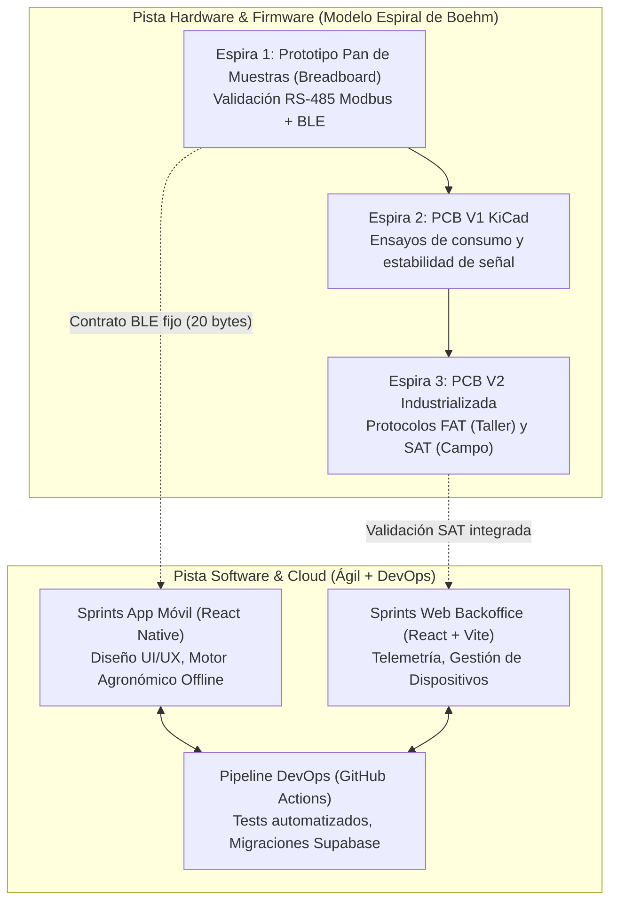

# Evaluación N° 2: Modelos de Desarrollo Tecnológico en la Planificación Estratégica de Sistemas Inteligentes

> **Asignatura:** Tecnologías Aplicadas a los Sistemas Inteligentes  
> **Institución:** INACAP — Sede Santiago Sur (2025 / 2026)  
> **Caso de Estudio y Aplicación:** Proyecto **TerraSense** (Sistema Ciberfísico e Inteligente de Monitoreo Agrícola)  
> **Objetivo de este documento:** Servir como **guía maestra, base teórica y especificación operativa** para que un agente o redactor desarrolle el informe académico final cumpliendo al 100 % con la rúbrica institucional.

> [!IMPORTANT]
> **El informe ya está redactado en `Evaluacion 2.docx`** (formato INACAP de la plantilla: portada, índice automático, títulos, párrafos justificados a 1,5 líneas, tablas con encabezado rojo y rótulos en cursiva). Si se reescribe, se conserva ese formato. Criterios de redacción acordados que **prevalecen sobre lo que diga el resto de esta guía**:
>
> - Se mira el proyecto como un **proyecto electrónico construido desde la raíz**: idea → protoboard → primera placa → placa corregida → equipo en el campo.
> - Modelo adoptado: **híbrido**. Espiral guiada por riesgo + prototipado evolutivo para hardware y firmware; verificación por niveles tomada del modelo en V; Kanban con prácticas de Scrum para el software; DevOps como base común; contrato BLE de 20 bytes como punto de unión. Para cada modelo se explica también **por qué no se usó de forma pura**.
> - **No se usan** los términos FAT ni SAT (se habla de pruebas en banco y pruebas en el campo), ni cifras o indicadores económicos (VAN, TIR, BOM, TCO, flujo de caja).
> - Sin rutas de archivos, nombres de scripts ni comandos del repositorio dentro del informe.

---

## 1. Rúbrica Oficial y Estructura Exigida para el Informe

El informe debe redactarse siguiendo estrictamente la estructura institucional establecida:

```
├── 1. Portada (Norma INACAP)
├── 2. Introducción
│   ├── Presentación del tema y relevancia
│   ├── Justificación de la investigación
│   ├── Objetivo General
│   └── Objetivos Específicos
├── 3. Marco Teórico
│   ├── Planificación tecnológica estratégica
│   ├── Modelos de desarrollo tecnológico (Cascada, Ágil, Prototipado, Espiral, DevOps)
│   ├── Auditoría tecnológica (concepto, función e instrumentos)
│   ├── Factores clave de viabilidad en planes tecnológicos
│   ├── Rol de los productos tecnológicos en sistemas inteligentes
│   └── Entornos de implantación (físico, digital y organizacional)
├── 4. Análisis y Caso Aplicado: Proyecto TerraSense
│   ├── Comparativa sistemática de modelos de desarrollo
│   ├── Justificación del modelo seleccionado para TerraSense (Enfoque Híbrido Ciberfísico)
│   ├── Aplicación de la auditoría tecnológica al ecosistema TerraSense
│   ├── Evaluación de ventajas, desventajas y gestión del riesgo técnico
│   └── Estudio de casos reales del sector agroindustrial / IoT inteligente
├── 5. Conclusión
│   ├── Síntesis de hallazgos
│   ├── Reflexión sobre modelos en sistemas ciberfísicos inteligentes
│   └── Recomendaciones para contextos educativos y empresariales
├── 6. Bibliografía (Normas APA / IEEE)
└── 7. Anexos
    ├── Matriz de decisión metodológica
    ├── Diagrama de ciclo de vida ciberfísico
    └── Protocolos de verificación (FAT/SAT y CI/CD)
```

---

## 2. Contexto del Caso de Estudio: Proyecto TerraSense

Para que el informe no sea un ensayo puramente abstracto, el análisis se apoya directamente en la arquitectura real de **TerraSense**, un sistema ciberfísico inteligente diseñado para optimizar el riego y fertilización agrícola mediante telemetría de suelo:

1. **Capa Física / Hardware (IoT & Sensores):**
   - Sonda industrial multinivel conectada vía bus **RS-485** con protocolo industrial **Modbus RTU** (medición de humedad volumétrica, temperatura, conductividad eléctrica CE, pH y macronutrientes NPK).
   - Unidad de adquisición basada en microcontrolador **ESP32** montado en una **PCB personalizada** (diseño en KiCad), con circuito de gestión de energía a batería y gabinete con protección para intemperie agrícola.
2. **Capa de Conectividad Local:**
   - Enlace inalámbrico mediante **Bluetooth Low Energy (BLE)** bajo un contrato estricto de trama binaria de 20 bytes (datos de suelo, condiciones ambientales de cabezal y nivel de batería).
3. **Capa Edge Inteligente (App Móvil):**
   - Aplicación móvil en **React Native / Expo** con arquitectura *offline-first*.
   - **Motor agronómico local (`agronomyEngine`):** Evalúa umbrales agronómicos y etapas fenológicas directamente en el dispositivo móvil sin depender de cobertura celular en el campo, entregando alertas inmediatas de estrés hídrico o salino al agricultor.
4. **Capa Cloud & Analítica (Web & Base de Datos):**
   - Plataforma en la nube basada en **Supabase (PostgreSQL)** con control de acceso a nivel de fila (**RLS**) y Edge Functions.
   - Backoffice de monitoreo y administración web en **React + Vite**, con visualización histórica, tendencias temporales y soporte de auditoría.
5. **Capa de Calidad y DevOps:**
   - Integración continua automatizada mediante **GitHub Actions** (`verificacion.yml`), pruebas unitarias automatizadas (`npm test` en App y Web), verificación del modelo financiero (`python finanzas/modelo.py`) y protocolos de prueba física **FAT** (*Factory Acceptance Test*) y **SAT** (*Site Acceptance Test*).

---

## 3. Desarrollo de Contenidos por Capítulo para el Informe

A continuación se desglosan los argumentos conceptuales y técnicos que el redactor debe plasmar en cada sección del informe:

### 3.1. Introducción
* **Presentación del tema:** La integración de sistemas inteligentes (sistemas ciberfísicos con toma de decisiones automatizada) demanda una planificación estratégica rigurosa. Un fallo en la arquitectura no solo corrompe software, sino que arruina hardware o compromete procesos críticos (como cosechas agrícolas).
* **Justificación:** Los sistemas inteligentes combinan hardware físico, firmware en tiempo real, aplicaciones móviles y microservicios en la nube. Aplicar una metodología monolítica tradicional (como Cascada pura) o una metodología ágil puramente web (como Scrum básico con sprints de dos semanas) suele provocar sobrecostos o fallos en producción debido a los tiempos físicos de fabricación (*lead times*) y las limitaciones de terreno.
* **Objetivo General:** Analizar cómo los modelos de desarrollo tecnológico influyen en la planificación estratégica y viabilidad de sistemas inteligentes ciberfísicos, fundamentando su aplicación práctica en el proyecto TerraSense.
* **Objetivos Específicos:**
  1. Identificar y contrastar los modelos clásicos y contemporáneos de desarrollo (Cascada, Prototipado, Espiral, Ágil y DevOps).
  2. Determinar los factores clave de viabilidad técnica, operativa y económica evaluados a través de auditorías tecnológicas.
  3. Fundamentar la selección de un modelo híbrido (Espiral para hardware + Ágil/DevOps para software) en sistemas inteligentes de monitoreo agrícola.

---

### 3.2. Marco Teórico
El informe debe definir rigurosamente los siguientes conceptos apoyándose en autores canónicos del área (Barry Boehm, Ian Sommerville, Roger Pressman, Gene Kim):

1. **Planificación Tecnológica Estratégica:** Proceso sistemático que alinea las capacidades tecnológicas de una organización con sus objetivos de negocio, anticipando obsolescencia, riesgos de integración y curvas de adopción.
2. **Modelos de Desarrollo Tecnológico:**
   * **Cascada (Waterfall):** Enfoque secuencial y predictivo con fases rígidas (Requisitos $\rightarrow$ Diseño $\rightarrow$ Implementación $\rightarrow$ Pruebas $\rightarrow$ Mantenimiento). Excelente documentación y estabilidad contractual, pero nula tolerancia a cambios tardíos.
   * **Prototipado Evolutivo:** Construcción rápida de maquetas y versiones preliminares para refinar requisitos con el usuario final antes de la ingeniería de detalle.
   * **Modelo en Espiral (Boehm):** Modelo guiado por el análisis y mitigación de riesgos que avanza mediante ciclos iterativos concéntricos (Determinación de objetivos $\rightarrow$ Evaluación de riesgos $\rightarrow$ Desarrollo y validación $\rightarrow$ Planificación del siguiente ciclo).
   * **Metodologías Ágiles (Scrum / Kanban):** Desarrollo iterativo e incremental centrado en entregas de valor frecuentes, inspección continua y adaptabilidad al cambio.
   * **DevOps y Entrega Continua:** Fusión cultural y técnica entre desarrollo y operaciones, enfatizando la automatización de pruebas, integración continua (CI), infraestructura como código y despliegue continuo (CD).
3. **Auditoría Tecnológica:** Evaluación formal de los activos tecnológicos, arquitectura de software, seguridad de la información, deudas técnicas y cumplimiento normativo de un sistema.
4. **Viabilidad de Planes Tecnológicos:** Factores clave: viabilidad técnica (factibilidad física y conectividad), económica (inversión inicial, costo de BOM, TCO, retorno de inversión), legal/normativa y operativa (usabilidad en campo).
5. **Productos Tecnológicos en Sistemas Inteligentes:** Dispositivos ciberfísicos (CPS) que unen sensores, actuadores, procesamiento local (*edge computing*) y analítica cloud.
6. **Entornos de Implantación:**
   * **Físico:** Condiciones ambientales (humedad, salinidad, polvo, temperatura), limitaciones energéticas (batería, consumo en reposo).
   * **Digital:** Conectividad restringida (zonas sin red celular), ancho de banda BLE, protocolos de sincronización eventual.
   * **Organizacional:** Perfil de los usuarios finales (agricultores, técnicos agrícolas), resistencia al cambio tecnológico y requerimiento de interfaces sencillas basadas en semáforos o recomendaciones directas.

---

### 3.3. Análisis y Justificación: ¿Por qué un Modelo Híbrido en TerraSense?

> [!IMPORTANT]
> **Tesis Central del Informe:** En sistemas ciberfísicos inteligentes como TerraSense, **ninguna metodología pura aislada es suficiente**. Se requiere un **Modelo Híbrido Ciberfísico** que combine el **Modelo en Espiral** para el hardware/firmware con **Ágil / DevOps** para el software/cloud.

#### A. ¿Por qué fracasan los enfoques puros?
* **El fracaso de Cascada pura:** Asumir que las necesidades agronómicas y los umbrales de los cultivos son estáticos desde el día 1 es inviable. Requerir meses de especificación teórica antes de probar una sonda en un suelo real genera productos desconectados de las necesidades del campo.
* **El fracaso de Ágil puro (Scrum dogmático):** En software es trivial hacer un *rollback* o desplegar un parche en minutos. En hardware, mandar a fabricar una placa PCB a fábrica toma 2 a 3 semanas y cuesta dinero por cada lote. No se puede "refactorizar el cobre" cada viernes en un sprint de dos semanas sin quebrar el presupuesto.

#### B. La Solución: Modelo Híbrido Ciberfísico (Espiral + Ágil/DevOps)
El desarrollo de TerraSense se estructura en dos pistas sincronizadas mediante compuertas de calidad (*Stage-Gates*):



1. **Pista Hardware/Firmware $\rightarrow$ Modelo en Espiral:**
   * **Mitigación del riesgo físico:** Cada espira incrementa la fidelidad técnica minimizando el riesgo económico.
   * **Ciclo 1:** Prueba de concepto en laboratorio con sensor Modbus sobre placas de desarrollo comerciales.
   * **Ciclo 2:** Diseño esquemático y PCB V1 para verificar consumo energético del ESP32 en modo deep-sleep.
   * **Ciclo 3:** Fabricación final de PCB V2, gabinete estanco IP65 y validación formal mediante protocolos **FAT** (*Factory Acceptance Test* en taller) y **SAT** (*Site Acceptance Test* en el campo).
   * **Contrato de Interfaz Cerrado:** Para no bloquear a la pista de software, se congela tempranamente un **contrato BLE de 20 bytes**, permitiendo que el equipo de software simule o desarrolle en paralelo.
2. **Pista Software/Cloud $\rightarrow$ Metodología Ágil (Kanban/Scrum) + DevOps:**
   * La App móvil y el portal Web evolucionan en iteraciones continuas.
   * Implementación de pruebas automatizadas: cada cambio en el repositorio ejecuta pruebas de unidad (`App npm test`, `Web npm test`) y verificadores de coherencia (`python finanzas/modelo.py`).
   * Despliegues automatizados de la capa web hacia entornos de producción en la nube (Vercel) y migraciones declarativas en base de datos (`supabase/migrations/`).

---

### 3.4. Matriz Comparativa de Modelos de Desarrollo

El informe debe incorporar una matriz de decisión cuantitativa/cualitativa que justifique rigurosamente la elección frente al tribunal evaluador:

| Criterio de Planificación | Cascada Clásico | Ágil Puro (Scrum) | Espiral (Boehm) | DevOps Puro | **Modelo Híbrido TerraSense** |
| :--- | :--- | :--- | :--- | :--- | :--- |
| **Gestión de riesgos físicos (Hardware/PCB)** | Muy baja (fallos detectados al final) | Nula (no maneja tiempos de fabricación) | **Excelente (núcleo del modelo)** | No aplica a componentes físicos | **Excelente** (Hardware en Espiral) |
| **Adaptabilidad a cambios agronómicos/UI** | Nula (requiere renegociación contractual) | **Excelente (ajuste por sprint)** | Media (ciclos más lentos) | Alta | **Excelente** (Software en Ágil) |
| **Automatización de QA y despliegue (CI/CD)** | Manual en etapas tardías | Parcial / Según equipo | Variable por ciclo | **Excelente (automatizado)** | **Excelente** (Pipeline GitHub Actions) |
| **Costo de retrabajo en caso de error físico** | Crítico / Inviable | Muy Alto | **Bajo** (mitigado por prototipos) | No aplica | **Bajo** (validado antes de mandar a fabricar) |
| **Operación en entornos sin conectividad (*offline*)** | Rígida | Depende del diseño | Analizado como riesgo | Enfoque primordialmente cloud | **Excelente** (Edge computing con motor local) |
| **Idoneidad para Sistemas Inteligentes IoT** | Desaconsejado | Insuficiente | Buena para hardware | Buena para servicios cloud | **ÓPTIMA (Alineación ciberfísica)** |

---

### 3.5. Auditoría Tecnológica y Viabilidad Aplicada a TerraSense

El informe debe ilustrar cómo se aplica la auditoría tecnológica a un sistema inteligente en tres dimensiones:

1. **Auditoría de Arquitectura y Código:**
   - Verificación de la no exposición de secretos de infraestructura (Row Level Security en PostgreSQL).
   - Control estricto de tipos en TypeScript y esquemas declarativos en migraciones SQL.
   - Ejecución de pruebas automatizadas que impiden mezclar entornos o subir dependencias vulnerables.
2. **Auditoría de Conectividad y Resiliencia en Terreno:**
   - Protocolos **FAT** (*Factory Acceptance Test*): Pruebas en banco de calibración con soluciones salinas patrón (conductividad eléctrica) y amortiguadores de pH para verificar exactitud de lectura de la sonda RS-485.
   - Protocolos **SAT** (*Site Acceptance Test*): Validación en suelo real agrícola, midiendo alcance BLE, resistencia mecánica a la inserción y degradación suave del pronóstico meteorológico cuando no hay red celular.
3. **Auditoría de Viabilidad Financiera y Económica:**
   - La planificación estratégica se respalda con un modelo financiero formalizado (`finanzas/modelo.py`) que evalúa la estructura de costos (BOM de hardware, costos de servidores cloud, soporte en terreno) y demuestra la viabilidad del proyecto con indicadores de VAN y TIR calculados de abajo hacia arriba.

---

### 3.6. Conclusiones y Recomendaciones
* **Conclusión Principal:** Los sistemas ciberfísicos inteligentes exigen abandonar los fundamentalismos metodológicos. La excelencia en la planificación estratégica radica en la capacidad de orquestar ciclos predictivos basados en riesgo (Espiral) para el componente atómico/físico, con ciclos adaptativos y automatizados (Ágil/DevOps) para la capa de software y algoritmos.
* **Recomendaciones Prácticas:**
  1. Definir contratos de interfaz (como el payload binario BLE o contratos de API) desde las primeras fases para desacoplar el desarrollo de hardware y software.
  2. Implementar pruebas automatizadas (CI) no solo en el código web, sino en los scripts de verificación de integridad documental, financiera y de firmware.
  3. Establecer compuertas formales de control de calidad (protocolos FAT y SAT) antes de comprometer fabricación de volumen o liberaciones en campo.

---

## 4. Guía de Redacción para el Agente que Construirá el Informe

Al momento de solicitarle al agente redactor la creación del archivo final (por ejemplo, `INFORME 2 - Modelos de Desarrollo Tecnológico.md` o `.docx`), el agente debe seguir las siguientes directrices:

1. **Tono y Estilo:** Académico, formal, técnico, objetivo y en tercera persona ("se analizó", "se propone", "la investigación demuestra").
2. **Formato Institucional INACAP:**
   - Portada formal: Título completo, Asignatura (*Tecnologías Aplicadas a los Sistemas Inteligentes*), Docente, Estudiante, Sede Santiago Sur, Fecha (Año 2025/2026).
   - Tipografía sugerida para exportación: Arial o Calibri 11 pt, interlineado 1.5, márgenes estándar (2.5 cm).
3. **Citas y Referencias Bibliográficas:**
   - Citar fuentes canónicas bajo norma APA 7ma edición:
     - Boehm, B. W. (1988). *A spiral model of software development and enhancement*. IEEE Computer.
     - Sommerville, I. (2011). *Software Engineering* (9th ed.). Addison-Wesley.
     - Beck, K. et al. (2001). *Manifesto for Agile Software Development*.
     - Kim, G., Humble, J., Debois, P., & Willis, J. (2016). *The DevOps Handbook*. IT Revolution.
     - Pressman, R. S. (2010). *Software Engineering: A Practitioner's Approach*. McGraw-Hill.
4. **Coherencia con el Repositorio:**
   - Al ilustrar el caso aplicado, el informe debe referirse a componentes reales de TerraSense (la sonda RS-485 Modbus, el microcontrolador ESP32, la aplicación React Native, la base de datos Supabase con RLS, las pruebas automatizadas y los protocolos FAT/SAT), demostrando un caso de estudio sólido, profesional e impecable.
