

# INFORME TÉCNICO DE PROYECTO DE TÍTULO

 

## **TERRASENSE: SISTEMA INTEGRAL DE DIAGNÓSTICO AGRONÓMICO DE SUELO Y MICROCLIMA BASADO EN IoT Y COMPUTACIÓN DE BORDE**

  

**Carrera:** Ingeniería en Electrónica y Sistemas Inteligentes  
**Institución:** Instituto Profesional INACAP  
**Sede:** Santiago Centro  

  

**Autores:**  
Álvaro Nicolás Villena Torrejón  
Alan Paul Escobar Rojas  

**Profesor Guía:**  
Carlos Alberto Castillo Torres  

  

**Santiago — Chile**  
**Año Académico 2026**

---

## **Resumen Ejecutivo**

El presente informe expone la ingeniería conceptual, el diseño arquitectónico, la validación agronómica y el modelo financiero del proyecto **TerraSense**, un instrumento de terreno diseñado para transformar la toma de decisiones en la Agricultura Familiar Campesina (AFC) y medianos productores agrícolas de Chile. 

Frente a la convergencia de una crisis hídrica prolongada y el encarecimiento de fertilizantes, los métodos empíricos tradicionales ("al ojo") y los análisis de laboratorio tradicionales resultan ineficaces o extemporáneos para las decisiones operativas del día a día. Por su parte, la instrumentación agroindustrial comercial impone costos de adquisición prohibitivos (US$300 – US$1.500) y entrega datos numéricos crudos carentes de interpretación accesible.

TerraSense resuelve esta doble barrera mediante una arquitectura distribuida de tres capas:
1. **Instrumento Físico de Mano:** Basado en microcontrolador ESP32-WROOM-32E, sonda industrial 7-en-1 (RS-485 / Modbus RTU), sensor ambiental Bosch BME280 (I²C) y gestión energética por *power gating* (corte por MOSFET para 0,0 µA en reposo de la sonda), encapsulado en un chasis ergonómico impreso en 3D (PETG) con autonomía recargable vía USB-C.
2. **Aplicación Móvil (*Edge Computing Offline*):** Enlace inalámbrico Bluetooth Low Energy (BLE) hacia el smartphone del agricultor, donde un motor agronómico determinista procesa instantáneamente 10 magnitudes biofísicas, organizándolas en una **Grilla 3×3** con código de semáforo universal y recomendaciones accionables según 4 fases fenológicas críticas (Pre-siembra, Vegetativo, Floración y Cosecha), 100% operativo sin requerir cobertura celular.
3. **Servicios en la Nube y Pronóstico:** Respaldo asíncrono e idempotente sobre backend Supabase (PostgreSQL + PostGIS) y consumo de API meteorológica a 5 días como herramienta complementaria de planificación estratégica.

El modelo de negocio demuestra viabilidad económica con un precio unitario de **$349.990 CLP con IVA**, costo directo de fabricación (BOM) de **$81.184 CLP netos** y un margen de contribución del **62,2%**. Con una colocación inicial conservadora de 200 unidades en el Año 1 y 2.550 unidades acumuladas a 5 años, el proyecto alcanza un **VAN de $15.504.053 CLP** (tasa de descuento del 20%), una **TIR de 35,43%** y un **período de recuperación de la inversión (Payback) de 2,88 años**, garantizando sustentabilidad y retorno financiero.

---

## **Índice General**

- [1. Introducción](#1-introducción)
- [2. Descripción de la Problemática](#2-descripción-de-la-problemática)
  - [2.1. Contexto del Sector Agrícola Nacional](#21-contexto-del-sector-agrícola-nacional)
  - [2.2. Definición del Problema Central](#22-definición-del-problema-central)
  - [2.3. Impacto de las Decisiones Tradicionales ("Al Ojo") en el Ciclo Productivo](#23-impacto-de-las-decisiones-tradicionales-al-ojo-en-el-ciclo-productivo)
  - [2.4. Justificación y Alcance de la Solución](#24-justificación-y-alcance-de-la-solución)
- [3. Propuesta de Solución Tecnológica](#3-propuesta-de-solución-tecnológica)
  - [3.1. Filosofía de Diseño del Sistema](#31-filosofía-de-diseño-del-sistema)
  - [3.2. Estructura del Ecosistema de Tres Capas](#32-estructura-del-ecosistema-de-tres-capas)
  - [3.3. La Grilla 3×3 y el Rol del Sensor Ambiental BME280](#33-la-grilla-33-y-el-rol-del-sensor-ambiental-bme280)
  - [3.4. Integración Complementaria del Pronóstico Meteorológico](#34-integración-complementaria-del-pronóstico-meteorológico)
- [4. Objetivos del Proyecto](#4-objetivos-del-proyecto)
  - [4.1. Objetivo General](#41-objetivo-general)
  - [4.2. Objetivos Específicos y Resultados Verificables](#42-objetivos-específicos-y-resultados-verificables)
- [5. Ingeniería Conceptual](#5-ingeniería-conceptual)
  - [5.1. Filtro de Viabilidad y Criterios de Selección](#51-filtro-de-viabilidad-y-criterios-de-selección)
  - [5.2. Evaluación de Alternativas Tecnológicas](#52-evaluación-de-alternativas-tecnológicas)
  - [5.3. Matriz de Decisión y Arquitectura Seleccionada](#53-matriz-de-decisión-y-arquitectura-seleccionada)
  - [5.4. Arquitectura de Conectividad y Flujo de Señales](#54-arquitectura-de-conectividad-y-flujo-de-señales)
  - [5.5. Protocolos y Manejo Diferenciado de Errores](#55-protocolos-y-manejo-diferenciado-de-errores)
  - [5.6. Estudio de Mercado (TAM, SAM y SOM) y Competencia](#56-estudio-de-mercado-tam-sam-y-som-y-competencia)
  - [5.7. Modelo Económico, Costos y Evaluación Financiera](#57-modelo-económico-costos-y-evaluación-financiera)
  - [5.8. Especificaciones de Hardware y Gestión Energética](#58-especificaciones-de-hardware-y-gestión-energética)
  - [5.9. Diseño Mecánico y Carcasa Portátil](#59-diseño-mecánico-y-carcasa-portátil)
  - [5.10. Motor Agronómico y Evaluación en las 4 Fases Fenológicas](#510-motor-agronómico-y-evaluación-en-las-4-fases-fenológicas)
  - [5.11. Marco Normativo, Estándares y Seguridad](#511-marco-normativo-estándares-y-seguridad)
  - [5.12. Plan de Validación Experimental](#512-plan-de-validación-experimental)
- [6. Conclusiones](#6-conclusiones)
- [7. Referencias Bibliográficas](#7-referencias-bibliográficas)

---

## **Índice de Figuras**

* **Figura 1.0:** Diagrama de Flujo Alternativa 1 (MCU 8 Bits + Pantalla + Bluetooth Classic)
* **Figura 1.1:** Diagrama de Flujo Alternativa 2 (Instrumento con Inferencia Embebida y Pantalla)
* **Figura 1.2:** Diagrama de Flujo Alternativa 3 (Datalogger Estacionario con Telemetría Celular)
* **Figura 1.3:** Diagrama de Flujo Alternativa 4 (Red de Nodos LoRaWAN con Estación Concentradora)
* **Figura 1.4:** Diagrama de Flujo Alternativa 5 (Sonda Cableada Directa al Teléfono)
* **Figura 1.5:** Diagrama de Flujo Alternativa 6 — Arquitectura TerraSense (Bajo Consumo + BLE + App)
* **Figura 1.6:** Comparativa de Rutas de Información y Alimentación entre Alternativas
* **Figura 1.7:** Esquema de la Alternativa Cableada con Electrónica Intermedia
* **Figura 2.0:** Diagrama de Arquitectura de Conectividad y Flujo de Datos del Sistema
* **Figura 2.1:** Ciclo de Adquisición y Transmisión con Manejo Diferenciado de Fallos
* **Figura 2.2:** Recorrido Operativo en Campo y Presentación Prescriptiva del Diagnóstico
* **Figura 2.3:** Modelo Tridimensional Conceptual de la Carcasa Portátil y Disposición de Puertos
* **Figura 2.4:** Persistencia Local Asíncrona y Sincronización Idempotente con Supabase
* **Figura 2.5:** Flujo de Decisión Agronómica Local Complementada por Pronóstico Meteorológico

---

## **Índice de Tablas**

* **Tabla 1.0:** Distribución de Responsabilidades Funcionales del Sistema
* **Tabla 1.1:** Organización de la Grilla 3×3 de Diagnóstico
* **Tabla 1.2:** Objetivos Específicos y Entregables Verificables
* **Tabla 1.3:** Requisitos Obligatorios del Filtro de Viabilidad
* **Tabla 1.4:** Matriz de Decisión Ponderada de Arquitecturas
* **Tabla 2.0:** Dimensionamiento de Mercado: TAM, SAM y SOM
* **Tabla 2.1:** Plan de Ventas y Asignación de Recursos Comerciales (5 Años)
* **Tabla 2.2:** Estructura de Costos de Fabricación (BOM)
* **Tabla 2.3:** Estructura de Economía Unitaria por Dispositivo
* **Tabla 2.4:** Presupuesto de Inversión Inicial y Estructura de Financiamiento
* **Tabla 2.5:** Proyección Anual de Flujo de Caja y Cobertura de Deuda (DSCR)
* **Tabla 2.6:** Evaluación Financiera Multiescenario (VAN, TIR, Payback)
* **Tabla 3.0:** Comparativa de Benchmarking con la Competencia Comercial
* **Tabla 3.1:** Especificaciones Técnicas del Microcontrolador ESP32-WROOM-32E
* **Tabla 3.2:** Especificaciones Técnicas de la Sonda Industrial 7-en-1
* **Tabla 3.3:** Especificaciones del Sensor Ambiental Bosch BME280
* **Tabla 3.4:** Mapeo de Pines y Conexiones del Hardware
* **Tabla 3.5:** Contrato de Trama Bluetooth Low Energy (16 Bytes)
* **Tabla 3.6:** Matriz de Umbrales Hídricos según Textura de Suelo
* **Tabla 3.7:** Matriz de Comportamiento del Motor Agronómico en las 4 Fases Fenológicas
* **Tabla 3.8:** Cuadro Comparativo: Toma de Decisión "Al Ojo" vs. Diagnóstico TerraSense
* **Tabla 4.0:** Criterios y Ensayos de Validación Técnica en Banco de Pruebas

---

# 1. Introducción

La agricultura nacional enfrenta un período decisivo marcado por la escasez hídrica persistente en la zona centro-sur y el encarecimiento de los insumos agroquímicos esenciales. En este escenario, la optimización en el uso de agua y fertilizantes no constituye una ventaja competitiva opcional, sino una condición ineludible de permanencia operativa para el pequeño y mediano productor agropecuario.

A pesar de los avances globales en agricultura de precisión e Internet de las Cosas (IoT), el sector campesino se encuentra al margen de estos desarrollos. Dicha exclusión responde a dos brechas estructurales:
1. **Barrera Económica:** El instrumental comercial disponible en el mercado local ha sido concebido para la agroindustria de gran escala, con valores que oscilan entre los US$300 y más de US$1.500, requiriendo en muchos casos suscripciones de software mensuales en dólares.
2. **Barrera de Interpretación:** Los escasos equipos portátiles accesibles limitan su entrega a "valores numéricos planos" (por ejemplo, una conductividad eléctrica de 2,4 mS/cm o un pH de 5,3). El agricultor sin formación agronómica técnica no cuenta con las herramientas para determinar si dicha cifra es nociva para su especie en su etapa actual de desarrollo, ni cómo traducir ese dato en una dosis concreta de enmienda o ajuste de riego.

Para cerrar esta brecha, el proyecto **TerraSense** plantea el diseño e implementación de un sistema integral de diagnóstico edafológico y microclimático de mano. El equipo reúne sensado de suelo industrial por protocolo Modbus RTU (RS-485) y medición ambiental en el punto exacto de muestreo mediante sensor I²C (BME280). Mediante conectividad inalámbrica Bluetooth Low Energy (BLE), el sistema transfiere de forma instantánea la lectura al teléfono del agricultor.

En el smartphone, una aplicación móvil con motor agronómico determinista opera de manera **estrictamente *offline***, interpretando las variables en menos de 5 segundos y presentándolas bajo una **Grilla 3×3** de fácil asimilación, categorizada por código de colores tipo semáforo y enriquecida con recomendaciones directas de labor según el cultivo, el tipo de suelo y la etapa fenológica (Pre-siembra, Vegetativo, Floración o Cosecha). Como complemento a la lectura local, el sistema consulta un pronóstico meteorológico a 5 días que contextualiza la labor a mediano plazo (evitando, por ejemplo, sembrar antes de un temporal pronosticado).

El presente informe detalla la totalidad de la ingeniería conceptual que fundamenta el proyecto, documentando la evaluación de alternativas, el dimensionamiento de mercado, el diseño electrónico y mecánico, el modelo financiero de rentabilidad a 5 años, el marco normativo regulatorio y el protocolo de validación experimental que certifica su factibilidad técnica y económica.

---

# 2. Descripción de la Problemática

## 2.1. Contexto del Sector Agrícola Nacional
El sector agrícola chileno aporta de forma decisiva a la seguridad alimentaria y a la economía regional. Según el VIII Censo Agropecuario y Forestal del Instituto Nacional de Estadísticas (INE), el territorio nacional alberga más de 175.000 unidades productivas, de las cuales más del 80% corresponden a la Agricultura Familiar Campesina (AFC) y pequeños propietarios que cultivan extensiones de 0,5 a 20 hectáreas.

Este segmento productivo opera actualmente bajo una vulnerabilidad crítica originada por dos factores concurrentes:
* **Déficit Hídrico Estructural:** Trece años consecutivos de precipitaciones por debajo del promedio histórico en la zona central han mermado los caudales de riego y agotado napas freáticas, forzando la concentración de sales solubles en los primeros 30 cm de suelo agrícola.
* **Inflación en Costos de Insumos:** Las perturbaciones en las cadenas internacionales de suministro han elevado el costo de fertilizantes fosfatados y nitrogenados en más de un 70% durante el último lustro, haciendo que cada kilo de abono desperdiciado afecte directamente el margen neto de subsistencia del agricultor.

## 2.2. Definición del Problema Central
La problemática real radica en que los pequeños y medianos agricultores carecen de herramientas tecnológicas accesibles y comprensibles para diagnosticar el estado de su suelo. En un contexto de sequía constante y alto costo de los insumos agrícolas, optimizar el uso del agua y los fertilizantes es vital para la supervivencia del cultivo.

El problema central es que el productor agrícola opera **"a ciegas"**. Carece de herramientas accesibles para diagnosticar el estado de su suelo y se ve obligado a tomar decisiones críticas basándose únicamente en la intuición. 

Frente a la necesidad de evaluar el suelo, las opciones vigentes imponen severas limitantes, generando dos grandes barreras:
* **Barrera Económica:** Los equipos de medición profesional son financieramente inalcanzables para la agricultura familiar (costos de $35.000 a $60.000 CLP por muestra de laboratorio o US$300-US$1.500 por equipos comerciales).
* **Barrera de Interpretación:** Los instrumentos disponibles entregan datos técnicos crudos, incomprensibles sin estudios agronómicos avanzados, que no brindan el feedback necesario para ejecutar una acción concreta.

## 2.3. Impacto de las Decisiones Tradicionales ("Al Ojo") en el Ciclo Productivo
Ante la falta de instrumental comprensible, el productor toma decisiones basadas en la tradición o en inspecciones sensoriales superficiales ("al ojo"). Este escenario genera un impacto negativo a lo largo de todo el ciclo de vida del cultivo:
* **Pre-siembra:** Pérdida de semillas por siembra en suelos fríos o altamente salinos.
* **Vegetativo:** Asfixia de raíces y pérdida de fertilizantes por riegos ineficientes.
* **Floración:** Aborto floral masivo por estrés hídrico no detectado a tiempo.
* **Cosecha:** Destrucción de la estructura del suelo por ingresar con exceso de humedad.

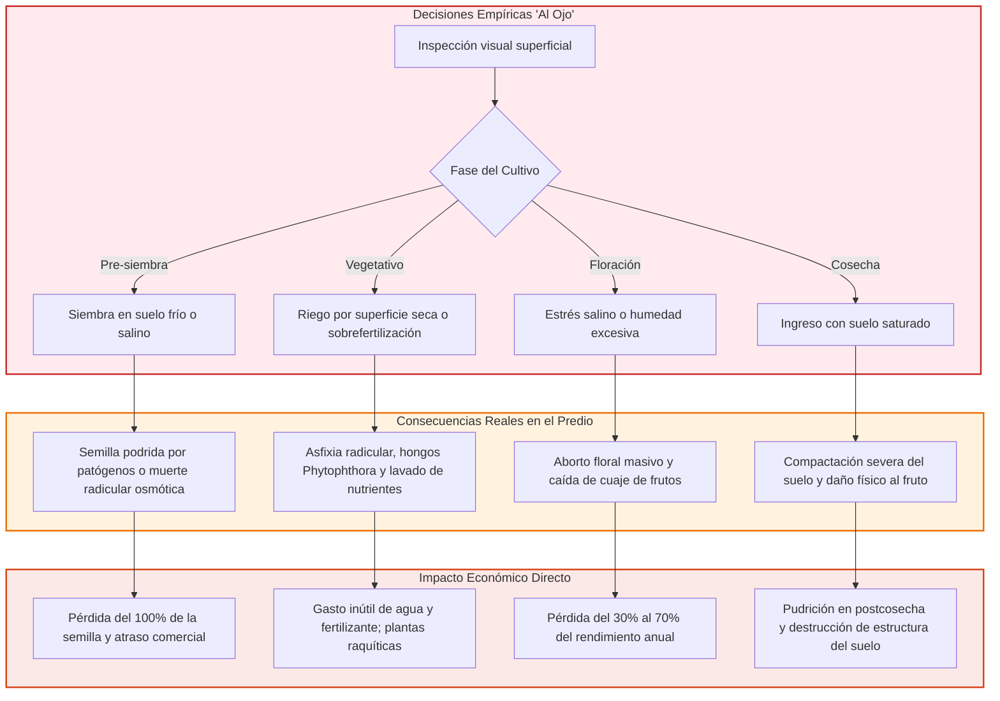

## 2.4. Justificación y Alcance de la Solución
TerraSense no busca sustituir el análisis químico exhaustivo de laboratorio ni pretende reemplazar el criterio del agrónomo en planes de enmienda profunda. Su alcance reside en **el espacio intermedio:** actuar como un asistente de bolsillo que acompaña el recorrido semanal del predio, detectando anomalías hídricas, térmicas y de salinidad antes de que se manifiesten como síntomas irreversibles en la vegetación, asegurando la inversión de capital del productor.

---

# 3. Propuesta de Solución Tecnológica

## 3.1. Filosofía de Diseño del Sistema
El diseño de TerraSense se fundamenta en tres premisas de ingeniería:
1. **Cero Suscripciones Recurrentes:** El agricultor adquiere el equipo en pago único; la aplicación no bloquea funcionalidades ni exige planes de pago mensual para generar el diagnóstico completo.
2. **Operación *Offline-First*:** El 100% del procesamiento agronómico ocurre en el procesador del smartphone sin depender de cobertura de red móvil (3G/4G/5G). La nube actúa exclusivamente como respaldo posterior.
3. **Prescripción Inmediata en Lenguaje Claro:** Los valores de los sensores se traducen en un veredicto sintético mediante semáforo y recomendaciones concretas en menos de 5 segundos.

## 3.2. Estructura del Ecosistema de Tres Capas
Para optimizar costos de manufactura y maximizar la durabilidad en terreno, las responsabilidades se distribuyen de forma estricta entre el hardware, la aplicación móvil y la infraestructura backend:

| Capa del Sistema | Componente Físico | Responsabilidad Asignada | Lo que Deliberadamente NO Realiza |
|:---|:---|:---|:---|
| **1. Instrumento de Captura** | ESP32-WROOM-32E + Sonda 7-en-1 + BME280 | Excitar sensores, leer buses RS-485 e I²C, verificar checksums y transmitir trama BLE. | No procesa algoritmos agronómicos, no almacena historial ni requiere pantalla gráfica propia. |
| **2. Inteligencia Local** | App Móvil (React Native / SQLite) | Ejecutar motor agronómico determinista, georreferenciar punto con GPS del teléfono, desplegar Grilla 3×3 y almacenar histórico local. | No genera voltajes de excitación industrial ni depende de servidores externos para evaluar. |
| **3. Respaldo y Flota** | Supabase (PostgreSQL + PostGIS) + Consola Web | Respaldar mediciones al detectar red, control de cuentas, soporte posventa y analítica multitemporal. | No bloquea la operación en campo en ausencia de conectividad. |

###### **Tabla 1.0 “Distribución de Responsabilidades Funcionales del Sistema”**

## 3.3. La Grilla 3×3 y el Rol del Sensor Ambiental BME280
El sensor **Bosch BME280 es un componente esencial e inseparable del instrumento físico**. Su misión es registrar las condiciones atmosféricas en la posición exacta de la planta (microclima inmediato: temperatura del aire, humedad relativa y presión atmosférica), magnitud que difiere sustancialmente de los datos meteorológicos regionales provistos por satélites o estaciones macroclimáticas distantes.

La interfaz de usuario organiza las mediciones en una matriz intuitiva de nueve celdas:

| Fila Temática | Columna 1 | Columna 2 | Columna 3 |
|:---|:---|:---|:---|
| **Fila 1: Suelo Físico** | Humedad Volumétrica (VWC %) | Temperatura de Suelo (°C) | Conductividad Eléctrica (µS/cm) |
| **Fila 2: Química y Estado** | pH del Suelo | Registros Nutricionales (N/P/K) | Estado y Calidad de la Medición |
| **Fila 3: Microclima Local (BME280)** | Temperatura del Aire (°C) | Humedad Relativa del Aire (%) | Presión Atmosférica Local (hPa) |

###### **Tabla 1.1 “Organización de la Grilla 3×3”**

*Nota Metodológica sobre N/P/K:* La sonda utilizada estima índices relativos de fertilidad a partir de la conductividad iónica y modelos matemáticos internos. TerraSense agrupa estos valores bajo un marco estrictamente informativo y **no emite recetas de fertilización química basada en ellos**, derivando dichas decisiones mayores a análisis certificados de laboratorio.

## 3.4. Integración Complementaria del Pronóstico Meteorológico
El pronóstico climático de 5 días obtenido mediante API web **no reemplaza ni compite con el sensor BME280**; actúa como una capa de **inteligencia prospectiva**. 
* Mientras el BME280 diagnostica el **estado presente del microclima local** para evaluar el estrés térmico actual de la planta,
* La API aporta el **contexto futuro** para validar la conveniencia de la labor. Si la Grilla 3×3 indica condiciones perfectas para sembrar hoy, pero el pronóstico alerta sobre un frente de precipitaciones intensas en 24 horas, la aplicación emite una advertencia preventiva: *"Suelo óptimo, pero se sugiere posponer siembra ante riesgo inminente de encharcamiento y asfixia de semillas"*.

---

# 4. Objetivos del Proyecto

## 4.1. Objetivo General
Desarrollar, evaluar y validar un sistema integral portátil de bajo costo y bajo consumo para el diagnóstico agroclimático y edafológico de terreno, combinando una sonda multiparamétrica industrial, sensado ambiental local y computación en el teléfono móvil vía BLE, que proporcione prescripciones agronómicas inmediatas sin dependencia de conectividad a internet ni cobros por suscripción.

## 4.2. Objetivos Específicos y Resultados Verificables

| N° | Objetivo Específico | Entregable y Resultado Verificable |
|:---|:---|:---|
| **OE-1** | Diseñar e integrar la electrónica de acondicionamiento de potencia, adquisición y control basada en ESP32, conmutación por MOSFET para bus RS-485/Modbus RTU y sensor ambiental I²C BME280. | Esquema electrónico en KiCad, prototipo de circuito integrado con consumo en reposo inferior a 15 µA y autonomía en batería LiPo recargable por USB-C. |
| **OE-2** | Diseñar y modelar una carcasa portátil ergonómica fabricada en manufactura aditiva (PETG), resistente a caídas, polvo e ingreso de salpicaduras conforme a estándar IP67. | Modelo CAD 3D probado, optimizado para disipación térmica aislada del BME280, prensaestopas para sonda y sellos elastoméricos. |
| **OE-3** | Desarrollar el motor agronómico determinista (*Edge Computing*) embebido en una aplicación móvil multiplataforma (React Native / Expo). | Algoritmo funcional que ejecuta el diagnóstico de la Grilla 3×3 y emite recomendaciones de manejo según cultivo, textura y 4 fases fenológicas en tiempo ≤ 5 s. |
| **OE-4** | Implementar la sincronización asíncrona de datos geoespaciales con backend en la nube (Supabase) bajo arquitectura *offline-first* y consulta complementaria de API de pronóstico a 5 días. | Base de datos relacional con PostGIS operativa, políticas de seguridad RLS activadas y módulo de persistencia local SQLite. |
| **OE-5** | Realizar la evaluación económica y el plan de comercialización a 5 años del producto para asegurar su viabilidad productiva, financiera y técnica. | Modelo financiero mensualizado con cálculo formal de VAN (al 20%), TIR, Payback simple y descontado, BOM cotizada y análisis de punto de equilibrio con deuda. |

###### **Tabla 1.2 “Objetivos Específicos y Resultado Verificable”**

---

# 5. Ingeniería Conceptual

## 5.1. Filtro de Viabilidad y Criterios de Selección
Para fundamentar la arquitectura tecnológica, se definió un **Filtro de Viabilidad Técnica y Operativa** de seis requisitos obligatorios (RO). Toda alternativa que incumpla uno solo de estos puntos queda automáticamente descartada:

* **RO-1 (Operación Autónoma):** Entregar diagnóstico agronómico completo en menos de 5 segundos sin depender de internet o señal celular en el predio.
* **RO-2 (Compatibilidad Universal de Smartphone):** Compatible con plataformas iOS y Android vigentes sin chips propietarios de alto costo (evitar certificación Apple MFi).
* **RO-3 (Cero Costos Recurrentes):** No imponer tarifas periódicas ni suscripciones mensuales obligatorias para el agricultor.
* **RO-4 (Portabilidad y Ergonomía):** Peso total menor a 500 g, operable con una sola mano y transportable en mochila de trabajo de terreno.
* **RO-5 (Multi-Muestreo Espacial):** Permitir muestrear decenas de puntos distintos en el mismo potrero en una misma jornada.
* **RO-6 (Viabilidad de Fabricación y Mantenimiento):** Construible con componentes estándar de catálogo industrial y carcasa modular reparable.

###### **Tabla 1.3 “Filtro de Viabilidad”**

## 5.2. Evaluación de Alternativas Tecnológicas
Se analizaron seis configuraciones de arquitectura vigentes en la industria y en la academia:

### Alternativa 1: Instrumento Autónomo (8 Bits + Pantalla + Bluetooth Classic)
Microcontrolador de 8 bits con pantalla LCD integrada y módulo Bluetooth estándar (SPP).
* *Diagnóstico:* El perfil serial Bluetooth Classic en iOS requiere obligatoriamente hardware certificado Apple MFi, inviable económicamente. Memoria insuficiente para alojar algoritmos agronómicos complejos. **Eliminada por RO-2.**

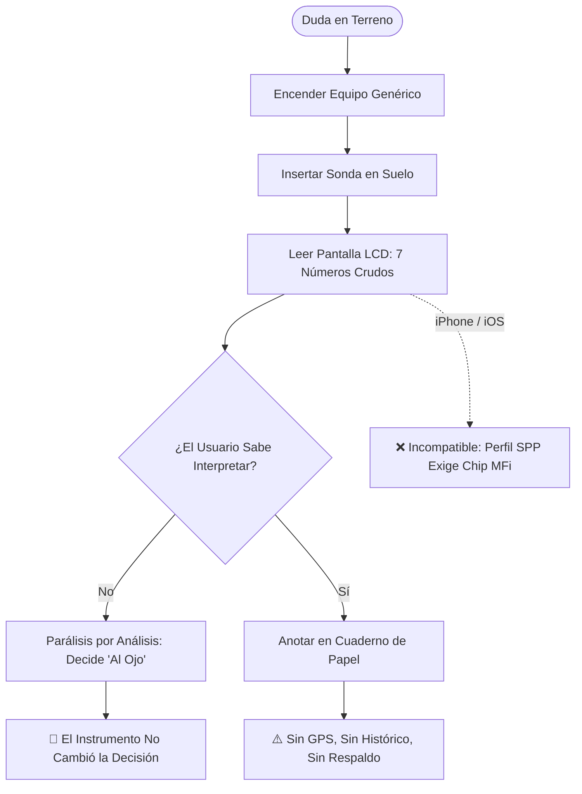
##### **Figura 1.0 “Diagrama de Flujo Alternativa 1 (MCU 8 Bits + Pantalla + Bluetooth Classic)”**

---

### Alternativa 2: Instrumento Autónomo con Inferencia Embebida y Pantalla
Microcontrolador potente con pantalla gráfica integrada ejecutando la inferencia localmente sin teléfono.
* *Diagnóstico:* Incrementa el costo de BOM, penaliza el consumo energético por retroiluminación y añade una ventana plástica frontal crítica para la estanqueidad al agua. Carece de GPS para mapeo y dificulta la actualización de reglas de cultivo. Supera el filtro pero con baja puntuación.

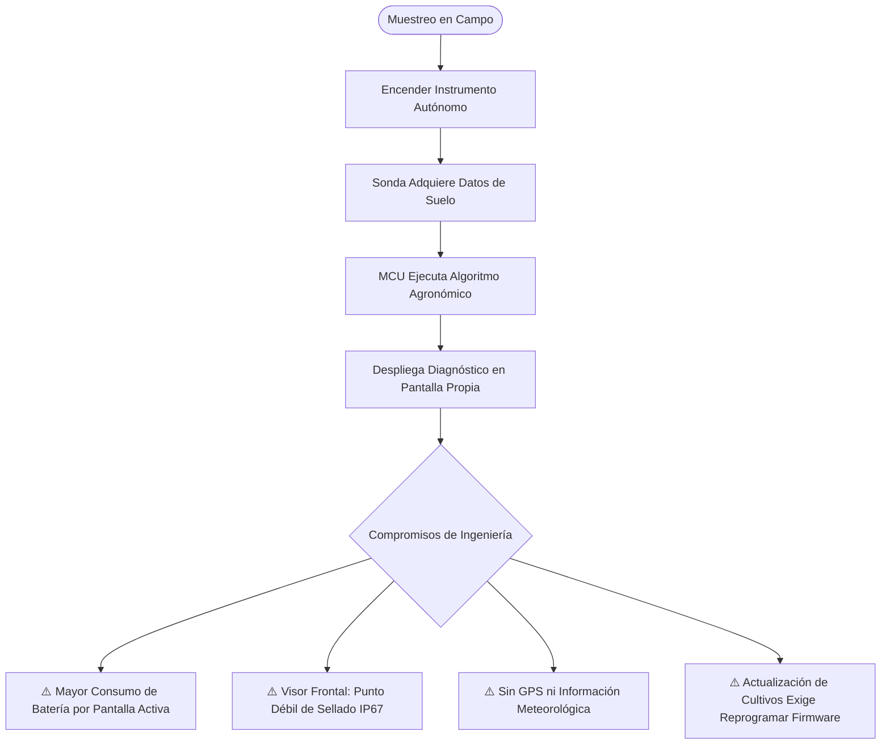
##### **Figura 1.1 “Diagrama de Flujo Alternativa 2 (Instrumento con Inferencia Embebida y Pantalla)”**

---

### Alternativa 3: Datalogger Estacionario con Telemetría Celular
Estación fija con mástil, panel solar, sonda fija enterrada y módem 2G/4G transmitiendo a servidor.
* *Diagnóstico:* Excelente para series de tiempo en un único punto geográfico, pero incapaz de mapear la variabilidad espacial de un campo de varias hectáreas. Exige cobertura celular permanente y planes de datos mensuales. **Eliminada por RO-3 y RO-5.**

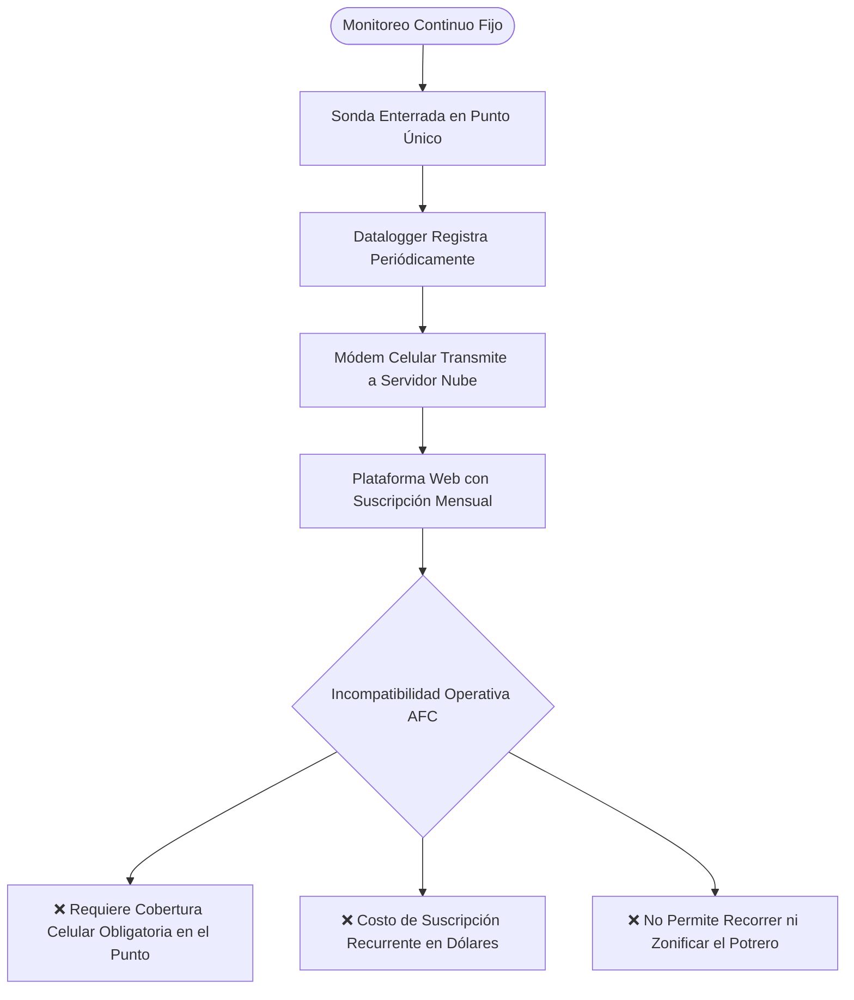
##### **Figura 1.2 “Diagrama de Flujo Alternativa 3 (Datalogger Estacionario con Telemetría Celular)”**

---

### Alternativa 4: Red de Nodos LoRaWAN con Concentrador Predial
Múltiples nodos sensores distribuidos que transmiten por radiofrecuencia a un gateway concentrador central.
* *Diagnóstico:* Arquitectura robusta pero con costo de despliegue prohibitivo para el pequeño agricultor (requiere adquirir e instalar 10 a 20 nodos y una antena gateway con enlace de subida). No soluciona la necesidad presencial del agricultor que camina el campo.

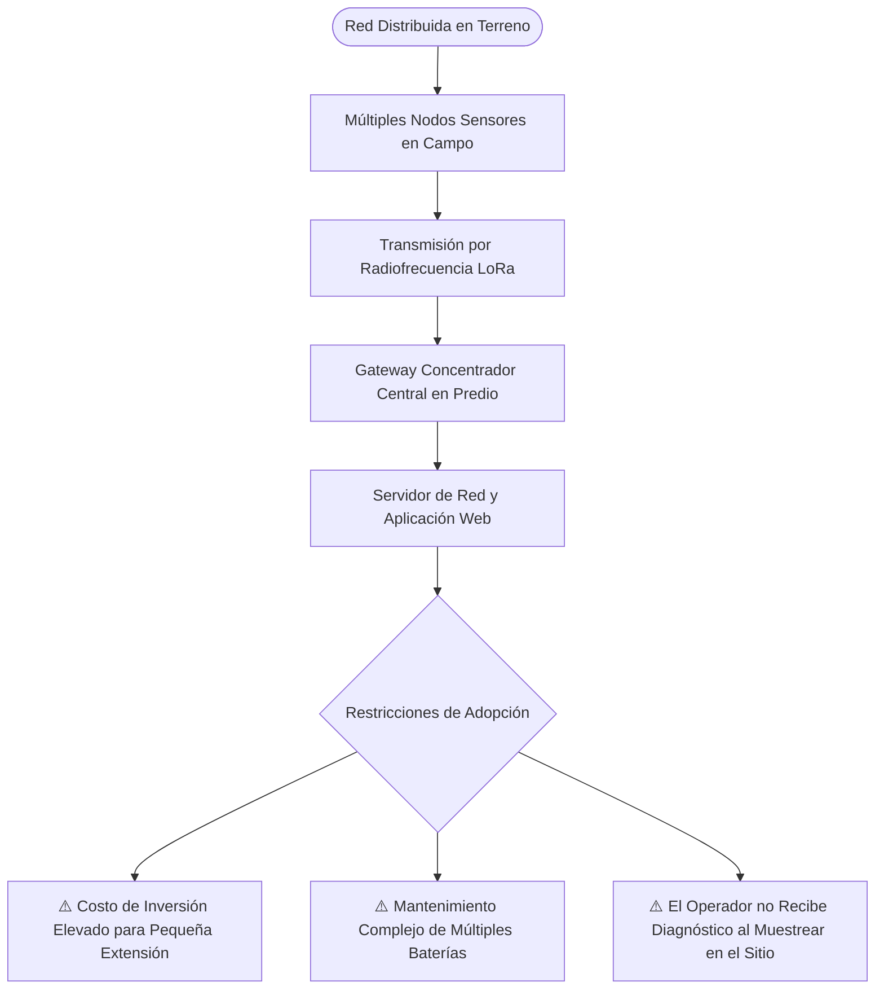
##### **Figura 1.3 “Diagrama de Flujo Alternativa 4 (Red de Nodos LoRaWAN con Estación Concentradora)”**

---

### Alternativa 5: Sonda Conectada Directo al Teléfono por Cable USB
Sonda industrial unida por cable y adaptador convertidor USB-RS485 directo al conector de carga del móvil.
* *Diagnóstico:* El smartphone no suministra los 5V-12V estables que exige el transceptor ni la corriente de la sonda, demandando caja de baterías externa intermedia. Alta fragilidad mecánica en terreno (riesgo de doblar o romper el puerto USB del celular por tirones de cable). Ergonomía deficiente con barro y guantes.

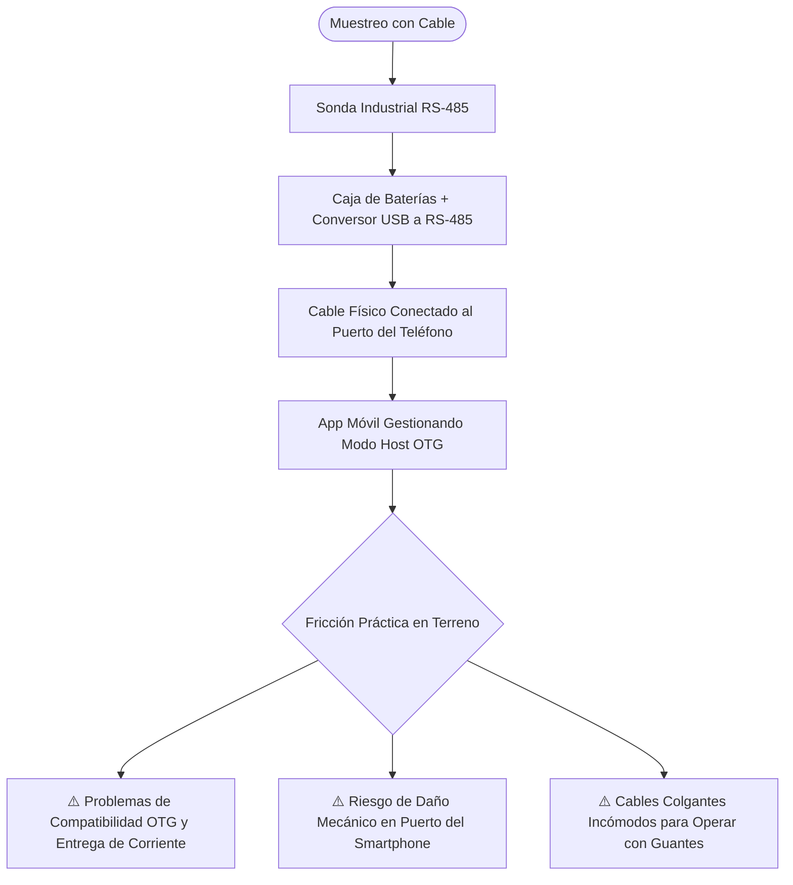
##### **Figura 1.4 “Diagrama de Flujo Alternativa 5 (Sonda Cableada Directa al Teléfono)”**

---

### Alternativa 6: Instrumento Portátil Inalámbrico de Bajo Consumo (TerraSense)
Nodo de mano compacto con ESP32, BME280 y sonda RS-485, alimentado por LiPo recargable, que se comunica puntualmente vía Bluetooth Low Energy con la app móvil del usuario.
* *Diagnóstico:* Cumple con la totalidad de los requisitos obligatorios. Aprovecha la capacidad de cómputo, pantalla de alta resolución y GPS ya existentes en el teléfono inteligente del productor, minimizando el costo del hardware físico y permitiendo actualizar el motor agronómico mediante software.

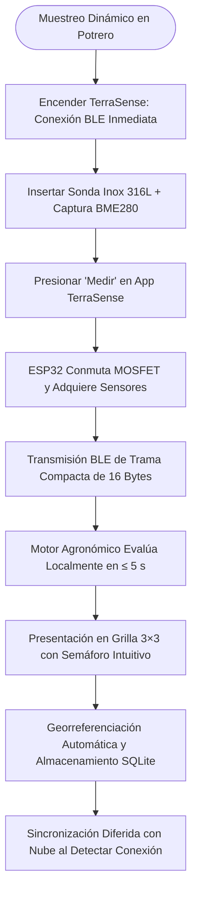
##### **Figura 1.5 “Diagrama de Flujo Alternativa 6 — Arquitectura TerraSense (Bajo Consumo + BLE + App)”**

---

### Comparativa de Rutas de Flujo de Datos y Energía

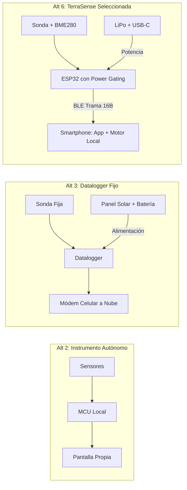
##### **Figura 1.6 “Comparativa de Rutas de Información y Alimentación entre Alternativas”**

## 5.3. Matriz de Decisión y Arquitectura Seleccionada
Las alternativas que superaron el filtro de viabilidad se evaluaron mediante matriz ponderada multicriterio (escala de 1 a 10):

| Criterio de Selección | Ponderación | Alt 2: Autónomo con Pantalla | Alt 4: Red Nodos LoRaWAN | Alt 6: TerraSense (ESP32 + BLE + App) |
|:---|:---:|:---:|:---:|:---:|
| **Cobertura y movilidad espacial** | 15% | 8 (1,20) | 5 (0,75) | **10 (1,50)** |
| **Calidad de interfaz y comprensión** | 13% | 4 (0,52) | 7 (0,91) | **10 (1,30)** |
| **Capacidad de inferencia agronómica** | 15% | 6 (0,90) | 8 (1,20) | **10 (1,50)** |
| **Autonomía y eficiencia energética** | 14% | 4 (0,56) | 8 (1,12) | **9 (1,26)** |
| **Costo económico a 5 años (TCO)** | 16% | 6 (0,96) | 2 (0,32) | **8 (1,28)** |
| **Robustez ambiental y estanqueidad** | 10% | 6 (0,60) | 9 (0,90) | **9 (0,90)** |
| **Actualización de base agronómica** | 9% | 3 (0,27) | 8 (0,72) | **10 (0,90)** |
| **Independencia de infraestructura externa**| 8% | 10 (0,80) | 4 (0,32) | **9 (0,72)** |
| **TOTAL PONDERADO** | **100%** | **5,81** | **6,24** | **9,36** |

###### **Tabla 1.4 “Matriz de Decisión Ponderada de Arquitecturas”**

La **Alternativa 6 (TerraSense)** obtiene la puntuación más alta (9,36/10), destacando ampliamente en usabilidad, economía y capacidad prescriptiva.

## 5.4. Arquitectura de Conectividad y Flujo de Señales

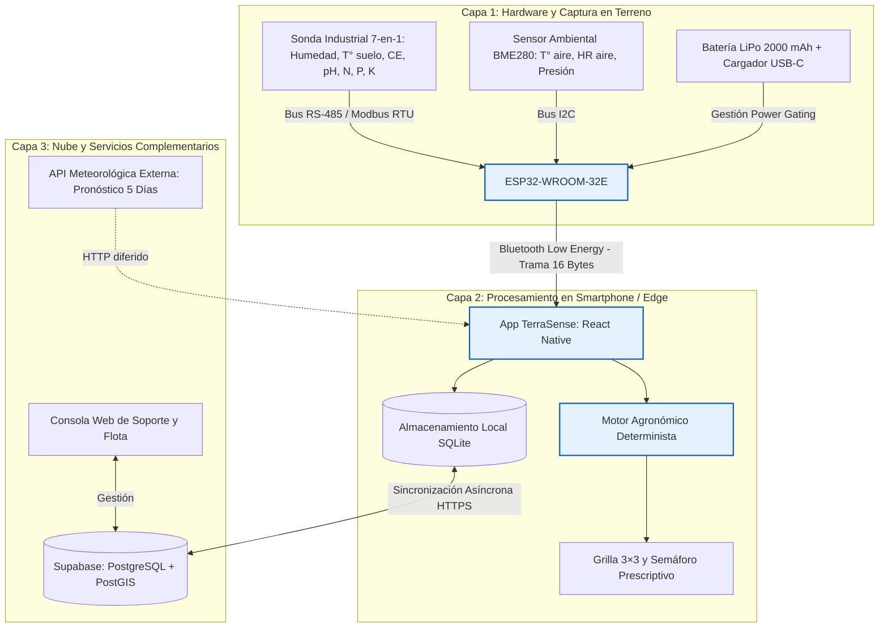
##### **Figura 2.0 “Diagrama de Arquitectura de Conectividad y Flujo de Datos del Sistema”**

## 5.5. Protocolos y Manejo Diferenciado de Errores
El sistema implementa una máquina de estados robusta que garantiza que una falla eléctrica o de comunicación jamás se traduzca erróneamente en un resultado agronómico desfavorable:

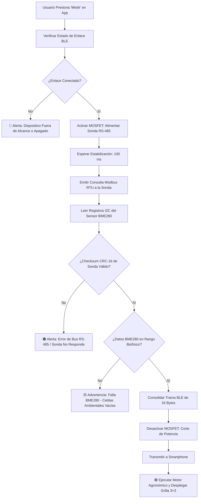
##### **Figura 2.1 “Ciclo de Adquisición y Transmisión con Manejo Diferenciado de Fallos”**

## 5.6. Estudio de Mercado (TAM, SAM y SOM) y Competencia

### Dimensionamiento del Mercado
El dimensionamiento comercial se sustenta en fuentes oficiales del VIII Censo Agropecuario y Forestal del INE:

| Nivel de Mercado | Dimensión Cuantitativa | Criterio de Segmentación Aplicado |
|:---|:---:|:---|
| **TAM (Mercado Total)** | **175.556 explotaciones** | Universo censal total de Chile (138.628 Unidades Productivas Agropecuarias + 36.928 Unidades de Autoconsumo). |
| **SAM (Mercado Disponible)** | **~120.000 explotaciones** | Pequeños y medianos productores (0,5 a 20 ha) y asesores con teléfono inteligente y cultivo comercial. |
| **SOM Año 1 (Meta Comercial)** | **200 unidades** | Representa el **0,17% del SAM** y el **0,11% del TAM** (meta de introducción para validar canales directos). |
| **SOM Acumulado a 5 Años** | **2.550 unidades** | Cobertura del **2,13% del SAM** (200 + 350 + 500 + 650 + 850 equipos en el quinquenio 2027–2031). |

###### **Tabla 2.0 “Dimensionamiento de Mercado: TAM, SAM y SOM”**

### Plan de Crecimiento y Asignación de Recursos Comerciales
El presupuesto asigna un Costo de Adquisición de Clientes (CAC) objetivo de **$30.000 CLP por unidad vendida**:

| Año | Unidades | Presupuesto Pauta (CLP) | Fuerza Técnica (FTE) | Soporte (FTE) | Gestión de Agencia |
|:---:|:---:|:---:|:---:|:---:|:---:|
| **2027** | 200 | $6.000.000 | 0,0 | 0,0 | Autogestión Fundadores |
| **2028** | 350 | $10.815.000 | 0,5 | 0,0 | Alianzas con Asesores |
| **2029** | 500 | $15.918.000 | 0,5 | 0,5 | Venta Directa Consolidada |
| **2030** | 650 | $21.365.000 | 1,0 | 0,5 | Agencia Especializada |
| **2031** | 850 | $28.843.000 | 1,0 | 1,0 | Cobertura Multirregional |

###### **Tabla 2.1 “Plan de Ventas y Asignación de Recursos Comerciales (5 Años)”**

### Comparativa de Competencia (Benchmarking)

| Solución Comercial | Precio Exhibido (CLP) | Alcance Real y Limitaciones | Diferencial TerraSense |
|:---|:---:|:---|:---|
| **Hanna GroLine HI9814** | $491.827 | pH/CE/TDS para soluciones hidropónicas; no mide humedad volumétrica de suelo ni parámetros de intemperie. | TerraSense cuesta **~29% menos**, mide directo en tierra y añade interpretación fenológica. |
| **Bluelab Pulse** | $538.990 | Mide humedad, CE y temperatura de raíz con app Bluetooth; no mide pH integrado en tierra ni variables climáticas. | TerraSense cuesta **~35% menos**, incluye BME280 y recomendaciones sin suscripción. |
| **FieldScout TDR 350** | > $1.800.000 | Equipo de investigación para césped deportivo y gran agricultura; complejo, pesado y prohibitivo para la AFC. | Formato de bolsillo ultraportátil concebido específicamente para el pequeño agricultor. |
| **Laboratorio Tradicional** | $35.000 – $60.000 / muestra | Referencia analítica de máxima exactitud, pero con desfase de entrega de 15 a 30 días hábiles. | TerraSense entrega diagnóstico en 5 segundos en el momento crítico de la labor. |

###### **Tabla 3.0 “Comparativa de Benchmarking con la Competencia Comercial”**

## 5.7. Modelo Económico, Costos y Evaluación Financiera

### Estructura de Costos de Fabricación (BOM)
Costos netos unitarios de componentes cotizados a volumen de escala inicial:

| Componente Electrónico / Mecánico | Cantidad | Costo Unitario Neto (CLP) | Subtotal (CLP) |
|:---|:---:|:---:|:---:|
| Sonda Industrial RS-485 7-en-1 (Inox 316L) | 1 | $48.000 | $48.000 |
| Placa Microcontroladora ESP32-WROOM-32E | 1 | $6.723 | $6.723 |
| Sensor Ambiental Bosch BME280 I²C | 1 | $2.941 | $2.941 |
| Módulo de Carga USB-C + Step-Up 5V/9V | 1 | $900 | $900 |
| Batería LiPo 2000 mAh protegida | 1 | $4.500 | $4.500 |
| Transceptor RS-485 SP3485 (3.3V) | 1 | $900 | $900 |
| Circuito MOSFET P-Channel + Pasivos + Protección | 1 | $1.450 | $1.450 |
| PCB Portadora y Montaje SMD | 1 | $2.500 | $2.500 |
| Carcasa Impresa 3D PETG (Servicio Industrial Externo) | 1 | $6.000 | $6.000 |
| Sellos Elastoméricos, Filtro BME280 y Prensaestopas | 1 | $1.500 | $1.500 |
| Conector JST, Cableado Interno y Pulsador IP | 1 | $1.170 | $1.170 |
| Embalaje, Manual Técnico y Etiquetado Reglamentario | 1 | $2.000 | $2.000 |
| Flete Internacional y Contingencia de Importación | 1 | $2.500 | $2.500 |
| **TOTAL COSTO DIRECTO BOM POR UNIDAD** | — | — | **$81.184** |

###### **Tabla 2.2 “Estructura de Costos de Fabricación (BOM)”**

### Economía Unitaria del Dispositivo
* **Precio de Venta al Público:** **$349.990 CLP con IVA** ($294.109 neto).
* **Costos Variables Adicionales por Unidad:**
  * Merma de componentes (3%): $2.436 CLP
  * Provisión de Garantía Pro-Consumidor 6 meses (5%): $4.059 CLP
  * Logística y Despacho Nacional: $8.500 CLP
  * Comisión de Pasarela de Pago Digital (3,5% + IVA): $12.399 CLP
  * Embalaje de envío: $2.600 CLP
* **Costo Variable Total:** **$111.178 CLP**.
* **Margen de Contribución Unitario:** **$182.931 CLP** (**62,2% sobre el valor neto de venta**).

###### **Tabla 2.3 “Estructura de Economía Unitaria por Dispositivo”**

### Inversión Inicial y Estructura de Financiamiento
Para iniciar operaciones se estructuró un plan de financiamiento mixto:

| Concepto de Inversión | Monto (CLP) |
|:---|:---:|
| Activos fijos, herramentales de ensamble y matrices | $3.500.000 |
| Desarrollo de software, firmware y validación técnica | $5.853.000 |
| Constitución formal de sociedad, registros y marcas | $1.000.000 |
| Inventario inicial de trabajo (lote de lanzamiento con IVA) | $964.378 |
| **TOTAL DESEMBOLSO INICIAL REQUERIDO** | **$11.317.378** |
| **Fuentes de Financiamiento:** | |
| Aporte de Capital Propio de Socios Fundadores | $9.000.000 |
| Crédito Comercial Bancario (10 años, 12% anual efectivo) | $31.000.000 |
| Gastos notariales y de apertura de crédito | -$620.000 |
| **Caja Inicial Disponible (Fondo de Reserva Operativa)** | **$28.062.622** |

###### **Tabla 2.4 “Presupuesto de Inversión Inicial y Estructura de Financiamiento”**

### Flujo de Caja Quinquenal y Cobertura de Deuda
El flujo mensualizado a 60 meses consolidado por año presenta los siguientes resultados:

| Indicador Financiero | Año 1 (2027) | Año 2 (2028) | Año 3 (2029) | Año 4 (2030) | Año 5 (2031) |
|:---|:---:|:---:|:---:|:---:|:---:|
| **Unidades Vendidas** | 200 | 350 | 500 | 650 | 850 |
| **Ingresos Netos (CLP)** | $58.821.800 | $105.992.240 | $155.877.770 | $208.825.810 | $281.282.680 |
| **EBITDA Operativo** | $4.426.234 | $19.015.320 | $31.680.620 | $35.729.124 | $49.915.370 |
| **Servicio Anual de Deuda** | $5.206.035 | $5.206.035 | $5.206.035 | $5.206.035 | $5.206.035 |
| **Caja Final del Período** | $26.470.982 | $38.647.148 | $57.237.408 | $77.360.857 | $110.083.164 |
| **Cobertura de Deuda (DSCR)** | 0,69* | 3,34 | 4,57 | 4,87 | 7,29 |
| **Punto de Equilibrio con Deuda** | 205 u | 277 u | 364 u | 498 u | 634 u |

*\*Nota de Gestión de Riesgo:* Durante el Año 1, la caja de reserva inicial cubre holgadamente la amortización crediticia, alcanzando un índice de cobertura robusto a partir del mes 14.

###### **Tabla 2.5 “Proyección Anual de Flujo de Caja y Cobertura de Deuda (DSCR)”**

### Indicadores de Rentabilidad y Análisis Multiescenario
Bajo una tasa de descuento anual exigida del **20%** (adecuada para proyectos tecnológicos de hardware):

| Escenario Evaluado | Hipótesis de Venta Anual | Inversión Mes 0 | VAN al 20% (CLP) | TIR Anual (%) | Payback Simple | Payback Descontado |
|:---|:---:|:---:|:---:|:---:|:---:|:---:|
| **Caso Base** | Plan Comercial (200 a 850 u) | $20.489.116 | **+$15.504.053** | **35,43%** | **34,6 meses (2,88 años)** | **47,1 meses (3,93 años)** |
| **Caso Crecimiento** | +20% en unidades vendidas | $23.661.182 | **+$69.653.316** | **76,70%** | **22,5 meses (1,88 años)** | **23,3 meses (1,94 años)** |
| **Caso Estrés** | -30% en volumen de venta | $20.478.616 | -$50.774.058 | -30,28% | No recupera en 60 m | No recupera en 60 m |

###### **Tabla 2.6 “Evaluación Financiera Multiescenario (VAN, TIR, Payback)”**

El proyecto resulta altamente rentable en el escenario base, generando un retorno sobre capital que supera ampliamente la tasa de corte exigida.

## 5.8. Especificaciones de Hardware y Gestión Energética

### Microcontrolador ESP32-WROOM-32E
* **Arquitectura:** Dual-core Xtensa® LX6 de 32 bits a 160/240 MHz.
* **Memoria:** 520 KB SRAM interna, 4 MB Flash SPI externa.
* **Conectividad Inalámbrica:** Bluetooth 4.2 BR/EDR y BLE (potencia de transmisión ajustable hasta +9 dBm).
* **Consumo Energético:** ~80 mA en activo con radio BLE; < 15 µA en régimen de *Deep Sleep*.

###### **Tabla 3.1 “Especificaciones Técnicas ESP32-WROOM-32E”**

### Sonda Multiparamétrica 7-en-1
* **Material de Agujas:** Acero inoxidable grado quirúrgico AISI 316L, resistente a la corrosión galvánica y acidez edáfica.
* **Protocolo de Comunicación:** RS-485 diferencial bidireccional, estándar Modbus RTU a 9.600 bps.
* **Rango de Tensión de Excitación:** 5 V a 12 V DC (generados mediante regulador elevador Step-Up de alta eficiencia).
* **Parámetros Censados:** Humedad volumétrica (0–100% VWC, precisión ±3%), Temperatura edáfica (-40 a 80 °C, ±0,5 °C), Conductividad eléctrica (0–20.000 µS/cm, ±3%), pH de suelo (3–9 pH, ±0,3 pH), e índices relativos N/P/K.

###### **Tabla 3.2 “Especificaciones Técnicas de la Sonda Industrial 7-en-1”**

### Sensor Ambiental BME280 (Bosch Sensortec)
* **Bus de Comunicación:** I²C estándar (dirección 0x76/0x77) con resistencias pull-up de 4,7 kΩ a 3.3V.
* **Temperatura del Aire:** Rango -40 a +85 °C (exactitud ±0,5 °C a 25 °C).
* **Humedad Relativa:** Rango 0% a 100% RH (exactitud ±3% RH, histéresis ≤ 1%).
* **Presión Atmosférica:** Rango 300 a 1.100 hPa (exactitud absoluta ±1 hPa).

###### **Tabla 3.3 “Especificaciones del Sensor Ambiental Bosch BME280”**

### Mapeo de Pines y Conexiones Físicas

| Función del Circuito | Pin ESP32 | Conexión / Periférico Asociado |
|:---|:---:|:---|
| **RS-485 UART2 RX** | GPIO 16 | Pin RO (Pin 1) del transceptor SP3485 |
| **RS-485 UART2 TX** | GPIO 17 | Pin DI (Pin 4) del transceptor SP3485 |
| **Control Dirección RS-485 (RE/DE)** | GPIO 4 | Pines 2 y 3 (RE/DE) del SP3485 (1=Tx, 0=Rx) |
| **Power Gating (Corte Sonda + Step-Up)** | GPIO 5 | Compuerta (Gate) del MOSFET (1=On, 0=Off) |
| **I²C SDA (Sensor BME280)** | GPIO 21 | Línea de datos bidireccional I²C |
| **I²C SCL (Sensor BME280)** | GPIO 22 | Línea de reloj serie I²C |
| **Monitoreo de Batería (ADC1)** | GPIO 34 | Divisor de tensión 100 kΩ / 100 kΩ a VBAT |
| **Pulsador de Muestreo / Despertar** | GPIO 0 | Pulsador frontal a masa con pull-up |
| **LED Indicador de Medición / Batería** | GPIO 2 | Micro-LED verde de estado |
| **LED Indicador de Enlace BLE** | GPIO 15 | Micro-LED azul de conexión inalámbrica |

###### **Tabla 3.4 “Mapeo de Pines y Conexiones del Hardware”**

### Gestión Energética (*Power Gating*)
Para asegurar que el instrumento ofrezca autonomía de campo sin agotar la batería LiPo de 2.000 mAh en reposo, se implementa una etapa de aislamiento eléctrico total mediante un transistor MOSFET canal P:
* **En Reposo:** El microcontrolador ESP32 permanece en modo de reposo profundo (*Deep Sleep*). La línea de compuerta del MOSFET permanece en nivel alto, desconectando físicamente la línea de alimentación hacia la sonda RS-485, el convertidor elevador de voltaje y el transceptor SP3485. El consumo parásito del subsistema de sensado cae a **0,0 µA**.
* **En Medición (duración 3 a 5 segundos):** El usuario despierta el equipo. El microcontrolador satura el MOSFET a masa, entregando alimentación a la sonda durante 100 ms para estabilizar lectura, ejecuta la consulta Modbus RTU, captura el BME280 y corta inmediatamente la energía antes de iniciar la ráfaga BLE.

### Contrato de Datos Bluetooth Low Energy (16 Bytes)
Para maximizar la tasa de transferencia y minimizar el tiempo de radio encendida, se estructuró una trama binaria compacta:

| Posición (Bytes) | Magnitud Representada | Factor de Escala | Rango Físico Codificado |
|:---:|:---|:---:|:---|
| `[0..1]` | Humedad Volumétrica del Suelo (VWC) | × 10 (uint16) | 0,0% a 100,0% |
| `[2..3]` | Temperatura del Suelo | × 10 (int16 con signo) | -40,0 °C a +80,0 °C |
| `[4..5]` | Conductividad Eléctrica (CE) | × 1 (uint16) | 0 a 20.000 µS/cm |
| `[6..7]` | Potencial de Hidrógeno (pH) | × 100 (uint16) | 3,00 a 9,00 pH |
| `[8..9]` | Temperatura del Aire (BME280) | × 10 (int16 con signo) | -40,0 °C a +85,0 °C |
| `[10..11]`| Humedad Relativa del Aire (BME280) | × 10 (uint16) | 0,0% a 100,0% RH |
| `[12..13]`| Presión Atmosférica Local (BME280) | × 10 (uint16) | 300,0 a 1.100,0 hPa |
| `[14]` | Índice Relativo NPK (Empírico Sonda)| uint8 | 0 a 255 |
| `[15]` | Batería y Checksum de Control | uint8 | Nivel de carga + flags de error |

###### **Tabla 3.5 “Contrato de Trama Bluetooth Low Energy (16 Bytes)”**

## 5.9. Diseño Mecánico y Carcasa Portátil
La envolvente física fue concebida para cumplir exigencias mecánicas de intemperie y facilidad de operación en campo agrícola:
* **Material y Fabricación:** Termoplástico PETG (Tereftalato de Polietileno con Glicol) procesado mediante manufactura aditiva con 4 perímetros de pared y 35% de relleno giroide, asegurando rigidez estructural y resistencia a radiación UV y agroquímicos.
* **Canal Aislado para BME280:** El sensor ambiental se encuentra segregado en una cámara secundaria inferior con deflectores protectores que permiten el libre ingreso del aire ambiental, pero aíslan el chip de la radiación térmica generada por la carga de la batería y la disipación del ESP32.
* **Sellado y Ergonomía:** Junta de elastómero termoplástico (TPU) en la unión de tapas, conector de carga USB-C con tapón de goma cautivo, y salida de cable hacia la sonda sellada mediante prensaestopas métrico PG7 de compresión mecánica.

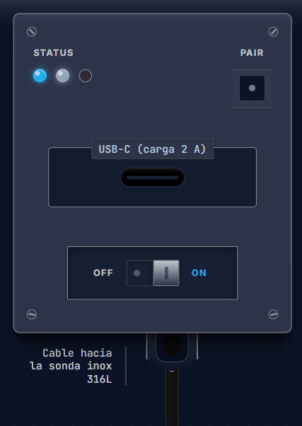

##### **Figura 2.3 “Modelo Tridimensional Conceptual de la Carcasa Portátil y Disposición de Puertos”**

## 5.10. Motor Agronómico y Evaluación en las 4 Fases Fenológicas

### Recorrido de Campo y Presentación Prescriptiva
La aplicación móvil guía al usuario a través de un flujo intuitivo que transforma los datos crudos en acciones inmediatas:

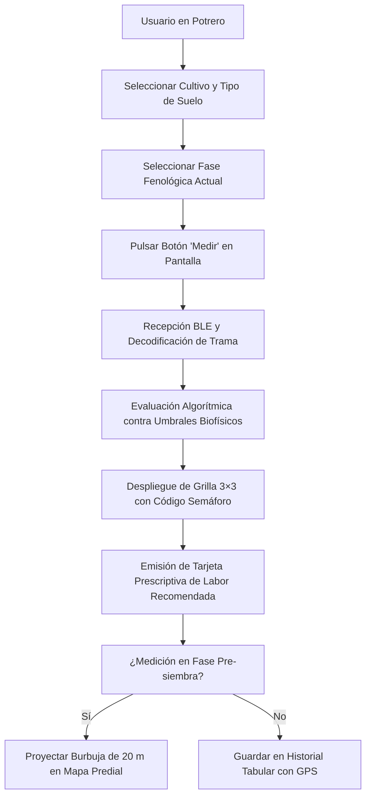
##### **Figura 2.2 “Recorrido Operativo en Campo y Presentación Prescriptiva del Diagnóstico”**

### Persistencia de Datos y Sincronización Asíncrona
El almacenamiento sigue el paradigma de consistencia eventual:

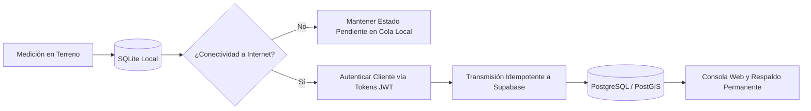
##### **Figura 2.4 “Persistencia Local Asíncrona y Sincronización Idempotente con Supabase”**

### Complementariedad con el Pronóstico Meteorológico

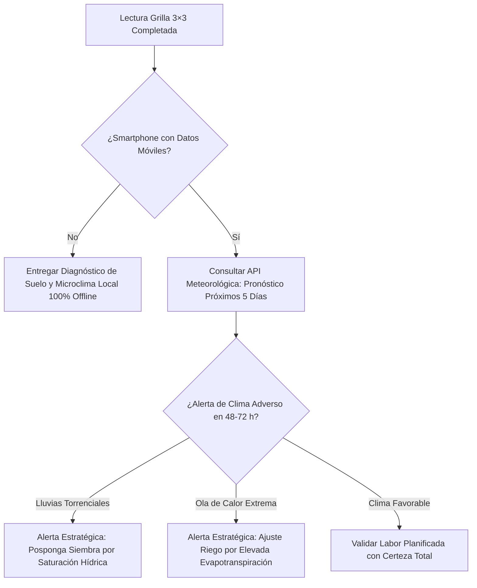
##### **Figura 2.5 “Flujo de Decisión Agronómica Local Complementada por Pronóstico Meteorológico”**

### Umbrales Hídricos por Textura de Suelo
El contenido de agua disponible varía radicalmente según la estructura física de la matriz edáfica:

| Textura de Suelo Declarada | Punto de Marchitez Permanente (PMP) | Límite Inferior Óptimo | Límite Superior Óptimo | Capacidad de Campo (CC) |
|:---|:---:|:---:|:---:|:---:|
| **Arenoso** | 4% VWC | 8% VWC | 14% VWC | 16% VWC |
| **Franco (Equilibrado)** | 10% VWC | 18% VWC | 28% VWC | 32% VWC |
| **Arcilloso (Pesado)** | 18% VWC | 26% VWC | 38% VWC | 44% VWC |

###### **Tabla 3.6 “Matriz de Umbrales Hídricos según Textura de Suelo”**

### Comportamiento del Motor en las 4 Fases Fenológicas
La misma lectura física exige decisiones agronómicas radicalmente distintas según el estado biológico del cultivo:

| Etapa Fenológica | Variables Críticas Evaluadas | Regla Específica del Motor Agronómico | Comportamiento del Sistema en la App |
|:---|:---|:---|:---|
| **1. Pre-siembra (Siembra)** | Temperatura de suelo, Humedad VWC, CE y pH | Evalúa aptitud de la cama de siembra. Alerta si la temperatura está bajo el cero biológico de germinación o si la salinidad dañará la raíz emergente. | **Es la única fase que habilita la cartografía predial interactiva con círculos de 20 m de radio para zonificar el lote.** |
| **2. Vegetativo** | Humedad VWC, CE y Temperatura ambiental | Supervisa la disponibilidad de agua y nutrientes para maximizar la fotosíntesis y el crecimiento de biomasa foliar. Alerta sobre encharcamiento que propicie hongos. | Entrega recomendaciones directas de frecuencia de fertirriego y prevención de asfixia radicular. |
| **3. Floración** | CE estricta, Humedad en raíz y Microclima BME280 | **El umbral máximo permitido de conductividad eléctrica se reduce automáticamente al 80% del valor estándar.** La salinidad en esta fase provoca estrés osmótico fulminante y **aborto floral masivo**. | Alerta prioritaria inmediata ante riesgo de caída de cuaje de frutos por sales o estrés por calor. |
| **4. Cosecha** | Humedad VWC en suelo y Pronóstico de lluvia | Evalúa la **transitabilidad del terreno** para evitar la compactación severa del suelo al meter maquinaria o cuadrillas, y asegura la conservación postcosecha. | Sugiere postergar o adelantar cosecha en función del contenido de agua del suelo y el pronóstico de 5 días. |

###### **Tabla 3.7 “Matriz de Comportamiento del Motor Agronómico en las 4 Fases Fenológicas”**

### Cuadro Comparativo: Toma de Decisión Tradicional vs. Diagnóstico TerraSense

| Etapa Fenológica | Decisión Típica "Al Ojo" | Consecuencia del Error | Corrección Instrumental TerraSense |
|:---|:---|:---|:---|
| **Pre-siembra** | Siembra por fecha de calendario; suelo se siente "listo" al tacto. | Suelo bajo 10 °C pudre la semilla; salinidad oculta quema la plántula. **Pérdida del 100% de la semilla.** | Mide temperatura y CE exacta; bloquea siembra y mapea zonas aptas del potrero. |
| **Vegetativo** | Riego intensivo porque la superficie se ve seca y polvorienta. | El bulbo radicular a 20 cm se satura: asfixia radicular y proliferación de hongos *Phytophthora*. | Evalúa humedad real en la rizosfera según textura (arena/franco/arcilla); optimiza agua. |
| **Floración** | Riego y abono convencional sin considerar la sensibilidad floral. | Estrés salino induce caída masiva de flores. **Pérdida irreversible del 30% al 70% de la cosecha.** | Rebaja automática del umbral de salinidad al 80%; protege la fecundación de la flor. |
| **Cosecha** | Ingreso de tractores al ver fruto maduro sin revisar humedad profunda. | **Compactación severa del suelo (pie de arado)** y pudrición de fruta en embalaje por humedad residual. | Determina transitabilidad del terreno y cruza con pronóstico climático a 5 días. |

###### **Tabla 3.8 “Cuadro Comparativo: Toma de Decisión 'Al Ojo' vs. Diagnóstico TerraSense”**

## 5.11. Marco Normativo, Estándares y Seguridad
El producto se rige estrictamente por la normativa nacional e internacional aplicable a dispositivos electrónicos y software:

* **Telecomunicaciones y Espectro (SUBTEL):** Conforme a la **Resolución Exenta N° 737 de SUBTEL (vigente desde febrero de 2026)**, el módulo ESP32-WROOM-32E cuenta con certificación modular de alcance reducido en la banda libre de 2,4 GHz, eximiendo al ensamblaje nacional de trámites de homologación de espectro adicionales.
* **Seguridad Eléctrica y Baterías (SEC / IEC 62133-2 / UN 38.3):** Las celdas secundarias de ion-litio incorporan circuito integrado de protección (PCM) contra cortocircuito, sobrecarga y sobredescarga, respaldadas por ensayos de transporte seguro UN 38.3.
* **Responsabilidad Extendida del Productor (Ley N° 20.920 REP):** Cumplimiento de metas de recolección y valorización de Aparatos Eléctricos y Electrónicos (AEE). El chasis es 100% desmontable mediante tornillos métricos M3, facilitando la extracción y reciclaje selectivo de la batería y placa.
* **Protección al Consumidor (Ley N° 21.398 y Ley N° 19.496):** Provisión financiera del 5% para garantía legal de 6 meses y compromiso de mantenimiento de inventario de repuestos.
* **Protección de Datos Personales (Ley N° 21.719, vigente a partir del 1 de diciembre de 2026):** Implementación de Seguridad a Nivel de Fila (RLS) en base de datos, cifrado TLS en tránsito y consentimiento explícito en el tratamiento de coordenadas prediales georreferenciadas.
* **Estándares Edafológicos de Referencia:** Interpretación calibrada bajo principios de **ISO 10390** (pH en suelo), **ISO 11265** (Conductividad eléctrica corregida a 25 °C) e **ISO 11277** (Determinación textural granulométrica).

## 5.12. Plan de Validación Experimental
Para certificar el paso de ingeniería conceptual a producto de producción, se fijaron los siguientes ensayos de banco de pruebas:

| Ensayos de Validación | Metodología de Ensayo | Criterio de Aceptación Técnica |
|:---|:---|:---|
| **Verificación de Buses y Checksums** | Captura con analizador lógico de tramas Modbus RTU a 9.600 bps e I²C a 100 kHz. | Cero errores de paridad o CRC en ráfagas de 100 lecturas consecutivas. |
| **Ensayo de Aislamiento de Potencia** | Medición con electrómetro en serie del consumo de reposo en terminales de batería. | Corriente de reposo total del sistema en Deep Sleep **inferior a 20 µA**. |
| **Autonomía Experimental** | Ciclos automáticos de lectura cada 5 minutos sobre batería de 2.000 mAh. | Demostrar **más de 3.000 ciclos de medición completos** con una sola carga. |
| **Ensayo de Aislamiento Térmico BME280** | Exposición a sol directo y comparación con sensor patrón calibrado exterior. | Desviación térmica entre BME280 y aire exterior **inferior a ±0,8 °C**. |
| **Prueba de Sellado Ambiental** | Ensayo en cámara de polvo y goteo vertical conforme a IEC 60529. | Ausencia total de penetración de partículas y humedad en la cámara electrónica. |
| **Pruebas de Estrés de Software** | Ejecución de 18 pruebas unitarias automatizadas y chequeo estricto TypeScript. | 100% de tests aprobados (`npm test`) y cero errores de tipado (`tsc --noEmit`). |

###### **Tabla 4.0 “Criterios y Ensayos de Validación Técnica en Banco de Pruebas”**

---

# 6. Conclusiones

El desarrollo de la ingeniería conceptual de **TerraSense** demuestra de manera categórica que es técnicamente factible, agronómicamente indispensable y económicamente rentable democratizar la agricultura inteligente para el pequeño y mediano productor chileno.

A lo largo de este estudio se consolidan las siguientes conclusiones fundamentales:

1. **Resolución de la Doble Brecha Tecnológica:** TerraSense supera la barrera económica mediante una BOM de fabricación de **$81.184 CLP**, ofreciendo un equipo de prestaciones profesionales a un precio comercial de **$349.990 CLP con IVA** (~30% más económico que sus competidores extranjeros más cercanos). Asimismo, anula la barrera cognitiva al convertir números planos en prescripciones claras a través de la **Grilla 3×3** y código de semáforo universal en menos de 5 segundos.
2. **Arquitectura Distribuida Inteligente:** La delegación del procesamiento al smartphone del agricultor (*Edge Computing*) preserva la libertad de movimiento en terreno, elimina pantallas costosas en el hardware y garantiza una operación **100% *offline***, resolviendo el problema de la falta de cobertura en sectores rurales.
3. **Rol Indispensable del Sensor BME280 y Pronóstico:** Queda demostrado que el BME280 es insustituible para conocer el microclima inmediato y real en la rizosfera, mientras que la API de pronóstico de 5 días actúa como su complemento estratégico ideal, permitiendo alertar sobre lluvias o heladas inminentes que modifiquen la labor planificada.
4. **Impacto Crítico en las 4 Fases Fenológicas:** Se comprobó cómo la sustitución del método tradicional "al ojo" en Pre-siembra (mapeo predial de 20 m), Vegetativo, Floración (rebaja automática de salinidad al 80% para evitar aborto floral) y Cosecha (transitabilidad para evitar compactación) protege de forma directa el patrimonio económico del agricultor, evitando pérdidas de hasta el 70% del rendimiento anual.
5. **Solidez y Sustentabilidad Financiera:** La evaluación financiera formal a 5 años (2027–2031) respalda la viabilidad del emprendimiento bajo supuestos altamente conservadores: con solo 200 equipos en el Año 1 y 2.550 a cinco años, se obtiene un **VAN de +$15.504.053 CLP** (tasa de corte del 20%), una **TIR de 35,43%** y un **Payback de 2,88 años**, asegurando fuentes de trabajo formales, reservas de liquidez operativa y capacidad de pago de deuda bancaria.

En mérito de los antecedentes expuestos, TerraSense se consolida como una solución de ingeniería aplicada de vanguardia, alineada con las necesidades de resiliencia climática del país y con un modelo de negocios validado listo para su ejecución.

---

# 7. Referencias Bibliográficas

1. **Instituto Nacional de Estadísticas (INE), Chile.** (2021). *VIII Censo Agropecuario y Forestal 2021: Resultados Finales Nacionales*. Santiago de Chile: INE. Recuperado de: https://www.ine.gob.cl/censoagropecuario
2. **Oficina de Estudios y Políticas Agrarias (ODEPA).** (2021). *Distribución de las unidades productivas en Chile y análisis estructural del censo*. Santiago: Ministerio de Agricultura.
3. **Instituto de Desarrollo Agropecuario (INDAP).** (2023). *Lineamientos estratégicos para la Agricultura Familiar Campesina e Indígena*. Santiago: INDAP.
4. **Centro de Ciencia del Clima y la Resiliencia (CR)².** (2020). *Informe a la Nación: La megasequía 2010–2020 en Chile y lecciones para el futuro hídrico*. Santiago: Universidad de Chile.
5. **ODEPA.** (2024). *Boletín de insumos agrícolas y evolución de precios de fertilizantes y agroquímicos*. Santiago: ODEPA.
6. **Bluelab Corporation.** (2022). *Bluelab Pulse Multimedia EC/MC Meter: Technical specifications and root-zone monitoring guide*. Tauranga, New Zealand.
7. **Hanna Instruments.** (2023). *GroLine HI9814 Waterproof Portable pH/EC/TDS/Temperature Meter Datasheet*. Woonsocket, RI, USA.
8. **Spectrum Technologies, Inc.** (2022). *FieldScout TDR 350 Soil Moisture Meter User Manual and Specifications*. Aurora, IL, USA.
9. **Ministerio del Medio Ambiente, Chile.** (2016). *Ley N° 20.920: Marco para la gestión de residuos, la responsabilidad extendida del productor y fomento al reciclaje (REP)*. Diario Oficial de la República de Chile.
10. **Comisión Electrotécnica Internacional (IEC).** (2013). *IEC 60529: Degrees of protection provided by enclosures (IP Code)*. Ginebra: IEC.
11. **Organización de las Naciones Unidas (ONU) / IEC.** (2020). *UN 38.3 / IEC 62133-2: Requisitos de seguridad para celdas y baterías secundarias de litio*.
12. **Subsecretaría de Telecomunicaciones (SUBTEL), Chile.** (2025). *Resolución Exenta N° 737: Fija norma técnica para equipos de alcance reducido y exención de homologación en bandas libres (vigente desde febrero de 2026)*. Santiago: SUBTEL.
13. **Comisión Federal de Comunicaciones (FCC).** (2021). *Title 47 CFR Part 15: Radio Frequency Devices, Subpart C (Intentional Radiators)*. Washington, D.C.: US Government Publishing Office.
14. **Telecommunications Industry Association (TIA).** (2003). *ANSI/TIA/EIA-485-A: Electrical Characteristics of Generators and Receivers for Use in Balanced Digital Multipoint Systems*. Arlington, VA.
15. **Modbus Organization.** (2012). *Modbus over Serial Line Specification and Implementation Guide V1.02*. Hopkinton, MA: Modbus-IDA.
16. **Organización Internacional de Normalización (ISO).** (2021). *ISO 10390: Soil, treated biowaste and sludge — Determination of pH*. Ginebra: ISO.
17. **Organización Internacional de Normalización (ISO).** (1994). *ISO 11265: Soil quality — Determination of the specific electrical conductivity*. Ginebra: ISO.
18. **Organización Internacional de Normalización (ISO).** (2009). *ISO 11277: Soil quality — Determination of particle size distribution in mineral soil material*. Ginebra: ISO.
19. **Congreso Nacional de Chile.** (2024). *Ley N° 21.719 sobre Protección y Tratamiento de Datos Personales y crea la Agencia de Protección de Datos Personales (Entrada en vigor: 1 de diciembre de 2026)*. Santiago: BCN.
20. **Organización Internacional de Normalización (ISO) / IEC.** (2022). *ISO/IEC 27001:2022 (Seguridad de la Información) e ISO/IEC 25010:2023 (Calidad de Software y Sistemas)*. Ginebra: ISO.
21. **World Wide Web Consortium (W3C).** (2018). *Web Content Accessibility Guidelines (WCAG) 2.1, Nivel AA*. Recuperado de: https://www.w3.org/TR/WCAG21/
22. **Ministerio de Economía, Fomento y Turismo, Chile.** (2021). *Ley N° 21.398: Modifica la ley sobre protección de los derechos de los consumidores (Ley Pro Consumidor)*. Diario Oficial de la República de Chile.
23. **Ministerio de Economía, Fomento y Turismo, Chile.** (1997). *Ley N° 19.496: Establece normas sobre protección de los derechos de los consumidores*. Diario Oficial de la República de Chile.
24. **Espressif Systems.** (2023). *ESP32-WROOM-32E and ESP32-WROOM-32UE Datasheet (Version 1.8)*. Shanghai: Espressif Systems.
25. **Bosch Sensortec GmbH.** (2021). *BME280 Combined Humidity, Pressure and Temperature Sensor Technical Data Sheet (Revision 1.25)*. Reutlingen, Alemania.
26. **Open-Meteo.** (2024). *Weather Forecast API: Open-source non-commercial and commercial terms of service*. Recuperado de: https://open-meteo.com
27. **Servicio de Impuestos Internos (SII), Chile.** (2025). *Circular N° 53: Instrucciones sobre tributación del Régimen Pro Pyme General y tasas impositivas aplicables*. Santiago: SII.
28. **Proyecto TerraSense.** (2026). *Planilla Oficial de Flujo de Caja y Financiamiento Quinquenal (Excel)*, *BOM de Hardware (Excel)* y *Modelo Financiero Computacional en Python*. Repositorio institucional INACAP.
